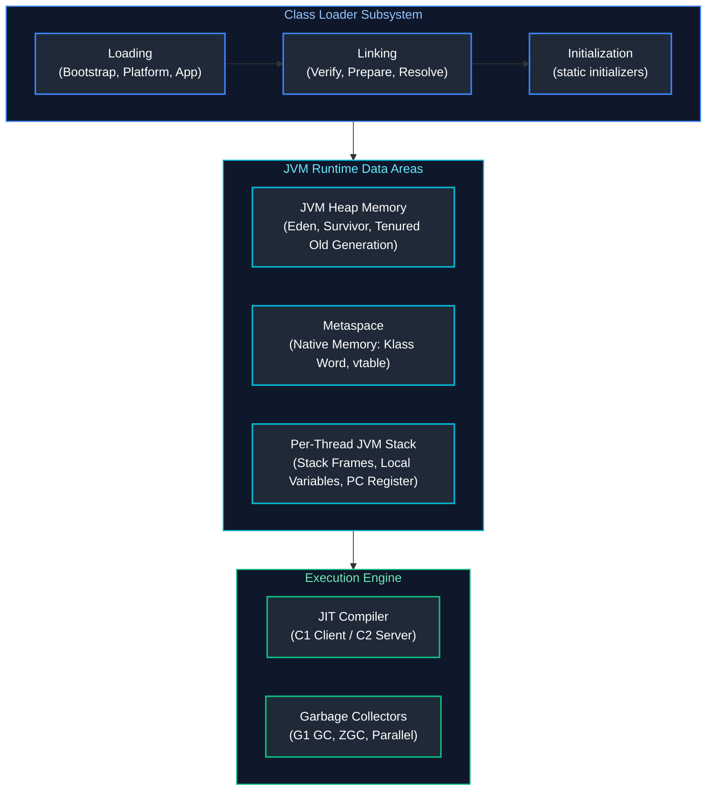
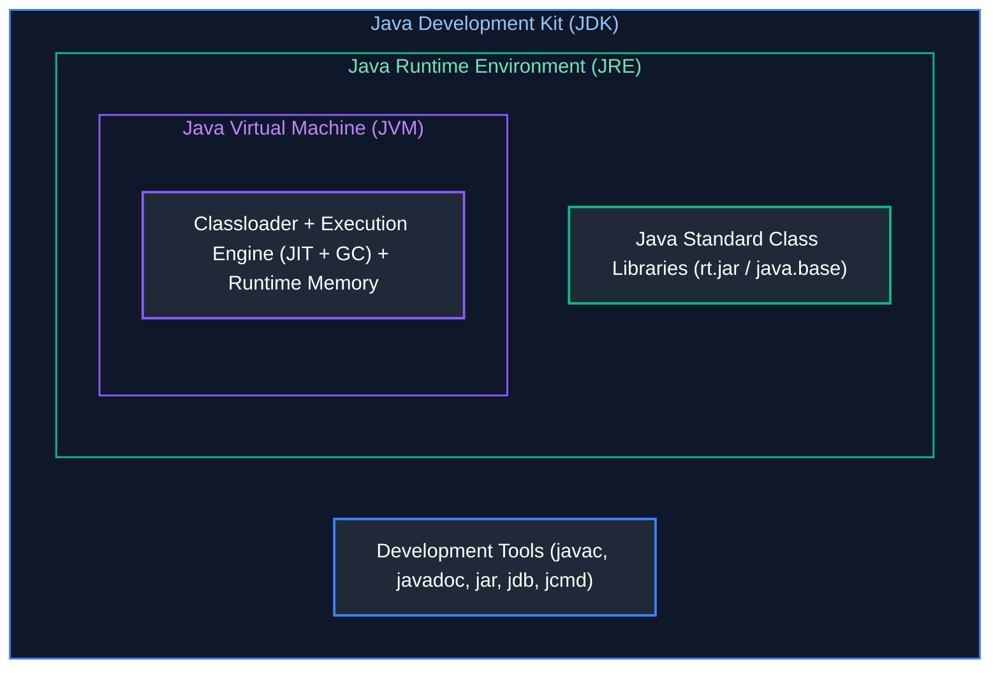
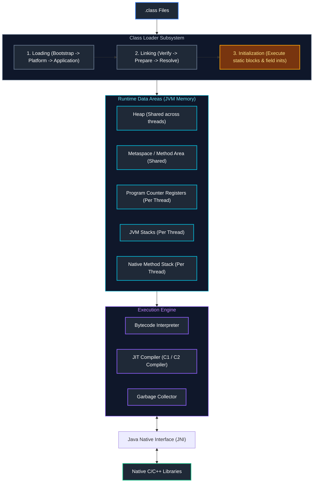
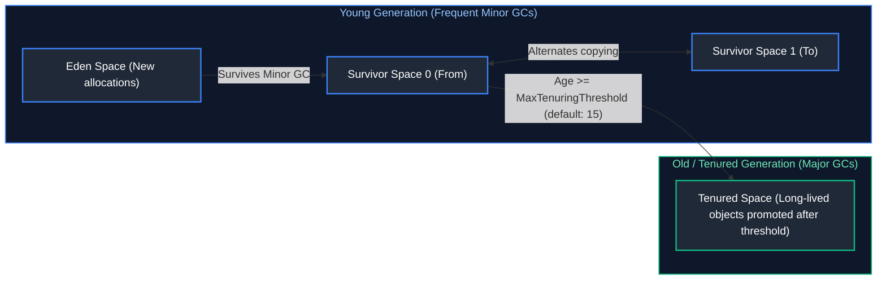
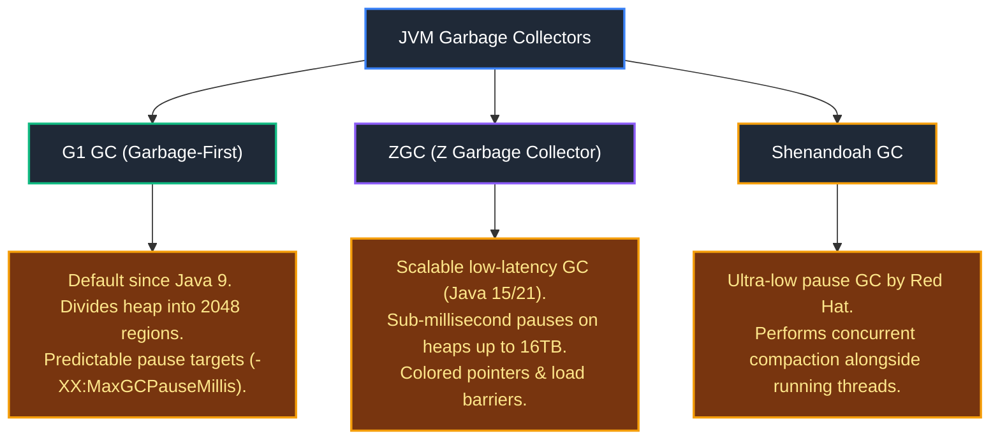
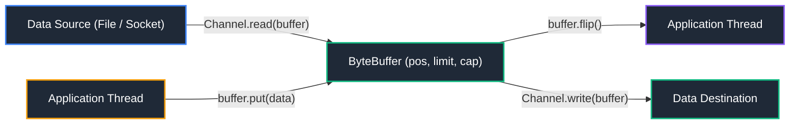
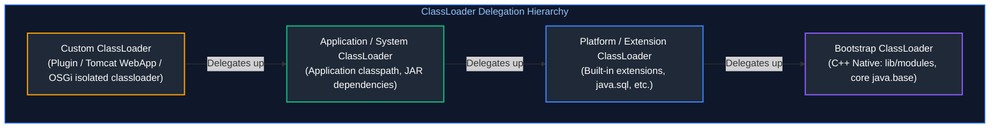

# 05. JVM, Memory, I/O, Reflection & Runtime

A comprehensive guide covering Java Virtual Machine (JVM) internals, memory regions, garbage collection collectors, diagnostic troubleshooting tools, Java I/O and NIO, object serialization, and the Reflection API.

---

## Architectural Overview: JVM Subsystem & Runtime Memory Architecture



---

## Table of Contents
1. [JVM Architecture & Memory Areas](#1-jvm-architecture-memory-areas)
   - [JDK vs JRE vs JVM](#jdk-vs-jre-vs-jvm)
   - [JVM Architecture Diagram & Class Loading Subsystem](#jvm-architecture-diagram-class-loading)
   - [Runtime Data Areas (Heap, Stack, Metaspace, PC, Native Stack)](#runtime-data-areas)
   - [Stack vs Heap Comparison](#stack-vs-heap)
2. [Garbage Collection (GC)](#2-garbage-collection-gc)
   - [Generational Garbage Collection Model](#generational-gc-model)
   - [Minor GC vs Major / Full GC & Stop-The-World (STW)](#minor-vs-major-gc)
   - [Modern Garbage Collectors: G1, ZGC, Shenandoah](#modern-garbage-collectors)
3. [JVM Troubleshooting & Diagnostics](#3-jvm-troubleshooting-diagnostics)
   - [`OutOfMemoryError` vs `StackOverflowError`](#oom-vs-stackoverflow)
   - [Memory Leaks in Java](#memory-leaks)
   - [JVM Flag Tuning (`-Xms`, `-Xmx`, `-XX:+HeapDumpOnOutOfMemoryError`)](#jvm-tuning)
   - [Diagnostics: Thread Dumps, Heap Dumps, JFR, JVisualVM](#diagnostics-tools)
4. [Java I/O & NIO](#4-java-io-nio)
   - [Classic I/O: Byte Streams vs Character Streams](#classic-io)
   - [Java NIO: Buffers, Channels, and Selectors](#java-nio)
   - [Modern `Path` and `Files` APIs](#modern-path-and-files)
   - [Large-File Streaming & Memory-Mapped Files](#large-file-streaming)
5. [Object Serialization](#5-object-serialization)
   - [Serialization & Deserialization Mechanics](#serialization-mechanics)
   - [`Serializable`, `transient`, and `serialVersionUID`](#serializable-transient-and-uid)
6. [Annotations & Reflection API](#6-annotations-reflection-api)
   - [Built-in & Meta-Annotations (`@Retention`, `@Target`, etc.)](#annotations)
   - [Reflection API Operations & Introspection](#6-annotations-reflection-api)
   - [Annotation Processing & Compile-Time Code Generation](#annotation-processing)
7. [ClassLoaders & Dynamic Bytecode Mechanics](#7-classloaders-dynamic-bytecode-mechanics)
8. [Foreign Function & Memory API (Project Panama / Java 21)](#8-foreign-function-memory-api-project-panama-java-21)
9. [Summary Comparison & Engineering Reference Matrix](#9-summary-comparison-engineering-reference-matrix)
10. [References & Further Reading](#10-references-further-reading)

---

# 1. JVM Architecture & Memory Areas

---

### JDK vs JRE vs JVM

#### Visual Architecture


| Component | Contains | Target Audience |
| :--- | :--- | :--- |
| **JVM** | Execution engine, JIT compiler, Garbage Collector | The software engine executing Java bytecode (`.class`) |
| **JRE** | JVM + core Java class libraries | End users running compiled Java applications |
| **JDK** | JRE + JVM + Developer tools (`javac`, `jdb`, `jcmd`) | Software engineers developing Java software |

**Primary Source Reference**: [GeeksforGeeks - Differences between JDK, JRE and JVM](https://www.geeksforgeeks.org/differences-between-jdk-jre-and-jvm/)

---

### JVM Architecture Diagram & Class Loading

#### Visual JVM Subsystem


#### Class Loader Hierarchy
1. **Bootstrap ClassLoader**: Loads core JDK classes (`java.lang.*`, `java.util.*` from `java.base`). Written in native C/C++.
2. **Platform / Extension ClassLoader**: Loads standard platform extension modules.
3. **Application / System ClassLoader**: Loads application classes found on the application classpath or module path.
- **Delegation Principle**: A class loader delegates search requests to its parent before attempting to find and load the class itself.

**Primary Source Reference**: [GeeksforGeeks - ClassLoader in Java](https://www.geeksforgeeks.org/classloader-in-java/)

---

### Runtime Data Areas

1. **Heap Memory**: Shared by all threads; stores all instantiated objects, arrays, and instance variables. Managed by the Garbage Collector.
2. **Metaspace (Java 8+)**: Replaced PermGen. Stored in **off-heap native memory**; stores class metadata, static variables, and method bytecode. Grows dynamically up to physical memory limits unless constrained by `-XX:MaxMetaspaceSize`.
3. **JVM Stack**: Private to each thread; allocated upon thread creation. Holds Stack Frames containing:
   - Local Variable Table (primitives and object reference pointers).
   - Operand Stack.
   - Frame Data (method return values, exception dispatch).
4. **Program Counter (PC) Register**: Stores the memory address of the JVM bytecode instruction currently being executed by the thread.
5. **Native Method Stack**: Dedicated stack executing native code invoked via JNI (C/C++ libraries).

---

### Stack vs Heap

| Dimension | Stack Memory | Heap Memory |
| :--- | :--- | :--- |
| **Scope** | Private to individual thread | Globally shared across all threads |
| **Storage Content** | Local variables, method call frames, primitive data | Actual objects, class instances, and arrays |
| **Allocation Mechanism** | LIFO (push/pop upon method entry and return) | Dynamic allocation via `new` keyword |
| **Lifecycle** | Exists only for the duration of the method | Exists until collected by the Garbage Collector |
| **Speed** | Ultra-fast access (direct CPU pointer offset) | Slower access (pointer dereference, cache misses) |
| **Failure Mode** | `StackOverflowError` | `OutOfMemoryError: Java heap space` |

> [!NOTE]
> **Platform Threads vs Virtual Threads Memory Footprint**: Traditional OS platform threads allocate a dedicated OS-level stack (defaulting to 1 MB via `-Xss1m`), which exhausts physical memory when spawning tens of thousands of concurrent threads (`OutOfMemoryError: unable to create new native thread`). In contrast, Java 21 **Virtual Threads (Project Loom)** mount dynamically onto carrier threads and allocate lightweight continuation frames directly on the Java Heap, allowing millions of concurrent threads with tiny memory footprints. For details, see [04. Java Concurrency & Multithreading - Section 8: Virtual Threads](04_java_concurrency_multithreading.md#8-modern-java-concurrency).

**Primary Source Reference**: [GeeksforGeeks - Stack vs Heap Memory in Java](https://www.geeksforgeeks.org/stack-vs-heap-memory-allocation/)

---

# 2. Garbage Collection (GC)

---

### Generational GC Model

#### The Weak Generational Hypothesis
Most objects have very short lifespans (allocated, used within a method, and immediately eligible for collection). The Heap is therefore segregated into generations to optimize collection efficiency.

#### Visual Heap Partitioning


**Primary Source Reference**: [GeeksforGeeks - Garbage Collection in Java](https://www.geeksforgeeks.org/garbage-collection-java/)

---

### Minor vs Major GC

- **Minor GC**: Collects only the Young Generation. Fast and frequent; cleans dead transient objects from Eden and Survivor spaces.
- **Major / Full GC**: Cleans the entire Heap (Young + Old Generation + Metaspace). Much slower; triggered when the Old Generation fills up or when explicitly requested.
- **Stop-The-World (STW)**: A pause phase during which all application worker threads are halted to allow the GC to safely trace object graph references without concurrent mutation.

---

### Modern Garbage Collectors



**Primary Source Reference**: [GeeksforGeeks - Types of Garbage Collector in Java](https://www.geeksforgeeks.org/types-of-garbage-collector-in-java/)

---

# 3. JVM Troubleshooting & Diagnostics

---

### OOM vs StackOverflow

| Error | Root Cause | Typical Scenario | Resolution |
| :--- | :--- | :--- | :--- |
| **`StackOverflowError`** | Stack memory exhausted | Infinite recursion; deep method call stacks | Fix termination base condition in recursive methods; increase `-Xss` |
| **`OutOfMemoryError: Java heap space`** | Heap cannot allocate object; GC cannot reclaim memory | Retaining unneeded object references in static maps; huge cache | Fix memory leak; increase `-Xmx` |
| **`OutOfMemoryError: Metaspace`** | Native memory holding class metadata exhausted | Generating dynamic classes without unloading (e.g. CGLIB proxies) | Increase `-XX:MaxMetaspaceSize`; fix classloader leak |

#### Working Code Example: Triggering and Diagnosing Errors
```java
public class MemoryTroubleshootingDemo {
    // 1. Causes StackOverflowError
    public static void recursiveCall(long depth) {
        recursiveCall(depth + 1); // No termination base case
    }

    public static void main(String[] args) {
        try {
            recursiveCall(1);
        } catch (StackOverflowError e) {
            System.err.println("Caught StackOverflowError: Stack frames exhausted.");
        }
    }
}
```

**Primary Source Reference**: [GeeksforGeeks - Understanding OutOfMemoryError in Java](https://www.geeksforgeeks.org/understanding-outofmemoryerror-exception-in-java/)

---

### Memory Leaks

In Java, a memory leak occurs when an application maintains references to objects that are no longer needed by business logic, preventing the Garbage Collector from reclaiming them.

#### Common Sources of Leaks
1. **Static Collections**: Appending elements to static `List` or `Map` variables without eviction.
2. **Unclosed Resources**: Leaving database connections, sockets, or file streams unclosed.
3. **Non-static Inner Classes**: Holding hidden references to an enclosing outer class.
4. **Listener Registrations**: Registering event listeners without unregistering them.

---

### JVM Tuning

Standard production startup flags:
```bash
java -Xms4g -Xmx4g \
     -XX:+UseG1GC \
     -XX:MaxGCPauseMillis=200 \
     -XX:+HeapDumpOnOutOfMemoryError \
     -XX:HeapDumpPath=/var/log/jvm/heapdump.hprof \
     -Xlog:gc*:file=/var/log/jvm/gc.log:time,uptime:filecount=5,filesize=100M \
     -jar app.jar
```
- `-Xms4g -Xmx4g`: Sets minimum and maximum heap to 4GB. Equal values prevent heap resizing pauses during traffic spikes.
- `-XX:+HeapDumpOnOutOfMemoryError`: Automatically generates an `.hprof` snapshot when OOM occurs, enabling post-mortem root-cause analysis.

---

### Diagnostics Tools

| Tool | Type | Purpose | Command |
| :--- | :--- | :--- | :--- |
| **`jps`** | CLI | Lists running JVM process IDs on current machine | `jps -v` |
| **`jstack`** | CLI | Generates instant Thread Dump (detects deadlocks) | `jstack <pid> > threads.tdump` |
| **`jmap`** | CLI | Triggers live Heap Dump | `jmap -dump:format=b,file=heap.hprof <pid>` |
| **`jcmd`** | CLI | Universal diagnostic command tool | `jcmd <pid> GC.heap_info` |
| **JFR** | Diagnostic Engine | Java Flight Recorder: low-overhead production event recording | `jcmd <pid> JFR.start duration=60s` |
| **JVisualVM / JConsole** | GUI | Live visual inspection of heap memory, threads, and MBeans | `jvisualvm` |

**Primary Source Reference**: [GeeksforGeeks - JVM Monitoring and Profiling Tools](https://www.geeksforgeeks.org/jvm-monitoring-and-profiling-tools-in-java/)

---

# 4. Java I/O & NIO

---

### Classic I/O

- **Byte Streams** (`InputStream` / `OutputStream`): Read and write binary data 8 bits (1 byte) at a time (e.g., `FileInputStream`, `FileOutputStream`).
- **Character Streams** (`Reader` / `Writer`): Read and write 16-bit characters taking character encodings (UTF-8, ISO-8859-1) into account (e.g., `FileReader`, `BufferedReader`).
- **Buffering**: `BufferedInputStream` and `BufferedReader` wrap underlying streams and reduce disk I/O system calls by reading chunks of data into an internal 8KB memory buffer.

#### Working Code Example: Character Stream with Buffering
```java
import java.io.BufferedReader;
import java.io.BufferedWriter;
import java.io.FileReader;
import java.io.FileWriter;
import java.io.IOException;

public class ClassicIoDemo {
    public static void main(String[] args) {
        String testFile = "classic_io_test.txt";
        // Writing text using BufferedWriter
        try (BufferedWriter writer = new BufferedWriter(new FileWriter(testFile))) {
            writer.write("Core Java I/O with buffering");
            writer.newLine();
        } catch (IOException e) {
            System.err.println("Write failed: " + e.getMessage());
        }

        // Reading text using BufferedReader
        try (BufferedReader reader = new BufferedReader(new FileReader(testFile))) {
            String line;
            while ((line = reader.readLine()) != null) {
                System.out.println("Read line: " + line);
            }
        } catch (IOException e) {
            System.err.println("Read failed: " + e.getMessage());
        }
    }
}
```

**Primary Source Reference**: [GeeksforGeeks - Java IO Tutorial](https://www.geeksforgeeks.org/java-io-tutorial/)

---

### Java NIO

#### Core Components
1. **Channels**: Bidirectional open connections to hardware devices, files, or network sockets capable of non-blocking I/O.
2. **Buffers**: Fixed-size memory containers (`ByteBuffer`, `CharBuffer`) that hold data during transfers. Driven by three pointers: `position`, `limit`, and `capacity`.
3. **Selectors**: Multiplexers that allow a single thread to monitor multiple channels for incoming events (`OP_READ`, `OP_WRITE`, `OP_ACCEPT`).

#### Visual Channel and Buffer Flow


#### Working Code Example: ByteBuffer Mechanics
```java
import java.nio.ByteBuffer;

public class NioBufferDemo {
    public static void main(String[] args) {
        // Allocate a buffer of 16 bytes
        ByteBuffer buffer = ByteBuffer.allocate(16);

        // Put data into buffer (Writing mode)
        buffer.put((byte) 'H');
        buffer.put((byte) 'E');
        buffer.put((byte) 'L');
        buffer.put((byte) 'L');
        buffer.put((byte) 'O');

        // Flip buffer: switches from writing mode to reading mode
        // Sets limit to current position (5) and resets position to 0
        buffer.flip();

        System.out.print("Read from buffer: ");
        while (buffer.hasRemaining()) {
            System.out.print((char) buffer.get()); // HELLO
        }
        System.out.println();
    }
}
```

---

### Modern `Path` and `Files`

Introduced in Java 7 (`java.nio.file`), `Path` and `Files` replace the legacy `java.io.File` API with fluent, comprehensive, and exception-safe utilities.

#### Working Code Example
```java
import java.io.IOException;
import java.nio.file.Files;
import java.nio.file.Path;
import java.nio.file.Paths;
import java.nio.file.StandardOpenOption;
import java.util.List;

public class ModernNioDemo {
    public static void main(String[] args) throws IOException {
        Path filePath = Paths.get("target_output.txt");

        // Write lines cleanly
        List<String> lines = List.of("Timestamp: " + System.currentTimeMillis(), "Status: ACTIVE");
        Files.write(filePath, lines, StandardOpenOption.CREATE, StandardOpenOption.TRUNCATE_EXISTING);

        // Read all lines using NIO stream
        try (var stream = Files.lines(filePath)) {
            stream.filter(l -> l.contains("ACTIVE"))
                  .forEach(System.out::println);
        }

        Files.deleteIfExists(filePath); // Cleanup
    }
}
```

**Primary Source Reference**: [GeeksforGeeks - Java NIO Path and Files](https://www.geeksforgeeks.org/java-nio-path-interface/)

---

### Large-File Streaming

```java
import java.io.IOException;
import java.io.RandomAccessFile;
import java.nio.MappedByteBuffer;
import java.nio.channels.FileChannel;

public class MemoryMappedFileDemo {
    public static void readLargeFile(String path) throws IOException {
        // Direct kernel memory mapping: zero-copy data transfer
        try (RandomAccessFile file = new RandomAccessFile(path, "r");
             FileChannel channel = file.getChannel()) {
            MappedByteBuffer buffer = channel.map(FileChannel.MapMode.READ_ONLY, 0, channel.size());
            while (buffer.hasRemaining()) {
                byte b = buffer.get(); // Reads directly from OS page cache
            }
        }
    }
}
```

---

# 5. Object Serialization

---

### Serialization Mechanics

Serialization converts the state of an object into a byte stream for storage to disk or transmission across a network. Deserialization reconstructs the live Java object in memory from the byte stream.

---

### `Serializable`, `transient`, and `UID`

- **`implements Serializable`**: Marker interface (no methods) signaling that a class is eligible for standard serialization.
- **`transient`**: Keyword applied to fields that must **not** be serialized (e.g., plaintext passwords, database handles, transient cache values).
- **`serialVersionUID`**: A unique 64-bit version identifier. During deserialization, the JVM compares the sender's UID with the recipient's local class UID. If they mismatch, an `InvalidClassException` is thrown.

#### Working Code Example
```java
import java.io.*;

public class UserSession implements Serializable {
    @Serial
    private static final long serialVersionUID = 1L; // Explicit version UID

    private String username;
    private transient String sessionToken; // Will NOT be written to stream

    public UserSession(String username, String sessionToken) {
        this.username = username;
        this.sessionToken = sessionToken;
    }

    public static void main(String[] args) throws IOException, ClassNotFoundException {
        ByteArrayOutputStream baos = new ByteArrayOutputStream();
        try (ObjectOutputStream oos = new ObjectOutputStream(baos)) {
            oos.writeObject(new UserSession("admin_user", "SEC_999888"));
        }

        try (ObjectInputStream ois = new ObjectInputStream(new ByteArrayInputStream(baos.toByteArray()))) {
            UserSession restored = (UserSession) ois.readObject();
            System.out.println("Restored user: " + restored.username);
            System.out.println("Restored transient token (should be null): " + restored.sessionToken);
        }
    }
}
```

**Primary Source Reference**: [GeeksforGeeks - Serialization in Java](https://www.geeksforgeeks.org/serialization-in-java/)

---

# 6. Annotations & Reflection API

---

### Annotations

Annotations are metadata tags added to code that do not directly affect program semantics but provide data to compilers, build tools, and runtime frameworks (like Spring and Hibernate).

#### Meta-Annotations
- **`@Retention`**: Specifies how long the annotation is retained:
  - `SOURCE`: Discarded during compilation (e.g., `@Override`).
  - `CLASS`: Recorded in `.class` file; discarded by JVM at runtime.
  - `RUNTIME`: Retained in VM at runtime; readable via Reflection (e.g., `@Autowired`).
- **`@Target`**: Restricts where the annotation can be placed (`ElementType.TYPE`, `METHOD`, `FIELD`, `PARAMETER`).
- **`@Inherited`**: Automatically inherited by subclasses.

#### Visual Annotation Retention Lifecycle

```mermaid
flowchart LR
    SourceCode["Source Code (.java) [@Retention(SOURCE)]"] -->|javac compilation| BytecodeFile["Bytecode File (.class) [@Retention(CLASS)]"]
    BytecodeFile -->|ClassLoader into JVM| RuntimeMemory["JVM Metaspace [@Retention(RUNTIME)]"]
    RuntimeMemory -->|Accessible via| ReflectionApp["Reflection API (clazz.getAnnotation())"]

    style SourceCode fill:#1f2937,stroke:#3b82f6,stroke-width:2px,color:#fff
    style BytecodeFile fill:#1f2937,stroke:#10b981,stroke-width:2px,color:#fff
    style RuntimeMemory fill:#1f2937,stroke:#8b5cf6,stroke-width:2px,color:#fff
    style ReflectionApp fill:#1f2937,stroke:#10b981,stroke-width:2px,color:#fff
```


#### Working Code Example: Custom Annotation Processing via Reflection
```java
import java.lang.annotation.*;
import java.lang.reflect.Method;

@Retention(RetentionPolicy.RUNTIME)
@Target(ElementType.METHOD)
@interface Auditable {
    String action();
}

class FinancialAccountService {
    @Auditable(action = "TRANSFER_FUNDS")
    public void transferMoney(double amount) {
        System.out.println("Transferred $" + amount);
    }

    public void viewBalance() {
        System.out.println("Balance viewed.");
    }
}

public class AnnotationProcessorDemo {
    public static void main(String[] args) throws Exception {
        FinancialAccountService service = new FinancialAccountService();
        Method[] methods = FinancialAccountService.class.getDeclaredMethods();

        for (Method method : methods) {
            // Check if annotation is present on method at runtime
            if (method.isAnnotationPresent(Auditable.class)) {
                Auditable annotation = method.getAnnotation(Auditable.class);
                System.out.println("[AUDIT LOG] Detected auditable action: " + annotation.action());
                // Dynamically invoke method via Reflection
                method.invoke(service, 500.0);
            }
        }
    }
}
```

**Primary Source Reference**: [GeeksforGeeks - Custom Annotations in Java](https://www.geeksforgeeks.org/custom-annotations-in-java/)

---

### Annotation Processing

Annotation Processors run as plug-ins inside the `javac` compiler pipeline to inspect annotations at compile time and generate auxiliary source code (`.java` files) before bytecode compilation finishes. Widely used by **Lombok**, **MapStruct**, and **Google AutoValue**.


---

# 7. ClassLoaders & Dynamic Bytecode Mechanics

The Java ClassLoading mechanism dynamically links and loads compiled `.class` binaries into Metaspace at runtime.

### 7.1 The ClassLoader Hierarchy & Delegation Model
Java enforces the **Parent Delegation Model**: when a ClassLoader receives a request to load a class, it delegates the search to its parent before searching its own classpath:



* **Delegation Invariant**: Protects core Java runtime classes (e.g. `java.lang.Object`, `java.lang.String`) from malicious replacement by untrusted third-party code.
* **Child-First Delegation (Delegation Inversion)**: Web containers (Tomcat, Jetty) intentionally invert this hierarchy for web applications, loading `/WEB-INF/classes` first to allow per-application dependency version overrides.

### 7.2 MethodHandles vs. Reflection
`java.lang.invoke.MethodHandles` (introduced in Java 7 and expanded in Java 9+) provides a direct, typed executable reference to an underlying method, constructor, or field:
- **Performance**: Access checks occur once during lookup rather than on every invocation. HotSpot can optimize and inline MethodHandle calls just like regular bytecode.
- **`VarHandle`**: Replaces `sun.misc.Unsafe` for atomic and memory-fenced access to variables without native risk.

---

# 8. Foreign Function & Memory API (Project Panama / Java 21)

Historically, calling native C/C++ libraries or managing off-heap memory required **Java Native Interface (JNI)** or `sun.misc.Unsafe`. JNI is notoriously brittle, slow (imposing call transition overhead), and prone to fatal JVM segfaults.

**Project Panama (Foreign Function & Memory API / JEP 454)** introduces safe, zero-cost native memory and function invocation:

```java
import java.lang.foreign.*;
import java.lang.invoke.MethodHandle;

public class PanamaDemo {
    public static void main(String[] args) throws Throwable {
        // 1. Confined Memory Arena guarantees deterministic, zero-GC off-heap allocation
        try (Arena arena = Arena.ofConfined()) {
            // Allocate 1024 native off-heap bytes
            MemorySegment nativeBuffer = arena.allocate(1024);
            nativeBuffer.setUtf8String(0, "High-performance off-heap telemetry payload");

            System.out.println("Read from native memory: " + nativeBuffer.getUtf8String(0));
            // Memory is deterministically deallocated upon exiting try-with-resources block!
        }

        // 2. Foreign Function Call: Invoking C standard library 'strlen'
        Linker linker = Linker.nativeLinker();
        SymbolLookup stdlib = linker.defaultLookup();
        MemorySegment strlenAddress = stdlib.find("strlen").orElseThrow();

        // Signature: size_t strlen(const char *s)
        FunctionDescriptor descriptor = FunctionDescriptor.of(ValueLayout.JAVA_LONG, ValueLayout.ADDRESS);
        MethodHandle strlen = linker.downcallHandle(strlenAddress, descriptor);

        try (Arena arena = Arena.ofConfined()) {
            MemorySegment cString = arena.allocateFrom("Hello Panama!");
            long length = (long) strlen.invoke(cString);
            System.out.println("C strlen result: " + length); // 13
        }
    }
}
```

---

# 9. Summary Comparison & Engineering Reference Matrix

| Garbage Collector | Generation Model | Target Heap Size | Typical Pause Latency | Throughput | Production Best Use Case |
| :--- | :--- | :--- | :--- | :--- | :--- |
| **Serial GC** | Two-generation single-thread | $< 512\text{ MB}$ | High (STW minutes) | High on 1 core | Embedded, CLI tools, micro-containers. |
| **Parallel GC** | Multi-threaded generational | $1\text{ GB} - 8\text{ GB}$ | High (STW seconds) | Maximum (100% CPU on batch) | Offline computational batch ETL, non-interactive reporting. |
| **G1 GC** | Region-based generational | $4\text{ GB} - 32\text{ GB}$ | Tunable ($50 - 200\text{ ms}$) | High ($90\% - 95\%$) | Standard default enterprise microservices, Spring Boot web APIs. |
| **ZGC** | Colored pointers, load barriers | $16\text{ GB} - 16\text{ TB}$ | **$< 1\text{ ms}$ max** | Moderate ($85\% - 90\%$) | Ultra-low latency services, massive heap caches, trading engines. |
| **Shenandoah** | Concurrent compaction, Brooks pointers | $8\text{ GB} - 100\text{ GB}$ | $< 10\text{ ms}$ | Moderate ($85\%$) | Response-time sensitive enterprise APIs where ZGC isn't available. |

---

# 10. References & Further Reading

- [Oracle Java Documentation - HotSpot Virtual Machine GC Tuning Guide](https://docs.oracle.com/en/java/javase/21/gctuning/)
- [JEP 454: Foreign Function & Memory API](https://openjdk.org/jeps/454) — Official specification for Panama in Java 22 / LTS.
- [Baeldung - Understanding the JVM Architecture](https://www.baeldung.com/jvm-vs-jre-vs-jdk)
- [Baeldung - JVM Garbage Collectors (G1, ZGC, Shenandoah)](https://www.baeldung.com/jvm-garbage-collectors)
- [GeeksforGeeks - JVM Architecture & Memory Areas](https://www.geeksforgeeks.org/jvm-works-jvm-architecture/)
- [Scott Oaks: Java Performance: In-Depth Advice for Tuning and Acceleration](https://www.oreilly.com/library/view/java-performance-2nd/9781492056102/) — Gold standard on GC tuning, JIT profiling, and thread ergonomics.
