# 06. Design Patterns, SOLID Principles & Software Architecture

A comprehensive, production-grade guide to Object-Oriented Software Architecture, SOLID Principles, Gang of Four (GoF) Design Patterns (Creational, Structural, Behavioral), Enterprise Domain-Driven Patterns, and their production implementations in Java 21 and Spring Boot 3.

---

## Architectural Overview: Enterprise Design Patterns Architecture

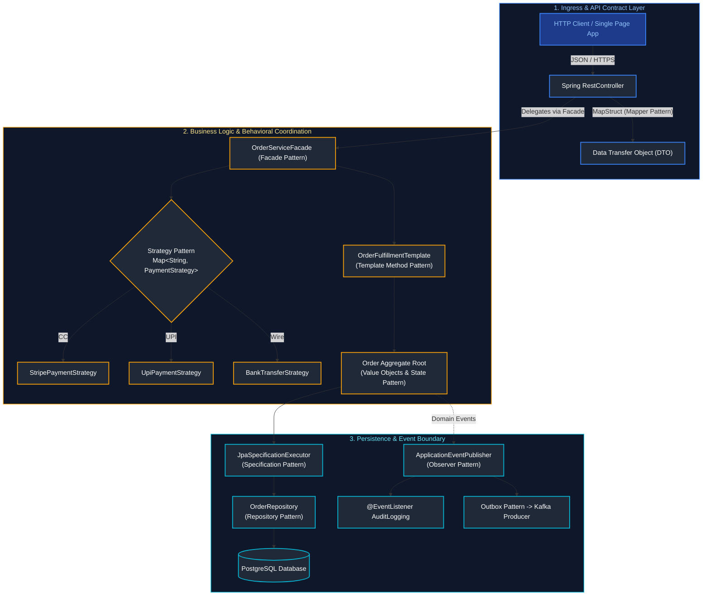

---

## Table of Contents
1. [SOLID Principles Deep-Dive](#1-solid-principles-deep-dive)
   - [1.1 Single Responsibility Principle (SRP)](#11-single-responsibility-principle-srp)
   - [1.2 Open/Closed Principle (OCP)](#12-openclosed-principle-ocp)
   - [1.3 Liskov Substitution Principle (LSP)](#13-liskov-substitution-principle-lsp)
   - [1.4 Interface Segregation Principle (ISP)](#14-interface-segregation-principle-isp)
   - [1.5 Dependency Inversion Principle (DIP)](#15-dependency-inversion-principle-dip)
2. [Core Software Engineering & Architectural Guidelines](#2-core-software-engineering-architectural-guidelines)
   - [2.1 DRY, KISS & YAGNI](#21-dry-kiss-yagni)
   - [2.2 Favor Composition Over Inheritance](#22-favor-composition-over-inheritance)
   - [2.3 Law of Demeter (Principle of Least Knowledge)](#23-law-of-demeter-principle-of-least-knowledge)
   - [2.4 Separation of Concerns (SoC) & Clean Layered Architecture](#24-separation-of-concerns-soc-clean-layered-architecture)
3. [GoF Creational Design Patterns](#3-gof-creational-design-patterns)
   - [3.1 Builder Pattern](#31-builder-pattern)
   - [3.2 Factory Method & Abstract Factory Pattern](#32-factory-method-abstract-factory-pattern)
   - [3.3 Singleton Pattern](#33-singleton-pattern)
   - [3.4 Prototype Pattern](#34-prototype-pattern)
4. [GoF Structural Design Patterns](#4-gof-structural-design-patterns)
   - [4.1 Adapter Pattern](#41-adapter-pattern)
   - [4.2 Decorator Pattern](#42-decorator-pattern)
   - [4.3 Proxy Pattern (JDK Dynamic vs CGLIB)](#43-proxy-pattern-jdk-dynamic-vs-cglib)
   - [4.4 Facade Pattern](#44-facade-pattern)
   - [4.5 Composite Pattern](#45-composite-pattern)
5. [GoF Behavioral Design Patterns](#5-gof-behavioral-design-patterns)
   - [5.1 Strategy Pattern](#51-strategy-pattern)
   - [5.2 Template Method Pattern](#52-template-method-pattern)
   - [5.3 Chain of Responsibility Pattern](#53-chain-of-responsibility-pattern)
   - [5.4 Observer Pattern](#54-observer-pattern)
   - [5.5 State Pattern](#55-state-pattern)
   - [5.6 Command Pattern](#56-command-pattern)
6. [Enterprise Backend & Domain-Driven Patterns](#6-enterprise-backend-domain-driven-patterns)
   - [6.1 Data Transfer Object (DTO) & MapStruct Mapper Pattern](#61-data-transfer-object-dto-mapstruct-mapper-pattern)
   - [6.2 Value Object Pattern](#62-value-object-pattern)
   - [6.3 Repository & Specification Pattern](#63-repository-specification-pattern)
7. [Clean Architecture & Hexagonal Architecture (Ports & Adapters)](#7-clean-architecture-hexagonal-architecture-ports-adapters)
8. [Architectural Fitness Functions & ArchUnit Testing](#8-architectural-fitness-functions-archunit-testing)
9. [Summary Comparison & Engineering Reference Matrix](#9-summary-comparison-engineering-reference-matrix)
10. [References & Further Reading](#10-references-further-reading)

---

# 1. SOLID Principles Deep-Dive

---

### 1.1 Single Responsibility Principle (SRP)
> **Definition**: A class should have one, and only one, reason to change. It must encapsulate a single, well-defined business responsibility.

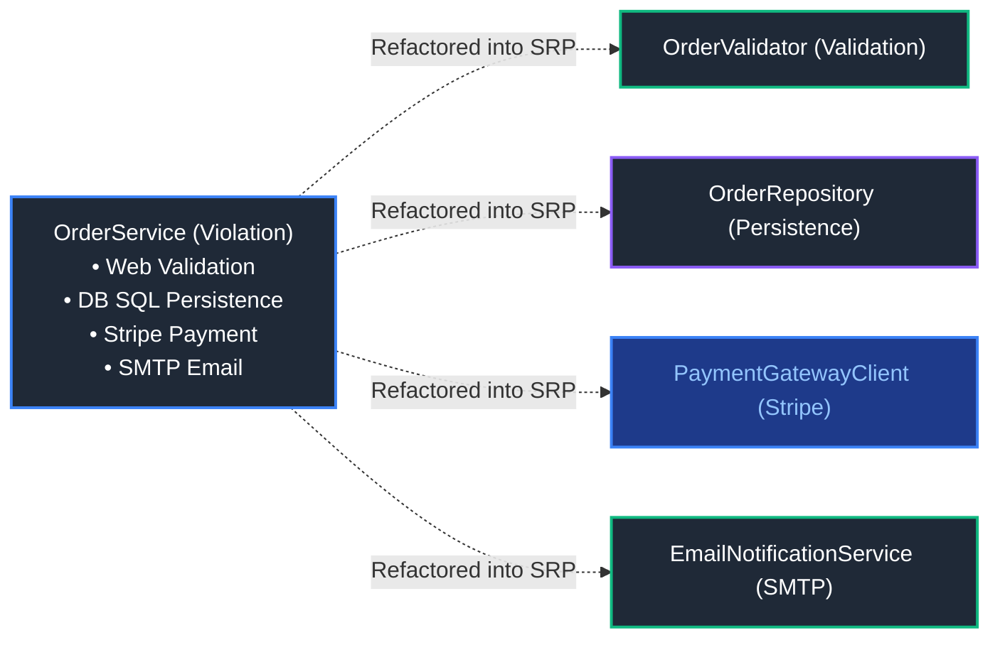

#### Anti-Pattern: The "God Class"
In monolithic Spring controllers or services, developers frequently bundle HTTP serialization, business validation, SQL database persistence, and email notification into a single class:

```java
// ❌ VIOLATION: Has 4 distinct reasons to change (Web, Validation, DB, Notification)
@Service
public class OrderService {
    public void processOrder(OrderRequest request) {
        // 1. Validation logic
        if (request.amount() <= 0) throw new IllegalArgumentException("Invalid amount");
        
        // 2. Database persistence logic
        String sql = "INSERT INTO orders (id, amount) VALUES (?, ?)";
        jdbcTemplate.update(sql, request.id(), request.amount());
        
        // 3. Payment gateway API integration
        httpClient.post("https://payment.stripe.com/v1/charge", request);
        
        // 4. Email notification logic
        JavaMailSender.send("Receipt for " + request.id());
    }
}
```

#### Refactored Production Solution: Cohesive Collaborators
Decompose the operations into focused, single-purpose components injected via constructor:

```java
// ✅ PRODUCTION SOLUTION: Clear separation of concerns
@Service
@RequiredArgsConstructor
public class OrderProcessor {
    private final OrderValidator validator;
    private final OrderRepository orderRepository;
    private final PaymentGatewayClient paymentGatewayClient;
    private final NotificationService notificationService;

    @Transactional
    public OrderResponse processOrder(OrderRequest request) {
        validator.validate(request);
        OrderEntity entity = orderRepository.save(OrderEntity.fromRequest(request));
        PaymentReceipt receipt = paymentGatewayClient.charge(request.paymentToken(), entity.getTotalAmount());
        notificationService.sendReceipt(request.customerEmail(), receipt);
        return OrderResponse.fromEntity(entity);
    }
}
```

---

### 1.2 Open/Closed Principle (OCP)
> **Definition**: Software artifacts should be **open for extension**, but **closed for modification**. You should be able to introduce new functionality without altering existing, tested code.

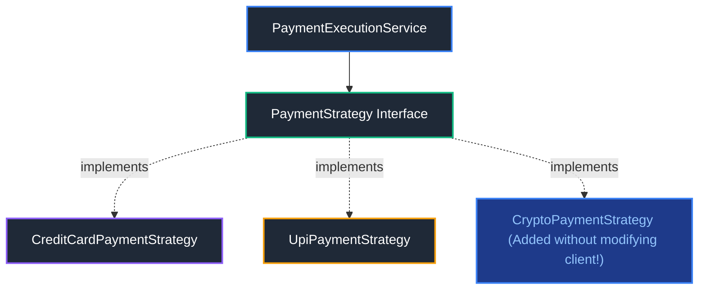

#### Anti-Pattern: Fragile `switch` Statements
```java
// ❌ VIOLATION: Every new payment type requires modifying this core method
public class PaymentService {
    public void executePayment(String paymentType, BigDecimal amount) {
        if ("CREDIT_CARD".equalsIgnoreCase(paymentType)) {
            processCreditCard(amount);
        } else if ("PAYPAL".equalsIgnoreCase(paymentType)) {
            processPayPal(amount);
        } else if ("CRYPTO".equalsIgnoreCase(paymentType)) {
            processCrypto(amount);
        } else {
            throw new UnsupportedOperationException("Unknown payment type: " + paymentType);
        }
    }
}
```

#### Refactored Production Solution: Polymorphic Strategy Pattern
```java
// 1. Define the behavioral contract
public interface PaymentStrategy {
    String getChannel();
    PaymentReceipt pay(BigDecimal amount);
}

// 2. Implementations can be added indefinitely without altering existing classes
@Component
public class CreditCardPaymentStrategy implements PaymentStrategy {
    @Override public String getChannel() { return "CREDIT_CARD"; }
    @Override public PaymentReceipt pay(BigDecimal amount) { return new PaymentReceipt("CC-SUCCESS"); }
}

@Component
public class UpiPaymentStrategy implements PaymentStrategy {
    @Override public String getChannel() { return "UPI"; }
    @Override public PaymentReceipt pay(BigDecimal amount) { return new PaymentReceipt("UPI-SUCCESS"); }
}

// 3. Open for extension, closed for modification via Spring bean map injection
@Service
public class PaymentExecutionService {
    private final Map<String, PaymentStrategy> paymentStrategies;

    public PaymentExecutionService(List<PaymentStrategy> strategies) {
        this.paymentStrategies = strategies.stream()
            .collect(Collectors.toMap(PaymentStrategy::getChannel, Function.identity()));
    }

    public PaymentReceipt execute(String channel, BigDecimal amount) {
        PaymentStrategy strategy = paymentStrategies.get(channel);
        if (strategy == null) {
            throw new IllegalArgumentException("Unsupported payment channel: " + channel);
        }
        return strategy.pay(amount);
    }
}
```

---

### 1.3 Liskov Substitution Principle (LSP)
> **Definition**: Subtypes must be substitutable for their base types without altering the correctness or invariant behavior of the program. If class $S$ is a subtype of class $T$, then objects of type $T$ may be replaced with objects of type $S$ without altering desirable program properties.

#### Enterprise Backend Violation: Throwing `UnsupportedOperationException`
```java
// ❌ VIOLATION: ReadOnlyRepository cannot fulfill the contract of CrudRepository
public interface CrudRepository<T> {
    T findById(Long id);
    void save(T entity);
    void delete(Long id);
}

public class ReadOnlyAuditLogRepository implements CrudRepository<AuditLog> {
    @Override public AuditLog findById(Long id) { return fetchFromDb(id); }
    @Override public void save(AuditLog entity) { 
        throw new UnsupportedOperationException("Audit logs are append-only!"); 
    }
    @Override public void delete(Long id) { 
        throw new UnsupportedOperationException("Cannot delete audit logs!"); 
    }
}
```

#### Production Solution: Segregated Interface Contracts
```java
public interface ReadOnlyRepository<T> {
    Optional<T> findById(Long id);
    List<T> findAll();
}

public interface WriteRepository<T> {
    T save(T entity);
    void deleteById(Long id);
}

// AuditLogRepository only implements what it safely supports without breaking caller invariants
@Repository
public class AuditLogRepository implements ReadOnlyRepository<AuditLog> {
    @Override public Optional<AuditLog> findById(Long id) { return Optional.empty(); }
    @Override public List<AuditLog> findAll() { return List.of(); }
}
```

---

### 1.4 Interface Segregation Principle (ISP)
> **Definition**: Clients should not be forced to depend upon interfaces that they do not use. Prefer small, highly cohesive interfaces over large "fat" interfaces.

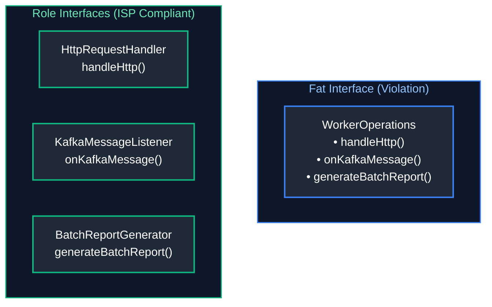

#### Production Solution: Cohesive Role Interfaces
```java
public interface HttpRequestHandler {
    void handleRequest(HttpServletRequest req);
}

public interface KafkaMessageListener {
    void onMessage(ConsumerRecord<String, byte[]> record);
}

public interface BatchReportGenerator {
    void generateReport();
}
```

---

### 1.5 Dependency Inversion Principle (DIP)
> **Definition**: High-level modules should not depend on low-level modules. Both should depend on abstractions. Abstractions should not depend on details; details should depend on abstractions.

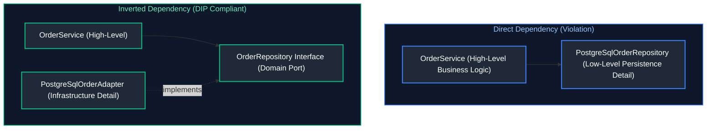

#### Production Implementation in Spring Boot:
```java
// High-level domain service depends purely on abstraction (Domain Port)
@Service
@RequiredArgsConstructor
public class AccountService {
    private final AccountPersistencePort persistencePort; // Abstraction

    public void transfer(AccountId from, AccountId to, Money amount) {
        Account sender = persistencePort.load(from);
        Account receiver = persistencePort.load(to);
        sender.debit(amount);
        receiver.credit(amount);
        persistencePort.save(sender);
        persistencePort.save(receiver);
    }
}

// Low-level adapter fulfills the port
@Component
@RequiredArgsConstructor
public class JpaAccountAdapter implements AccountPersistencePort {
    private final SpringDataJpaAccountRepository springDataRepo;
    
    @Override public Account load(AccountId id) { return springDataRepo.findById(id.value()).map(AccountMapper::toDomain).orElseThrow(); }
    @Override public void save(Account account) { springDataRepo.save(AccountMapper.toEntity(account)); }
}
```

---

# 2. Core Software Engineering & Architectural Guidelines

---

### 2.1 DRY, KISS & YAGNI

| Principle | Full Name | Core Engineering Directive | Production Anti-Pattern |
| :--- | :--- | :--- | :--- |
| **DRY** | Don't Repeat Yourself | Every piece of domain knowledge or business logic must have a single, unambiguous representation within the system. | Copy-pasting tax calculation or currency rounding logic across 5 controllers. |
| **KISS** | Keep It Simple, Stupid | Solutions should be as straightforward as possible. Avoid unnecessary algorithmic cleverness or over-abstraction. | Writing custom bytecode manipulation or reflection trees where a simple `switch` or `Map` lookup suffices. |
| **YAGNI** | You Aren't Gonna Need It | Do not build speculative features, premature abstractions, or flexible plugins until actual production requirements demand them. | Designing a dynamic multi-cloud distributed consensus engine for an internal corporate CRUD tool with 10 users. |

---

### 2.2 Favor Composition Over Inheritance

> **The Fragile Base Class Problem**: Deep inheritance hierarchies couple subclasses intimately to the private implementation details of parent classes. When a parent class changes, subclasses break unexpectedly.

```mermaid
flowchart TD
    subgraph FragileInheritance ["Fragile Inheritance (Anti-Pattern)"]
        SubclassNode["InstrumentedHashSet<br/>(Extends HashSet: overrides add & addAll)"]
        BaseClassNode["java.util.HashSet<br/>(super.addAll invokes add internally -> Double Counting Bug!)"]
        SubclassNode -->|"Extends base class implementation"| BaseClassNode
    end

    subgraph RobustComposition ["Robust Composition (Paved Road)"]
        DecoratorNode["InstrumentedSet&lt;E&gt;<br/>(Implements Set, decorates delegate, tracks addCount)"]
        InterfaceNode["java.util.Set&lt;E&gt;<br/>(Decoupled interface, explicit method delegation)"]
        DecoratorNode -->|"Composes and forwards calls"| InterfaceNode
    end

    style FragileInheritance fill:#0f172a,stroke:#ef4444,stroke-width:1.5px,color:#fca5a5
    style RobustComposition fill:#0f172a,stroke:#10b981,stroke-width:1.5px,color:#6ee7b7

    style SubclassNode fill:#1f2937,stroke:#ef4444,stroke-width:2px,color:#fff
    style BaseClassNode fill:#1f2937,stroke:#ef4444,stroke-width:2px,color:#fff
    style DecoratorNode fill:#1f2937,stroke:#10b981,stroke-width:2px,color:#fff
    style InterfaceNode fill:#1f2937,stroke:#10b981,stroke-width:2px,color:#fff
```

#### Production Code: The Forwarding / Decorator Idiom
```java
// ✅ ROBUST: Composes an internal Set and forwards calls
public class InstrumentedSet<E> implements Set<E> {
    private final Set<E> delegate;
    private int addCount = 0;

    public InstrumentedSet(Set<E> delegate) {
        this.delegate = delegate;
    }

    @Override
    public boolean add(E e) {
        addCount++;
        return delegate.add(e);
    }

    @Override
    public boolean addAll(Collection<? extends E> c) {
        addCount += c.size();
        return delegate.addAll(c);
    }

    public int getAddCount() { return addCount; }

    // Forwarding boilerplate delegates safely to internal instance
    @Override public int size() { return delegate.size(); }
    @Override public boolean isEmpty() { return delegate.isEmpty(); }
    @Override public boolean contains(Object o) { return delegate.contains(o); }
    @Override public Iterator<E> iterator() { return delegate.iterator(); }
    @Override public Object[] toArray() { return delegate.toArray(); }
    @Override public <T> T[] toArray(T[] a) { return delegate.toArray(a); }
    @Override public boolean remove(Object o) { return delegate.remove(o); }
    @Override public boolean containsAll(Collection<?> c) { return delegate.containsAll(c); }
    @Override public boolean retainAll(Collection<?> c) { return delegate.retainAll(c); }
    @Override public boolean removeAll(Collection<?> c) { return delegate.removeAll(c); }
    @Override public void clear() { delegate.clear(); }
}
```

---

### 2.3 Law of Demeter (Principle of Least Knowledge)
> **Definition**: A module should not know the internal details of the objects it manipulates. "Talk only to your immediate friends, never to strangers."

#### Anti-Pattern: The "Train Wreck"
```java
// ❌ VIOLATION: Excessive dot-chaining navigates deep object graphs
String zipcode = order.getCustomer().getAddress().getGeoLocation().getZipcode();
```

#### Refactored Production Solution: Delegated Query
```java
// ✅ PRODUCTION: Order delegates to Customer, which queries Address
String zipcode = order.getDeliveryZipcode();
```

---

### 2.4 Separation of Concerns (SoC) & Clean Layered Architecture

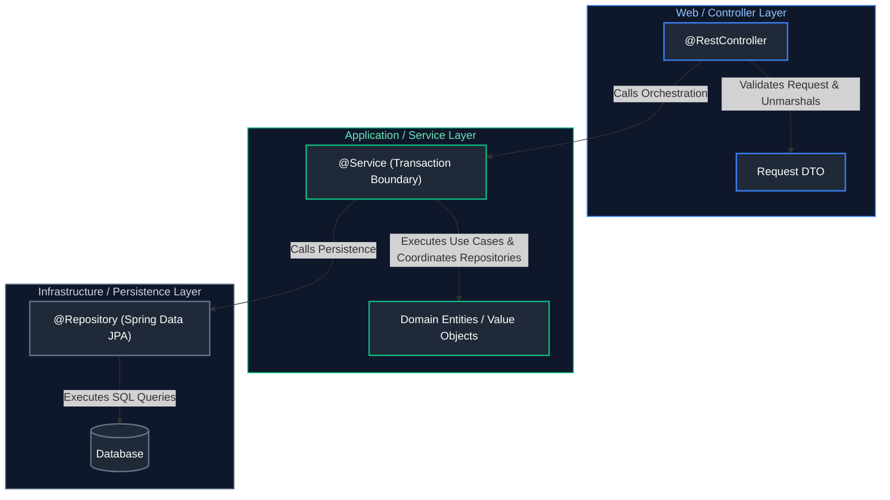

---

# 3. GoF Creational Design Patterns

---

### 3.1 Builder Pattern
* **Purpose**: Constructs complex objects step-by-step, separating construction from representation. Crucial for creating **immutable** objects with multiple optional parameters.
* **Spring / Java Idioms**: Lombok `@Builder`, `ProcessBuilder`, `UriComponentsBuilder`, `HttpRequest.newBuilder()`.

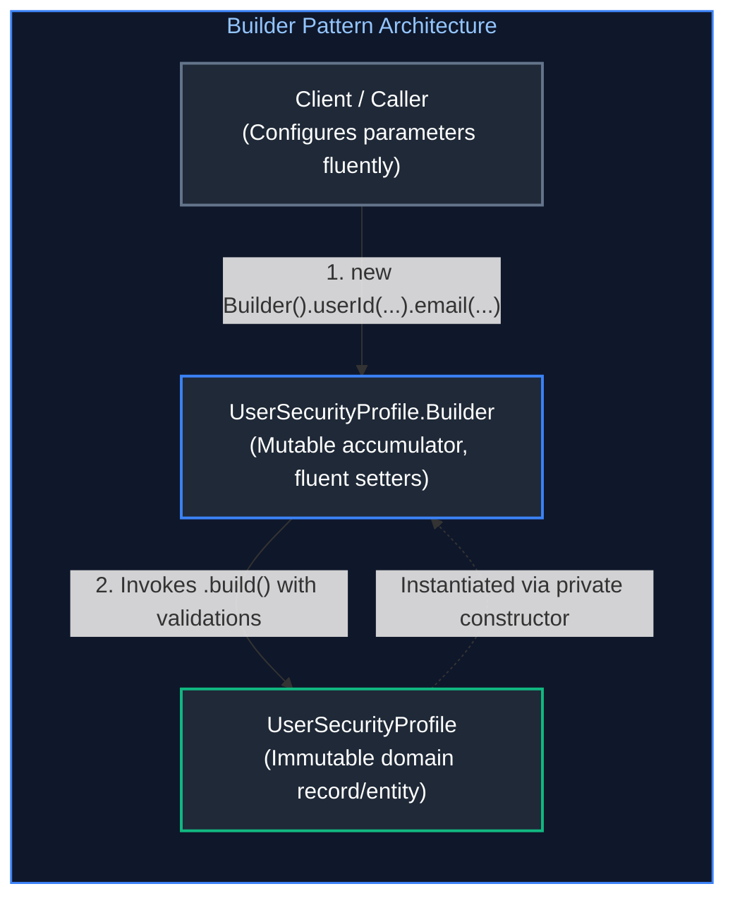

```java
public final class UserSecurityProfile {
    private final String userId;
    private final String username;
    private final String email;
    private final Set<String> roles;
    private final boolean mfaEnabled;

    private UserSecurityProfile(Builder builder) {
        this.userId = Objects.requireNonNull(builder.userId, "userId must not be null");
        this.username = Objects.requireNonNull(builder.username, "username must not be null");
        this.email = Objects.requireNonNull(builder.email, "email must not be null");
        this.roles = Set.copyOf(builder.roles); // Immutable defensive copy
        this.mfaEnabled = builder.mfaEnabled;
    }

    public static class Builder {
        private String userId;
        private String username;
        private String email;
        private Set<String> roles = new HashSet<>();
        private boolean mfaEnabled = false;

        public Builder userId(String userId) { this.userId = userId; return this; }
        public Builder username(String username) { this.username = username; return this; }
        public Builder email(String email) { this.email = email; return this; }
        public Builder addRole(String role) { this.roles.add(role); return this; }
        public Builder mfaEnabled(boolean mfaEnabled) { this.mfaEnabled = mfaEnabled; return this; }

        public UserSecurityProfile build() {
            return new UserSecurityProfile(this);
        }
    }
}
```

---

### 3.2 Factory Method & Abstract Factory Pattern
* **Purpose**: 
  * **Factory Method**: Defines an interface for creating an object, but allows subclasses to decide which class to instantiate.
  * **Abstract Factory**: Provides an interface for creating families of related or dependent objects without specifying their concrete classes.
* **Spring Usage**: `BeanFactory`, `FactoryBean<T>`, `ConnectionFactory`.

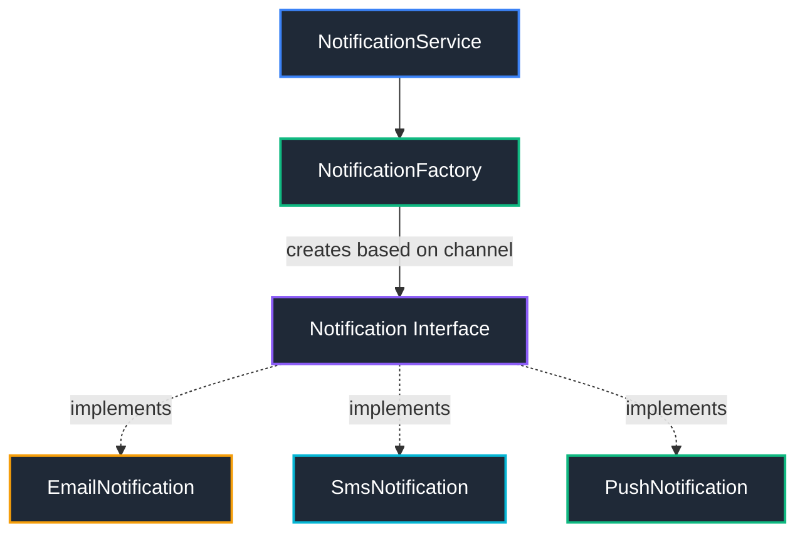

```java
// Notification Factory Method
public interface Notification {
    void send(String recipient, String message);
}

@Component("emailNotification")
public class EmailNotification implements Notification {
    @Override public void send(String r, String m) { /* Send via SMTP */ }
}

@Component("smsNotification")
public class SmsNotification implements Notification {
    @Override public void send(String r, String m) { /* Send via Twilio */ }
}

@Service
@RequiredArgsConstructor
public class NotificationFactory {
    private final Map<String, Notification> notificationMap;

    public Notification getNotificationService(String channel) {
        Notification notification = notificationMap.get(channel.toLowerCase() + "Notification");
        if (notification == null) {
            throw new IllegalArgumentException("Unknown channel: " + channel);
        }
        return notification;
    }
}
```

---

### 3.3 Singleton Pattern
* **Purpose**: Ensures that a class has only one instance and provides a global point of access to it.
* **Production Best Practice**: In Spring applications, singletons are managed by the container (`@Component`, `@Service`). In pure Java, Double-Checked Locking with `volatile` or Enum Singletons are standard.

#### Thread-Safe Double-Checked Locking (DCL)
```java
public class CacheRegistry {
    // volatile ensures memory visibility and prevents CPU instruction reordering
    private static volatile CacheRegistry INSTANCE;

    private CacheRegistry() {
        // Guard against reflection instantiation attacks
        if (INSTANCE != null) {
            throw new IllegalStateException("Singleton instance already exists!");
        }
    }

    public static CacheRegistry getInstance() {
        if (INSTANCE == null) { // 1st Check (No lock overhead)
            synchronized (CacheRegistry.class) {
                if (INSTANCE == null) { // 2nd Check (Inside lock)
                    INSTANCE = new CacheRegistry();
                }
            }
        }
        return INSTANCE;
    }
}
```

#### The Enum Singleton Implementation
```java
public enum ConnectionPoolManager {
    INSTANCE;

    private final List<String> connections = new CopyOnWriteArrayList<>();

    public void registerConnection(String id) {
        connections.add(id);
    }
}
```

---

### 3.4 Prototype Pattern
* **Purpose**: Creates new objects by copying an existing instance (prototyping) rather than constructing new ones from scratch. Highly effective when object instantiation is computationally heavy (e.g. database parsing, complex graph loading).
* **Spring Usage**: Spring Bean Prototype Scope (`@Scope("prototype")`).

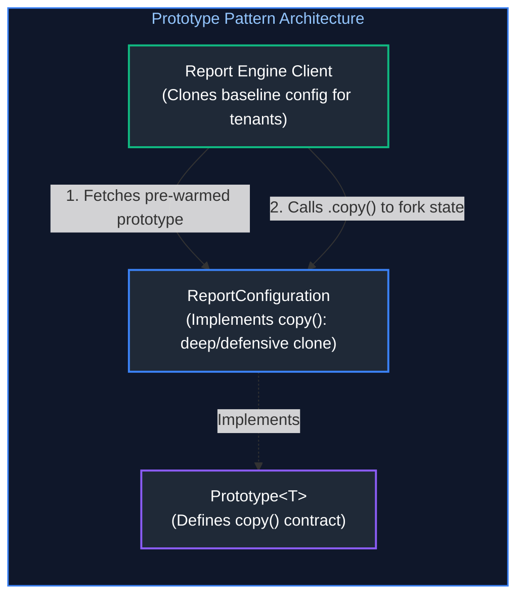

```java
public interface Prototype<T> {
    T copy();
}

public class ReportConfiguration implements Prototype<ReportConfiguration> {
    private final String tenantId;
    private final List<String> metrics;
    private final Map<String, String> displayFilters;

    public ReportConfiguration(String tenantId, List<String> metrics, Map<String, String> displayFilters) {
        this.tenantId = tenantId;
        this.metrics = new ArrayList<>(metrics);
        this.displayFilters = new HashMap<>(displayFilters);
    }

    // Deep copy implementation guaranteeing immutability across clones
    @Override
    public ReportConfiguration copy() {
        return new ReportConfiguration(
            this.tenantId,
            new ArrayList<>(this.metrics),
            new HashMap<>(this.displayFilters)
        );
    }

    public void addMetric(String metric) {
        this.metrics.add(metric);
    }
}
```

---

# 4. GoF Structural Design Patterns

---

### 4.1 Adapter Pattern
* **Purpose**: Converts the interface of a class into another interface that clients expect. Allows incompatible classes to work together.
* **Spring Usage**: `HandlerAdapter` in Spring MVC, `JpaVendorAdapter`.


```java
// Target interface expected by modern backend
public interface PaymentGateway {
    PaymentResult charge(String customerId, BigDecimal amountInCents);
}

// Incompatible legacy 3rd-party SDK
public class LegacySoapBankingClient {
    public SoapResponse submitDebitTransaction(long accountNum, double dollarAmount) {
        return new SoapResponse("SUCCESS_CODE_200");
    }
}

// Adapter bridges the two systems
@Component
@RequiredArgsConstructor
public class LegacyBankingAdapter implements PaymentGateway {
    private final LegacySoapBankingClient legacyClient;

    @Override
    public PaymentResult charge(String customerId, BigDecimal amountInCents) {
        long accountNum = Long.parseLong(customerId);
        double dollarAmount = amountInCents.divide(BigDecimal.valueOf(100)).doubleValue();
        SoapResponse response = legacyClient.submitDebitTransaction(accountNum, dollarAmount);
        return new PaymentResult("SUCCESS_CODE_200".equals(response.statusCode()));
    }
}
```

---

### 4.2 Decorator Pattern
* **Purpose**: Attaches additional responsibilities to an object dynamically without subclassing.
* **JDK / Spring Usage**: `BufferedReader(new InputStreamReader(System.in))`, Spring `HttpServletRequestWrapper`.

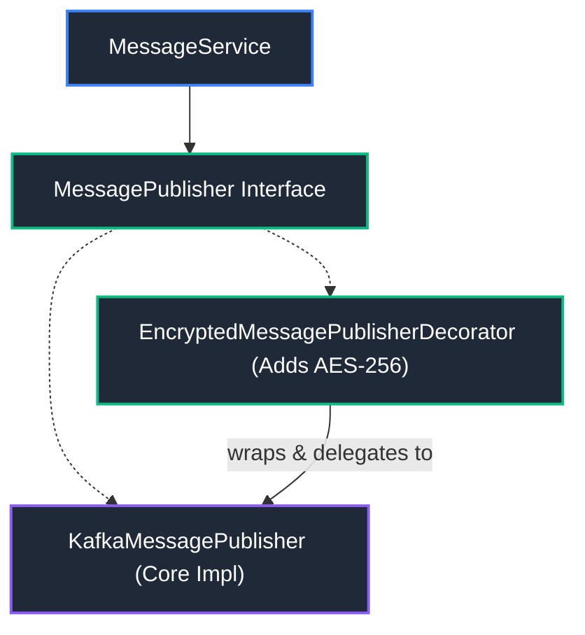

```java
public interface MessagePublisher {
    void publish(String topic, String payload);
}

@Service
public class KafkaMessagePublisher implements MessagePublisher {
    @Override public void publish(String topic, String payload) { /* send raw payload to kafka */ }
}

// Decorator adding encryption transparently without modifying KafkaMessagePublisher
@Service
@Primary
public class EncryptedMessagePublisherDecorator implements MessagePublisher {
    private final MessagePublisher delegate;
    private final AesEncryptionService encryptionService;

    public EncryptedMessagePublisherDecorator(MessagePublisher delegate, AesEncryptionService enc) {
        this.delegate = delegate;
        this.encryptionService = enc;
    }

    @Override
    public void publish(String topic, String payload) {
        String cipherText = encryptionService.encrypt(payload);
        delegate.publish(topic, cipherText);
    }
}
```

---

### 4.3 Proxy Pattern (JDK Dynamic vs CGLIB)
* **Purpose**: Provides a surrogate or placeholder for another object to control access, perform lazy loading, add transaction boundaries, or log execution metrics.
* **Spring Usage**: Spring AOP dynamically wraps beans in proxies for `@Transactional`, `@Async`, and `@Cacheable`.

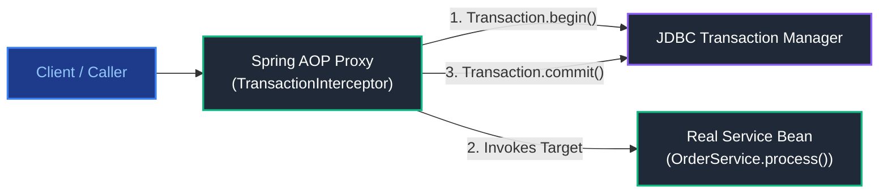

* **JDK Dynamic Proxy**: Requires target class to implement an interface. Employs `java.lang.reflect.Proxy` and `InvocationHandler`.
* **CGLIB Proxy**: Generates bytecode subclasses of target classes at runtime. Used when classes do not implement interfaces or when `proxyTargetClass = true`.

---

### 4.4 Facade Pattern
* **Purpose**: Provides a simplified, higher-level interface to a complex library, subsystem, or cluster of classes.
* **Spring Usage**: `JdbcTemplate`, `KafkaTemplate`, `RestTemplate`.

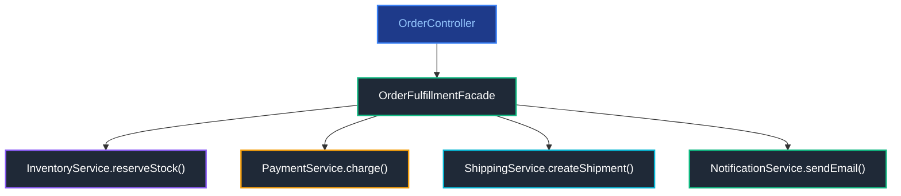

```java
@Component
@RequiredArgsConstructor
public class OrderFulfillmentFacade {
    private final InventoryClient inventoryClient;
    private final PaymentProcessor paymentProcessor;
    private final ShippingGateway shippingGateway;
    private final NotificationService notificationService;

    public FulfillmentReceipt fulfillOrder(Order order) {
        inventoryClient.reserveStock(order.getItems());
        paymentProcessor.charge(order.getCustomerId(), order.getTotal());
        TrackingNumber tracking = shippingGateway.createShipment(order.getAddress());
        notificationService.sendConfirmation(order.getCustomerId(), tracking);
        return new FulfillmentReceipt(order.getId(), tracking);
    }
}
```

---

### 4.5 Composite Pattern
* **Purpose**: Composes objects into tree structures to represent part-whole hierarchies. Enables clients to treat individual leaf objects and compositions of objects uniformly.
* **Enterprise Usage**: Hierarchical permission trees (Roles containing Sub-roles and Privileges), product catalog categories, and nested organization units.

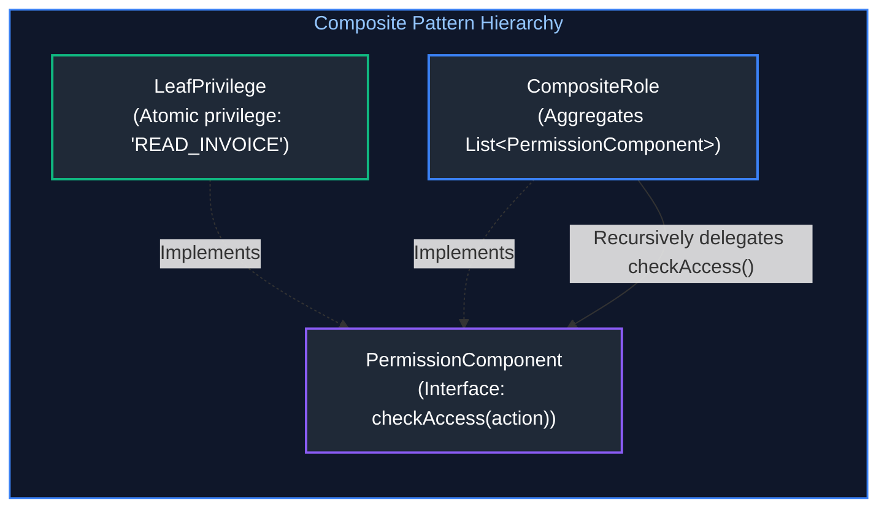

```java
public interface PermissionComponent {
    boolean checkAccess(String action);
    String getName();
}

// Leaf: Individual atomic permission
public class LeafPrivilege implements PermissionComponent {
    private final String name;
    private final String requiredAction;

    public LeafPrivilege(String name, String requiredAction) {
        this.name = name;
        this.requiredAction = requiredAction;
    }

    @Override public String getName() { return name; }
    @Override public boolean checkAccess(String action) { return requiredAction.equalsIgnoreCase(action); }
}

// Composite: Role containing child roles and permissions
public class CompositeRole implements PermissionComponent {
    private final String roleName;
    private final List<PermissionComponent> children = new ArrayList<>();

    public CompositeRole(String roleName) { this.roleName = roleName; }

    public void add(PermissionComponent component) { children.add(component); }

    @Override public String getName() { return roleName; }

    @Override
    public boolean checkAccess(String action) {
        // Recursive evaluation treats leaf privileges and nested sub-roles identically
        return children.stream().anyMatch(child -> child.checkAccess(action));
    }
}
```

---

# 5. GoF Behavioral Design Patterns

---

### 5.1 Strategy Pattern
* **Purpose**: Defines a family of algorithms, encapsulates each one, and makes them interchangeable at runtime.
* **Spring Idiom**: Injecting `Map<String, StrategyInterface>` directly into services for dynamic algorithmic dispatch.

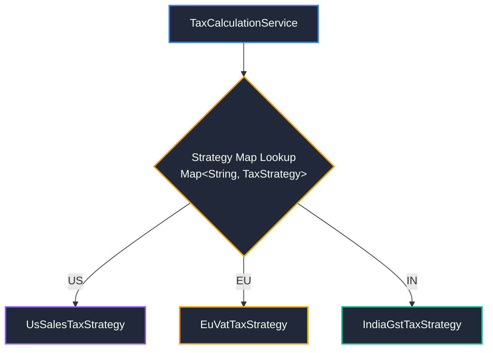

```java
public interface TaxStrategy {
    String getCountryCode();
    BigDecimal calculateTax(BigDecimal subtotal);
}

@Component
public class UsSalesTaxStrategy implements TaxStrategy {
    @Override public String getCountryCode() { return "US"; }
    @Override public BigDecimal calculateTax(BigDecimal subtotal) { return subtotal.multiply(new BigDecimal("0.07")); }
}

@Component
public class EuVatTaxStrategy implements TaxStrategy {
    @Override public String getCountryCode() { return "EU"; }
    @Override public BigDecimal calculateTax(BigDecimal subtotal) { return subtotal.multiply(new BigDecimal("0.20")); }
}

@Service
public class TaxCalculationEngine {
    private final Map<String, TaxStrategy> taxStrategies;

    public TaxCalculationEngine(List<TaxStrategy> strategies) {
        this.taxStrategies = strategies.stream()
            .collect(Collectors.toMap(TaxStrategy::getCountryCode, Function.identity()));
    }

    public BigDecimal compute(String country, BigDecimal subtotal) {
        TaxStrategy strategy = taxStrategies.getOrDefault(country, subtotalVal -> BigDecimal.ZERO);
        return strategy.calculateTax(subtotal);
    }
}
```

---

### 5.2 Template Method Pattern
* **Purpose**: Defines the skeleton of an algorithm in an abstract base class, deferring specific steps to subclasses without altering algorithm structure.
* **Spring Usage**: `AbstractPlatformTransactionManager`, `JdbcTemplate.execute()`.

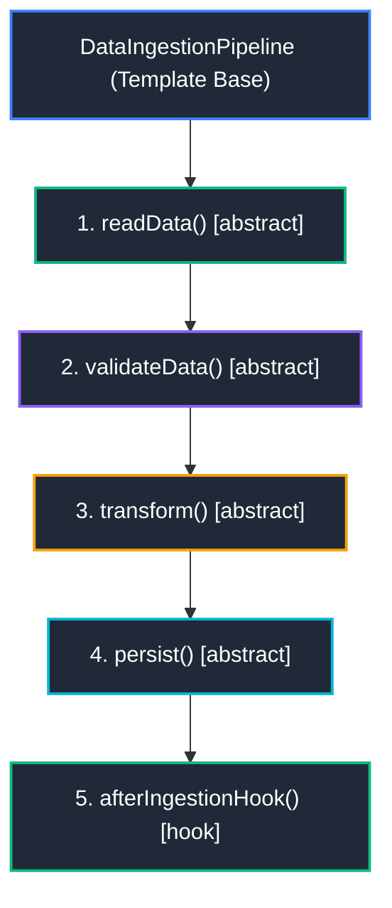

```java
public abstract class DataIngestionPipeline {
    // Template method declared final to lock down algorithm execution sequence
    public final void executePipeline(URI sourceUri) {
        byte[] rawData = readData(sourceUri);
        byte[] validatedData = validateData(rawData);
        Object domainModel = transform(validatedData);
        persist(domainModel);
        afterIngestionHook(domainModel); // Optional hook
    }

    protected abstract byte[] readData(URI sourceUri);
    protected abstract byte[] validateData(byte[] rawData);
    protected abstract Object transform(byte[] validatedData);
    protected abstract void persist(Object model);

    // Hook method with default no-op implementation
    protected void afterIngestionHook(Object model) {
        // Subclasses may optionally override for audit metrics
    }
}
```

---

### 5.3 Chain of Responsibility Pattern
* **Purpose**: Passes requests along a chain of handlers. Upon receiving a request, each handler either processes it or passes it to the next handler in the chain.
* **Spring Usage**: `SecurityFilterChain`, `javax.servlet.Filter`.


```java
public interface OrderValidationFilter {
    void doFilter(OrderContext context, ValidationFilterChain chain);
}

public interface ValidationFilterChain {
    void proceed(OrderContext context);
}

@Component
@Order(1)
public class BlacklistCheckFilter implements OrderValidationFilter {
    @Override
    public void doFilter(OrderContext context, ValidationFilterChain chain) {
        if (isBlacklisted(context.getCustomerId())) {
            throw new SecurityException("Customer is blacklisted!");
        }
        chain.proceed(context);
    }
}

@Component
@Order(2)
public class CreditLimitCheckFilter implements OrderValidationFilter {
    @Override
    public void doFilter(OrderContext context, ValidationFilterChain chain) {
        if (exceedsCreditLimit(context)) {
            throw new InsufficientCreditException("Limit exceeded!");
        }
        chain.proceed(context);
    }
}
```

---

### 5.4 Observer Pattern
* **Purpose**: Defines a one-to-many dependency between objects so that when one object changes state, all its dependents are notified automatically.
* **Spring Usage**: `ApplicationEventPublisher`, `@EventListener`, Spring Application Events.

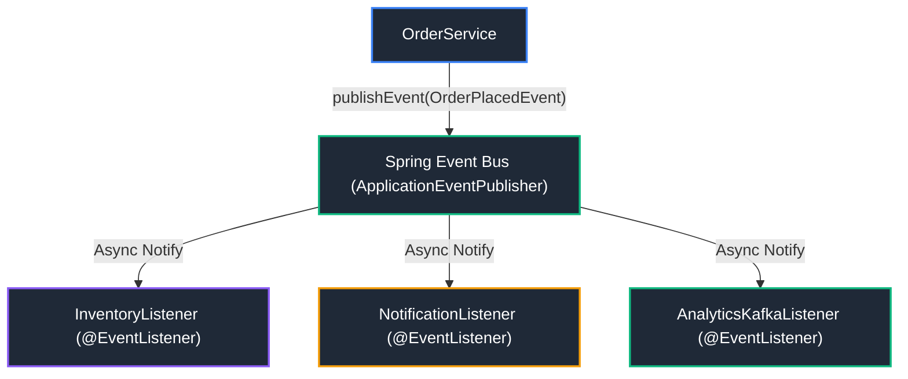

```java
// 1. Immutable Domain Event
public record OrderPlacedEvent(String orderId, BigDecimal amount, Instant timestamp) {}

// 2. Event Publisher
@Service
@RequiredArgsConstructor
public class OrderService {
    private final ApplicationEventPublisher eventPublisher;

    public void placeOrder(String orderId, BigDecimal amount) {
        // Business execution...
        eventPublisher.publishEvent(new OrderPlacedEvent(orderId, amount, Instant.now()));
    }
}

// 3. Asynchronous Observer / Listener
@Component
public class InventoryOrderListener {
    @Async
    @EventListener
    public void handleOrderPlaced(OrderPlacedEvent event) {
        // Updates inventory asynchronously without blocking order response
    }
}
```

---

### 5.5 State Pattern
* **Purpose**: Allows an object to alter its behavior when its internal state changes. Replaces giant, brittle `switch` and `if-else` state transition trees with dedicated state objects.

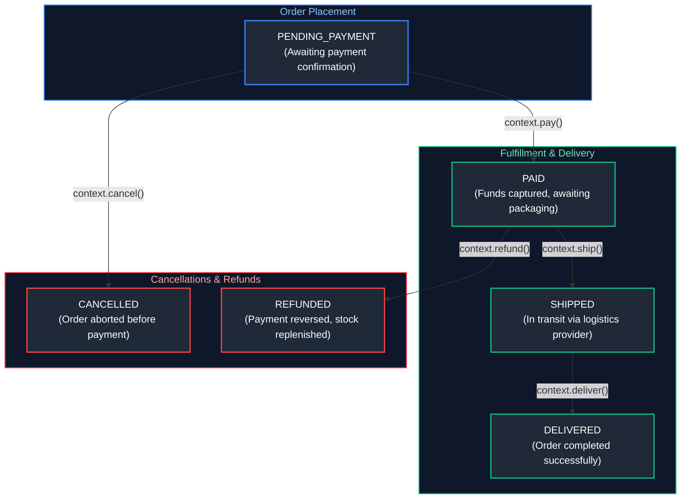

```java
public interface OrderState {
    void pay(OrderContext context);
    void ship(OrderContext context);
    void cancel(OrderContext context);
}

public class OrderContext {
    private OrderState state = new PendingPaymentState();

    public void setState(OrderState state) { this.state = state; }
    public void pay() { state.pay(this); }
    public void ship() { state.ship(this); }
    public void cancel() { state.cancel(this); }
}

public class PendingPaymentState implements OrderState {
    @Override
    public void pay(OrderContext context) {
        System.out.println("Payment processed successfully.");
        context.setState(new PaidState());
    }

    @Override
    public void ship(OrderContext context) {
        throw new IllegalStateException("Cannot ship order before payment!");
    }

    @Override
    public void cancel(OrderContext context) {
        System.out.println("Order cancelled.");
        context.setState(new CancelledState());
    }
}

public class PaidState implements OrderState {
    @Override
    public void pay(OrderContext context) { throw new IllegalStateException("Order already paid!"); }
    @Override
    public void ship(OrderContext context) { context.setState(new ShippedState()); }
    @Override
    public void cancel(OrderContext context) { context.setState(new RefundedState()); }
}
```

---

### 5.6 Command Pattern
* **Purpose**: Encapsulates a request as an object, thereby letting you parameterize clients with different requests, queue or log requests, and support undoable operations.
* **Enterprise Usage**: Transactional outbox pattern, batch execution engines, undo/redo state management in event sourcing.

```mermaid
flowchart LR
    Client["OrderActionService"] --> Command["CreateOrderCommand (Command Object)"]
    Command --> Invoker["CommandExecutor / Queue"]
    Invoker -->|"execute() / undo()"| Receiver["OrderDatabaseReceiver"]

    style Client fill:#1f2937,stroke:#3b82f6,stroke-width:2px,color:#fff
    style Command fill:#1f2937,stroke:#10b981,stroke-width:2px,color:#fff
    style Invoker fill:#1f2937,stroke:#8b5cf6,stroke-width:2px,color:#fff
    style Receiver fill:#1f2937,stroke:#10b981,stroke-width:2px,color:#fff
```

```java
public interface Command {
    void execute();
    void undo();
}

public class AdjustInventoryCommand implements Command {
    private final InventoryRepository repository;
    private final String sku;
    private final int quantity;

    public AdjustInventoryCommand(InventoryRepository repository, String sku, int quantity) {
        this.repository = repository;
        this.sku = sku;
        this.quantity = quantity;
    }

    @Override
    public void execute() {
        repository.decreaseStock(sku, quantity);
    }

    @Override
    public void undo() {
        repository.increaseStock(sku, quantity);
    }
}

// Invoker managing command history and execution
public class TransactionCommandManager {
    private final Deque<Command> history = new ArrayDeque<>();

    public void executeCommand(Command command) {
        command.execute();
        history.push(command);
    }

    public void rollbackLast() {
        if (!history.isEmpty()) {
            Command command = history.pop();
            command.undo();
        }
    }
}
```

---

# 6. Enterprise Backend & Domain-Driven Patterns

---

### 6.1 Data Transfer Object (DTO) & MapStruct Mapper Pattern
* **Purpose**: Separates internal database entities (JPA models) from external API contracts (JSON payloads) to prevent leaking database schemas, circular serialization, and unintended field overwrites.

```java
// 1. API Contract Record
public record UserResponseDto(UUID id, String email, String fullName) {}

// 2. MapStruct Compile-Time Mapper (Zero reflection overhead)
@Mapper(componentModel = "spring")
public interface UserMapper {
    @Mapping(target = "fullName", expression = "java(entity.getFirstName() + ' ' + entity.getLastName())")
    UserResponseDto toDto(UserEntity entity);
}
```

---

### 6.2 Value Object Pattern
* **Purpose**: Encapsulates primitive types into immutable, self-validating objects with value equality.
* **Domain Examples**: `Money(BigDecimal amount, Currency currency)`, `EmailAddress(String email)`, `PostalCode(String code)`.

```java
public record Money(BigDecimal amount, Currency currency) {
    public Money {
        Objects.requireNonNull(amount, "Amount must not be null");
        Objects.requireNonNull(currency, "Currency must not be null");
        if (amount.compareTo(BigDecimal.ZERO) < 0) {
            throw new IllegalArgumentException("Money amount cannot be negative");
        }
        amount = amount.setScale(2, RoundingMode.HALF_UP);
    }

    public Money add(Money other) {
        if (!this.currency.equals(other.currency)) {
            throw new IllegalArgumentException("Cannot add different currencies: " + currency + " vs " + other.currency);
        }
        return new Money(this.amount.add(other.amount), this.currency);
    }
}
```

---

### 6.3 Repository & Specification Pattern
* **Purpose**: Decouples domain logic from persistence mechanisms. The Specification Pattern enables dynamic, composable query predicates using the JPA Criteria API.

```java
public class OrderSpecifications {
    public static Specification<OrderEntity> hasStatus(OrderStatus status) {
        return (root, query, cb) -> cb.equal(root.get("status"), status);
    }

    public static Specification<OrderEntity> minAmount(BigDecimal min) {
        return (root, query, cb) -> cb.greaterThanOrEqualTo(root.get("totalAmount"), min);
    }
}

// In Service: Composable querying without dynamic SQL strings
List<OrderEntity> results = orderRepository.findAll(
    Specification.where(OrderSpecifications.hasStatus(OrderStatus.PAID))
                 .and(OrderSpecifications.minAmount(new BigDecimal("100.00")))
);
```

---

# 7. Clean Architecture & Hexagonal Architecture (Ports & Adapters)

Hexagonal Architecture (Alistair Cockburn) and Clean Architecture (Robert C. Martin) place pure domain business logic at the core, decoupling it completely from frameworks, databases, message brokers, and user interfaces.

```mermaid
flowchart TD
    subgraph DrivingAdapters ["Inbound / Driving Adapters (Input Triggers)"]
        WebCtrl["REST Controller<br/>(Spring Web / GraphQL)"]
        KafkaConsumer["Kafka Event Consumer<br/>(Spring Kafka)"]
    end

    subgraph ApplicationCore ["Application & Domain Core (Pure Java)"]
        direction TB
        InboundPort["Inbound Port (Use Case Interface)<br/>PlaceOrderUseCase"]
        DomainService["Domain Entity & Aggregates<br/>Order, Money, LineItem"]
        OutboundPort["Outbound Port (Driven Interface)<br/>OrderRepositoryPort, PaymentGatewayPort"]
        
        InboundPort --> DomainService
        DomainService --> OutboundPort
    end

    subgraph DrivenAdapters ["Outbound / Driven Adapters (Infrastructure)"]
        JpaRepo["PostgreSQL Database<br/>(Spring Data JPA Adapter)"]
        StripeGateway["Stripe Payment Gateway<br/>(HTTP REST Adapter)"]
    end

    WebCtrl --> InboundPort
    KafkaConsumer --> InboundPort
    OutboundPort -.-> JpaRepo
    OutboundPort -.-> StripeGateway

    style DrivingAdapters fill:#0f172a,stroke:#3b82f6,stroke-width:1.5px,color:#93c5fd
    style ApplicationCore fill:#0f172a,stroke:#10b981,stroke-width:1.5px,color:#6ee7b7
    style DrivenAdapters fill:#0f172a,stroke:#f59e0b,stroke-width:1.5px,color:#fde68a
    style WebCtrl fill:#1f2937,stroke:#3b82f6,stroke-width:2px,color:#fff
    style KafkaConsumer fill:#1f2937,stroke:#3b82f6,stroke-width:2px,color:#fff
    style InboundPort fill:#1f2937,stroke:#10b981,stroke-width:2px,color:#fff
    style DomainService fill:#1f2937,stroke:#10b981,stroke-width:2px,color:#fff
    style OutboundPort fill:#1f2937,stroke:#10b981,stroke-width:2px,color:#fff
    style JpaRepo fill:#1f2937,stroke:#f59e0b,stroke-width:2px,color:#fff
    style StripeGateway fill:#1f2937,stroke:#f59e0b,stroke-width:2px,color:#fff
```

#### Production Code: Clean Architecture Dependency Inversion
```java
// 1. INBOUND PORT: Expresses what the application can do
public interface PlaceOrderUseCase {
    OrderId execute(PlaceOrderCommand command);
}

// 2. OUTBOUND PORT: Expresses external dependencies required by domain
public interface OrderRepositoryPort {
    void save(Order order);
    Optional<Order> findById(OrderId id);
}

// 3. APPLICATION SERVICE: Orchestrates domain objects without framework dependencies
public class OrderApplicationService implements PlaceOrderUseCase {
    private final OrderRepositoryPort orderRepository;

    public OrderApplicationService(OrderRepositoryPort orderRepository) {
        this.orderRepository = orderRepository;
    }

    @Override
    public OrderId execute(PlaceOrderCommand command) {
        Order order = Order.create(command.customerId(), command.items());
        orderRepository.save(order);
        return order.getId();
    }
}
```

---

# 8. Architectural Fitness Functions & ArchUnit Testing

Architectural degradation happens gradually when developers inadvertently introduce circular dependencies or import persistence models into web controllers. **ArchUnit** provides executable, automated unit tests that enforce architectural boundaries in CI/CD pipelines.

```java
import com.tngtech.archunit.core.importer.ImportOption;
import com.tngtech.archunit.junit.AnalyzeClasses;
import com.tngtech.archunit.junit.ArchTest;
import com.tngtech.archunit.lang.ArchRule;

import static com.tngtech.archunit.lang.syntax.ArchRuleDefinition.classes;
import static com.tngtech.archunit.lang.syntax.ArchRuleDefinition.noClasses;
import static com.tngtech.archunit.library.Architectures.layeredArchitecture;

@AnalyzeClasses(packages = "com.enterprise.app", importOptions = ImportOption.DoNotIncludeTests.class)
public class ArchitectureInvariantsTest {

    // 1. Enforce Clean Layered Architecture
    @ArchTest
    static final ArchRule layered_architecture_must_be_respected =
        layeredArchitecture()
            .consideringAllDependencies()
            .layer("Controllers").definedBy("..adapter.in.web..")
            .layer("Services").definedBy("..application.service..")
            .layer("Domain").definedBy("..domain..")
            .layer("Infrastructure").definedBy("..adapter.out.persistence..")
            .whereLayer("Controllers").mayNotBeAccessedByAnyLayer()
            .whereLayer("Services").mayOnlyBeAccessedByLayers("Controllers")
            .whereLayer("Domain").mayOnlyBeAccessedByLayers("Services", "Infrastructure");

    // 2. Domain Model must be pure Java: Zero Spring or JPA dependencies!
    @ArchTest
    static final ArchRule domain_must_be_free_of_framework_dependencies =
        noClasses().that().resideInAPackage("..domain..")
            .should().dependOnClassesThat().resideInAnyPackage(
                "org.springframework..",
                "jakarta.persistence..",
                "org.hibernate.."
            );
}
```

---

# 9. Summary Comparison & Engineering Reference Matrix

| GoF / Enterprise Pattern | Category | Intent | Spring Boot / JDK Production Reference | Architectural Rule |
| :--- | :--- | :--- | :--- | :--- |
| **Builder** | Creational | Construct complex immutable objects step-by-step | Lombok `@Builder`, `UriComponentsBuilder` | Mandate defensive copying for collection fields. |
| **Factory Method** | Creational | Delegate object instantiation to factory classes | `BeanFactory`, `FactoryBean`, `LoggerFactory.getLogger()` | Decouples caller from concrete constructor invocation. |
| **Singleton** | Creational | Single shared instance with controlled global access | Default Spring Bean Scope (`@Scope("singleton")`) | Keep beans stateless; stateful singletons cause concurrency race hazards. |
| **Prototype** | Creational | Clone instances from a template | `@Scope("prototype")`, `Object.clone()` | Use when instantiation involves heavy parsing or configuration trees. |
| **Adapter** | Structural | Bridge incompatible interfaces | Spring MVC `HandlerAdapter`, `JpaVendorAdapter` | Convert third-party data structures to internal domain types. |
| **Decorator** | Structural | Add runtime dynamic responsibilities transparently | Java I/O (`BufferedReader`), `HttpServletRequestWrapper` | Prefer over deep inheritance hierarchies. |
| **Proxy** | Structural | Control access, add cross-cutting behavior (AOP) | Spring AOP (`@Transactional`, `@Async`), CGLIB | Avoid internal self-invocation (`this.method()`) which bypasses proxies. |
| **Facade** | Structural | Simplified high-level interface to complex subsystems | `JdbcTemplate`, `KafkaTemplate`, `MongoTemplate` | Masks subsystem complexity; keeps client APIs focused and clean. |
| **Composite** | Structural | Part-whole tree hierarchies | Spring `CompositeUriComponents`, UI component trees | Treats individual leaves and composite groups uniformly. |
| **Strategy** | Behavioral | Interchangeable algorithmic implementations | Map injection `Map<String, Strategy>`, `TaskExecutor` | Eliminates long `switch-case` blocks; facilitates Open/Closed principle. |
| **Template Method** | Behavioral | Invariant algorithm skeleton with subclass hooks | `AbstractPlatformTransactionManager`, `JdbcTemplate.execute()` | Favor Strategy if algorithms vary dynamically at runtime. |
| **Chain of Responsibility** | Behavioral | Sequential request processing pipeline | `SecurityFilterChain`, `javax.servlet.FilterChain` | Order filters carefully; verify authentication before authorization. |
| **Observer** | Behavioral | Decoupled event notification | `ApplicationEventPublisher`, `@EventListener` | Prefer asynchronous listeners (`@Async`) for non-transactional side-effects. |
| **State** | Behavioral | State-dependent polymorphic behavior | Spring State Machine, Order workflow state objects | Eliminates error-prone status flag branches across controllers. |
| **Command** | Behavioral | Encapsulate request/operation as an object | Spring Batch `JobStep`, `Runnable`, `Callable` | Enables request queuing, retry logging, and undo/redo semantics. |

---

# 10. References & Further Reading

- [GeeksforGeeks - Java Design Patterns](https://www.geeksforgeeks.org/java-design-patterns/)
- [GeeksforGeeks - SOLID Principles in Java](https://www.geeksforgeeks.org/solid-principles-in-java/)
- [Refactoring.Guru - Design Patterns in Java](https://refactoring.guru/design-patterns/java)
- [Baeldung - Gang of Four (GoF) Design Patterns Series](https://www.baeldung.com/category/design-patterns/)
- [Robert C. Martin: Clean Architecture](https://www.oreilly.com/library/view/clean-architecture-a/9780134494272/) — The definitive guide to software structure, boundaries, and dependencies.
- [ArchUnit Official Documentation](https://www.archunit.org/) — Unit testing Java architecture and package boundaries.
- [Martin Fowler - Inversion of Control Containers and Dependency Injection](https://martinfowler.com/articles/injection.html)
- [Spring Framework Official Documentation - Core IoC and AOP Architecture](https://docs.spring.io/spring-framework/reference/core.html)
