# 07. Spring Framework & Spring Boot

A comprehensive, production-grade guide to the Spring ecosystem, covering Spring Core, Inversion of Control (IoC), Dependency Injection (DI) mechanics, the 12-phase Spring Bean lifecycle, stereotype annotations, Spring Boot auto-configuration internals, externalized configuration, Aspect-Oriented Programming (AOP) proxy mechanics, custom starters, Actuator production operations, and high-scale troubleshooting playbooks.

---

## Architectural Overview: Enterprise Spring Core & Spring Boot Runtime Architecture

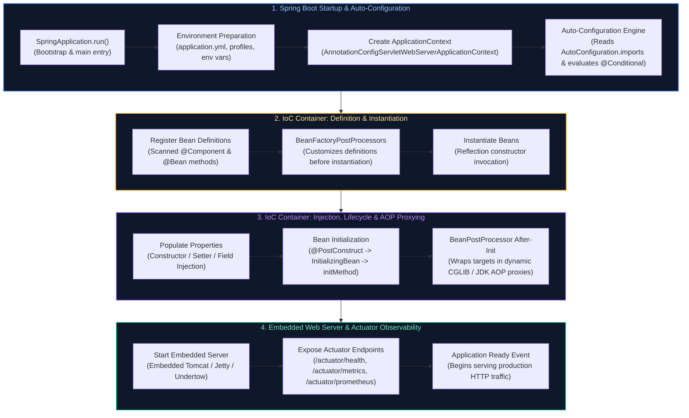

---

## Table of Contents
1. [Spring Core & Inversion of Control (IoC)](#1-spring-core--inversion-of-control-ioc)
   - [1.1 Why Spring? The Evolution Beyond Heavyweight EJB](#11-why-spring-the-evolution-beyond-heavyweight-ejb)
   - [1.2 Inversion of Control (IoC) & The Hollywood Principle](#12-inversion-of-control-ioc--the-hollywood-principle)
   - [1.3 Dependency Injection (DI) Types: Constructor vs Setter vs Field Injection](#13-dependency-injection-di-types-constructor-vs-setter-vs-field-injection)
   - [1.4 `BeanFactory` vs `ApplicationContext` Architectural Differences & Internal Hierarchy](#14-beanfactory-vs-applicationcontext-architectural-differences--internal-hierarchy)
   - [1.5 Spring Bean Scopes & The Prototype-In-Singleton Injection Dilemma](#15-spring-bean-scopes--the-prototype-in-singleton-injection-dilemma)
2. [Stereotype Annotations, Scanning & Candidate Disambiguation](#2-stereotype-annotations-scanning--candidate-disambiguation)
   - [2.1 The Stereotype Family (`@Component`, `@Service`, `@Repository`, `@Controller`, `@RestController`)](#21-the-stereotype-family-component-service-repository-controller-restcontroller)
   - [2.2 Disambiguation: `@Autowired`, `@Primary`, and `@Qualifier`](#22-disambiguation-autowired-primary-and-qualifier)
   - [2.3 Multi-Bean Injection & The Dynamic Strategy Pattern](#23-multi-bean-injection--the-dynamic-strategy-pattern)
   - [2.4 Circular Dependencies: The Three-Level Cache, Spring Boot 2.6+ Ban & Architectural Remedies](#24-circular-dependencies-the-three-level-cache-spring-boot-26-ban--architectural-remedies)
3. [The Spring Bean Lifecycle & Container Extension Points](#3-the-spring-bean-lifecycle--container-extension-points)
   - [3.1 The Complete 12-Phase Spring Bean Lifecycle](#31-the-complete-12-phase-spring-bean-lifecycle)
   - [3.2 Lifecycle Hooks: `@PostConstruct`, `InitializingBean`, and `@PreDestroy`](#32-lifecycle-hooks-postconstruct-initializingbean-and-predestroy)
   - [3.3 `BeanFactoryPostProcessor` vs `BeanPostProcessor` vs `FactoryBean<T>`](#33-beanfactorypostprocessor-vs-beanpostprocessor-vs-factorybean)
   - [3.4 Hands-on Deep Dive: Custom BeanPostProcessor for Field Encryption/Masking](#34-hands-on-deep-dive-custom-beanpostprocessor-for-field-encryptionmasking)
4. [Application Configuration & Enterprise Secret Management](#4-application-configuration--enterprise-secret-management)
   - [4.1 Java Configuration: `@Configuration` (Full Mode) vs `@Component` (Lite Mode)](#41-java-configuration-configuration-full-mode-vs-component-lite-mode)
   - [4.2 Multi-Environment Profiles (`@Profile`) & Configuration Hierarchies](#42-multi-environment-profiles-profile--configuration-hierarchies)
   - [4.3 Externalized Configuration: `@Value` vs `@ConfigurationProperties` with Records & JSR-380](#43-externalized-configuration-value-vs-configurationproperties-with-records--jsr-380)
   - [4.4 Conditional Bean Registration (`@ConditionalOnProperty`, `@ConditionalOnClass`, `@ConditionalOnMissingBean`)](#44-conditional-bean-registration-conditionalonproperty-conditionalonclass-conditionalonmissingbean)
   - [4.5 In-Process Application Events (`ApplicationEventPublisher`, `@EventListener`, `@TransactionalEventListener`)](#45-in-process-application-events-applicationeventpublisher-eventlistener-transactionaleventlistener)
5. [Aspect-Oriented Programming (AOP) & Proxy Internals](#5-aspect-oriented-programming-aop--proxy-internals)
   - [5.1 Core AOP Concepts: Aspect, Advice, JoinPoint, and Pointcut](#51-core-aop-concepts-aspect-advice-joinpoint-and-pointcut)
   - [5.2 JDK Dynamic Proxies vs CGLIB Proxies Under the Hood](#52-jdk-dynamic-proxies-vs-cglib-proxies-under-the-hood)
   - [5.3 The Self-Invocation Proxy Bypass Trap & Production Solutions](#53-the-self-invocation-proxy-bypass-trap--production-solutions)
   - [5.4 Enterprise Implementation: Custom Distributed Rate-Limiting & Performance Aspect](#54-enterprise-implementation-custom-distributed-rate-limiting--performance-aspect)
6. [Spring Boot Architecture, Bootstrapping & Modern Runtime](#6-spring-boot-architecture-bootstrapping--modern-runtime)
   - [6.1 What Problem Does Spring Boot Solve?](#61-what-problem-does-spring-boot-solve)
   - [6.2 Deconstructing `@SpringBootApplication` & Bootstrap Sequence](#62-deconstructing-springbootapplication--bootstrap-sequence)
   - [6.3 The Auto-Configuration Engine (`AutoConfiguration.imports` & Condition Evaluation)](#63-the-auto-configuration-engine-autoconfigurationimports--condition-evaluation)
   - [6.4 Developing a Production-Ready Custom Spring Boot Starter](#64-developing-a-production-ready-custom-spring-boot-starter)
   - [6.5 Embedded Web Servers (Tomcat, Jetty, Undertow) & Graceful Shutdown](#65-embedded-web-servers-tomcat-jetty-undertow--graceful-shutdown)
   - [6.6 Spring Boot 3 AOT Compilation & GraalVM Native Images](#66-spring-boot-3-aot-compilation--graalvm-native-images)
7. [Spring Boot Actuator & Production Operations](#7-spring-boot-actuator--production-operations)
   - [7.1 Key Actuator Endpoints (`/health`, `/metrics`, `/loggers`, `/env`, `/threaddump`)](#71-key-actuator-endpoints-health-metrics-loggers-env-threaddump)
   - [7.2 Kubernetes Liveness & Readiness Probes (`AvailabilityChangeEvent`)](#72-kubernetes-liveness--readiness-probes-availabilitychangeevent)
   - [7.3 Custom Actuator Management Endpoints (`@Endpoint`, `@ReadOperation`, `@WriteOperation`)](#73-custom-actuator-management-endpoints-endpoint-readoperation-writeoperation)
   - [7.4 Custom Micrometer Observability (Gauges, Counters, Timers)](#74-custom-micrometer-observability-gauges-counters-timers)
   - [7.5 Dynamic Runtime Log Level Switching & Securing Actuator Endpoints](#75-dynamic-runtime-log-level-switching--securing-actuator-endpoints)
8. [Production Troubleshooting Playbook](#8-production-troubleshooting-playbook)
9. [Summary Comparison & Engineering Reference Matrix](#9-summary-comparison--engineering-reference-matrix)
10. [References & Further Reading](#10-references--further-reading)

---

# 1. Spring Core & Inversion of Control (IoC)

---

### 1.1 Why Spring? The Evolution Beyond Heavyweight EJB

In the late 1990s and early 2000s, enterprise Java development was dominated by **Enterprise JavaBeans (EJB 2.x)**:
* To implement a simple business object, developers had to inherit from heavyweight EJB base interfaces, create distinct Home and Remote interfaces, and maintain voluminous XML deployment descriptors.
* Code could not be tested outside of proprietary, memory-hungry application servers (such as WebLogic, WebSphere, or JBoss). A single test run required building an enterprise archive (`.ear`), booting a server taking several minutes, and executing complex JNDI lookups.
* Objects were tightly coupled to framework APIs. If the vendor upgraded or changed specifications, code broke immediately.

In 2002, Rod Johnson published *Expert One-on-One J2EE Design and Development*, challenging the orthodoxy. He argued that enterprise applications did not need bloated application servers. Instead, enterprise capabilities—declarative transactions, persistence management, security, and remoting—could be applied to lightweight **Plain Old Java Objects (POJOs)** using a non-intrusive container. This codebase evolved into the **Spring Framework**.

Spring decoupled enterprise software architecture from proprietary infrastructure. It allowed developers to build modular, highly decoupled systems using pure Java objects, relying on **Inversion of Control (IoC)** to connect components and **Aspect-Oriented Programming (AOP)** to layer cross-cutting infrastructure concerns on top.

---

### 1.2 Inversion of Control (IoC) & The Hollywood Principle

**Inversion of Control (IoC)** is an architectural pattern in which the control flow of a program is inverted relative to traditional procedural code. In standard procedural programming, your code controls its own lifecycle: when an object needs a database connection, an encryption utility, or an HTTP client, it directly creates that dependency using the `new` operator.

Under IoC, control is inverted: a central container creates the objects, wires them together with their required dependencies, manages their lifecycles, and invokes them when events or requests occur.

> [!NOTE]
> **The Hollywood Principle**: *"Don't call us, we'll call you."*
> In traditional programming, your class calls the factory or invokes `new PostgresOrderRepository()`. Under IoC, your class simply declares what it requires (e.g., via a constructor), and the container **calls your class** to provide those dependencies.

#### Real-World Mental Model: The Commercial Kitchen vs The Solo Chef
Imagine a chef in a restaurant:
* **Without IoC (Solo Chef)**: The chef must leave the kitchen, drive to the farm, harvest tomatoes, butcher cattle, return to the kitchen, forge a knife, cook the steak, and serve the customer. The chef is tightly coupled to raw ingredient creation, logistics, and tooling. If the tomato farm closes, the chef cannot cook.
* **With IoC (Commercial Kitchen with Supply Chain)**: The chef stands at the cooking station and simply requests ingredients: `public Chef(Steak steak, Tomatoes tomatoes, ChefKnife knife)`. The restaurant's logistics department (the IoC container) procures the certified ingredients, inspects them, and delivers them directly to the chef's counter. The chef focuses 100% on pure culinary domain logic.

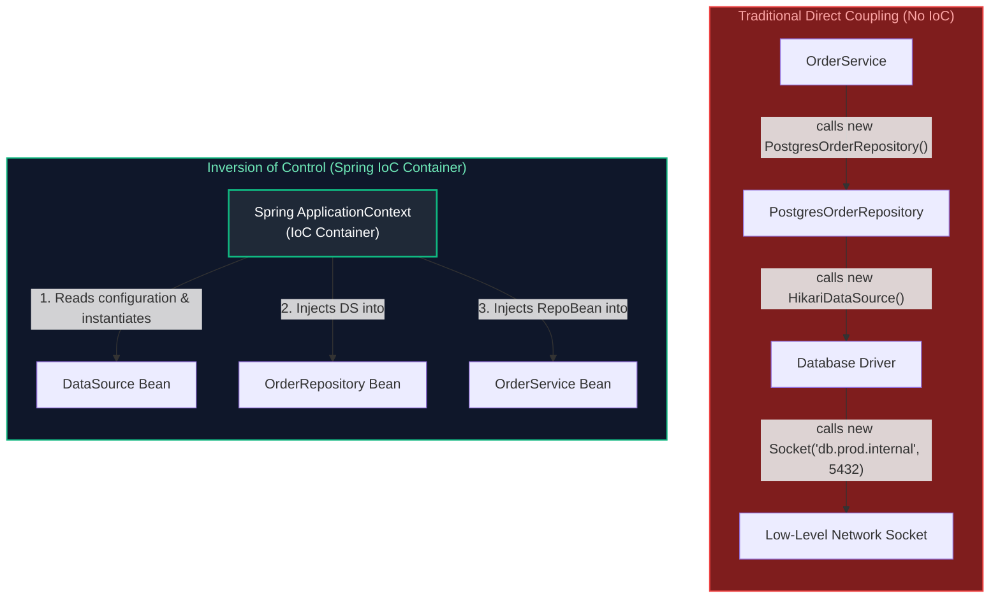

#### Why IoC is Vital for Enterprise Systems:
1. **Loose Coupling**: Business services depend only on interfaces (`OrderRepository`), never concrete database implementations (`PostgresOrderRepository`). Switching to MongoDB, Cassandra, or an in-memory test store requires zero changes to core business code.
2. **Deterministic Testability**: Unit tests can instantiate the target class using `new OrderService(mockRepo, mockPayment)` with Mockito mocks. No heavyweight Spring context or live database connections are required for fast, isolated tests.
3. **Transparent Infrastructure Augmentation**: Because the container controls instantiation, it can wrap objects in dynamic proxies. This allows transactions (`@Transactional`), security checks (`@PreAuthorize`), and performance metrics (`@Timed`) to be applied without cluttering business logic.

---

### 1.3 Dependency Injection (DI) Types: Constructor vs Setter vs Field Injection

Dependency Injection (DI) is the specific design pattern through which the IoC container fulfills a component's dependencies. In the Java ecosystem, three primary DI mechanisms exist:

| Injection Style | Syntax Pattern | Immutability (`final`) | Null Safety / Testability | Circular Reference Handling | Production Recommendation |
| :--- | :--- | :---: | :---: | :---: | :--- |
| **Constructor Injection** | `public OrderService(Repo r) { this.r = r; }` | **YES** | **Outstanding** (Plain JUnit without Spring) | Fails Fast at startup (Detects cycles immediately) | **MANDATORY DEFAULT** |
| **Setter Injection** | `public void setRepo(Repo r) { this.r = r; }` | NO | Moderate (Risk of `NullPointerException` before setter call) | Resolves via multi-phase initialization | Optional or reconfigurable dependencies only |
| **Field Injection** | `@Autowired private Repo r;` | NO | **Terrible** (Requires reflection to test) | Masked until runtime | **BANNED / ANTI-PATTERN** |

#### Why Field Injection (`@Autowired private MyService service;`) is an Enterprise Anti-Pattern:
1. **Breaks Immutability**: Injected fields cannot be marked `final`. Objects are mutable after instantiation, introducing thread-safety risks in concurrent web applications.
2. **Hides Class Dependencies**: A class using field injection conceals its dependencies from outside consumers. Looking at the public API (`public OrderService()`), you cannot determine what the class requires to function.
3. **Prevents Plain Unit Testing**: You cannot test the class with `new OrderService()`. To inject a mock, you must boot the entire Spring context (slowing test execution from 2 milliseconds to 5 seconds) or rely on reflection utilities like `ReflectionTestUtils.setField()`, which breaks encapsulation.
4. **Obscures Single Responsibility Principle (SRP) Violations**: It is deceptively easy to add 15 `@Autowired` private fields to a service without noticing. With constructor injection, a constructor with 15 parameters immediately signals a code smell that the class has taken on too many responsibilities.

#### Production Standard: Constructor Injection with Lombok or Explicit Records

```java
package com.enterprise.order.service;

import com.enterprise.order.domain.Order;
import com.enterprise.order.domain.OrderResponse;
import com.enterprise.order.domain.CreateOrderRequest;
import com.enterprise.order.repository.OrderRepository;
import com.enterprise.payment.service.PaymentGateway;
import com.enterprise.notification.service.NotificationService;
import org.springframework.stereotype.Service;

import java.util.Objects;

@Service
public class OrderService {

    // All dependencies are explicitly declared final to guarantee immutability
    private final OrderRepository orderRepository;
    private final PaymentGateway paymentGateway;
    private final NotificationService notificationService;

    // In modern Spring (4.3+), if a class defines a single constructor,
    // the @Autowired annotation is completely OPTIONAL. Spring automatically invokes it.
    public OrderService(OrderRepository orderRepository,
                        PaymentGateway paymentGateway,
                        NotificationService notificationService) {
        this.orderRepository = Objects.requireNonNull(orderRepository, "orderRepository must not be null");
        this.paymentGateway = Objects.requireNonNull(paymentGateway, "paymentGateway must not be null");
        this.notificationService = Objects.requireNonNull(notificationService, "notificationService must not be null");
    }

    public OrderResponse createOrder(CreateOrderRequest request) {
        // Business logic execution...
        Order order = new Order(request.customerId(), request.items(), request.totalAmount());
        Order savedOrder = orderRepository.save(order);
        
        paymentGateway.charge(savedOrder.getId(), savedOrder.getTotalAmount());
        notificationService.sendOrderConfirmation(savedOrder);
        
        return new OrderResponse(savedOrder.getId(), "CONFIRMED");
    }
}
```

```java
// Testing OrderService requires ZERO Spring infrastructure!
class OrderServiceTest {

    private OrderRepository orderRepository;
    private PaymentGateway paymentGateway;
    private NotificationService notificationService;
    private OrderService orderService;

    @BeforeEach
    void setUp() {
        orderRepository = Mockito.mock(OrderRepository.class);
        paymentGateway = Mockito.mock(PaymentGateway.class);
        notificationService = Mockito.mock(NotificationService.class);
        // Direct constructor instantiation: fast, deterministic, pure Java!
        orderService = new OrderService(orderRepository, paymentGateway, notificationService);
    }

    @Test
    void shouldCreateOrderSuccessfully() {
        CreateOrderRequest request = new CreateOrderRequest("CUST-1", List.of(), new BigDecimal("100.00"));
        when(orderRepository.save(any())).thenReturn(new Order("ORD-99", "CUST-1", List.of(), new BigDecimal("100.00")));

        OrderResponse response = orderService.createOrder(request);

        assertThat(response.status()).isEqualTo("CONFIRMED");
        verify(paymentGateway, times(1)).charge(eq("ORD-99"), any());
    }
}
```

---

### 1.4 `BeanFactory` vs `ApplicationContext` Architectural Differences & Internal Hierarchy

Spring separates its container design into two fundamental interface hierarchies:

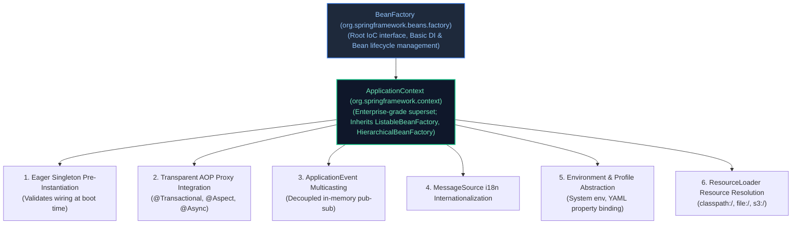

| Dimension | `BeanFactory` | `ApplicationContext` |
| :--- | :--- | :--- |
| **Package** | `org.springframework.beans.factory` | `org.springframework.context` |
| **Instantiation Strategy** | **Lazy Initialization**: Beans are instantiated only when explicitly requested via `getBean()`. | **Eager Pre-Instantiation**: All singleton beans are constructed, wired, initialized, and validated during application startup. |
| **Fail-Fast Behavior** | **Late Failure**: Misconfigured dependencies or missing beans fail at runtime when a user request triggers bean lookup. | **Fail-Fast**: Configuration errors, missing beans, or unresolvable properties immediately abort startup, preventing broken deployments. |
| **Enterprise Features** | Core DI and lifecycle only. No AOP proxy auto-generation, no event publisher, no profile management. | Full AOP proxy generation, `ApplicationEventPublisher`, internationalization (`MessageSource`), Actuator integration. |
| **Memory Footprint** | Extremely lightweight ($\sim 1\text{ MB}$ overhead). | Slightly higher overhead due to event multicaster, environment state, and eager singletons. |
| **Production Use** | Ultra-constrained IoT / embedded edge environments ($< 32\text{ MB}$ total heap). | **Standard runtime for 100% of modern Spring Boot production enterprise applications**. |

#### Key ApplicationContext Implementations in Spring Boot:
* **`AnnotationConfigServletWebServerApplicationContext`**: Used by standard Spring Boot Web (Spring MVC + Embedded Tomcat/Jetty).
* **`AnnotationConfigReactiveWebServerApplicationContext`**: Used by Spring Boot Reactive (Spring WebFlux + Netty).
* **`AnnotationConfigApplicationContext`**: Used in standalone, non-web command-line applications or background workers.

---

### 1.5 Spring Bean Scopes & The Prototype-In-Singleton Injection Dilemma

Spring provides five core bean scopes that control instance lifecycle and visibility:

1. **`singleton` (Default Scope)**: Exactly **one instance** per Spring IoC container (`ApplicationContext`).
   * *Concurrency Warning*: Singleton beans are shared across all concurrent request threads. They **must be stateless** or use thread-safe data structures (`ConcurrentHashMap`, atomic primitives). Never store user-specific request state in instance variables of a singleton bean!
2. **`prototype`**: A **new instance** is created every time the bean is requested from the container (via injection or `getBean()`).
   * *Memory Warning*: Spring creates prototype beans and executes their `@PostConstruct` hooks, but **does not manage their destruction** (`@PreDestroy` is never called on prototypes). Holding references to prototypes will cause memory leaks.
3. **`request` (Web-aware)**: Exactly one instance created per HTTP request lifecycle. Destroyed automatically when the HTTP response completes.
4. **`session` (Web-aware)**: Exactly one instance per HTTP session. Survives multiple HTTP requests from the same user session.
5. **`application` (Web-aware)**: Exactly one instance per `ServletContext` lifecycle (similar to singleton, but tied to the servlet container level).

#### The Prototype-in-Singleton Injection Dilemma
A classic production bug occurs when a developer injects a `@Scope("prototype")` bean directly into a `@Scope("singleton")` bean:

```java
@Component
@Scope(ConfigurableBeanFactory.SCOPE_PROTOTYPE)
public class TokenGenerator {
    private final String tokenId = UUID.randomUUID().toString();
    public String getTokenId() { return tokenId; }
}

@Service // Singleton scope by default!
public class AuthenticationService {

    private final TokenGenerator tokenGenerator;

    // ❌ CRITICAL BUG: Constructor injection happens EXACTLY ONCE at application startup!
    // The singleton AuthenticationService receives a single TokenGenerator instance on boot.
    // Every subsequent request will receive the EXACT SAME tokenId, completely neutralizing the prototype scope!
    public AuthenticationService(TokenGenerator tokenGenerator) {
        this.tokenGenerator = tokenGenerator;
    }

    public String issueToken() {
        return tokenGenerator.getTokenId(); // Always returns the startup UUID!
    }
}
```

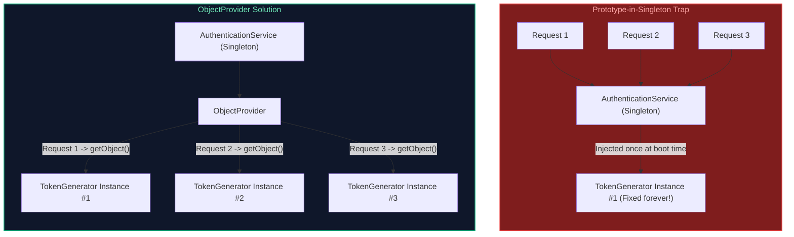

#### Production Solutions:

##### Solution 1: `ObjectProvider<T>` (Recommended Standard)
`ObjectProvider<T>` is a type-safe variant of `BeanFactory` lookup that defers instantiation until runtime:

```java
@Service
public class AuthenticationService {

    private final ObjectProvider<TokenGenerator> tokenGeneratorProvider;

    public AuthenticationService(ObjectProvider<TokenGenerator> tokenGeneratorProvider) {
        this.tokenGeneratorProvider = tokenGeneratorProvider;
    }

    public String issueToken() {
        // getObject() reaches back into the IoC container to create a fresh prototype instance
        TokenGenerator freshGenerator = tokenGeneratorProvider.getObject();
        return freshGenerator.getTokenId();
    }
}
```

##### Solution 2: Scoped Proxies (`proxyMode = ScopedProxyMode.TARGET_CLASS`)
Spring generates a dynamic CGLIB proxy around the prototype bean. When the singleton invokes a method on the proxy, the proxy delegates to a brand-new target instance:

```java
@Component
@Scope(value = ConfigurableBeanFactory.SCOPE_PROTOTYPE, proxyMode = ScopedProxyMode.TARGET_CLASS)
public class TokenGenerator {
    private final String tokenId = UUID.randomUUID().toString();
    public String getTokenId() { return tokenId; }
}

@Service
public class AuthenticationService {
    private final TokenGenerator tokenGenerator; // Injected as a CGLIB proxy

    public AuthenticationService(TokenGenerator tokenGenerator) {
        this.tokenGenerator = tokenGenerator;
    }

    public String issueToken() {
        // Calling tokenGenerator.getTokenId() goes through the CGLIB proxy,
        // which retrieves a fresh instance from the ApplicationContext!
        return tokenGenerator.getTokenId();
    }
}
```

##### Solution 3: Method Injection via `@Lookup`
Spring dynamically subclasses the singleton bean at runtime using CGLIB, overriding the abstract `@Lookup` method to return a fresh prototype from `ApplicationContext`:

```java
@Service
public abstract class AuthenticationService {

    @Lookup
    public abstract TokenGenerator getTokenGenerator();

    public String issueToken() {
        return getTokenGenerator().getTokenId();
    }
}
```

---

# 2. Stereotype Annotations, Scanning & Candidate Disambiguation

---

### 2.1 The Stereotype Family (`@Component`, `@Service`, `@Repository`, `@Controller`, `@RestController`)

Stereotype annotations are specialized forms of `@Component` that assign clear architectural roles within a multi-tier enterprise application:

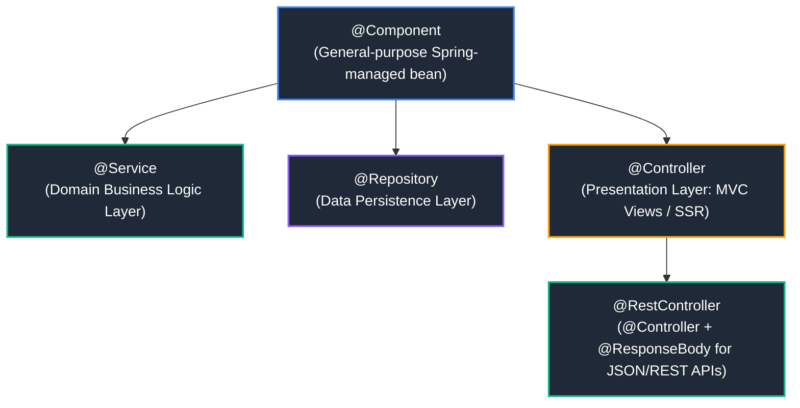

#### Stereotype Responsibilities:
* **`@Component`**: The root stereotype. Any class annotated with `@Component` is picked up during component scanning and registered as a Spring bean definition.
* **`@Service`**: Semantically identifies classes containing core domain business logic, orchestration, and transaction boundaries (`@Transactional`). Contains no technical behavioral differences from `@Component`, but communicates architectural intent.
* **`@Repository`**: Semantically identifies classes interacting with persistent storage (databases, key-value stores).
  * **Special Architectural Behavior**: In addition to component scanning, `@Repository` triggers Spring's `PersistenceExceptionTranslationPostProcessor`. This post-processor automatically intercepts low-level database exceptions (e.g., vendor-specific `SQLException`, Hibernate's `HibernateException`, or MongoDB exceptions) and translates them into Spring's unified, unchecked **`DataAccessException` hierarchy** (e.g., `DuplicateKeyException`, `CannotAcquireLockException`, `DataIntegrityViolationException`). This prevents lower-layer database driver exceptions from leaking into business services.
* **`@Controller`**: Presentation layer component responsible for routing incoming HTTP requests, model preparation, and dispatching views (JSP, Thymeleaf).
* **`@RestController`**: Meta-annotation combining `@Controller` and `@ResponseBody`. Informs Spring's `HandlerAdapter` that every controller method serializes return objects directly into the HTTP response body (typically via Jackson JSON) rather than rendering an HTML view template.

---

### 2.2 Disambiguation: `@Autowired`, `@Primary`, and `@Qualifier`

When multiple beans implement the same interface, Spring's IoC container cannot determine which candidate to inject by type alone. Without explicit instructions, startup crashes with a `NoUniqueBeanDefinitionException`:

```
Parameter 0 of constructor in com.enterprise.order.service.CheckoutService 
required a single bean of type 'com.enterprise.payment.service.PaymentGateway', 
but 2 were found: [stripeGateway, payPalGateway]
```

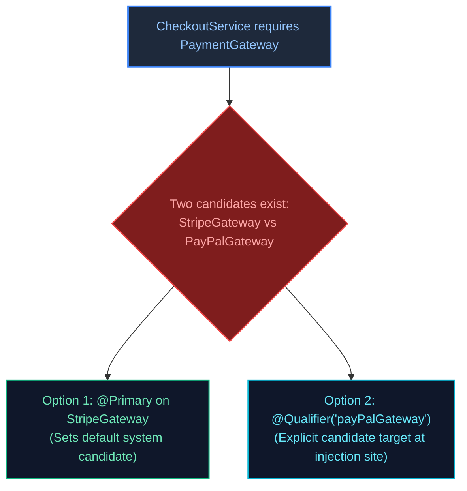

#### Production Resolution Strategies:

```java
public interface PaymentGateway {
    void processPayment(BigDecimal amount);
}

@Component("stripe")
@Primary // Strategy 1: Makes Stripe the default candidate if no qualifier is specified
public class StripeGateway implements PaymentGateway {
    @Override
    public void processPayment(BigDecimal amount) {
        // Stripe integration logic
    }
}

@Component("paypal")
public class PayPalGateway implements PaymentGateway {
    @Override
    public void processPayment(BigDecimal amount) {
        // PayPal integration logic
    }
}

@Service
public class CheckoutService {

    private final PaymentGateway defaultGateway;
    private final PaymentGateway payPalGateway;

    public CheckoutService(
            PaymentGateway defaultGateway, // Injects StripeGateway due to @Primary
            @Qualifier("paypal") PaymentGateway payPalGateway // Injects PayPalGateway via explicit qualifier
    ) {
        this.defaultGateway = defaultGateway;
        this.payPalGateway = payPalGateway;
    }
}
```

---

### 2.3 Multi-Bean Injection & The Dynamic Strategy Pattern

Spring provides native support for the **Strategy Pattern**. If you inject a collection (`List<Interface>` or `Map<String, Interface>`), Spring automatically discovers and injects **all beans** implementing that interface:

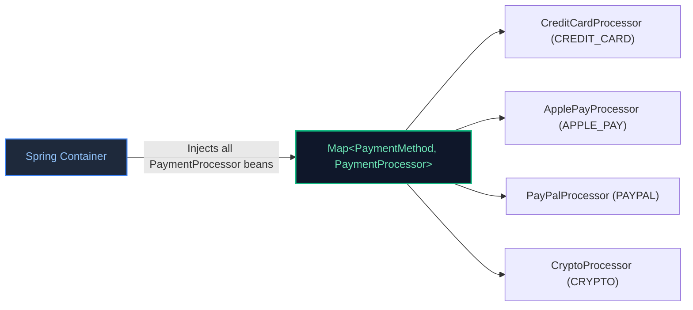

#### Production Implementation: Pluggable Payment Routing Engine
```java
public enum PaymentMethod { CREDIT_CARD, APPLE_PAY, PAYPAL, CRYPTO }

public interface PaymentProcessor {
    PaymentMethod getSupportedMethod();
    void executeTransaction(String transactionId, BigDecimal amount);
}

@Component
public class CreditCardProcessor implements PaymentProcessor {
    @Override public PaymentMethod getSupportedMethod() { return PaymentMethod.CREDIT_CARD; }
    @Override public void executeTransaction(String txId, BigDecimal amount) { /* ... */ }
}

@Component
public class ApplePayProcessor implements PaymentProcessor {
    @Override public PaymentMethod getSupportedMethod() { return PaymentMethod.APPLE_PAY; }
    @Override public void executeTransaction(String txId, BigDecimal amount) { /* ... */ }
}

@Service
public class PaymentRoutingService {

    private final Map<PaymentMethod, PaymentProcessor> processorMap;

    // Spring discovers all beans implementing PaymentProcessor and passes them as a List.
    // The constructor transforms the list into an immutable lookup Map for O(1) strategy dispatch!
    public PaymentRoutingService(List<PaymentProcessor> processors) {
        this.processorMap = processors.stream()
                .collect(Collectors.toUnmodifiableMap(
                        PaymentProcessor::getSupportedMethod,
                        Function.identity()
                ));
    }

    public void processOrderPayment(PaymentMethod method, String txId, BigDecimal amount) {
        PaymentProcessor processor = processorMap.get(method);
        if (processor == null) {
            throw new UnsupportedOperationException("No processor registered for method: " + method);
        }
        processor.executeTransaction(txId, amount);
    }
}
```

---

### 2.4 Circular Dependencies: The Three-Level Cache, Spring Boot 2.6+ Ban & Architectural Remedies

A circular dependency occurs when Bean A requires Bean B, and Bean B directly or indirectly requires Bean A:

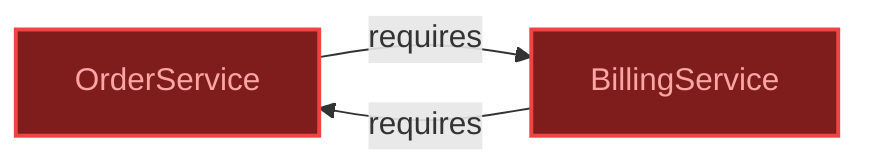

#### How Spring Solved This Historically: The Three-Level Cache
Inside `DefaultSingletonBeanRegistry`, Spring maintains three concurrent maps:
1. **Level 1 (`singletonObjects`)**: Holds fully initialized, ready-to-use singleton beans (`Map<String, Object>`).
2. **Level 2 (`earlySingletonObjects`)**: Holds early bean references (instantiated, but properties not yet injected and initialization hooks not yet run). Used to expose partially created instances to break cycles.
3. **Level 3 (`singletonFactories`)**: Holds ObjectFactories (`Map<String, ObjectFactory<?>>`). This level generates early AOP proxies if a bean requires dynamic proxy wrapping.

*Why constructor injection always failed with circular dependencies*:
The three-level cache relies on instantiating the object via its zero-argument constructor *first*, placing its factory into Level 3, and *then* populating properties. With **constructor injection**, Bean A cannot be instantiated until Bean B exists, and Bean B cannot be instantiated until Bean A exists. The JVM cannot allocate either object, throwing `BeanCurrentlyInCreationException`.

#### Spring Boot 2.6+ Circular Dependency Ban
Starting in **Spring Boot 2.6**, circular references between beans are **forbidden by default**. The application will fail to start:
```text
***************************
APPLICATION FAILED TO START
***************************
Description:
The dependencies of some of the beans in the application context form a cycle:

   orderService (field private billingService)
      ↓
   billingService (field private orderService)
      ↓
   orderService
```

#### Production Architectural Remedies:
1. **Domain Refactoring (Recommended Staff Standard)**: Circular dependencies are almost always symptomatic of flawed domain boundaries and violations of the Single Responsibility Principle. Extract the shared logic into an independent third service:

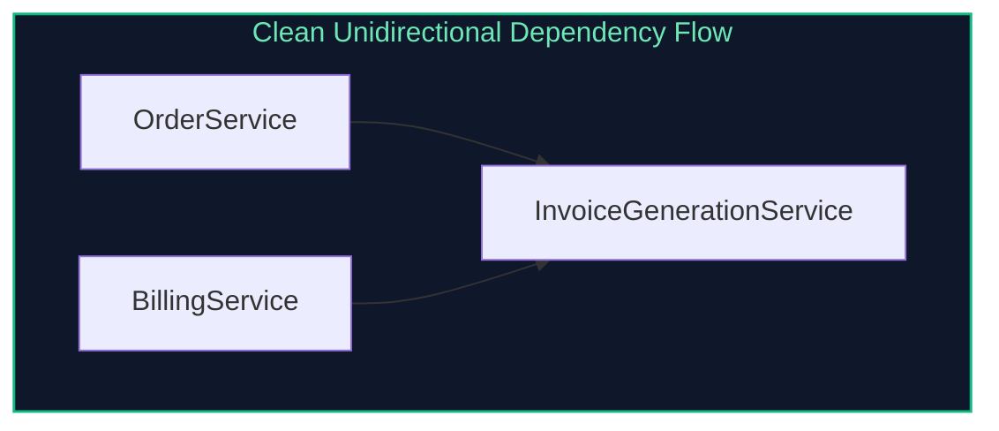

2. **Event-Driven Decoupling**: Replace the synchronous method call with an in-process `ApplicationEventPublisher`. `OrderService` publishes an `OrderCompletedEvent`, and `BillingService` listens via `@EventListener`. Neither service references the other.
3. **`@Lazy` Injection (Temporary Band-aid)**: Injecting `@Lazy` on one side tells Spring to inject a dynamic CGLIB proxy instead of the real bean. The proxy defers resolution of the target bean until a method is actually invoked at runtime:

```java
@Service
public class OrderService {
    private final BillingService billingService;

    public OrderService(@Lazy BillingService billingService) {
        this.billingService = billingService;
    }
}
```

---

# 3. The Spring Bean Lifecycle & Container Extension Points

---

### 3.1 The Complete 12-Phase Spring Bean Lifecycle

Understanding the exact sequence of bean instantiation, property injection, initialization, and destruction is vital for building robust framework components and debugging startup anomalies:

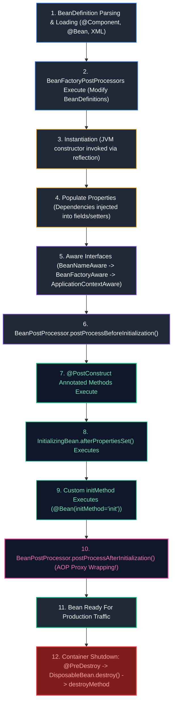

#### Detailed Phase Breakdown:
1. **BeanDefinition Parsing**: The container scans the classpath, parsing annotations (`@Component`, `@Service`, `@Bean`) into metadata structures called `BeanDefinition`. These record the bean class, scope, lazy initialization state, and dependency requirements.
2. **`BeanFactoryPostProcessor` Execution**: Intercepts the raw `BeanDefinition` metadata before any bean instances are constructed.
3. **Instantiation**: The JVM allocates heap memory and invokes the selected constructor via reflection.
4. **Populate Properties**: Dependencies are resolved and injected into the newly constructed bean.
5. **Aware Interfaces**: Spring injects container-level references if implemented:
   * `BeanNameAware`: Provides the bean's registered name in the context.
   * `BeanFactoryAware`: Provides the owning `BeanFactory`.
   * `ApplicationContextAware`: Provides the full `ApplicationContext`.
6. **`BeanPostProcessor.postProcessBeforeInitialization`**: Custom preprocessing on the bean instance.
7. **`@PostConstruct`**: JSR-250 annotation hook invoked after dependencies are injected.
8. **`InitializingBean.afterPropertiesSet`**: Spring framework-specific lifecycle callback.
9. **Custom `initMethod`**: User-defined initialization method defined on `@Bean(initMethod = "start")`.
10. **`BeanPostProcessor.postProcessAfterInitialization`**: **Critical AOP Phase**: Spring examines the initialized bean for annotations like `@Transactional`, `@Async`, or `@Aspect`, and wraps the raw bean in a dynamic proxy (CGLIB or JDK dynamic proxy).
11. **Bean Ready**: The bean is active and serving application traffic.
12. **Container Shutdown**: Initiated when the JVM receives a `SIGTERM` or the context closes:
   * `@PreDestroy` executes.
   * `DisposableBean.destroy()` executes.
   * Custom `destroyMethod` executes.

---

### 3.2 Lifecycle Hooks: `@PostConstruct`, `InitializingBean`, and `@PreDestroy`

```java
package com.enterprise.cache;

import jakarta.annotation.PostConstruct;
import jakarta.annotation.PreDestroy;
import org.slf4j.Logger;
import org.slf4j.LoggerFactory;
import org.springframework.beans.factory.DisposableBean;
import org.springframework.beans.factory.InitializingBean;
import org.springframework.stereotype.Component;

@Component
public class CacheWarmupManager implements InitializingBean, DisposableBean {

    private static final Logger log = LoggerFactory.getLogger(CacheWarmupManager.class);
    private final RedisClient redisClient;

    public CacheWarmupManager(RedisClient redisClient) {
        this.redisClient = redisClient;
        log.info("Phase 3 & 4: Constructor completed; dependencies injected.");
    }

    // JSR-250 Standard: Preferred modern approach
    @PostConstruct
    public void onPostConstruct() {
        log.info("Phase 7: @PostConstruct executing. Pre-loading reference data cache...");
        redisClient.primeCache();
    }

    // Spring Interface: Executes immediately after @PostConstruct
    @Override
    public void afterPropertiesSet() throws Exception {
        log.info("Phase 8: InitializingBean.afterPropertiesSet() validating Redis cluster ping...");
        if (!redisClient.isHealthy()) {
            throw new IllegalStateException("Redis cluster is unreachable during cache warmup!");
        }
    }

    // JSR-250 Shutdown Hook
    @PreDestroy
    public void onPreDestroy() {
        log.info("Phase 12: @PreDestroy executing. Flushing dirty buffers to disk...");
        redisClient.flushBuffers();
    }

    // Spring Interface Shutdown Hook
    @Override
    public void destroy() throws Exception {
        log.info("Phase 12: DisposableBean.destroy() disconnecting Redis client connection pool...");
        redisClient.disconnect();
    }
}
```

---

### 3.3 `BeanFactoryPostProcessor` vs `BeanPostProcessor` vs `FactoryBean<T>`

These three extension interfaces are frequently confused in technical interviews and codebases:

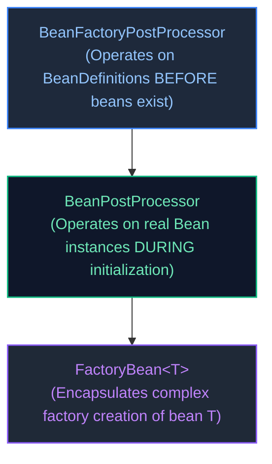

| Interface | Operates On | Execution Timing | Primary Enterprise Use Case |
| :--- | :--- | :--- | :--- |
| **`BeanFactoryPostProcessor`** | `BeanDefinition` metadata structures | **Before any beans are instantiated** | Resolving property placeholders (`${database.url}`) from `application.yml` via `PropertySourcesPlaceholderConfigurer`; registering dynamic bean definitions. |
| **`BeanPostProcessor`** | Actual **bean instances** | **During bean initialization** (before and after init hooks) | Inspecting custom annotations and wrapping beans in dynamic proxies (`@Transactional`, `@Async`, `@Cacheable`, security masking). |
| **`FactoryBean<T>`** | Factory producing complex bean `T` | On-demand when bean `T` is requested | Constructing complex third-party library objects requiring intricate setup (e.g., `LocalContainerEntityManagerFactoryBean`, Apache Kafka producer factories). |

---

### 3.4 Hands-on Deep Dive: Custom BeanPostProcessor for Field Encryption/Masking

A powerful use case for `BeanPostProcessor` in enterprise banking is automatically masking sensitive PII fields (credit cards, SSNs) returned from services:

```java
@Retention(RetentionPolicy.RUNTIME)
@Target(ElementType.METHOD)
public @interface MaskPII {}

@Component
public class PiiMaskingBeanPostProcessor implements BeanPostProcessor {

    private static final Logger log = LoggerFactory.getLogger(PiiMaskingBeanPostProcessor.class);

    @Override
    public Object postProcessBeforeInitialization(Object bean, String beanName) throws BeansException {
        // No modification prior to initialization
        return bean;
    }

    @Override
    public Object postProcessAfterInitialization(Object bean, String beanName) throws BeansException {
        Class<?> targetClass = bean.getClass();
        
        // Scan methods for the @MaskPII annotation
        boolean hasMaskedMethods = Arrays.stream(targetClass.getMethods())
                .anyMatch(m -> m.isAnnotationPresent(MaskPII.class));

        if (!hasMaskedMethods) {
            return bean; // Return original unmodified bean instance
        }

        log.info("Creating dynamic CGLIB proxy for bean '{}' to enforce PII masking", beanName);
        Enhancer enhancer = new Enhancer();
        enhancer.setSuperclass(targetClass);
        enhancer.setCallback((MethodInterceptor) (obj, method, args, proxy) -> {
            Object result = proxy.invoke(bean, args);
            if (method.isAnnotationPresent(MaskPII.class) && result instanceof String s) {
                // Mask string: display only last 4 characters
                return maskValue(s);
            }
            return result;
        });

        return enhancer.create(); // Return dynamic proxy wrapped around original bean
    }

    private String maskValue(String input) {
        if (input == null || input.length() <= 4) return "****";
        return "****-****-****-" + input.substring(input.length() - 4);
    }
}
```

---

# 4. Application Configuration & Enterprise Secret Management

---

### 4.1 Java Configuration: `@Configuration` (Full Mode) vs `@Component` (Lite Mode)

When declaring `@Bean` methods, where the annotation is placed changes the runtime mechanics:

```java
@Configuration // "Full" Configuration Mode
public class DatabaseConfiguration {

    @Bean
    public DataSource dataSource() {
        return new HikariDataSource();
    }

    @Bean
    public JdbcTemplate jdbcTemplate() {
        // CGLIB Interception: Does NOT create a second DataSource instance!
        // The CGLIB proxy intercepts the call and returns the existing singleton DataSource bean.
        return new JdbcTemplate(dataSource());
    }
}
```

* **Full Configuration (`@Configuration(proxyBeanMethods = true)`)**:
  Spring subclasses the configuration class using **CGLIB** at runtime. Method invocations between `@Bean` methods are intercepted. If the bean already exists in the container, the CGLIB proxy returns the cached singleton reference, strictly guaranteeing singleton identity.
* **Lite Configuration (`@Component` or `@Configuration(proxyBeanMethods = false)`)**:
  No CGLIB proxy is generated. Calling `dataSource()` from within `jdbcTemplate()` executes standard Java method invocation, allocating a **duplicate `DataSource` object** and creating an unmanaged connection pool!
* *Spring Boot 2.2+ Standard*: Spring Boot internal auto-configurations use `proxyBeanMethods = false` to improve startup performance and reduce memory overhead, relying on explicit method parameter injection instead of inter-method calls.

---

### 4.2 Multi-Environment Profiles (`@Profile`) & Configuration Hierarchies

Spring Profiles enable conditional configuration across development, staging, and production environments:

```java
@Configuration
@Profile("prod")
public class ProductionCloudStorageConfig {
    @Bean
    public StorageClient storageClient() {
        return new AmazonS3Client();
    }
}

@Configuration
@Profile("local | test")
public class LocalStorageConfig {
    @Bean
    public StorageClient storageClient() {
        return new LocalFileSystemStorageClient();
    }
}
```

#### Spring Boot Configuration Precedence Hierarchy (Highest to Lowest):
When the same property key is defined in multiple sources, Spring Boot resolves values in the following order:
1. **Command-Line Arguments** (`--server.port=9090`)
2. **Spring Boot DevTools global settings** (`~/.config/spring-boot-devtools.properties`)
3. **OS Environment Variables** (`SERVER_PORT=9090` or `SPRING_DATASOURCE_PASSWORD=secret`)
4. **Profile-specific application properties outside packaged JAR** (`config/application-prod.yml`)
5. **Profile-specific application properties packaged inside JAR** (`src/main/resources/application-prod.yml`)
6. **Application properties outside packaged JAR** (`config/application.yml`)
7. **Application properties packaged inside JAR** (`src/main/resources/application.yml`)
8. **Default properties on `@PropertySource` annotations**

---

### 4.3 Externalized Configuration: `@Value` vs `@ConfigurationProperties` with Records & JSR-380

```java
// ❌ Legacy @Value: Prone to typos, unvalidated, scatters property keys across services
@Service
public class PaymentGatewayService {
    @Value("${payment.stripe.api-key}")
    private String apiKey; // Fails late at runtime if missing; not type-safe
}
```

#### The Production Standard: `@ConfigurationProperties` with Immutable Java Records
Combining `@ConfigurationProperties` with Java 16+ records and Jakarta Bean Validation (`@Validated`) provides type safety, immutability, and boot-time fail-fast validation:

```java
@ConfigurationProperties(prefix = "payment.gateway")
@Validated
public record PaymentGatewayProperties(
    @NotBlank(message = "API key must not be blank")
    String apiKey,

    @NotNull(message = "Endpoint URI is required")
    URI endpointUri,

    @Min(value = 100, message = "Timeout must be at least 100ms")
    @Max(value = 30000, message = "Timeout cannot exceed 30000ms")
    int timeoutMs,

    @PositiveOrZero
    int maxRetryAttempts,

    Duration connectionTimeout
) {}
```

Enable scanning in your configuration:
```java
@Configuration
@EnableConfigurationProperties(PaymentGatewayProperties.class)
public class PaymentConfig {

    private final PaymentGatewayProperties properties;

    public PaymentConfig(PaymentGatewayProperties properties) {
        this.properties = properties;
    }

    @Bean
    public RestClient paymentRestClient() {
        return RestClient.builder()
                .baseUrl(properties.endpointUri().toString())
                .defaultHeader("Authorization", "Bearer " + properties.apiKey())
                .build();
    }
}
```

---

### 4.4 Conditional Bean Registration (`@ConditionalOnProperty`, `@ConditionalOnClass`, `@ConditionalOnMissingBean`)

Spring Boot auto-configuration is driven by declarative condition annotations evaluated during container startup:

```java
@Configuration
public class AuditingAutoConfiguration {

    @Bean
    // Only registered if 'app.audit.enabled' is explicitly 'true'
    @ConditionalOnProperty(prefix = "app.audit", name = "enabled", havingValue = "true", matchIfMissing = false)
    // Only registered if KafkaTemplate is present on the application classpath
    @ConditionalOnClass(name = "org.springframework.kafka.core.KafkaTemplate")
    // Only registered if the user has NOT provided their own AuditPublisher bean
    @ConditionalOnMissingBean(AuditPublisher.class)
    public AuditPublisher kafkaAuditPublisher(KafkaTemplate<String, String> kafkaTemplate) {
        return new KafkaAuditPublisher(kafkaTemplate);
    }

    @Bean
    // Fallback bean registered if Kafka is absent or audit logging uses local file
    @ConditionalOnMissingBean(AuditPublisher.class)
    public AuditPublisher consoleAuditPublisher() {
        return new ConsoleAuditPublisher();
    }
}
```

---

### 4.5 In-Process Application Events (`ApplicationEventPublisher`, `@EventListener`, `@TransactionalEventListener`)

Spring provides an in-memory event bus decoupling publishers from subscribers:

```java
public record OrderPlacedEvent(String orderId, String customerEmail, BigDecimal totalAmount) {}

@Service
public class OrderService {

    private final ApplicationEventPublisher eventPublisher;
    private final OrderRepository orderRepository;

    public OrderService(ApplicationEventPublisher eventPublisher, OrderRepository orderRepository) {
        this.eventPublisher = eventPublisher;
        this.orderRepository = orderRepository;
    }

    @Transactional
    public void placeOrder(CreateOrderRequest request) {
        Order order = orderRepository.save(new Order(request));
        // Publishes event synchronously onto Spring's ApplicationEventMulticaster
        eventPublisher.publishEvent(new OrderPlacedEvent(order.getId(), order.getCustomerEmail(), order.getTotalAmount()));
    }
}
```

#### The Critical Production Difference: `@EventListener` vs `@TransactionalEventListener`

```mermaid
flowchart TD
    TX["Database Transaction Begins"] --> Insert["INSERT INTO orders..."]
    Insert --> Publish["publishEvent(OrderPlacedEvent)"]
    Publish --> Commit{"Does DB commit succeed?"}

    Commit -->|YES (Committed)| Listener["@TransactionalEventListener(AFTER_COMMIT)<br/>Fires successfully! Sends customer email."]
    Commit -->|NO (Rollback)| Dropped["Event Dropped!<br/>Customer is NEVER erroneously emailed!"]

    style TX fill:#1e293b,stroke:#3b82f6,stroke-width:1.5px,color:#93c5fd
    style Listener fill:#0f172a,stroke:#10b981,stroke-width:2px,color:#6ee7b7
    style Dropped fill:#7f1d1d,stroke:#ef4444,stroke-width:2px,color:#fca5a5
```

```java
@Component
public class NotificationEventListener {

    private static final Logger log = LoggerFactory.getLogger(NotificationEventListener.class);
    private final EmailClient emailClient;

    public NotificationEventListener(EmailClient emailClient) {
        this.emailClient = emailClient;
    }

    // ❌ DANGEROUS: Standard @EventListener executes IMMEDIATELY inside the active DB transaction!
    // If sending the email fails, the DB transaction rolls back.
    // If DB commit fails later, the email has ALREADY been sent to the user!
    // @EventListener
    // public void handleImmediate(OrderPlacedEvent event) { ... }

    // ✅ PRODUCTION STANDARD: Executes ONLY AFTER the database transaction has successfully committed!
    @TransactionalEventListener(phase = TransactionPhase.AFTER_COMMIT)
    @Async // Offloads email dispatch to a background thread pool, freeing the HTTP request thread
    public void onOrderPlaced(OrderPlacedEvent event) {
        log.info("Transaction committed successfully. Dispatching order confirmation email to {}", event.customerEmail());
        emailClient.sendOrderConfirmation(event.orderId(), event.customerEmail());
    }
}
```

---

# 5. Aspect-Oriented Programming (AOP) & Proxy Internals

---

### 5.1 Core AOP Concepts: Aspect, Advice, JoinPoint, and Pointcut

Aspect-Oriented Programming isolates **cross-cutting concerns** (concerns that touch multiple layers of the application, such as logging, security auditing, caching, and transaction management) from core business logic:

* **Aspect**: A modular class encapsulating a cross-cutting concern (annotated with `@Aspect` and `@Component`).
* **JoinPoint**: A specific point during program execution. In Spring AOP (which is proxy-based), a JoinPoint is **always a method execution**.
* **Pointcut**: A predicate expression that selects specific JoinPoints (e.g., `@annotation(com.enterprise.annotation.Audited)` or `execution(* com.enterprise.service.*.*(..))`).
* **Advice**: The action taken at a JoinPoint:
  * `@Before`: Executes prior to method execution.
  * `@AfterReturning`: Executes after normal method completion.
  * `@AfterThrowing`: Executes if the method throws an exception.
  * `@After`: Executes regardless of outcome (analogous to `finally`).
  * `@Around`: Wraps method execution, completely controlling arguments, return values, and whether the target method executes at all.

---

### 5.2 JDK Dynamic Proxies vs CGLIB Proxies Under the Hood

When Spring encounters an `@Aspect`, `@Transactional`, or `@Cacheable` annotation, its `BeanPostProcessor` wraps the raw bean in a **Dynamic Proxy**:

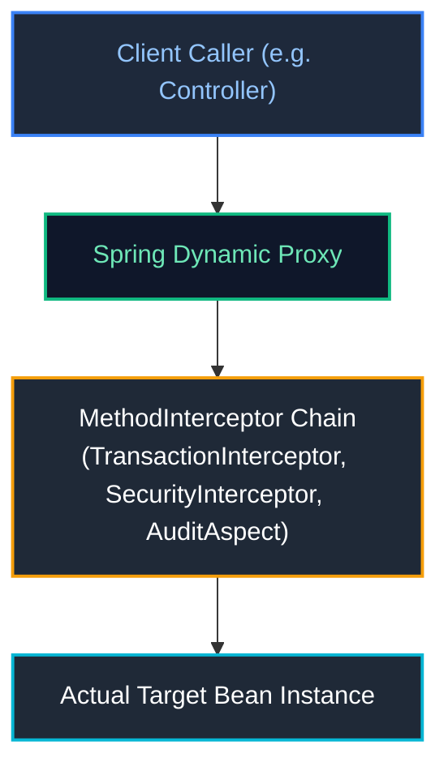

| Dimension | JDK Dynamic Proxy | CGLIB Proxy |
| :--- | :--- | :--- |
| **Technology** | Built into standard JDK (`java.lang.reflect.Proxy`) | Bytecode generation library (`org.springframework.cglib`) |
| **Requirements** | Target class **must implement at least one interface** | Target class does **not** need an interface |
| **Mechanism** | Generates a proxy class implementing the same interface | Generates a dynamic subclass extending the target class |
| **Restrictions** | Only interface methods can be proxied | **`final` classes and `final` methods cannot be proxied!** Target class must have a visible constructor. |
| **Spring Boot Default** | Historical default in Spring 3.x / 4.x | **Default in Spring Boot 2.x and 3.x** (`spring.aop.proxy-target-class=true`) |

---

### 5.3 The Self-Invocation Proxy Bypass Trap & Production Solutions

The single most common bug with declarative Spring annotations (`@Transactional`, `@Cacheable`, `@Async`) is **Self-Invocation**:

```java
@Service
public class UserService {

    public void registerUser(UserRegistrationDto dto) {
        // Business logic...
        
        // ❌ PRODUCTION BUG: Internal call bypasses the Spring Proxy!
        // Calling this.sendActivationEmail() invokes the raw object method directly.
        // The @Async annotation is completely IGNORED and executes synchronously on the HTTP thread!
        sendActivationEmail(dto.email());
    }

    @Async
    public void sendActivationEmail(String email) {
        // Slow SMTP email dispatch (blocks for 3 seconds!)
    }
}
```

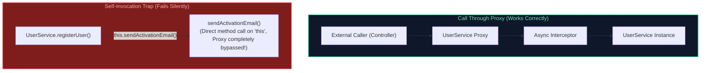

#### Production Fixes for Self-Invocation:

##### Solution 1: Extract to a Collaborator Service (Best Practice)
Move the asynchronous or transactional method to a dedicated collaborator service:

```java
@Service
public class UserRegistrationService {
    private final UserEmailService emailService;

    public UserRegistrationService(UserEmailService emailService) {
        this.emailService = emailService;
    }

    public void registerUser(UserRegistrationDto dto) {
        // Invoking method on an injected collaborator routes through its proxy!
        emailService.sendActivationEmail(dto.email());
    }
}

@Service
public class UserEmailService {
    @Async
    public void sendActivationEmail(String email) {
        // Runs asynchronously on background thread pool
    }
}
```

##### Solution 2: Self-Injection with `@Lazy`
Inject the bean's own proxy reference into itself via constructor or setter with `@Lazy`:

```java
@Service
public class UserService {

    private final ObjectProvider<UserService> selfProvider;

    public UserService(ObjectProvider<UserService> selfProvider) {
        this.selfProvider = selfProvider;
    }

    public void registerUser(UserRegistrationDto dto) {
        // Retrieves the Spring Proxy from the provider
        selfProvider.getObject().sendActivationEmail(dto.email());
    }

    @Async
    public void sendActivationEmail(String email) {
        // Asynchronous execution
    }
}
```

---

### 5.4 Enterprise Implementation: Custom Distributed Rate-Limiting & Performance Aspect

```java
@Retention(RetentionPolicy.RUNTIME)
@Target(ElementType.METHOD)
public @interface RateLimited {
    int maxRequestsPerMinute() default 60;
    String keyPrefix() default "rate_limit:";
}

@Aspect
@Component
public class DistributedRateLimitingAspect {

    private static final Logger log = LoggerFactory.getLogger(DistributedRateLimitingAspect.class);
    private final StringRedisTemplate redisTemplate;

    public DistributedRateLimitingAspect(StringRedisTemplate redisTemplate) {
        this.redisTemplate = redisTemplate;
    }

    @Around("@annotation(rateLimited)")
    public Object enforceRateLimit(ProceedingJoinPoint joinPoint, RateLimited rateLimited) throws Throwable {
        String clientIp = resolveClientIp();
        String redisKey = rateLimited.keyPrefix() + clientIp + ":" + joinPoint.getSignature().toShortString();

        // Increment counter in Redis with 60-second sliding expiration
        Long currentCount = redisTemplate.opsForValue().increment(redisKey);
        if (currentCount != null && currentCount == 1) {
            redisTemplate.expire(redisKey, Duration.ofMinutes(1));
        }

        if (currentCount != null && currentCount > rateLimited.maxRequestsPerMinute()) {
            log.warn("Rate limit exceeded for IP {} on operation {}", clientIp, joinPoint.getSignature().getName());
            throw new ResponseStatusException(HttpStatus.TOO_MANY_REQUESTS, "Exceeded rate limit of " + rateLimited.maxRequestsPerMinute() + " requests/minute");
        }

        long start = System.nanoTime();
        try {
            return joinPoint.proceed(); // Invoke target method
        } finally {
            long durationMs = (System.nanoTime() - start) / 1_000_000;
            log.info("Execution of [{}] took {} ms", joinPoint.getSignature().toShortString(), durationMs);
        }
    }

    private String resolveClientIp() {
        ServletRequestAttributes attrs = (ServletRequestAttributes) RequestContextHolder.getRequestAttributes();
        if (attrs == null) return "INTERNAL";
        HttpServletRequest req = attrs.getRequest();
        String xForwardedFor = req.getHeader("X-Forwarded-For");
        return (xForwardedFor != null) ? xForwardedFor.split(",")[0].trim() : req.getRemoteAddr();
    }
}
```

---

# 6. Spring Boot Architecture, Bootstrapping & Modern Runtime

---

### 6.1 What Problem Does Spring Boot Solve?

Before Spring Boot, building a production enterprise Spring application required:
1. Writing extensive, error-prone XML descriptors (`web.xml`, `applicationContext.xml`, `dispatcher-servlet.xml`).
2. Manually resolving transitive Maven/Gradle dependency version conflicts between Spring, Jackson, Hibernate, and logging libraries.
3. Building a Web Application Archive (`.war`) file and deploying it to external application servers (Tomcat, WebLogic). Upgrading or patching servlet containers required server-wide downtime.

Spring Boot revolutionized the ecosystem through **Opinionated Defaults** and **Convention over Configuration**:
* **Spring Boot Starters**: Curated dependency descriptors guaranteeing tested, mutually compatible library versions.
* **Auto-Configuration Engine**: Introspects the classpath and configures necessary infrastructure beans automatically.
* **Embedded Web Servers**: Packages Tomcat, Jetty, or Undertow directly into a self-contained, executable Fat JAR (`java -jar app.jar`).

---

### 6.2 Deconstructing `@SpringBootApplication` & Bootstrap Sequence

The `@SpringBootApplication` annotation on your main entry class is a meta-annotation composed of three fundamental annotations:

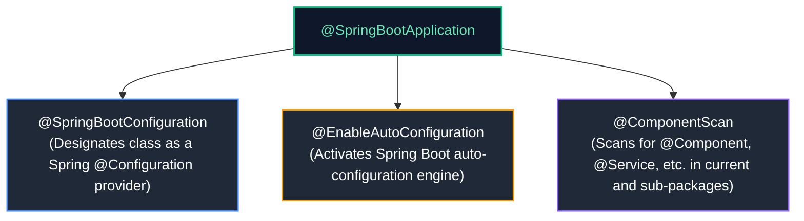

#### Step-by-Step Bootstrap Sequence of `SpringApplication.run()`:
1. **Instantiate `SpringApplication`**:
   * Inspects the classpath to determine web application type: `SERVLET` (Spring MVC), `REACTIVE` (WebFlux), or `NONE` (CLI/batch).
   * Discovers and registers `ApplicationContextInitializer` and `ApplicationListener` instances from `META-INF/spring.factories`.
2. **Prepare Environment**:
   * Initializes `StandardEnvironment` or `StandardServletEnvironment`.
   * Loads active profiles and merges configuration sources (`application.yml`, env vars, CLI args).
   * Emits `ApplicationEnvironmentPreparedEvent`.
3. **Print Banner**: Displays the ASCII Spring Boot startup banner.
4. **Create `ApplicationContext`**:
   * Instantiates the appropriate context (e.g., `AnnotationConfigServletWebServerApplicationContext`).
5. **Prepare Context**:
   * Applies `ApplicationContextInitializer` instances.
   * Loads bean definitions from the primary source class.
   * Emits `ApplicationPreparedEvent`.
6. **Refresh Context (`refresh()`)**:
   * Runs `BeanFactoryPostProcessors`.
   * Registers `BeanPostProcessors`.
   * **Starts Embedded Web Server** (e.g., binds embedded Tomcat to port 8080).
   * Eagerly instantiates and initializes all singleton beans.
7. **Execute Runners**:
   * Discovers and executes all beans implementing `ApplicationRunner` and `CommandLineRunner`.
8. **Emit `ApplicationReadyEvent`**: The application is fully booted and ready to process incoming HTTP requests.

---

### 6.3 The Auto-Configuration Engine (`AutoConfiguration.imports` & Condition Evaluation)

How does Spring Boot know to configure a PostgreSQL `DataSource` when `org.postgresql:postgresql` is added to `pom.xml`?

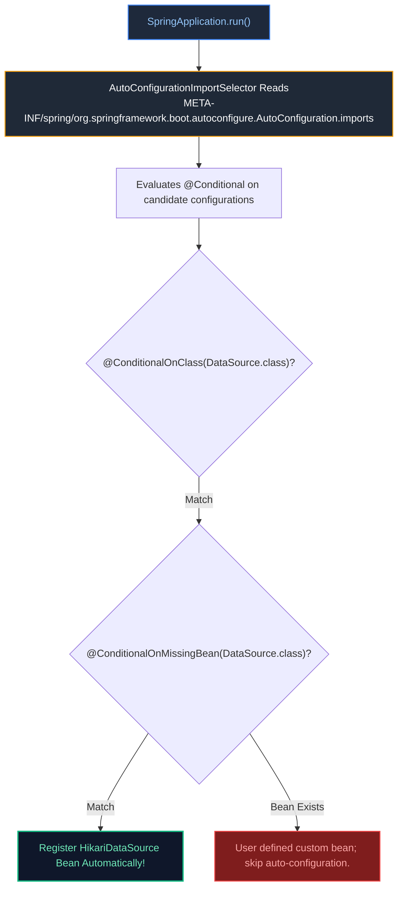

* **In Spring Boot 3.x / 2.7+**: Candidate auto-configurations are listed in:
  `META-INF/spring/org.springframework.boot.autoconfigure.AutoConfiguration.imports`
* **Condition Evaluation Report**: You can inspect why auto-configurations were applied or skipped by booting with `--debug` or querying `/actuator/conditions`.

---

### 6.4 Developing a Production-Ready Custom Spring Boot Starter

Building custom internal starters is a senior engineering requirement for standardizing security, logging, and database connectivity across microservices.

#### Project Layout:
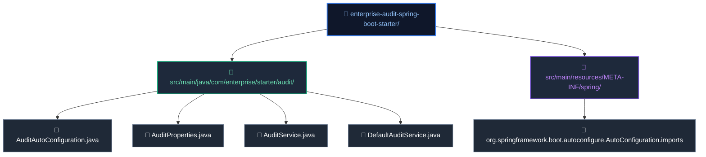

#### Step 1: Configuration Properties Record
```java
package com.enterprise.starter.audit;

import org.springframework.boot.context.properties.ConfigurationProperties;

@ConfigurationProperties(prefix = "enterprise.audit")
public record AuditProperties(boolean enabled, String applicationName, int bufferSize) {}
```

#### Step 2: Auto-Configuration Class
```java
package com.enterprise.starter.audit;

import org.springframework.boot.autoconfigure.AutoConfiguration;
import org.springframework.boot.autoconfigure.condition.ConditionalOnMissingBean;
import org.springframework.boot.autoconfigure.condition.ConditionalOnProperty;
import org.springframework.boot.context.properties.EnableConfigurationProperties;
import org.springframework.context.annotation.Bean;

@AutoConfiguration
@EnableConfigurationProperties(AuditProperties.class)
@ConditionalOnProperty(prefix = "enterprise.audit", name = "enabled", havingValue = "true", matchIfMissing = true)
public class AuditAutoConfiguration {

    @Bean
    @ConditionalOnMissingBean(AuditService.class)
    public AuditService defaultAuditService(AuditProperties properties) {
        return new DefaultAuditService(properties.applicationName(), properties.bufferSize());
    }
}
```

#### Step 3: Registration Descriptor
Create `src/main/resources/META-INF/spring/org.springframework.boot.autoconfigure.AutoConfiguration.imports`:
```
com.enterprise.starter.audit.AuditAutoConfiguration
```

Any downstream microservice adding this starter to its dependencies automatically receives `AuditService` without manual configuration!

---

### 6.5 Embedded Web Servers (Tomcat, Jetty, Undertow) & Graceful Shutdown

Spring Boot packages embedded web servers directly into the executable archive.

#### Production Tuning in `application.yml`:
```yaml
server:
  port: 8080
  # Graceful shutdown: When SIGTERM is received, stop accepting new HTTP connections
  # and allow active in-flight requests up to 30 seconds to finish processing!
  shutdown: graceful
  tomcat:
    threads:
      max: 200 # Maximum worker threads in the Tomcat pool
      min-spare: 20 # Minimum idle threads kept warm
    max-connections: 8192 # Maximum connections accepted by the OS socket acceptor
    accept-count: 100 # Maximum backlog queue when all worker threads are busy
    connection-timeout: 5000ms

spring:
  lifecycle:
    timeout-per-shutdown-phase: 30s # Grace period for in-flight requests
```

---

### 6.6 Spring Boot 3 AOT Compilation & GraalVM Native Images

Spring Boot 3 introduces native support for **Ahead-of-Time (AOT) Compilation** using the GraalVM native image compiler:

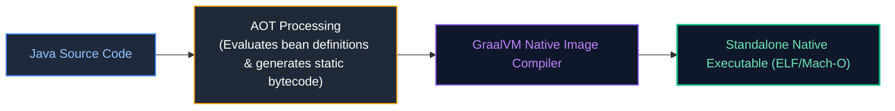

| Metric | Traditional JVM Mode (`java -jar`) | GraalVM Native Image |
| :--- | :--- | :--- |
| **Startup Latency** | $2.5\text{ seconds} - 6.0\text{ seconds}$ | **$0.04\text{ seconds} - 0.09\text{ seconds}$ (Instant)** |
| **Memory Footprint (RSS)** | $300\text{ MB} - 600\text{ MB}$ | **$30\text{ MB} - 55\text{ MB}$ (10x reduction)** |
| **Build Time** | $15\text{ seconds}$ (Maven/Gradle) | $3 - 8\text{ minutes}$ (Closed-world analysis) |
| **Peak Throughput** | Higher (C2 JIT runtime profiling) | Slightly lower (no runtime profile-guided optimization) |
| **Serverless Fit** | Poor (Cold start penalty) | **Exceptional** (Sub-100ms scale-to-zero) |

#### Registering Native Reflection Hints:
Because GraalVM enforces a **closed-world assumption**, any dynamic reflection or serialization requires explicit reachability metadata:

```java
@Configuration
public class NativeRuntimeHintsConfig implements RuntimeHintsRegistrar {
    @Override
    public void registerHints(RuntimeHints hints, ClassLoader classLoader) {
        // Register reflection access for classes loaded dynamically at runtime
        hints.reflection().registerType(PaymentPayload.class, 
                MemberCategory.INVOKE_PUBLIC_CONSTRUCTORS, 
                MemberCategory.INVOKE_PUBLIC_METHODS);
    }
}
```

---

# 7. Spring Boot Actuator & Production Operations

---

### 7.1 Key Actuator Endpoints (`/health`, `/metrics`, `/loggers`, `/env`, `/threaddump`)

Spring Boot Actuator provides production observability, metrics collection, and operational management endpoints:

```yaml
management:
  endpoints:
    web:
      exposure:
        include: "health,metrics,prometheus,loggers,info"
  endpoint:
    health:
      show-details: when_authorized
      probes:
        enabled: true # Enables Kubernetes /liveness and /readiness probes
```

---

### 7.2 Kubernetes Liveness & Readiness Probes (`AvailabilityChangeEvent`)

Actuator natively understands Kubernetes Pod lifecycle semantics:

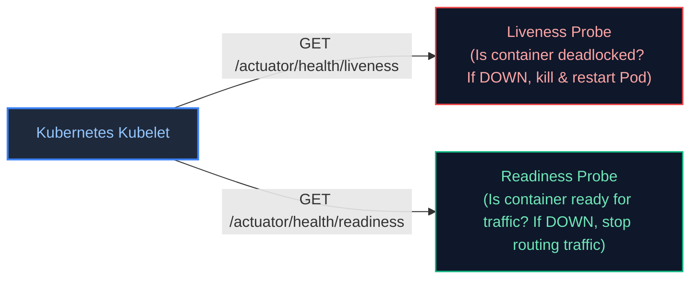

#### Dynamically Modifying Pod Readiness During Cache Warming:
```java
@Component
public class CacheWarmupOrchestrator {

    private final ApplicationEventPublisher eventPublisher;

    public CacheWarmupOrchestrator(ApplicationEventPublisher eventPublisher) {
        this.eventPublisher = eventPublisher;
    }

    public void reloadCache() {
        // 1. Tell Kubernetes to stop routing traffic to this Pod
        AvailabilityChangeEvent.publish(eventPublisher, this, ReadinessState.REFUSING_TRAFFIC);

        try {
            // Perform heavy cache reload...
            rebuildIndex();
        } finally {
            // 2. Cache is warm: signal Kubernetes to restore traffic!
            AvailabilityChangeEvent.publish(eventPublisher, this, ReadinessState.ACCEPTING_TRAFFIC);
        }
    }
}
```

---

### 7.3 Custom Actuator Management Endpoints (`@Endpoint`, `@ReadOperation`, `@WriteOperation`)

You can expose custom domain operations to operations teams via Actuator:

```java
@Component
@Endpoint(id = "circuitBreakers")
public class CircuitBreakerActuatorEndpoint {

    private final ConcurrentMap<String, String> breakerStates = new ConcurrentHashMap<>();

    @ReadOperation // Exposes GET /actuator/circuitBreakers
    public Map<String, String> getAllStates() {
        return breakerStates;
    }

    @ReadOperation // Exposes GET /actuator/circuitBreakers/{name}
    public String getState(@Selector String name) {
        return breakerStates.getOrDefault(name, "UNKNOWN");
    }

    @WriteOperation // Exposes POST /actuator/circuitBreakers
    public void resetBreaker(String name, String state) {
        breakerStates.put(name, state);
    }
}
```

---

### 7.4 Custom Micrometer Observability (Gauges, Counters, Timers)

Spring Boot Actuator integrates with **Micrometer** to publish metrics to Prometheus, Datadog, or InfluxDB:

```java
@Service
public class OrderProcessingMetricsService {

    private final Counter orderSuccessCounter;
    private final Counter orderFailureCounter;
    private final Timer orderProcessingTimer;

    public OrderProcessingMetricsService(MeterRegistry meterRegistry) {
        this.orderSuccessCounter = Counter.builder("orders.processed")
                .tag("status", "success")
                .description("Total successfully processed orders")
                .register(meterRegistry);

        this.orderFailureCounter = Counter.builder("orders.processed")
                .tag("status", "failed")
                .description("Total failed orders")
                .register(meterRegistry);

        this.orderProcessingTimer = Timer.builder("orders.latency")
                .publishPercentiles(0.5, 0.95, 0.99)
                .publishPercentileHistogram()
                .register(meterRegistry);
    }

    public void recordOrder(boolean success, long durationNanos) {
        if (success) {
            orderSuccessCounter.increment();
        } else {
            orderFailureCounter.increment();
        }
        orderProcessingTimer.record(durationNanos, TimeUnit.NANOSECONDS);
    }
}
```

---

### 7.5 Dynamic Runtime Log Level Switching & Securing Actuator Endpoints

#### Incident Troubleshooting via Dynamic Log Level Switching:
During a live production incident, you can elevate logging to `DEBUG` without restarting pods or losing thread state:

```bash
# Query active logging level
curl -X GET http://localhost:8080/actuator/loggers/com.enterprise.order.service

# Dynamically change logging level to DEBUG
curl -X POST http://localhost:8080/actuator/loggers/com.enterprise.order.service \
     -H "Content-Type: application/json" \
     -d '{"configuredLevel": "DEBUG"}'

# Revert back to INFO once incident is resolved
curl -X POST http://localhost:8080/actuator/loggers/com.enterprise.order.service \
     -H "Content-Type: application/json" \
     -d '{"configuredLevel": "INFO"}'
```

#### Securing Actuator with Spring Security:
> [!CAUTION]
> Never expose `/actuator/env`, `/actuator/heapdump`, or sensitive endpoints without strict authorization. They expose environment secrets and process memory.

```java
@Configuration
@EnableWebSecurity
public class ActuatorSecurityConfig {

    @Bean
    public SecurityFilterChain securityFilterChain(HttpSecurity http) throws Exception {
        return http
            .authorizeHttpRequests(auth -> auth
                .requestMatchers(EndpointRequest.to("health", "info")).permitAll()
                .requestMatchers(EndpointRequest.toAnyEndpoint()).hasRole("OPS_ADMIN")
                .anyRequest().authenticated()
            )
            .httpBasic(Customizer.withDefaults())
            .build();
    }
}
```

---

# 8. Production Troubleshooting Playbook

### Incident 1: `BeanCurrentlyInCreationException` (Circular Dependency)
* **Symptom**: Application fails to boot with `BeanCurrentlyInCreationException: Error creating bean with name 'A': Requested bean is currently in creation`.
* **Root Cause**: Two or more beans require each other in their constructors, or circular injection occurs with default Spring Boot 2.6+ settings.
* **Remedy**:
  1. Inspect the exception stack trace to locate the circular cycle (`A -> B -> C -> A`).
  2. Extract common logic into an independent third service (`D`).
  3. Decouple components using `ApplicationEventPublisher`.
  4. If refactoring is not immediately feasible during an urgent outage, mark one dependency `@Lazy` as a temporary bridge.

### Incident 2: `@Transactional` or `@Async` Fails Silently (Self-Invocation)
* **Symptom**: Method annotated with `@Transactional` does not roll back on exception, or `@Async` method runs synchronously and blocks the caller.
* **Root Cause**: The method is being invoked internally from within the same class (`this.method()`), bypassing the Spring CGLIB/JDK proxy interceptor chain.
* **Remedy**:
  1. Move the annotated method into an independent collaborator bean and inject it.
  2. Never call transactional or async methods via `this`.

### Incident 3: High Latency Due to Slow Application Startup
* **Symptom**: Cloud auto-scaling fails because new container pods take 45+ seconds to boot.
* **Diagnostics**:
  * Run with `ApplicationStartup` flight recorder:
    ```java
    SpringApplication app = new SpringApplication(Application.class);
    app.setApplicationStartup(new FlightRecorderApplicationStartup());
    app.run(args);
    ```
  * Query `/actuator/startup` to locate beans with slow constructors or `@PostConstruct` methods.
* **Remedy**:
  * Offload slow initialization (e.g., priming massive caches or verifying remote third-party APIs) out of `@PostConstruct` into asynchronous background threads after `ApplicationReadyEvent`.

---

# 9. Summary Comparison & Engineering Reference Matrix

| Feature / Subsystem | Internal Mechanism | Senior Engineering Standard |
| :--- | :--- | :--- |
| **Dependency Injection** | Constructor injection via reflection | Ban field injection; use immutable constructor injection for clean unit testing. |
| **Bean Scopes** | Singleton cached in container registry; Prototype generated on demand | When injecting prototype into singleton, use `ObjectProvider<T>`. |
| **`@Repository`** | Registers `PersistenceExceptionTranslationPostProcessor` | Encapsulates DB vendor exceptions into Spring `DataAccessException`. |
| **Circular Dependencies** | Three-level singleton cache | Forbidden in Spring Boot 2.6+; decouple via events or extract shared services. |
| **Bean Initialization** | `@PostConstruct` $\to$ `InitializingBean` $\to$ custom `initMethod` | Use `@PostConstruct` for cache warming and validation. |
| **AOP Proxies** | CGLIB dynamic subclassing proxy by default | Beware self-invocation proxy bypass; classes and methods cannot be `final`. |
| **Auto-Configuration** | Evaluates `@Conditional` on `AutoConfiguration.imports` | Use `@ConditionalOnMissingBean` when building reusable team starters. |
| **Config Properties** | Binds YAML to validated records via JSR-380 | Replace `@Value` with `@ConfigurationProperties` records for type safety. |
| **Actuator Probes** | Integrates with K8s via `AvailabilityChangeEvent` | Enable `/actuator/health/liveness` and `/readiness` for safe zero-downtime rolling deploys. |

---

# 10. References & Further Reading

- [Spring Framework Official Documentation (Core Technologies)](https://docs.spring.io/spring-framework/reference/core.html)
- [Spring Boot Reference Guide - Auto-configuration & Starters](https://docs.spring.io/spring-boot/docs/current/reference/html/)
- [Martin Fowler - Inversion of Control Containers and the Dependency Injection Pattern](https://martinfowler.com/articles/injection.html)
- [Spring Boot 3 - GraalVM Native Image Support](https://docs.spring.io/spring-boot/docs/current/reference/html/native-image.html)
- [Micrometer Application Observability Documentation](https://micrometer.io/docs)
