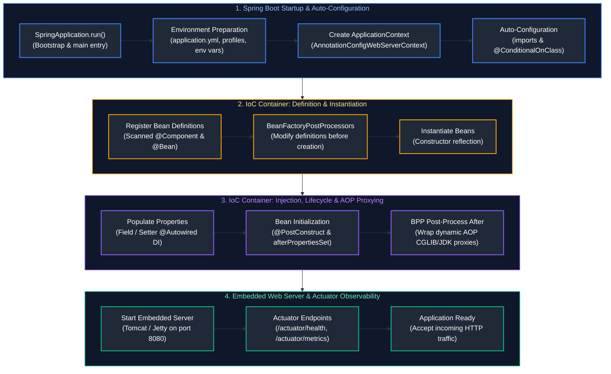
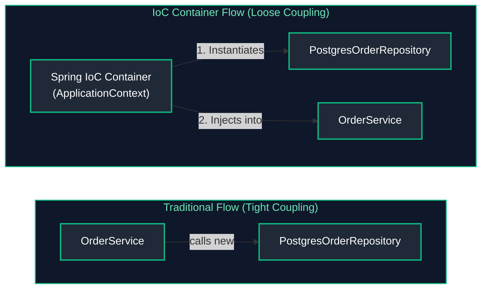
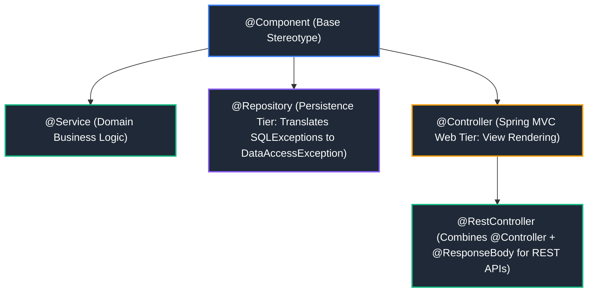
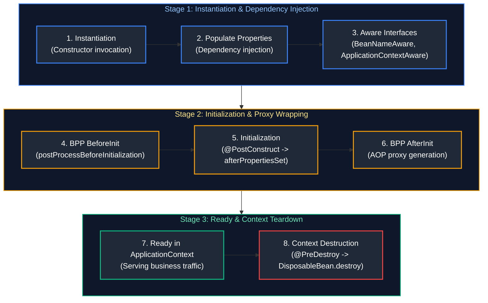
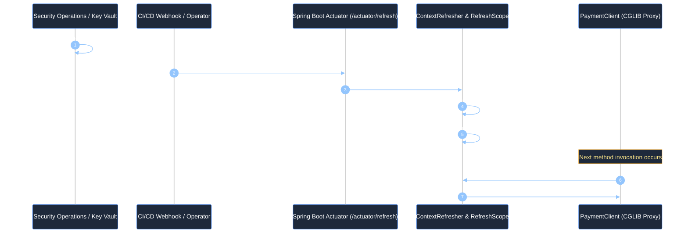
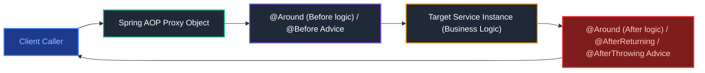
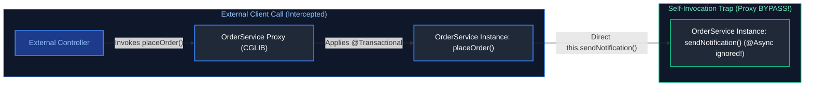
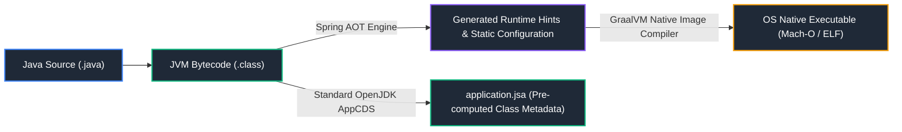
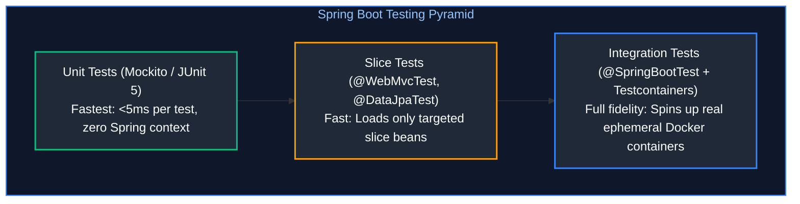

# 07. Spring Framework & Spring Boot

A comprehensive, production-grade guide to the Spring ecosystem, covering Spring Core, Inversion of Control (IoC), Dependency Injection (DI), Spring Bean lifecycle phases, stereotype annotations, Spring Boot architecture, Starters, Auto-Configuration internals, Profiles, Externalized configuration (`@ConfigurationProperties`), and Spring Boot Actuator production observability.

---

## Architectural Overview: Enterprise Spring Core & Spring Boot Runtime Architecture



---

## Table of Contents
1. [Spring Core & Inversion of Control (IoC)](#1-spring-core-inversion-of-control-ioc)
   - [1.1 IoC & Dependency Injection Fundamentals](#11-ioc-dependency-injection-fundamentals)
   - [1.2 Injection Types: Constructor vs Setter vs Field Injection](#12-injection-types-constructor-vs-setter-vs-field-injection)
   - [1.3 `BeanFactory` vs `ApplicationContext` Architectural Differences](#13-beanfactory-vs-applicationcontext-architectural-differences)
   - [1.4 Spring Bean Scopes (`singleton`, `prototype`, web-aware)](#14-spring-bean-scopes-singleton-prototype-web-aware)
2. [Stereotype Annotations & Dependency Resolution](#2-stereotype-annotations-dependency-resolution)
   - [2.1 Stereotypes (`@Component`, `@Service`, `@Repository`, `@Controller`, `@RestController`)](#21-stereotypes-component-service-repository-controller-restcontroller)
   - [2.2 Disambiguation: `@Autowired`, `@Primary`, and `@Qualifier`](#22-disambiguation-autowired-primary-and-qualifier)
   - [2.3 Lazy Initialization (`@Lazy`) & `@DependsOn`](#23-lazy-initialization-lazy-dependson)
3. [Spring Bean Lifecycle & Container Extension Points](#3-spring-bean-lifecycle-container-extension-points)
   - [3.1 Comprehensive Bean Lifecycle Phases & Visual Sequence](#31-comprehensive-bean-lifecycle-phases-visual-sequence)
   - [3.2 Lifecycle Annotations (`@PostConstruct`, `@PreDestroy`)](#32-lifecycle-annotations-postconstruct-predestroy)
   - [3.3 `BeanPostProcessor` vs `BeanFactoryPostProcessor` vs `FactoryBean`](#33-beanpostprocessor-vs-beanfactorypostprocessor-vs-factorybean)
4. [Spring Application Configuration & Enterprise Secret Management](#4-spring-application-configuration-enterprise-secret-management)
   - [4.1 Multi-Environment Profiles (`@Profile`)](#41-multi-environment-profiles-profile)
   - [4.2 Externalized Configuration: `@Value` vs `@ConfigurationProperties`](#42-externalized-configuration-value-vs-configurationproperties)
   - [4.3 Conditional Bean Registration (`@ConditionalOnProperty`, `@ConditionalOnClass`)](#43-conditional-bean-registration-conditionalonproperty-conditionalonclass)
   - [4.4 In-Process Application Events (`ApplicationEventPublisher`, `@EventListener`)](#44-in-process-application-events-applicationeventpublisher-eventlistener)
   - [4.5 Enterprise Secret Management: HashiCorp Vault & Azure Key Vault](#45-enterprise-secret-management-hashicorp-vault-azure-key-vault)
   - [4.6 Dynamic Hot Configuration & Secret Rotation (`@RefreshScope`)](#46-dynamic-hot-configuration-secret-rotation-refreshscope)
5. [Aspect-Oriented Programming (AOP) & Proxy Internals](#5-aspect-oriented-programming-aop-proxy-internals)
   - [5.1 Spring AOP Architecture (`@Aspect`, `@Pointcut`, JoinPoint, Advice Types)](#51-spring-aop-architecture-aspect-pointcut-joinpoint-advice-types)
   - [5.2 JDK Dynamic Proxies vs CGLIB Proxies Under the Hood](#52-jdk-dynamic-proxies-vs-cglib-proxies-under-the-hood)
   - [5.3 The Self-Invocation Proxy Bypass Trap & Production Fixes](#53-the-self-invocation-proxy-bypass-trap-production-fixes)
6. [Spring Boot Architecture, Bootstrapping & Modern Runtime](#6-spring-boot-architecture-bootstrapping-modern-runtime)
   - [6.1 Starters & Auto-Configuration Mechanics](#61-starters-auto-configuration-mechanics)
   - [6.2 Deconstructing `@SpringBootApplication`](#62-deconstructing-springbootapplication)
   - [6.3 Embedded Web Servers (Tomcat, Jetty, Undertow) & Graceful Shutdown](#63-embedded-web-servers-tomcat-jetty-undertow-graceful-shutdown)
   - [6.4 Spring Boot 3 AOT, GraalVM Native Image & CDS (Class Data Sharing)](#64-spring-boot-3-aot-graalvm-native-image-cds-class-data-sharing)
7. [Spring Boot Actuator & Production Operations](#7-spring-boot-actuator-production-operations)
   - [7.1 Essential Actuator Endpoints & Custom Health Indicators](#71-essential-actuator-endpoints-custom-health-indicators)
   - [7.2 Kubernetes Liveness & Readiness Probes (`AvailabilityChangeEvent`)](#72-kubernetes-liveness-readiness-probes-availabilitychangeevent)
   - [7.3 Runtime Log Level Switching & Environment Inspection](#73-runtime-log-level-switching-environment-inspection)
   - [7.4 Spring Boot Actuator Operational Commands Cheatsheet](#74-spring-boot-actuator-operational-commands-cheatsheet)
8. [Spring Boot Testing Strategy & Testcontainers](#8-spring-boot-testing-strategy-testcontainers)
9. [Summary Comparison & Engineering Reference Matrix](#9-summary-comparison-engineering-reference-matrix)
10. [References & Further Reading](#10-references-further-reading)

---

# 1. Spring Core & Inversion of Control (IoC)

---

### 1.1 IoC & Dependency Injection Fundamentals

- **Inversion of Control (IoC)**: A software architectural principle where the control of object creation, configuration, and lifecycle management is inverted—transferred from application code to a framework container.
- **Dependency Injection (DI)**: A concrete implementation of IoC where the container injects dependent objects into a client class at runtime, rather than the class constructing dependencies directly with `new`.



#### Why IoC Matters in Production:
1. **Decoupled Architecture**: Classes depend on interfaces rather than concrete implementations, allowing seamless swaps (e.g., in-memory mocks during unit testing vs real PostgreSQL repositories in production).
2. **Centralized Lifecycle Management**: The container manages initialization hooks, connection pooling, proxy generation, and graceful shutdown without boilerplate code.

---

### 1.2 Injection Types: Constructor vs Setter vs Field Injection

| Injection Type | Syntax Example | Immutability | Testability | Production Recommendation |
| :--- | :--- | :---: | :---: | :--- |
| **Constructor Injection** | `public OrderService(Repo r) { this.r = r; }` | **Yes (`final`)** | **High** (Plain JUnit without Spring) | **Strongly Recommended** |
| **Setter Injection** | `public void setRepo(Repo r) { this.r = r; }` | No | Moderate | Optional dependencies only |
| **Field Injection** | `@Autowired private Repo r;` | No | Low (Requires Reflection/Spring) | **Anti-Pattern (Avoid)** |

#### Recommended Constructor Injection Pattern
```java
@Service
public class OrderService {
    private final PaymentGateway paymentGateway;
    private final NotificationService notificationService;

    // Single constructor: @Autowired is implicit in modern Spring
    public OrderService(PaymentGateway paymentGateway, NotificationService notificationService) {
        this.paymentGateway = paymentGateway;
        this.notificationService = notificationService;
    }
}
```

---

### 1.3 `BeanFactory` vs `ApplicationContext` Architectural Differences

| Dimension | `BeanFactory` (Legacy Core) | `ApplicationContext` (Enterprise Container) |
| :--- | :--- | :--- |
| **Instantiation Strategy** | **Lazy loading**: Instantiates beans on `getBean()` call | **Eager pre-instantiation**: Instantiates all singletons at boot |
| **Enterprise Features** | Basic DI only; minimal footprint | AOP proxy generation, Internationalization (i18n), Application Events |
| **Primary Use Case** | Severely constrained embedded devices | All modern Spring Framework & Spring Boot applications |

---

### 1.4 Spring Bean Scopes (`singleton`, `prototype`, web-aware)

1. **`singleton` (Default)**: Exactly one shared instance per Spring IoC container. Singleton scope does not itself guarantee thread safety; keep beans stateless where possible or coordinate access to mutable shared state. See [Topic 04: Java Concurrency & Multithreading](./04_java_concurrency_multithreading.md#2-synchronization-thread-safety).
2. **`prototype`**: A new, independent instance is created every time the bean is requested from the container.
3. **`request` (Web)**: Exactly one instance per HTTP request lifecycle.
4. **`session` (Web)**: Exactly one instance per HTTP session.
5. **`application` (Web)**: Exactly one instance per `ServletContext`.

---

# 2. Stereotype Annotations & Dependency Resolution

---

### 2.1 Stereotypes (`@Component`, `@Service`, `@Repository`, `@Controller`, `@RestController`)



---

### 2.2 Disambiguation: `@Autowired`, `@Primary`, and `@Qualifier`

When multiple beans implement the same interface:
- **`@Primary`**: Designates a default bean to inject when multiple candidates exist.
- **`@Qualifier("beanName")`**: Explicitly selects a specific target bean by name at the injection site.

```java
@Service
public class NotificationManager {
    private final MessageSender messageSender;

    public NotificationManager(@Qualifier("smsSender") MessageSender messageSender) {
        this.messageSender = messageSender;
    }
}
```

---

### 2.3 Lazy Initialization (`@Lazy`) & `@DependsOn`

- **`@Lazy`**: Defers bean instantiation until the bean is first requested, accelerating initial application startup.
- **`@DependsOn("beanName")`**: Enforces an explicit bean initialization order (e.g. initialize DatabaseMigrationBean before DataSourceConnectionPool).

---

# 3. Spring Bean Lifecycle & Container Extension Points

---

### 3.1 Comprehensive Bean Lifecycle Phases & Visual Sequence



---

### 3.2 Lifecycle Annotations (`@PostConstruct`, `@PreDestroy`)

```java
@Component
public class CacheWarmupService {

    @PostConstruct
    public void onStartup() {
        System.out.println("Lifecycle: Dependencies wired. Pre-warming in-memory cache...");
    }

    @PreDestroy
    public void onShutdown() {
        System.out.println("Lifecycle: Application shutting down. Flushing cache pages to disk...");
    }
}
```

---

### 3.3 `BeanPostProcessor` vs `BeanFactoryPostProcessor` vs `FactoryBean`

- **`BeanFactoryPostProcessor`**: Executes **before** any bean instances are created. Operates on raw bean metadata/definitions (e.g. resolving `${...}` configuration placeholders).
- **`BeanPostProcessor`**: Intercepts bean instances both before and after initialization. **This is the exact engine Spring uses to wrap beans in AOP Dynamic Proxies for `@Transactional`, `@Async`, and `@Cacheable`**.
- **`FactoryBean<T>`**: An interface for complex factory objects producing beans (e.g. `LocalContainerEntityManagerFactoryBean`).

---

# 4. Spring Application Configuration & Enterprise Secret Management

---

### 4.1 Multi-Environment Profiles (`@Profile`)

Segregates configurations by environment (`dev`, `staging`, `prod`):
```properties
# application.properties
spring.profiles.active=prod
```

```java
@Configuration
@Profile("prod")
public class ProductionSecurityConfig { ... }
```

---

### 4.2 Externalized Configuration: `@Value` vs `@ConfigurationProperties`

| Feature | `@Value` | `@ConfigurationProperties` |
| :--- | :--- | :--- |
| **Binding Type** | Injects individual raw property strings | Type-safe binding of entire hierarchical property trees |
| **SpEL Support** | Yes (`#{...}`) | No |
| **Validation** | No | Supports Jakarta Bean Validation (`@Validated`) |
| **Relaxed Binding** | Strict matching | Yes (`app.server-url`, `app.serverUrl`, `APP_SERVERURL`) |

```java
@ConfigurationProperties(prefix = "app.payment")
@Validated
public record PaymentProperties(
    @NotBlank String gatewayUrl,
    @Min(1000) int timeoutMillis
) {}
```

---

### 4.3 Conditional Bean Registration (`@ConditionalOnProperty`, `@ConditionalOnClass`)

Allows beans to be registered conditionally at boot:
- `@ConditionalOnProperty(name = "feature.billing.enabled", havingValue = "true")`
- `@ConditionalOnClass(name = "org.postgresql.Driver")`
- `@ConditionalOnMissingBean(PaymentService.class)`: Foundation of Spring Boot Auto-Configuration (provides default bean only if user hasn't declared one).

---

### 4.4 In-Process Application Events (`ApplicationEventPublisher`, `@EventListener`)

```java
// 1. Immutable Event Record
public record OrderPlacedEvent(String orderId, double amount) {}

// 2. Publisher
@Service
public class OrderService {
    private final ApplicationEventPublisher publisher;

    public OrderService(ApplicationEventPublisher publisher) { this.publisher = publisher; }

    public void createOrder(String orderId, double amount) {
        publisher.publishEvent(new OrderPlacedEvent(orderId, amount));
    }
}

// 3. Asynchronous Listener & Custom TaskExecutor Configuration
@Component
public class NotificationListener {

    // Runs asynchronously on a background thread pool without blocking the main web request
    @Async("applicationTaskExecutor")
    @EventListener
    public void onOrderPlaced(OrderPlacedEvent event) {
        System.out.println("[" + Thread.currentThread().getName() + "] Event received: Sending email receipt for Order #" + event.orderId());
    }
}

// 4. Production Spring ThreadPoolTaskExecutor Configuration
@Configuration
@EnableAsync
public class AsyncThreadPoolConfig {

    @Bean(name = "applicationTaskExecutor")
    public Executor applicationTaskExecutor() {
        ThreadPoolTaskExecutor executor = new ThreadPoolTaskExecutor();
        // Core pool size: minimum worker threads kept alive
        executor.setCorePoolSize(4);
        // Max pool size: maximum threads allocated when queue fills
        executor.setMaxPoolSize(8);
        // Bounded queue capacity: backpressure buffer preventing OutOfMemoryError
        executor.setQueueCapacity(100);
        // Custom thread naming prefix for easy diagnosis in logs and thread dumps
        executor.setThreadNamePrefix("spring-async-");
        // Rejection policy: CallerRunsPolicy executes rejected task in caller thread to apply backpressure
        executor.setRejectedExecutionHandler(new ThreadPoolExecutor.CallerRunsPolicy());
        // Graceful shutdown: wait for in-flight tasks to complete before destroying context
        executor.setWaitForTasksToCompleteOnShutdown(true);
        executor.setAwaitTerminationSeconds(30);
        executor.initialize();
        return executor;
    }
}

> [!TIP]
> For thread pool parameter sizing formulas, bounded work queue selection (`ArrayBlockingQueue` vs `LinkedBlockingQueue`), and Java 21 Virtual Thread integration (`spring.threads.virtual.enabled=true`), see [04. Java Concurrency & Multithreading - Section 7: Executor Framework](04_java_concurrency_multithreading.md#7-executor-framework-asynchronous-pipelines).
```

---

### 4.5 Enterprise Secret Management: HashiCorp Vault & Azure Key Vault

Hardcoding database passwords, private keys, or API credentials into source code, Git repositories, or unencrypted Docker containers violates PCI-DSS, SOC 2, and ISO 27001 compliance standards. Enterprise Spring Boot applications integrate directly with centralized Secret Management stores.

#### 1. HashiCorp Vault Integration (`spring-cloud-starter-vault-config`)

Spring Cloud Vault acts as an early-bootstrap property source, querying HashiCorp Vault over mutual TLS before the main `ApplicationContext` initializes.

```yaml
# bootstrap.yml or application.yml
spring:
  cloud:
    vault:
      uri: https://vault.internal.corp:8200
      ssl:
        trust-store: classpath:vault-truststore.p12
        trust-store-password: "${VAULT_TS_PASSWORD}"
      authentication: APPROLE
      app-role:
        role-id: "${VAULT_ROLE_ID}"
        secret-id: "${VAULT_SECRET_ID}"
      kv:
        enabled: true
        backend: secret
        default-context: application
        profiles: prod
```
* **Secret Path Hierarchy**: Spring Boot queries Vault paths in order:
  1. `secret/data/application` (Shared across all services)
  2. `secret/data/application,prod` (Shared production credentials)
  3. `secret/data/order-service` (Service-specific secrets)
  4. `secret/data/order-service,prod` (Service-specific production secrets)

#### 2. Azure Key Vault Integration (`spring-cloud-azure-starter-keyvault-secrets`)

In Microsoft Azure, applications running on Azure Kubernetes Service (AKS) authenticate to Key Vault passwordlessly via Azure Managed Identity (Workload Identity):

```yaml
# application.yml
spring:
  cloud:
    azure:
      keyvault:
        secret:
          property-sources:
            - name: "kv-prod-eastus"
              endpoint: "https://kv-prod-eastus.vault.azure.net/"
              credential:
                managed-identity-client-id: "${AZURE_CLIENT_ID}"
```

Secrets stored in Azure Key Vault (e.g. `datasource-password`) are transparently mapped to standard Spring properties (`spring.datasource.password`).

---

### 4.6 Dynamic Hot Configuration & Secret Rotation (`@RefreshScope`)

When database passwords or TLS API tokens rotate, restarting dozens of microservice pods induces unnecessary downtime and cache invalidation. Spring Cloud's `@RefreshScope` enables zero-downtime hot reloading of configuration beans:



#### Implementation in Java:

```java
@Component
@RefreshScope // Managed by RefreshScope: target bean reconstructed on refresh
public class PaymentGatewayClient {

    private final String apiKey;
    private final String gatewayEndpoint;

    public PaymentGatewayClient(
            @Value("${payment.gateway.api-key}") String apiKey,
            @Value("${payment.gateway.endpoint}") String gatewayEndpoint) {
        this.apiKey = apiKey;
        this.gatewayEndpoint = gatewayEndpoint;
    }

    public ChargeResponse processCharge(BigDecimal amount) {
        // Automatically uses current refreshed API key
        return executeHttpCall(gatewayEndpoint, apiKey, amount);
    }
}
```

Triggering rotation at runtime without restarting the application:
```bash
curl -X POST http://localhost:8080/actuator/refresh
# Response returns list of modified property keys:
# ["payment.gateway.api-key"]
```

---

# 5. Aspect-Oriented Programming (AOP) & Proxy Internals

---

### 5.1 Spring AOP Architecture (`@Aspect`, `@Pointcut`, JoinPoint, Advice Types)

Spring AOP provides declarative separation of cross-cutting concerns (logging, transaction management, rate limiting, security, metrics) without cluttering business logic:



#### The Five Advice Types:
1. **`@Before`**: Executes before the target join point method starts.
2. **`@AfterReturning`**: Executes after the join point completes successfully without exceptions.
3. **`@AfterThrowing`**: Executes only if the target method throws an exception.
4. **`@After` (Finally)**: Executes regardless of normal or exceptional completion.
5. **`@Around`**: The most powerful advice; surrounds the join point. Controls whether and when `proceed()` is invoked, allowing modification of method arguments and return values.

#### Production Custom AOP Performance Tracker:

```java
// 1. Custom Marker Annotation
@Target(ElementType.METHOD)
@Retention(RetentionPolicy.RUNTIME)
public @interface TrackExecutionTime {
    String operationName() default "";
}

// 2. Aspect Definition
@Aspect
@Component
public class PerformanceMonitoringAspect {

    private static final Logger log = LoggerFactory.getLogger(PerformanceMonitoringAspect.class);

    // Pointcut matches any method annotated with @TrackExecutionTime
    @Pointcut("@annotation(trackExecutionTime)")
    public void annotatedWithTrackTime(TrackExecutionTime trackExecutionTime) {}

    @Around(value = "annotatedWithTrackTime(trackExecutionTime)", argNames = "joinPoint,trackExecutionTime")
    public Object profileMethodExecution(ProceedingJoinPoint joinPoint, TrackExecutionTime trackExecutionTime) throws Throwable {
        long startTime = System.nanoTime();
        String targetMethod = joinPoint.getSignature().toShortString();
        String operation = trackExecutionTime.operationName().isBlank() ? targetMethod : trackExecutionTime.operationName();

        try {
            Object result = joinPoint.proceed(); // Executes target business method
            return result;
        } finally {
            long durationMs = (System.nanoTime() - startTime) / 1_000_000;
            log.info("AOP Metric: [Operation: {}] executed in {} ms", operation, durationMs);
        }
    }
}
```

---

### 5.2 JDK Dynamic Proxies vs CGLIB Proxies Under the Hood

Spring AOP is runtime proxy-based. Spring creates a surrogate proxy object that intercepts calls before delegating to the target instance:

| Dimension | JDK Dynamic Proxy | CGLIB Proxy (Code Generation Library) |
| :--- | :--- | :--- |
| **Mechanism** | `java.lang.reflect.Proxy` & `InvocationHandler` | Subclasses target class via ASM bytecode generation |
| **Interface Requirement** | **Strictly requires** target to implement an `interface` | Can proxy plain classes without interfaces |
| **Limitations** | Only proxies methods defined on interfaces | Cannot proxy `final` classes or `final` methods |
| **Performance** | Historically slower; very fast in modern Java | Fast direct bytecode invocation |
| **Spring Boot Default** | Default in legacy Spring Framework | **Default in Spring Boot 2.x & 3.x** (`proxy-target-class=true`) |

---

### 5.3 The Self-Invocation Proxy Bypass Trap & Production Fixes

The single most common bug in Spring enterprise applications is the **Self-Invocation Trap**: when a method within a bean calls another method on `this`, the call bypasses the Spring AOP Proxy entirely!



#### The Bug in Action:
```java
@Service
public class OrderService {

    public void processOrder(Long orderId) {
        // Business logic...
        
        // BUG: Direct 'this' call! Does NOT go through the AOP Proxy!
        // The @Transactional(propagation = Propagation.REQUIRES_NEW) or @Async is SILENTLY IGNORED!
        this.saveAuditLog(orderId); 
    }

    @Transactional(propagation = Propagation.REQUIRES_NEW)
    public void saveAuditLog(Long orderId) {
        // Expecting a separate, independent transaction; but runs in parent transaction!
    }
}
```

#### Production Resolution Strategies:

1. **Clean Architectural Extraction (Recommended)**:
Extract the annotated method into a dedicated collaborator service bean (`AuditService`), ensuring all calls traverse the proxy:
```java
@Service
public class OrderService {
    private final AuditService auditService; // Separate bean!

    public OrderService(AuditService auditService) { this.auditService = auditService; }

    public void processOrder(Long orderId) {
        auditService.saveAuditLog(orderId); // Traverses proxy cleanly!
    }
}
```

2. **Self-Injection via ObjectProvider (Lazy Self-Reference)**:
Inject a reference to the proxy of the current class:
```java
@Service
public class OrderService {
    @Lazy
    @Autowired
    private OrderService self;

    public void processOrder(Long orderId) {
        self.saveAuditLog(orderId); // Routes through proxy!
    }
}
```

3. **`AopContext.currentProxy()`**:
Enable proxy exposure via `@EnableAspectJAutoProxy(exposeProxy = true)`:
```java
public void processOrder(Long orderId) {
    ((OrderService) AopContext.currentProxy()).saveAuditLog(orderId);
}
```

# 6. Spring Boot Architecture, Bootstrapping & Modern Runtime

---

### 6.1 Starters & Auto-Configuration Mechanics

- **Spring Boot Starters**: Curated dependency descriptors (`spring-boot-starter-web`) that bundle compatible transitives (Tomcat, Jackson, Spring MVC, Validation).
- **Auto-Configuration Engine**: Scans `META-INF/spring/org.springframework.boot.autoconfigure.AutoConfiguration.imports`, checking `@Conditional` annotations against classpath classes to instantiate boilerplate beans automatically.

---

### 6.2 Deconstructing `@SpringBootApplication`

Combines three essential annotations:
1. **`@SpringBootConfiguration`**: Declares class as a source of bean definitions.
2. **`@EnableAutoConfiguration`**: Enables Spring Boot's automatic bean configuration engine.
3. **`@ComponentScan`**: Recursively scans current package and subpackages for stereotype annotations.

---

### 6.3 Embedded Web Servers (Tomcat, Jetty, Undertow) & Graceful Shutdown

Spring Boot packages an embedded servlet container inside the fat executable JAR, eliminating external application server deployments:
```properties
# Graceful Shutdown Configuration in application.properties
server.shutdown=graceful
spring.lifecycle.timeout-per-shutdown-phase=30s
```

---

### 6.4 Spring Boot 3 AOT, GraalVM Native Image & CDS (Class Data Sharing)

Modern cloud-native and serverless workloads (AWS Lambda, Azure Functions, Knative) demand instant cold startup and reduced memory footprints. Spring Boot 3 addresses this with native compilation and JVM optimizations:



#### 1. GraalVM Native Image vs Standard JVM
- **Ahead-of-Time (AOT) Processing**: Spring Boot 3 analyzes the application at build time, pre-computes `@Conditional` evaluations, and synthesizes bean definitions into direct Java code, eliminating runtime reflection and classpath scanning.
- **Benefits**:
  - **Cold Start Time**: ~50–100ms (compared to 3–8 seconds on standard JVM).
  - **Memory Footprint**: 30–50MB RSS (compared to 300–600MB on JVM).
  - **Instant Peak Performance**: No JIT compilation warm-up curve.
- **Trade-offs**: Closed-world assumption; dynamic reflection, dynamic proxies, and resource loading require explicit hints (`RuntimeHintsRegistrar` or `@RegisterReflectionForBinding`).

#### 2. AppCDS (Application Class Data Sharing)
For workloads where GraalVM Native Image cannot be used (e.g. heavy dynamic bytecode manipulation):
- AppCDS pre-processes application classes into a shared archive (`application.jsa`).
- At container startup, the JVM memory-maps (`mmap`) this archive directly into memory without class parsing and verification.
- Achieves **40–50% faster startup** on standard HotSpot JVM with **zero code modifications**:
```bash
# 1. Training run to generate CDS archive
java -XX:ArchiveClassesAtExit=application.jsa -Dspring.context.exit=onRefresh -jar app.jar

# 2. Production startup using CDS archive
java -XX:SharedArchiveFile=application.jsa -jar app.jar
```

---

# 7. Spring Boot Actuator & Production Operations

---

### 7.1 Essential Actuator Endpoints & Custom Health Indicators

```java
@Component
public class PaymentGatewayHealthIndicator implements HealthIndicator {
    @Override
    public Health health() {
        boolean gatewayOnline = checkPing();
        if (gatewayOnline) {
            return Health.up().withDetail("GatewayLatency", "12ms").build();
        }
        return Health.down().withDetail("Reason", "Socket timeout").build();
    }
    private boolean checkPing() { return true; }
}
```

---

### 7.2 Kubernetes Liveness & Readiness Probes (`AvailabilityChangeEvent`)

In Kubernetes, Pod lifecycle management relies on Spring Boot Actuator's dedicated health groups:
```properties
# Exposes /actuator/health/liveness and /actuator/health/readiness
management.endpoint.health.probes.enabled=true
management.health.livenessstate.enabled=true
management.health.readinessstate.enabled=true
```

| Probe | Actuator Group | Default Logic | Kubernetes Action on Failure |
| :--- | :--- | :--- | :--- |
| **Liveness Probe** | `/actuator/health/liveness` | Checks if JVM internal state is uncorrupted (`LivenessState.CORRECT`) | **Restarts container** (`kill -9` & reschedule) |
| **Readiness Probe** | `/actuator/health/readiness` | Checks if app is ready to handle traffic (`ReadinessState.ACCEPTING_TRAFFIC`) | **Removes Pod IP from Service routing** (No traffic; pod stays alive!) |

#### Programmatic Readiness Toggling (Graceful Drain & Recovery):
If an external dependency (such as downstream billing) becomes degraded, an application should NOT fail its liveness probe (which triggers a pointless restart loop). Instead, it should refuse incoming traffic gracefully by updating its readiness state:

```java
@Service
public class GracefulTrafficManager {

    private final ApplicationEventPublisher eventPublisher;

    public GracefulTrafficManager(ApplicationEventPublisher eventPublisher) {
        this.eventPublisher = eventPublisher;
    }

    public void drainTrafficForMaintenance() {
        // Signals Kubernetes to immediately stop routing ingress traffic to this Pod
        AvailabilityChangeEvent.publish(eventPublisher, this, ReadinessState.REFUSING_TRAFFIC);
    }

    public void resumeTraffic() {
        // Signals Kubernetes to re-add Pod to Service endpoints
        AvailabilityChangeEvent.publish(eventPublisher, this, ReadinessState.ACCEPTING_TRAFFIC);
    }
}
```

---

### 7.3 Runtime Log Level Switching & Environment Inspection

Change package log levels dynamically **without restarting the application**:
```bash
curl -X POST http://localhost:8080/actuator/loggers/com.company.service \
  -H "Content-Type: application/json" \
  -d '{"configuredLevel": "DEBUG"}'
```

---

### 7.4 Spring Boot Actuator Operational Commands Cheatsheet

| Command & Endpoint | Purpose | What Does What | Practical Operational Scenario |
| :--- | :--- | :--- | :--- |
| `curl -s http://localhost:8080/actuator/health` | Application Health | Returns `UP`, `DOWN`, or `OUT_OF_SERVICE` status | Kubernetes Liveness and Readiness probes |
| `curl -s http://localhost:8080/actuator/metrics` | Metrics List | Enumerates all active Micrometer metric names | Discovering available JVM and HTTP metrics |
| `curl -s http://localhost:8080/actuator/metrics/jvm.memory.used` | JVM Memory Usage | Dumps memory utilization by memory pool | Diagnosing heap memory leaks |
| `curl -s http://localhost:8080/actuator/env` | Environment Config | Displays active profiles and resolved configuration properties | Verifying active configuration values in production |
| `curl -s http://localhost:8080/actuator/beans` | Bean Inventory | Dumps complete list of all singleton beans in ApplicationContext | Debugging missing bean or dependency injection conflicts |

---

# 8. Spring Boot Testing Strategy & Testcontainers

A comprehensive Spring Boot testing strategy optimizes test speed while maintaining high confidence across the testing pyramid:



### 8.1 The Spring Test Context Caching Hazard
- **Context Caching**: By default, Spring Boot reuses the same `ApplicationContext` across multiple test classes if they share identical configuration.
- **The `@MockBean` Anti-Pattern**: When a test uses `@MockBean`, it modifies the bean definition tree, forcing Spring to create a **brand new ApplicationContext** for that test class. In large suites with 100+ tests, excessive `@MockBean` usage causes test runs to balloon from 30 seconds to 15 minutes!
- **Mitigation**: Prefer pure unit tests with Mockito (`@ExtendWith(MockitoExtension.class)`) for services, and use real Testcontainers for repository and integration tests.

### 8.2 Production Integration Testing with Testcontainers
```java
@SpringBootTest(webEnvironment = SpringBootTest.WebEnvironment.RANDOM_PORT)
@Testcontainers
class OrderIntegrationTest {

    // Starts an isolated PostgreSQL container before test suite execution
    @Container
    static final PostgreSQLContainer<?> postgres = new PostgreSQLContainer<>("postgres:16-alpine")
        .withDatabaseName("testdb")
        .withUsername("testuser")
        .withPassword("testpass");

    // Dynamically injects container port into Spring configuration
    @DynamicPropertySource
    static void configureProperties(DynamicPropertyRegistry registry) {
        registry.add("spring.datasource.url", postgres::getJdbcUrl);
        registry.add("spring.datasource.username", postgres::getUsername);
        registry.add("spring.datasource.password", postgres::getPassword);
    }

    @Autowired
    private OrderRepository orderRepository;

    @Test
    void shouldPersistAndRetrieveOrder() {
        Order order = new Order("ORD-101", new BigDecimal("250.00"));
        orderRepository.save(order);

        Optional<Order> fetched = orderRepository.findById("ORD-101");
        assertThat(fetched).isPresent();
        assertThat(fetched.get().getAmount()).isEqualByComparingTo("250.00");
    }
}
```

---

# 9. Summary Comparison & Engineering Reference Matrix

| Feature / Subsystem | Underlying Spring Mechanism | Configuration / Code Hook | Production Engineering Rule |
| :--- | :--- | :--- | :--- |
| **Inversion of Control** | `DefaultListableBeanFactory` | Constructor Injection | Always use constructor injection; avoids reflection overhead and enforces immutability. |
| **Singleton Scope** | Cached in `singletonObjects` Map | `@Scope("singleton")` | Keep beans strictly stateless; shared mutable state causes race hazards under load. |
| **Prototype Scope** | Newly instantiated on every request | `@Scope("prototype")` | Avoid injecting Prototype beans directly into Singleton beans without `ObjectProvider` or `@Lookup`. |
| **AOP Proxies** | JDK Dynamic (interfaces) or CGLIB (subclassing) | `@EnableAspectJAutoProxy` | Never invoke transactional/cached methods internally via `this.method()`; bypasses proxy interception. |
| **Auto-Configuration** | Conditional evaluation of META-INF imports | `@ConditionalOnMissingBean` | Declare custom beans to override default framework auto-configurations safely. |
| **Configuration Binding** | Relaxed property binder | `@ConfigurationProperties` | Prefer type-safe `@ConfigurationProperties` over scattered `@Value` annotations. |
| **Observability** | Micrometer MeterRegistry & HealthIndicators | Spring Boot Actuator | Secure Actuator endpoints (`/actuator/**`) with Spring Security; expose only health publicly. |

---

# 10. References & Further Reading

- [Spring Framework Official Documentation](https://docs.spring.io/spring-framework/reference/) — Comprehensive guide to Spring IoC, AOP, and events.
- [Spring Boot Official Reference Guide](https://docs.spring.io/spring-boot/docs/current/reference/html/) — Bootstrapping, auto-configuration, and starters.
- [Spring Boot Actuator Documentation](https://docs.spring.io/spring-boot/docs/current/reference/html/actuator.html) — Production metrics, health probes, and Kubernetes integration.
- [Testcontainers Official Documentation](https://java.testcontainers.org/) — Ephemeral Docker container integration for Java testing.
- [Baeldung - Spring Boot Testing Guide](https://www.baeldung.com/spring-boot-testing)
- [Craig Walls: Spring in Action (6th Edition)](https://www.manning.com/books/spring-in-action-sixth-edition) — Modern Spring Boot practices and architecture.
