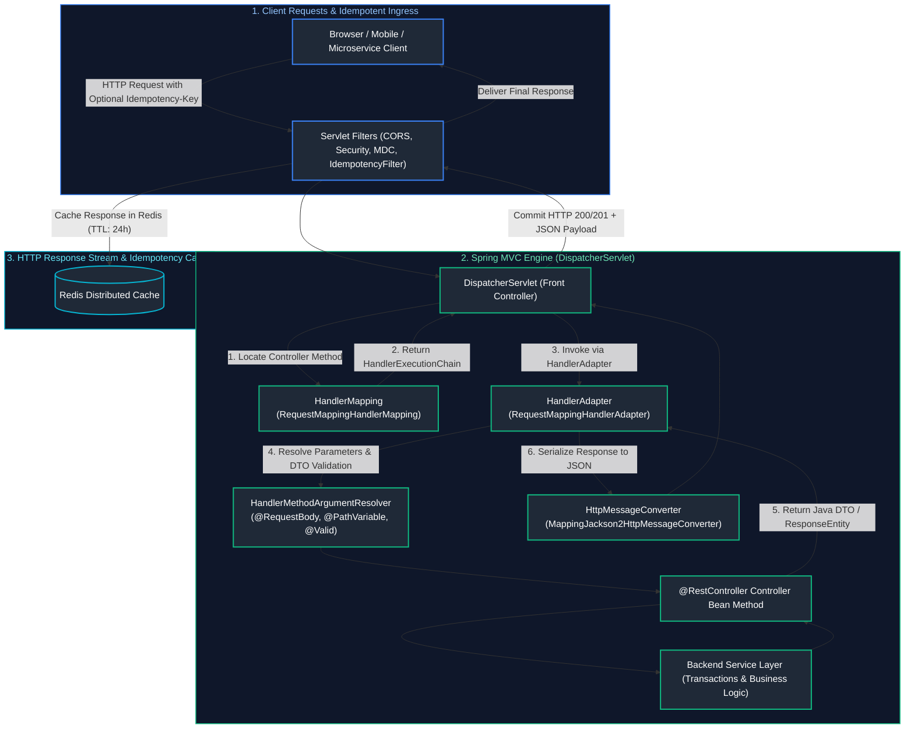
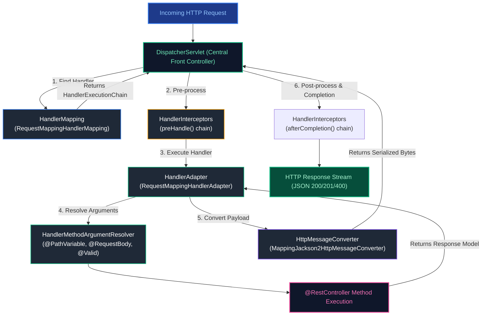
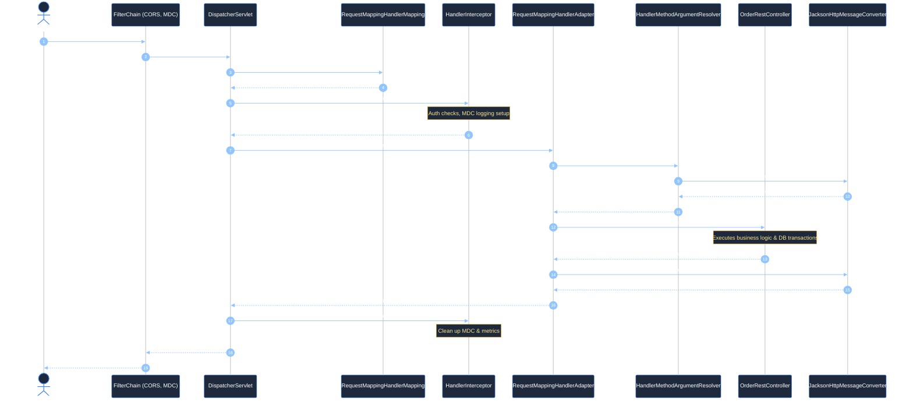
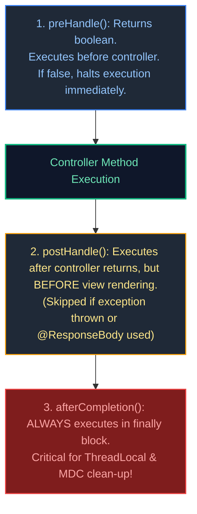
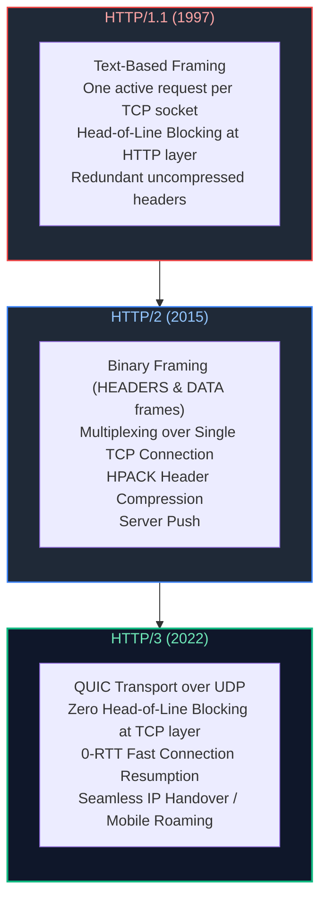
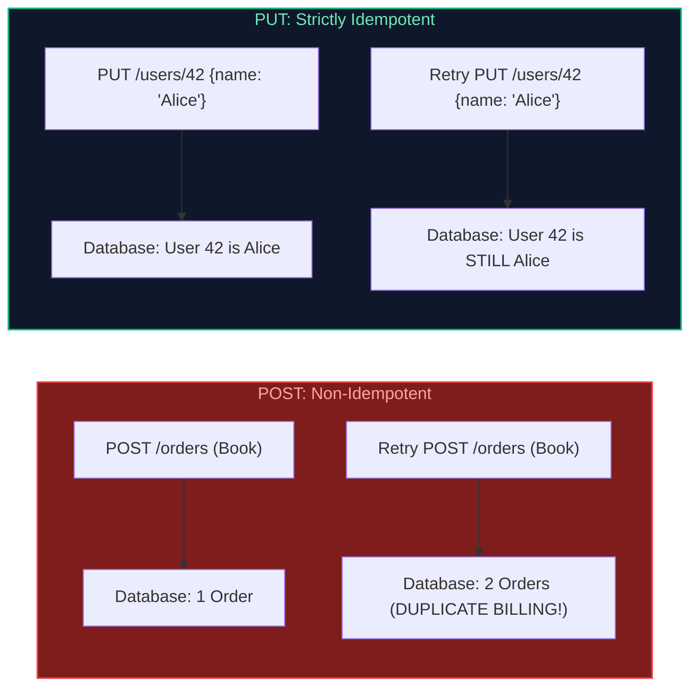
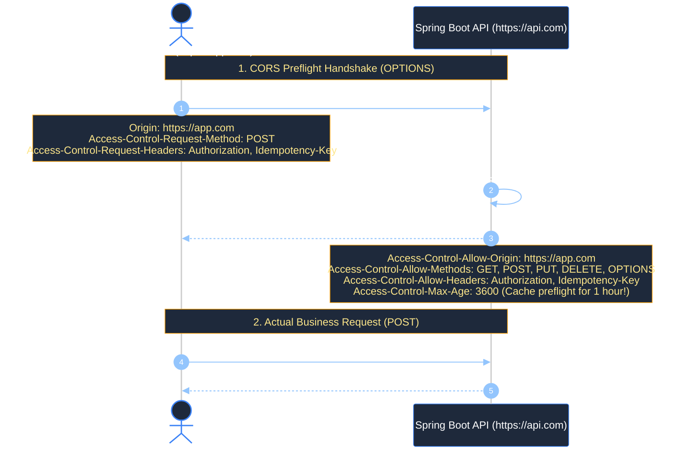
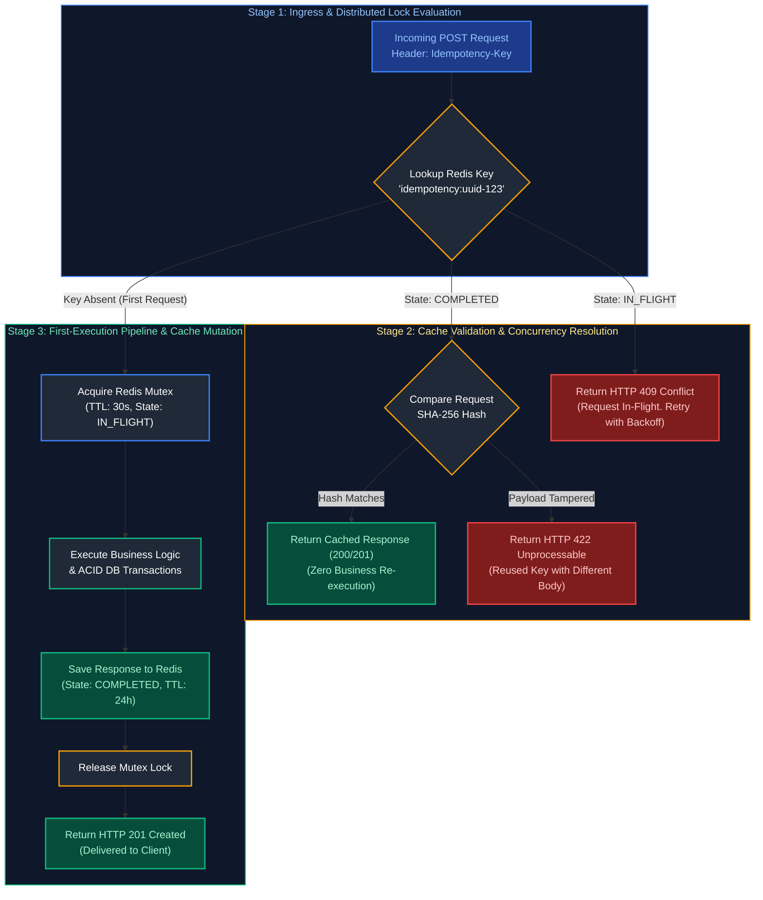
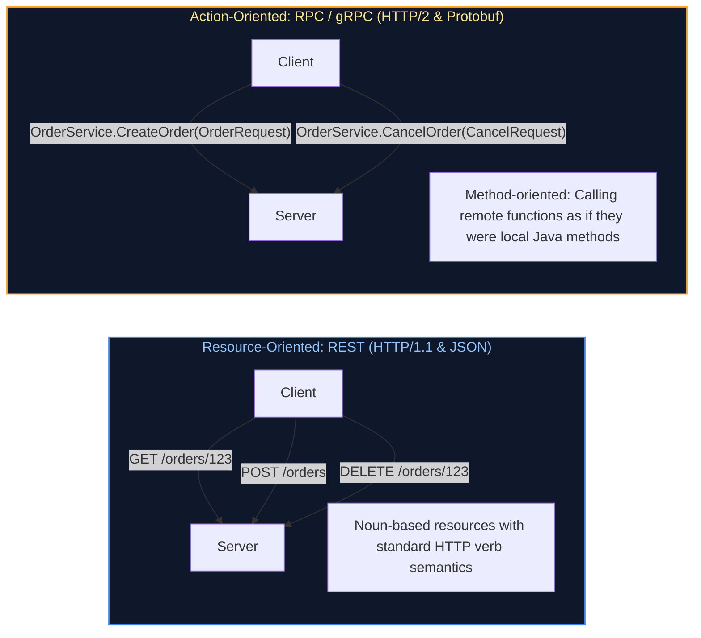
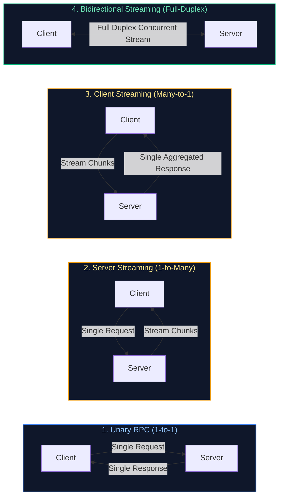

# 08. Spring Web, REST APIs & API Development

A comprehensive, production-grade architectural and engineering guide covering Spring MVC, the Front Controller pattern (`DispatcherServlet`), HTTP/1.1 vs HTTP/2 vs HTTP/3 transport mechanics, RESTful API design principles, complete HTTP method taxonomy, API Idempotency architecture (`Idempotency-Key` specification, Redis locking, and payload SHA-256 hashing), JSON Patch vs JSON Merge Patch, CORS preflight handshakes, Spring web annotations, Data Transfer Objects (DTOs), Jakarta Bean Validation with validation groups, pagination with keyset/cursor pagination, declarative HTTP interfaces (`@HttpExchange`), OpenAPI 3 specification, RFC 9457 Problem Details error handling, gRPC Java implementations, and production troubleshooting playbooks.

---

## Architectural Overview: Enterprise Spring Web & REST API Architecture



---

## Table of Contents
1. [Spring MVC Architecture & Request Processing Pipeline](#1-spring-mvc-architecture--request-processing-pipeline)
   - [1.1 The Front Controller Pattern & `DispatcherServlet`](#11-the-front-controller-pattern--dispatcherservlet)
   - [1.2 End-to-End HTTP Request Lifecycle Sequence](#12-end-to-end-http-request-lifecycle-sequence)
   - [1.3 `HandlerInterceptor` Lifecycle & ThreadLocal Context Cleanup](#13-handlerinterceptor-lifecycle--threadlocal-context-cleanup)
   - [1.4 Custom `HandlerMethodArgumentResolver` Implementation](#14-custom-handlermethodargumentresolver-implementation)
   - [1.5 `HttpMessageConverter` & Jackson Serialization Tuning](#15-httpmessageconverter--jackson-serialization-tuning)
   - [1.6 Asynchronous HTTP Processing (`DeferredResult`, `CompletableFuture`, `SseEmitter`)](#16-asynchronous-http-processing-deferredresult-completablefuture-sseemitter)
2. [HTTP Protocols, Methods Taxonomy & Safety vs Idempotence](#2-http-protocols-methods-taxonomy-safety-vs-idempotence)
   - [2.1 REST Architectural Constraints & Resource Modeling](#21-rest-architectural-constraints-resource-modeling)
   - [2.2 Transport Protocol Evolution: HTTP/1.1 vs HTTP/2 vs HTTP/3 (QUIC)](#22-transport-protocol-evolution-http11-vs-http2-vs-http3-quic)
   - [2.3 Comprehensive HTTP Methods Taxonomy (`GET`, `POST`, `PUT`, `PATCH`, `DELETE`, `OPTIONS`, `HEAD`)](#23-comprehensive-http-methods-taxonomy-get-post-put-patch-delete-options-head)
   - [2.4 Deep-Dive: Safety vs Idempotence & The `DELETE` 404 Paradox](#24-deep-dive-safety-vs-idempotence--the-delete-404-paradox)
   - [2.5 Partial Updates: JSON Merge Patch (RFC 7396) vs JSON Patch (RFC 6902)](#25-partial-updates-json-merge-patch-rfc-7396-vs-json-patch-rfc-6902)
   - [2.6 `OPTIONS` Method & CORS Preflight Handshake Mechanics](#26-options-method--cors-preflight-handshake-mechanics)
   - [2.7 HTTP Status Codes Reference Matrix (2xx, 3xx, 4xx, 5xx)](#27-http-status-codes-reference-matrix-2xx-3xx-4xx-5xx)
   - [2.8 Content Negotiation (`Accept` & `Content-Type`)](#28-content-negotiation-accept--content-type)
3. [Production API Idempotency Architecture](#3-production-api-idempotency-architecture)
   - [3.1 The Idempotency-Key Pattern & IETF Standard Specification](#31-the-idempotency-key-pattern--ietf-standard-specification)
   - [3.2 Idempotency Lifecycle State Machine](#32-idempotency-lifecycle-state-machine)
   - [3.3 Production Spring Boot Idempotency Filter with Redis & Payload SHA-256 Hashing](#33-production-spring-boot-idempotency-filter-with-redis--payload-sha-256-hashing)
   - [3.4 Database-Level Idempotency Patterns (Unique Constraints, Conditional Updates, Upserts, Advisory Locks)](#34-database-level-idempotency-patterns-unique-constraints-conditional-updates-upserts-advisory-locks)
4. [Spring MVC Web Annotations](#4-spring-mvc-web-annotations)
   - [4.1 Controller Stereotypes: `@Controller` vs `@RestController`](#41-controller-stereotypes-controller-vs-restcontroller)
   - [4.2 Routing Mappings (`@GetMapping`, `@PostMapping`, `@PutMapping`, `@DeleteMapping`, `@PatchMapping`)](#42-routing-mappings-getmapping-postmapping-putmapping-deletemapping-patchmapping)
   - [4.3 Extracting Input: `@PathVariable`, `@RequestParam`, `@RequestBody`, `@RequestHeader`, `@CookieValue`](#43-extracting-input-pathvariable-requestparam-requestbody-requestheader-cookievalue)
5. [DTOs & Jakarta Bean Validation](#5-dtos-jakarta-bean-validation)
   - [5.1 Entity vs DTO Separation of Concerns & Mass Assignment Defense](#51-entity-vs-dto-separation-of-concerns--mass-assignment-defense)
   - [5.2 Bean Validation Annotations (`@NotNull`, `@NotBlank`, `@Size`, `@Pattern`)](#52-bean-validation-annotations-notnull-notblank-size-pattern)
   - [5.3 `@Valid` vs `@Validated` & Group Validation (`OnCreate`, `OnUpdate`)](#53-valid-vs-validated--group-validation-oncreate-onupdate)
   - [5.4 Custom Constraint Validators (e.g. ISO Country Code, Business Tax ID)](#54-custom-constraint-validators-eg-iso-country-code-business-tax-id)
6. [Advanced API Capabilities & Modern Clients](#6-advanced-api-capabilities--modern-clients)
   - [6.1 Pagination, Sorting & Cursor/Keyset Pagination](#61-pagination-sorting--cursorkeyset-pagination)
   - [6.2 API Versioning Strategies (URI, Header, Media Type)](#62-api-versioning-strategies-uri-header-media-type)
   - [6.3 OpenAPI 3 / Swagger Documentation (SpringDoc)](#63-openapi-3--swagger-documentation-springdoc)
   - [6.4 Modern HTTP Clients: `RestClient`, `WebClient`, and Spring 6 `@HttpExchange`](#64-modern-http-clients-restclient-webclient-and-spring-6-httpexchange)
   - [6.5 Cross-Origin Resource Sharing (CORS) Security Configuration](#65-cross-origin-resource-sharing-cors-security-configuration)
7. [API Error Handling & Resilience](#7-api-error-handling--resilience)
   - [7.1 Centralized Exception Handling (`@RestControllerAdvice`)](#71-centralized-exception-handling-restcontrolleradvice)
   - [7.2 RFC 9457 Standard Problem Details](#72-rfc-9457-standard-problem-details)
   - [7.3 REST API Diagnostic cURL Commands Cheatsheet](#73-rest-api-diagnostic-curl-commands-cheatsheet)
8. [API Communication Paradigms: REST vs RPC vs gRPC & Protocol Buffers](#8-api-communication-paradigms-rest-vs-rpc-vs-grpc--protocol-buffers)
   - [8.1 API Communication Paradigms (Resource-Oriented REST vs Action-Oriented RPC)](#81-api-communication-paradigms-resource-oriented-rest-vs-action-oriented-rpc)
   - [8.2 gRPC Internals: HTTP/2 Transport & Binary Protocol Buffers](#82-grpc-internals-http2-transport--binary-protocol-buffers)
   - [8.3 gRPC Communication Modes (Unary, Server, Client, Bidirectional Streaming)](#83-grpc-communication-modes-unary-server-client-bidirectional-streaming)
   - [8.4 Production gRPC Java Implementation (`.proto` Definition, ServiceBase, Stubs)](#84-production-grpc-java-implementation-proto-definition-servicebase-stubs)
   - [8.5 Comprehensive Evaluation: REST vs gRPC Architecture Comparison Matrix](#85-comprehensive-evaluation-rest-vs-grpc-architecture-comparison-matrix)
9. [Production Troubleshooting Playbook](#9-production-troubleshooting-playbook)
10. [Summary Comparison & Engineering Reference Matrix](#10-summary-comparison--engineering-reference-matrix)
11. [References & Further Reading](#11-references--further-reading)

---

# 1. Spring MVC Architecture & Request Processing Pipeline

---

### 1.1 The Front Controller Pattern & `DispatcherServlet`

In early Java web applications (Servlets & JSPs), developers registered distinct `HttpServlet` classes for every URL route inside `web.xml`. This led to massive duplication of cross-cutting concerns: authentication, logging, request parsing, character encoding, and error routing had to be repeated across every servlet.

Spring MVC implements the **Front Controller Architectural Pattern** via **`DispatcherServlet`**:
* A single central servlet (`DispatcherServlet`) intercepts all incoming HTTP requests matching the servlet mapping (`/*`).
* It coordinates a pipeline of specialized, modular components to route, parse, execute, validate, and serialize the request:



---

### 1.2 End-to-End HTTP Request Lifecycle Sequence



---

### 1.3 `HandlerInterceptor` Lifecycle & ThreadLocal Context Cleanup

While Servlet `Filter` instances wrap the entire servlet invocation (before `DispatcherServlet` runs), `HandlerInterceptor` operates within the Spring context, giving you access to the specific Spring controller `HandlerMethod` that will execute:



#### Production Standard: Distributed Trace Logging & MDC Cleanup Interceptor
```java
@Component
public class CorrelationIdInterceptor implements HandlerInterceptor {

    private static final String CORRELATION_ID_HEADER = "X-Correlation-Id";
    private static final String MDC_KEY = "correlationId";

    @Override
    public boolean preHandle(HttpServletRequest request, HttpServletResponse response, Object handler) {
        String correlationId = request.getHeader(CORRELATION_ID_HEADER);
        if (correlationId == null || correlationId.isBlank()) {
            correlationId = UUID.randomUUID().toString();
        }
        
        // Populate SLF4J MDC (Mapped Diagnostic Context) stored in ThreadLocal
        MDC.put(MDC_KEY, correlationId);
        response.addHeader(CORRELATION_ID_HEADER, correlationId);
        return true; // Continue processing chain
    }

    @Override
    public void afterCompletion(HttpServletRequest request, HttpServletResponse response, 
                                Object handler, Exception ex) {
        // ⚠️ CRITICAL STAFF RULE: Always clean up ThreadLocal in afterCompletion()!
        // Tomcat threads are pooled. If MDC is not cleared, the next unrelated HTTP request
        // handled by this pooled thread will inherit the previous user's correlation ID!
        MDC.remove(MDC_KEY);
    }
}
```

Register the interceptor in Spring Web configuration:
```java
@Configuration
public class WebMvcConfig implements WebMvcConfigurer {

    private final CorrelationIdInterceptor correlationIdInterceptor;

    public WebMvcConfig(CorrelationIdInterceptor correlationIdInterceptor) {
        this.correlationIdInterceptor = correlationIdInterceptor;
    }

    @Override
    public void addInterceptors(InterceptorRegistry registry) {
        registry.addInterceptor(correlationIdInterceptor)
                .addPathPatterns("/api/**")
                .excludePathPatterns("/actuator/**", "/swagger-ui/**");
    }
}
```

---

### 1.4 Custom `HandlerMethodArgumentResolver` Implementation

Custom argument resolvers eliminate boilerplate code for extracting authenticated user context, tenant IDs, or device metadata:

```java
// 1. Define custom parameter annotation
@Target(ElementType.PARAMETER)
@Retention(RetentionPolicy.RUNTIME)
public @interface CurrentUser {}

// 2. Strongly-typed user context record
public record AuthenticatedUser(String userId, String email, Set<String> roles) {}

// 3. Implement HandlerMethodArgumentResolver
@Component
public class CurrentUserArgumentResolver implements HandlerMethodArgumentResolver {

    @Override
    public boolean supportsParameter(MethodParameter parameter) {
        return parameter.hasParameterAnnotation(CurrentUser.class) 
            && parameter.getParameterType().equals(AuthenticatedUser.class);
    }

    @Override
    public Object resolveArgument(MethodParameter parameter,
                                  ModelAndViewContainer mavContainer,
                                  NativeWebRequest webRequest,
                                  WebDataBinderFactory binderFactory) {
        
        // Extract JWT or SecurityContextHolder details
        Authentication auth = SecurityContextHolder.getContext().getAuthentication();
        if (auth == null || !auth.isAuthenticated() || auth instanceof AnonymousAuthenticationToken) {
            throw new ResponseStatusException(HttpStatus.UNAUTHORIZED, "User is not authenticated");
        }

        Jwt jwt = (Jwt) auth.getPrincipal();
        return new AuthenticatedUser(
                jwt.getSubject(),
                jwt.getClaimAsString("email"),
                new HashSet<>(jwt.getClaimAsStringList("roles"))
        );
    }
}
```

Now, any controller method can seamlessly inject the current user without touching Spring Security APIs:
```java
@GetMapping("/api/v1/profile")
public UserProfileResponse getProfile(@CurrentUser AuthenticatedUser user) {
    return new UserProfileResponse(user.userId(), user.email());
}
```

---

### 1.5 `HttpMessageConverter` & Jackson Serialization Tuning

Spring Boot configures `MappingJackson2HttpMessageConverter` as the default converter for `@ResponseBody` JSON serialization. In high-scale production systems, standard Jackson settings cause subtle date/time bugs, precision loss, and security risks.

#### Production ObjectMapper Configuration:
```java
@Configuration
public class JacksonConfig {

    @Bean
    @Primary
    public ObjectMapper objectMapper() {
        return JsonMapper.builder()
                // 1. Support Java 8 Date and Time API (Instant, LocalDate, ZonedDateTime)
                .addModule(new JavaTimeModule())
                // 2. Prevent writing dates as timestamps ([2026, 10, 16]) -> write ISO-8601 strings
                .disable(SerializationFeature.WRITE_DATES_AS_TIMESTAMPS)
                // 3. Tolerate unknown JSON fields sent by newer client versions without failing
                .disable(DeserializationFeature.FAIL_ON_UNKNOWN_PROPERTIES)
                // 4. Do NOT fail on empty beans
                .disable(SerializationFeature.FAIL_ON_EMPTY_BEANS)
                // 5. Exclude null fields from JSON output to save network bandwidth
                .serializationInclusion(JsonInclude.Include.NON_NULL)
                .build();
    }
}
```

---

### 1.6 Asynchronous HTTP Processing (`DeferredResult`, `CompletableFuture`, `SseEmitter`)

Standard Spring MVC request processing assigns one Tomcat worker thread per HTTP request. If a request blocks on a slow 5-second third-party service, that worker thread is trapped, leading to thread pool starvation under heavy load.

#### 1. Non-Blocking CompletableFuture Controller
```java
@GetMapping("/api/v1/credit-score/{userId}")
public CompletableFuture<CreditScoreResponse> getCreditScore(@PathVariable String userId) {
    // Releases the Tomcat worker thread back to the pool immediately!
    // The response is resumed on a dedicated Virtual Thread or async executor when ready.
    return CompletableFuture.supplyAsync(() -> creditBureauClient.fetchScore(userId), asyncTaskExecutor);
}
```

#### 2. Server-Sent Events (SSE) via `SseEmitter`
SSE establishes a unidirectional persistent HTTP connection over which the server streams real-time updates (e.g. LLM token generation, live stock ticks):

```java
@GetMapping(value = "/api/v1/orders/{orderId}/tracking-stream", produces = MediaType.TEXT_EVENT_STREAM_VALUE)
public SseEmitter streamTrackingUpdates(@PathVariable String orderId) {
    SseEmitter emitter = new SseEmitter(60_000L); // 60-second timeout

    // Register async task to push updates
    asyncTaskExecutor.execute(() -> {
        try {
            for (int i = 0; i < 5; i++) {
                Thread.sleep(1000);
                emitter.send(SseEmitter.event()
                        .name("order-status")
                        .data(new TrackingUpdate(orderId, "STEP_" + i, Instant.now())));
            }
            emitter.complete(); // Clean close
        } catch (Exception ex) {
            emitter.completeWithError(ex);
        }
    });

    return emitter;
}
```

---

# 2. HTTP Protocols, Methods Taxonomy & Safety vs Idempotence

---

### 2.1 REST Architectural Constraints & Resource Modeling

REST (Representational State Transfer), formulated by Roy Fielding, is an architectural style defined by six core constraints:
1. **Client-Server Separation**: Separation of concerns allows client UIs and backend persistence to evolve independently.
2. **Statelessness**: Every request contains all necessary credentials and parameters; no conversational session state is stored on the server.
3. **Cacheability**: Responses explicitly specify whether they can be cached via standard headers (`Cache-Control: max-age=3600, public`).
4. **Uniform Interface**: Resources are addressed by consistent URIs (`/orders/{id}`), manipulated through representations (JSON DTOs), self-descriptive messages, and hypermedia (HATEOAS).
5. **Layered System**: The client cannot tell whether it is communicating directly with the origin server or through an API Gateway, CDN, or load balancer.
6. **Code-on-Demand (Optional)**: Transferring executable code (e.g. WebAssembly or JavaScript scripts).

---

### 2.2 Transport Protocol Evolution: HTTP/1.1 vs HTTP/2 vs HTTP/3 (QUIC)



| Dimension | HTTP/1.1 | HTTP/2 | HTTP/3 (QUIC) |
| :--- | :--- | :--- | :--- |
| **Transport Layer** | TCP | TCP | **UDP (QUIC)** |
| **Wire Protocol** | Human-readable ASCII text | Binary frames | Binary packets |
| **Connection Multiplexing** | No (Requires 6 parallel TCP connections) | **Yes** (Multiplexed streams over single TCP) | **Yes** (Independent streams over UDP) |
| **Head-of-Line (HoL) Blocking** | Severe at application layer | Resolved at HTTP layer, **still exists at TCP packet loss level** | **Completely eliminated** (single lost packet affects only that stream) |
| **Header Compression** | None (Redundant cookies sent every time) | **HPACK** (Sliding dictionary) | **QPACK** (Optimized for out-of-order UDP) |
| **Connection Setup Latency** | 2–3 RTT (TCP + TLS 1.3 handshake) | 2–3 RTT | **0-RTT or 1-RTT (Integrated TLS 1.3)** |

---

### 2.3 Comprehensive HTTP Methods Taxonomy (`GET`, `POST`, `PUT`, `PATCH`, `DELETE`, `OPTIONS`, `HEAD`)

| HTTP Method | Purpose / Intent | Request Body? | Response Body? | Safe? | Idempotent? | Typical Status Codes |
| :--- | :--- | :---: | :---: | :---: | :---: | :--- |
| **`GET`** | Retrieve resource representation | No | **Yes** | **Yes** | **Yes** | `200 OK`, `304 Not Modified`, `404 Not Found` |
| **`HEAD`** | Retrieve response headers only (no body) | No | **No** | **Yes** | **Yes** | `200 OK`, `304 Not Modified` |
| **`POST`** | Create a subordinate resource / trigger action | **Yes** | **Yes** | **No** | **No** | `201 Created` (`Location` header), `200 OK` |
| **`PUT`** | Completely replace resource / create at known URI | **Yes** | Optional | **No** | **Yes** | `200 OK`, `204 No Content` |
| **`PATCH`**| Partially update specific fields of a resource | **Yes** | **Yes** | **No** | **Conditional**| `200 OK`, `204 No Content` |
| **`DELETE`**| Permanently remove target resource | No | Optional | **No** | **Yes** | `200 OK`, `204 No Content`, `404 Not Found` |
| **`OPTIONS`**| Query supported methods / CORS preflight | No | Optional | **Yes** | **Yes** | `200 OK`, `204 No Content` |
| **`TRACE`**| Loopback diagnostic test echoing request | No | **Yes** | **Yes** | **Yes** | `200 OK` (Typically disabled for security) |

---

### 2.4 Deep-Dive: Safety vs Idempotence & The `DELETE` 404 Paradox

#### 1. Mathematical Definitions:
* **Safe Methods ($f(x) \rightarrow \text{State Unmodified}$)**:
  Methods that **never mutate resource state on the origin server**. `GET` and `HEAD` are strictly read-only. A client can execute `GET /orders/10` one million times without causing database side-effects.
* **Idempotent Methods ($f(f(x)) = f(x)$)**:
  Methods where **executing an operation once produces the exact same server resource state as executing it $N$ times consecutively**.



#### 2. The `DELETE` 404 Paradox: Is `DELETE` Truly Idempotent?
Consider this scenario:
1. Client sends `DELETE /orders/101` $\rightarrow$ Database deletes row, server returns `204 No Content`.
2. Client retries `DELETE /orders/101` $\rightarrow$ Database row no longer exists, server returns `404 Not Found`.

> [!IMPORTANT]
> **Is `DELETE` still idempotent even though the HTTP status code changed from 204 to 404?**
> **YES!** Idempotency applies to **server resource state**, not HTTP response status codes.
> - Prior to call 1: Order 101 existed.
> - After call 1: Order 101 is deleted.
> - After call 2, 3, and 100: Order 101 remains deleted.
> The server's persistent state is completely identical after the first call and after subsequent calls.

---

### 2.5 Partial Updates: JSON Merge Patch (RFC 7396) vs JSON Patch (RFC 6902)

When modifying a subset of fields, `PUT` is semantically incorrect because `PUT` requires sending the **entire** object representation (omitted fields are assumed to be reset to `null`). `PATCH` is the standardized mechanism for partial updates:

| Dimension | JSON Merge Patch (RFC 7396) | JSON Patch (RFC 6902) |
| :--- | :--- | :--- |
| **`Content-Type`** | `application/merge-patch+json` | `application/json-patch+json` |
| **Payload Structure**| Partial JSON object matching target schema | Array of sequential operational instructions |
| **Complexity** | Extremely simple; intuitive for web/mobile developers | Higher complexity; requires patch processing engine |
| **Null Semantics** | Sending `{"field": null}` deletes/nulls the field | Explicit operation: `{"op": "remove", "path": "/field"}` |
| **Array Mutations** | Replaces the entire array; cannot append a single item | Surgical: `{"op": "add", "path": "/tags/1", "value": "java"}` |

#### 1. JSON Merge Patch Example (RFC 7396)
```http
PATCH /api/v1/users/42 HTTP/1.1
Content-Type: application/merge-patch+json

{
  "email": "updated.email@enterprise.com",
  "phoneNumber": null
}
```
*(Updates email, removes phoneNumber, and leaves all other user attributes intact).*

#### 2. JSON Patch Example (RFC 6902)
```http
PATCH /api/v1/orders/102 HTTP/1.1
Content-Type: application/json-patch+json

[
  { "op": "test", "path": "/status", "value": "PENDING" },
  { "op": "replace", "path": "/status", "value": "APPROVED" },
  { "op": "add", "path": "/trackingNumbers/0", "value": "FEDEX-889102" },
  { "op": "remove", "path": "/temporaryHoldReason" }
]
```

---

### 2.6 `OPTIONS` Method & CORS Preflight Handshake Mechanics

When a browser makes a cross-origin HTTP request (`https://dashboard.company.com` accessing `https://api.backend.com`) with non-simple headers (`Authorization`, `Idempotency-Key`) or methods other than `GET`/`POST`, the browser automatically executes an **`OPTIONS` Preflight Handshake**:



---

### 2.7 HTTP Status Codes Reference Matrix (2xx, 3xx, 4xx, 5xx)

| Status Code | Reason Phrase | Semantic Meaning & Best Practice Usage |
| :--- | :--- | :--- |
| **`200 OK`** | Success | Request succeeded; response payload contains data. |
| **`201 Created`** | Created | Resource created; includes `Location` header pointing to new resource URI. |
| **`202 Accepted`** | Asynchronous | Request accepted for background processing; includes job status URL. |
| **`204 No Content`** | No Content | Action succeeded; response body intentionally empty (common for `DELETE`). |
| **`301 Moved Permanently`** | Redirect | Permanent redirect; client updates stored URLs to `Location`. |
| **`304 Not Modified`** | Cached | Client's cached copy remains fresh (`ETag` or `If-Modified-Since` matched). |
| **`400 Bad Request`** | Validation Error | Malformed JSON syntax or Bean Validation constraint failure. |
| **`401 Unauthorized`** | Missing Auth | Missing or invalid authentication token. |
| **`403 Forbidden`** | Access Denied | Authenticated, but lacking sufficient permissions or roles. |
| **`404 Not Found`** | Missing Resource | Resource identified by URI does not exist. |
| **`409 Conflict`** | State Collision | Database unique constraint violation or optimistic lock conflict. |
| **`422 Unprocessable`** | Semantic Error | Syntactically valid JSON, but violates business validation rules. |
| **`429 Too Many Requests`** | Rate Limited | Client exceeded rate limit; includes `Retry-After` header. |
| **`500 Internal Error`** | Server Failure | Unhandled runtime exception inside application. |
| **`502 Bad Gateway`** | Upstream Error | Upstream microservice, database, or gateway returned invalid response. |
| **`503 Unavailable`** | Maintenance/Overload| Server temporarily overloaded or undergoing graceful shutdown. |
| **`504 Gateway Timeout`**| Network Timeout | Upstream service failed to respond within configured timeout window. |

---

### 2.8 Content Negotiation (`Accept` & `Content-Type`)

- `Content-Type`: Specifies the format of the data in the **request body** (`application/json`, `application/x-www-form-urlencoded`).
- `Accept`: Informs the server what media format the **client expects in return** (`application/json`, `application/pdf`, `text/csv`).

```java
@GetMapping(
    value = "/api/v1/reports/{id}",
    produces = {MediaType.APPLICATION_JSON_VALUE, MediaType.APPLICATION_PDF_VALUE}
)
public ResponseEntity<?> generateReport(@PathVariable String id, @RequestHeader(HttpHeaders.ACCEPT) String accept) {
    if (accept.contains(MediaType.APPLICATION_PDF_VALUE)) {
        byte[] pdfBytes = reportService.renderPdf(id);
        return ResponseEntity.ok().contentType(MediaType.APPLICATION_PDF).body(pdfBytes);
    }
    return ResponseEntity.ok(reportService.getJsonData(id));
}
```

---

# 3. Production API Idempotency Architecture

---

### 3.1 The Idempotency-Key Pattern & IETF Standard Specification

In distributed microservices, transient network failures (dropped TCP connections, load balancer 504 timeouts) leave the client unsure whether a mutating `POST` request completed on the server:
- If the client **does not retry**, a valid payment or order may never execute.
- If the client **retries naively**, the customer may be charged multiple times or duplicate inventory may be reserved.

The **`Idempotency-Key` specification (IETF Draft)** resolves this:
1. The client generates a unique UUID (e.g. `Idempotency-Key: 9b1deb4d-3b7d-4bad-9bdd-2b0d7b3dcb6d`) and passes it in the header of mutating requests (`POST`).
2. The server acquires a distributed lock in Redis for in-flight protection and hashes the request body.
3. The server executes business logic and stores the resulting HTTP status and serialized response in Redis under the key.
4. Any repeated request with the same key returns the cached response immediately, bypassing business re-execution.

---

### 3.2 Idempotency Lifecycle State Machine



---

### 3.3 Production Spring Boot Idempotency Filter with Redis & Payload SHA-256 Hashing

```java
package com.company.security.idempotency;

import jakarta.servlet.FilterChain;
import jakarta.servlet.ServletException;
import jakarta.servlet.http.HttpServletRequest;
import jakarta.servlet.http.HttpServletResponse;
import org.springframework.data.redis.core.StringRedisTemplate;
import org.springframework.http.HttpStatus;
import org.springframework.stereotype.Component;
import org.springframework.web.filter.OncePerRequestFilter;
import org.springframework.web.util.ContentCachingRequestWrapper;
import org.springframework.web.util.ContentCachingResponseWrapper;

import java.io.IOException;
import java.nio.charset.StandardCharsets;
import java.security.MessageDigest;
import java.security.NoSuchAlgorithmException;
import java.time.Duration;
import java.util.HexFormat;

@Component
public class IdempotencyFilter extends OncePerRequestFilter {

    private static final String IDEMPOTENCY_HEADER = "Idempotency-Key";
    private static final Duration IDEMPOTENCY_TTL = Duration.ofHours(24);
    private final StringRedisTemplate redisTemplate;

    public IdempotencyFilter(StringRedisTemplate redisTemplate) {
        this.redisTemplate = redisTemplate;
    }

    @Override
    protected void doFilterInternal(HttpServletRequest request,
                                    HttpServletResponse response,
                                    FilterChain filterChain) throws ServletException, IOException {

        // Enforce idempotency checks only on mutating state methods (POST)
        if (!"POST".equalsIgnoreCase(request.getMethod())) {
            filterChain.doFilter(request, response);
            return;
        }

        String idempotencyKey = request.getHeader(IDEMPOTENCY_HEADER);
        if (idempotencyKey == null || idempotencyKey.isBlank()) {
            filterChain.doFilter(request, response);
            return;
        }

        ContentCachingRequestWrapper wrappedRequest = new ContentCachingRequestWrapper(request);
        ContentCachingResponseWrapper wrappedResponse = new ContentCachingResponseWrapper(response);

        // Read payload bytes to compute SHA-256 fingerprint
        byte[] body = wrappedRequest.getInputStream().readAllBytes();
        String currentPayloadHash = calculateSha256(body);

        String redisDataKey = "idempotency:data:" + idempotencyKey;
        String redisLockKey = "idempotency:lock:" + idempotencyKey;

        // 1. Inspect if a previous execution completed successfully
        String cachedData = redisTemplate.opsForValue().get(redisDataKey);
        if (cachedData != null) {
            String[] parts = cachedData.split("::", 3);
            String savedHash = parts[0];
            int savedStatus = Integer.parseInt(parts[1]);
            String savedBody = parts[2];

            // Verify the client did not alter the payload with the same idempotency key
            if (!savedHash.equals(currentPayloadHash)) {
                response.sendError(HttpStatus.UNPROCESSABLE_ENTITY.value(),
                        "Idempotency-Key was reused with a conflicting request payload");
                return;
            }

            // Return cached original response immediately
            response.setStatus(savedStatus);
            response.setContentType("application/json");
            response.addHeader("X-Cache-Lookup", "HIT-IDEMPOTENT");
            response.getWriter().write(savedBody);
            return;
        }

        // 2. Atomic distributed lock acquisition for in-flight protection (SETNX with 30s TTL)
        Boolean lockAcquired = redisTemplate.opsForValue()
                .setIfAbsent(redisLockKey, "IN_FLIGHT", Duration.ofSeconds(30));

        if (Boolean.FALSE.equals(lockAcquired)) {
            response.sendError(HttpStatus.CONFLICT.value(),
                    "Concurrent in-flight request with identical Idempotency-Key is actively processing");
            return;
        }

        try {
            // 3. Dispatch downstream to Spring MVC controller and service pipeline
            filterChain.doFilter(wrappedRequest, wrappedResponse);

            int status = wrappedResponse.getStatus();
            byte[] responseBytes = wrappedResponse.getContentAsByteArray();
            String responseBody = new String(responseBytes, StandardCharsets.UTF_8);

            // 4. Cache successful responses (2xx status codes) for 24 hours
            if (status >= 200 && status < 300) {
                String record = currentPayloadHash + "::" + status + "::" + responseBody;
                redisTemplate.opsForValue().set(redisDataKey, record, IDEMPOTENCY_TTL);
            }

            // Copy response bytes back to output stream so client receives them
            wrappedResponse.copyBodyToResponse();

        } finally {
            // Always release in-flight lock mutex
            redisTemplate.delete(redisLockKey);
        }
    }

    private String calculateSha256(byte[] data) {
        try {
            MessageDigest digest = MessageDigest.getInstance("SHA-256");
            byte[] hash = digest.digest(data);
            return HexFormat.of().formatHex(hash);
        } catch (NoSuchAlgorithmException e) {
            throw new RuntimeException("SHA-256 digest unavailable", e);
        }
    }
}
```

---

### 3.4 Database-Level Idempotency Patterns (Unique Constraints, Conditional Updates, Upserts, Advisory Locks)

In addition to API filter caches, database layers must enforce structural idempotency:

#### 1. Unique Constraints & Natural Keys
```sql
ALTER TABLE payments ADD CONSTRAINT uk_payment_idempotency_key UNIQUE (idempotency_key);
```
If a duplicate request passes the cache, the second `INSERT` fails with a unique constraint violation, which Spring catches as `DataIntegrityViolationException`.

#### 2. Conditional State Transitions
```sql
-- Safe to retry: state transitions from PENDING to CANCELLED only once
UPDATE orders
SET status = 'CANCELLED', updated_at = CURRENT_TIMESTAMP
WHERE id = 101 AND status = 'PENDING';
```

#### 3. PostgreSQL Advisory Locks for Critical Resource Sections
```sql
-- Acquire transaction-level application lock
SELECT pg_advisory_xact_lock(hashtext('order_checkout_' || 'ORD-101'));
```

---

# 4. Spring MVC Web Annotations

---

### 4.1 Controller Stereotypes: `@Controller` vs `@RestController`

- **`@Controller`**: Presentation layer stereotype. Controller methods return a view template name (e.g. `"index"`) resolved by a `ViewResolver` (Thymeleaf, FreeMarker) to render HTML.
- **`@RestController`**: Meta-annotation combining `@Controller` and `@ResponseBody`. Informs `RequestMappingHandlerAdapter` that method return values serialize directly into the HTTP response stream via Jackson JSON converters.

---

### 4.2 Routing Mappings (`@GetMapping`, `@PostMapping`, `@PutMapping`, `@DeleteMapping`, `@PatchMapping`)

```java
@RestController
@RequestMapping("/api/v1/orders")
public class OrderController {

    private final OrderService orderService;

    public OrderController(OrderService orderService) {
        this.orderService = orderService;
    }

    @GetMapping("/{id}")
    public OrderResponse getOrder(@PathVariable Long id) {
        return orderService.findById(id);
    }

    @PostMapping
    public ResponseEntity<OrderResponse> createOrder(@Valid @RequestBody CreateOrderRequest request) {
        OrderResponse created = orderService.create(request);
        URI location = URI.create("/api/v1/orders/" + created.id());
        return ResponseEntity.created(location).body(created); // Returns HTTP 201 Created + Location header
    }

    @PutMapping("/{id}")
    public ResponseEntity<OrderResponse> replaceOrder(@PathVariable Long id, @Valid @RequestBody UpdateOrderRequest request) {
        return ResponseEntity.ok(orderService.update(id, request));
    }

    @DeleteMapping("/{id}")
    public ResponseEntity<Void> deleteOrder(@PathVariable Long id) {
        orderService.delete(id);
        return ResponseEntity.noContent().build(); // Returns HTTP 204 No Content
    }
}
```

---

### 4.3 Extracting Input: `@PathVariable`, `@RequestParam`, `@RequestBody`, `@RequestHeader`, `@CookieValue`

```java
@GetMapping("/search/{category}")
public PageResponse<ProductDTO> search(
        @PathVariable String category,                                    // Path segment: /search/electronics
        @RequestParam(defaultValue = "0") int page,                       // Query param: ?page=0
        @RequestParam(defaultValue = "20") int size,                      // Query param: &size=20
        @RequestHeader("X-Tenant-Id") String tenantId,                    // HTTP header
        @CookieValue(name = "sessionId", required = false) String session // Cookie
) {
    // Process search logic...
    return PageResponse.empty();
}
```

---

# 5. DTOs & Jakarta Bean Validation

---

### 5.1 Entity vs DTO Separation of Concerns & Mass Assignment Defense

> [!CAUTION]
> Never expose JPA `@Entity` classes directly in REST API controller parameters or return types!

#### Security & Architecture Rationale:
1. **Prevents Mass Assignment Vulnerabilities (GitHub Incident)**: Attackers can craft malicious JSON payloads containing administrative fields (e.g. `{"isAdmin": true}`). If an `@Entity` is directly bound, Jackson binds the field, elevating privileges.
2. **Eliminates Infinite Jackson Serialization Loops**: Bidirectional relationships (`@OneToMany` / `@ManyToOne`) cause Jackson to serialize circularly until `StackOverflowError` occurs.
3. **Decouples API Contracts from Database Relational Schema**: Database tables can be renamed, split, or normalized without breaking external client API contracts.

---

### 5.2 Bean Validation Annotations (`@NotNull`, `@NotBlank`, `@Size`, `@Pattern`)

```java
public record CreateUserRequest(
    @NotBlank(message = "Username cannot be blank")
    @Size(min = 3, max = 50, message = "Username must be between 3 and 50 characters")
    String username,

    @NotBlank(message = "Email is required")
    @Email(message = "Must be a syntactically valid email address")
    String email,

    @Pattern(regexp = "^(?=.*[A-Za-z])(?=.*\\d)[A-Za-z\\d]{8,}$", 
             message = "Password must contain minimum 8 characters with at least one letter and one number")
    String password,

    @Min(value = 18, message = "Must be 18 or older")
    @Max(value = 120, message = "Invalid age provided")
    int age
) {}
```

---

### 5.3 `@Valid` vs `@Validated` & Group Validation (`OnCreate`, `OnUpdate`)

- **`@Valid`**: Standard Jakarta EE (`jakarta.validation.Valid`) annotation. Placed on controller method arguments to trigger cascade validation.
- **`@Validated`**: Spring-specific (`org.springframework.validation.annotation.Validated`) annotation. Supports **Validation Groups**, enabling different validation constraints on creation vs update:

```java
// 1. Define marker interfaces for validation groups
public interface OnCreate {}
public interface OnUpdate {}

// 2. Apply groups to DTO constraints
public record UserDto(
    @Null(groups = OnCreate.class, message = "ID must be null during user creation")
    @NotNull(groups = OnUpdate.class, message = "ID is required during update")
    Long id,

    @NotBlank(groups = {OnCreate.class, OnUpdate.class})
    String name,

    @NotBlank(groups = OnCreate.class)
    String temporaryPassword
) {}

// 3. Activate groups in Controller
@RestController
@RequestMapping("/api/v1/users")
public class UserController {

    @PostMapping
    public ResponseEntity<?> createUser(@Validated(OnCreate.class) @RequestBody UserDto dto) {
        // Enforces OnCreate rules
        return ResponseEntity.ok().build();
    }

    @PutMapping("/{id}")
    public ResponseEntity<?> updateUser(@Validated(OnUpdate.class) @RequestBody UserDto dto) {
        // Enforces OnUpdate rules
        return ResponseEntity.ok().build();
    }
}
```

---

### 5.4 Custom Constraint Validators (e.g. ISO Country Code, Business Tax ID)

```java
// 1. Declare Custom Annotation
@Target({ElementType.FIELD, ElementType.PARAMETER})
@Retention(RetentionPolicy.RUNTIME)
@Constraint(validatedBy = IsoCountryCodeValidator.class)
@Documented
public @interface ValidCountryCode {
    String message() default "Invalid ISO-3166-1 alpha-2 country code";
    Class<?>[] groups() default {};
    Class<? extends Payload>[] payload() default {};
}

// 2. Implement ConstraintValidator
public class IsoCountryCodeValidator implements ConstraintValidator<ValidCountryCode, String> {

    private static final Set<String> ISO_COUNTRIES = Set.of(Locale.getISOCountries());

    @Override
    public boolean isValid(String value, ConstraintValidatorContext context) {
        if (value == null) return true; // Let @NotNull handle null checks
        return ISO_COUNTRIES.contains(value.toUpperCase());
    }
}
```

---

# 6. Advanced API Capabilities & Modern Clients

---

### 6.1 Pagination, Sorting & Cursor/Keyset Pagination

#### Offset Pagination (Standard Spring Data `Pageable`)
```java
@GetMapping("/api/v1/products")
public Page<ProductResponse> getProducts(
        @PageableDefault(size = 20, sort = "createdAt", direction = Sort.Direction.DESC) Pageable pageable
) {
    return productRepository.findAll(pageable).map(ProductResponse::fromEntity);
}
```
* **Performance Trap of Offset Pagination**: Executing `OFFSET 1000000 LIMIT 20` forces the database engine to scan and discard 1,000,000 index rows, causing extreme query degradation on deep pages.

#### Production Solution: Keyset / Cursor Pagination
Keyset pagination uses the last seen item ID and timestamp as a filter condition:
```sql
SELECT id, name, price, created_at 
FROM products 
WHERE (created_at, id) < ('2026-10-15 14:00:00', 'PROD-9981')
ORDER BY created_at DESC, id DESC 
LIMIT 20;
```
This query uses a composite index `(created_at, id)` to jump directly to the target leaf node in $O(\log N)$ time, achieving constant latency regardless of page depth.

---

### 6.2 API Versioning Strategies (URI, Header, Media Type)

| Strategy | Syntax Example | Pros | Cons |
| :--- | :--- | :--- | :--- |
| **URI Path** | `/api/v1/orders` vs `/api/v2/orders` | Explicit, easy to route in API gateways | Breaks strict URI resource identity |
| **Custom Header** | `X-API-Version: 2` | Clean URIs; preserves resource identity | Cannot test easily via standard browser address bar |
| **Media Type (Accept)**| `Accept: application/vnd.company.v2+json` | Purest RESTful HATEOAS representation | High client configuration complexity |

---

### 6.3 OpenAPI 3 / Swagger Documentation (SpringDoc)

Add the `springdoc-openapi-starter-webmvc-ui` dependency to automatically expose OpenAPI 3 specs:
* **Interactive UI**: `http://localhost:8080/swagger-ui.html`
* **Raw JSON Spec**: `http://localhost:8080/v3/api-docs`

```java
@Operation(summary = "Create an order", description = "Creates a new customer order with idempotency protection")
@ApiResponses(value = {
    @ApiResponse(responseCode = "201", description = "Order created successfully"),
    @ApiResponse(responseCode = "400", description = "Validation constraint failure"),
    @ApiResponse(responseCode = "409", description = "Concurrent in-flight duplicate request")
})
@PostMapping("/api/v1/orders")
public ResponseEntity<OrderResponse> createOrder(@Valid @RequestBody CreateOrderRequest req) { ... }
```

---

### 6.4 Modern HTTP Clients: `RestClient`, `WebClient`, and Spring 6 `@HttpExchange`

Spring 6 / Spring Boot 3 introduces **`RestClient`** (a synchronous, fluent HTTP client) and declarative **HTTP Interfaces (`@HttpExchange`)**:

```java
// 1. Declare declarative HTTP interface
public interface PaymentClient {
    @PostExchange("/charges")
    ChargeResponse executeCharge(@RequestBody ChargeRequest request);

    @GetExchange("/charges/{id}")
    ChargeResponse getCharge(@PathVariable String id);
}

// 2. Configure HTTP Client Proxy
@Configuration
public class ClientConfig {

    @Bean
    public PaymentClient paymentClient(RestClient.Builder builder) {
        RestClient restClient = builder
                .baseUrl("https://api.stripe.com/v1")
                .defaultHeader("Authorization", "Bearer sk_test_123")
                .build();

        HttpServiceProxyFactory factory = HttpServiceProxyFactory
                .builderFor(RestClientAdapter.create(restClient))
                .build();

        return factory.createClient(PaymentClient.class);
    }
}
```

---

### 6.5 Cross-Origin Resource Sharing (CORS) Security Configuration

```java
@Configuration
public class SecurityCorsConfiguration implements WebMvcConfigurer {

    @Override
    public void addCorsMappings(CorsRegistry registry) {
        registry.addMapping("/api/**")
                .allowedOrigins("https://portal.enterprise.com", "https://checkout.enterprise.com")
                .allowedMethods("GET", "POST", "PUT", "DELETE", "PATCH", "OPTIONS")
                .allowedHeaders("Authorization", "Content-Type", "Idempotency-Key", "X-Correlation-Id")
                .exposedHeaders("X-Correlation-Id", "Location")
                .allowCredentials(true)
                .maxAge(3600); // Cache preflight response for 1 hour
    }
}
```

---

# 7. API Error Handling & Resilience

---

### 7.1 Centralized Exception Handling (`@RestControllerAdvice`)

Centralized exception handlers intercept unhandled controller exceptions, preventing stack traces from leaking to clients and guaranteeing consistent error payloads across all endpoints.

---

### 7.2 RFC 9457 Standard Problem Details

Spring Boot 3 natively supports **RFC 9457 (Problem Details for HTTP APIs)** via `ProblemDetail`:

```java
package com.company.exception;

import org.springframework.http.HttpStatus;
import org.springframework.http.ProblemDetail;
import org.springframework.web.bind.MethodArgumentNotValidException;
import org.springframework.web.bind.annotation.ExceptionHandler;
import org.springframework.web.bind.annotation.RestControllerAdvice;

import java.net.URI;
import java.time.Instant;
import java.util.HashMap;
import java.util.Map;

@RestControllerAdvice
public class GlobalExceptionHandler {

    @ExceptionHandler(ResourceNotFoundException.class)
    public ProblemDetail handleNotFound(ResourceNotFoundException ex) {
        ProblemDetail problem = ProblemDetail.forStatusAndDetail(HttpStatus.NOT_FOUND, ex.getMessage());
        problem.setTitle("Resource Not Found");
        problem.setType(URI.create("https://api.company.com/errors/not-found"));
        problem.setProperty("timestamp", Instant.now());
        return problem;
    }

    @ExceptionHandler(MethodArgumentNotValidException.class)
    public ProblemDetail handleValidation(MethodArgumentNotValidException ex) {
        ProblemDetail problem = ProblemDetail.forStatusAndDetail(HttpStatus.BAD_REQUEST, "Validation failed");
        problem.setTitle("Invalid Request Payload");
        problem.setType(URI.create("https://api.company.com/errors/validation-error"));

        Map<String, String> invalidFields = new HashMap<>();
        ex.getBindingResult().getFieldErrors().forEach(err ->
            invalidFields.put(err.getField(), err.getDefaultMessage())
        );

        problem.setProperty("invalidFields", invalidFields);
        problem.setProperty("timestamp", Instant.now());
        return problem;
    }
}
```

Sample RFC 9457 response returned to client:
```json
{
  "type": "https://api.company.com/errors/validation-error",
  "title": "Invalid Request Payload",
  "status": 400,
  "detail": "Validation failed",
  "instance": "/api/v1/orders",
  "invalidFields": {
    "totalAmount": "must be greater than 0",
    "customerEmail": "Must be a syntactically valid email address"
  },
  "timestamp": "2026-10-16T14:30:00Z"
}
```

---

### 7.3 REST API Diagnostic cURL Commands Cheatsheet

| Command & Syntax | Key Flags Explained | What Does What | Practical Operational Scenario |
| :--- | :--- | :--- | :--- |
| `curl -i -X GET https://api.company.com/orders` | `-i`: Include HTTP response headers in output | Dumps response status code, headers, and body | Checking HTTP status codes and response headers |
| `curl -X POST https://api.company.com/orders -H "Content-Type: application/json" -H "Idempotency-Key: uuid-123" -d '{"amount":100}'` | `-H "Idempotency-Key: ..."`: Attach key<br>`-d`: Payload | Sends idempotent POST request to create resource | Testing API idempotency and duplicate prevention |
| `curl -X OPTIONS https://api.company.com/orders -H "Origin: https://app.com" -H "Access-Control-Request-Method: POST" -i` | `OPTIONS`: Preflight test<br>`-H "Origin: ..."` | Tests server CORS preflight headers | Diagnosing CORS issues in browser apps |
| `curl -H "Authorization: Bearer <token>" https://api.company.com/orders` | `-H "Authorization: Bearer ..."` | Supplies OAuth2 / JWT access token | Testing authenticated REST API endpoints |
| `curl -s -o /dev/null -w "%{http_code}\n" https://api.company.com/health` | `-s`: Silent mode<br>`-o /dev/null`: Discard body<br>`-w`: Extract HTTP code | Outputs strictly the HTTP numeric status code | Automated bash health check scripts and probes |
| `curl -w "@curl-format.txt" -o /dev/null -s https://api.company.com/orders` | `-w`: Format timing output (DNS, TCP, TTFB) | Measures detailed latency breakdown per network phase | Diagnosing API latency bottlenecks |

---

# 8. API Communication Paradigms: REST vs RPC vs gRPC & Protocol Buffers

---

### 8.1 API Communication Paradigms (Resource-Oriented REST vs Action-Oriented RPC)



---

### 8.2 gRPC Internals: HTTP/2 Transport & Binary Protocol Buffers

gRPC (Google Remote Procedure Call) utilizes **HTTP/2** as its underlying transport and **Protocol Buffers (Protobuf v3)** as its interface definition and serialization language:
* **Binary Framing**: No text parsing overhead. Payloads are compact binary buffers.
* **Tag-Based Encoding**: Field names are never sent over the wire; fields are mapped to compact integer tags (1, 2, 3).
* **Strict Interface Contract**: The `.proto` file provides a single source of truth across polyglot microservice teams.

---

### 8.3 gRPC Communication Modes (Unary, Server, Client, Bidirectional Streaming)



---

### 8.4 Production gRPC Java Implementation (`.proto` Definition, ServiceBase, Stubs)

#### 1. `.proto` Interface Definition (`order_service.proto`)
```protobuf
syntax = "proto3";

package com.company.orders.grpc;

option java_multiple_files = true;
option java_package = "com.company.orders.grpc";
option java_outer_classname = "OrderProto";

service OrderGrpcService {
    // Unary RPC
    rpc GetOrder (OrderRequest) returns (OrderResponse);
    // Server Streaming RPC
    rpc StreamOrderAuditLogs (OrderRequest) returns (stream AuditLogEntry);
}

message OrderRequest {
    string order_id = 1;
}

message OrderResponse {
    string order_id = 1;
    string customer_id = 2;
    double amount = 3;
    string status = 4;
}

message AuditLogEntry {
    string event_id = 1;
    string timestamp = 2;
    string message = 3;
}
```

#### 2. Java Server Implementation
```java
@GrpcService
public class OrderGrpcServiceImpl extends OrderGrpcServiceGrpc.OrderGrpcServiceImplBase {

    @Override
    public void getOrder(OrderRequest request, StreamObserver<OrderResponse> responseObserver) {
        OrderResponse response = OrderResponse.newBuilder()
                .setOrderId(request.getOrderId())
                .setCustomerId("CUST-9901")
                .setAmount(250.75)
                .setStatus("CONFIRMED")
                .build();

        responseObserver.onNext(response);
        responseObserver.onCompleted();
    }

    @Override
    public void streamOrderAuditLogs(OrderRequest request, StreamObserver<AuditLogEntry> responseObserver) {
        for (int i = 1; i <= 3; i++) {
            AuditLogEntry log = AuditLogEntry.newBuilder()
                    .setEventId("EVT-" + i)
                    .setTimestamp(Instant.now().toString())
                    .setMessage("Order transitioned to STEP_" + i)
                    .build();
            responseObserver.onNext(log);
        }
        responseObserver.onCompleted();
    }
}
```

#### 3. Java Client Implementation
```java
@Service
public class OrderGrpcClient {

    private final OrderGrpcServiceGrpc.OrderGrpcServiceBlockingStub blockingStub;

    public OrderGrpcClient() {
        ManagedChannel channel = ManagedChannelBuilder.forAddress("order-service.internal", 9090)
                .usePlaintext() // Production uses TLS / mTLS
                .build();
        this.blockingStub = OrderGrpcServiceGrpc.newBlockingStub(channel);
    }

    public OrderResponse fetchOrder(String orderId) {
        return blockingStub.getOrder(OrderRequest.newBuilder().setOrderId(orderId).build());
    }
}
```

---

### 8.5 Comprehensive Evaluation: REST vs gRPC Architecture Comparison Matrix

| Architectural Dimension | REST (Representational State Transfer) | gRPC (Google Remote Procedure Call) |
| :--- | :--- | :--- |
| **Primary Protocol** | HTTP/1.1 (standard) or HTTP/2 | **HTTP/2 exclusively** (multiplexed, binary framing) |
| **Payload Format** | Text-based JSON (human-readable, verbose) | **Binary Protocol Buffers** (compact, machine-optimized) |
| **Performance & Latency**| Moderate (JSON serialization and string parsing cost) | **Ultra-Low Latency (7–10x faster serialization than JSON)** |
| **Streaming Support** | Unary request/response (SSE or WebSockets separate) | **Native 4-way Streaming** (Unary, Server, Client, Bidirectional) |
| **Schema & Typing** | Optional (OpenAPI/Swagger), loose enforcement | **Strict `.proto` contract**, compile-time code generation |
| **Browser Compatibility**| **Universal** (Native in every web browser fetch/XHR) | Limited (requires `grpc-web` proxy translation) |
| **Payload Size** | Larger (field keys repeated in every message) | Minimal (keys encoded as 1–2 byte numeric tags) |
| **Idempotency & Caching**| Built-in via HTTP verbs & Cache-Control headers | Application-level implementation required |
| **Best Production Use Case**| **Public APIs, Mobile/Web Frontends, Gateway Ingress** | **Internal Microservice-to-Microservice, High-Frequency Trading, IoT** |

---

# 9. Production Troubleshooting Playbook

### Incident 1: Broken Browser CORS Preflight (`403 Forbidden` on `OPTIONS`)
* **Symptom**: Web frontend throws `Access to XMLHttpRequest at '...' from origin '...' has been blocked by CORS policy: Response to preflight request doesn't pass access control check`.
* **Root Cause**: Spring Security intercepts the `OPTIONS` preflight request and rejects it as unauthenticated before it reaches the CORS filter.
* **Remedy**:
  Ensure Spring Security explicitly permits all `OPTIONS` requests:
  ```java
  http.cors(Customizer.withDefaults())
      .authorizeHttpRequests(auth -> auth
          .requestMatchers(HttpMethod.OPTIONS, "/**").permitAll()
          ...
      );
  ```

### Incident 2: Infinite Jackson JSON Serialization (`StackOverflowError`)
* **Symptom**: `GET /api/v1/departments/1` crashes with `java.lang.StackOverflowError` in `JacksonHttpMessageConverter`.
* **Root Cause**: JPA entities with bidirectional relationships (`Department` $\leftrightarrow$ `Employee`) serializing each other indefinitely.
* **Remedy**:
  1. **Best Practice**: Map entities to DTO records before serialization.
  2. If annotating entities directly: place `@JsonManagedReference` on the parent and `@JsonBackReference` on the child.

### Incident 3: Connection Reset by Peer Under High Concurrency
* **Symptom**: Upstream load balancers return `502 Bad Gateway` during peak traffic bursts.
* **Root Cause**: Tomcat `accept-count` backlog queue is exceeded or keep-alive timeouts do not match load balancer idle timeouts.
* **Remedy**:
  Tune embedded server settings in `application.yml`:
  ```yaml
  server:
    tomcat:
      threads:
        max: 400
        min-spare: 50
      accept-count: 200
      connection-timeout: 20000ms
  ```

---

# 10. Summary Comparison & Engineering Reference Matrix

| HTTP Method / Protocol | Safety Guarantees | Idempotence Guarantees | Spring MVC Controller Idiom | Production Engineering Rule |
| :--- | :---: | :---: | :--- | :--- |
| **`GET`** | **Safe** | **Idempotent** | `@GetMapping` | Cacheable; must never cause server-side state mutation. |
| **`POST`** | Non-Safe | Non-Idempotent | `@PostMapping` | Enforce Idempotency-Key header with Redis locks for payments/orders. |
| **`PUT`** | Non-Safe | **Idempotent** | `@PutMapping` | Full resource replacement; client must provide complete entity representation. |
| **`PATCH`** | Non-Safe | Conditional | `@PatchMapping` | Partial mutation; use JSON Merge Patch (RFC 7396) or JSON Patch (RFC 6902). |
| **`DELETE`** | Non-Safe | **Idempotent** | `@DeleteMapping` | Idempotent on resource state (resource ceases to exist regardless of retry count). |
| **`HEAD`** | **Safe** | **Idempotent** | `@RequestMapping(method = RequestMethod.HEAD)` | Returns identical headers to `GET` without message body; used for cache validation. |
| **`OPTIONS`** | **Safe** | **Idempotent** | Handled by CORS Filter | Preflight handshake; configure allowed origins, headers, and credentials strictly. |
| **gRPC** | Configurable | Configurable | `GrpcService` + `io.grpc.stub.StreamObserver` | Binary Protobuf over HTTP/2; 7–10x faster serialization for internal microservices. |

---

# 11. References & Further Reading

- [RFC 9110: HTTP Semantics Specification](https://www.rfc-editor.org/rfc/rfc9110.html) — Authoritative HTTP standards.
- [RFC 9457: Problem Details for HTTP APIs](https://www.rfc-editor.org/rfc/rfc9457.html) — Standardized JSON machine-readable error bodies.
- [IETF Draft: The Idempotency-Key HTTP Header Field](https://datatracker.ietf.org/doc/draft-ietf-httpapi-idempotency-key-header/)
- [gRPC Official Documentation & Guides](https://grpc.io/docs/languages/java/)
- [Protocol Buffers Language Guide (proto3)](https://protobuf.dev/programming-guides/proto3/)
- [RFC 7396: JSON Merge Patch](https://www.rfc-editor.org/rfc/rfc7396.html)
- [RFC 6902: JavaScript Object Notation (JSON) Patch](https://www.rfc-editor.org/rfc/rfc6902.html)
- [Spring MVC Official Documentation](https://docs.spring.io/spring-framework/reference/web/webmvc.html)
