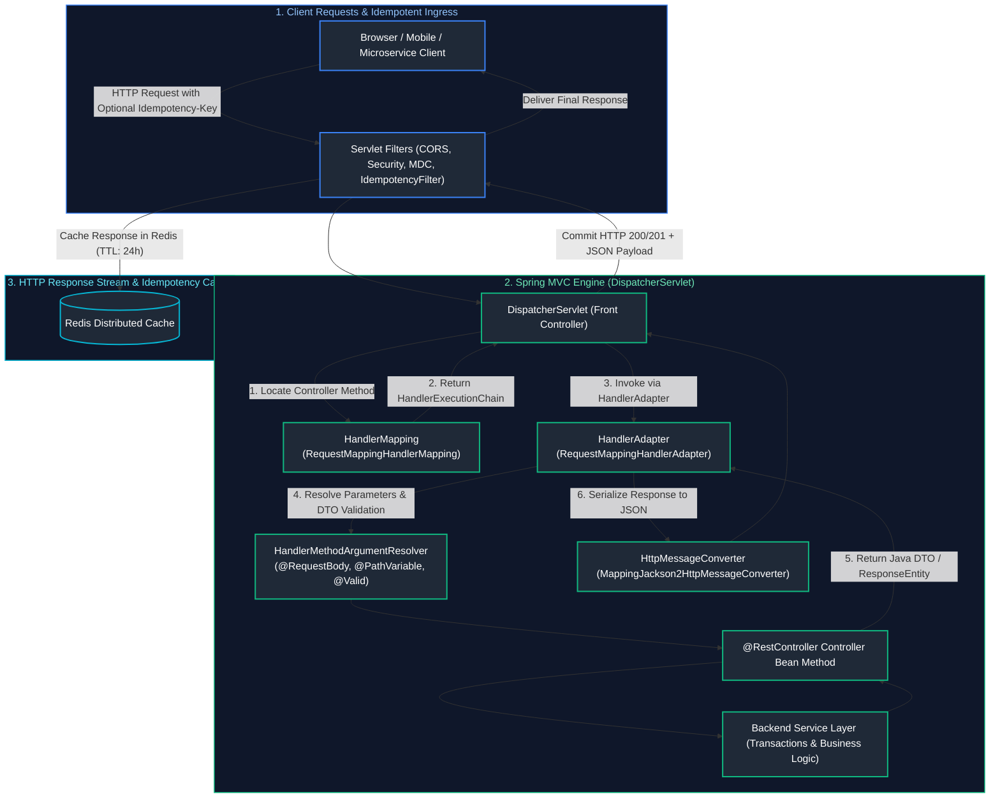
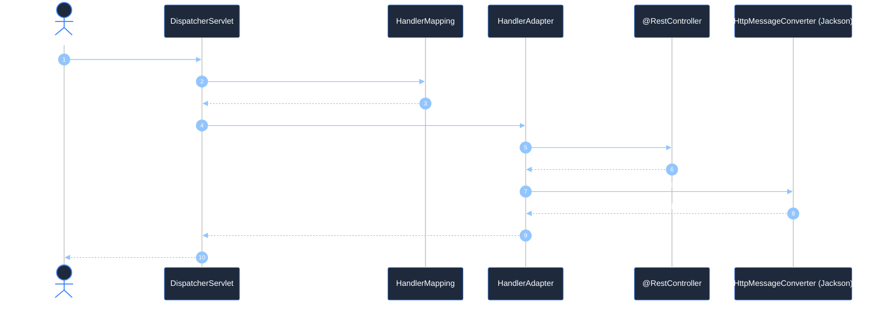
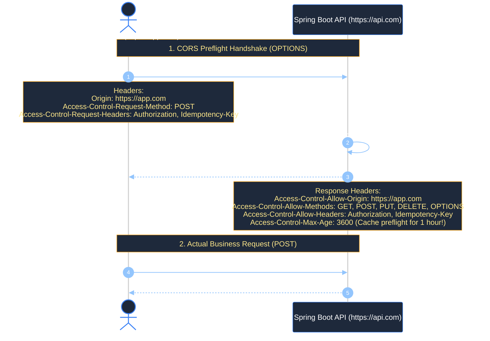
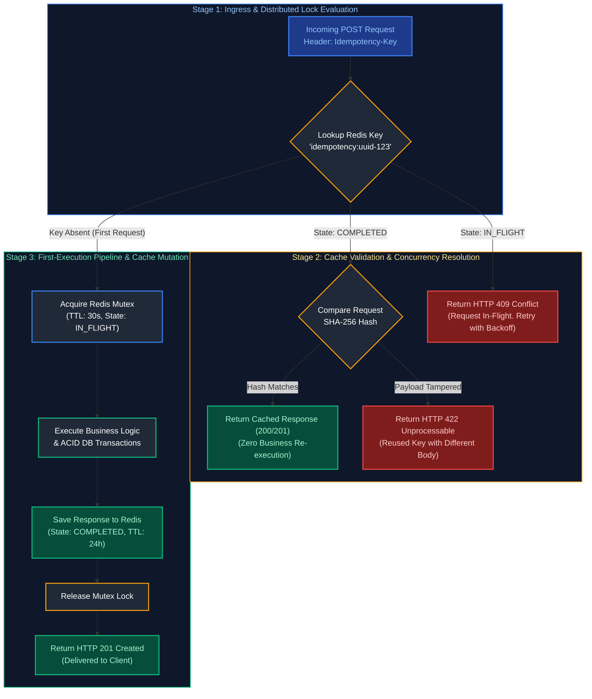
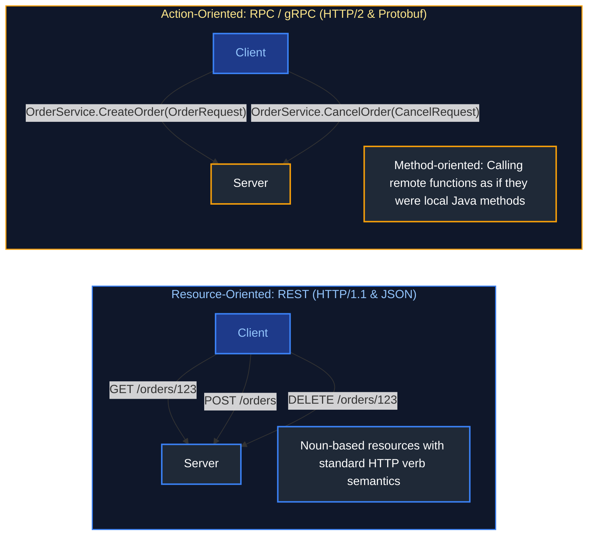
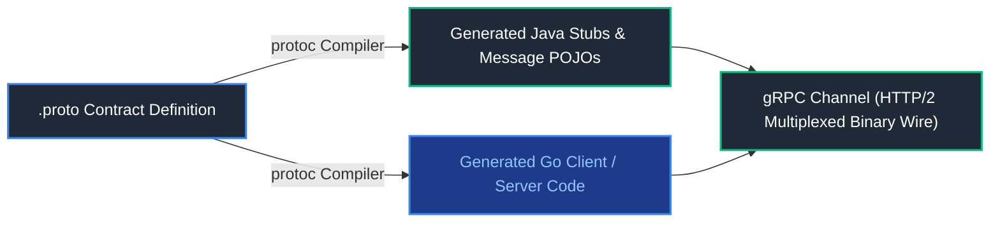
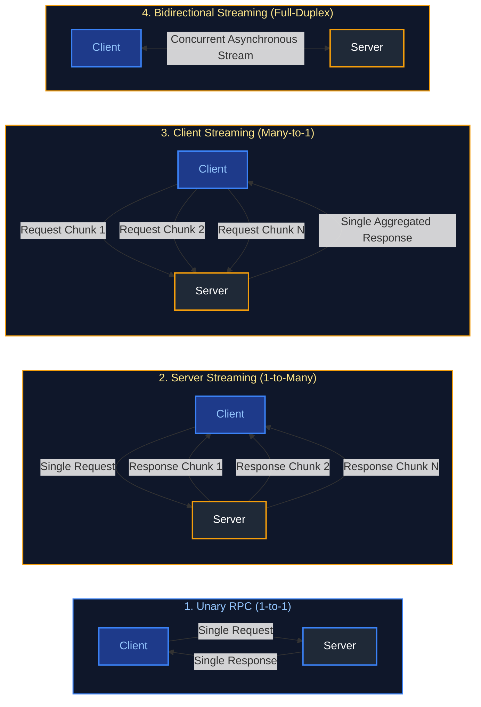

# 08. Spring Web, REST APIs & API Development

A comprehensive architectural and engineering guide covering Spring MVC, the Front Controller pattern (`DispatcherServlet`), RESTful API design principles, complete HTTP method taxonomy, API Idempotency architecture (`Idempotency-Key` specification, Redis locking, and payload hashing), JSON Patch vs JSON Merge Patch, CORS preflight mechanics, Spring web annotations, Data Transfer Objects (DTOs), Jakarta Bean Validation, pagination, OpenAPI specification, RFC 9457 Problem Details error handling, and cURL API diagnostic commands.

---

## Architectural Overview: Enterprise Spring Web & REST API Architecture



---

## Table of Contents
1. [Spring MVC Architecture & Request Lifecycle](#1-spring-mvc-architecture-request-lifecycle)
   - [1.1 The Front Controller Pattern & `DispatcherServlet`](#11-the-front-controller-pattern-dispatcherservlet)
   - [1.2 End-to-End HTTP Request Lifecycle Sequence](#12-end-to-end-http-request-lifecycle-sequence)
2. [HTTP Protocols, Methods Taxonomy & Safety vs Idempotence](#2-http-protocols-methods-taxonomy-safety-vs-idempotence)
   - [2.1 REST Architectural Constraints & Resource Modeling](#21-rest-architectural-constraints-resource-modeling)
   - [2.2 Comprehensive HTTP Methods Taxonomy (`GET`, `POST`, `PUT`, `PATCH`, `DELETE`, `OPTIONS`, `HEAD`)](#22-comprehensive-http-methods-taxonomy-get-post-put-patch-delete-options-head)
   - [2.3 Deep-Dive: Safety vs Idempotence & The `DELETE` 404 Paradox](#23-deep-dive-safety-vs-idempotence-the-delete-404-paradox)
   - [2.4 Partial Updates: JSON Merge Patch (RFC 7396) vs JSON Patch (RFC 6902)](#24-partial-updates-json-merge-patch-rfc-7396-vs-json-patch-rfc-6902)
   - [2.5 `OPTIONS` Method & CORS Preflight Handshake Mechanics](#25-options-method-cors-preflight-handshake-mechanics)
   - [2.6 HTTP Status Codes Reference Matrix](#26-http-status-codes-reference-matrix)
   - [2.7 Content Negotiation (`Accept` & `Content-Type`)](#27-content-negotiation-accept-content-type)
3. [Production API Idempotency Architecture](#3-production-api-idempotency-architecture)
   - [3.1 The Idempotency-Key Pattern & IETF Standard Specification](#31-the-idempotency-key-pattern-ietf-standard-specification)
   - [3.2 Idempotency Lifecycle State Machine](#32-idempotency-lifecycle-state-machine)
   - [3.3 Production Spring Boot Idempotency Filter with Redis & Payload SHA-256 Hashing](#33-production-spring-boot-idempotency-filter-with-redis-payload-sha-256-hashing)
   - [3.4 Database-Level Idempotency Patterns (Unique Constraints, Conditional Updates, Upserts)](#34-database-level-idempotency-patterns-unique-constraints-conditional-updates-upserts)
4. [Spring MVC Web Annotations](#4-spring-mvc-web-annotations)
   - [4.1 Controller Stereotypes: `@Controller` vs `@RestController`](#41-controller-stereotypes-controller-vs-restcontroller)
   - [4.2 Routing Mappings (`@GetMapping`, `@PostMapping`, etc.)](#42-routing-mappings-getmapping-postmapping-etc)
   - [4.3 Extracting Input: `@PathVariable`, `@RequestParam`, `@RequestBody`](#43-extracting-input-pathvariable-requestparam-requestbody)
5. [DTOs & Jakarta Bean Validation](#5-dtos-jakarta-bean-validation)
   - [5.1 Entity vs DTO Separation of Concerns](#51-entity-vs-dto-separation-of-concerns)
   - [5.2 Bean Validation Annotations (`@NotNull`, `@Size`, `@Email`)](#52-bean-validation-annotations-notnull-size-email)
   - [5.3 `@Valid` vs `@Validated` & Group Validation](#53-valid-vs-validated-group-validation)
   - [5.4 Custom Constraint Validators](#54-custom-constraint-validators)
6. [Advanced API Capabilities](#6-advanced-api-capabilities)
   - [6.1 Pagination, Sorting & Dynamic Filtering (`Pageable`)](#61-pagination-sorting-dynamic-filtering-pageable)
   - [6.2 API Versioning Strategies (URI, Header, Media Type)](#62-api-versioning-strategies-uri-header-media-type)
   - [6.3 OpenAPI 3 / Swagger Documentation (SpringDoc)](#63-openapi-3-swagger-documentation-springdoc)
   - [6.4 Cross-Origin Resource Sharing (CORS) Configuration](#64-cross-origin-resource-sharing-cors-configuration)
7. [API Error Handling & Resilience](#7-api-error-handling-resilience)
   - [7.1 Centralized Exception Handling (`@RestControllerAdvice`)](#71-centralized-exception-handling-restcontrolleradvice)
   - [7.2 RFC 9457 Standard Problem Details](#72-rfc-9457-standard-problem-details)
   - [7.3 REST API Diagnostic cURL Commands Cheatsheet](#73-rest-api-diagnostic-curl-commands-cheatsheet)
8. [API Communication Paradigms: REST vs RPC vs gRPC & Protocol Buffers](#8-api-communication-paradigms-rest-vs-rpc-vs-grpc-protocol-buffers)
   - [8.1 API Communication Paradigms (Resource-Oriented REST vs Action-Oriented RPC)](#81-api-communication-paradigms-resource-oriented-rest-vs-action-oriented-rpc)
   - [8.2 gRPC Internals: HTTP/2 Transport & Binary Protocol Buffers](#82-grpc-internals-http2-transport-binary-protocol-buffers)
   - [8.3 gRPC Communication Modes (Unary, Server, Client, Bidirectional Streaming)](#83-grpc-communication-modes)
   - [8.4 Production gRPC Java Implementation (`.proto` Definition, ServiceBase, Stubs)](#84-production-grpc-java-implementation)
   - [8.5 Comprehensive Evaluation: REST vs gRPC Architecture Comparison Matrix](#85-comprehensive-evaluation-rest-vs-grpc-architecture-comparison-matrix)
9. [Summary Comparison & Engineering Reference Matrix](#9-summary-comparison-engineering-reference-matrix)
10. [References & Further Reading](#10-references-further-reading)

---

# 1. Spring MVC Architecture & Request Lifecycle

---

### 1.1 The Front Controller Pattern & `DispatcherServlet`

`DispatcherServlet` is the centralized HTTP entry point of Spring MVC. It orchestrates collaborating beans to process requests:
1. **`HandlerMapping`**: Scans `@RequestMapping` annotations and URI templates to locate the matching controller method.
2. **`HandlerAdapter`**: Adapts and invokes the controller method, using `HandlerMethodArgumentResolver` to extract parameters and trigger validation.
3. **`HttpMessageConverter`**: Serializes and deserializes payloads (Jackson converting Java objects to/from JSON).
4. **`HandlerExceptionResolver`**: Catches unhandled exceptions and routes them to `@RestControllerAdvice`.

---

### 1.2 End-to-End HTTP Request Lifecycle Sequence



---

# 2. HTTP Protocols, Methods Taxonomy & Safety vs Idempotence

---

### 2.1 REST Architectural Constraints & Resource Modeling

REST (Representational State Transfer) is governed by six foundational architectural constraints:
1. **Client-Server Separation**: UI concerns separated from data storage.
2. **Statelessness**: Every request contains all information needed to process it; zero session state stored on the server.
3. **Cacheability**: Responses explicitly declare cacheability (`Cache-Control: max-age=3600`).
4. **Uniform Interface**: Resource identification via URIs, manipulation via representations, self-descriptive messages, and HATEOAS.
5. **Layered System**: Client cannot determine whether it is connected directly to the server or an intermediary proxy.
6. **Code on Demand (Optional)**: Transferring executable scripts.

---

### 2.2 Comprehensive HTTP Methods Taxonomy (`GET`, `POST`, `PUT`, `PATCH`, `DELETE`, `OPTIONS`, `HEAD`)

| HTTP Method | Purpose / Intent | Request Body? | Response Body? | Safe? | Idempotent? | Typical Status Codes |
| :--- | :--- | :---: | :---: | :---: | :---: | :--- |
| **`GET`** | Retrieve resource representation | No | **Yes** | **Yes** | **Yes** | `200 OK`, `304 Not Modified`, `404 Not Found` |
| **`HEAD`** | Retrieve response headers only (no body) | No | **No** | **Yes** | **Yes** | `200 OK`, `304 Not Modified` |
| **`POST`** | Create a new subordinate resource / trigger action | **Yes** | **Yes** | **No** | **No** | `201 Created` (`Location` header), `200 OK` |
| **`PUT`** | Completely replace resource / create at known URI | **Yes** | Optional | **No** | **Yes** | `200 OK`, `204 No Content` |
| **`PATCH`**| Partially update specific fields of a resource | **Yes** | **Yes** | **No** | **Conditional**| `200 OK`, `204 No Content` |
| **`DELETE`**| Permanently remove target resource | No | Optional | **No** | **Yes** | `200 OK`, `204 No Content`, `404 Not Found` |
| **`OPTIONS`**| Query supported methods / CORS preflight | No | Optional | **Yes** | **Yes** | `200 OK`, `204 No Content` |
| **`TRACE`**| Loopback diagnostic test echoing request | No | **Yes** | **Yes** | **Yes** | `200 OK` (Typically disabled for security) |

---

### 2.3 Deep-Dive: Safety vs Idempotence & The `DELETE` 404 Paradox

#### 1. Safe vs Idempotent: What Is the Difference?
- **Safe Methods ($f(x) \rightarrow \text{No State Mutation}$)**: Methods that **do not alter server resource state**. `GET` and `HEAD` are strictly read-only. Calling `GET /users` 1,000 times will never modify the database.
- **Idempotent Methods ($f(f(x)) = f(x)$)**: Methods where **executing the operation once produces the exact same server state as executing it $N$ times consecutively**.
  - **`PUT` is Idempotent**: `PUT /users/10 {'name': 'Alice'}` replaces user 10's name with 'Alice'. Repeating this call 50 times leaves user 10's name as 'Alice'—server state is identical.
  - **`POST` is NOT Idempotent**: `POST /orders {'item': 'Book'}` creates a new order row each time. Calling it 5 times creates 5 distinct order records in the database with 5 distinct IDs!

#### 2. The `DELETE` 404 Paradox: Is `DELETE` Truly Idempotent?
Consider this scenario:
1. `DELETE /orders/101` $\rightarrow$ Server deletes order 101 and returns `204 No Content`.
2. `DELETE /orders/101` (Retried) $\rightarrow$ Server cannot find order 101 and returns `404 Not Found`.

> [!IMPORTANT]
> **Is `DELETE` still idempotent even though the response status code changed from 204 to 404?**
> **YES!** Idempotence refers to **server resource state**, not the HTTP response status code. Before the first call, order 101 existed; after the first call, order 101 was deleted. After the second, third, and hundredth call, order 101 remains deleted. The server state has not changed.

---

### 2.4 Partial Updates: JSON Merge Patch (RFC 7396) vs JSON Patch (RFC 6902)

When updating a resource partially, `PUT` is improper because `PUT` requires replacing the **entire** object (fields omitted in a `PUT` are expected to be set to `null`). `PATCH` is the correct semantic tool:

#### Comparison Matrix: RFC 7396 vs RFC 6902

| Dimension | JSON Merge Patch (RFC 7396) | JSON Patch (RFC 6902) |
| :--- | :--- | :--- |
| **Content-Type** | `application/merge-patch+json` | `application/json-patch+json` |
| **Payload Structure**| Partial JSON object matching target schema | Array of sequential operational instructions |
| **Simplicity** | Extremely simple and human-readable | More complex; requires patch engine library |
| **Field Deletion** | Sending `{"field": null}` deletes the field | Explicit operation: `{"op": "remove", "path": "/field"}` |
| **Array Operations** | Replaces entire array; cannot append single item | Precise: `{"op": "add", "path": "/tags/1", "value": "java"}` |

#### 1. JSON Merge Patch Example (RFC 7396)
```http
PATCH /api/v1/users/42 HTTP/1.1
Content-Type: application/merge-patch+json

{
  "email": "new.email@company.com",
  "phoneNumber": null
}
```
*(Updates email to `new.email@company.com` and sets `phoneNumber` to null/deletes it; leaves all other fields intact).*

#### 2. JSON Patch Example (RFC 6902)
```http
PATCH /api/v1/orders/102 HTTP/1.1
Content-Type: application/json-patch+json

[
  { "op": "replace", "path": "/status", "value": "SHIPPED" },
  { "op": "add", "path": "/trackingNumbers/0", "value": "TRACK-998811" },
  { "op": "remove", "path": "/internalNotes" }
]
```

---

### 2.5 `OPTIONS` Method & CORS Preflight Handshake Mechanics

When a browser makes a cross-origin HTTP request (`https://frontend.com` calling `https://api.backend.com`) involving custom headers (`Authorization`, `Idempotency-Key`) or methods other than simple `GET`/`POST`, the browser **automatically pauses** and issues an `OPTIONS` **Preflight Request**:



---

### 2.6 HTTP Status Codes Reference Matrix

| Status Code | Reason Phrase | Semantic Meaning & Best Practice Usage |
| :--- | :--- | :--- |
| **`200 OK`** | Success | Request succeeded; response payload contains data. |
| **`201 Created`** | Created | Resource created; includes `Location` header pointing to new resource URI. |
| **`204 No Content`** | No Content | Action succeeded; response body intentionally empty (common for `DELETE`). |
| **`301 Moved Permanently`** | Redirection | Target resource moved permanently to URI specified in `Location`. |
| **`304 Not Modified`** | Cached | Client's cached copy remains fresh (`ETag` matched). |
| **`400 Bad Request`** | Validation Error | Malformed JSON syntax or Bean Validation constraint failure. |
| **`401 Unauthorized`** | Missing Auth | Missing or invalid authentication token. |
| **`403 Forbidden`** | Access Denied | Authenticated, but lacking sufficient permissions or roles. |
| **`404 Not Found`** | Missing Resource | Resource identified by URI does not exist. |
| **`409 Conflict`** | State Collision | Database unique constraint violation or optimistic lock conflict. |
| **`429 Too Many Requests`** | Rate Limited | Client exceeded rate limit; includes `Retry-After` header. |
| **`500 Internal Error`** | Server Failure | Unhandled runtime exception inside application. |
| **`502 Bad Gateway`** | Upstream Error | Upstream microservice or database returned invalid response. |
| **`503 Unavailable`** | Maintenance/Overload| Server temporarily overloaded or undergoing graceful shutdown. |

---

### 2.7 Content Negotiation (`Accept` & `Content-Type`)

- `Content-Type`: Tells the server the media type of the payload being sent in the request body (`application/json`).
- `Accept`: Tells the server what media type the client wants back in the response body.

```java
@GetMapping(value = "/users/{id}", produces = {"application/json", "application/xml"})
public UserResponseDTO getUser(@PathVariable Long id) { ... }
```

---

# 3. Production API Idempotency Architecture

---

### 3.1 The Idempotency-Key Pattern & IETF Standard Specification

In distributed networks, transient network timeouts (TCP drop, HTTP 504 Gateway Timeout) leave callers uncertain whether a mutating `POST` request was processed by the server:
- If the client **does not retry**, the payment or order may never be executed.
- If the client **retries naively**, the customer may be billed twice or duplicate orders may be created.

The **`Idempotency-Key` specification (IETF Draft)** resolves this:
1. The client generates a unique UUID (e.g. `Idempotency-Key: 9b1deb4d-3b7d-4bad-9bdd-2b0d7b3dcb6d`) and attaches it as an HTTP header to mutating requests (`POST`).
2. The server caches the response of the first execution under this key.
3. If the client retries with the same key, the server **returns the cached original response immediately without re-executing business logic**.

---

### 3.2 Idempotency Lifecycle State Machine



---

### 3.3 Production Spring Boot Idempotency Filter with Redis & Payload SHA-256 Hashing

```java
package com.company.security.idempotency;

import jakarta.servlet.FilterChain;
import jakarta.servlet.ServletException;
import jakarta.servlet.http.HttpServletRequest;
import jakarta.servlet.http.HttpServletResponse;
import org.springframework.data.redis.core.StringRedisTemplate;
import org.springframework.http.HttpStatus;
import org.springframework.stereotype.Component;
import org.springframework.web.filter.OncePerRequestFilter;
import org.springframework.web.util.ContentCachingRequestWrapper;
import org.springframework.web.util.ContentCachingResponseWrapper;

import java.io.IOException;
import java.nio.charset.StandardCharsets;
import java.security.MessageDigest;
import java.security.NoSuchAlgorithmException;
import java.time.Duration;
import java.util.HexFormat;

@Component
public class IdempotencyFilter extends OncePerRequestFilter {

    private static final String IDEMPOTENCY_HEADER = "Idempotency-Key";
    private static final Duration IDEMPOTENCY_TTL = Duration.ofHours(24);
    private final StringRedisTemplate redisTemplate;

    public IdempotencyFilter(StringRedisTemplate redisTemplate) {
        this.redisTemplate = redisTemplate;
    }

    @Override
    protected void doFilterInternal(HttpServletRequest request,
                                    HttpServletResponse response,
                                    FilterChain filterChain) throws ServletException, IOException {

        // Only enforce idempotency on mutating state methods (POST)
        if (!"POST".equalsIgnoreCase(request.getMethod())) {
            filterChain.doFilter(request, response);
            return;
        }

        String idempotencyKey = request.getHeader(IDEMPOTENCY_HEADER);
        if (idempotencyKey == null || idempotencyKey.isBlank()) {
            // No idempotency key provided; proceed normally
            filterChain.doFilter(request, response);
            return;
        }

        ContentCachingRequestWrapper wrappedRequest = new ContentCachingRequestWrapper(request);
        ContentCachingResponseWrapper wrappedResponse = new ContentCachingResponseWrapper(response);

        // Pre-read request body to calculate payload SHA-256 hash
        byte[] body = wrappedRequest.getInputStream().readAllBytes();
        String currentPayloadHash = calculateSha256(body);

        String redisDataKey = "idempotency:data:" + idempotencyKey;
        String redisLockKey = "idempotency:lock:" + idempotencyKey;

        // 1. Check if response is already cached from previous successful execution
        String cachedData = redisTemplate.opsForValue().get(redisDataKey);
        if (cachedData != null) {
            // Format: "hash::status_code::response_body"
            String[] parts = cachedData.split("::", 3);
            String savedHash = parts[0];
            int savedStatus = Integer.parseInt(parts[1]);
            String savedBody = parts[2];

            // Verify payload has not been tampered with under the same key
            if (!savedHash.equals(currentPayloadHash)) {
                response.sendError(HttpStatus.UNPROCESSABLE_ENTITY.value(),
                        "Idempotency key reused with different request payload");
                return;
            }

            // Return cached response immediately
            response.setStatus(savedStatus);
            response.setContentType("application/json");
            response.addHeader("X-Cache-Lookup", "HIT-IDEMPOTENT");
            response.getWriter().write(savedBody);
            return;
        }

        // 2. Acquire atomic distributed lock for in-flight protection (SETNX with 30s TTL)
        Boolean lockAcquired = redisTemplate.opsForValue()
                .setIfAbsent(redisLockKey, "IN_FLIGHT", Duration.ofSeconds(30));

        if (Boolean.FALSE.equals(lockAcquired)) {
            // Concurrent in-flight request with same key already executing
            response.sendError(HttpStatus.CONFLICT.value(),
                    "Concurrent request with same Idempotency-Key in progress");
            return;
        }

        try {
            // 3. Execute downstream controller and service logic
            filterChain.doFilter(wrappedRequest, wrappedResponse);

            int status = wrappedResponse.getStatus();
            byte[] responseBytes = wrappedResponse.getContentAsByteArray();
            String responseBody = new String(responseBytes, StandardCharsets.UTF_8);

            // 4. Cache successful responses (2xx status codes) for 24 hours
            if (status >= 200 && status < 300) {
                String record = currentPayloadHash + "::" + status + "::" + responseBody;
                redisTemplate.opsForValue().set(redisDataKey, record, IDEMPOTENCY_TTL);
            }

            // Copy response body back to original response stream
            wrappedResponse.copyBodyToResponse();

        } finally {
            // Always release in-flight lock
            redisTemplate.delete(redisLockKey);
        }
    }

    private String calculateSha256(byte[] data) {
        try {
            MessageDigest digest = MessageDigest.getInstance("SHA-256");
            byte[] hash = digest.digest(data);
            return HexFormat.of().formatHex(hash);
        } catch (NoSuchAlgorithmException e) {
            throw new RuntimeException("SHA-256 algorithm unavailable", e);
        }
    }
}
```

---

### 3.4 Database-Level Idempotency Patterns (Unique Constraints, Conditional Updates, Upserts)

In addition to API-level filters, backend databases should enforce structural idempotency:

#### 1. Natural Unique Constraints
Enforce unique database indexes on client-provided IDs:
```sql
ALTER TABLE payments ADD CONSTRAINT uk_payment_idempotency UNIQUE (idempotency_key);
```
If a duplicate request bypasses the cache, the second `INSERT` statement throws a unique constraint violation (`DataIntegrityViolationException`), which the application catches and translates into a clean idempotent response.

#### 2. Conditional State Transitions
```sql
-- Idempotent: Executing multiple times changes status only once
UPDATE orders
SET status = 'CANCELLED', updated_at = CURRENT_TIMESTAMP
WHERE id = 101 AND status = 'PENDING';
```

#### 3. Upsert (Insert on Conflict)
```sql
-- PostgreSQL Upsert: Safe to retry indefinitely
INSERT INTO user_preferences (user_id, dark_mode, email_notifications)
VALUES (42, true, false)
ON CONFLICT (user_id)
DO UPDATE SET
    dark_mode = EXCLUDED.dark_mode,
    email_notifications = EXCLUDED.email_notifications;
```

---

# 4. Spring MVC Web Annotations

---

### 4.1 Controller Stereotypes: `@Controller` vs `@RestController`

- **`@Controller`**: Standard Spring MVC stereotype returning a view name string resolved by a `ViewResolver` (Thymeleaf, JSP).
- **`@RestController`**: Meta-annotation combining `@Controller` and `@ResponseBody`. Every method automatically writes return values directly to the HTTP response stream serialized via Jackson.

---

### 4.2 Routing Mappings (`@GetMapping`, `@PostMapping`, etc.)

```java
@RestController
@RequestMapping("/api/v1/orders")
public class OrderController {

    @GetMapping("/{id}")
    public OrderResponse getOrder(@PathVariable Long id) { ... }

    @PostMapping
    public ResponseEntity<OrderResponse> createOrder(@Valid @RequestBody CreateOrderRequest request) {
        OrderResponse created = orderService.create(request);
        URI location = URI.create("/api/v1/orders/" + created.id());
        return ResponseEntity.created(location).body(created);
    }
}
```

---

### 4.3 Extracting Input: `@PathVariable`, `@RequestParam`, `@RequestBody`

- **`@PathVariable`**: Extracts dynamic URI path segment values (`/orders/{id}`).
- **`@RequestParam`**: Extracts query string parameters (`/orders?status=PENDING&page=1`).
- **`@RequestBody`**: Deserializes the JSON HTTP request body into a strongly typed Java DTO record.

---

# 5. DTOs & Jakarta Bean Validation

---

### 5.1 Entity vs DTO Separation of Concerns

Never expose JPA `@Entity` classes directly via REST controllers:
1. **Prevents Mass Assignment Vulnerabilities**: Attackers cannot inject unauthorized fields (e.g. `isAdmin = true`).
2. **Eliminates Infinite Recursion**: Prevents bidirectional JPA relationship loops during Jackson JSON serialization.
3. **Decouples Database Schema**: The database schema can change without breaking client API contracts.

---

### 5.2 Bean Validation Annotations (`@NotNull`, `@Size`, `@Email`)

```java
public record CreateUserRequest(
    @NotBlank(message = "Username is required")
    @Size(min = 3, max = 50, message = "Username must be between 3 and 50 characters")
    String username,

    @NotBlank(message = "Email is required")
    @Email(message = "Must be a well-formed email address")
    String email,

    @Min(value = 18, message = "User must be at least 18 years old")
    int age
) {}
```

---

### 5.3 `@Valid` vs `@Validated` & Group Validation

- **`@Valid`**: Standard Jakarta EE annotation. Used on controller method parameters to trigger recursive validation of object graphs.
- **`@Validated`**: Spring-specific annotation. Supports **Validation Groups** (applying different validation rules during creation vs update) and method-level parameter validation on Service beans.

---

### 5.4 Custom Constraint Validators

```java
// 1. Define custom annotation
@Target({ElementType.FIELD})
@Retention(RetentionPolicy.RUNTIME)
@Constraint(validatedBy = PhoneNumberValidator.class)
public @interface ValidPhoneNumber {
    String message() default "Invalid phone number format";
    Class<?>[] groups() default {};
    Class<? extends Payload>[] payload() default {};
}

// 2. Implement validator logic
public class PhoneNumberValidator implements ConstraintValidator<ValidPhoneNumber, String> {
    private static final Pattern PHONE_PATTERN = Pattern.compile("^\\+[1-9]\\d{1,14}$");

    @Override
    public boolean isValid(String value, ConstraintValidatorContext context) {
        if (value == null) return false;
        return PHONE_PATTERN.matcher(value).matches();
    }
}
```

---

# 6. Advanced API Capabilities

---

### 6.1 Pagination, Sorting & Dynamic Filtering (`Pageable`)

```java
@GetMapping("/api/v1/products")
public Page<ProductDTO> listProducts(
    @PageableDefault(size = 20, sort = "createdAt", direction = Sort.Direction.DESC) Pageable pageable
) {
    return productRepository.findAll(pageable).map(ProductDTO::fromEntity);
}
```

Supports requests such as:
`GET /api/v1/products?page=0&size=20&sort=price,desc&sort=name,asc`

---

### 6.2 API Versioning Strategies (URI, Header, Media Type)

| Strategy | Syntax Example | Pros | Cons |
| :--- | :--- | :--- | :--- |
| **URI Path** | `/api/v1/orders` vs `/api/v2/orders` | Clear, bookmarkable, easy routing | Clutters URI namespace |
| **Custom Header** | `X-API-Version: 2` | Clean URIs | Harder to test in browsers directly |
| **Media Type (Accept)**| `Accept: application/vnd.company.v2+json` | Pure RESTful content negotiation | Complex client configuration |

---

### 6.3 OpenAPI 3 / Swagger Documentation (SpringDoc)

Add dependency `springdoc-openapi-starter-webmvc-ui` to automatically expose interactive Swagger UI at `/swagger-ui.html` and the raw OpenAPI 3 JSON specification at `/v3/api-docs`.

---

### 6.4 Cross-Origin Resource Sharing (CORS) Configuration

```java
@Configuration
public class WebCorsConfig implements WebMvcConfigurer {
    @Override
    public void addCorsMappings(CorsRegistry registry) {
        registry.addMapping("/api/**")
                .allowedOrigins("https://portal.company.com")
                .allowedMethods("GET", "POST", "PUT", "DELETE", "PATCH", "OPTIONS")
                .allowedHeaders("*")
                .allowCredentials(true)
                .maxAge(3600);
    }
}
```

---

# 7. API Error Handling & Resilience

---

### 7.1 Centralized Exception Handling (`@RestControllerAdvice`)

Intercepts unhandled controller exceptions globally, mapping them to uniform, standardized error representations.

---

### 7.2 RFC 9457 Standard Problem Details

Spring Boot 3 natively implements **RFC 9457 (Problem Details for HTTP APIs)**:

```java
package com.company.exception;

import org.springframework.http.HttpStatus;
import org.springframework.http.ProblemDetail;
import org.springframework.web.bind.MethodArgumentNotValidException;
import org.springframework.web.bind.annotation.ExceptionHandler;
import org.springframework.web.bind.annotation.RestControllerAdvice;

import java.net.URI;
import java.time.Instant;
import java.util.HashMap;
import java.util.Map;

@RestControllerAdvice
public class GlobalExceptionHandler {

    @ExceptionHandler(ResourceNotFoundException.class)
    public ProblemDetail handleNotFound(ResourceNotFoundException ex) {
        ProblemDetail problem = ProblemDetail.forStatusAndDetail(HttpStatus.NOT_FOUND, ex.getMessage());
        problem.setTitle("Resource Not Found");
        problem.setType(URI.create("https://api.company.com/errors/not-found"));
        problem.setProperty("timestamp", Instant.now());
        return problem;
    }

    @ExceptionHandler(MethodArgumentNotValidException.class)
    public ProblemDetail handleValidation(MethodArgumentNotValidException ex) {
        ProblemDetail problem = ProblemDetail.forStatusAndDetail(HttpStatus.BAD_REQUEST, "Validation failed");
        problem.setTitle("Invalid Request Payload");
        problem.setType(URI.create("https://api.company.com/errors/validation-error"));

        Map<String, String> invalidFields = new HashMap<>();
        ex.getBindingResult().getFieldErrors().forEach(err ->
            invalidFields.put(err.getField(), err.getDefaultMessage())
        );

        problem.setProperty("invalidFields", invalidFields);
        problem.setProperty("timestamp", Instant.now());
        return problem;
    }
}
```

---

### 7.3 REST API Diagnostic cURL Commands Cheatsheet

| Command & Syntax | Key Flags Explained | What Does What | Practical Operational Scenario |
| :--- | :--- | :--- | :--- |
| `curl -i -X GET https://api.company.com/orders` | `-i`: Include HTTP response headers in output | Dumps response status code, headers, and body | Checking HTTP status codes and response headers |
| `curl -X POST https://api.company.com/orders -H "Content-Type: application/json" -H "Idempotency-Key: uuid-123" -d '{"amount":100}'` | `-H "Idempotency-Key: ..."`: Attach key<br>`-d`: Payload | Sends idempotent POST request to create resource | Testing API idempotency and duplicate prevention |
| `curl -X OPTIONS https://api.company.com/orders -H "Origin: https://app.com" -H "Access-Control-Request-Method: POST" -i` | `OPTIONS`: Preflight test<br>`-H "Origin: ..."` | Tests server CORS preflight headers | Diagnosing CORS issues in browser apps |
| `curl -H "Authorization: Bearer <token>" https://api.company.com/orders` | `-H "Authorization: Bearer ..."` | Supplies OAuth2 / JWT access token | Testing authenticated REST API endpoints |
| `curl -s -o /dev/null -w "%{http_code}\n" https://api.company.com/health` | `-s`: Silent mode<br>`-o /dev/null`: Discard body<br>`-w`: Extract HTTP code | Outputs strictly the HTTP numeric status code | Automated bash health check scripts and probes |
| `curl -w "@curl-format.txt" -o /dev/null -s https://api.company.com/orders` | `-w`: Format timing output (DNS, TCP, TTFB) | Measures detailed latency breakdown per network phase | Diagnosing API latency bottlenecks |

---

---

# 8. API Communication Paradigms: REST vs RPC vs gRPC & Protocol Buffers

---

### 8.1 API Communication Paradigms (Resource-Oriented REST vs Action-Oriented RPC)

Enterprise architectures utilize distinct architectural styles for distributed client-to-service and service-to-service communication:



- **REST (Representational State Transfer)**: Resource-centric (`/users`, `/orders/{id}`). Relies on standard HTTP semantics (`GET`, `POST`, `PUT`, `DELETE`). Ideal for public-facing APIs, web browsers, and third-party developer integrations.
- **RPC (Remote Procedure Call)**: Action-centric (`orderService.processOrder(req)`). Abstracts network calls into local procedure invocations. Optimized for low-latency internal microservice communication.

---

### 8.2 gRPC Internals: HTTP/2 Transport & Binary Protocol Buffers

gRPC (Google Remote Procedure Call) is an open-source, high-performance RPC framework that addresses key inefficiencies of REST over HTTP/1.1:

#### 1. HTTP/2 Transport Capabilities
- **Binary Framing**: Unlike HTTP/1.1's human-readable text protocols, HTTP/2 breaks communication into binary frames (`HEADERS`, `DATA`), making parsing exponentially faster with lower CPU overhead.
- **Multiplexing over Single TCP Connection**: Multiple concurrent bidirectional requests and responses travel across a single TCP connection concurrently, eliminating HTTP/1.1 "Head-of-Line" (HoL) blocking and TCP socket exhaustion.
- **HPACK Header Compression**: Compresses redundant headers (authorization tokens, user agents) across requests using a shared sliding compression window.

#### 2. Protocol Buffers (Protobuf v3)
Protocol Buffers is a language-neutral, platform-neutral binary serialization mechanism:
- **Compact Byte Footprint**: Field names are omitted from the wire; fields are identified by compact integer tags (1, 2, 3), resulting in payloads **3x to 10x smaller than equivalent JSON**.
- **Strong Typing & Contract Safety**: The `.proto` file serves as the single source of truth across polyglot microservice teams (Java, Go, Python, C++).



---

### 8.3 gRPC Communication Modes

gRPC supports four distinct communication patterns:



1. **Unary RPC**: Classic request-response (e.g., fetch order by ID).
2. **Server Streaming**: Client sends one request; server streams back a sequence of messages (e.g., live stock quotes, IoT telemetry logs, large file exports).
3. **Client Streaming**: Client streams a sequence of messages to server; server replies with a single summary (e.g., continuous GPS location updates, chunked large file uploads).
4. **Bidirectional Streaming**: Both client and server read and write independent streams concurrently over a single HTTP/2 connection (e.g., real-time multiplayer gaming, bidirectional chat, financial trading).

---

### 8.4 Production gRPC Java Implementation

#### 1. Protobuf Contract Definition (`order_service.proto`)
```protobuf
syntax = "proto3";

package com.company.orders.grpc;

option java_multiple_files = true;
option java_package = "com.company.orders.grpc";
option java_outer_classname = "OrderProto";

// Service Interface definition
service OrderGrpcService {
    // Unary RPC
    rpc GetOrder (OrderRequest) returns (OrderResponse);
    // Server Streaming RPC
    rpc StreamOrderAuditLogs (OrderRequest) returns (stream AuditLogEntry);
}

message OrderRequest {
    string order_id = 1;
}

message OrderResponse {
    string order_id = 1;
    string customer_id = 2;
    double amount = 3;
    string status = 4;
}

message AuditLogEntry {
    string event_id = 1;
    string timestamp = 2;
    string message = 3;
}
```

#### 2. Java gRPC Server Implementation
```java
package com.company.orders.grpc;

import io.grpc.stub.StreamObserver;
import net.devh.boot.grpc.server.service.GrpcService;
import org.springframework.stereotype.Service;

@GrpcService // Spring Boot gRPC Starter annotation
public class OrderGrpcServiceImpl extends OrderGrpcServiceGrpc.OrderGrpcServiceImplBase {

    @Override
    public void getOrder(OrderRequest request, StreamObserver<OrderResponse> responseObserver) {
        String orderId = request.getOrderId();

        // Business Logic retrieval
        OrderResponse response = OrderResponse.newBuilder()
                .setOrderId(orderId)
                .setCustomerId("CUST-9901")
                .setAmount(250.75)
                .setStatus("CONFIRMED")
                .build();

        // Send response and complete invocation
        responseObserver.onNext(response);
        responseObserver.onCompleted();
    }

    @Override
    public void streamOrderAuditLogs(OrderRequest request, StreamObserver<AuditLogEntry> responseObserver) {
        // Stream multiple entries back to the client
        for (int i = 1; i <= 3; i++) {
            AuditLogEntry log = AuditLogEntry.newBuilder()
                    .setEventId("EVT-" + i)
                    .setTimestamp("2026-10-03T22:30:00Z")
                    .setMessage("State transitioned to STEP_" + i)
                    .build();
            responseObserver.onNext(log);
        }
        responseObserver.onCompleted();
    }
}
```

#### 3. Java gRPC Client Implementation (Stubs)
gRPC provides three client stub variants:
- **`BlockingStub`**: Synchronous, blocking execution (simplest for standard threads).
- **`Stub` (Async)**: Non-blocking, callback-based (`StreamObserver`).
- **`FutureStub`**: Returns Google Guava `ListenableFuture` / `CompletableFuture`.

```java
package com.company.orders.client;

import com.company.orders.grpc.*;
import io.grpc.ManagedChannel;
import io.grpc.ManagedChannelBuilder;
import org.springframework.stereotype.Service;

import java.util.Iterator;
import java.util.concurrent.TimeUnit;

@Service
public class OrderGrpcClient {

    private final ManagedChannel channel;
    private final OrderGrpcServiceGrpc.OrderGrpcServiceBlockingStub blockingStub;

    public OrderGrpcClient() {
        // Create an HTTP/2 Channel with TLS (or plaintext for local dev)
        this.channel = ManagedChannelBuilder.forAddress("order-service.internal", 9090)
                .usePlaintext() // Production uses .useTransportSecurity() with mTLS
                .keepAliveTime(30, TimeUnit.SECONDS)
                .build();
        this.blockingStub = OrderGrpcServiceGrpc.newBlockingStub(channel);
    }

    public OrderResponse fetchOrder(String orderId) {
        OrderRequest request = OrderRequest.newBuilder().setOrderId(orderId).build();
        return blockingStub.getOrder(request);
    }

    public void printAuditLogs(String orderId) {
        OrderRequest request = OrderRequest.newBuilder().setOrderId(orderId).build();
        // Server streaming response returned as standard Java Iterator!
        Iterator<AuditLogEntry> logIterator = blockingStub.streamOrderAuditLogs(request);
        while (logIterator.hasNext()) {
            AuditLogEntry entry = logIterator.next();
            System.out.println("Received Log: " + entry.getMessage());
        }
    }
}
```

---

### 8.5 Comprehensive Evaluation: REST vs gRPC Architecture Comparison Matrix

| Architectural Dimension | REST (Representational State Transfer) | gRPC (Google Remote Procedure Call) |
| :--- | :--- | :--- |
| **Primary Protocol** | HTTP/1.1 (standard) or HTTP/2 | **HTTP/2 exclusively** (multiplexed, binary framing) |
| **Payload Format** | Text-based JSON (human-readable, verbose) | **Binary Protocol Buffers** (compact, machine-optimized) |
| **Performance & Latency**| Moderate (JSON serialization and string parsing cost) | **Ultra-Low Latency (7–10x faster serialization than JSON)** |
| **Streaming Support** | Unary request/response (SSE or WebSockets separate) | **Native 4-way Streaming** (Unary, Server, Client, Bidirectional) |
| **Schema & Typing** | Optional (OpenAPI/Swagger), loose enforcement | **Strict `.proto` contract**, compile-time code generation |
| **Browser Compatibility**| **Universal** (Native in every web browser fetch/XHR) | Limited (requires `grpc-web` proxy translation) |
| **Payload Size** | Larger (field keys repeated in every message) | Minimal (keys encoded as 1–2 byte numeric tags) |
| **Idempotency & Caching**| Built-in via HTTP verbs & Cache-Control headers | Application-level implementation required |
| **Best Production Use Case**| **Public APIs, Mobile/Web Frontends, Gateway Ingress** | **Internal Microservice-to-Microservice, High-Frequency Trading, IoT** |

---

# 9. Summary Comparison & Engineering Reference Matrix

| HTTP Method / Protocol | Safety Guarantees | Idempotence Guarantees | Spring MVC Controller Idiom | Production Engineering Rule |
| :--- | :---: | :---: | :--- | :--- |
| **`GET`** | **Safe** | **Idempotent** | `@GetMapping` | Cacheable; must never cause server-side state mutation. |
| **`POST`** | Non-Safe | Non-Idempotent | `@PostMapping` | Enforce Idempotency-Key header with Redis locks for payments/orders. |
| **`PUT`** | Non-Safe | **Idempotent** | `@PutMapping` | Full resource replacement; client must provide complete entity representation. |
| **`PATCH`** | Non-Safe | Conditional | `@PatchMapping` | Partial mutation; use JSON Merge Patch (RFC 7396) or JSON Patch (RFC 6902). |
| **`DELETE`** | Non-Safe | **Idempotent** | `@DeleteMapping` | Idempotent on resource state (resource ceases to exist regardless of retry count). |
| **`HEAD`** | **Safe** | **Idempotent** | `@RequestMapping(method = RequestMethod.HEAD)` | Returns identical headers to `GET` without message body; used for cache validation. |
| **`OPTIONS`** | **Safe** | **Idempotent** | Handled by CORS Filter | Preflight handshake; configure allowed origins, headers, and credentials strictly. |
| **gRPC** | Configurable | Configurable | `GrpcService` + `io.grpc.stub.StreamObserver` | Binary Protobuf over HTTP/2; 7–10x faster serialization for internal microservices. |

---

# 10. References & Further Reading

- [RFC 9110: HTTP Semantics Specification](https://www.rfc-editor.org/rfc/rfc9110.html) — Authoritative HTTP standards.
- [RFC 9457: Problem Details for HTTP APIs](https://www.rfc-editor.org/rfc/rfc9457.html) — Standardized JSON machine-readable error bodies.
- [IETF Draft: The Idempotency-Key HTTP Header Field](https://datatracker.ietf.org/doc/draft-ietf-httpapi-idempotency-key-header/)
- [gRPC Official Documentation & Guides](https://grpc.io/docs/languages/java/)
- [Protocol Buffers Language Guide (proto3)](https://protobuf.dev/programming-guides/proto3/)
- [RFC 7396: JSON Merge Patch](https://www.rfc-editor.org/rfc/rfc7396.html)
- [RFC 6902: JavaScript Object Notation (JSON) Patch](https://www.rfc-editor.org/rfc/rfc6902.html)
- [Spring MVC Official Documentation](https://docs.spring.io/spring-framework/reference/web/webmvc.html)
