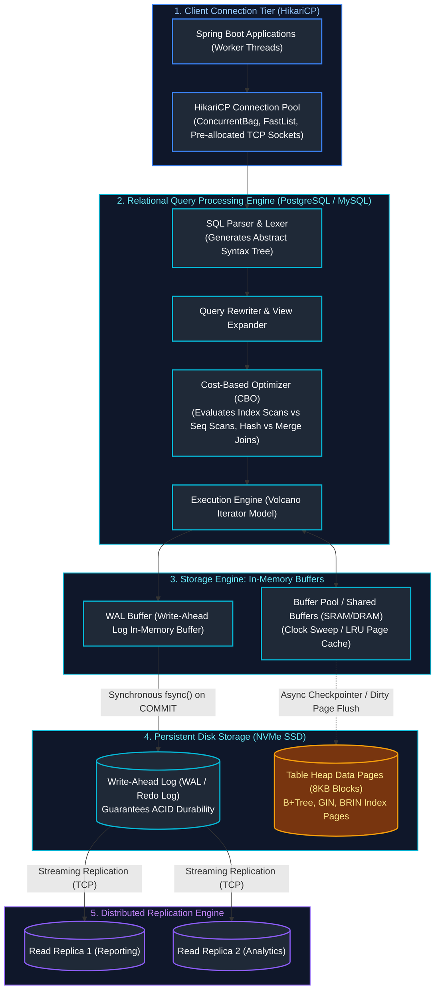
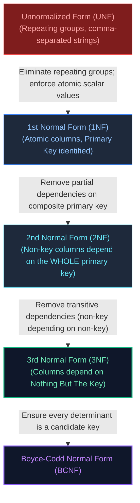
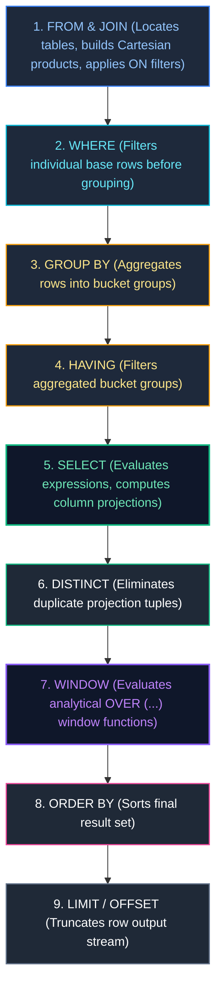
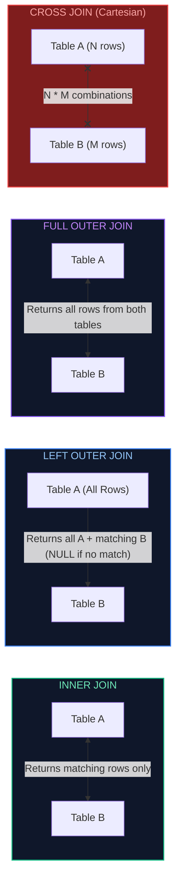
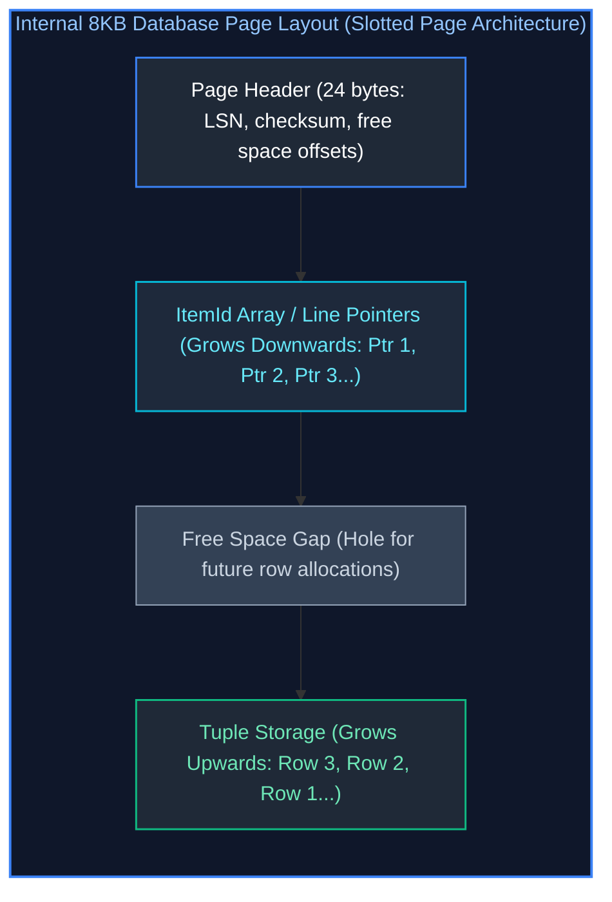
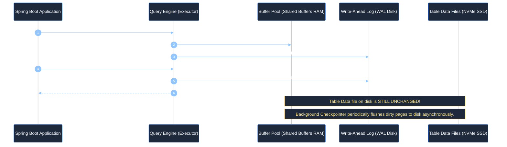
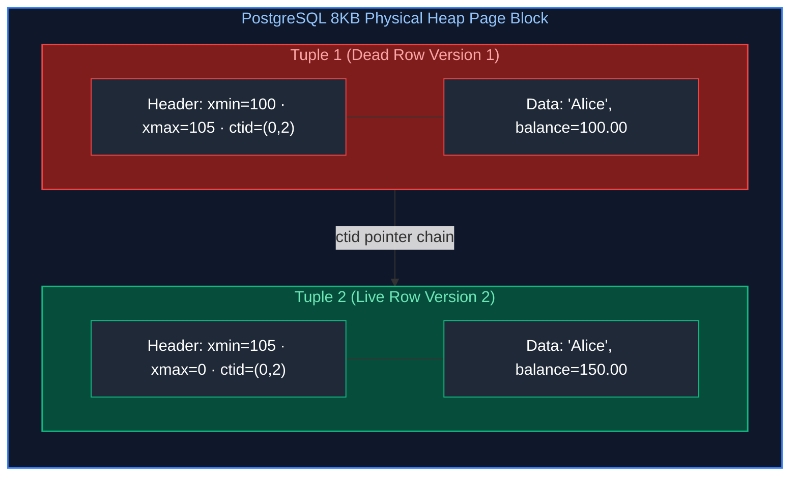
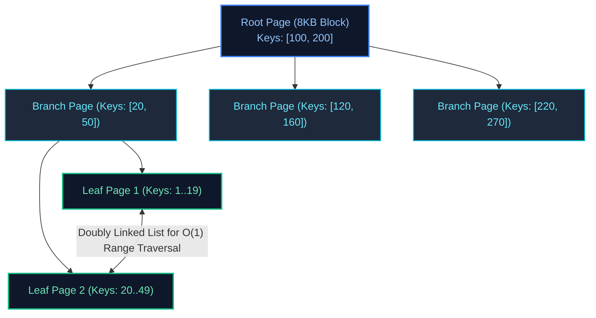
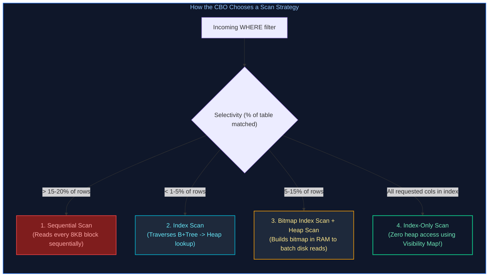
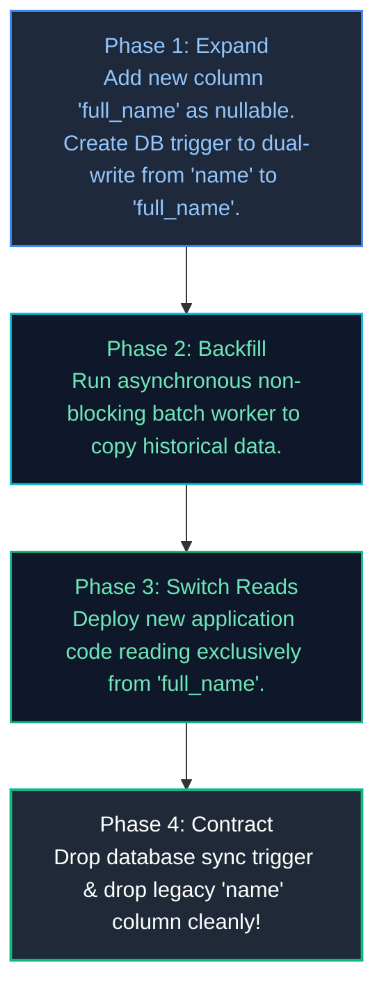

# 09. Relational Databases & SQL

A comprehensive, production-grade guide covering relational database storage engine internals, schema normalization theory (1NF through BCNF), SQL logical order of execution, advanced SQL querying (Window functions, recursive CTEs, Anti-joins, LATERAL joins), transaction isolation levels, Multi-Version Concurrency Control (MVCC), B+Tree and specialized indexing mechanics, query execution plan tuning (`EXPLAIN (ANALYZE, BUFFERS)`), HikariCP high-throughput connection pooling, zero-downtime schema refactoring (Expand-Contract), distributed topologies, and production troubleshooting playbooks.

---

## Architectural Overview: Enterprise Database Engine & Storage Architecture



---

## Table of Contents
1. [Relational Foundations & Schema Design](#1-relational-foundations--schema-design)
   - [1.1 Relational Model Foundations: Tables, Rows, Attributes & Integrity Constraints](#11-relational-model-foundations-tables-rows-attributes--integrity-constraints)
   - [1.2 Database Normalization Theory (1NF, 2NF, 3NF, BCNF) with Real-World Anomalies](#12-database-normalization-theory-1nf-2nf-3nf-bcnf-with-real-world-anomalies)
   - [1.3 Controlled Denormalization for High-Scale Read Performance](#13-controlled-denormalization-for-high-scale-read-performance)
   - [1.4 The Exact Logical SQL Order of Execution with Complete Trace Example](#14-the-exact-logical-sql-order-of-execution-with-complete-trace-example)
2. [Advanced SQL Engineering](#2-advanced-sql-engineering)
   - [2.1 Comprehensive JOIN Taxonomy & Visual Guide](#21-comprehensive-join-taxonomy--visual-guide)
   - [2.2 Anti-Joins: `NOT EXISTS` vs `NOT IN` (The Fatal Null Trap & Query Plan Analysis)](#22-anti-joins-not-exists-vs-not-in-the-fatal-null-trap--query-plan-analysis)
   - [2.3 Lateral Joins (`CROSS JOIN LATERAL`) for Correlated Top-N Per Group](#23-lateral-joins-cross-join-lateral-for-correlated-top-n-per-group)
   - [2.4 Aggregations: `GROUP BY`, `HAVING` vs `WHERE` Invariants](#24-aggregations-group-by-having-vs-where-invariants)
   - [2.5 Subqueries: Correlated vs Non-Correlated Execution Mechanics](#25-subqueries-correlated-vs-non-correlated-execution-mechanics)
   - [2.6 Common Table Expressions (CTEs) & Recursive Hierarchical Tree Traversals](#26-common-table-expressions-ctes--recursive-hierarchical-tree-traversals)
   - [2.7 Analytical SQL Window Functions (`ROW_NUMBER`, `RANK`, `DENSE_RANK`, `NTILE`, `LAG`, `LEAD`, `FIRST_VALUE`)](#27-analytical-sql-window-functions-row_number-rank-dense_rank-ntile-lag-lead-first_value)
   - [2.8 Window Frame Specifications: `ROWS` vs `RANGE BETWEEN` & Running Totals](#28-window-frame-specifications-rows-vs-range-between--running-totals)
3. [Relational Database Engine Internals & Concurrency Control](#3-relational-database-engine-internals--concurrency-control)
   - [3.1 Physical Storage Engine Anatomy: 8KB Pages, Slotted Pages & TOAST Storage](#31-physical-storage-engine-anatomy-8kb-pages-slotted-pages--toast-storage)
   - [3.2 Write-Ahead Logging (WAL / Redo Log): How Durability is Guaranteed at Scale](#32-write-ahead-logging-wal--redo-log-how-durability-is-guaranteed-at-scale)
   - [3.3 ACID Transaction Guarantees & Low-Level Mechanics](#33-acid-transaction-guarantees--low-level-mechanics)
   - [3.4 The 4 SQL-92 Transaction Isolation Levels & Concurrency Anomalies](#34-the-4-sql-92-transaction-isolation-levels--concurrency-anomalies)
   - [3.5 Multi-Version Concurrency Control (MVCC) in PostgreSQL vs MySQL InnoDB](#35-multi-version-concurrency-control-mvcc-in-postgresql-vs-mysql-innodb)
   - [3.6 Database Locking Hierarchy: Shared, Exclusive, Intent, Row Locks & Deadlock Detection](#36-database-locking-hierarchy-shared-exclusive-intent-row-locks--deadlock-detection)
4. [Indexing Mechanics & Query Execution Plan Tuning](#4-indexing-mechanics--query-execution-plan-tuning)
   - [4.1 B+Tree Index Anatomy: Node Branching Factors, Leaf Pages & Clustered Indexes](#41-btree-index-anatomy-node-branching-factors-leaf-pages--clustered-indexes)
   - [4.2 The Leftmost Prefix Rule on Composite Indexes & SARGability](#42-the-leftmost-prefix-rule-on-composite-indexes--sargability)
   - [4.3 Specialized Indexes: GIN (JSONB / Full-Text), GiST, BRIN, and Partial Indexes](#43-specialized-indexes-gin-jsonb--full-text-gist-brin-and-partial-indexes)
   - [4.4 Covering Indexes (`INCLUDE` Clause) & Index-Only Scans](#44-covering-indexes-include-clause--index-only-scans)
   - [4.5 Deconstructing Execution Plans (`EXPLAIN (ANALYZE, BUFFERS)`)](#45-deconstructing-execution-plans-explain-analyze-buffers)
   - [4.6 Physical Join Algorithms: Nested Loop vs Hash Join vs Merge Join](#46-physical-join-algorithms-nested-loop-vs-hash-join-vs-merge-join)
   - [4.7 Anti-Patterns That Silently Invalidate Indexes](#47-anti-patterns-that-silently-invalidate-indexes)
   - [4.8 Production Index Maintenance, Bloat & REINDEX CONCURRENTLY](#48-production-index-maintenance-bloat--reindex-concurrently)
5. [Connection Management, Migrations & High Availability](#5-connection-management-migrations--high-availability)
   - [5.1 HikariCP Connection Pool Sizing & Starvation Defenses](#51-hikaricp-connection-pool-sizing--starvation-defenses)
   - [5.2 Zero-Downtime Database Refactoring: The Expand-Contract Pattern](#52-zero-downtime-database-refactoring-the-expand-contract-pattern)
   - [5.3 Production Schema Migrations with Flyway & Liquibase](#53-production-schema-migrations-with-flyway--liquibase)
   - [5.4 Database Topologies: Replication, Partitioning & Horizontal Sharding](#54-database-topologies-replication-partitioning--horizontal-sharding)
   - [5.5 Database Administration & Performance Diagnostic CLI Cheatsheet](#55-database-administration--performance-diagnostic-cli-cheatsheet)
6. [Production Troubleshooting Playbook](#6-production-troubleshooting-playbook)
7. [Summary Comparison & Engineering Reference Matrix](#7-summary-comparison--engineering-reference-matrix)
8. [References & Further Reading](#8-references--further-reading)

---

# 1. Relational Foundations & Schema Design

> [!NOTE]
> **Domain Framing: Enterprise Java OLTP vs. Data Engineering Analytics:**
> In Java enterprise backends, relational databases back business microservices via Spring Data JPA, Hibernate, and HikariCP. The primary engineering concern is transactional integrity, ACID anomaly prevention, optimistic/pessimistic locking, and low-latency point queries.
>
> For massive distributed analytical queries over billions of rows, distributed joins, window aggregations over streaming event logs, and columnar data warehousing, refer to the companion Data Engineering track:
> - [Data Engineering: 01. SQL Fundamentals](../Data%20Engineering/01_sql_fundamentals.md)
> - [Data Engineering: 02. Advanced SQL](../Data%20Engineering/02_advanced_sql.md)
> - [Data Engineering: 04. Database Internals & Performance](../Data%20Engineering/04_database_internals_and_performance.md)


---

### 1.1 Relational Model Foundations: Tables, Rows, Attributes & Integrity Constraints

Invented by Edgar F. Codd at IBM in 1970, the **Relational Model** organizes data mathematically based on first-order predicate logic and set theory:
* **Relation (Table)**: An unordered collection of tuples conforming to a strictly typed schema.
* **Tuple (Row / Record)**: An individual member of the relation representing a concrete real-world entity or association.
* **Attribute (Column / Field)**: A named domain attribute with a strict data type (`VARCHAR`, `NUMERIC`, `TIMESTAMP`, `JSONB`, `UUID`).
* **Integrity Constraints**: Invariants enforced directly at the storage engine level to guarantee data validity:
  * **Primary Key (PK)**: Uniquely identifies each tuple in the relation; rejects duplicates and strictly rejects `NULL`.
  * **Foreign Key (FK)**: Enforces referential integrity between parent and child relations (`ON DELETE CASCADE`, `ON DELETE RESTRICT`, `ON DELETE SET NULL`).
  * **Unique Constraint**: Guarantees uniqueness across non-null values.
  * **Check Constraint**: Enforces domain-specific boolean conditions directly in SQL (e.g. `CHECK (balance >= 0 AND discount_pct BETWEEN 0 AND 100)`).
  * **Not Null Constraint**: Prohibits absence of value.

---

### 1.2 Database Normalization Theory (1NF, 2NF, 3NF, BCNF) with Real-World Anomalies

Normalization is the systematic process of organizing relational schemas to eliminate **data redundancy** and prevent **modification anomalies**:



#### The Three Destructive Anomalies of Unnormalized Data:
1. **Insertion Anomaly**: You cannot record a customer until they place an order, or you cannot record a new product until someone purchases it.
2. **Update Anomaly**: If a customer's address or product price is duplicated across 1,000 order rows, updating it requires updating all 1,000 rows. If one update fails or is missed, data becomes corrupt and contradictory.
3. **Deletion Anomaly**: If customer John cancels his only order and you delete that row, you accidentally erase John's customer profile and account history from the database forever!

#### Comprehensive Case Study: E-Commerce Store Decomposition

##### 1. Unnormalized State (UNF):

| `order_id` | `customer_name` | `customer_email` | `items` (Non-Atomic Multi-Valued Attribute) | `order_date` |
| :---: | :--- | :--- | :--- | :---: |
| `101` | Alice Smith | `alice@corp.com` | `"Laptop:1200.00, Mouse:25.00"` | `2026-10-15` |

* **Failure**: The `items` column contains a non-atomic, comma-delimited string. You cannot index individual products, join on inventory, or compute `SUM(price)`.

##### 2. First Normal Form (1NF):
* **Rule**: Every column must hold strictly **atomic (indivisible) scalar values**. No repeating groups. A primary key must be identified.
```sql
CREATE TABLE order_items_1nf (
    order_id INT NOT NULL,
    customer_name VARCHAR(100) NOT NULL,
    customer_email VARCHAR(150) NOT NULL,
    product_id INT NOT NULL,
    product_name VARCHAR(100) NOT NULL,
    unit_price NUMERIC(10, 2) NOT NULL,
    quantity INT NOT NULL,
    PRIMARY KEY (order_id, product_id) -- Composite Primary Key
);
```

##### 3. Second Normal Form (2NF):
* **Rule**: Must be in 1NF, and **no non-key column may depend on a partial subset of a composite primary key**.
* **Analysis**: The composite primary key is `(order_id, product_id)`.
  * `quantity` depends on the full composite key `(order_id, product_id)` (Valid).
  * `product_name` and `unit_price` depend **only on `product_id`**, not `order_id`! (Partial dependency violation).
  * `customer_name` and `customer_email` depend **only on `order_id`**! (Partial dependency violation).
* **Fix**: Decompose into separate entities:
```sql
CREATE TABLE products_2nf (
    product_id INT PRIMARY KEY,
    product_name VARCHAR(100) NOT NULL,
    unit_price NUMERIC(10, 2) NOT NULL
);

CREATE TABLE orders_2nf (
    order_id INT PRIMARY KEY,
    customer_name VARCHAR(100) NOT NULL,
    customer_email VARCHAR(150) NOT NULL
);

CREATE TABLE order_items_2nf (
    order_id INT REFERENCES orders_2nf(order_id),
    product_id INT REFERENCES products_2nf(product_id),
    quantity INT NOT NULL,
    PRIMARY KEY (order_id, product_id)
);
```

##### 4. Third Normal Form (3NF):
* **Rule**: Must be in 2NF, and **no non-key column may depend on another non-key column** (no transitive dependencies). Every non-key column must depend on the key, the whole key, and nothing but the key.
* **Analysis**: In `orders_2nf`, `customer_name` depends on `customer_email`, which depends on `order_id`. If Alice changes her name, multiple historical orders become inconsistent.
* **Fix**: Extract `customers` into its own first-class table:
```sql
CREATE TABLE customers_3nf (
    customer_id INT PRIMARY KEY,
    name VARCHAR(100) NOT NULL,
    email VARCHAR(150) UNIQUE NOT NULL
);

CREATE TABLE orders_3nf (
    order_id INT PRIMARY KEY,
    customer_id INT NOT NULL REFERENCES customers_3nf(customer_id),
    order_date TIMESTAMP WITH TIME ZONE DEFAULT CURRENT_TIMESTAMP
);
```

##### 5. Boyce-Codd Normal Form (BCNF):
* **Rule**: A stricter version of 3NF. Every determinant (a column or set of columns on which another column is fully functionally dependent) **must be a candidate key**.
* **Example**: Consider a tutoring table: `(student_id, subject, professor_id)`.
  * Each student can take multiple subjects.
  * For each subject, multiple professors teach, but each professor teaches **only one subject** (`professor_id -> subject`).
  * If a student takes math with Professor Gauss, the composite key is `(student_id, subject)`.
  * In this table, `professor_id` determines `subject`, but `professor_id` is NOT a candidate key!
  * **BCNF Decomposition**:
    * `student_tutoring(student_id, professor_id)` (PK: `student_id, professor_id`)
    * `professor_subject(professor_id, subject)` (PK: `professor_id`)

##### 6. Fourth Normal Form (4NF) & Multivalued Dependencies:
* **Rule**: A schema is in 4NF if and only if it is in BCNF, and contains **no non-trivial multivalued dependencies (MVDs)**.
* **The Multivalued Dependency Problem ($X \twoheadrightarrow Y$)**:
  Consider an employee table storing an employee's multiple phone numbers and multiple skill certifications:

| `emp_id` | `phone_number` | `skill_certification` |
| :---: | :--- | :--- |
| `101` | `555-0101` | AWS Certified Solutions Architect |
| `101` | `555-0102` | AWS Certified Solutions Architect |
| `101` | `555-0101` | Certified Kubernetes Administrator (CKA) |
| `101` | `555-0102` | Certified Kubernetes Administrator (CKA) |

  Because `phone_number` and `skill_certification` are completely independent facts about the employee, storing them in a single table forces a **Cartesian product explosion** ($M \times N$ rows). Adding a 3rd phone number requires inserting 2 additional rows!
* **4NF Decomposition**:
  Decompose independent multivalued attributes into separate relational entities:
  * `employee_phones(emp_id, phone_number)` (PK: `emp_id, phone_number`)
  * `employee_certifications(emp_id, skill_certification)` (PK: `emp_id, skill_certification`)

---

### 1.3 Controlled Denormalization for High-Scale Read Performance

While 3NF guarantees write consistency, querying a customer order summary in 3NF requires joining 5 tables (`orders` $\to$ `customers` $\to$ `order_items` $\to$ `products` $\to$ `taxes`).
* In high-throughput read workloads, architects intentionally duplicate data (e.g. storing an immutable snapshot of `unit_price` and `customer_name` directly in `orders`).
* **The Rule**: Denormalize only when read latency SLAs cannot be met with indexes, and guarantee consistency via application event hooks or database triggers.

---

### 1.4 The Exact Logical SQL Order of Execution with Complete Trace Example

A pervasive beginner trap is writing an SQL query according to its visual syntax. The database parser executes clauses in a completely different, strict logical order:



#### Detailed Query Trace:
Consider this analytical query:
```sql
SELECT 
    c.country,
    COUNT(o.order_id) AS total_orders,
    SUM(o.total_amount) AS revenue,
    RANK() OVER (ORDER BY SUM(o.total_amount) DESC) AS revenue_rank
FROM customers c
INNER JOIN orders o ON c.id = o.customer_id
WHERE o.order_date >= '2026-01-01'
GROUP BY c.country
HAVING COUNT(o.order_id) >= 10
ORDER BY revenue DESC
LIMIT 5;
```

#### Step-by-Step Execution Sequence:
1. **`FROM customers c INNER JOIN orders o ON c.id = o.customer_id`**: Loads tables into working memory and evaluates the `ON` join predicate. Rows without matching IDs are discarded.
2. **`WHERE o.order_date >= '2026-01-01'`**: Filters individual joined tuples prior to aggregation. Non-2026 orders are dropped.
3. **`GROUP BY c.country`**: Sorts or hashes remaining tuples into bucket groups identified by unique `c.country` values.
4. **`HAVING COUNT(o.order_id) >= 10`**: Evaluates aggregate count on each country bucket. Discards countries with fewer than 10 orders.
5. **`SELECT c.country, COUNT(o.order_id)...`**: Computes expressions, aggregates, and column projections. Assigns aliases `total_orders` and `revenue`.
6. **`WINDOW RANK() OVER (ORDER BY revenue DESC)`**: Evaluates window functions over the aggregated dataset.
7. **`ORDER BY revenue DESC`**: Sorts final result rows by the computed `revenue` expression.
8. **`LIMIT 5`**: Returns strictly the top 5 sorted tuples to the client application.

---

# 2. Advanced SQL Engineering

---

### 2.1 Comprehensive JOIN Taxonomy & Visual Guide



---

### 2.2 Anti-Joins: `NOT EXISTS` vs `NOT IN` (The Fatal Null Trap & Query Plan Analysis)

Finding records in Table A that have no matching records in Table B is called an **Anti-Join**:

```sql
-- ❌ DANGEROUS: NOT IN with NULL values returns ZERO rows!
SELECT * FROM customers 
WHERE id NOT IN (SELECT customer_id FROM orders);
```

#### The Fatal Three-Valued Logic NULL Trap:
If a single row in `orders` contains a `NULL` `customer_id`, the SQL subquery evaluates to:
`id NOT IN (1, 2, NULL)` $\to$ `id != 1 AND id != 2 AND id != NULL`.
In ANSI SQL three-valued logic, `id != NULL` evaluates to **`UNKNOWN`**.
Because `TRUE AND TRUE AND UNKNOWN` is `UNKNOWN`, the entire `WHERE` clause evaluates to false for **every single row**! The query returns zero results silently!

#### The Production Standard: `NOT EXISTS`
`NOT EXISTS` operates on boolean presence rather than value sets and is completely immune to `NULL` corruption:
```sql
-- ✅ PRODUCTION STANDARD: Immune to NULL values; optimizer executes efficient Anti-Join
SELECT c.* 
FROM customers c
WHERE NOT EXISTS (
    SELECT 1 FROM orders o WHERE o.customer_id = c.id
);
```

#### Query Plan Comparison:
* `NOT IN (SELECT...)` prevents the Cost-Based Optimizer from transforming the subquery into a Hash Anti-Join when nullable columns exist, forcing a disastrous $O(N \times M)$ SubPlan filter.
* `NOT EXISTS (SELECT 1...)` is recognized immediately by the optimizer and rewritten into an optimal **Hash Anti-Join** or **Merge Anti-Join**.

---

### 2.3 Lateral Joins (`CROSS JOIN LATERAL`) for Correlated Top-N Per Group

A standard `JOIN` evaluates independently of the current row being examined. A **`LATERAL` Join** behaves like a foreach loop in SQL: for each row in the outer table, it evaluates the subquery with access to columns from that outer row:

```sql
-- Fetch every customer along with their 2 most recent orders
SELECT c.name, o.order_id, o.order_date, o.total_amount
FROM customers c
CROSS JOIN LATERAL (
    SELECT order_id, order_date, total_amount
    FROM orders
    WHERE customer_id = c.id
    ORDER BY order_date DESC
    LIMIT 2
) o;
```
This avoids expensive window functions across the entire table when you only need the Top-N elements for a subset of parent records.

---

### 2.4 Aggregations: `GROUP BY`, `HAVING` vs `WHERE` Invariants

* **`WHERE`**: Filters individual base rows **before** grouping and aggregation occur.
* **`HAVING`**: Filters aggregate bucket calculations **after** grouping occurs.

```sql
SELECT 
    department_id,
    COUNT(*) AS total_employees,
    AVG(salary) AS avg_salary
FROM employees
WHERE status = 'ACTIVE'                -- Step 1: Filter out inactive employees first
GROUP BY department_id                -- Step 2: Group by department
HAVING COUNT(*) >= 5 AND AVG(salary) > 75000; -- Step 3: Filter groups with >=5 employees
```

---

### 2.5 Subqueries: Correlated vs Non-Correlated Execution Mechanics

* **Non-Correlated Subquery**: Independent of the outer query. Evaluated **once**, and its result is cached and reused by the outer query:
  ```sql
  SELECT * FROM products WHERE price > (SELECT AVG(price) FROM products);
  ```
* **Correlated Subquery**: References columns from the enclosing outer query row (`e.department_id`). In unoptimized engines, it is re-evaluated **once for every single candidate row** in the outer table ($O(N \times M)$ overhead):
  ```sql
  SELECT e.emp_id, e.salary
  FROM employees e
  WHERE e.salary > (
      SELECT AVG(sub.salary) 
      FROM employees sub 
      WHERE sub.department_id = e.department_id -- Correlated reference!
  );
  ```

---

### 2.6 Common Table Expressions (CTEs) & Recursive Hierarchical Tree Traversals

Common Table Expressions (CTEs) define named temporary result sets via `WITH`:

#### Recursive CTE: Traversing Hierarchical Organizational Charts
```sql
WITH RECURSIVE OrgHierarchy AS (
    -- Anchor Member: Select top-level CEO (manager_id is NULL)
    SELECT emp_id, name, manager_id, 1 AS level, CAST(name AS VARCHAR(255)) AS path
    FROM employees
    WHERE manager_id IS NULL

    UNION ALL

    -- Recursive Member: Join subordinates to their managers
    SELECT e.emp_id, e.name, e.manager_id, o.level + 1, CAST(o.path || ' -> ' || e.name AS VARCHAR(255))
    FROM employees e
    INNER JOIN OrgHierarchy o ON e.manager_id = o.emp_id
)
SELECT level, path FROM OrgHierarchy ORDER BY path;
```

#### Output Result:

| Recursion Level | Hierarchical Management Path |
| :---: | :--- |
| `1` | Satya Nadella |
| `2` | Satya Nadella -> Scott Guthrie |
| `3` | Satya Nadella -> Scott Guthrie -> Core OS VP |
| `4` | Satya Nadella -> Scott Guthrie -> Core OS VP -> Principal Engineer |

---

### 2.7 Analytical SQL Window Functions (`ROW_NUMBER`, `RANK`, `DENSE_RANK`, `NTILE`, `LAG`, `LEAD`, `FIRST_VALUE`)

Unlike `GROUP BY`, which collapses multiple rows into a single summary row, **Window Functions** compute aggregate and ranking values across a defined window partition while **retaining individual row identities**:

#### Realistic Sample Dataset: `sales_records` Table
```sql
CREATE TABLE sales_records (
    sale_id INT PRIMARY KEY,
    employee_name VARCHAR(50) NOT NULL,
    department VARCHAR(50) NOT NULL,
    amount NUMERIC(10, 2) NOT NULL,
    sale_date DATE NOT NULL
);

INSERT INTO sales_records VALUES
(1, 'Alice',   'Electronics', 1500.00, '2026-03-01'),
(2, 'Bob',     'Electronics', 1200.00, '2026-03-02'),
(3, 'Charlie', 'Electronics', 1200.00, '2026-03-03'),
(4, 'David',   'Electronics',  800.00, '2026-03-04'),
(5, 'Emma',    'Furniture',   2200.00, '2026-03-01'),
(6, 'Frank',   'Furniture',   1800.00, '2026-03-02'),
(7, 'Grace',   'Furniture',   1800.00, '2026-03-03'),
(8, 'Hannah',  'Furniture',    950.00, '2026-03-04');
```

#### Comprehensive Analytical Window Query

```sql
SELECT 
    department,
    employee_name,
    amount,
    -- 1. Number rows strictly 1..N within each department
    ROW_NUMBER() OVER (PARTITION BY department ORDER BY amount DESC) AS row_num,

    -- 2. Rank with gaps on ties (1, 2, 2, 4)
    RANK() OVER (PARTITION BY department ORDER BY amount DESC) AS rnk,

    -- 3. Rank without gaps on ties (1, 2, 2, 3)
    DENSE_RANK() OVER (PARTITION BY department ORDER BY amount DESC) AS dense_rnk,

    -- 4. Split department into 2 quartile buckets (1 = Top performers, 2 = Bottom)
    NTILE(2) OVER (PARTITION BY department ORDER BY amount DESC) AS quartile,

    -- 5. Value from previous row in partition (preceding colleague's amount)
    LAG(amount, 1) OVER (PARTITION BY department ORDER BY amount DESC) AS prev_amount,

    -- 6. Value from next row in partition
    LEAD(amount, 1) OVER (PARTITION BY department ORDER BY amount DESC) AS next_amount,

    -- 7. Best sale in this department
    FIRST_VALUE(amount) OVER (PARTITION BY department ORDER BY amount DESC) AS dept_max_sale
FROM sales_records;
```

#### Exact Query Execution Output:

| Department | Employee | Amount | `row_num` | `rnk` | `dense_rnk` | `quartile` | `prev_amount` (`LAG`) | `next_amount` (`LEAD`) | `dept_max_sale` (`FIRST_VALUE`) |
| :--- | :--- | :---: | :---: | :---: | :---: | :---: | :---: | :---: | :---: |
| **Electronics** | Alice | \$1,500.00 | 1 | 1 | 1 | 1 | `NULL` | \$1,200.00 | \$1,500.00 |
| **Electronics** | Bob | \$1,200.00 | 2 | 2 | 2 | 1 | \$1,500.00 | \$1,200.00 | \$1,500.00 |
| **Electronics** | Charlie | \$1,200.00 | 3 | 2 | 2 | 2 | \$1,200.00 | \$800.00 | \$1,500.00 |
| **Electronics** | David | \$800.00 | 4 | 4 | 3 | 2 | \$1,200.00 | `NULL` | \$1,500.00 |
| **Furniture** | Emma | \$2,200.00 | 1 | 1 | 1 | 1 | `NULL` | \$1,800.00 | \$2,200.00 |
| **Furniture** | Frank | \$1,800.00 | 2 | 2 | 2 | 1 | \$2,200.00 | \$1,800.00 | \$2,200.00 |
| **Furniture** | Grace | \$1,800.00 | 3 | 2 | 2 | 2 | \$1,800.00 | \$950.00 | \$2,200.00 |
| **Furniture** | Hannah | \$950.00 | 4 | 4 | 3 | 2 | \$1,800.00 | `NULL` | \$2,200.00 |

#### Detailed Behavior Comparison:
- **`ROW_NUMBER()`**: Deterministic sequential integer sequence ($1, 2, 3, 4$). Ties in `amount` receive arbitrary order unless a tie-breaker column is provided in `ORDER BY`. Perfect for **Pagination** (`WHERE row_num BETWEEN 21 AND 30`).
- **`RANK()`**: Tied values share the same rank ($2, 2$), but skips numbers for the next rank ($4$), reflecting the count of strictly preceding rows.
- **`DENSE_RANK()`**: Tied values share the same rank ($2, 2$), with zero gap for the subsequent rank ($3$). Ideal for **Top-N per Category** (`WHERE dense_rnk <= 3`).
- **`LAG(col, offset)`**: Accesses data from $N$ rows prior to the current row without a self-join. Ideal for calculating **Month-over-Month (MoM) revenue growth**:
  $$\text{Growth} = \frac{\text{Current} - \text{LAG}(\text{Current}, 1)}{\text{LAG}(\text{Current}, 1)} \times 100$$
- **`NTILE(B)`**: Divides ordered partition as evenly as possible into $B$ discrete buckets.

---

### 2.8 Window Frame Specifications: `ROWS` vs `RANGE BETWEEN` & Running Totals

Window frames define the exact subset of rows within a partition evaluated for running calculations:

```sql
SELECT 
    department,
    employee_name,
    amount,
    -- 1. Cumulative running total from beginning of department up to current row
    SUM(amount) OVER (
        PARTITION BY department 
        ORDER BY amount DESC 
        ROWS BETWEEN UNBOUNDED PRECEDING AND CURRENT ROW
    ) AS running_total,

    -- 2. Centered moving average (preceding row, current row, next row)
    AVG(amount) OVER (
        PARTITION BY department 
        ORDER BY amount DESC 
        ROWS BETWEEN 1 PRECEDING AND 1 FOLLOWING
    ) AS centered_3_point_moving_avg
FROM sales_records;
```

#### Critical Difference: `ROWS` vs `RANGE`
* **`ROWS BETWEEN`**: Operates on **physical row counts** relative to the current position. Fast and deterministic.
* **`RANGE BETWEEN`**: Operates on **logical value ranges** on the order column.
  * **Dangerous Default**: When an `ORDER BY` is specified without an explicit frame, SQL defaults to:
    `RANGE BETWEEN UNBOUNDED PRECEDING AND CURRENT ROW`
  * If duplicate values exist, `RANGE` includes all peers with equal values in the running total at once rather than row by row! Always explicitly specify `ROWS BETWEEN` for predictable running totals.

---

# 3. Relational Database Engine Internals & Concurrency Control

---

### 3.1 Physical Storage Engine Anatomy: 8KB Pages, Slotted Pages & TOAST Storage

Relational databases organize persistent storage into fixed-size disk blocks called **Pages** (8KB in PostgreSQL, 16KB in MySQL InnoDB):



* **Slotted Page Design**: The `ItemId` array grows downwards from the top, while raw row byte tuples grow upwards from the bottom. An external pointer (e.g. from an index) points to `(page_number, item_offset)`. When a row is updated, it can move inside the page without changing its external index pointer!
* **TOAST (The Oversized-Attribute Storage Technique)**: Database pages cannot span multiple physical blocks. When a column value (`TEXT`, `JSONB`) exceeds $\sim 2\text{KB}$, the engine compresses it. If it still exceeds the threshold, it is moved out-of-line into a dedicated auxiliary TOAST table, storing only an 18-byte pointer in the main page.

---

### 3.2 Write-Ahead Logging (WAL / Redo Log): How Durability is Guaranteed at Scale

Relational databases achieve ACID persistence while maintaining high write throughput using **Write-Ahead Logging (WAL)**:



* **The WAL Principle**: Sequential disk writes are up to $100\times$ faster than random page writes. The database appends transaction logs sequentially to WAL and acknowledges commits immediately. If the server loses power, on reboot the engine replays the WAL to recover all unwritten dirty pages!

---

### 3.3 ACID Transaction Guarantees & Low-Level Mechanics

1. **Atomicity**: Enforced via Undo Logs (MySQL InnoDB) or MVCC tuple versioning (PostgreSQL). If an abort occurs, changes are reverted.
2. **Consistency**: Enforced via foreign keys, check constraints, unique constraints, and schema data types.
3. **Isolation**: Enforced via row locks, table locks, and MVCC snapshot read isolation.
4. **Durability**: Enforced via the Write-Ahead Log (WAL) and synchronous `fsync()` to persistent disk storage.

---

### 3.4 The 4 SQL-92 Transaction Isolation Levels & Concurrency Anomalies

| Isolation Level | Dirty Read | Non-Repeatable Read | Phantom Read | Write Skew |
| :--- | :---: | :---: | :---: | :---: |
| **Read Uncommitted** | ⚠️ Allowed | ⚠️ Allowed | ⚠️ Allowed | ⚠️ Allowed |
| **Read Committed** (PostgreSQL / Oracle Default) | ❌ Prevented | ⚠️ Allowed | ⚠️ Allowed | ⚠️ Allowed |
| **Repeatable Read** (MySQL InnoDB Default) | ❌ Prevented | ❌ Prevented | ❌ Prevented (in MVCC) | ⚠️ Allowed |
| **Serializable** | ❌ Prevented | ❌ Prevented | ❌ Prevented | ❌ Prevented |

#### Step-by-Step Concurrent Execution Timelines

##### 1. Non-Repeatable Read (Fuzzy Read) Anomaly under Read Committed:
```mermaid
%%{init: {'theme': 'dark', 'themeVariables': { 'actorBkg': '#1e293b', 'actorBorder': '#3b82f6', 'actorTextColor': '#ffffff', 'signalColor': '#93c5fd', 'signalTextColor': '#ffffff', 'noteBkgColor': '#1e293b', 'noteBorderColor': '#f59e0b', 'noteTextColor': '#fde68a', 'activationBkgColor': '#3b82f6', 'sequenceNumberColor': '#ffffff' }}}%%
sequenceDiagram
    autonumber
    actor S1 as Session 1 (Tx 101: Read Committed)
    participant DB as PostgreSQL Database
    actor S2 as Session 2 (Tx 102)

    S1->>DB: BEGIN;
    S1->>DB: SELECT balance FROM accounts WHERE id = 1;
    DB-->>S1: Returns 100.00 (Statement Snapshot 1)

    S2->>DB: BEGIN;
    S2->>DB: UPDATE accounts SET balance = 150.00 WHERE id = 1;
    S2->>DB: COMMIT; (Changes permanently written to disk)

    S1->>DB: SELECT balance FROM accounts WHERE id = 1;
    DB-->>S1: Returns 150.00 (Statement Snapshot 2 - Fuzzy Read within same transaction!)
    S1->>DB: COMMIT;
```
* **Why it happens in Read Committed**: Every single SQL statement takes a **fresh snapshot** of the database at the instant the statement begins. Because Tx 102 committed between statement 1 and statement 2, statement 2 sees the new value.
* **How Repeatable Read solves it**: The transaction takes a **single snapshot at the beginning of the transaction**, maintaining that identical point-in-time view across all subsequent queries.

##### 2. The Write Skew Anomaly under Repeatable Read:
Write Skew occurs when two concurrent transactions read overlapping data, verify a shared business rule, make disjoint writes, and commit—violating the rule globally:

```mermaid
%%{init: {'theme': 'dark', 'themeVariables': { 'actorBkg': '#1e293b', 'actorBorder': '#3b82f6', 'actorTextColor': '#ffffff', 'signalColor': '#93c5fd', 'signalTextColor': '#ffffff', 'noteBkgColor': '#1e293b', 'noteBorderColor': '#f59e0b', 'noteTextColor': '#fde68a', 'activationBkgColor': '#3b82f6', 'sequenceNumberColor': '#ffffff' }}}%%
sequenceDiagram
    autonumber
    actor Alice as Dr. Alice (Session 1: Repeatable Read)
    actor Bob as Dr. Bob (Session 2: Repeatable Read)
    participant DB as Hospital RDBMS (Rule: At least 1 doctor on-call!)

    Note over DB: Initial State: Alice on_call=true, Bob on_call=true (Count = 2)

    Alice->>DB: 1. SELECT COUNT(*) FROM doctors WHERE on_call = true;
    DB-->>Alice: Count is 2 (Safe to request leave!)

    Bob->>DB: 2. SELECT COUNT(*) FROM doctors WHERE on_call = true;
    DB-->>Bob: Count is 2 (Safe to request leave!)

    Alice->>DB: 3. UPDATE doctors SET on_call = false WHERE name = 'Alice';
    Bob->>DB: 4. UPDATE doctors SET on_call = false WHERE name = 'Bob';

    Alice->>DB: 5. COMMIT; (Success! Alice's row committed)
    Bob->>DB: 6. COMMIT; (Success! Bob's row committed - no lock conflict!)

    Note over DB: CATASTROPHIC VIOLATION: Zero doctors left on call!
```

* **Why Repeatable Read permits Write Skew**: Neither transaction updated the same row (Alice modified row 1; Bob modified row 2), so row locks never collided!
* **Production Defenses**:
  1. **Serializable Isolation**: Engine detects serialization dependency graph cycle and aborts Session 2 with `could not serialize access due to read/write dependencies among transactions`.
  2. **Pessimistic Locking**: `SELECT ... FOR UPDATE` locks both doctor rows during initial read.

---

### 3.5 Multi-Version Concurrency Control (MVCC) in PostgreSQL vs MySQL InnoDB

In modern relational engines, **Readers Never Block Writers, and Writers Never Block Readers**:

#### 1. PostgreSQL MVCC (Heap Tuple Versioning)

In PostgreSQL, every table row (tuple) on disk includes a 23-byte header containing low-level transaction metadata:
* **`t_xmin`**: The 32-bit transaction ID (XID) that inserted this tuple version.
* **`t_xmax`**: The transaction ID that deleted or replaced this tuple version ($0$ if currently live).
* **`t_ctid`**: Tuple ID pointing to the current physical block and offset of this tuple (or the newer version if updated).
* **`t_infomask`**: Bit flags indicating whether `xmin`/`xmax` are committed or aborted.



| Physical Tuple Slot | Low-Level Header (`xmin` / `xmax` / `ctid`) | Tuple Status | Visibility Under Active Transactions |
| :--- | :--- | :---: | :--- |
| **Row Version 1** | `xmin=100` · `xmax=105` · `ctid=(0,2)` | ❌ **Dead Tuple** | Visible only to historical snapshots where $\text{TxID} < 105$. Cleaned up by `VACUUM`. |
| **Row Version 2** | `xmin=105` · `xmax=0` · `ctid=(0,2)` | ✅ **Live Tuple** | Visible to all active transactions where $\text{TxID} \ge 105$. Current ground truth. |


* **How UPDATE Works**: PostgreSQL does not modify bytes in-place. It sets `xmax = current_tx` on the old tuple, and inserts a **completely new tuple** with `xmin = current_tx` and `xmax = 0`.
* **The Vacuuming Necessity**: Because old versions remain in table pages, high-update workloads generate **Table Bloat**. The background `VACUUM` worker identifies pages where all dead tuples have `xmax < oldest_active_txid` and frees item pointers.
* **Transaction ID (XID) Wraparound Catastrophe**: 32-bit integers cap transaction IDs at $\approx 4.29 \text{ Billion}$. Without maintenance, modulo arithmetic causes past historical transactions to appear in the "future", making historical data disappear! PostgreSQL prevents this via **`VACUUM FREEZE`**, converting old `xmin` values to a special frozen ID (`FrozenTransactionId = 2`), treated as permanently in the past.

#### 2. MySQL InnoDB MVCC (Undo Log Roll-Pointer Architecture)

MySQL InnoDB uses an entirely different architecture centered around the **Undo Log**:
* Every InnoDB clustered index record contains hidden system columns:
  * **`DB_TRX_ID` (6 bytes)**: Transaction ID of the last modifying transaction.
  * **`DB_ROLL_PTR` (7 bytes)**: Roll-pointer pointing backwards to the prior version in the **Undo Log**.
* **In-Place Updates**: InnoDB modifies the active page directly in-place. If an active transaction needs to view older snapshot data, it reads the current page and follows the `DB_ROLL_PTR` pointer chain back into the Undo Log segment in memory/disk!
* **Purge Threads**: Once older transactions commit and no longer require undo views, background InnoDB purge threads clean up old undo log pages.

---

### 3.6 Database Locking Hierarchy: Shared, Exclusive, Intent, Row Locks & Deadlock Detection

* **Shared Lock (S-Lock / Read Lock)**: Multiple transactions can hold S-locks concurrently to read data. Blocks Exclusive locks.
* **Exclusive Lock (X-Lock / Write Lock)**: Only one transaction can hold an X-lock. Blocks all other readers and writers.
* **Intent Locks (`IS`, `IX`)**: Table-level flags indicating that a transaction holds or intends to acquire fine-grained row locks inside the table. Prevents full-table lock operations (`ALTER TABLE`) from acquiring locks while rows are modified.
* **Deadlocks**: Transaction 1 holds Row A and requests Row B; Transaction 2 holds Row B and requests Row A. The database engine's **Deadlock Detector** runs a background cycle-finding graph search, aborts the cheaper transaction with a serialization error, and allows the other to proceed.

---

# 4. Indexing Mechanics & Query Execution Plan Tuning

---

### 4.1 B+Tree Index Anatomy: Node Branching Factors, Leaf Pages & Clustered Indexes

The **B+Tree** is the universal indexing data structure for relational databases:



#### Why B+Trees Outperform Standard Binary Trees:
1. **High Branching Factor (Fanout)**: Each 8KB database page holds hundreds of keys (branching factor $\sim 200$). A B+Tree of height 3 can index $200^3 = 8,000,000\text{ rows}$, requiring at most **3 disk I/O operations** to find any row!
2. **Doubly-Linked Leaf Nodes**: Leaf nodes are linked sequentially in a doubly-linked list. Executing range scans (`WHERE age BETWEEN 25 AND 35`) traverses directly across leaf nodes without re-traversing the root!

---

### 4.2 The Leftmost Prefix Rule on Composite Indexes & SARGability

When creating a composite index:
```sql
CREATE INDEX idx_users_country_state_city ON users (country, state, city);
```

The B+Tree sorts keys strictly in **hierarchical leftmost order** (`country` $\to$ `state` $\to$ `city`):
* `WHERE country = 'US'` $\to$ **Uses Index**.
* `WHERE country = 'US' AND state = 'CA'` $\to$ **Uses Index**.
* `WHERE state = 'CA' AND city = 'SF'` $\to$ **CANNOT USE INDEX!** (Violates leftmost prefix; engine falls back to Sequential Scan!).

---

### 4.3 Specialized Indexes: GIN (JSONB / Full-Text), GiST, BRIN, and Partial Indexes

* **GIN (Generalized Inverted Index)**: Maps internal elements to their enclosing rows. Essential for indexing PostgreSQL `JSONB` documents and full-text search:
  ```sql
  CREATE INDEX idx_orders_metadata ON orders USING GIN (metadata);
  ```
* **BRIN (Block Range Index)**: Stores min/max values for physical block ranges on disk. Consumes $< 1\%$ of the RAM of a B+Tree. Outstanding for massive, immutable, append-only time-series tables (e.g. audit logs sorted by `created_at`).
* **Partial Index**: Indexes only a filtered subset of rows, dramatically saving memory and maintenance costs:
  ```sql
  CREATE INDEX idx_active_orders ON orders (customer_id) WHERE status = 'PENDING';
  ```

---

### 4.4 Covering Indexes (`INCLUDE` Clause) & Index-Only Scans

A standard index lookup requires two steps:
1. Traverse the B+Tree to find the row pointer (Heap Tuple ID).
2. Dereference the pointer to fetch data columns from the Table Heap.

A **Covering Index** includes non-search columns in the index leaf pages using the `INCLUDE` clause:
```sql
CREATE INDEX idx_orders_covering ON orders (customer_id) INCLUDE (total_amount, order_date);
```
When code queries:
```sql
SELECT total_amount, order_date FROM orders WHERE customer_id = 101;
```
The database executes an **Index-Only Scan**. The entire result set is satisfied directly from the B+Tree leaf pages **without touching the Table Heap on disk**, delivering a $10\times$ performance boost!

---

### 4.5 Deconstructing Execution Plans (`EXPLAIN (ANALYZE, BUFFERS)`)

The Cost-Based Optimizer (CBO) converts SQL text into a physical execution tree of iterator nodes (the Volcano model). Inspecting execution plans with `EXPLAIN (ANALYZE, BUFFERS)` is the foundation of senior database query optimization:

```sql
EXPLAIN (ANALYZE, BUFFERS, COSTS, VERBOSE, TIMING)
SELECT * FROM orders WHERE customer_id = 90210;
```

#### Annotated Real Execution Plan Output:
```text
Index Scan using idx_orders_customer_id on public.orders  (cost=0.42..8.44 rows=1 width=72) (actual time=0.035..0.037 rows=1 loops=1)
  Output: order_id, customer_id, total_amount, order_date
  Index Cond: (orders.customer_id = 90210)
  Buffers: shared hit=3 read=1
Planning Time: 0.125 ms
Execution Time: 0.058 ms
```

#### Key Output Parameters Explained:
* **`cost=0.42..8.44`**:
  * `0.42`: Estimated startup cost to fetch the very first row.
  * `8.44`: Total estimated cost to process all matching rows. (Cost units are arbitrary, normalized where 1 sequential disk page fetch = 1.0, random page fetch = 4.0).
* **`rows=1 width=72`**: Planner expects 1 row, each row averaging 72 bytes.
* **`actual time=0.035..0.037`**: Actual elapsed wall-clock time in milliseconds (start to finish).
* **`loops=1`**: Number of times this execution node was invoked.
* **`Buffers: shared hit=3 read=1`**:
  * `shared hit=3`: 3 database pages were retrieved directly from RAM (Buffer Pool).
  * `read=1`: 1 page had to be physically read from NVMe disk storage.

---

#### The 4 Core Scan Types Deconstructed



##### 1. Sequential Scan (`Seq Scan`)
Reads every single 8KB block of the table heap from start to finish. Outstanding for small tables ($< 1,000$ rows) or queries returning $>25\%$ of the table, but disastrous on 50-million-row tables.

##### 2. Index Scan (`Index Scan`)
Traverses the B+Tree to identify tuple pointers (`ctid`), then fetches corresponding rows from the heap. Efficient for high selectivity ($< 2\%$ of rows).

##### 3. Bitmap Index Scan + Bitmap Heap Scan
When a query matches thousands of scattered rows, raw index scanning incurs expensive random disk I/O.
* **Phase 1 (Bitmap Index Scan)**: Traverses the B+Tree and builds a bitmap in memory marking which physical heap pages contain matching rows.
* **Phase 2 (Bitmap Heap Scan)**: Reads the physical heap blocks **sequentially in physical disk order**, converting random I/O into fast sequential I/O!

##### 4. Index-Only Scan (`Index Only Scan`)
If every requested column is stored in the index (via composite key or `INCLUDE` clause), the engine satisfies the query entirely from the B+Tree leaf pages without touching the table heap on disk.

---

#### Diagnosing `work_mem` Disk Spills in Sort and Hash Nodes

When an `ORDER BY` or `HASH JOIN` requires more working memory than allocated by `work_mem` (default is 4MB in PostgreSQL), the query engine spills intermediate data to temporary files on disk:

```text
Sort  (cost=125430.00..128900.00 rows=500000 width=64) (actual time=850.12..920.45 rows=500000 loops=1)
  Sort Key: order_date DESC
  Sort Method: external merge  Disk: 42800kB  <-- CRITICAL WARNING: Spilled 42 MB to disk!
```

* **The Problem**: Writing 42MB to disk and reading it back slows the query down by $10\times$ to $50\times$.
* **The Solution**: Increase `work_mem` locally for that specific transaction session:
  ```sql
  SET work_mem = '64MB';
  -- Re-running query now outputs:
  -- Sort Method: quicksort  Memory: 48500kB (Sub-millisecond in-memory sort!)
  ```

---

### 4.6 Physical Join Algorithms: Nested Loop vs Hash Join vs Merge Join

The Cost-Based Optimizer (CBO) selects from three physical join algorithms:

| Join Algorithm | Mechanism | Time Complexity | When Selected |
| :--- | :--- | :---: | :--- |
| **Nested Loop Join** | Outer loop scans table A; inner loop executes index lookups on table B for each row. | $O(N \times \log M)$ | One small table joined against an indexed foreign key. |
| **Hash Join** | Scans smaller table, builds in-memory hash table; streams larger table and probes hash table. | $O(N + M)$ | Large unsorted datasets where join columns are not indexed. |
| **Merge Join** | Both tables are sorted by the join key; advances two pointers simultaneously like merge sort. | $O(N \log N + M \log M)$ | Very large tables pre-sorted by primary key or B+Tree index. |

---

### 4.7 Anti-Patterns That Silently Invalidate Indexes

1. **Applying Functions to Indexed Columns**:
   ```sql
   -- ❌ INVALIDATES INDEX: Database must compute LOWER() for every row on disk!
   SELECT * FROM users WHERE LOWER(email) = 'alice@corp.com';
   -- ✅ FIX: Create an Expression Index
   CREATE INDEX idx_users_lower_email ON users (LOWER(email));
   ```
2. **Leading Wildcard Searches**:
   ```sql
   -- ❌ INVALIDATES B+TREE INDEX: Leftmost prefix cannot match!
   SELECT * FROM customers WHERE name LIKE '%Smith';
   ```
3. **Implicit Type Casting**:
   ```sql
   -- If phone_number is VARCHAR, querying with an integer forces implicit cast across every row!
   SELECT * FROM customers WHERE phone_number = 5551234; -- Invalids index!
   ```

---

### 4.8 Production Index Maintenance, Bloat & `REINDEX CONCURRENTLY`

Over time, frequent `UPDATE` and `DELETE` operations create fragmented, half-empty B+Tree leaf pages (Index Bloat). A bloated index consumes excess RAM in `shared_buffers` and forces the query engine to read dozens of unnecessary disk blocks:

#### Inspecting Index Bloat in PostgreSQL:
```sql
SELECT
    current_database(), schemaname, tablename, indexname,
    ROUND((case when otta=0 then 0.0 else sml.relpages::float/otta end)::numeric, 1) AS bloat_ratio,
    pg_size_pretty((case when relpages < otta then 0 else relpages-otta end * 8192)::bigint) AS wasted_bytes
FROM (
    SELECT schemaname, tablename, relname AS indexname, relpages,
    CEIL((reltuples*(datahdr+ma-case when datahdr%ma=0 then ma else datahdr%ma end+nullhdr2+4))/(bs-20::float)) AS otta
    FROM (
        SELECT s.schemaname, s.tablename, s.relname, s.relpages, s.reltuples,
               current_setting('block_size')::numeric AS bs, 8 AS ma, 24 AS datahdr, 0 AS nullhdr2
        FROM pg_statio_user_indexes i
        JOIN pg_class s ON s.oid = i.indexrelid
    ) sub
) sml
WHERE sml.relpages > 100
ORDER BY wasted_bytes DESC;
```

#### Rebuilding Bloated Indexes Without Table Locks:
Running standard `REINDEX TABLE orders;` acquires a heavy `SHARE` lock that halts all concurrent `INSERT`, `UPDATE`, and `DELETE` transactions!

In production, always rebuild indexes using **`REINDEX CONCURRENTLY`**:
```sql
-- Builds the new index copy in the background while online transactions continue uninterrupted!
REINDEX INDEX CONCURRENTLY idx_orders_customer_id;
```

---

# 5. Connection Management, Migrations & High Availability

---

### 5.1 HikariCP Connection Pool Sizing & Starvation Defenses

HikariCP is the default, zero-overhead JDBC connection pool in Spring Boot, engineered with byte-code generated fast-paths, a lock-free `ConcurrentBag`, and eliminating `ThreadLocal` allocations.

```properties
# Production HikariCP configuration in application.properties
spring.datasource.hikari.pool-name=EnterpriseHikariPool
# Sizing formula: connections = (core_count * 2) + spindle_count
spring.datasource.hikari.maximum-pool-size=15
spring.datasource.hikari.minimum-idle=10
spring.datasource.hikari.connection-timeout=20000        # 20 seconds
spring.datasource.hikari.idle-timeout=300000             # 5 minutes
spring.datasource.hikari.max-lifetime=1800000            # 30 minutes (must be < DB wait_timeout)
spring.datasource.hikari.leak-detection-threshold=5000   # 5 seconds
```

#### Why Fewer Connections Deliver Higher Throughput:
A common misconception is that increasing connection pool size to 200 improves performance.
* In reality, if your database server has 8 CPU cores, running 200 concurrent active transactions causes severe **CPU context switching** and disk I/O thrashing.
* By constraining the connection pool to $(8 \text{ cores} \times 2) \approx 16$ connections, each query executes uninterrupted at maximum CPU cache efficiency, increasing overall queries-per-second (QPS) while lowering latency!

#### Production Java Configuration with Prometheus Metrics Instrumentation

```java
package com.enterprise.database.config;

import com.zaxxer.hikari.HikariConfig;
import com.zaxxer.hikari.HikariDataSource;
import io.micrometer.core.instrument.MeterRegistry;
import org.springframework.beans.factory.annotation.Value;
import org.springframework.context.annotation.Bean;
import org.springframework.context.annotation.Configuration;

import javax.sql.DataSource;

@Configuration
public class DatabasePoolConfiguration {

    @Value("${spring.datasource.url}")
    private String jdbcUrl;

    @Value("${spring.datasource.username}")
    private String username;

    @Value("${spring.datasource.password}")
    private String password;

    @Bean(destroyMethod = "close")
    public DataSource primaryDataSource(MeterRegistry meterRegistry) {
        HikariConfig config = new HikariConfig();
        config.setPoolName("ProductionHikariPool");
        config.setJdbcUrl(jdbcUrl);
        config.setUsername(username);
        config.setPassword(password);

        // Core Sizing & Timing
        config.setMaximumPoolSize(16);
        config.setMinimumIdle(8);
        config.setConnectionTimeout(20_000);  // 20s
        config.setIdleTimeout(300_000);        // 5m
        config.setMaxLifetime(1_800_000);      // 30m
        config.setLeakDetectionThreshold(5_000); // 5s warning for unclosed connections

        // PostgreSQL Performance Optimizations
        config.addDataSourceProperty("cachePrepStmts", "true");
        config.addDataSourceProperty("prepStmtCacheSize", "250");
        config.addDataSourceProperty("prepStmtCacheSqlLimit", "2048");
        config.addDataSourceProperty("useServerPrepStmts", "true");

        // Bind Micrometer metrics for Prometheus scraping (active, idle, pending connections)
        config.setMetricRegistry(meterRegistry);

        return new HikariDataSource(config);
    }
}
```

---

### 5.2 Zero-Downtime Database Refactoring: The Expand-Contract Pattern

Renaming or splitting columns on production tables with millions of rows cannot be executed with a single `ALTER TABLE users RENAME COLUMN name TO full_name;` without taking an exclusive `ACCESS EXCLUSIVE` table lock that blocks all incoming customer traffic and crashes live microservices.

The **Expand-Contract (Parallel Run) Pattern** achieves zero-downtime database evolution across 4 distinct deployment phases:



#### Complete Step-by-Step Production Migration Scripts

##### Phase 1: Expand (`V1__expand_add_full_name_column.sql`)
```sql
-- 1. Add new column as nullable (takes sub-millisecond metadata lock in PostgreSQL)
ALTER TABLE users ADD COLUMN full_name VARCHAR(255);

-- 2. Create sync trigger to automatically propagate updates between old and new columns
CREATE OR REPLACE FUNCTION trg_fn_sync_user_name() RETURNS TRIGGER AS $$
BEGIN
    -- If writing to legacy column 'name', copy to 'full_name'
    IF NEW.name IS NOT NULL AND NEW.full_name IS NULL THEN
        NEW.full_name = NEW.name;
    -- If writing to new column 'full_name', copy back to 'name' for backward compatibility
    ELSIF NEW.full_name IS NOT NULL AND NEW.name IS NULL THEN
        NEW.name = NEW.full_name;
    END IF;
    RETURN NEW;
END;
$$ LANGUAGE plpgsql;

CREATE TRIGGER trg_sync_user_name
BEFORE INSERT OR UPDATE ON users
FOR EACH ROW EXECUTE FUNCTION trg_fn_sync_user_name();
```

##### Phase 2: Backfill Historical Data in Non-Blocking Batches (`backfill_script.sql`)
```sql
-- Never run UPDATE users SET full_name = name; without WHERE! It locks the entire table and fills WAL!
-- Run small chunked batches (e.g. 5,000 rows per batch with sleep 0.1s):
DO $$
DECLARE
    batch_size INT := 5000;
    rows_updated INT := 1;
BEGIN
    WHILE rows_updated > 0 LOOP
        UPDATE users
        SET full_name = name
        WHERE id IN (
            SELECT id FROM users
            WHERE full_name IS NULL
            LIMIT batch_size
            FOR UPDATE SKIP LOCKED
        );
        GET DIAGNOSTICS rows_updated = ROW_COUNT;
        COMMIT; -- Commit batch to free row locks and truncate transaction log
        PERFORM pg_sleep(0.05); -- Sleep 50ms to yield I/O to online traffic
    END LOOP;
END $$;
```

##### Phase 3: Switch Reads in Application Code
Deploy Spring Boot application version `1.2.0` that reads directly from `full_name` and writes to both `full_name` and `name`.

##### Phase 4: Contract (`V2__contract_drop_legacy_column.sql`)
```sql
-- 1. Drop trigger and sync function
DROP TRIGGER IF EXISTS trg_sync_user_name ON users;
DROP FUNCTION IF EXISTS trg_fn_sync_user_name();

-- 2. Enforce NOT NULL on the new column safely
ALTER TABLE users ADD CONSTRAINT chk_full_name_not_null CHECK (full_name IS NOT NULL) NOT VALID;
ALTER TABLE users VALIDATE CONSTRAINT chk_full_name_not_null;

-- 3. Drop legacy column cleanly
ALTER TABLE users DROP COLUMN name;
```

---

### 5.3 Production Schema Migrations with Flyway & Liquibase

* **Flyway**: SQL-first versioned migration scripts named `V1__init_schema.sql`, `V2__add_index.sql`. Stores state in the `flyway_schema_history` table.
* **Production Best Practice**: In Kubernetes, **never allow web application pods to execute migrations at boot time**! Multiple concurrent pods will compete for migration locks. Instead, run Flyway migrations in a dedicated **Kubernetes Pre-Install Job** before rolling out web deployments.

---

### 5.4 Database Topologies: Replication, Partitioning & Horizontal Sharding

* **Streaming Replication**: Primary node writes to WAL and streams WAL bytes via TCP to read replicas.
* **Table Partitioning (Declarative)**: Splits a single logical table into physical sub-tables by **Range** (`PARTITION BY RANGE (created_at)`), **List**, or **Hash**. The optimizer performs **Partition Pruning**, skipping unneeded partitions during scans.
* **Horizontal Sharding**: Distributes database rows across completely separate physical database clusters using a sharding key (e.g. `tenant_id`).

---

### 5.5 Database Administration & Performance Diagnostic CLI Cheatsheet

```bash
# 1. Connect to PostgreSQL CLI
psql -U postgres -d enterprise_db -h db.prod.internal

# 2. Identify currently running slow queries in real time
SELECT pid, now() - query_start AS duration, query, state 
FROM pg_stat_activity 
WHERE state != 'idle' ORDER BY duration DESC;

# 3. Kill a rogue query locking tables
SELECT pg_cancel_backend(<PID>);

# 4. Inspect table sizes and bloat
SELECT relname, pg_size_pretty(pg_total_relation_size(relid)) 
FROM pg_catalog.pg_statio_user_tables 
ORDER BY pg_total_relation_size(relid) DESC;

# 5. Check index usage and identify unused indexes
SELECT relname, indexrelname, idx_scan 
FROM pg_stat_user_indexes 
WHERE idx_scan = 0;
```

---

# 6. Production Troubleshooting Playbook

### Incident 1: Connection Pool Exhaustion (`SQLTransientConnectionException`)
* **Symptom**: Application throws `HikariPool-1 - Connection is not available, request timed out after 30000ms`, microservice health checks fail with 503 Service Unavailable, and thread dumps show dozens of application threads blocked on `com.zaxxer.hikari.util.ConcurrentBag.borrow()`.
* **Root Causes**:
  1. **Connection Leaks**: Code opens a JDBC connection or starts a `@Transactional` block and fails to return it due to unhandled exceptions, long-running batch loops, or unbounded stream processing.
  2. **External I/O in Transactions**: Developers invoking slow external microservices via REST/Feign, awaiting Kafka acknowledgments, or performing disk I/O while holding an active database connection.
  3. **Pool Misconfiguration**: Setting HikariCP `maximum-pool-size` to 100 on 50 container pods, saturating PostgreSQL's `max_connections` (5,000 backend processes swapping OS memory and fighting over spinlocks).
* **Diagnostic Queries & Telemetry**:
  ```sql
  -- Inspect active vs idle connections and detect blocked backends
  SELECT 
      pid,
      usename,
      client_addr,
      state,
      wait_event_type,
      wait_event,
      now() - state_change AS state_duration,
      query
  FROM pg_stat_activity
  WHERE state <> 'idle'
  ORDER BY state_duration DESC;

  -- Terminate non-responsive zombie queries holding transaction locks
  SELECT pg_terminate_backend(pid) 
  FROM pg_stat_activity 
  WHERE state = 'idle in transaction' 
    AND now() - state_change > interval '5 minutes';
  ```
* **Production Remedy & Mitigation**:
  1. **Strictly Ban Non-DB I/O in Transactions**: Refactor business logic to perform external HTTP calls *before* or *after* the `@Transactional` boundary, never inside it.
  2. **Activate HikariCP Leak Detection**:
     ```yaml
     spring:
       datasource:
         hikari:
           maximum-pool-size: 15
           minimum-idle: 15
           connection-timeout: 30000
           idle-timeout: 600000
           max-lifetime: 1800000
           leak-detection-threshold: 5000  # Logs stack trace if connection held > 5s
     ```
  3. **Deploy PgBouncer / Connection Pooler**: For microservices with hundreds of application pods, place PgBouncer in `transaction` pooling mode in front of PostgreSQL, reducing backend server connection count from thousands to tens.

---

### Incident 2: Table Bloat & Autovacuum Lag in PostgreSQL
* **Symptom**: Query latency progressively degrades over weeks despite proper indexing; database storage usage balloons by hundreds of gigabytes; `pg_total_relation_size` is $10\times$ larger than the theoretical size of the row data.
* **Root Cause**: High-velocity `UPDATE` and `DELETE` workloads create dead tuple versions. PostgreSQL's default `autovacuum` settings are tuned conservatively for low-memory desktop machines (`autovacuum_vacuum_scale_factor = 0.20`, requiring $20\%$ of the table to change before triggering a sweep). On a 100-million-row table, autovacuum sleeps until 20 million dead tuples accumulate.
* **Diagnostic Queries**:
  ```sql
  -- Detect top bloated tables by dead tuple count and vacuum urgency
  SELECT 
      schemaname,
      relname,
      n_live_tup,
      n_dead_tup,
      round(100.0 * n_dead_tup / nullif(n_live_tup + n_dead_tup, 0), 2) AS dead_tuple_pct,
      last_vacuum,
      last_autovacuum,
      last_analyze
  FROM pg_stat_user_tables
  WHERE (n_live_tup + n_dead_tup) > 10000
  ORDER BY n_dead_tup DESC
  LIMIT 10;
  ```
* **Production Remedy**:
  1. **Tune Autovacuum Per-Table for Write-Intensive Entities**:
     ```sql
     -- Trigger vacuuming as soon as 1% or 10,000 rows change
     ALTER TABLE high_throughput_events SET (
         autovacuum_vacuum_scale_factor = 0.01,
         autovacuum_vacuum_threshold = 10000,
         autovacuum_vacuum_cost_limit = 2000,
         autovacuum_vacuum_cost_delay = 2
     );
     ```
  2. **Non-Blocking Reorganization via pg_repack**:
     Do **NOT** run `VACUUM FULL` in production—it acquires an exclusive table lock (`AccessExclusiveLock`), halting all application reads and writes for hours. Instead, utilize `pg_repack` to build an unbloated copy online using shadow tables and change logs:
     ```bash
     # Reorganize bloated table online without blocking concurrent reads or writes
     pg_repack -h db-primary.internal -U postgres -d enterprise_db -t orders
     ```

---

### Incident 3: Catastrophic Lock Contention & Deadlocks on Concurrent Writes
* **Symptom**: High concurrency order processing or financial transfers crash with `PSQLException: ERROR: deadlock detected` or `DeadlockLoserDataAccessException: CannotAcquireLockException`. Latency spikes as worker threads queue behind exclusive row-level locks.
* **Root Cause**: Distinct concurrent transactions acquire row locks on common records in opposing sequences:
  - **Transaction 1**: Updates Account $A$, then attempts to update Account $B$.
  - **Transaction 2**: Updates Account $B$, then attempts to update Account $A$.
  - Both transactions block indefinitely waiting for the other's lock release; PostgreSQL's `deadlock_timeout` (default 1s) detects the cycle and aborts one transaction.
* **Diagnostic Queries**:
  ```sql
  -- Identify blocking and blocked queries in real time
  SELECT 
      blocked_locks.pid     AS blocked_pid,
      blocked_activity.usename  AS blocked_user,
      blocking_locks.pid    AS blocking_pid,
      blocking_activity.usename AS blocking_user,
      blocked_activity.query    AS blocked_statement,
      blocking_activity.query   AS current_statement_in_blocking_process
  FROM  pg_catalog.pg_locks         blocked_locks
  JOIN pg_catalog.pg_stat_activity blocked_activity ON blocked_activity.pid = blocked_locks.pid
  JOIN pg_catalog.pg_locks         blocking_locks 
      ON blocking_locks.locktype = blocked_locks.locktype
      AND blocking_locks.database IS NOT DISTINCT FROM blocked_locks.database
      AND blocking_locks.relation IS NOT DISTINCT FROM blocked_locks.relation
      AND blocking_locks.page IS NOT DISTINCT FROM blocked_locks.page
      AND blocking_locks.tuple IS NOT DISTINCT FROM blocked_locks.tuple
      AND blocking_locks.virtualxid IS NOT DISTINCT FROM blocked_locks.virtualxid
      AND blocking_locks.transactionid IS NOT DISTINCT FROM blocked_locks.transactionid
      AND blocking_locks.classid IS NOT DISTINCT FROM blocked_locks.classid
      AND blocking_locks.objid IS NOT DISTINCT FROM blocked_locks.objid
      AND blocking_locks.objsubid IS NOT DISTINCT FROM blocked_locks.objsubid
      AND blocking_locks.pid != blocked_locks.pid
  JOIN pg_catalog.pg_stat_activity blocking_activity ON blocking_activity.pid = blocking_locks.pid
  WHERE NOT blocked_locks.granted;
  ```
* **Production Remedy**:
  1. **Enforce Deterministic Lock Ordering**: Ensure all application entry points access shared resources in identical sorted order:
     ```java
     // Guarantee deterministic lock ordering to mathematically eliminate deadlock cycles
     List<UUID> sortedAccountIds = accountsToLock.stream()
         .sorted(Comparator.naturalOrder())
         .toList();

     for (UUID id : sortedAccountIds) {
         accountRepository.findAndLockById(id); // SELECT ... FOR UPDATE
     }
     ```
  2. **Set Aggressive Lock Timeouts**: Avoid indefinite thread blocking:
     ```sql
     SET lock_timeout = '3s';
     SET statement_timeout = '10s';
     ```

---

### Incident 4: Missing Indexes & Slow Query Log Analysis (`pg_stat_statements`)
* **Symptom**: CPU utilization on database nodes spikes to $95\text{--}100\%$, disk I/O IOPS saturation alerts fire, and p99 query latency degrades across the entire service.
* **Root Cause**: Developers deploy unindexed queries, or query planner estimates turn inaccurate due to stale statistics (`ANALYZE`), forcing sequential disk scans (`Seq Scan`) across multi-million row tables.
* **Diagnostic Query Analysis**:
  ```sql
  -- Top 5 queries consuming the most total execution time on the cluster
  SELECT 
      round(total_exec_time::numeric, 2) AS total_time_ms,
      calls,
      round(mean_exec_time::numeric, 2) AS avg_time_ms,
      round((100 * total_exec_time / sum(total_exec_time) OVER ())::numeric, 2) AS pct_load,
      rows,
      query
  FROM pg_stat_statements
  ORDER BY total_exec_time DESC
  LIMIT 5;

  -- Deep inspection of physical plan execution with buffer cache hit metrics
  EXPLAIN (ANALYZE, BUFFERS, VERBOSE, SETTINGS)
  SELECT customer_id, count(*), sum(amount)
  FROM payments
  WHERE status = 'SETTLED' AND settled_at >= now() - interval '7 days'
  GROUP BY customer_id;
  ```
* **Reading `EXPLAIN (ANALYZE, BUFFERS)` Output**:
  - `Buffers: shared hit=4210 read=18900`: `shared hit` means data was retrieved from RAM (Postgres shared buffers); `read` means cold disk reads (NVMe SSD page faults). High `read` indicates buffer pool thrashing.
  - `Seq Scan on payments (cost=0.00..89201.00 rows=321040 width=24) (actual time=0.045..1240.500 rows=319800 loops=1)`: Sequential scan examined every single table heap block.
* **Production Remedy**:
  1. **Create Index Concurrently**: Never run raw `CREATE INDEX` on production tables—it grabs a `ShareLock` that blocks all concurrent `INSERT`, `UPDATE`, and `DELETE` queries.
     ```sql
     -- Builds index in background across multiple table passes without locking writes
     CREATE INDEX CONCURRENTLY idx_payments_status_settled_at 
     ON payments (status, settled_at) 
     WHERE status = 'SETTLED';
     ```
  2. **Handle Failed Concurrent Index Builds**: If `CREATE INDEX CONCURRENTLY` terminates midway (e.g. timeout or uniqueness violation), it leaves an `INVALID` index marked in `pg_class`. It continues to consume storage and slows writes without ever being used by the optimizer. Clean it up with:
     ```sql
     DROP INDEX CONCURRENTLY idx_payments_status_settled_at;
     ```

---

### Incident 5: PostgreSQL Transaction ID (XID) Wraparound Catastrophe
* **Symptom**: Emergency alert: PostgreSQL server abruptly shuts down or enters read-only survival mode, refusing all write commands with:
  `FATAL: database is not accepting commands to avoid wraparound data loss in database "orders_db"`.
* **Root Cause**:
  PostgreSQL utilizes a 32-bit unsigned integer for Transaction IDs (XIDs), providing $\approx 4.29 \text{ billion}$ unique transactions. To handle infinite time, PostgreSQL treats XIDs circularly modulo $2^{31}$ ($\approx 2.14 \text{ billion}$). Any XID within the past $2.14 \text{ billion}$ transactions is in the "past" (visible); anything ahead is in the "future" (invisible).
  
  ```mermaid
flowchart LR
    subgraph XIDSpace ["Circular 32-bit Modulo 2^31 Transaction Horizon"]
        direction LR
        Past["Past Horizon (Visible to Snapshot)<br/>2.14 Billion Transactions in Past<br/>Tuples committed with xmin < Current XID"]
        Current["Current XID (Active Transaction)<br/>Reference Epoch Point"]
        Future["Future Horizon (Invisible to Snapshot)<br/>2.14 Billion Transactions Ahead<br/>Tuples with xmin > Current XID"]
        Frozen["VACUUM FREEZE<br/>Converts xmin to FrozenXID (2)<br/>Eternally committed in all snapshots"]

        Past --> Current --> Future
        Frozen -.->|Anchors Old Tuples| Past
    end

    style XIDSpace fill:#0f172a,stroke:#3b82f6,stroke-width:1.5px,color:#93c5fd
    style Past fill:#1e293b,stroke:#10b981,stroke-width:2px,color:#6ee7b7
    style Current fill:#7f1d1d,stroke:#ef4444,stroke-width:2px,color:#fff
    style Future fill:#1e293b,stroke:#64748b,stroke-width:2px,color:#94a3b8
    style Frozen fill:#1e293b,stroke:#f59e0b,stroke-width:2px,color:#fde68a
```

  To prevent older transactions from wrapping around into the "future" and disappearing, `VACUUM FREEZE` marks row tuples with a special `FrozenTransactionId` (value 2), signaling they are eternally committed. If autovacuum cannot keep up (due to aggressive vacuum throttling, long-running transactions holding oldest XID back, or orphaned replication slots), the database approaches the $2\text{ billion}$ limit. At 10 million transactions remaining, PostgreSQL refuses all writes to preserve data integrity.
* **Diagnostic Query**:
  ```sql
  -- Monitor XID age per database to detect impending wraparound
  SELECT 
      datname,
      age(datfrozenxid) AS xid_age,
      2147483648 - age(datfrozenxid) AS tx_until_wraparound,
      round(100.0 * age(datfrozenxid) / 2147483648, 2) AS wraparound_consumed_pct
  FROM pg_database
  ORDER BY xid_age DESC;

  -- Locate tables blocking oldest frozen XID advance
  SELECT 
      relname,
      age(relfrozenxid) AS table_xid_age
  FROM pg_class
  WHERE relkind IN ('r', 't')
  ORDER BY table_xid_age DESC
  LIMIT 10;
  ```
* **Production Disaster Recovery**:
  1. **Emergency Single-User Mode**: If the database halted and refuses connections:
     ```bash
     # Stop PostgreSQL service
     systemctl stop postgresql
     
     # Start PostgreSQL directly in single-user maintenance mode (-O: allow system catalog updates, -P: ignore indexes)
     postgres --single -D /var/lib/postgresql/data -P orders_db
     ```
  2. **Execute Full Freeze Vacuum**:
     ```sql
     -- Run manual freeze vacuum in single-user shell
     VACUUM FREEZE VERBOSE ANALYZE;
     ```
  3. **Restart Standard Cluster**: Exit single-user mode (`Ctrl+D`) and restart normal system service.

---

### Incident 6: Replication Lag & WAL Sender Saturation in Streaming Replicas
* **Symptom**: Read-replica database queries return stale data; replica reports seconds or minutes of `replay_lag`; primary node disk space drops precipitously towards $100\%$ exhaustion in the `pg_wal` directory.
* **Root Causes**:
  1. **Physical Replication Slot Disk Exhaustion**: A physical replication slot retains WAL files on the primary until the replica confirms receipt. If a replica crashes, disconnects, or lags, the primary's `pg_wal` accumulates every generated WAL segment without recycling, risking complete cluster disk full outage.
  2. **Replica Query Conflicts**: Queries running on the read replica attempt to view row versions that autovacuum on the primary has already pruned and logged as dead. When the replica replays the WAL cleanup record, it encounters a conflict: cancel the query or stall WAL replay.
* **Diagnostic Queries**:
  ```sql
  -- On Primary: Inspect replication lag and byte delay across all streaming replicas
  SELECT 
      client_addr,
      application_name,
      state,
      sync_state,
      pg_wal_lsn_diff(pg_current_wal_lsn(), sent_lsn) AS sent_lag_bytes,
      pg_wal_lsn_diff(sent_lsn, write_lsn) AS write_lag_bytes,
      pg_wal_lsn_diff(write_lsn, flush_lsn) AS flush_lag_bytes,
      pg_wal_lsn_diff(flush_lsn, replay_lsn) AS replay_lag_bytes,
      extract(epoch from replay_lag) AS replay_lag_seconds
  FROM pg_stat_replication;

  -- On Primary: Inspect replication slots retaining WAL segments
  SELECT 
      slot_name,
      plugin,
      slot_type,
      active,
      pg_size_pretty(pg_wal_lsn_diff(pg_current_wal_lsn(), restart_lsn)) AS retained_wal_bytes
  FROM pg_replication_slots;
  ```
* **Production Remedy & Mitigation**:
  1. **Enforce Safety Limit on WAL Retention**:
     Prevent lagging or orphaned replicas from crashing the primary node by enforcing `max_slot_wal_keep_size`:
     ```ini
     # postgresql.conf on Primary
     # Cap maximum WAL disk retained for replication slots at 64GB
     max_slot_wal_keep_size = 64GB
     ```
     *If a replica falls behind by more than 64GB, PostgreSQL automatically invalidates the slot and unlinks WAL files, prioritizing primary node survivability over replica continuity.*
  2. **Mitigate Replica Query Conflicts**:
     ```ini
     # postgresql.conf on Read Replica
     hot_standby_feedback = on          # Informs primary of replica's oldest active transaction
     max_standby_streaming_delay = 30s  # Max duration WAL replay waits before canceling conflicting query
     ```
  3. **Emergency Slot Drop on Imminent Disk Outage**:
     ```sql
     -- If primary disk reaches 95% due to an inactive replica slot, drop the slot immediately
     SELECT pg_drop_replication_slot('standby_replica_2');
     ```

---

# 7. Summary Comparison & Engineering Reference Matrix

| Architectural Domain | Internal Database Mechanism | Senior Production Standard |
| :--- | :--- | :--- |
| **Write-Ahead Log (WAL)** | Sequential append-only disk logging | Never disable `fsync`; ensures durability across hardware power cuts. |
| **Normalization** | Enforces scalar attributes and dependency rules (3NF) | Use 3NF for OLTP write models; use controlled denormalization for read APIs. |
| **Anti-Joins** | Presence checks vs value-set checks | Always use `NOT EXISTS`; ban `NOT IN` due to catastrophic 3-valued NULL failure. |
| **Window Functions** | Evaluates partition frame over sorted stream | Use `ROW_NUMBER()` / `DENSE_RANK()` for pagination and running totals without `GROUP BY`. |
| **B+Tree Indexing** | Hierarchical page traversal (Height 3 $\approx$ 8M rows) | Follow Leftmost Prefix Rule on composite indexes. |
| **Covering Index** | Leaf pages hold requested columns via `INCLUDE` | Enables Index-Only Scans, eliminating random table heap reads completely. |
| **MVCC** | Tuple versioning (Postgres) vs Undo Logs (InnoDB) | Readers never block writers; schedule autovacuuming to prevent table bloat. |
| **Connection Pooling** | Fast-path ThreadLocal array + CAS ConcurrentBag | Size pools strictly using $(CPU \times 2) + Spindles$ ($\approx 10\text{--}15$ connections). |
| **Schema Migrations** | Expand-Contract parallel run strategy | Run migrations via dedicated CI/K8s jobs, not inside application startup threads. |

---

# 8. References & Further Reading

- [PostgreSQL Official Documentation (Internals & Indexing)](https://www.postgresql.org/docs/current/internals.html)
- [MySQL 8.0 Reference Manual - The InnoDB Storage Engine](https://dev.mysql.com/doc/refman/8.0/en/innodb-storage-engine.html)
- [Markus Winand - Use The Index, Luke! (A Guide to Database Performance)](https://use-the-index-luke.com/)
- [Martin Kleppmann - Designing Data-Intensive Applications (O'Reilly)](https://dataintensive.net/)
- [Brett Wooldridge - HikariCP Connection Pool Sizing](https://github.com/brettwooldridge/HikariCP/wiki/About-Pool-Sizing)
