# 10. Cloud Native, DevOps, Observability & Production Troubleshooting

A comprehensive, production-grade guide to containerization, Kubernetes orchestration, CI/CD deployment pipelines, JVM memory ergonomics, GC pause profiling, thread dump analysis, and high-concurrency production troubleshooting playbooks tailored for Staff/Principal Java Engineers.

---

## Architectural Overview: Enterprise Cloud & Platform Engineering Architecture

```mermaid
flowchart TD
    subgraph Developer_Workflow["1. Developer & Version Control (Git)"]
        Dev["Software Engineer"] -->|git push feature| Repo["Git Repository (App Code)"]
        Repo -->|Pull Request & Merge| MainBranch["main / trunk Branch"]
    end

    subgraph CI_CD_Engine["2. Automated CI/CD Engine (Azure DevOps / GitHub Actions)"]
        MainBranch -->|Trigger Webhook| CI_Build["CI Pipeline: Maven Verify & JUnit Tests"]
        CI_Build --> CI_Test["Integration Tests (Testcontainers)"]
        CI_Test --> CI_Scan["Security & Code Quality (SonarQube & Trivy)"]
        CI_Scan --> CI_Docker["Docker Multi-Stage Build & Layer Cache"]
        CI_Docker -->|Push OCI Image| ACR["Azure Container Registry (ACR / Harbor)"]
        CI_Scan -->|Update Image Tag| GitOps_Repo["GitOps Config Repository (K8s YAML / Helm)"]
    end

    subgraph GitOps_Reconciliation["3. GitOps Continuous Delivery (ArgoCD)"]
        GitOps_Repo -->|Poll / Webhook| ArgoCD["ArgoCD Controller (K8s Cluster)"]
        ArgoCD -->|Reconcile State & Sync| AKS_Cluster["Azure Kubernetes Service (AKS Cluster)"]
    end

    subgraph Microsoft_Azure_Infrastructure["4. Microsoft Azure Production Cloud Platform"]
        Traffic["Internet / Mobile / Web Clients"] --> FrontDoor["Azure Front Door / Global DNS (WAF L7)"]
        FrontDoor --> APIM["Azure API Management (APIM Gateway)"]
        APIM --> AppGW["Azure Application Gateway (Private Ingress WAF)"]
        
        subgraph Virtual_Network_Spoke["VNet Spoke: Managed Compute (AKS)"]
            AppGW --> Ingress["NGINX Ingress Controller / ALB"]
            Ingress --> Pod1["Java Pod (Spring Boot Service A)"]
            Ingress --> Pod2["Java Pod (Spring Boot Service B)"]
            Pod1 <-->|Internal ClusterIP| Pod2
        end

        subgraph Virtual_Network_Data["VNet Spoke: Private Data Services (Azure Private Link)"]
            Pod1 -.->|JDBC over Private Endpoint| AzureSQL["Azure Database for PostgreSQL / Azure SQL"]
            Pod1 -.->|Lettuce over Private Endpoint| Redis["Azure Cache for Redis (Clustered)"]
            Pod2 -.->|AMQP over Private Endpoint| ServiceBus["Azure Service Bus (Queues & Topics)"]
            Pod2 -.->|Kafka API over Private Endpoint| EventHubs["Azure Event Hubs (Event Streams)"]
            Pod1 & Pod2 -.->|DefaultAzureCredential| KeyVault["Azure Key Vault (Secrets & HSM)"]
        end

        subgraph Observability_Platform["Observability & Operations"]
            Pod1 & Pod2 -.->|OpenTelemetry & Metrics| AppInsights["Azure Application Insights"]
            AKS_Cluster -.->|Container Insights| LogAnalytics["Azure Log Analytics Workspace"]
            LogAnalytics -.-> Monitor["Azure Monitor Alerting & Dashboards"]
        end
    end

    style Developer_Workflow fill:#0f172a,stroke:#8b5cf6,stroke-width:1.5px,color:#c084fc
    style CI_CD_Engine fill:#0f172a,stroke:#8b5cf6,stroke-width:1.5px,color:#c084fc
    style GitOps_Reconciliation fill:#0f172a,stroke:#8b5cf6,stroke-width:1.5px,color:#c084fc
    style Microsoft_Azure_Infrastructure fill:#0f172a,stroke:#64748b,stroke-width:1.5px,color:#cbd5e1
    style Virtual_Network_Spoke fill:#0f172a,stroke:#f59e0b,stroke-width:1.5px,color:#fde68a
    style Virtual_Network_Data fill:#0f172a,stroke:#06b6d4,stroke-width:1.5px,color:#67e8f9
    style Observability_Platform fill:#0f172a,stroke:#10b981,stroke-width:1.5px,color:#6ee7b7

    style Dev fill:#1f2937,stroke:#8b5cf6,stroke-width:2px,color:#fff
    style Repo fill:#1f2937,stroke:#8b5cf6,stroke-width:2px,color:#fff
    style MainBranch fill:#1f2937,stroke:#8b5cf6,stroke-width:2px,color:#fff
    style CI_Build fill:#1f2937,stroke:#8b5cf6,stroke-width:2px,color:#fff
    style CI_Test fill:#1f2937,stroke:#8b5cf6,stroke-width:2px,color:#fff
    style CI_Scan fill:#1f2937,stroke:#8b5cf6,stroke-width:2px,color:#fff
    style CI_Docker fill:#1f2937,stroke:#8b5cf6,stroke-width:2px,color:#fff
    style ACR fill:#1f2937,stroke:#8b5cf6,stroke-width:2px,color:#fff
    style GitOps_Repo fill:#1f2937,stroke:#8b5cf6,stroke-width:2px,color:#fff
    style ArgoCD fill:#1f2937,stroke:#8b5cf6,stroke-width:2px,color:#fff
    style AKS_Cluster fill:#1f2937,stroke:#8b5cf6,stroke-width:2px,color:#fff
    style Traffic fill:#1e3a8a,stroke:#3b82f6,stroke-width:2px,color:#93c5fd
    style FrontDoor fill:#1f2937,stroke:#64748b,stroke-width:2px,color:#fff
    style APIM fill:#1f2937,stroke:#64748b,stroke-width:2px,color:#fff
    style AppGW fill:#1f2937,stroke:#64748b,stroke-width:2px,color:#fff
    style Ingress fill:#1f2937,stroke:#f59e0b,stroke-width:2px,color:#fff
    style Pod1 fill:#1f2937,stroke:#f59e0b,stroke-width:2px,color:#fff
    style Pod2 fill:#1f2937,stroke:#f59e0b,stroke-width:2px,color:#fff
    style AzureSQL fill:#1f2937,stroke:#06b6d4,stroke-width:2px,color:#fff
    style Redis fill:#1f2937,stroke:#06b6d4,stroke-width:2px,color:#fff
    style ServiceBus fill:#1f2937,stroke:#06b6d4,stroke-width:2px,color:#fff
    style EventHubs fill:#1f2937,stroke:#06b6d4,stroke-width:2px,color:#fff
    style KeyVault fill:#1f2937,stroke:#06b6d4,stroke-width:2px,color:#fff
    style AppInsights fill:#1f2937,stroke:#10b981,stroke-width:2px,color:#fff
    style LogAnalytics fill:#1f2937,stroke:#10b981,stroke-width:2px,color:#fff
    style Monitor fill:#1f2937,stroke:#10b981,stroke-width:2px,color:#fff
```

---

## Table of Contents
1. [Docker & Containerization Deep-Dive](#1-docker--containerization-deep-dive)
   - [1.1 Containers vs Virtual Machines](#11-containers-vs-virtual-machines)
   - [1.2 Linux Kernel Isolation Internals (Namespaces, Cgroups, OverlayFS)](#12-linux-kernel-isolation-internals-namespaces-cgroups-overlayfs)
   - [1.3 Container Lifecycle State Machine](#13-container-lifecycle-state-machine)
   - [1.4 Dockerfile Directives & Spring Boot Multi-Stage Layered Builds](#14-dockerfile-directives--spring-boot-multi-stage-layered-builds)
   - [1.5 Base Image Optimization: Distroless vs Alpine vs Chainguard](#15-base-image-optimization-distroless-vs-alpine-vs-chainguard)
   - [1.6 Docker Storage (Volumes vs Bind Mounts vs tmpfs) & Networking Modes](#16-docker-storage-volumes-vs-bind-mounts-vs-tmpfs--networking-modes)
   - [1.7 Docker Compose Production Stack for Java Microservices](#17-docker-compose-production-stack-for-java-microservices)
   - [5.8 Docker CLI Commands Cheatsheet & Operational Reference](#58-docker-cli-commands-cheatsheet--operational-reference)
2. [Kubernetes (K8s) Architecture & Core Primitives](#6-kubernetes-k8s-architecture--core-primitives)
   - [6.1 Master Control Plane & Worker Node Internal Architecture](#61-master-control-plane--worker-node-internal-architecture)
   - [6.2 Pod Lifecycle State Machine & Deep Troubleshooting](#62-pod-lifecycle-state-machine--deep-troubleshooting)
   - [6.3 Workload Primitives: Pod vs Deployment vs StatefulSet vs DaemonSet vs Job](#63-workload-primitives-pod-vs-deployment-vs-statefulset-vs-daemonset-vs-job)
   - [6.4 Kubernetes Networking & Service Routing (ClusterIP, NodePort, LoadBalancer, Ingress)](#64-kubernetes-networking--service-routing-clusterip-nodeport-loadbalancer-ingress)
   - [6.5 Production Kubernetes Manifests: Deployment, Service, Ingress, HPA, PDB, NetworkPolicy](#65-production-kubernetes-manifests-deployment-service-ingress-hpa-pdb-networkpolicy)
   - [16.6 Configuration & Secrets Management: `ConfigMap`, `Secret`, Azure Key Vault CSI Driver](#166-configuration--secrets-management-configmap-secret-azure-key-vault-csi-driver)
   - [16.7 Persistent Storage: StorageClass, PV, PVC, and Dynamic Volume Provisioning](#167-persistent-storage-storageclass-pv-pvc-and-dynamic-volume-provisioning)
   - [16.8 Pod Health Probes (Startup, Liveness, Readiness) & JVM Graceful Shutdown](#168-pod-health-probes-startup-liveness-readiness--jvm-graceful-shutdown)
   - [16.9 Resource Management (Requests vs Limits, CFS Throttling, OOMKilled Exit Code 137)](#169-resource-management-requests-vs-limits-cfs-throttling-oomkilled-exit-code-137)
   - [16.10 `kubectl` CLI Commands Cheatsheet & Troubleshooting Diagnostics](#1610-kubectl-cli-commands-cheatsheet--troubleshooting-diagnostics)
   - [16.11 Automated Cloud Certificate Management: Kubernetes cert-manager, ACME Protocol & Azure Key Vault Secrets Store CSI Driver](#1611-automated-cloud-certificate-management-kubernetes-cert-manager-acme-protocol--azure-key-vault-secrets-store-csi-driver)
3. [CI/CD & Advanced Zero-Downtime Deployment Strategies](#18-cicd--advanced-zero-downtime-deployment-strategies)
   - [18.1 CI vs CD (Continuous Integration, Delivery, and Deployment)](#181-ci-vs-cd-continuous-integration-delivery-and-deployment)
   - [18.2 The Enterprise CI/CD Pipeline Lifecycle](#182-the-enterprise-cicd-pipeline-lifecycle)
   - [18.3 Zero-Downtime Deployment Strategies: Rolling vs Blue-Green vs Canary vs Shadow](#183-zero-downtime-deployment-strategies-rolling-vs-blue-green-vs-canary-vs-shadow)
   - [18.4 Enterprise Multi-Stage Azure DevOps Pipeline (`azure-pipelines.yml`)](#184-enterprise-multi-stage-azure-devops-pipeline-azure-pipelinesyml)
   - [18.5 Enterprise GitHub Actions CI/CD Workflow (`.github/workflows/deploy.yml`)](#185-enterprise-github-actions-cicd-workflow-githubworkflowsdeployyml)
4. [GitOps Continuous Delivery with ArgoCD](#19-gitops-continuous-delivery-with-argocd)
   - [19.1 GitOps Core Principles & Architectural Paradigm](#191-gitops-core-principles--architectural-paradigm)
   - [19.2 ArgoCD Automated Reconciliation Loop & Drift Detection](#192-argocd-automated-reconciliation-loop--drift-detection)
   - [19.3 Production ArgoCD Application CRD & ApplicationSet for Multi-Environment Promotion](#193-production-argocd-application-crd--applicationset-for-multi-environment-promotion)
   - [19.4 Argo Rollouts: Automated Canary Rollouts with Prometheus Metric Analysis](#194-argo-rollouts-automated-canary-rollouts-with-prometheus-metric-analysis)
   - [19.5 ArgoCD CLI Cheatsheet & Operational Commands](#195-argocd-cli-cheatsheet--operational-commands)
5. [Microsoft Azure Cloud Architecture for Java Enterprise Backends](#20-microsoft-azure-cloud-architecture-for-java-enterprise-backends)
   - [20.1 End-to-End Azure Enterprise Reference Architecture](#201-end-to-end-azure-enterprise-reference-architecture)
   - [20.2 Cloud Computing Service Models: IaaS vs PaaS vs CaaS vs FaaS](#202-cloud-computing-service-models-iaas-vs-paas-vs-caas-vs-faas)
   - [20.3 High Availability (HA), Availability Zones (AZ), Disaster Recovery (DR, RPO, RTO)](#203-high-availability-ha-availability-zones-az-disaster-recovery-dr-rpo-rto)
   - [20.4 Azure Core Services Breakdown for Java Backends](#204-azure-core-services-breakdown-for-java-backends)
   - [20.5 Azure Service Bus vs Azure Event Hubs: Deep Architectural Comparison](#205-azure-service-bus-vs-azure-event-hubs-deep-architectural-comparison)
   - [20.6 Identity & Zero-Trust Security: Microsoft Entra ID & Workload Identity on AKS](#206-identity--zero-trust-security-microsoft-entra-id--workload-identity-on-aks)
   - [20.7 Virtual Networks (VNets), Hub-and-Spoke Peering & Azure Private Link Endpoints](#207-virtual-networks-vnets-hub-and-spoke-peering--azure-private-link-endpoints)
   - [20.8 Complete Infrastructure as Code (Terraform) for Azure Java Platform](#208-complete-infrastructure-as-code-terraform-for-azure-java-platform)
   - [20.9 Azure CLI (`az`) Commands Cheatsheet & Administration Reference](#209-azure-cli-az-commands-cheatsheet--administration-reference)
6. [From Source Code to Native Execution: The Life of a Java Class](#21-from-source-code-to-native-execution-the-life-of-a-java-class)
   - [21.1 The JVM Execution Mental Model](#211-the-jvm-execution-mental-model)
   - [21.2 Bytecode Disassembly & Instruction Set Architecture (`javap`)](#212-bytecode-disassembly--instruction-set-architecture-javap)
   - [21.3 The ClassLoader Subsystem & Parent Delegation Model](#213-the-classloader-subsystem--parent-delegation-model)
   - [21.4 Custom ClassLoaders & ClassLoader Memory Leaks](#214-custom-classloaders--classloader-memory-leaks)
7. [JVM Memory Layout & Runtime Data Areas](#22-jvm-memory-layout--runtime-data-areas)
   - [22.1 Heap Memory Architecture (Generational Model & TLABs)](#221-heap-memory-architecture-generational-model--tlabs)
   - [22.2 JVM Thread Stacks: Stack Frames, Operand Stack & Local Variables](#222-jvm-thread-stacks-stack-frames-operand-stack--local-variables)
   - [22.3 Metaspace: Off-Heap Class Metadata (Replacing PermGen)](#223-metaspace-off-heap-class-metadata-replacing-permgen)
   - [22.4 Code Cache & JIT Compilation Tiers (Interpreter $\to$ C1 $\to$ C2)](#224-code-cache--jit-compilation-tiers-interpreter-to-c1-to-c2)
   - [22.5 Direct Memory & Native Off-Heap Storage](#225-direct-memory--native-off-heap-storage)
8. [Garbage Collection (GC) Internals & Algorithms](#23-garbage-collection-gc-internals--algorithms)
   - [23.1 The Weak Generational Hypothesis](#231-the-weak-generational-hypothesis)
   - [23.2 Tracing GC: GC Roots Reachability vs Reference Counting](#232-tracing-gc-gc-roots-reachability-vs-reference-counting)
   - [23.3 Core GC Algorithms: Mark-Copy, Mark-Sweep, and Mark-Compact](#233-core-gc-algorithms-mark-copy-mark-sweep-and-mark-compact)
   - [23.4 Stop-The-World (STW) Pauses, Safepoints & Time-To-Safepoint (TTSP)](#234-stop-the-world-stw-pauses-safepoints--time-to-safepoint-ttsp)
   - [23.5 Deep-Dive into Modern Collectors: G1, ZGC, Shenandoah, and Parallel](#235-deep-dive-into-modern-collectors-g1-zgc-shenandoah-and-parallel)
   - [23.6 Production GC Selection Decision Framework](#236-production-gc-selection-decision-framework)
9. [Production JVM Diagnostics, Profiling & Troubleshooting](#24-production-jvm-diagnostics-profiling--troubleshooting)
   - [24.1 The 5 Flavors of `OutOfMemoryError` & Reproduction Playbook](#241-the-5-flavors-of-outofmemoryerror--reproduction-playbook)
   - [24.2 Detecting & Diagnosing Memory Leaks (ThreadLocal, Static Pools, Leaky Proxies)](#242-detecting--diagnosing-memory-leaks-threadlocal-static-pools-leaky-proxies)
   - [24.3 CPU Spikes & Deadlock Diagnosis via Thread Dumps (`jstack`)](#243-cpu-spikes--deadlock-diagnosis-via-thread-dumps-jstack)
   - [24.4 Heap Dump Analysis with Eclipse Memory Analyzer Tool (MAT)](#244-heap-dump-analysis-with-eclipse-memory-analyzer-tool-mat)
   - [24.5 Continuous Low-Overhead Profiling: Java Flight Recorder (JFR), JMC & Custom Flight Events](#245-continuous-low-overhead-profiling-java-flight-recorder-jfr-jmc--custom-flight-events)
   - [24.6 Battle-Tested Production JVM Flags](#246-battle-tested-production-jvm-flags)
10. [Java I/O vs Java NIO: High-Performance Networking & File Systems](#25-java-io-vs-java-nio-high-performance-networking--file-systems)
   - [25.1 Classic Java I/O: Blocking Streams & The C10K Concurrency Barrier](#251-classic-java-io-blocking-streams--the-c10k-concurrency-barrier)
   - [25.2 Java NIO: Buffers, Channels, and Multiplexed Selectors](#252-java-nio-buffers-channels-and-multiplexed-selectors)
   - [25.3 Direct Buffers, OS Page Cache & Zero-Copy I/O (`FileChannel.transferTo`)](#253-direct-buffers-os-page-cache--zero-copy-io-filechanneltransferto)
   - [25.4 Complete Production Implementation: High-Throughput NIO Server](#254-complete-production-implementation-high-throughput-nio-server)
   - [25.5 Modern File Systems API (`java.nio.file.Path` & `Files`), Memory-Mapped Files (mmap) & Asynchronous I/O](#255-modern-file-systems-api-javaniofilepath--files-memory-mapped-files-mmap--asynchronous-io)
11. [Object Serialization: Mechanics, Risks & Modern Alternatives](#26-object-serialization-mechanics-risks--modern-alternatives)
   - [26.1 Native Java Serialization Mechanics (`Serializable`, `transient`, `serialVersionUID`)](#261-native-java-serialization-mechanics-serializable-transient-serialversionuid)
   - [26.2 The Deserialization Vulnerability (Remote Code Execution & Gadget Chains)](#262-the-deserialization-vulnerability-remote-code-execution--gadget-chains)
   - [26.3 Modern Production Serialization: JSON, Jackson & Protocol Buffers (Protobuf)](#263-modern-production-serialization-json-jackson--protocol-buffers-protobuf)
12. [Reflection, Dynamic Proxies & Bytecode Instrumentation](#27-reflection-dynamic-proxies--bytecode-instrumentation)
   - [27.1 The Reflection API: Introspection & Performance Penalties](#271-the-reflection-api-introspection--performance-penalties)
   - [27.2 Java 9 Strong Encapsulation & The `--add-opens` Flag](#272-java-9-strong-encapsulation--the---add-opens-flag)
   - [27.3 Dynamic Proxies: JDK `java.lang.reflect.Proxy` vs CGLIB / ByteBuddy](#273-dynamic-proxies-jdk-javalangreflectproxy-vs-cglib--bytebuddy)
   - [27.4 Production Implementation: Custom Method Interception Dynamic Proxy](#274-production-implementation-custom-method-interception-dynamic-proxy)
13. [Project Panama: Foreign Function & Memory API (Java 21+)](#28-project-panama-foreign-function--memory-api-java-21)
   - [28.1 Modern Off-Heap Management: `Arena`, `MemorySegment` & Structured `MemoryLayout`](#281-modern-off-heap-management-arena-memorysegment--structured-memorylayout)
   - [28.2 Calling Native C Libraries (Replacing Legacy JNI)](#282-calling-native-c-libraries-replacing-legacy-jni)
14. [The Testing Pyramid & Unit Testing Foundations](#29-the-testing-pyramid--unit-testing-foundations)
   - [29.1 The Testing Pyramid: Balancing Speed, Determinism & Fidelity](#291-the-testing-pyramid-balancing-speed-determinism--fidelity)
   - [29.2 Test-Driven Development (TDD): The Red-Green-Refactor Cycle](#292-test-driven-development-tdd-the-red-green-refactor-cycle)
   - [29.3 JUnit 5 Architecture & Test Lifecycle (`@BeforeEach`, `@Nested`)](#293-junit-5-architecture--test-lifecycle-beforeeach-nested)
   - [29.4 Custom JUnit 5 Extensions (Timing & Benchmark Extensions)](#294-custom-junit-5-extensions-timing--benchmark-extensions)
   - [29.5 Parameterized Testing Mastery (`@CsvSource`, `@MethodSource`)](#295-parameterized-testing-mastery-csvsource-methodsource)
   - [29.6 Test Doubles: Dummy vs Stub vs Mock vs Spy](#296-test-doubles-dummy-vs-stub-vs-mock-vs-spy)
   - [29.7 Mockito Deep-Dive: `@Mock`, `@InjectMocks`, `ArgumentCaptor` & Static Mocking](#297-mockito-deep-dive-mock-injectmocks-argumentcaptor--static-mocking)
   - [29.8 Fluent Assertions with AssertJ & Deep Object Graph Comparison](#298-fluent-assertions-with-assertj--deep-object-graph-comparison)
15. [Spring Boot Test Slicing & Real Integration Testing](#30-spring-boot-test-slicing--real-integration-testing)
   - [30.1 Why `@SpringBootTest` is an Anti-Pattern for Simple Tests](#301-why-springboottest-is-an-anti-pattern-for-simple-tests)
   - [30.2 Controller Slice Testing with `@WebMvcTest` & `MockMvc`](#302-controller-slice-testing-with-webmvctest--mockmvc)
   - [30.3 Data Persistence Slicing with `@DataJpaTest`](#303-data-persistence-slicing-with-datajpatest)
   - [30.4 Why H2 In-Memory DB Fails in Production Integration Tests](#304-why-h2-in-memory-db-fails-in-production-integration-tests)
   - [30.5 Real Integration Testing with Testcontainers & Spring Boot 3.1+ `@ServiceConnection`](#305-real-integration-testing-with-testcontainers--spring-boot-31-serviceconnection)
16. [Contract Testing, Mocking & Code Quality Gates](#31-contract-testing-mocking--code-quality-gates)
   - [31.1 External HTTP API Mocking with WireMock (Fault Injection, Delays & Stateful Scenarios)](#311-external-http-api-mocking-with-wiremock-fault-injection-delays--stateful-scenarios)
   - [31.2 Consumer-Driven Contract Testing with Pact](#312-consumer-driven-contract-testing-with-pact)
   - [31.3 Code Coverage (JaCoCo) vs Mutation Testing (PITest)](#313-code-coverage-jacoco-vs-mutation-testing-pitest)
17. [Enterprise Logging, MDC & Structured Diagnostics](#32-enterprise-logging-mdc--structured-diagnostics)
   - [32.1 The Logging Facade Pattern: SLF4J over Logback](#321-the-logging-facade-pattern-slf4j-over-logback)
   - [32.2 Mapped Diagnostic Context (MDC): Correlation IDs & Distributed Request Tracing](#322-mapped-diagnostic-context-mdc-correlation-ids--distributed-request-tracing)
   - [32.3 Structured JSON Logging for ELK & Grafana Loki](#323-structured-json-logging-for-elk--grafana-loki)
   - [32.4 Production Logback PII Masking Converter (GDPR & PCI-DSS Compliance)](#324-production-logback-pii-masking-converter-gdpr--pci-dss-compliance)
18. [The Three Pillars of Observability & APM](#33-the-three-pillars-of-observability--apm)
   - [33.1 The Three Pillars Multi-Dimensional Comparison (Metrics vs Logs vs Traces)](#331-the-three-pillars-multi-dimensional-comparison-metrics-vs-logs-vs-traces)
   - [33.2 Micrometer Metrics: Counters, Timers, Gauges & DistributionSummaries](#332-micrometer-metrics-counters-timers-gauges--distributionsummaries)
   - [33.3 Prometheus Pull Model & Grafana Dashboarding](#333-prometheus-pull-model--grafana-dashboarding)
   - [33.4 The 4 Golden Signals (Latency, Traffic, Errors, Saturation)](#334-the-4-golden-signals-latency-traffic-errors-saturation)
   - [33.5 Distributed Tracing with OpenTelemetry & W3C TraceContext](#335-distributed-tracing-with-opentelemetry--w3c-tracecontext)
   - [33.6 Production Prometheus Alerting Rules for SLO Monitoring](#336-production-prometheus-alerting-rules-for-slo-monitoring)
19. [Production Performance Profiling & Diagnostic Troubleshooting](#37-production-performance-profiling--diagnostic-troubleshooting)
   - [37.1 Low-Overhead CPU & Memory Profiling with async-profiler (Flame Graphs)](#371-low-overhead-cpu--memory-profiling-with-async-profiler-flame-graphs)
   - [39.2 Heap Dump Analysis with Eclipse Memory Analyzer Tool (MAT)](#392-heap-dump-analysis-with-eclipse-memory-analyzer-tool-mat)
   - [39.3 Load Testing with k6: Simulating High-Concurrency Traffic](#393-load-testing-with-k6-simulating-high-concurrency-traffic)
20. [Production Troubleshooting Playbook](#40-production-troubleshooting-playbook)
21. [Summary Comparison & Production Engineering Reference Matrix](#41-summary-comparison--production-engineering-reference-matrix)
22. [References & Further Reading](#42-references--further-reading)
---

# 1. Docker & Containerization Deep-Dive

> [!NOTE]
> **Domain Framing: Application Containerization vs. Cloud Platform Infrastructure:**
> This module details the application engineering lifecycle for Java developers: containerizing Spring Boot apps, tuning JVM memory within cgroups, configuring Kubernetes Deployment/Service manifests, and implementing CI/CD pipelines.
>
> For deep cloud infrastructure engineering, etcd control plane mechanics, CNI network virtualization, multi-region hub-and-spoke landing zones, and enterprise GitOps (ArgoCD/Flux), see:
> - [Cloud Engineering: 08. Containers, Kubernetes & GitOps](../Supplemental%20Engineering%20Tracks/Cloud%20Engineering/06_containers_kubernetes_and_gitops.md)
> - [Cloud Engineering: 07. CI/CD & Release Engineering](../Supplemental%20Engineering%20Tracks/Cloud%20Engineering/05_cicd_and_release_engineering.md)

---

### 1.1 Containers vs Virtual Machines

Virtual Machines (VMs) virtualize physical hardware through a **Hypervisor** (Type 1 bare-metal such as VMware ESXi / KVM, or Type 2 hosted such as VirtualBox). Each VM bundles a full, independent Guest Operating System (including kernel, device drivers, and system services), incurring substantial memory overhead (gigabytes) and multi-minute boot latencies.

Containers virtualize the operating system. All containers running on a host share the **single underlying Linux Host Kernel**. Isolation is achieved through native Linux kernel primitives (`namespaces` and `control groups`). Containers bundle only the application bytecode, runtime binaries, and dependencies, yielding megabyte footprints and sub-second startup times.

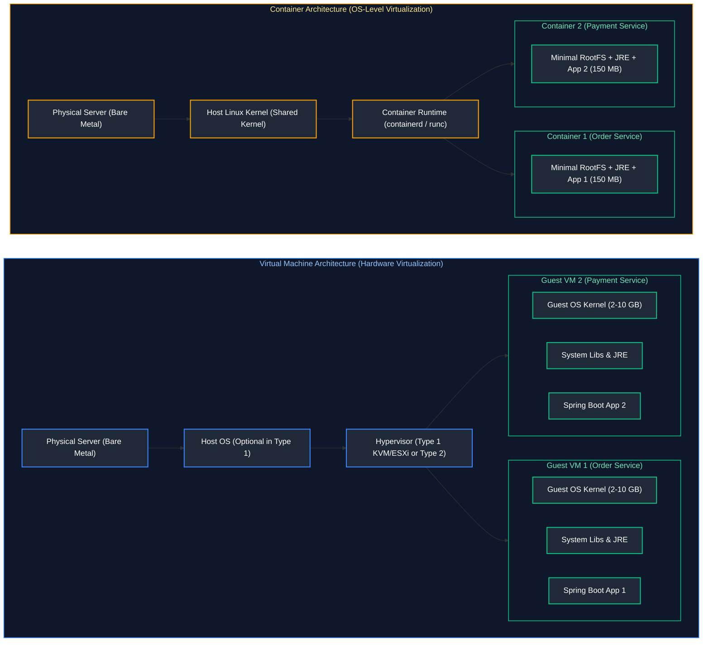

#### Detailed Architectural Comparison

| Architectural Dimension | Virtual Machines (VMs) | Docker Containers |
| :--- | :--- | :--- |
| **Virtualization Level** | Hardware abstraction via Hypervisor | OS kernel abstraction via namespaces & cgroups |
| **Operating System** | Independent Guest OS per VM (Windows/Linux) | Shared Host Linux Kernel |
| **Storage Footprint** | 10 GB – 100 GB per VM | 50 MB – 300 MB per container image |
| **Startup Latency** | 1 – 5 minutes (full kernel boot & systemd) | 100 milliseconds – 3 seconds (process execution) |
| **Resource Efficiency** | Heavy memory/CPU tax allocated to guest OS | Near-zero virtualization overhead (bare-metal speed) |
| **Security Isolation** | Hypervisor ring-0 hardware boundary (Very high) | Shared kernel boundary; hardened via seccomp & AppArmor |
| **Portability** | Heavy OVF/VMDK images, hypervisor dependent | Lightweight OCI standard images runnable on any engine |

---

### 1.2 Linux Kernel Isolation Internals (Namespaces, Cgroups, OverlayFS)

A Docker container is not a magical virtual computer; it is simply a standard Linux process constrained by three foundational kernel subsystems:

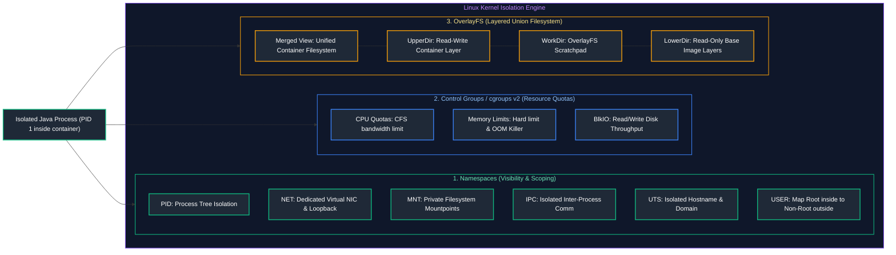

1. **Linux Namespaces (What the Process Can See)**:
   - **`pid`**: Isolates process IDs. The Java process sees itself as `PID 1` inside the container, while the host kernel tracks it as an arbitrary PID (e.g. `PID 48291`).
   - **`net`**: Provides an independent virtual network stack: private network interfaces (`eth0`), loopback (`lo`), routing tables, and firewall rules.
   - **`mnt`**: Isolates filesystem mount points. The process only sees its mounted container root filesystem (`rootfs`), completely blinded to the host disk.
   - **`ipc`**: Isolates System V IPC and POSIX message queues, preventing shared memory leakage across containers.
   - **`uts`**: Allows the container to have its own unique hostname (e.g., `container-order-service-7b9`).
   - **`user`**: Maps user and group IDs. An application running as `root` (UID 0) inside the container namespace can be mapped to an unprivileged user (UID 10001) on the host host system.

2. **Control Groups / `cgroups v2` (How Much the Process Can Use)**:
   - Enforces hard ceilings and accounting on CPU, memory, memory swap, and I/O.
   - When a Java container exceeds its defined memory limit, the Linux kernel **OOM Killer** (Out Of Memory Killer) triggers an immediate `SIGKILL` (`Exit Code 137`).
   - Modern Java versions (JDK 17, 21+) natively query `cgroups v2` to size JVM heap dynamically (`-XX:+UseContainerSupport`).

3. **OverlayFS (How Storage Layers Stack)**:
   - Docker images are composed of immutable, content-addressable read-only layers (**`LowerDir`**).
   - When a container boots, Docker mounts a thin, ephemeral read-write layer (**`UpperDir`**) on top.
   - **Copy-on-Write (CoW)**: When an application modifies an existing file from a lower layer, OverlayFS copies the file up to `UpperDir` before writing, preserving the immutable base image.

---

### 1.3 Container Lifecycle State Machine

Understanding container states is essential for diagnosing operational production failures:

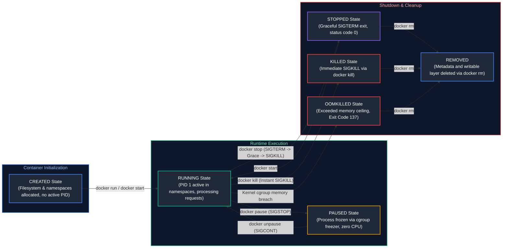

- **`Created`**: Container filesystem and metadata prepared; no active running processes.
- **`Running`**: Main process (`PID 1`) executing actively within isolated namespaces.
- **`Paused`**: All processes frozen in-memory via the Linux freezer cgroup (`SIGSTOP`).
- **`Stopped`**: Process received `SIGTERM`, was given a grace period (default 10s) to flush state, and terminated cleanly (`Exit Code 0`) or via `SIGKILL`.
- **`OOMKilled`**: Linux kernel terminated the process due to exceeding cgroup memory ceiling (`Exit Code 137 = 128 + 9 [SIGKILL]`).

---

### 1.4 Dockerfile Directives & Spring Boot Multi-Stage Layered Builds

Traditional monolithic Docker builds copy a single fat JAR into an image. When a developer changes one line of code, Docker must invalidate the entire JAR layer cache (50–100 MB) and push the entire artifact across the network.

**Spring Boot Layered JARs (`layertools`)** decompose the fat JAR into four discrete architectural layers ordered by update frequency:
1. `dependencies`: Third-party release dependencies (changes rarely).
2. `spring-boot-loader`: Internal Spring classloader utilities (changes rarely).
3. `snapshot-dependencies`: Internal snapshot builds (changes occasionally).
4. `application`: Enterprise business source classes and configurations (changes every commit).

#### Production Multi-Stage Layered Dockerfile for Spring Boot 3 (Java 21)

```dockerfile
# Stage 1: Dependency Cache & Compilation Stage
FROM maven:3.9.6-eclipse-temurin-21-alpine AS builder
WORKDIR /workspace

# Step 1: Copy only build descriptor to leverage Docker layer caching
COPY pom.xml .
RUN mvn dependency:go-offline -B

# Step 2: Copy source code and build production fat jar
COPY src ./src
RUN mvn clean package -DskipTests -B

# Stage 2: Extract Spring Boot Layered JAR Components
FROM eclipse-temurin:21-jre-alpine AS extractor
WORKDIR /workspace
COPY --from=builder /workspace/target/*.jar app.jar
# Extract layered JAR into distinct component directories
RUN java -Djarmode=layertools -jar app.jar extract

# Stage 3: Minimal, Hardened Production Runtime Image
FROM eclipse-temurin:21-jre-alpine AS runner
WORKDIR /application

# Security: Create non-root system group and user
RUN addgroup -S appgroup && adduser -S appuser -G appgroup

# Install curl for container healthcheck execution
RUN apk add --no-cache curl

# Copy extracted layers in order from lowest frequency to highest frequency
COPY --from=extractor /workspace/dependencies/ ./
COPY --from=extractor /workspace/spring-boot-loader/ ./
COPY --from=extractor /workspace/snapshot-dependencies/ ./
COPY --from=extractor /workspace/application/ ./

# Switch to non-root user
USER appuser:appgroup

# Container Healthcheck configuration
HEALTHCHECK --interval=15s --timeout=3s --start-period=30s --retries=3 \
  CMD curl -f http://localhost:8080/actuator/health/liveness || exit 1

# Expose standard Spring Boot HTTP port
EXPOSE 8080

# Production JVM container flags:
# -XX:+UseContainerSupport: Detect cgroup limits automatically
# -XX:MaxRAMPercentage=75.0: Allocate 75% of container memory limit to JVM Heap
# -XX:+ExitOnOutOfMemoryError: Immediately terminate container on OOM to trigger K8s restart
ENTRYPOINT ["java", \
  "-XX:+UseContainerSupport", \
  "-XX:MaxRAMPercentage=75.0", \
  "-XX:+ExitOnOutOfMemoryError", \
  "org.springframework.boot.loader.launch.JarLauncher"]
```

---

### 1.5 Base Image Optimization: Distroless vs Alpine vs Chainguard

| Image Base | Typical Size | Package Manager | Shell Included | Vulnerability (CVE) Surface | Production Recommendation |
| :--- | :--- | :--- | :--- | :--- | :--- |
| **Ubuntu / Debian** | 150 MB – 300 MB | `apt` | `/bin/bash` | High (hundreds of packages) | Development / Debugging only |
| **Alpine Linux** | 5 MB – 20 MB | `apk` (musl libc) | `/bin/sh` | Low (requires testing with `musl` vs `glibc`) | Standard Enterprise Containers |
| **Google Distroless** | 20 MB – 50 MB | None | None | Extremely Low (zero package managers or shells) | High-Security Production Systems |
| **Chainguard Images** | 15 MB – 40 MB | `apk` (glibc) | None (minimal) | Near-Zero CVE guarantee | Enterprise Regulated Environments |

---

### 1.6 Docker Storage (Volumes vs Bind Mounts vs tmpfs) & Networking Modes

#### Storage Options Compared
- **Named Volumes (`docker volume create my-vol`)**: Managed entirely by Docker inside host path `/var/lib/docker/volumes/`. High performance, isolated from host OS changes, ideal for database persistence (PostgreSQL data directory).
- **Bind Mounts (`-v /local/path:/container/path`)**: Mounts an explicit directory from the developer's workstation directly into the container. Ideal for live hot-reloading during local development.
- **tmpfs Mounts (`--tmpfs /app/cache`)**: Stored purely in host volatile system RAM. Data is never persisted to disk; destroyed immediately on container stop. Ideal for sensitive ephemeral secrets or ultra-fast scratchpads.

#### Docker Networking Drivers
- **`bridge` (Default)**: Creates a software bridge (`docker0`). Each container obtains an isolated private IP address (`172.17.0.x`). Port forwarding (`-p 8080:8080`) maps host ports to container ports using host `iptables` NAT rules.
- **`host`**: Bypasses network isolation completely. The container binds directly to the host's physical network interface. Removes NAT performance overhead; eliminates port mapping.
- **`none`**: Fully disconnects the container from any network stack; only internal loopback interface (`lo`) exists.
- **`overlay`**: Multi-host distributed network driver used in Docker Swarm and container meshes to enable cross-node container communication.

---

### 1.7 Docker Compose Production Stack for Java Microservices

The following production-ready `docker-compose.yml` orchestrates a resilient local microservice topology featuring Spring Boot, PostgreSQL, Redis cache, and Kafka with KRaft (ZooKeeper-less):

```yaml
version: '3.8'

services:
  # PostgreSQL Database Service

postgres-db:
    image: postgres:16-alpine
    container_name: postgres-db
    restart: unless-stopped
    environment:
      POSTGRES_DB: enterprise_db
      POSTGRES_USER: postgres_admin
      POSTGRES_PASSWORD: supersecretpassword
    ports:
      - "5432:5432"
    volumes:
      - pgdata:/var/lib/postgresql/data
    healthcheck:
      test: ["CMD-SHELL", "pg_isready -U postgres_admin -d enterprise_db"]
      interval: 5s
      timeout: 5s
      retries: 5
    networks:
      - backend-net

# 3. Redis Distributed Cache Service

redis-cache:
    image: redis:7.2-alpine
    container_name: redis-cache
    restart: unless-stopped
    command: ["redis-server", "--appendonly", "yes", "--requirepass", "redissecret"]
    ports:
      - "6379:6379"
    volumes:
      - redisdata:/data
    healthcheck:
      test: ["CMD", "redis-cli", "-a", "redissecret", "ping"]
      interval: 5s
      timeout: 3s
      retries: 5
    networks:
      - backend-net

# 4. Apache Kafka (KRaft Mode - No ZooKeeper)

kafka-broker:
    image: confluentinc/cp-kafka:7.6.0
    container_name: kafka-broker
    restart: unless-stopped
    ports:
      - "9092:9092"
    environment:
      KAFKA_NODE_ID: 1
      KAFKA_LISTENER_SECURITY_PROTOCOL_MAP: 'CONTROLLER:PLAINTEXT,PLAINTEXT:PLAINTEXT,PLAINTEXT_HOST:PLAINTEXT'
      KAFKA_ADVERTISED_LISTENERS: 'PLAINTEXT://kafka-broker:29092,PLAINTEXT_HOST://localhost:9092'
      KAFKA_OFFSETS_TOPIC_REPLICATION_FACTOR: 1
      KAFKA_PROCESS_ROLES: 'broker,controller'
      KAFKA_CONTROLLER_QUORUM_VOTERS: '1@kafka-broker:29093'
      KAFKA_LISTENERS: 'PLAINTEXT://0.0.0.0:29092,CONTROLLER://0.0.0.0:29093,PLAINTEXT_HOST://0.0.0.0:9092'
      KAFKA_INTER_BROKER_LISTENER_NAME: 'PLAINTEXT'
      KAFKA_CONTROLLER_LISTENER_NAMES: 'CONTROLLER'
      CLUSTER_ID: '4L622nShTWWkrFuMm5IGqA'
    volumes:
      - kafkadata:/var/lib/kafka/data
    networks:
      - backend-net

# 5. Spring Boot Backend Microservice

order-service:
    build:
      context: .
      dockerfile: Dockerfile
    container_name: order-service
    restart: unless-stopped
    ports:
      - "8080:8080"
    environment:
      SPRING_PROFILES_ACTIVE: docker
      SPRING_DATASOURCE_URL: jdbc:postgresql://postgres-db:5432/enterprise_db
      SPRING_DATASOURCE_USERNAME: postgres_admin
      SPRING_DATASOURCE_PASSWORD: supersecretpassword
      SPRING_DATA_REDIS_HOST: redis-cache
      SPRING_DATA_REDIS_PORT: 6379
      SPRING_DATA_REDIS_PASSWORD: redissecret
      SPRING_KAFKA_BOOTSTRAP_SERVERS: kafka-broker:29092
    depends_on:
      postgres-db:
        condition: service_healthy
      redis-cache:
        condition: service_healthy
    networks:
      - backend-net

volumes:
  pgdata:
  redisdata:
  kafkadata:

networks:
  backend-net:
    driver: bridge
```

---

### 5.8 Docker CLI Commands Cheatsheet & Operational Reference

| Command & Syntax | Key Flags Explained | What Does What | Practical Production Scenario |
| :--- | :--- | :--- | :--- |
| `docker build -t myapp:1.0 .` | `-t`: Tag image name & version<br>`-f`: Specify custom Dockerfile path<br>`--no-cache`: Force rebuild of all layers | Compiles application code and packages immutable OCI image into local storage | Building a new release artifact in local dev or CI pipeline |
| `docker run -d -p 8080:8080 --name myapp myapp:1.0` | `-d`: Run in background (detached mode)<br>`-p <host>:<container>`: Publish port mapping<br>`--name`: Assign human-readable container name | Creates container namespaces, attaches storage, and executes `ENTRYPOINT` process | Launching application in local workstation |
| `docker run --memory="1g" --cpus="1.5" ...` | `--memory`: Hard cgroup RAM ceiling<br>`--cpus`: CFS CPU quota fraction<br>`--restart=always`: Auto-restart policy | Enforces strict host resource boundaries to prevent noisy neighbor starvation | Running production containers directly on bare metal/VM |
| `docker exec -it myapp /bin/sh` | `-i`: Keep STDIN open<br>`-t`: Allocate pseudo-TTY terminal<br>`-u`: Run as specific user (e.g. root) | Injects a new interactive shell process into an already running container's namespaces | Live operational debugging and checking file paths inside container |
| `docker logs -f --tail=100 myapp` | `-f`: Follow / stream live logs<br>`--tail 100`: Show only last 100 lines<br>`-t`: Prepend timestamps | Streams `STDOUT` and `STDERR` log output of the container process | Diagnosing runtime exceptions or startup failures |
| `docker ps -a --filter "status=exited"` | `-a`: List all containers (running and stopped)<br>`--filter`: Query containers by status or label<br>`-q`: Output only container IDs | Lists container inventory with status, exit code, and port mappings | Finding containers that crashed with non-zero exit codes |
| `docker inspect myapp` | `--format '{{.NetworkSettings.IPAddress}}'`: Extract specific JSON attribute | Emits full low-level JSON configuration, network IP, mount points, and state | Inspecting exact IP address assigned to container bridge interface |
| `docker stop -t 30 myapp` | `-t 30`: Wait 30 seconds before sending SIGKILL | Sends `SIGTERM` to allow graceful shutdown, then sends `SIGKILL` if still running | Gracefully terminating Spring Boot app to drain in-flight web requests |
| `docker kill myapp` | `-s SIGKILL`: Send raw Linux signal | Immediately sends kernel signal to kill process instantly without cleanup | Terminating hung or deadlocked application instantly |
| `docker system prune -a --volumes` | `-a`: Delete unused images, not just dangling ones<br>`--volumes`: Purge unattached named volumes | Cleans up stopped containers, unused networks, dangling images, and build caches | Freeing tens of gigabytes of disk space on build servers |
| `docker stats` | `--no-stream`: Pull single snapshot | Real-time live stream of CPU%, Memory usage, I/O, and Network bandwidth | Checking which local container is consuming host CPU or memory |

---

# 6. Kubernetes (K8s) Architecture & Core Primitives

---

### 6.1 Master Control Plane & Worker Node Internal Architecture

Kubernetes is an open-source distributed system for orchestrating containerized workloads. It maintains the desired state of a cluster declaratively:

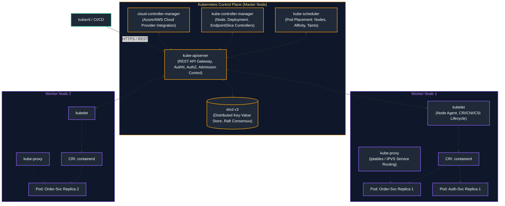

#### Control Plane Components Breakdown
1. **`kube-apiserver`**: The front door of the cluster. All internal components and external `kubectl` clients communicate exclusively through this RESTful API. Validates requests, authenticates, authorizes (RBAC), and writes state mutations directly to `etcd`.
2. **`etcd`**: High-availability, strongly consistent key-value store using the **Raft consensus algorithm**. Stores the entire cluster state, configuration, and secret data. **Zero worker components ever communicate directly with etcd.**
3. **`kube-scheduler`**: Watches for newly created Pods with no assigned node. Evaluates node filtering (Resource Requests, NodeSelector, Taints/Tolerations) and scoring (NodeAffinity, PodAntiAffinity) to bind the Pod to the optimal worker node.
4. **`kube-controller-manager` (KCM)**: Runs continuous reconciliation control loops (`desired state == current state`). Bundles Deployment Controller, ReplicaSet Controller, Node Controller, and Namespace Controller.
5. **`cloud-controller-manager` (CCM)**: Interacts with the underlying cloud vendor (Azure, AWS, GCP) to provision cloud load balancers, manage routes, and attach cloud storage volumes.

#### Worker Node Components Breakdown
1. **`kubelet`**: Primary node agent. Registers the node with the API server, watches for assigned PodSpecs, and delegates container management to the Container Runtime Interface (CRI). Enforces health probes and executes volume mounts via CSI.
2. **`kube-proxy`**: Network proxy running on each node. Reflects Kubernetes `Service` definitions by managing Linux `iptables` or `IPVS` rules, distributing incoming traffic across healthy Pod IP endpoints.
3. **Container Runtime (`containerd` / `CRI-O`)**: Pulls images, configures Linux namespaces and cgroups, and starts/stops containers via `runc`.

---

### 6.2 Pod Lifecycle State Machine & Deep Troubleshooting

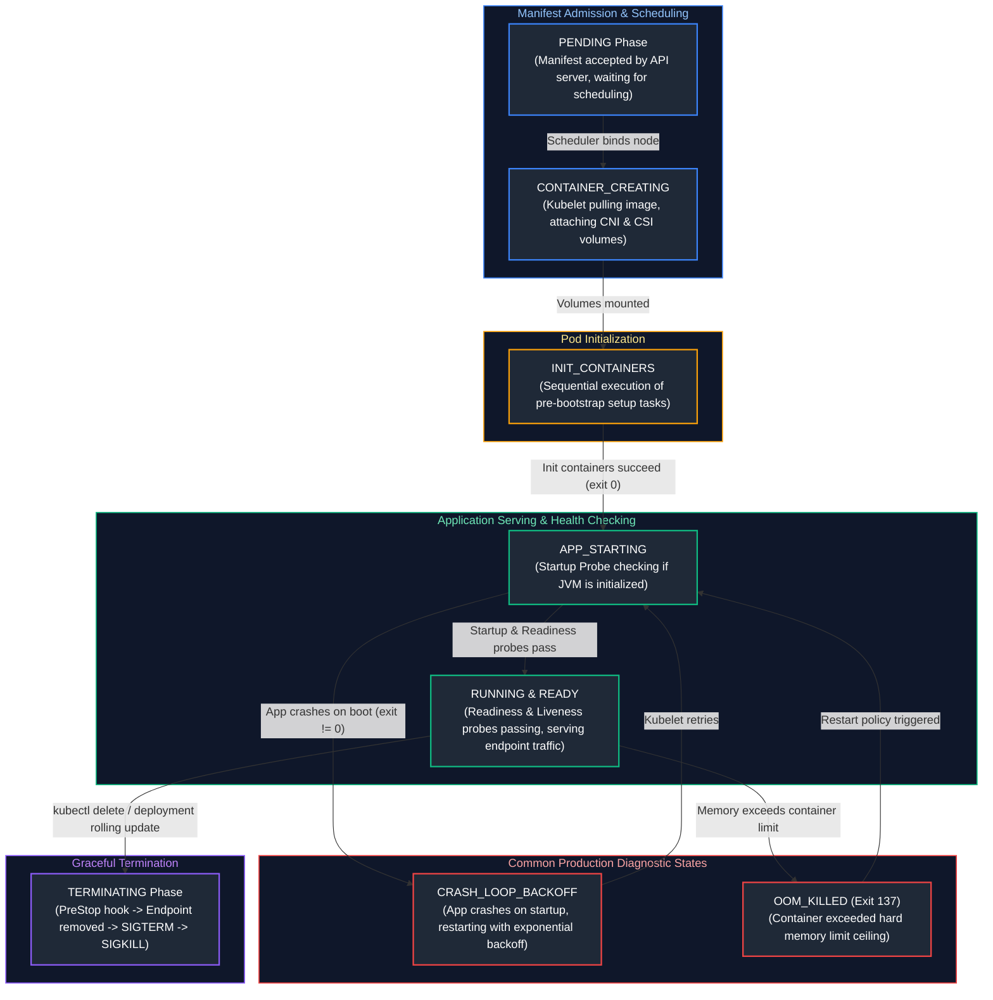

#### Diagnostic State Troubleshooting Guide
- **`Pending`**: Pod cannot be scheduled. Run `kubectl describe pod <name>` to view `Events`. Common causes: insufficient node CPU/memory requests, node selector mismatches, or unbound PersistentVolumeClaims (PVCs).
- **`ImagePullBackOff` / `ErrImagePull`**: Kubelet failed to pull image. Common causes: image tag typo, non-existent registry URL, or missing `imagePullSecrets` (ACR authentication failure).
- **`CrashLoopBackOff`**: Container starts, exits with a non-zero exit code, and Kubelet restarts it with exponential backoff delay. Run `kubectl logs <name> --previous` to inspect the crash log (e.g., missing database connection string, Spring Boot context failure).
- **`OOMKilled` (`Exit Code 137`)**: The container exceeded its hard `limits.memory` ceiling, and the Linux kernel terminated it. Solution: Increase memory limits or tune `-XX:MaxRAMPercentage` down to leave headroom for non-heap native memory.

---

### 6.3 Workload Primitives: Pod vs Deployment vs StatefulSet vs DaemonSet vs Job

| Workload Primitive | State Managed | Scaling & Naming Strategy | Storage Association | Best Production Use Case |
| :--- | :--- | :--- | :--- | :--- |
| **Pod** | Atomic unit | Single ephemeral instance; random hash | Shared ephemeral volume | Testing or debug containers only |
| **Deployment** | Stateless | Replicas scaled dynamically; random hash (e.g. `web-7df8-4a1`) | Shared read-only or stateless ephemeral | Spring Boot REST APIs, Web apps |
| **StatefulSet** | Stateful | Ordered, deterministic naming (`kafka-0`, `kafka-1`, `kafka-2`) | Dedicated PersistentVolume per Pod (`volumeClaimTemplates`) | Kafka brokers, PostgreSQL clusters, ZooKeeper |
| **DaemonSet** | Node-bound | Exactly one copy per worker node automatically | Host root filesystem mounts | Log collectors (FluentBit), node metrics (Prometheus Node Exporter) |
| **Job / CronJob** | Batch / Scheduled | Run-to-completion (`completions`, `parallelism`) | Ephemeral or external S3/ADLS storage | DB schema migrations (Flyway), nightly report generation |

---

### 6.4 Kubernetes Networking & Service Routing (ClusterIP, NodePort, LoadBalancer, Ingress)

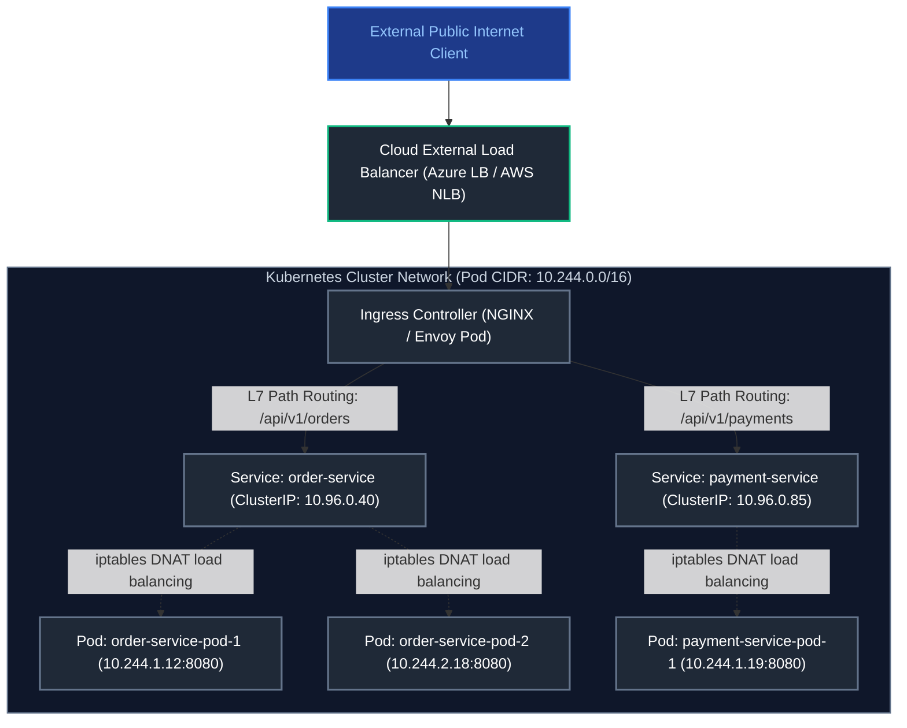

#### Service Types Explained
1. **`ClusterIP` (Default)**: Assigns a stable internal virtual IP address visible only within the cluster. Internal microservices reach each other via CoreDNS (`http://order-service.production.svc.cluster.local:80`).
2. **`NodePort`**: Allocates a static port (default range 30000–32767) across **every worker node's physical IP**. Accessing `<Any-Node-IP>:<NodePort>` routes traffic to the backend Pods.
3. **`LoadBalancer`**: Integrates with the cloud provider (Azure, AWS) to provision an external Layer 4 load balancer that routes public traffic directly to the service's `NodePort`.
4. **`Ingress`**: An application-level (Layer 7) reverse proxy controller (NGINX, Traefik, Contour) that consolidates routing, SSL/TLS termination, and virtual hosting for hundreds of backend `ClusterIP` services under a single public IP.

---

### 6.5 Production Kubernetes Manifests: Deployment, Service, Ingress, HPA, PDB, NetworkPolicy

> [!TIP]
> **Deep-Dive Interview Scenarios:**
> - [Q2. Liveness vs Readiness Probes in Kubernetes](frequently_asked_questions/10_cloud_devops_and_observability_faq.md#q2-liveness-vs-readiness-probes-in-kubernetes)
> - [Q3. Kubernetes Autoscaling (HPA, VPA, Cluster Autoscaler) & Service Discovery](frequently_asked_questions/10_cloud_devops_and_observability_faq.md#q3-kubernetes-autoscaling-hpa-vpa-cluster-autoscaler-service-discovery)

```yaml
# ConfigMap: Application Environment Properties

apiVersion: v1
kind: ConfigMap
metadata:
  name: order-service-config
  namespace: production
data:
  SPRING_PROFILES_ACTIVE: "prod"
  LOG_LEVEL: "INFO"
  SERVER_PORT: "8080"

# 8. Deployment: Zero-Downtime Rolling Update & Hardened Pod Spec

apiVersion: apps/v1
kind: Deployment
metadata:
  name: order-service
  namespace: production
  labels:
    app.kubernetes.io/name: order-service
    app.kubernetes.io/part-of: e-commerce
spec:
  replicas: 3
  revisionHistoryLimit: 10
  strategy:
    type: RollingUpdate
    rollingUpdate:
      maxSurge: 25%        # Provision up to 25% additional pods during rollout
      maxUnavailable: 0     # Guarantee zero down replicas during deployment
  selector:
    matchLabels:
      app.kubernetes.io/name: order-service
  template:
    metadata:
      labels:
        app.kubernetes.io/name: order-service
    spec:
      # Pod Anti-Affinity: Prevent scheduling replicas on the same worker node
      affinity:
        podAntiAffinity:
          preferredDuringSchedulingIgnoredDuringExecution:
          - weight: 100
            podAffinityTerm:
              labelSelector:
                matchExpressions:
                - key: app.kubernetes.io/name
                  operator: In
                  values: ["order-service"]
              topologyKey: "kubernetes.io/hostname"
      # Security Context: Hardened container security
      securityContext:
        runAsNonRoot: true
        runAsUser: 10001
        runAsGroup: 10001
        fsGroup: 10001
      containers:
      - name: order-service
        image: myacr.azurecr.io/order-service:v2.1.0
        imagePullPolicy: IfNotPresent
        securityContext:
          allowPrivilegeEscalation: false
          readOnlyRootFilesystem: false
          capabilities:
            drop: ["ALL"]
        ports:
        - name: http
          containerPort: 8080
        envFrom:
        - configMapRef:
            name: order-service-config
        resources:
          requests:
            cpu: "250m"
            memory: "512Mi"
          limits:
            cpu: "1000m"
            memory: "1024Mi"

# 9. Startup Probe: Disables liveness checks during JVM startup

startupProbe:
          httpGet:
            path: /actuator/health/liveness
            port: http
          failureThreshold: 30
          periodSeconds: 2

# 10. Liveness Probe: Restarts container if JVM deadlocks

livenessProbe:
          httpGet:
            path: /actuator/health/liveness
            port: http
          periodSeconds: 10
          timeoutSeconds: 3
          failureThreshold: 3

# 11. Readiness Probe: Removes pod from Service routing if overloaded

readinessProbe:
          httpGet:
            path: /actuator/health/readiness
            port: http
          periodSeconds: 5
          timeoutSeconds: 2
          failureThreshold: 2

# 12. Service: Internal ClusterIP Routing

apiVersion: v1
kind: Service
metadata:
  name: order-service
  namespace: production
spec:
  type: ClusterIP
  selector:
    app.kubernetes.io/name: order-service
  ports:
  - name: http
    port: 80
    targetPort: http

# 13. Ingress: Layer 7 Routing & SSL Termination

apiVersion: networking.k8s.io/v1
kind: Ingress
metadata:
  name: order-service-ingress
  namespace: production
  annotations:
    kubernetes.io/ingress.class: "nginx"
    cert-manager.io/cluster-issuer: "letsencrypt-production"
    nginx.ingress.kubernetes.io/ssl-redirect: "true"
    nginx.ingress.kubernetes.io/proxy-body-size: "10m"
spec:
  tls:
  - hosts:
    - api.company.com
    secretName: api-company-tls
  rules:
  - host: api.company.com
    http:
      paths:
      - path: /api/v1/orders
        pathType: Prefix
        backend:
          service:
            name: order-service
            port:
              name: http

# 14. Horizontal Pod Autoscaler (HPA): Dynamic Autoscaling

apiVersion: autoscaling/v2
kind: HorizontalPodAutoscaler
metadata:
  name: order-service-hpa
  namespace: production
spec:
  scaleTargetRef:
    apiVersion: apps/v1
    kind: Deployment
    name: order-service
  minReplicas: 3
  maxReplicas: 15
  metrics:
  - type: Resource
    resource:
      name: cpu
      target:
        type: Utilization
        averageUtilization: 75
  - type: Resource
    resource:
      name: memory
      target:
        type: Utilization
        averageUtilization: 80

# 15. Pod Disruption Budget (PDB): Protect Availability during Node Drains

apiVersion: policy/v1
kind: PodDisruptionBudget
metadata:
  name: order-service-pdb
  namespace: production
spec:
  minAvailable: 2
  selector:
    matchLabels:
      app.kubernetes.io/name: order-service

# 16. NetworkPolicy: Zero-Trust Microsegmentation

apiVersion: networking.k8s.io/v1
kind: NetworkPolicy
metadata:
  name: order-service-netpol
  namespace: production
spec:
  podSelector:
    matchLabels:
      app.kubernetes.io/name: order-service
  policyTypes:
  - Ingress
  - Egress
  ingress:
  # Allow incoming traffic only from NGINX Ingress and Payment Service
  - from:
    - namespaceSelector:
        matchLabels:
          kubernetes.io/metadata.name: ingress-nginx
    - podSelector:
        matchLabels:
          app.kubernetes.io/name: payment-service
    ports:
    - protocol: TCP
      port: 8080
  egress:
  # Allow outgoing connections to CoreDNS and Database Subnet
  - to:
    - namespaceSelector: {}
      podSelector:
        matchLabels:
          k8s-app: kube-dns
    ports:
    - protocol: UDP
      port: 53
  - to:
    - ipBlock:
        cidr: 10.240.4.0/24 # Azure Private DB Subnet
```

---

### 16.6 Configuration & Secrets Management: `ConfigMap`, `Secret`, Azure Key Vault CSI Driver

- **`ConfigMap`**: Injects non-sensitive environment variables and files (`application.yml`) into Pod containers without rebuilding images.
- **`Secret`**: Stores sensitive data (passwords, tokens, TLS certs) Base64-encoded. Mounted as environment variables or volume files.
- **Azure Key Vault Provider for Secrets Store CSI Driver**: Production best practice on Azure Kubernetes Service (AKS). Mounts secrets, keys, and certificates stored in **Azure Key Vault** directly as in-memory volumes into Pods using Azure Managed Identities, avoiding storing secrets in the cluster `etcd` store altogether.

---

### 16.7 Persistent Storage: StorageClass, PV, PVC, and Dynamic Volume Provisioning

Kubernetes decouples storage administration from developer consumption:
1. **StorageClass (SC)**: Admin defines the storage profile (e.g. `managed-csi` on Azure using Azure Premium SSD v2, volume expansion enabled, reclaim policy `Delete` or `Retain`).
2. **PersistentVolumeClaim (PVC)**: Developers declare a storage request (e.g. `100Gi`, `ReadWriteOnce`).
3. **PersistentVolume (PV)**: The cloud CSI driver dynamically allocates physical cloud disk and registers the PV bound to the PVC.

---

### 16.8 Pod Health Probes (Startup, Liveness, Readiness) & JVM Graceful Shutdown

1. **Startup Probe**: Prevents aggressive liveness probes from killing slow-starting enterprise Java applications (e.g. Spring Boot cold start under class loading). Kubelet pauses liveness checks until startup probe passes.
2. **Liveness Probe**: Verifies internal application health. If this probe fails repeatedly, Kubelet terminates the container and schedules a replacement.
3. **Readiness Probe**: Verifies whether the container is ready to accept incoming client traffic. If it fails (e.g. database pool temporarily saturated), Kubelet removes the Pod IP from the Service load balancer endpoints without killing the container.
4. **Graceful Shutdown**: Configure `server.shutdown: graceful` in Spring Boot with `terminationGracePeriodSeconds: 45` in the K8s PodSpec. Kubelet sends `SIGTERM`, Spring Boot stops accepting new requests, drains in-flight requests, and terminates cleanly.

> [!TIP]
> For Spring Boot's programmatic control of Kubernetes readiness and liveness probes via `AvailabilityChangeEvent` (graceful connection draining without restarting pods), see [06. Spring Framework & Spring Boot - Section 7.2](05_spring_boot_and_rest_apis.md#72-kubernetes-liveness--readiness-probes-availabilitychangeevent).

---

### 16.9 Resource Management (Requests vs Limits, CFS Throttling, OOMKilled Exit Code 137)

- **`requests`**: Guaranteed minimum compute allocated to the container. The `kube-scheduler` calculates node capacity strictly using `requests`.
- **`limits`**: Maximum hard ceiling:
  - **CPU Limit**: Enforced by the Linux kernel Completely Fair Scheduler (CFS) bandwidth control (`cfs_quota_us` / `cfs_period_us`). If a container exceeds its limit, the CPU is **throttled** (response latency spikes; process does not crash).
  - **Memory Limit**: Enforced by kernel memory cgroup. If memory usage exceeds the limit, the Linux kernel triggers the **OOM Killer** (`Exit Code 137`), terminating the container immediately.

---

### 16.10 `kubectl` CLI Commands Cheatsheet & Troubleshooting Diagnostics

| Command & Syntax | Key Flags Explained | What Does What | Practical Troubleshooting Scenario |
| :--- | :--- | :--- | :--- |
| `kubectl get pods -A -o wide` | `-A`: All namespaces<br>`-o wide`: Include Node name, Pod IP, and restart count | Displays global container inventory across all cluster namespaces | Quickly checking which worker node hosts a failing Pod |
| `kubectl describe pod <name> -n <ns>` | `-n <ns>`: Target namespace | Dumps complete Pod spec, recent system events, and probe status | Investigating `Pending`, `CrashLoopBackOff`, or scheduling failures |
| `kubectl logs <name> -n <ns> -f --previous` | `-f`: Stream logs live<br>`--previous`: Read logs of previously crashed container instance | Fetches STDOUT/STDERR logs from the container | Diagnosing why a Java container crashed with Exit Code 137 or JVM error |
| `kubectl exec -it <name> -n <ns> -- /bin/sh` | `-i`: STDIN<br>`-t`: TTY<br>`-c <container>`: Target container in multi-container pod | Injects interactive terminal into running Pod container | Checking database connectivity (`nc -zv db-host 5432`) from inside Pod |
| `kubectl port-forward svc/<svc> 8080:80 -n <ns>` | `<local-port>:<svc-port>` | Tunnels local developer port directly to internal K8s Service | Testing internal REST API without exposing Ingress or LoadBalancer |
| `kubectl rollout status deployment/<name> -n <ns>` | `--timeout=60s`: Maximum wait time | Blocks until rolling update deployment completes or times out | Using in CI/CD pipeline to verify zero-downtime deployment success |
| `kubectl rollout undo deployment/<name> -n <ns>` | `--to-revision=2`: Rollback to explicit past revision number | Instantly reverts Deployment to previous healthy ReplicaSet | Emergency rollback after a bad release introduces production errors |
| `kubectl top nodes / pods -n <ns>` | `--containers`: Show CPU/RAM breakdown per container | Displays real-time CPU and memory usage from Metrics Server | Identifying memory leaks or CPU throttling bottlenecks |
| `kubectl cordon <node>` | `<node>`: Worker node name | Marks worker node as unschedulable (no new Pods scheduled) | Preparing a Kubernetes node for OS patching or maintenance |
| `kubectl drain <node> --ignore-daemonsets --delete-emptydir-data` | `--ignore-daemonsets`: Skip node logging pods<br>`--delete-emptydir-data`: Allow discarding local scratchpads | Safely evicts all active Pods from node to other cluster nodes | Upgrading Kubernetes worker node version with zero user downtime |
| `kubectl apply -f manifest.yaml --dry-run=client -o yaml` | `--dry-run=client`: Validate locally without sending to API server | Validates YAML syntax and schema without applying changes to cluster | Pre-commit validation and CI pipeline sanity checks |

---

### 16.11 Automated Cloud Certificate Management: Kubernetes cert-manager, ACME Protocol & Azure Key Vault Secrets Store CSI Driver

In modern production Kubernetes clusters, manual SSL certificate renewal is a critical operational anti-pattern. Two primary patterns dominate enterprise certificate automation:

> [!NOTE]
> For foundational PKI concepts, X.509 chains, TLS 1.3 handshakes, Java KeyStore vs TrustStore architecture, and `keytool`/`openssl` commands, see [10. Security, Identity & Cryptographic Certificate Management - Section 3: Certificate Management, SSL/TLS, Keystores & mTLS](06_security_and_cryptography.md#5-public-key-infrastructure-pki-tls-13--certificate-management).

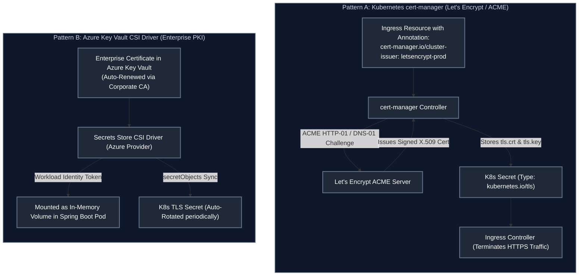

#### 1. Production `ClusterIssuer` Manifest (Let's Encrypt Production)

```yaml
apiVersion: cert-manager.io/v1
kind: ClusterIssuer
metadata:
  name: letsencrypt-production
spec:
  acme:
    server: https://acme-v02.api.letsencrypt.org/directory
    email: devops-admin@company.com
    privateKeySecretRef:
      name: letsencrypt-production-account-key
    solvers:

# 17. HTTP-01 Solver: Solves challenge by answering HTTP requests routed via Ingress

- http01:
        ingress:
          class: nginx
```

#### 2. Declarative `Certificate` CRD & Ingress Integration

```yaml
apiVersion: cert-manager.io/v1
kind: Certificate
metadata:
  name: api-company-cert
  namespace: production
spec:
  secretName: api-company-tls # Name of target K8s Secret generated automatically
  issuerRef:
    name: letsencrypt-production
    kind: ClusterIssuer
  dnsNames:
  - api.company.com
  - orders.company.com
  duration: 2160h # 90 days validity
  renewBefore: 360h # Automatically renew 15 days before expiration!
```

#### 3. Kubernetes `kubernetes.io/tls` Secret Anatomy
The generated Kubernetes Secret holds two Base64-encoded keys required by standard ingress controllers and web servers:
- **`tls.crt`**: The leaf certificate followed by intermediate CA certificates forming the complete validation chain.
- **`tls.key`**: The unencrypted private key matching the public key in the leaf certificate.

---

# 18. CI/CD & Advanced Zero-Downtime Deployment Strategies

---

### 18.1 CI vs CD (Continuous Integration, Delivery, and Deployment)

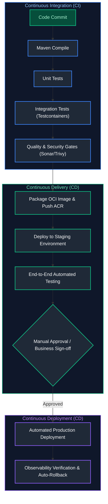

- **Continuous Integration (CI)**: Developers commit code to the trunk frequently. Every commit automatically triggers a pipeline that compiles code, executes unit tests, runs integration tests against real databases (via Testcontainers), and enforces static security analysis.
- **Continuous Delivery (CD)**: Extends CI by automatically packaging deployable release artifacts (Docker images, Helm charts) and deploying them to staging/UAT environments. Deployment to production requires human approval.
- **Continuous Deployment (CD)**: Eliminates manual gates entirely. Every commit that passes automated testing and quality gates automatically rolls out to production systems.

---

### 18.2 The Enterprise CI/CD Pipeline Lifecycle

1. **Commit & Static Linting**: Pre-commit hooks verify code formatting (Spotless), check licenses, and execute secret scanning (GitGuardian).
2. **Build & Unit Test**: Fast execution of JUnit 5 and Mockito tests with JaCoCo code coverage verification (enforcing >80% line coverage).
3. **Integration Testing with Testcontainers**: Boots real ephemeral Docker containers (PostgreSQL, Kafka, Redis) directly within the build agent to validate real repository queries and event producers.
4. **Security & Vulnerability Analysis**:
   - SAST (Static Application Security Testing): SonarQube scans code quality and security vulnerabilities.
   - SCA (Software Composition Analysis): OWASP Dependency-Check scans CVEs in third-party libraries.
   - Container Scanning: **Trivy** scans the final Docker image layers for OS and runtime vulnerabilities.
5. **Artifact Publishing**: The signed Docker image is pushed to **Azure Container Registry (ACR)** with an immutable build tag (`sha-xxxxxx` or semantic version).
6. **GitOps Trigger**: Pipeline updates the target image tag in the GitOps deployment repository, triggering automated ArgoCD reconciliation.

---

### 18.3 Zero-Downtime Deployment Strategies: Rolling vs Blue-Green vs Canary vs Shadow

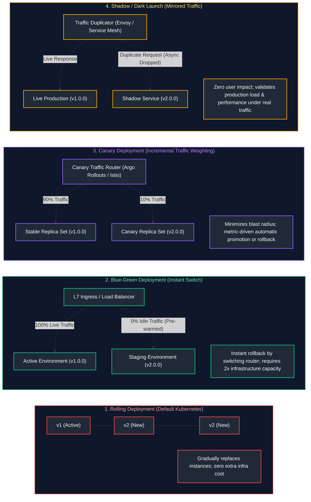

#### In-Depth Architectural Comparison

| Dimension | Rolling Deployment | Blue-Green Deployment | Canary Deployment | Shadow (Dark Launch) |
| :--- | :--- | :--- | :--- | :--- |
| **Rollout Speed** | Moderate (pod by pod) | Instant (router cutover) | Progressive (e.g. 5% $\rightarrow$ 25% $\rightarrow$ 100%) | Instant mirror |
| **Rollback Speed** | Slow (requires reverse rolling update) | Instant (switch router pointer back to Green) | Fast (drop canary weight to 0%) | Not applicable (zero user traffic impacted) |
| **Infrastructure Overhead** | Low (only `maxSurge` overhead, e.g. +25%) | High (requires 2x full cluster capacity) | Very Low (single canary replica, +10%) | High (2x compute to process mirrored requests) |
| **Blast Radius** | Medium (all users hit new version eventually) | High (cutover impacts 100% of user traffic) | Minimal (only 5% of users exposed initially) | Zero (shadow responses discarded asynchronously) |
| **Database Migration Complexity** | Complex (DB must support v1 and v2 simultaneously) | Complex (DB must support both environments) | Complex (DB must support both versions) | Complex (must avoid duplicate writes to production DB) |

---

### 18.4 Enterprise Multi-Stage Azure DevOps Pipeline (`azure-pipelines.yml`)

```yaml
trigger:
  branches:
    include:
      - main
      - release/*

variables:
  vmImageName: 'ubuntu-latest'
  imageRepository: 'order-service'
  containerRegistry: 'myenterpriseacr.azurecr.io'
  dockerfilePath: '$(Build.SourcesDirectory)/Dockerfile'
  tag: '$(Build.BuildId)'

stages:
# Stage 1: Continuous Integration (Build, Test, Quality Gates)
- stage: CI_BuildAndTest
  displayName: '1. Build, Test & Security Gates'
  jobs:
  - job: MavenBuildAndScan
    pool:
      vmImage: $(vmImageName)
    steps:
    - task: JavaToolInstaller@0
      inputs:
        versionSpec: '21'
        jdkArchitectureOption: 'x64'
        jdkSourceOption: 'PreInstalled'

    # Cache Maven dependencies to accelerate build times
    - task: Cache@2
      inputs:
        key: 'maven | "$(Agent.OS)" | **/pom.xml'
        restoreKeys: |
          maven | "$(Agent.OS)"
        path: $(HOME)/.m2/repository
      displayName: 'Cache Maven packages'

    - script: mvn clean verify -B
      displayName: 'Execute Maven Clean, Test, and Verify'

    - task: PublishTestResults@2
      inputs:
        testResultsFormat: 'JUnit'
        testResultsFiles: '**/surefire-reports/TEST-*.xml'
        mergeTestResults: true
      displayName: 'Publish JUnit Test Results'

    - task: PublishCodeCoverageResults@2
      inputs:
        summaryFileLocation: '$(System.DefaultWorkingDirectory)/**/site/jacoco/jacoco.xml'
      displayName: 'Publish JaCoCo Code Coverage'

# Stage 2: Containerization & Security Scanning
- stage: CI_Containerize
  displayName: '2. Docker Multi-Stage Build & Trivy Scan'
  dependsOn: CI_BuildAndTest
  condition: succeeded()
  jobs:
  - job: DockerBuildAndScan
    pool:
      vmImage: $(vmImageName)
    steps:
    - task: Docker@2
      displayName: 'Build Docker OCI Image'
      inputs:
        command: build
        repository: $(imageRepository)
        dockerfile: $(dockerfilePath)
        tags: |
          $(tag)
          latest

    # Install and execute Trivy Container Vulnerability Scanner
    - script: |
        curl -sfL https://raw.githubusercontent.com/aquasecurity/trivy/main/contrib/install.sh | sh -s -- -b /usr/local/bin
        trivy image --exit-code 1 --severity CRITICAL $(imageRepository):$(tag)
      displayName: 'Trivy Scan: Fail build on CRITICAL CVEs'

    - task: Docker@2
      displayName: 'Push Image to Azure Container Registry'
      inputs:
        containerRegistry: 'AzureContainerRegistryServiceConnection'
        repository: $(imageRepository)
        command: push
        tags: |
          $(tag)
          latest

# Stage 3: GitOps Config Update (Trigger ArgoCD)
- stage: CD_PromoteToStaging
  displayName: '3. Update GitOps Repository'
  dependsOn: CI_Containerize
  condition: succeeded()
  jobs:
  - job: UpdateGitOpsManifests
    steps:
    - script: |
        git config --global user.email "devops-bot@company.com"
        git config --global user.name "DevOps Pipeline Bot"
        git clone https://$(SYSTEM_ACCESSTOKEN)@dev.azure.com/myorg/myproject/_git/gitops-manifests
        cd gitops-manifests/environments/staging/order-service
        sed -i 's|image: .*|image: $(containerRegistry)/$(imageRepository):$(tag)|g' deployment.yaml
        git add deployment.yaml
        git commit -m "Auto-promote order-service to image tag $(tag)"
        git push origin main
      displayName: 'Update K8s Deployment Manifest with new Image Tag'
```

---

### 18.5 Enterprise GitHub Actions CI/CD Workflow (`.github/workflows/deploy.yml`)

```yaml
name: Enterprise CI/CD Pipeline

on:
  push:
    branches: [ "main" ]
  pull_request:
    branches: [ "main" ]

permissions:
  contents: write
  packages: write
  security-events: write

jobs:
  build-and-test:
    runs-on: ubuntu-latest
    steps:
      - uses: actions/checkout@v4

      - name: Set up JDK 21
        uses: actions/setup-java@v4
        with:
          java-version: '21'
          distribution: 'temurin'
          cache: maven

      - name: Build with Maven & Run Unit and Testcontainers Tests
        run: mvn clean verify -B

      - name: Upload JaCoCo Coverage Report
        uses: actions/upload-artifact@v4
        with:
          name: code-coverage-report
          path: target/site/jacoco/

  docker-build-and-push:
    needs: build-and-test
    if: github.ref == 'refs/heads/main'
    runs-on: ubuntu-latest
    steps:
      - uses: actions/checkout@v4

      - name: Set up Docker Buildx
        uses: actions/setup-buildx-action@v3

      - name: Log in to Azure Container Registry
        uses: docker/login-action@v3
        with:
          registry: ${{ secrets.ACR_LOGIN_SERVER }}
          username: ${{ secrets.ACR_USERNAME }}
          password: ${{ secrets.ACR_PASSWORD }}

      - name: Build and Push Docker Image
        uses: docker/build-push-action@v5
        with:
          context: .
          push: true
          tags: |
            ${{ secrets.ACR_LOGIN_SERVER }}/order-service:${{ github.sha }}
            ${{ secrets.ACR_LOGIN_SERVER }}/order-service:latest
          cache-from: type=gha
          cache-to: type=gha,mode=max

      - name: Scan Image with Trivy
        uses: aquasecurity/trivy-action@master
        with:
          image-ref: ${{ secrets.ACR_LOGIN_SERVER }}/order-service:${{ github.sha }}
          format: 'sarif'
          output: 'trivy-results.sarif'
          severity: 'CRITICAL,HIGH'
```

> [!TIP]
> **Deep-Dive Interview Scenarios:**
> - [Q4. Structuring a Robust CI/CD Pipeline (GitHub Actions / Jenkins)](frequently_asked_questions/10_cloud_devops_and_observability_faq.md#q4-structuring-a-robust-cicd-pipeline-github-actions--jenkins)
> - [Q5. Deployment Strategies: Blue-Green vs Canary vs Rolling](frequently_asked_questions/10_cloud_devops_and_observability_faq.md#q5-deployment-strategies-blue-green-vs-canary-vs-rolling)
> - [Q6. Enterprise Production Monitoring & Observability Stack](frequently_asked_questions/10_cloud_devops_and_observability_faq.md#q6-enterprise-production-monitoring--observability-stack)
> - [Q15. End-to-End AWS Deployment Flow: CI Build to ECR and EKS Container Rollout](frequently_asked_questions/10_cloud_devops_and_observability_faq.md#q15-end-to-end-aws-deployment-flow-ci-build-to-ecr-and-eks-container-rollout)

---

# 19. GitOps Continuous Delivery with ArgoCD

---

### 19.1 GitOps Core Principles & Architectural Paradigm

GitOps is an operational framework that takes DevOps best practices used for application development (version control, collaboration, compliance, and CI/CD) and applies them to infrastructure and deployment automation.

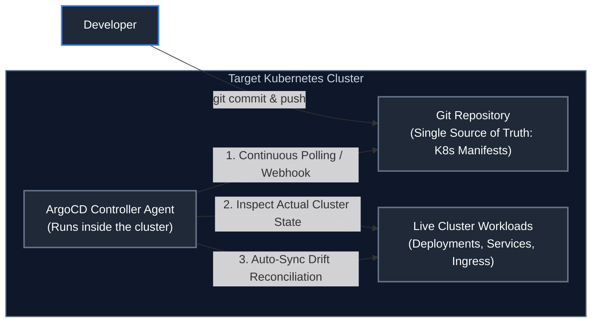

1. **Declarative State**: The entire desired system state (applications, networking, ingress, resource quotas) is declared declaratively via Kubernetes manifests, Kustomize, or Helm charts.
2. **Version-Controlled Single Source of Truth**: The Git repository is the sole authority for what is allowed to run in the cluster.
3. **Automated Pull-Based Delivery**: An agent running **inside** the target Kubernetes cluster pulls updates from Git, eliminating the security vulnerability of exposing cluster API credentials to external CI runners.
4. **Continuous Drift Detection & Self-Healing**: If an operator manually edits a deployment via `kubectl edit`, the ArgoCD reconciliation loop immediately detects configuration drift and reverts the live cluster back to the Git source state.

---

### 19.2 ArgoCD Automated Reconciliation Loop & Drift Detection

The ArgoCD controller compares the **Target State** (defined in Git) with the **Live State** (running in the Kubernetes cluster) every 3 minutes (or triggered immediately via Git Webhook):
- **`Synced`**: Live state matches the desired Git commit hash.
- **`OutOfSync`**: Differences detected between Git and Live cluster.
- **`Healthy`**: All Pod health probes are passing and workloads are running.
- **`Degraded`**: Containers crashing, probes failing, or HPA unable to scale.

---

### 19.3 Production ArgoCD Application CRD & ApplicationSet for Multi-Environment Promotion

```yaml
apiVersion: argoproj.io/v1alpha1
kind: Application
metadata:
  name: order-service-prod
  namespace: argocd
  finalizers:
    # Ensures K8s resources are deleted if Application is deleted from Git
    - resources-finalizer.argocd.argoproj.io
spec:
  project: default
  source:
    repoURL: 'https://github.com/my-enterprise/gitops-deployments.git'
    targetRevision: main
    path: environments/production/order-service
  destination:
    server: 'https://kubernetes.default.svc'
    namespace: production
  syncPolicy:
    automated:
      prune: true     # Automatically deletes resources removed from Git
      selfHeal: true  # Automatically reverts manual kubectl edits on cluster
    syncOptions:
      - CreateNamespace=true
      - ApplyOutOfSyncOnly=true
    retry:
      limit: 5
      backoff:
        duration: 5s
        factor: 2
        maxDuration: 3m
```

---

### 19.4 Argo Rollouts: Automated Canary Rollouts with Prometheus Metric Analysis

Argo Rollouts replaces the standard Kubernetes `Deployment` with an advanced `Rollout` CRD, enabling automated canary deployments driven by real-time Prometheus metrics:

```yaml
apiVersion: argoproj.io/v1alpha1
kind: Rollout
metadata:
  name: order-service-rollout
  namespace: production
spec:
  replicas: 10
  strategy:
    canary:
      # Automatically step through traffic weights
      steps:
      - setWeight: 10
      - pause: { duration: 5m }  # Evaluate metrics at 10% traffic for 5 minutes
      - setWeight: 25
      - pause: { duration: 10m }
      - setWeight: 50
      - pause: { duration: 10m }
      # Automated Prometheus Metric Analysis
      analysis:
        templates:
        - templateName: http-success-rate-analysis
---
apiVersion: argoproj.io/v1alpha1
kind: AnalysisTemplate
metadata:
  name: http-success-rate-analysis
  namespace: production
spec:
  metrics:
  - name: success-rate
    interval: 30s
    successCondition: result[0] >= 0.99
    failureLimit: 3
    provider:
      prometheus:
        address: http://prometheus-k8s.monitoring.svc:9090
        query: |
          sum(rate(http_server_requests_seconds_count{status!~"5.*",app="order-service"}[1m]))
          /
          sum(rate(http_server_requests_seconds_count{app="order-service"}[1m]))
```

---

### 19.5 ArgoCD CLI Cheatsheet & Operational Commands

| Command & Syntax | Key Flags Explained | What Does What | Practical Operational Scenario |
| :--- | :--- | :--- | :--- |
| `argocd app list` | `-o wide`: Output extended cluster info | Lists all managed applications, sync status, and health status | Checking health of all services across environments |
| `argocd app get <app-name>` | `--refresh`: Force immediate live Git pull | Dumps detailed tree of all K8s resources managed by application | Diagnosing why an app is in `Degraded` or `OutOfSync` state |
| `argocd app sync <app-name>` | `--prune`: Remove deleted resources<br>`--force`: Force recreate pods | Triggers manual synchronization from Git repository immediately | Deploying an emergency patch without waiting for polling interval |
| `argocd app diff <app-name>` | `--local`: Compare against local files | Displays unified diff between live cluster state and Git commit | Reviewing exact changes before approving synchronization |
| `argocd app rollback <app-name> <id>` | `<id>`: Target historical revision ID | Reverts cluster application state to specified prior sync run | Emergency rollback when a new Git sync causes production faults |
| `argocd app set <app-name> --self-heal` | `--self-heal=false`: Disable self-heal | Configures automated self-healing drift reconciliation | Temporarily allowing manual debugging in non-production cluster |

---

# 20. Microsoft Azure Cloud Architecture for Java Enterprise Backends

---

### 20.1 End-to-End Azure Enterprise Reference Architecture

In an enterprise Microsoft Azure deployment, zero-trust network isolation, managed identity security, and multi-region resilience form the foundation of a modern Java backend:

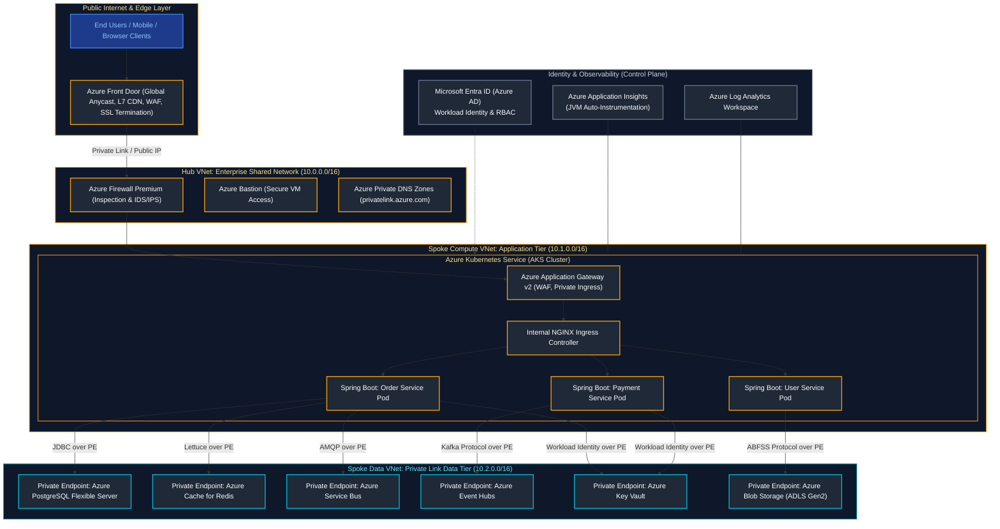

---

### 20.2 Cloud Computing Service Models: IaaS vs PaaS vs CaaS vs FaaS

| Cloud Service Model | Vendor-Managed Infrastructure Layer | Customer-Managed Application Layer | Representative Azure Service | Primary Enterprise Benefit |
| :--- | :--- | :--- | :--- | :--- |
| **IaaS (Infrastructure as a Service)** | Physical Datacenter, Power, Hardware, Hypervisor | Virtual Machine OS, OS Patching, Network Routing, Java Runtime, Spring Boot App, Data | Azure Virtual Machines (VMs), Azure Virtual Network (VNet) | Maximum control over low-level kernel, OS libraries, and legacy software configurations. |
| **CaaS (Containers as a Service)** | Hardware, Hypervisor, K8s Control Plane (API Server, etcd), Worker Node VM OS | Docker / OCI Container Images, Helm Charts, K8s Deployments, Service Mesh, Spring Boot Pods | Azure Kubernetes Service (AKS), Azure Container Apps (ACA) | Portable microservice orchestration, dynamic horizontal pod autoscaling (HPA), and declarative GitOps. |
| **PaaS (Platform as a Service)** | Hardware, OS, Kernel Patching, Java JDK Runtime, Web Server Container | Spring Boot Executable JAR / WAR, Application Code, Database Schemas | Azure App Service (Linux Java 21), Azure Spring Apps Enterprise | Zero VM or OS maintenance overhead; built-in automated TLS certificates and blue-green deployment slots. |
| **FaaS (Function as a Service / Serverless)** | Everything: Hardware, OS, Runtime, Scaling to Zero, Event Trigger Plumbing | Isolated Individual Java Function Methods (`apply()`, `accept()`) | Azure Functions (Java Worker), AWS Lambda | True pay-per-execution billing; automated event-driven scale-to-zero for unpredictable bursts. |

---

### 20.3 High Availability (HA), Availability Zones (AZ), Disaster Recovery (DR, RPO, RTO)

- **Availability Zones (AZ)**: Physically separate data centers within an Azure region equipped with independent power, cooling, and networking. AKS node pools and Azure SQL instances deploy across 3 AZs to survive complete data center outages.
- **RPO (Recovery Point Objective)**: Maximum acceptable duration of data loss measured in time (e.g., RPO = 0 with synchronous database replication; RPO = 5 minutes with asynchronous cross-region storage replication).
- **RTO (Recovery Time Objective)**: Maximum acceptable duration of system downtime before service is restored (e.g., RTO = 15 minutes with automated DNS failover via Azure Front Door).

---

### 20.4 Azure Core Services Breakdown for Java Backends

| Azure Service | Category | Protocol / Engine | Primary Role in Java Backend Architecture |
| :--- | :--- | :--- | :--- |
| **Azure Kubernetes Service (AKS)** | Compute (CaaS) | OCI / containerd | Orchestrating microservice container pods with autoscaling and VNet integration |
| **Azure Container Registry (ACR)** | Registry | OCI / Docker v2 | Secure, geo-replicated private container image storage with automated vulnerability scanning |
| **Azure Database for PostgreSQL** | Database (PaaS) | PostgreSQL 16 | ACID transactional relational database with high availability and automated backups |
| **Azure Cosmos DB** | Database (NoSQL) | SQL / Mongo / Cassandra | Globally distributed, multi-model NoSQL database providing single-digit millisecond latency |
| **Azure Cache for Redis** | Caching | Redis 7.2 | High-throughput in-memory cache for distributed session stores and database offloading |
| **Azure Service Bus** | Messaging | AMQP 1.0 / JMS 2.0 | Enterprise transactional message broker with FIFO queues, topics, sessions, and dead-lettering |
| **Azure Event Hubs** | Event Streaming | Apache Kafka Protocol | High-throughput distributed event ingestion platform handling millions of events/sec |
| **Azure Key Vault** | Security | REST / HTTPS | HSM-backed vault for cryptographic keys, TLS certificates, and database secrets |
| **Azure Application Insights** | Observability (APM) | OpenTelemetry / Java Agent | Distributed tracing, live metrics, JVM memory profiling, and exception tracking |

---

### 20.5 Azure Service Bus vs Azure Event Hubs: Deep Architectural Comparison

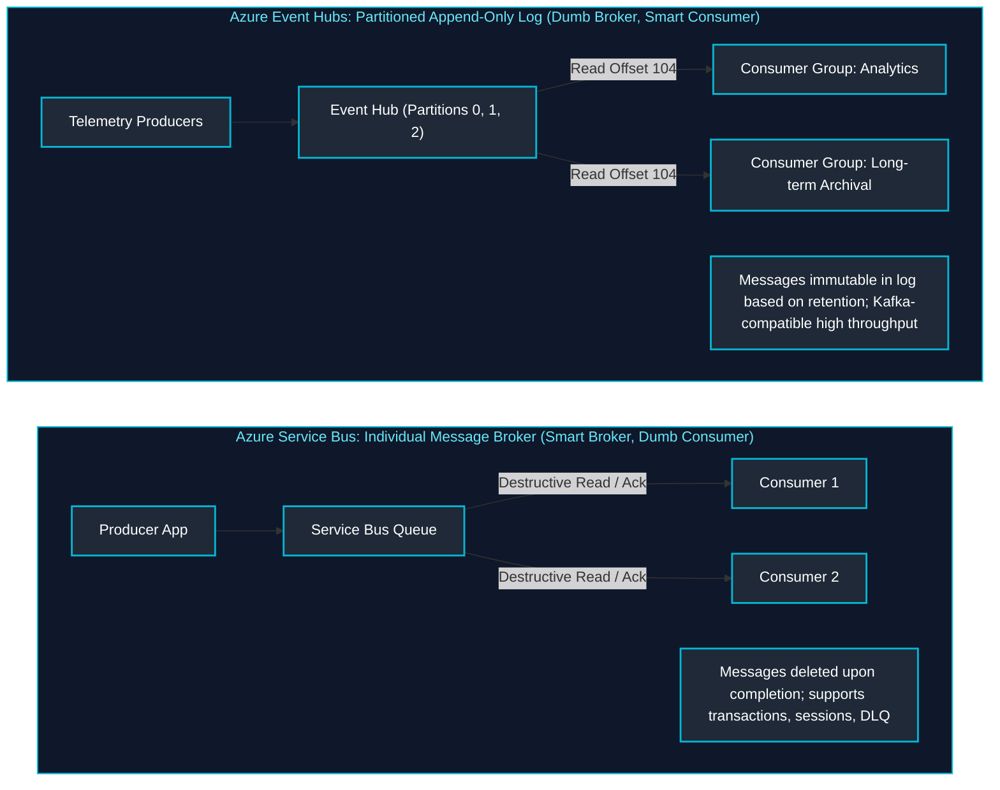

| Architectural Dimension | Azure Service Bus | Azure Event Hubs |
| :--- | :--- | :--- |
| **Messaging Paradigm** | Enterprise Message Broker (Queues & Topics) | Partitioned Event Streaming Log (Kafka-compatible) |
| **Consumption Model** | Competing consumers pull individual messages; broker deletes on ACK | Partition consumers track read offsets; messages persist in log |
| **Ordering Guarantee** | Guaranteed per Message Session across consumers | Guaranteed per Partition strictly |
| **Throughput Capacity** | Thousands of messages per second | Millions of events per second (Gigabytes/sec) |
| **Message Size Limit** | Up to 100 MB (Premium tier) | Up to 1 MB per event |
| **Dead-Letter Queue (DLQ)** | Built-in native automatic Dead-Letter Queue support | No native DLQ; consumer must handle unparseable payloads |
| **Best Java Use Case** | Financial orders, payment workflows, transactional job processing | Clickstream telemetry, IoT event streams, CDC change streams |

---

### 20.6 Identity & Zero-Trust Security: Microsoft Entra ID & Workload Identity on AKS

Hardcoding database passwords or API keys in configuration files is a critical vulnerability. Azure **Workload Identity** federates Kubernetes ServiceAccounts with **Microsoft Entra ID (Azure AD)** using OpenID Connect (OIDC):

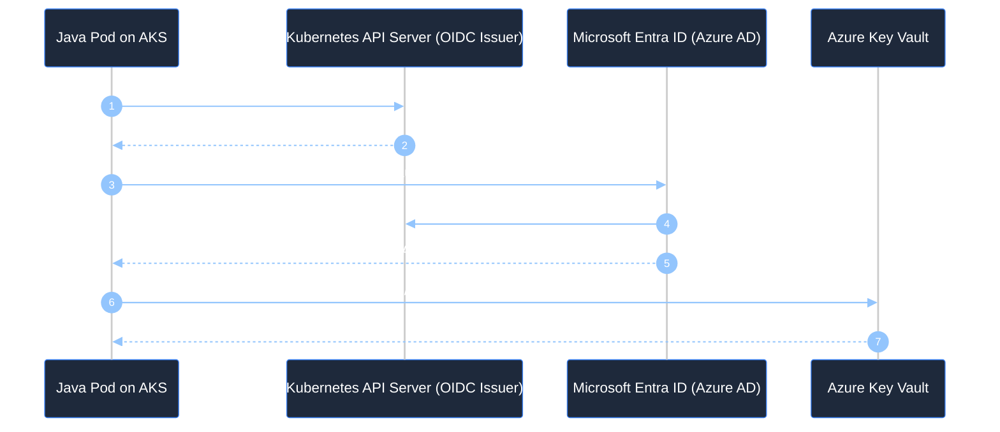

#### Production Java Code: Zero-Credential Key Vault Access via `DefaultAzureCredential`

```java
package com.company.security;

import com.azure.identity.DefaultAzureCredentialBuilder;
import com.azure.security.keyvault.secrets.SecretClient;
import com.azure.security.keyvault.secrets.SecretClientBuilder;
import com.azure.security.keyvault.secrets.models.KeyVaultSecret;
import org.springframework.beans.factory.annotation.Value;
import org.springframework.context.annotation.Bean;
import org.springframework.context.annotation.Configuration;

@Configuration
public class AzureSecurityConfig {

    @Value("${azure.keyvault.uri:https://kv-enterprise-prod.vault.azure.net/}")
    private String keyVaultUri;

    @Bean
    public SecretClient secretClient() {
        // DefaultAzureCredential seamlessly probes:
        // 1. Environment variables (AZURE_CLIENT_ID, AZURE_TENANT_ID)
        // 2. Workload Identity on AKS
        // 3. Managed Identity on Azure VMs / App Service
        // 4. Azure CLI credentials during local development
        return new SecretClientBuilder()
            .vaultUrl(keyVaultUri)
            .credential(new DefaultAzureCredentialBuilder().build())
            .buildClient();
    }

    public String fetchSecret(SecretClient client, String secretName) {
        KeyVaultSecret secret = client.getSecret(secretName);
        return secret.getValue();
    }
}
```

---

### 20.7 Virtual Networks (VNets), Hub-and-Spoke Peering & Azure Private Link Endpoints

In an enterprise topology:
1. **Hub-and-Spoke Peering**: The Hub VNet contains shared services (Azure Firewall, Bastion, ExpressRoute to on-premises). Spoke VNets peer with the Hub, routing all egress traffic through the firewall.
2. **Azure Private Link**: Replaces public internet routing with **Private Endpoints (PE)**. Each PaaS resource (Azure SQL, Cosmos DB, Key Vault, ACR) receives a private IP address within the Spoke VNet subnet. Public internet access is completely disabled.

---

### 20.8 Complete Infrastructure as Code (Terraform) for Azure Java Platform

```hcl
# main.tf - Production Microsoft Azure Java Platform Infrastructure
terraform {
  required_version = ">= 1.6.0"
  required_providers {
    azurerm = {
      source  = "hashicorp/azurerm"
      version = "~> 3.90.0"
    }
  }
}

provider "azurerm" {
  features {}
}

# Resource Group
resource "azurerm_resource_group" "rg" {
  name     = "rg-enterprise-prod-eastus"
  location = "East US"
  tags = {
    Environment = "Production"
    ManagedBy   = "Terraform"
  }
}

# Virtual Network & Subnets
resource "azurerm_virtual_network" "vnet" {
  name                = "vnet-enterprise-prod"
  resource_group_name = azurerm_resource_group.rg.name
  location            = azurerm_resource_group.rg.location
  address_space       = ["10.100.0.0/16"]
}

resource "azurerm_subnet" "aks_subnet" {
  name                 = "snet-aks-nodes"
  resource_group_name  = azurerm_resource_group.rg.name
  virtual_network_name = azurerm_virtual_network.vnet.name
  address_prefixes     = ["10.100.1.0/24"]
}

resource "azurerm_subnet" "pe_subnet" {
  name                 = "snet-private-endpoints"
  resource_group_name  = azurerm_resource_group.rg.name
  virtual_network_name = azurerm_virtual_network.vnet.name
  address_prefixes     = ["10.100.2.0/24"]
}

# Azure Container Registry (ACR)
resource "azurerm_container_registry" "acr" {
  name                = "acrenterpriseprod001"
  resource_group_name = azurerm_resource_group.rg.name
  location            = azurerm_resource_group.rg.location
  sku                 = "Premium"
  admin_enabled       = false
}

# Azure Kubernetes Service (AKS) with Azure CNI & OIDC Workload Identity
resource "azurerm_kubernetes_cluster" "aks" {
  name                = "aks-enterprise-prod"
  resource_group_name = azurerm_resource_group.rg.name
  location            = azurerm_resource_group.rg.location
  dns_prefix          = "aks-enterprise-prod"
  kubernetes_version  = "1.28.5"

  oidc_issuer_enabled       = true
  workload_identity_enabled = true

  default_node_pool {
    name                = "systempool"
    node_count          = 3
    vm_size             = "Standard_D4s_v5"
    vnet_subnet_id      = azurerm_subnet.aks_subnet.id
    zones               = ["1", "2", "3"]
    enable_auto_scaling = true
    min_count           = 3
    max_count           = 6
  }

  identity {
    type = "SystemAssigned"
  }

  network_profile {
    network_plugin    = "azure"
    load_balancer_sku = "standard"
  }
}

# Role Assignment: Allow AKS to pull images from ACR
resource "azurerm_role_assignment" "aks_acr_pull" {
  scope                = azurerm_container_registry.acr.id
  role_definition_name = "AcrPull"
  principal_id         = azurerm_kubernetes_cluster.aks.kubelet_identity[0].object_id
}

# Azure Key Vault with RBAC
resource "azurerm_key_vault" "kv" {
  name                      = "kv-enterprise-prod-001"
  resource_group_name       = azurerm_resource_group.rg.name
  location                  = azurerm_resource_group.rg.location
  sku_name                  = "premium"
  tenant_id                 = data.azurerm_client_config.current.tenant_id
  enable_rbac_authorization = true
  purge_protection_enabled  = true
}

data "azurerm_client_config" "current" {}
```

---

### 20.9 Azure CLI (`az`) Commands Cheatsheet & Administration Reference

| Command & Syntax | Key Flags Explained | What Does What | Practical Operational Scenario |
| :--- | :--- | :--- | :--- |
| `az login` | `--use-device-code`: Use browser authentication on headless server | Authenticates developer or admin session with Microsoft Entra ID | Initial login before executing Azure CLI operations |
| `az aks get-credentials --resource-group <rg> --name <aks>` | `--admin`: Fetch cluster admin credentials<br>`--overwrite-existing`: Update local kubeconfig | Merges AKS cluster endpoint and authentication tokens into local `~/.kube/config` | Connecting local `kubectl` client to target AKS cluster |
| `az acr build --registry <acr> --image myapp:1.0 .` | `--registry`: Target ACR registry name<br>`-f`: Path to Dockerfile | Uploads build context and builds Docker image remotely inside Azure cloud | Building container images without running local Docker daemon |
| `az keyvault secret set --vault-name <kv> --name db-pass --value secret` | `--vault-name`: Key Vault resource name | Securely creates or updates a secret value in Azure Key Vault | Storing sensitive database credentials or API keys |
| `az keyvault secret show --vault-name <kv> --name db-pass --query value -o tsv` | `--query`: JMESPath query filter<br>`-o tsv`: Plaintext tab-separated output | Retrieves and prints plaintext secret value from Azure Key Vault | Verifying that secret exists or extracting it for local script |
| `az monitor app-insights query --app <app-id> --analytics-query "..."` | `--analytics-query`: Kusto Query Language (KQL) | Executes live KQL query against Application Insights telemetry | Querying slow HTTP transactions or 5xx error spikes |
| `az network private-endpoint create ...` | `--connection-name`: Private Link connection identifier | Provisions a Private Endpoint attaching PaaS resource to internal VNet | Isolating database or Key Vault from the public internet |
| `az group list --query "[].{Name:name, Region:location}" -o table` | `-o table`: Format output in human-readable ASCII table | Displays summary inventory of all Azure Resource Groups | Auditing cloud resource allocation across subscriptions |

> [!TIP]
> **Deep-Dive Interview Scenarios:**
> - [Q7. Azure Resource Hierarchy & Resource Groups](frequently_asked_questions/10_cloud_devops_and_observability_faq.md#q7-azure-resource-hierarchy--resource-groups)
> - [Q8. Azure Identity: IAM Roles, Managed Identities & Service Principals](frequently_asked_questions/10_cloud_devops_and_observability_faq.md#q8-azure-identity-iam-roles-managed-identities--service-principals)
> - [Q9. Azure Storage (Blob vs Files) & Queues (Service Bus vs Storage Queue)](frequently_asked_questions/10_cloud_devops_and_observability_faq.md#q9-azure-storage-blob-vs-files--queues-service-bus-vs-storage-queue)
> - [Q10. Azure Load Balancer Architecture & Types](frequently_asked_questions/10_cloud_devops_and_observability_faq.md#q10-azure-load-balancer-architecture--types)
> - [Q11. Horizontal vs Vertical Scaling in Azure](frequently_asked_questions/10_cloud_devops_and_observability_faq.md#q11-horizontal-vs-vertical-scaling-in-azure)
> - [Q12. Azure Compute Models (VM vs App Service vs Functions vs AKS) & Zero-Downtime Deployments](frequently_asked_questions/10_cloud_devops_and_observability_faq.md#q12-azure-compute-models-vm-vs-app-service-vs-functions-vs-aks--zero-downtime-deployments)
> - [Q13. Azure Compliance, Governance & Secret Management](frequently_asked_questions/10_cloud_devops_and_observability_faq.md#q13-azure-compliance-governance--secret-management)
> - [Q14. AWS Virtual Private Cloud (VPC) & Network Resource Isolation](frequently_asked_questions/10_cloud_devops_and_observability_faq.md#q14-aws-virtual-private-cloud-vpc--network-resource-isolation)
> - [Q16. Core AWS Services Integration in Enterprise Java Backend Engineering](frequently_asked_questions/10_cloud_devops_and_observability_faq.md#q16-core-aws-services-integration-in-enterprise-java-backend-engineering)
> - [Q17. Production Kubernetes Architecture for Java Microservices: Memory Limits & cgroups v2](frequently_asked_questions/10_cloud_devops_and_observability_faq.md#q17-production-kubernetes-architecture-for-java-microservices-memory-limits--cgroups-v2)
> - [Q18. Local and Remote Debugging via JDWP & Port Distinctions](frequently_asked_questions/10_cloud_devops_and_observability_faq.md#q18-local-and-remote-debugging-via-jdwp--port-distinctions)

---

# 21. From Source Code to Native Execution: The Life of a Java Class

---

### 21.1 The JVM Execution Mental Model

To understand how Java achieves platform independence while matching native C++ execution speeds, an engineer must visualize the complete transformation pipeline:

1. **Compilation Phase (`javac`)**: The Java compiler reads `.java` source code, performs syntax verification, type-checking, and translates human-readable statements into architecture-neutral **bytecode** stored in `.class` files.
2. **Loading & Linking Phase**: The JVM ClassLoader subsystem reads bytecode into native process memory, validates its safety constraints, and initializes class definitions.
3. **Execution Phase**:
   * **Interpreter**: Begins executing bytecode immediately, instruction by instruction, ensuring zero startup lag.
   * **JIT Profiler**: Monitors method invocations and loop iterations. Code that executes thousands of times ("hot code") is flagged for compilation.
   * **Just-In-Time (JIT) Compiler**: Translates hot bytecode into raw, highly optimized host machine assembly instructions, writing them directly into the **Code Cache**. Future calls execute at bare-metal native CPU speed!

---

### 21.2 Bytecode Disassembly & Instruction Set Architecture (`javap`)

The JVM is an **abstract stack-based computer**. Unlike x86 or ARM CPUs that operate directly on physical hardware registers, JVM instructions push operands onto and pop operands off an internal **Operand Stack**.

#### Anatomy of a `.class` Binary File:
Every compiled Java class conforms to a strict binary layout specified in the JVM Specification (§4):

| Field Type | Field Name | Width / Size | JVM Specification (§4) Purpose & Format |
| :--- | :--- | :---: | :--- |
| `u4` | `magic` | 4 Bytes | `0xCAFEBABE` (Mandatory binary file format identifier). |
| `u2` | `minor_version` | 2 Bytes | Minor class format version (e.g. `0`). |
| `u2` | `major_version` | 2 Bytes | Major bytecode version: `52` (Java 8), `61` (Java 17), `65` (Java 21). |
| `u2` | `constant_pool_count` | 2 Bytes | Length of the constant pool symbol array $+ 1$. |
| `cp_info[]` | `constant_pool` | Variable | Symbol table storing string literals, class symbols, method refs, and descriptors. |
| `u2` | `access_flags` | 2 Bytes | Modifier bitmasks: `ACC_PUBLIC`, `ACC_FINAL`, `ACC_SUPER`, `ACC_INTERFACE`. |
| `u2` | `this_class` | 2 Bytes | Constant pool index pointing to `CONSTANT_Class_info` of this class. |
| `u2` | `super_class` | 2 Bytes | Constant pool index pointing to `CONSTANT_Class_info` of direct superclass. |
| `u2` | `interfaces_count` | 2 Bytes | Number of direct superinterfaces implemented by this class. |
| `u2[]` | `interfaces` | Variable | Array of constant pool indices representing implemented interfaces. |
| `u2` | `fields_count` | 2 Bytes | Count of fields declared directly within this class. |
| `field_info[]` | `fields` | Variable | Field metadata: names, type descriptors, access flags, and attributes. |
| `u2` | `methods_count` | 2 Bytes | Count of methods declared directly within this class. |
| `method_info[]`| `methods` | Variable | Method metadata, parameters, descriptors, and bytecode `Code` attribute. |
| `u2` | `attributes_count` | 2 Bytes | Count of class-level attributes. |
| `attribute_info[]` | `attributes` | Variable | Class metadata: `SourceFile`, `InnerClasses`, `BootstrapMethods`, `NestMembers`. |

#### Inspecting Bytecode with `javap -c -v`
Consider this simple calculation:
```java
public class Calculator {
    public int addAndMultiply(int a, int b) {
        int sum = a + b;
        return sum * 2;
    }
}
```

Running `javap -c -v Calculator.class` reveals the underlying JVM assembly opcodes:

```text
public int addAndMultiply(int, int);
  Code:
   stack=2, locals=4, args_size=3
      0: iload_1          // Push parameter 'a' (local variable slot 1) onto Operand Stack
      1: iload_2          // Push parameter 'b' (local variable slot 2) onto Operand Stack
      2: iadd             // Pop two ints, add them, and push the result onto Operand Stack
      3: istore_3         // Pop sum result and store it into local variable slot 3 ('sum')
      4: iload_3          // Push 'sum' back onto Operand Stack
      5: iconst_2         // Push constant int 2 onto Operand Stack
      6: imul             // Pop two ints, multiply them, push result onto Operand Stack
      7: ireturn          // Return the top int from the Operand Stack to the caller
```

#### The 5 Primary JVM Method Invocation Opcodes:
* **`invokestatic`**: Dispatches a `static` method. Resolved statically at compile time; requires no object instance.
* **`invokespecial`**: Dispatches private methods, instance constructors (`<init>`), and `super` calls. Bound non-polymorphically.
* **`invokevirtual`**: Standard dynamic method dispatch for public/protected instance methods. Traverses the object's `vtable` at runtime based on the actual heap object type.
* **`invokeinterface`**: Dispatches methods declared in interfaces. Uses an `itable` lookup (slightly more dynamic than `vtable`).
* **`invokedynamic` (Indy - JSR 292)**: Introduced in Java 7, foundational to Java 8+ lambdas and string concatenation. Defers method linkage to a user-defined Bootstrap Method (BSM) executed dynamically at runtime.

#### The `StackMapTable` Attribute & Linear-Time Verification:
Prior to Java 6, JVM bytecode verification relied on expensive dataflow type inference algorithms that computed stack states iteratively, incurring significant startup lag.
* In modern JVMs, `javac` generates a **`StackMapTable`** attribute embedded directly in the `Code` attribute of each method.
* The table contains type frames explicitly declaring the exact types present in every local variable slot and operand stack entry at every jump or branch target.
* The JVM verifier checks bytecode safety in **$O(N)$ linear time** simply by validating that instructions transition from one precomputed frame to the next without violating constraints.

#### Programmatic Runtime Bytecode Generation with ByteBuddy:
Modern enterprise frameworks (Spring Boot, Hibernate, Mockito) generate raw JVM bytecode directly in memory without disk compilation:

```java
package com.enterprise.jvm.bytecode;

import net.bytebuddy.ByteBuddy;
import net.bytebuddy.implementation.bytecode.ByteCodeAppender;
import net.bytebuddy.implementation.Implementation;
import net.bytebuddy.jar.asm.Opcodes;
import net.bytebuddy.matcher.ElementMatchers;

public class DynamicCalculatorGenerator {

    public interface FastMath {
        int multiplyByTen(int value);
    }

    public static FastMath generateFastMathInstance() throws Exception {
        // Dynamically synthesize a new Class at runtime implementing FastMath
        Class<? extends FastMath> dynamicType = new ByteBuddy()
                .subclass(FastMath.class)
                .name("com.enterprise.jvm.generated.FastMathImpl")
                .method(ElementMatchers.named("multiplyByTen"))
                .intercept(new Implementation.Simple(new ByteCodeAppender() {
                    @Override
                    public Size apply(net.bytebuddy.jar.asm.MethodVisitor mv,
                                      Implementation.Context context,
                                      net.bytebuddy.description.method.MethodDescription method) {
                        // Emit raw JVM bytecode instructions directly:
                        mv.visitVarInsn(Opcodes.ILOAD, 1);  // Load parameter 'value'
                        mv.visitIntInsn(Opcodes.BIPUSH, 10); // Push constant 10
                        mv.visitInsn(Opcodes.IMUL);          // Multiply
                        mv.visitInsn(Opcodes.IRETURN);       // Return integer
                        return new Size(2, 2);               // Max stack=2, locals=2
                    }
                }))
                .make()
                .load(FastMath.class.getClassLoader())
                .getLoaded();

        return dynamicType.getDeclaredConstructor().newInstance();
    }
}
```

---

### 21.3 The ClassLoader Subsystem & Parent Delegation Model

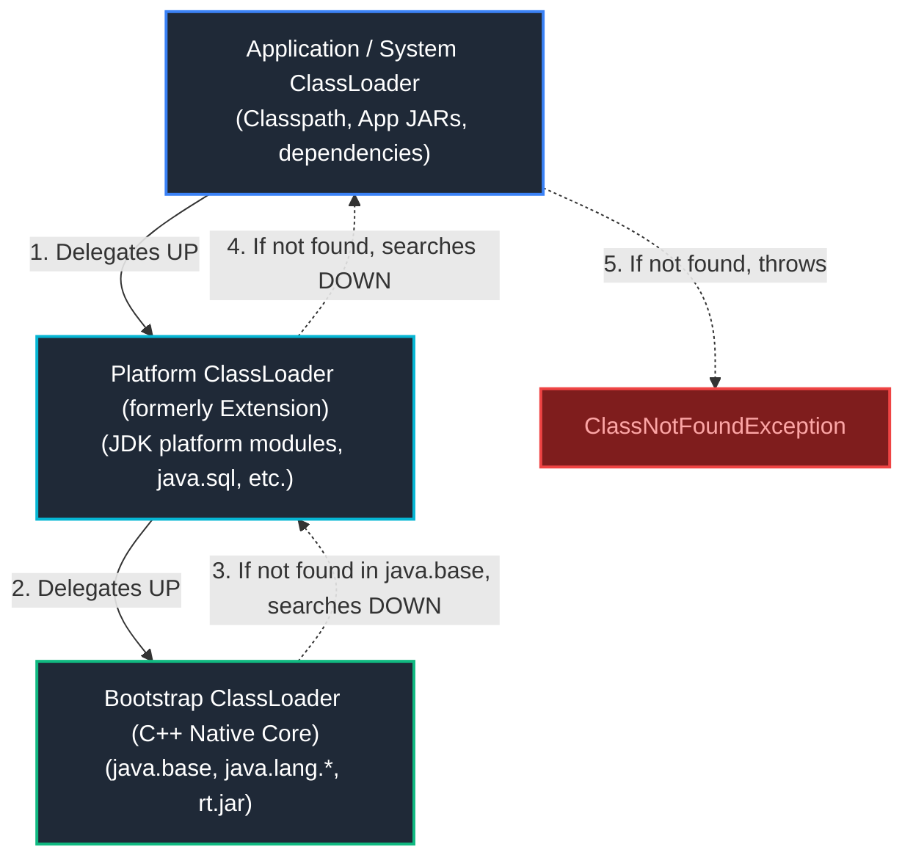

#### The 3 Stages of Class Loading:
1. **Loading**:
   * Reads raw `.class` binary bytes from a filesystem, JAR archive, or network stream.
   * Parses the binary stream into JVM internal metadata structures in **Metaspace**.
   * Creates a `java.lang.Class` object in the Heap to represent the type in user code.
2. **Linking**:
   * **Verification**: Rigorously analyzes bytecode to guarantee it does not violate JVM security constraints, overflow stack frames, or attempt illegal type conversions.
   * **Preparation**: Allocates memory for `static` fields and assigns them **default machine zero values** (`0`, `0.0`, `false`, `null`). *Note: Explicit code assignments do not happen here!*
   * **Resolution**: Replaces symbolic constant pool references (e.g. string names of classes and methods) with direct, physical memory pointers.
3. **Initialization (`<clinit>`)**:
   * Executes static field initializers and `static { ... }` blocks in textual order.
   * Guaranteed to be thread-safe by the JVM: the JVM acquires an internal initialization lock on the `Class` object during `<clinit>`, ensuring static initialization blocks execute strictly once.

#### Why Parent Delegation Protects Security:
Without the parent delegation model, an attacker could package a rogue class named `java.lang.String` or `java.lang.SecurityManager` inside a dependency JAR. Because child ClassLoaders always delegate upwards first, the Bootstrap ClassLoader intercepts the request, loads the authentic JDK `String`, and completely ignores the malicious counterpart!

---

### 21.4 Custom ClassLoaders & ClassLoader Memory Leaks

By subclassing `java.lang.ClassLoader`, developers can customize bytecode loading (e.g., loading encrypted JARs, hot-reloading code in development, or plugin architectures):

```java
package com.enterprise.classloader;

import java.io.IOException;
import java.nio.file.Files;
import java.nio.file.Path;

public class EncryptedDiskClassLoader extends ClassLoader {

    private final Path classDirectory;

    public EncryptedDiskClassLoader(Path classDirectory, ClassLoader parent) {
        super(parent); // Maintains parent delegation!
        this.classDirectory = classDirectory;
    }

    @Override
    protected Class<?> findClass(String name) throws ClassNotFoundException {
        try {
            String fileName = name.replace('.', '/') + ".class";
            Path filePath = classDirectory.resolve(fileName);

            if (!Files.exists(filePath)) {
                throw new ClassNotFoundException("Class not found: " + name);
            }

            byte[] encryptedBytes = Files.readAllBytes(filePath);
            byte[] decryptedBytes = decrypt(encryptedBytes); // Custom decryption algorithm

            // defineClass converts raw bytes into a live Class metadata instance in Metaspace!
            return defineClass(name, decryptedBytes, 0, decryptedBytes.length);
        } catch (IOException e) {
            throw new ClassNotFoundException("Failed to read class bytes", e);
        }
    }

    private byte[] decrypt(byte[] bytes) {
        // Simple XOR decryption demonstration
        byte[] result = new byte[bytes.length];
        for (int i = 0; i < bytes.length; i++) {
            result[i] = (byte) (bytes[i] ^ 0x5A);
        }
        return result;
    }
}
```

#### The ClassLoader Memory Leak Hazard:
In application servers (Tomcat, WebLogic), deploying and undeploying web applications requires creating and discarding ClassLoaders.
* A class loaded by a custom ClassLoader holds an implicit reference back to its `ClassLoader`.
* The `ClassLoader` holds a reference to every single `Class` it loaded.
* Every `Class` holds references to all its `static` variables.
* If a static variable holds a thread, or if a thread pool retains an instance of a class loaded by that ClassLoader (e.g. via a lingering `ThreadLocal`), **the entire ClassLoader and all its loaded classes cannot be garbage collected**!
* Repeated application redeployments cause rapid exhaustion of native memory $\to$ **`java.lang.OutOfMemoryError: Metaspace`**.

---

# 22. JVM Memory Layout & Runtime Data Areas

---

### 22.1 Heap Memory Architecture (Generational Model & TLABs)

The JVM Heap is the shared memory pool holding all active object instances and arrays:

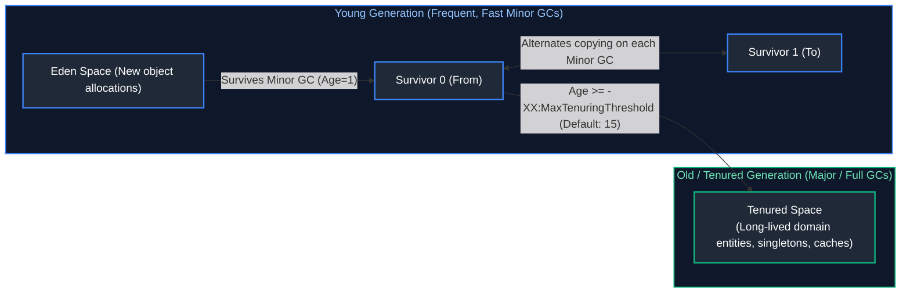

#### Thread-Local Allocation Buffers (TLAB):
In high-throughput enterprise systems with hundreds of concurrent threads, multiple threads allocating objects simultaneously on the shared heap would create massive lock contention.
* **The Solution**: HotSpot assigns each thread a dedicated chunk of Eden space called a **TLAB**.
* Inside its TLAB, a thread allocates memory via a simple, lock-free **bump-the-pointer** operation ($O(1)$) by incrementing a local memory pointer.
* Only when a thread's TLAB fills up does it acquire a synchronized lock to request a new buffer from Eden.

#### Object Layout in Heap Memory (JOL - Java Object Layout):
Every object instance stored on the JVM heap consists of three distinct segments:

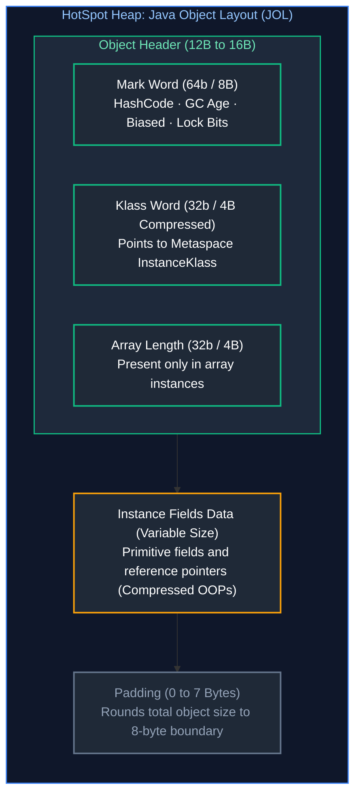

| Object Layout Segment | Bit / Byte Width | Lock State / Encoding Rules |
| :--- | :---: | :--- |
| **Mark Word: Unlocked** | 64 bits (8 Bytes) | 31-bit Identity HashCode · 4-bit GC Age ($0\text{--}15$) · 1-bit Biased Flag (`0`) · 2-bit State (`01`). |
| **Mark Word: Lightweight Lock** | 64 bits (8 Bytes) | 62-bit Pointer to Lock Record in thread execution stack · 2-bit State (`00`). |
| **Mark Word: Heavyweight Lock** | 64 bits (8 Bytes) | 62-bit Pointer to native C++ `ObjectMonitor` synchronization mutex · 2-bit State (`10`). |
| **Mark Word: Marked for GC** | 64 bits (8 Bytes) | Used internally during GC evacuation and compaction · 2-bit State (`11`). |
| **Klass Word** | 32 bits (4 Bytes) | Compressed pointer (`-XX:+UseCompressedClassPointers`) referencing Metaspace class metadata. |
| **Array Length** | 32 bits (4 Bytes) | Present strictly on array objects (`int[]`, `Object[]`), encoding element count. |
| **Instance Data** | Variable | Primitive fields (packed by size) followed by compressed 32-bit reference pointers. |
| **Alignment Padding** | $0\text{--}7$ Bytes | Round-up padding ensuring 8-byte memory boundary alignment. |

#### Compressed OOPs (Ordinary Object Pointers):
* On 64-bit architectures, raw memory pointers consume 8 bytes. For a heap with millions of small objects, pointer overhead consumes up to 40% of total heap RAM!
* **Compressed OOPs (`-XX:+UseCompressedOops`)**: HotSpot takes advantage of the fact that all objects are aligned to 8-byte boundaries (the lowest 3 bits of every memory address are always `000`).
* Instead of storing the full 64-bit byte address, the JVM shifts the 32-bit integer pointer left by 3 bits (`address << 3`).
* This enables 32-bit pointers to address up to:
  $$2^{32} \times 8\text{ bytes} = 32\text{ Gigabytes of Heap Memory!}$$
* *Production Rule*: As soon as `-Xmx` exceeds $\approx 31.5\text{ GB}$, the JVM automatically disables Compressed OOPs, causing memory efficiency to plunge! Running a 31 GB heap often yields more usable memory than running a 33 GB heap!

#### CPU Cache Lines, False Sharing & `@Contended`:
Modern CPUs transfer memory between RAM and L1/L2 caches in **64-byte Cache Lines**.
* **False Sharing**: If Thread A frequently mutates field `x` and Thread B frequently mutates field `y`, and both fields happen to reside on the same 64-byte cache line:
  * Whenever Thread A writes to `x`, the CPU hardware cache-coherence protocol (MESI) invalidates Thread B's entire L1 cache line!
  * Thread B stalls waiting for the cache line to reload from L3/RAM, causing severe throughput collapse despite zero logical lock contention.
* **Defense**: Add 128 bytes of padding or annotate critical fields with `@jdk.internal.vm.annotation.Contended` (requires `-XX:-RestrictContended`), forcing HotSpot to isolate the field onto its own private cache line.

---

### 22.2 JVM Thread Stacks: Stack Frames, Operand Stack & Local Variables

Each active Java thread possesses its own private execution stack. Every method invocation pushes a new **Stack Frame**, which is popped when the method returns or throws an unhandled exception:

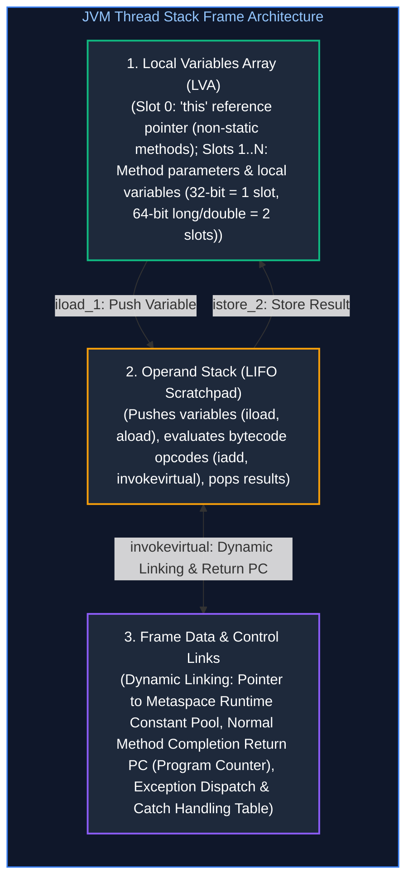

| Frame Subsystem | Data Structure / Sizing | Low-Level JVM Mechanics & Execution Invariants |
| :--- | :---: | :--- |
| **Local Variables Array (LVA)** | Array of 32-bit Slots | Pre-allocated at compile time (`max_locals`). Slot 0 holds `this` for instance methods. 64-bit primitives (`long`, `double`) span two consecutive slots. |
| **Operand Stack** | LIFO Word Stack | Working memory evaluated by execution engine (`max_stack`). Bytecode instructions push values, execute ALU arithmetic, and push return values. |
| **Dynamic Linking** | Constant Pool Symbolic Reference | Translates symbolic method calls (e.g. `#14 <Method java/lang/String.length()I>`) into concrete Metaspace function addresses upon first resolution. |
| **Normal / Exceptional Return** | Return Address & Exception Table | Restores caller's PC register on `ireturn`/`areturn`; scans method exception table for matching catch ranges upon unhandled throw. |

---

### 22.3 Metaspace: Off-Heap Class Metadata (Replacing PermGen)

Prior to Java 8, class metadata was stored in **PermGen (Permanent Generation)** inside the contiguous JVM heap. PermGen had a fixed maximum size (`-XX:MaxPermSize`), making enterprise applications notoriously prone to `OutOfMemoryError: PermGen space`.

Java 8 completely removed PermGen, replacing it with **Metaspace**:
* **Off-Heap Native Memory**: Metaspace resides in native operating system RAM, completely outside the JVM heap.
* **Auto-Scaling**: By default, Metaspace dynamically expands as needed up to physical host RAM limits.
* **Guardrails in Containers**: In Docker/Kubernetes environments, an unbounded Metaspace will trigger Linux kernel Out-Of-Memory (OOM) killer terminating the container. Always configure a ceiling in production:
  ```bash
  -XX:MetaspaceSize=128m -XX:MaxMetaspaceSize=512m
  ```

---

### 22.4 Code Cache & JIT Compilation Tiers (Interpreter $\to$ C1 $\to$ C2)

HotSpot utilizes **Tiered Compilation** (`-XX:+TieredCompilation`, enabled by default):

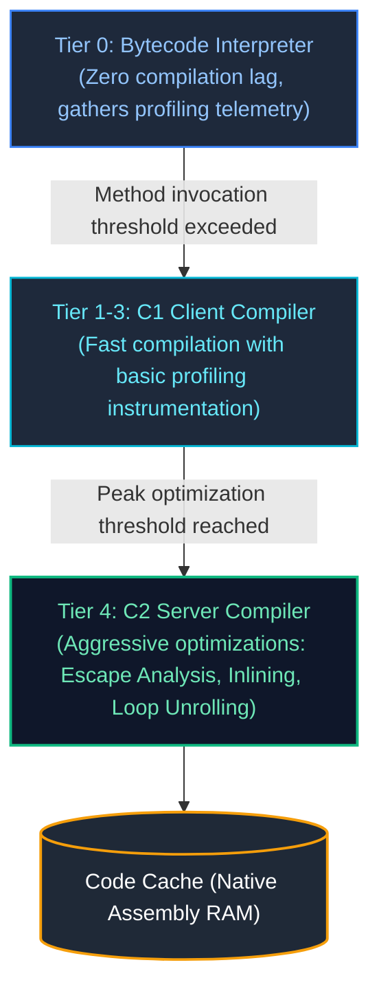

* **Method Inlining**: C2 replaces method calls with the actual method bytecode, eliminating call stack overhead.
* **Dead Code Elimination & Loop Unrolling**: Removes unreachable conditional branches and unrolls loops for SIMD vectorization.
* **Deoptimization**: If runtime assumptions change (e.g. a second concrete class violates monomorphic inlining assumptions), C2 invalidates the compiled assembly and deoptimizes execution back to interpreted code!

---

### 22.5 Direct Memory & Native Off-Heap Storage

* **Direct Memory (`ByteBuffer.allocateDirect(size)`)**: Allocates native memory buffers outside the JVM heap using native OS `malloc()`.
* **Why Use Off-Heap Memory?**: Bypasses Garbage Collector overhead completely. High-performance messaging engines (Apache Kafka, Netty) store gigabytes of network buffers off-heap, avoiding GC pauses during high-throughput I/O.
* **Configuration**: Governed by `-XX:MaxDirectMemorySize=2g`.

---

# 23. Garbage Collection (GC) Internals & Algorithms

---

### 23.1 The Weak Generational Hypothesis

The architecture of modern Java Garbage Collectors is derived from an empirical rule observed across decades of enterprise computing:
1. **The vast majority of objects die shortly after allocation** (e.g., local strings, request DTOs, stream iterators).
2. **Objects that survive multiple GC cycles tend to live for a very long time** (e.g., Spring singletons, connection pools, long-lived caches).

Therefore, segregating memory into **Young Generation** (collected frequently with fast algorithms) and **Old Generation** (collected infrequently) optimizes overall CPU efficiency.

---

### 23.2 Tracing GC: GC Roots Reachability vs Reference Counting

Java uses **Tracing Garbage Collection** based on **GC Roots Reachability**:

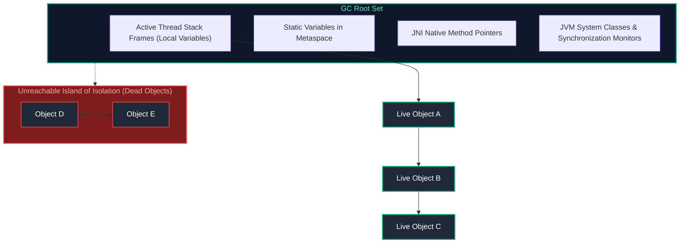

* An object is alive if and only if there is an unbroken chain of references from at least one **GC Root**.
* Notice that Objects D and E point to each other in a circular reference. Under primitive **Reference Counting**, their reference count is 1, so they would never be collected (a severe memory leak). Under HotSpot's **Reachability Analysis**, because no GC Root reaches them, they are reclaimed cleanly!

---

### 23.3 Core GC Algorithms: Mark-Copy, Mark-Sweep, and Mark-Compact

1. **Mark-Copy (Used in Young Generation)**:
   * Traces live objects from Eden and the active Survivor space (`From`).
   * Copies surviving objects into the alternate Survivor space (`To`), packing them contiguously.
   * Clears Eden and `From` in a single bulk operation. Extremely fast; zero memory fragmentation.
2. **Mark-Sweep**:
   * Identifies and marks live objects; sweeps dead objects leaving their memory slots available in a free-list.
   * *Drawback*: Causes severe **memory fragmentation**. Large contiguous arrays cannot be allocated even if total free memory is sufficient.
3. **Mark-Compact (Used in Old Generation)**:
   * Marks live objects, sweeps dead ones, and slides all surviving objects to the beginning of the memory space, creating a single contiguous block of free memory. Eliminates fragmentation.

---

### 23.4 Stop-The-World (STW) Pauses, Safepoints & Time-To-Safepoint (TTSP)

* **Stop-The-World (STW)**: A pause phase during which all application threads are suspended so the collector can safely mutate object references and compact memory without race conditions.
* **Safepoints**: Application threads check a dedicated safepoint polling memory page at loop branches and method exits. When a GC pause is requested, the JVM protects the polling page, triggering a thread signal that halts threads safely.
* **TTSP (Time-To-Safepoint) Spikes**: If a thread is executing an intensive uncounted counted loop, older JIT compilers may not inject a safepoint poll inside the loop. All other threads pause immediately, but the GC cannot begin until the rogue thread finishes its loop, causing latency spikes! (Resolved in modern JVMs with loop strip-mining).

---

### 23.5 Deep-Dive into Modern Collectors: G1, ZGC, Shenandoah, and Parallel

```mermaid
flowchart TD
    GCs["<b>HotSpot Garbage Collectors</b><br/>Java Virtual Machine memory management"]

    subgraph ThroughputZone ["Throughput-Optimized (Batch Jobs)"]
        direction TB
        Parallel["<b>Parallel GC</b> (-XX:+UseParallelGC)<br/>Max throughput, stop-the-world pauses acceptable"]
    end

    subgraph LowLatencyZone ["Low-Latency & Balance (General Web APIs)"]
        direction TB
        G1["<b>G1 GC</b> (-XX:+UseG1GC)<br/>Default since Java 9; regional incremental compaction"]
    end

    subgraph UltraLowLatencyZone ["Sub-Millisecond Pauses (Large Heaps > 32GB)"]
        direction TB
        ZGC["<b>ZGC</b> (-XX:+UseZGC)<br/>Generational in Java 21; concurrent color pointers"]
        Shenandoah["<b>Shenandoah GC</b> (-XX:+UseShenandoahGC)<br/>Concurrent Brooks forwarding pointers"]
    end

    GCs --> ThroughputZone
    GCs --> LowLatencyZone
    GCs --> UltraLowLatencyZone

    style GCs fill:#0f172a,stroke:#3b82f6,stroke-width:2px,color:#93c5fd
    style ThroughputZone fill:#0f172a,stroke:#3b82f6,stroke-width:1.5px,color:#93c5fd
    style LowLatencyZone fill:#0f172a,stroke:#10b981,stroke-width:1.5px,color:#6ee7b7
    style UltraLowLatencyZone fill:#0f172a,stroke:#8b5cf6,stroke-width:1.5px,color:#c4b5fd
    style Parallel fill:#1e293b,stroke:#3b82f6,stroke-width:1.5px,color:#fff
    style G1 fill:#1e293b,stroke:#10b981,stroke-width:2px,color:#fff
    style ZGC fill:#1e293b,stroke:#8b5cf6,stroke-width:2px,color:#fff
    style Shenandoah fill:#1e293b,stroke:#8b5cf6,stroke-width:1.5px,color:#fff
```

#### 1. Garbage-First (G1) GC Internals
G1 splits the Heap into ~2048 dynamically assigned regions (ranging from 1 MB to 32 MB each, power of 2):
* **Dynamic Region Roles**: Regions are assigned roles dynamically: Eden (`E`), Survivor (`S`), Old (`O`), and Humongous (`H` - for objects exceeding 50% of a region size).
* **Remembered Sets (RSets) & Card Table**:
  * An RSet is associated with every region, recording which Old regions contain reference pointers pointing into this region.
  * When executing a Minor GC on Young regions, G1 scans only the RSets rather than the entire multi-gigabyte Old generation, dramatically reducing pause times!
  * Mutated references in the card table (512-byte blocks) are logged via post-write barriers into dirty card queues processed concurrently by refinement threads.
* **Snapshot-At-The-Beginning (SATB) Concurrent Marking**:
  * G1 takes a logical snapshot of the object graph at the beginning of marking.
  * If an application mutates a reference during concurrent marking, a pre-write barrier catches the old reference and pushes it to an SATB buffer so dead object reachability is evaluated consistently.
* **Mixed Collections**:
  * Triggered when the Old generation occupancy crosses `-XX:InitiatingHeapOccupancyPercent=45` (IHOP).
  * G1 collects all Young regions plus an incremental subset of the most garbage-dense Old regions to meet `-XX:MaxGCPauseMillis=200`.

#### 2. Generational Z Garbage Collector (ZGC) Internals
Finalized in Java 21 (JEP 439), Generational ZGC achieves **sub-millisecond maximum pause times** across heaps ranging from a few gigabytes to **16 Terabytes**:
* **Colored Pointers (Reference Metadata Embedding)**:
  ZGC uses reference pointers where the lower 44 bits hold the object's virtual memory address (supporting 16 TB address space), and the upper bits encode GC state flags:

```mermaid
flowchart LR
    subgraph PointerLayout ["ZGC 64-bit Colored Pointer Bitmask Layout"]
        direction LR
        Unused["Bits 48-63: Unused / Reserved (16 bits)"]
        Finalizable["Bit 47: Finalizable (1 bit)"]
        Remapped["Bit 46: Remapped (1 bit)"]
        Marked1["Bit 45: Marked1 (1 bit)"]
        Marked0["Bit 44: Marked0 (1 bit)"]
        Address["Bits 0-43: Object Virtual Address (44 bits = 16 TB Max Heap)"]
        Unused --- Finalizable --- Remapped --- Marked1 --- Marked0 --- Address
    end

    style PointerLayout fill:#0f172a,stroke:#3b82f6,stroke-width:1.5px,color:#93c5fd
    style Unused fill:#1e293b,stroke:#64748b,stroke-width:1.5px,color:#94a3b8
    style Finalizable fill:#1e293b,stroke:#f59e0b,stroke-width:1.5px,color:#fff
    style Remapped fill:#1e293b,stroke:#10b981,stroke-width:1.5px,color:#fff
    style Marked1 fill:#1e293b,stroke:#06b6d4,stroke-width:1.5px,color:#fff
    style Marked0 fill:#1e293b,stroke:#3b82f6,stroke-width:1.5px,color:#fff
    style Address fill:#1e293b,stroke:#8b5cf6,stroke-width:2px,color:#fff
```

| Bit Position | Bit Flag / Field Name | Width | Architectural Function in ZGC Relocation & Marking |
| :---: | :--- | :---: | :--- |
| **Bits 0–43** | **Object Memory Address** | 44 bits | Directly addresses physical memory space up to $2^{44}\text{ bytes} = 16\text{ Terabytes}$. |
| **Bit 44** | `Marked0` | 1 bit | Live object reachability flag for even-numbered GC marking cycles. |
| **Bit 45** | `Marked1` | 1 bit | Live object reachability flag for odd-numbered GC marking cycles. |
| **Bit 46** | `Remapped` | 1 bit | Reference has been updated to point to the relocated object copy (self-healed). |
| **Bit 47** | `Finalizable` | 1 bit | Object is reachable solely through finalizer/cleaner references. |
| **Bits 48–63**| **Reserved Bits** | 16 bits | Reserved for hardware page tagging and future 64-bit OS pointer scaling. |
* **Load Barriers & Self-Healing Pointers**:
  * Whenever application code reads an object reference (`Account acc = customer.getAccount()`), HotSpot injects a tiny JIT assembly **Load Barrier** ($\sim 2-3$ instructions).
  * The barrier tests the reference's color bits against the current GC phase mask.
  * If the reference is not yet remapped, the thread consults the forwarding table, locates the relocated copy, updates the reference in memory (**self-healing**), and returns the new pointer with zero STW pause!
* **Generational Separation in Java 21**:
  * Maintains separate Young and Old generation memory regions.
  * Young generation collections run at high frequency without interrupting Old generation concurrent cycles.

#### 3. Shenandoah GC Internals
Developed by Red Hat (`-XX:+UseShenandoahGC`), Shenandoah performs concurrent marking, evacuation, and update-references in parallel with active application threads:
* **Load-Reference Barrier (LRB)**:
  * Replaced the older Brooks pointer model.
  * When a thread reads a reference to an object currently inside an evacuation collection set, the LRB ensures the thread receives the copy in the `to-space` buffer.
* **Paced Allocation**:
  * If application threads allocate objects faster than the concurrent GC can reclaim memory, Shenandoah dynamically paces (delays) allocations to prevent the dreaded fallback to a Full STW GC.

---

### 23.6 Production GC Selection Decision Framework

| Workload Characteristic | Recommended GC | Startup Flags | Key Rationale |
| :--- | :--- | :--- | :--- |
| **High-Throughput Batch Processing** (Offline data pipelines, ML training) | **Parallel GC** | `-XX:+UseParallelGC` | Highest CPU compute utilization; zero barrier overhead. |
| **Standard Enterprise Web Services** (Spring Boot REST APIs, Heaps 2GB–32GB) | **G1 GC** (Default) | `-XX:+UseG1GC -XX:MaxGCPauseMillis=150` | Balanced throughput and predictable pause times. |
| **Ultra-Low Latency FinTech / Gaming** (Heaps 4GB–16TB, SLA: $p99 < 5\text{ ms}$) | **Generational ZGC** | `-XX:+UseZGC -XX:+ZGenerational` | Sub-millisecond pause times; concurrent compaction. |
| **Memory-Constrained Microcontainers** (Heaps $< 256\text{ MB}$) | **Serial GC** | `-XX:+UseSerialGC` | Minimal footprint; no multi-threaded background GC thread overhead. |

> [!TIP]
> **Deep-Dive Interview Scenarios:**
> - [Q25. Memory Usage Keeps Increasing with No Obvious Heap Leaks](frequently_asked_questions/10_cloud_devops_and_observability_faq.md#q25-memory-usage-keeps-increasing-with-no-obvious-heap-leaks)
> - [Q26. `HashMap` Lookup Time Degrades from $O(1)$ to $O(N)$](frequently_asked_questions/10_cloud_devops_and_observability_faq.md#q26-hashmap-lookup-time-degrades-from-o1-to-on)
> - [Q27. GC Pauses Increase Significantly After a Small Release](frequently_asked_questions/10_cloud_devops_and_observability_faq.md#q27-gc-pauses-increase-significantly-after-a-small-release)
> - [Q28. JVM Tuning: Throughput vs Latency Trade-Off](frequently_asked_questions/10_cloud_devops_and_observability_faq.md#q28-jvm-tuning-throughput-vs-latency-trade-off)

---

# 24. Production JVM Diagnostics, Profiling & Troubleshooting

---

### 24.1 The 5 Flavors of `OutOfMemoryError` & Reproduction Playbook

| OOM Variant | Root Cause | Code Scenario | Diagnostic Triage |
| :--- | :--- | :--- | :--- |
| **`Java heap space`** | Heap is full; GC cannot reclaim memory to allocate object. | Static map retaining unbounded objects; unbounded cache. | Inspect Heap Dump (`.hprof`) via Eclipse MAT to find leak suspect. |
| **`Metaspace`** | Native memory holding class definitions is exhausted. | Generating dynamic CGLIB proxies repeatedly without recycling ClassLoaders. | Run `jcmd <pid> VM.classloader_stats` to locate leaky ClassLoader. |
| **`Unable to create new native thread`** | OS thread limit reached or system out of memory for thread stacks. | Spawning unbounded platform threads (`new Thread().start()`). | Check OS `ulimit -u`; switch to virtual threads or configure bounded thread pools. |
| **`GC overhead limit exceeded`** | $>98\%$ of CPU time spent in GC reclaiming $<2\%$ of heap. | Application is thrashing at near-100% heap capacity. | Increase `-Xmx` or tune object allocation rates. |
| **`Direct buffer memory`** | Off-heap direct memory exhausted (`ByteBuffer.allocateDirect`). | Netty or Kafka network buffer pool leak without calling cleaner. | Check `-XX:MaxDirectMemorySize`; inspect off-heap buffers via JMX. |

---

### 24.2 Detecting & Diagnosing Memory Leaks (ThreadLocal, Static Pools, Leaky Proxies)

#### Reproducing a ThreadLocal Memory Leak in Pooled Environments:
```java
public class ThreadLocalLeakDemo {

    // ThreadLocal retains large byte array on the active thread
    private static final ThreadLocal<byte[]> memoryPayload = new ThreadLocal<>();

    public static void executeRequest(ExecutorService threadPool) {
        threadPool.submit(() -> {
            // Allocates 10 MB and attaches to pooled worker thread
            memoryPayload.set(new byte[10 * 1024 * 1024]);

            try {
                // Business logic...
            } finally {
                // ❌ OMITTING THIS CALL CAUSES PERMANENT MEMORY LEAK!
                // memoryPayload.remove();
            }
        });
    }
}
```

---

### 24.3 CPU Spikes & Deadlock Diagnosis via Thread Dumps (`jstack`)

When an incident occurs in production (CPU hits 100% or API hangs):

```bash
# Step 1: Capture 3 consecutive thread dumps spaced 5 seconds apart
jstack -l <PID> > thread_dump_1.tdump
sleep 5
jstack -l <PID> > thread_dump_2.tdump
sleep 5
jstack -l <PID> > thread_dump_3.tdump

# Step 2: Identify the OS thread ID consuming high CPU via top
top -H -p <PID>
# Note the high CPU Thread ID (e.g., PID 4012), and convert to hexadecimal:
printf "%x\n" 4012 # Outputs: 0x0FAC

# Step 3: Search thread dump for the nid (native thread ID)
grep -A 20 "nid=0x0fac" thread_dump_1.tdump
```

#### Deadlock Detection:
`jstack` automatically executes cycle-finding analysis on thread locks. If a deadlock exists, the bottom of the dump outputs:
```text
Found one Java-level deadlock:
=============================
"pool-1-thread-1":
  waiting to lock monitor 0x00007f (object 0x000001, a Account),
  which is held by "pool-1-thread-2"
"pool-1-thread-2":
  waiting to lock monitor 0x000080 (object 0x000002, a Account),
  which is held by "pool-1-thread-1"
```

---

### 24.4 Heap Dump Analysis with Eclipse Memory Analyzer Tool (MAT)

To capture a heap dump automatically when an OOM occurs:
```bash
-XX:+HeapDumpOnOutOfMemoryError -XX:HeapDumpPath=/var/log/jvm/heap_dump.hprof
```

#### Triage Workflow in Eclipse MAT:
1. **Open Heap Dump**: Load `heap_dump.hprof` into MAT.
2. **Run Leak Suspects Report**: MAT analyzes the object graph and flags components holding $>20\%$ of heap memory.
3. **Inspect the Dominator Tree**: Lists objects with the highest **Retained Heap** (the total memory freed if that object were garbage collected).
4. **Path to GC Roots**: Right-click the suspicious object $\to$ *Path to GC Roots* $\to$ *Exclude Soft/Weak References*. This reveals the exact static field, collection, or thread keeping the memory alive!

---

### 24.5 Continuous Low-Overhead Profiling: Java Flight Recorder (JFR), JMC & Custom Flight Events

**Java Flight Recorder (JFR)** is built directly into the HotSpot JVM kernel. It incurs $< 1\%$ performance overhead, making it safe for live 24/7 production profiling.

```bash
# Start an on-demand 60-second production recording
jcmd <PID> JFR.start name=incident_profile duration=60s filename=/tmp/incident.jfr settings=profile

# Dump the recording when complete and inspect in JDK Mission Control (JMC) GUI
```
* **JFR Capabilities**: Analyzes thread allocations, lock contention duration, file/socket I/O latencies, and exact safepoint pause times.

#### Emitting Custom Domain JFR Events in Production:
Engineers can define custom high-performance telemetry events integrated directly into the JVM event pipeline:

```java
package com.enterprise.telemetry;

import jdk.jfr.*;

@Name("com.enterprise.PaymentProcessing")
@Label("Payment Processing Event")
@Category({"Enterprise", "Payments"})
@Description("Measures latency and external gateway status for payment transactions")
public class PaymentProcessingEvent extends Event {

    @Label("Transaction ID")
    private String transactionId;

    @Label("Payment Gateway")
    private String gateway;

    @Label("Amount in Cents")
    private long amountCents;

    @Label("Success")
    private boolean successful;

    public void setTransactionId(String transactionId) { this.transactionId = transactionId; }
    public void setGateway(String gateway) { this.gateway = gateway; }
    public void setAmountCents(long amountCents) { this.amountCents = amountCents; }
    public void setSuccessful(boolean successful) { this.successful = successful; }
}

// In business service:
PaymentProcessingEvent event = new PaymentProcessingEvent();
event.begin(); // Records event start timestamp
try {
    processPayment(tx);
    event.setSuccessful(true);
} finally {
    event.setTransactionId(tx.getId());
    event.setGateway("Stripe");
    event.setAmountCents(tx.getAmount());
    event.commit(); // Records duration and pushes to JFR native buffer in < 20 nanoseconds!
}
```

#### Real-Time JFR Event Streaming (`RecordingStream`):
Since Java 14, applications can stream JFR events asynchronously in-process to detect memory spikes or lock contention in real-time:

```java
import jdk.jfr.consumer.RecordingStream;
import java.time.Duration;

public class JfrRealtimeMonitor {

    public static void startAnomalyDetector() {
        Thread monitorThread = new Thread(() -> {
            try (RecordingStream stream = new RecordingStream()) {
                // Alert if any thread experiences a monitor wait longer than 100ms
                stream.enable("jdk.JavaMonitorWait").withThreshold(Duration.ofMillis(100));

                stream.onEvent("jdk.JavaMonitorWait", event -> {
                    System.err.printf("ALERT: Severe lock contention! Thread [%s] waited %d ms for monitor: %s%n",
                            event.getThread("eventThread").getJavaName(),
                            event.getDuration().toMillis(),
                            event.getString("monitorClass"));
                });

                stream.start(); // Runs continuous low-overhead in-memory listener
            }
        });
        monitorThread.setDaemon(true);
        monitorThread.start();
    }
}
```

---

### 24.6 Battle-Tested Production JVM Flags

```bash
java \
  -Xms8g -Xmx8g \
  -XX:+UseG1GC \
  -XX:MaxGCPauseMillis=150 \
  -XX:InitiatingHeapOccupancyPercent=45 \
  -XX:G1ReservePercent=15 \
  -XX:+ParallelRefProcEnabled \
  -XX:MetaspaceSize=256m -XX:MaxMetaspaceSize=512m \
  -XX:+HeapDumpOnOutOfMemoryError \
  -XX:HeapDumpPath=/var/log/jvm/heap_dump.hprof \
  -XX:+ExitOnOutOfMemoryError \
  -Xlog:gc*,gc+phases=debug:file=/var/log/jvm/gc.log:time,uptime,pid:filecount=5,filesize=100M \
  -Djava.security.egd=file:/dev/./urandom \
  -jar enterprise-service.jar
```

> [!TIP]
> **Deep-Dive Interview Scenarios:**
> - [Q19. Service Slow but CPU Usage is Low: What to Check First](frequently_asked_questions/10_cloud_devops_and_observability_faq.md#q19-service-slow-but-cpu-usage-is-low-what-to-check-first)
> - [Q20. Application Runs Fine for Hours, Then Suddenly Slows Down](frequently_asked_questions/10_cloud_devops_and_observability_faq.md#q20-application-runs-fine-for-hours-then-suddenly-slows-down)
> - [Q21. High CPU Usage with Very Low Traffic: Investigation Steps](frequently_asked_questions/10_cloud_devops_and_observability_faq.md#q21-high-cpu-usage-with-very-low-traffic-investigation-steps)
> - [Q24. Debugging Rare Production Deadlocks that Cannot be Reproduced Locally](frequently_asked_questions/10_cloud_devops_and_observability_faq.md#q24-debugging-rare-production-deadlocks-that-cannot-be-reproduced-locally)
> - [Q33. Troubleshooting and Resolving 504 Gateway Timeout and 503 Service Unavailable](frequently_asked_questions/10_cloud_devops_and_observability_faq.md#q33-troubleshooting-and-resolving-504-gateway-timeout-and-503-service-unavailable)
> - [Q41. 200 Threads Running with Low Throughput: Thread Starvation, Pool Sizing & Lock Contention](frequently_asked_questions/10_cloud_devops_and_observability_faq.md#q41-200-threads-running-with-low-throughput-thread-starvation-pool-sizing--lock-contention)
> - [Q42. Spring Boot OutOfMemoryError Diagnostic Playbook: Heap Dumps, Metaspace & Leak Triage](frequently_asked_questions/10_cloud_devops_and_observability_faq.md#q42-spring-boot-outofmemoryerror-diagnostic-playbook-heap-dumps-metaspace--leak-triage)
> - [Q43. High GC Activity with Low Production Traffic: Allocation Churn & Object Lifecycle Triage](frequently_asked_questions/10_cloud_devops_and_observability_faq.md#q43-high-gc-activity-with-low-production-traffic-allocation-churn--object-lifecycle-triage)

---

# 25. Java I/O vs Java NIO: High-Performance Networking & File Systems

---

### 25.1 Classic Java I/O: Blocking Streams & The C10K Concurrency Barrier

Classic Java I/O (`java.io`) is **stream-oriented and synchronous/blocking**:
* When a thread invokes `inputStream.read()` or `serverSocket.accept()`, the operating system puts the thread to sleep until hardware data arrives.
* To handle 10,000 concurrent socket connections, an application must spawn 10,000 OS platform threads.
* At 1 MB stack memory per thread (`-Xss1m`), this requires **10 GB of RAM purely for thread stacks**, plus massive CPU context-switching overhead. Spawning thousands of threads crashes traditional servers (**The C10K Problem**).

---

### 25.2 Java NIO: Buffers, Channels, and Multiplexed Selectors

Java NIO (`java.nio`) introduces **buffer-oriented, non-blocking I/O multiplexing**:

```mermaid
flowchart TD
    subgraph MultiplexerEngine ["Java NIO Multiplexed Event Engine"]
        Ch1["SocketChannel 1"]
        Ch2["SocketChannel 2"]
        Ch3["SocketChannel 3"]

        Selector["NIO Selector (Linux epoll / macOS kqueue)<br/>Monitors OP_READ, OP_WRITE, OP_ACCEPT"]
        DispatcherThread["Single Event Dispatcher Thread"]
    end

    Ch1 -->|Registers with| Selector
    Ch2 -->|Registers with| Selector
    Ch3 -->|Registers with| Selector
    Selector -->|"selector.select() returns ready channels"| DispatcherThread

    style MultiplexerEngine fill:#0f172a,stroke:#3b82f6,stroke-width:1.5px,color:#93c5fd
    style Selector fill:#1f2937,stroke:#10b981,stroke-width:2px,color:#6ee7b7
    style DispatcherThread fill:#1f2937,stroke:#3b82f6,stroke-width:2px,color:#fff
```

1. **Channels**: Open connections to hardware devices, files, or network sockets (`SocketChannel`, `ServerSocketChannel`). Channels are bidirectional (can both read and write).
2. **Buffers**: Data containers (`ByteBuffer`). Operations revolve around 3 pointers:
   * **`capacity`**: Maximum number of bytes the buffer can hold.
   * **`position`**: The next byte index to read or write.
   * **`limit`**: The boundary beyond which bytes cannot be read or written.
   * **`flip()`**: Sets `limit = position; position = 0;` (Switches buffer from writing mode to reading mode).
   * **`clear()`**: Sets `position = 0; limit = capacity;` (Resets buffer to accept new data).
3. **Selectors**: Software wrappers around high-performance OS kernel event notification facilities (**`epoll` on Linux**, **`kqueue` on BSD/macOS**). A single dispatcher thread can monitor tens of thousands of channels concurrently!

---

### 25.3 Direct Buffers, OS Page Cache & Zero-Copy I/O (`FileChannel.transferTo`)

* **Heap Buffer (`ByteBuffer.allocate(size)`)**: Allocated on the JVM heap. During network transmission, the OS kernel cannot write directly into Java heap memory because GC compaction moves memory addresses. The JVM must copy bytes into a temporary native OS buffer, causing double-copy overhead.
* **Direct Buffer (`ByteBuffer.allocateDirect(size)`)**: Allocated in native OS memory. The OS network card writes directly via Direct Memory Access (DMA).
* **Zero-Copy Transfer (`FileChannel.transferTo`)**:
  Leverages the Linux kernel `sendfile()` system call. Bytes transfer directly from disk cache to the network socket buffer **inside kernel space**, bypassing user-space RAM entirely!

```mermaid
%%{init: {'theme': 'dark', 'themeVariables': { 'actorBkg': '#1e293b', 'actorBorder': '#3b82f6', 'actorTextColor': '#ffffff', 'signalColor': '#93c5fd', 'signalTextColor': '#ffffff', 'noteBkgColor': '#1e293b', 'noteBorderColor': '#f59e0b', 'noteTextColor': '#fde68a', 'activationBkgColor': '#3b82f6', 'sequenceNumberColor': '#ffffff' }}}%%
sequenceDiagram
    autonumber
    participant Disk as Physical Disk Cache
    participant Kernel as OS Kernel Buffer
    participant Socket as Network Socket Buffer
    participant NIC as Network Interface Card

    Note over Disk,NIC: ZERO-COPY TRANSFER (FileChannel.transferTo)
    Disk->>Kernel: DMA copy file data to OS page cache
    Kernel->>Socket: Kernel passes descriptor references (Zero CPU data copy!)
    Socket->>NIC: DMA gathers data directly to network card!
```

---

### 25.4 Complete Production Implementation: High-Throughput NIO Server

```java
package com.enterprise.nio;

import java.io.IOException;
import java.net.InetSocketAddress;
import java.nio.ByteBuffer;
import java.nio.channels.*;
import java.util.Iterator;

public class HighPerformanceEchoServer {

    private final int port;

    public HighPerformanceEchoServer(int port) {
        this.port = port;
    }

    public void start() throws IOException {
        ServerSocketChannel serverChannel = ServerSocketChannel.open();
        serverChannel.bind(new InetSocketAddress(port));
        serverChannel.configureBlocking(false); // Non-blocking mode!

        Selector selector = Selector.open();
        serverChannel.register(selector, SelectionKey.OP_ACCEPT);

        System.out.println("NIO Non-blocking server active on port " + port);

        ByteBuffer readBuffer = ByteBuffer.allocateDirect(4096); // Native Direct Buffer

        while (true) {
            selector.select(); // Blocks until at least one registered channel has an OS event
            Iterator<SelectionKey> keyIterator = selector.selectedKeys().iterator();

            while (keyIterator.hasNext()) {
                SelectionKey key = keyIterator.next();
                keyIterator.remove(); // Mandatory: remove processed key to avoid duplicate events!

                if (key.isAcceptable()) {
                    ServerSocketChannel server = (ServerSocketChannel) key.channel();
                    SocketChannel clientChannel = server.accept();
                    clientChannel.configureBlocking(false);
                    clientChannel.register(selector, SelectionKey.OP_READ);
                    System.out.println("Accepted connection from: " + clientChannel.getRemoteAddress());
                } else if (key.isReadable()) {
                    SocketChannel clientChannel = (SocketChannel) key.channel();
                    readBuffer.clear();
                    int bytesRead = clientChannel.read(readBuffer);

                    if (bytesRead == -1) {
                        System.out.println("Client disconnected: " + clientChannel.getRemoteAddress());
                        clientChannel.close();
                    } else if (bytesRead > 0) {
                        readBuffer.flip(); // Prepare buffer for reading
                        clientChannel.write(readBuffer); // Echo data back to client
                    }
                }
            }
        }
    }
}
```

---

### 25.5 Modern File Systems API (`java.nio.file.Path` & `Files`), Memory-Mapped Files (mmap) & Asynchronous I/O

#### 1. Memory-Mapped Files (`MappedByteBuffer`):
For multi-gigabyte files (e.g. database commit logs like Kafka or Lucene search indexes), memory-mapping (`mmap`) leverages virtual memory paging to map disk blocks directly into the application's process address space:
* Reading and writing to the buffer becomes simple memory array access ($O(1)$) with zero `read()` / `write()` syscall overhead!
* The operating system kernel automatically manages dirty page flushing to physical storage asynchronously.

```java
package com.enterprise.nio.file;

import java.io.RandomAccessFile;
import java.nio.MappedByteBuffer;
import java.nio.channels.FileChannel;
import java.nio.file.Path;

public class MemoryMappedLogAppender {

    private static final long SEGMENT_SIZE = 64 * 1024 * 1024; // 64 MB chunk

    public static void appendFastAuditLog(Path logPath, byte[] record) throws Exception {
        try (RandomAccessFile file = new RandomAccessFile(logPath.toFile(), "rw");
             FileChannel channel = file.getChannel()) {

            // Maps 64 MB of disk file directly into virtual memory!
            MappedByteBuffer mappedBuffer = channel.map(FileChannel.MapMode.READ_WRITE, 0, SEGMENT_SIZE);

            // Write bytes directly to memory address; OS pages flush to disk in background
            mappedBuffer.put(record);

            // Force dirty pages to disk hardware (fsync equivalent)
            mappedBuffer.force();
        }
    }
}
```

#### 2. Asynchronous File I/O with `AsynchronousFileChannel`:
Java NIO.2 provides true asynchronous non-blocking file processing using OS I/O completion ports (IOCP on Windows, Linux `io_uring` / epoll thread pools):

```java
package com.enterprise.nio.file;

import java.io.IOException;
import java.nio.ByteBuffer;
import java.nio.channels.AsynchronousFileChannel;
import java.nio.channels.CompletionHandler;
import java.nio.file.Path;
import java.nio.file.StandardOpenOption;
import java.util.concurrent.CountDownLatch;

public class AsyncFileReader {

    public static void readAsync(Path filePath) throws IOException, InterruptedException {
        AsynchronousFileChannel asyncChannel = AsynchronousFileChannel.open(filePath, StandardOpenOption.READ);
        ByteBuffer buffer = ByteBuffer.allocateDirect(1024);
        CountDownLatch latch = new CountDownLatch(1);

        asyncChannel.read(buffer, 0, buffer, new CompletionHandler<Integer, ByteBuffer>() {
            @Override
            public void completed(Integer bytesRead, ByteBuffer attachment) {
                System.out.printf("Asynchronously read %d bytes!%n", bytesRead);
                attachment.flip();
                byte[] data = new byte[bytesRead];
                attachment.get(data);
                System.out.println("Data: " + new String(data));
                latch.countDown();
            }

            @Override
            public void failed(Throwable exc, ByteBuffer attachment) {
                System.err.println("Asynchronous read failed: " + exc.getMessage());
                latch.countDown();
            }
        });

        latch.await();
        asyncChannel.close();
    }
}
```

#### 3. Efficient Path and Files Utilities:
```java
public class ModernFileUtilities {

    // Efficient lazy streaming of large multi-gigabyte log files without heap exhaustion
    public static long countErrorLogs(Path logFilePath) throws IOException {
        try (Stream<String> lineStream = Files.lines(logFilePath, StandardCharsets.UTF_8)) {
            return lineStream
                    .filter(line -> line.contains("ERROR"))
                    .count();
        }
    }

    // Atomic file save: Prevents corrupt zero-byte files if system crashes mid-write
    public static void atomicSave(Path destination, byte[] content) throws IOException {
        Path tempFile = Files.createTempFile(destination.getParent(), "atomic_", ".tmp");
        Files.write(tempFile, content, StandardOpenOption.CREATE, StandardOpenOption.WRITE);
        Files.move(tempFile, destination, StandardCopyOption.ATOMIC_MOVE, StandardCopyOption.REPLACE_EXISTING);
    }
}
```

> [!TIP]
> **Deep-Dive Interview Scenarios:**
> - [Q30. Why Scaling Instances Worsens Overall System Performance](frequently_asked_questions/10_cloud_devops_and_observability_faq.md#q30-why-scaling-instances-worsens-overall-system-performance)
> - [Q40. ConcurrentHashMap Race Conditions: Check-Then-Act Flaws & Atomic Resolution](frequently_asked_questions/10_cloud_devops_and_observability_faq.md#q40-concurrenthashmap-race-conditions-check-then-act-flaws--atomic-resolution)
> - [Q44. Concurrency Scalability Collapse: Investigating 10 vs 1,000 Concurrent Requests](frequently_asked_questions/10_cloud_devops_and_observability_faq.md#q44-concurrency-scalability-collapse-investigating-10-vs-1000-concurrent-requests)

---

# 26. Object Serialization: Mechanics, Risks & Modern Alternatives

---

### 26.1 Native Java Serialization Mechanics (`Serializable`, `transient`, `serialVersionUID`)

* **`Serializable` Marker Interface**: Instructs the JVM that an object's instance graph can be serialized into a binary byte stream.
* **`serialVersionUID`**: A version identifier. If omitted, the compiler computes one by hashing method signatures. Adding a single private method alters the computed hash, causing `InvalidClassException` upon deserializing past payloads! Always declare:
  ```java
  private static final long serialVersionUID = 1L;
  ```
* **`transient` Keyword**: Prevents sensitive fields (passwords, encryption keys) from being serialized.

---

### 26.2 The Deserialization Vulnerability (Remote Code Execution & Gadget Chains)

> [!CAUTION]
> **Production Alert**: Native Java deserialization (`ObjectInputStream.readObject()`) is one of the most dangerous vulnerabilities in computing history.

#### The Exploit Mechanism:
1. `readObject()` instantiates objects directly without invoking their constructors.
2. Attackers craft malicious serialized payloads containing **Gadget Chains** (chains of classes present on the classpath, such as Apache Commons Collections).
3. When the server invokes `readObject()`, method invocations cascade through the gadget chain, culminating in `Runtime.getRuntime().exec()`, executing arbitrary shell commands with server privileges!

**Senior Architectural Standard**:
* **Completely ban Java Native Serialization** across network APIs.
* If legacy streams must be consumed, apply strict object input filters via JEP 290 (`jdk.serialFilter`).

---

### 26.3 Modern Production Serialization: JSON, Jackson & Protocol Buffers (Protobuf)

* **JSON (Jackson / Gson)**: Human-readable, text-based, ubiquitous across REST APIs.
* **Protocol Buffers (Google Protobuf)**: Binary serialization format based on strongly-typed `.proto` schemas. Extremely compact, fast parsing, with backwards and forwards compatibility. Ideal for internal microservice gRPC communication.

---

# 27. Reflection, Dynamic Proxies & Bytecode Instrumentation

---

### 27.1 The Reflection API: Introspection & Performance Penalties

Reflection allows runtime introspection and modification of classes, methods, and private fields:

```java
Class<?> accountClass = Class.forName("com.enterprise.banking.Account");
Constructor<?> constructor = accountClass.getDeclaredConstructor(String.class);
Object instance = constructor.newInstance("ACC-101");

Field balanceField = accountClass.getDeclaredField("balance");
balanceField.setAccessible(true); // ⚠️ Bypasses private encapsulation!
balanceField.set(instance, new BigDecimal("1000000.00"));
```

#### Why Reflection Degrades Performance:
* **Prevents JIT Inlining**: The C2 compiler cannot inline reflective method calls.
* **Boxing Overhead**: All arguments and return values are wrapped in object wrappers.
* **Continuous Class Verification**: Every invocation performs runtime access and parameter verification checks.

---

### 27.2 Java 9 Strong Encapsulation & The `--add-opens` Flag

The Java 9 Module System (JPMS) enforces strong encapsulation. Calling `field.setAccessible(true)` on internal JDK classes throws `InaccessibleObjectException`.
* To permit reflection across modules in production, you must explicitly configure startup JVM arguments:
  ```bash
  --add-opens java.base/java.lang=ALL-UNNAMED
  ```

---

### 27.3 Dynamic Proxies: JDK `java.lang.reflect.Proxy` vs CGLIB / ByteBuddy

Dynamic proxies allow intercepting method invocations at runtime (powering Spring `@Transactional`, `@Async`, and `@Cacheable`):

| Proxy Mechanism | Underlying Technology | Requirements | Limitations |
| :--- | :--- | :--- | :--- |
| **JDK Dynamic Proxy** | `java.lang.reflect.Proxy` | Target class **must implement an interface** | Cannot proxy classes without interfaces. |
| **CGLIB / ByteBuddy** | Bytecode manipulation generates subclass | Generates a subclass of target at runtime | **Cannot proxy `final` classes or `final` methods**! |

---

### 27.4 Production Implementation: Custom Method Interception Dynamic Proxy

```java
package com.enterprise.proxy;

import java.lang.reflect.InvocationHandler;
import java.lang.reflect.Method;
import java.lang.reflect.Proxy;

public class PerformanceMetricProxy implements InvocationHandler {

    private final Object target;

    public PerformanceMetricProxy(Object target) {
        this.target = target;
    }

    @Override
    public Object invoke(Object proxy, Method method, Object[] args) throws Throwable {
        long start = System.nanoTime();
        try {
            return method.invoke(target, args); // Delegates to real target instance
        } finally {
            long durationNs = System.nanoTime() - start;
            System.out.printf("AUDIT: Method [%s] executed in %.2f ms%n",
                    method.getName(), durationNs / 1_000_000.0);
        }
    }

    @SuppressWarnings("unchecked")
    public static <T> T wrap(T target, Class<T> interfaceType) {
        return (T) Proxy.newProxyInstance(
                interfaceType.getClassLoader(),
                new Class<?>[]{interfaceType},
                new PerformanceMetricProxy(target)
        );
    }
}
```

#### Production ByteBuddy Subclass Method Interception (No Interfaces Required!):
Unlike JDK Dynamic Proxies which strictly require interfaces, ByteBuddy dynamically subclasses concrete classes at runtime (identical to Spring CGLIB proxies):

```java
package com.enterprise.proxy;

import net.bytebuddy.ByteBuddy;
import net.bytebuddy.implementation.MethodDelegation;
import net.bytebuddy.implementation.bind.annotation.*;
import net.bytebuddy.matcher.ElementMatchers;

import java.lang.reflect.Method;
import java.util.concurrent.Callable;

public class ByteBuddyPerformanceInterceptor {

    // Target interceptor invoked for all non-final methods
    @RuntimeType
    public static Object intercept(@Origin Method method,
                                   @AllArguments Object[] args,
                                   @SuperCall Callable<?> callable) throws Exception {
        long start = System.nanoTime();
        try {
            return callable.call(); // Invokes the real superclass method
        } finally {
            long elapsed = System.nanoTime() - start;
            System.out.printf("[BYTEBUDDY PROXY] %s executed in %.2f µs%n",
                    method.getName(), elapsed / 1_000.0);
        }
    }

    public static <T> T createProxy(Class<T> clazz) throws Exception {
        return new ByteBuddy()
                .subclass(clazz)
                .method(ElementMatchers.any())
                .intercept(MethodDelegation.to(ByteBuddyPerformanceInterceptor.class))
                .make()
                .load(clazz.getClassLoader())
                .getLoaded()
                .getDeclaredConstructor()
                .newInstance();
    }
}
```

---

# 28. Project Panama: Foreign Function & Memory API (Java 21+)

Historically, accessing off-heap native memory required `sun.misc.Unsafe` (dangerous, risks fatal JVM segfaults) or Java Native Interface (JNI - complex C glue-code).

Java 21 introduces the finalized **Foreign Function & Memory API (FFM - JEP 442)**:

---

### 28.1 Modern Off-Heap Management: `Arena`, `MemorySegment` & Structured `MemoryLayout`

#### 1. Confined Arena Memory Allocation:
```java
import java.lang.foreign.*;

public class ForeignMemoryDemo {

    public static void allocateNativeMemory() {
        // Confined Arena: Memory is guaranteed freed immediately when the try-with-resources block exits!
        try (Arena arena = Arena.ofConfined()) {
            // Allocate 1024 bytes of native off-heap memory
            MemorySegment nativeSegment = arena.allocate(1024);

            // Write integers directly into physical RAM
            nativeSegment.set(ValueLayout.JAVA_INT, 0, 1001);
            nativeSegment.set(ValueLayout.JAVA_INT, 4, 2002);

            int val1 = nativeSegment.get(ValueLayout.JAVA_INT, 0);
            int val2 = nativeSegment.get(ValueLayout.JAVA_INT, 4);

            System.out.println("Read from off-heap: " + val1 + ", " + val2);
        } // Native memory freed cleanly at OS level here; ZERO Garbage Collection involvement!
    }
}
```

#### 2. Off-Heap C Struct Array Processing with `MemoryLayout` and `VarHandle`:
High-frequency trading engines and spatial databases process millions of records completely off-heap using Panama structured memory layouts:

```java
package com.enterprise.panama;

import java.lang.foreign.*;
import java.lang.invoke.VarHandle;

public class OffHeapPointGrid {

    // Define equivalent of C struct: struct Point { long id; double x; double y; };
    private static final StructLayout POINT_LAYOUT = MemoryLayout.structLayout(
            ValueLayout.JAVA_LONG.withName("id"),
            ValueLayout.JAVA_DOUBLE.withName("x"),
            ValueLayout.JAVA_DOUBLE.withName("y")
    );

    // Sequence layout representing an off-heap array of 1,000,000 Point structs
    private static final SequenceLayout GRID_LAYOUT = MemoryLayout.sequenceLayout(1_000_000, POINT_LAYOUT);

    // VarHandles for ultra-fast direct field manipulation
    private static final VarHandle ID_HANDLE = GRID_LAYOUT.varHandle(
            MemoryLayout.PathElement.sequenceElement(),
            MemoryLayout.PathElement.groupElement("id")
    );
    private static final VarHandle X_HANDLE = GRID_LAYOUT.varHandle(
            MemoryLayout.PathElement.sequenceElement(),
            MemoryLayout.PathElement.groupElement("x")
    );

    public static void processOffHeapGrid() {
        try (Arena arena = Arena.ofShared()) {
            // Allocate 24 MB off-heap buffer holding 1,000,000 points
            MemorySegment gridSegment = arena.allocate(GRID_LAYOUT);

            // Populate index 42 directly in native memory
            ID_HANDLE.set(gridSegment, 0L, 42L, 99999L);
            X_HANDLE.set(gridSegment, 0L, 42L, 123.456);

            long id = (long) ID_HANDLE.get(gridSegment, 0L, 42L);
            double x = (double) X_HANDLE.get(gridSegment, 0L, 42L);

            System.out.printf("Retrieved off-heap struct: ID=%d, X=%.3f%n", id, x);
        }
    }
}
```

---

### 28.2 Calling Native C Libraries (Replacing Legacy JNI)

Using Project Panama, Java can invoke native C standard library functions directly without writing a single line of C wrapper code:

```java
import java.lang.foreign.*;
import java.lang.invoke.MethodHandle;

public class NativeCLibraryInvoker {

    public static void callClibStrlen() throws Throwable {
        Linker linker = Linker.nativeLinker();
        SymbolLookup stdLib = linker.defaultLookup();

        // Locate native C 'strlen' function symbol: size_t strlen(const char *s);
        MemorySegment strlenAddress = stdLib.find("strlen").orElseThrow();

        // Define C function descriptor (returns long, accepts memory pointer)
        FunctionDescriptor descriptor = FunctionDescriptor.of(ValueLayout.JAVA_LONG, ValueLayout.ADDRESS);
        MethodHandle strlenHandle = linker.downcallHandle(strlenAddress, descriptor);

        try (Arena arena = Arena.ofConfined()) {
            // Allocate native C string in native memory
            MemorySegment cString = arena.allocateFrom("Hello from Java Panama!");

            // Invoke native C strlen directly!
            long length = (long) strlenHandle.invokeExact(cString);
            System.out.println("Native strlen returned: " + length);
        }
    }
}
```

---

# 29. The Testing Pyramid & Unit Testing Foundations

---

### 29.1 The Testing Pyramid: Balancing Speed, Determinism & Fidelity

Originally formulated by Mike Cohn and popularized by Martin Fowler, the **Testing Pyramid** provides the foundational architectural strategy for automated testing in high-velocity software engineering:

```mermaid
flowchart TD
    subgraph Pyramid ["The Automated Testing Pyramid"]
        direction TB
        E2E["(End-to-End (E2E) Tests (5-10%); Slow (~minutes), expensive, brittle; Tests full user journeys through UI/Gateway)"]
        Integration["(Integration Tests (20-30%), Moderate speed (~seconds), Verifies service interactions with real DB & Kafka (Testcontainers))"]
        Unit["(Unit Tests (60-70%); Blazing fast (~milliseconds), deterministic, isolated; Tests isolated business algorithms in memory with JUnit 5 & Mockito)"]
    end

    Unit --> Integration --> E2E

    style Pyramid fill:#0f172a,stroke:#3b82f6,stroke-width:1.5px,color:#93c5fd
    style Unit fill:#0f172a,stroke:#10b981,stroke-width:2px,color:#6ee7b7
    style Integration fill:#1e293b,stroke:#f59e0b,stroke-width:2px,color:#fde68a
    style E2E fill:#7f1d1d,stroke:#ef4444,stroke-width:2px,color:#fca5a5
```

#### The Ice Cream Cone Anti-Pattern:
In dysfunctional engineering organizations, teams write very few unit tests and rely predominantly on hundreds of end-to-end UI tests.
* **Result**: CI builds take 2 hours to complete; tests frequently fail due to network timeouts or database state pollution (**Flaky Tests**); developers stop trusting the test suite.

---

### 29.2 Test-Driven Development (TDD): The Red-Green-Refactor Cycle

Test-Driven Development inverts traditional development: you write the automated specification **before** writing implementation code:

```mermaid
flowchart LR
    Red["1. RED<br/>Write a failing unit test for behavior that does not exist yet"]
    --> Green["2. GREEN<br/>Write the minimal code needed to make the test pass"]
    --> Refactor["3. REFACTOR<br/>Clean up code, eliminate duplication, preserve passing tests"]
    --> Red

    style Red fill:#7f1d1d,stroke:#ef4444,stroke-width:2px,color:#fca5a5
    style Green fill:#064e3b,stroke:#10b981,stroke-width:2px,color:#a7f3d0
    style Refactor fill:#1e293b,stroke:#3b82f6,stroke-width:2px,color:#93c5fd
```

* **Why TDD Matters for Staff Engineers**: TDD forces modular, loosely-coupled object design. If a class is difficult to test in a unit test, its architectural design is flawed (e.g. violating SRP, using static global state, or missing dependency injection).

---

### 29.3 JUnit 5 Architecture & Test Lifecycle (`@BeforeEach`, `@Nested`)

JUnit 5 is decoupled into three independent modules:
* **JUnit Platform**: The underlying test engine foundation running on the JVM.
* **JUnit Jupiter**: The modern programming and extension model (`@Test`, `@ParameterizedTest`).
* **JUnit Vintage**: Backwards-compatibility engine running legacy JUnit 3 and 4 tests.

#### Hierarchical BDD Lifecycle with `@Nested`:
```java
package com.enterprise.banking.service;

import org.junit.jupiter.api.*;
import java.math.BigDecimal;
import static org.assertj.core.api.Assertions.*;

@DisplayName("BankAccount Domain Operations")
class BankAccountTest {

    private BankAccount account;

    @BeforeEach
    void setUp() {
        // Runs before every individual @Test method
        account = new BankAccount("ACC-101", new BigDecimal("100.00"));
    }

    @Nested
    @DisplayName("Deposit Operations")
    class DepositTests {

        @Test
        @DisplayName("Should increment balance when deposit is strictly positive")
        void depositValidAmount() {
            account.deposit(new BigDecimal("50.00"));
            assertThat(account.getCurrentBalance()).isEqualByComparingTo("150.00");
        }

        @Test
        @DisplayName("Should throw IllegalArgumentException when deposit is zero or negative")
        void depositInvalidAmount() {
            assertThatThrownBy(() -> account.deposit(new BigDecimal("-10.00")))
                .isInstanceOf(IllegalArgumentException.class)
                .hasMessageContaining("strictly positive");
        }
    }

    @Nested
    @DisplayName("Withdrawal Operations")
    class WithdrawalTests {

        @Test
        @DisplayName("Should decrement balance when funds are sufficient")
        void withdrawSufficientFunds() {
            account.withdraw(new BigDecimal("40.00"));
            assertThat(account.getCurrentBalance()).isEqualByComparingTo("60.00");
        }

        @Test
        @DisplayName("Should throw InsufficientFundsException when balance is exceeded")
        void withdrawInsufficientFunds() {
            assertThatThrownBy(() -> account.withdraw(new BigDecimal("200.00")))
                .isInstanceOf(InsufficientFundsException.class);
        }
    }
}
```

---

### 29.4 Custom JUnit 5 Extensions (Timing & Benchmark Extensions)

Custom JUnit 5 extensions let you intercept test lifecycle events without modifying test code:

```java
public class ExecutionTimeExtension implements BeforeTestExecutionCallback, AfterTestExecutionCallback {

    private static final Logger log = LoggerFactory.getLogger(ExecutionTimeExtension.class);
    private static final String START_TIME = "start_time";

    @Override
    public void beforeTestExecution(ExtensionContext context) {
        context.getStore(ExtensionContext.Namespace.GLOBAL).put(START_TIME, System.currentTimeMillis());
    }

    @Override
    public void afterTestExecution(ExtensionContext context) {
        long start = context.getStore(ExtensionContext.Namespace.GLOBAL).remove(START_TIME, long.class);
        long duration = System.currentTimeMillis() - start;
        if (duration > 500) {
            log.warn("SLOW TEST ALERT: Test [{}] took {} ms to execute!", context.getDisplayName(), duration);
        }
    }
}
```

#### Production Database Truncation Extension (`DatabaseCleanupExtension`)

In integration test suites, tests that write to a database can cause test order pollution (e.g. Test A creates a user with email `test@corp.com`, causing Test B to fail with a unique constraint violation). Wrapping tests in `@Transactional` causes rollback, but breaks tests that test asynchronous listeners or committed states.

A custom JUnit 5 extension cleanly truncates all database tables between test executions:

```java
package com.enterprise.integration.extension;

import org.junit.jupiter.api.extension.AfterEachCallback;
import org.junit.jupiter.api.extension.ExtensionContext;
import org.springframework.context.ApplicationContext;
import org.springframework.jdbc.core.JdbcTemplate;
import org.springframework.test.context.junit.jupiter.SpringExtension;

import java.util.List;

public class DatabaseCleanupExtension implements AfterEachCallback {

    @Override
    public void afterEach(ExtensionContext context) {
        ApplicationContext appCtx = SpringExtension.getApplicationContext(context);
        JdbcTemplate jdbcTemplate = appCtx.getBean(JdbcTemplate.class);

        // Fetch all user tables in PostgreSQL public schema (ignoring Flyway/Liquibase history)
        List<String> tableNames = jdbcTemplate.queryForList(
            "SELECT table_name FROM information_schema.tables " +
            "WHERE table_schema = 'public' AND table_type = 'BASE TABLE' " +
            "AND table_name NOT IN ('flyway_schema_history', 'databasechangelog', 'databasechangeloglock')",
            String.class
        );

        if (!tableNames.isEmpty()) {
            // Disable referential integrity and truncate all tables concurrently with CASCADE
            String truncateSql = "TRUNCATE TABLE " + String.join(", ", tableNames) + " RESTART IDENTITY CASCADE";
            jdbcTemplate.execute(truncateSql);
        }
    }
}
```

Apply at test class or base class level: `@ExtendWith(DatabaseCleanupExtension.class)`!

---

### 29.5 Parameterized Testing Mastery (`@CsvSource`, `@MethodSource`)

Parameterized tests execute the exact same test logic across multiple input-output data sets without code duplication:

```java
public class PasswordValidator {
    public boolean isValid(String password) {
        if (password == null || password.length() < 8) return false;
        return password.matches(".*[A-Z].*") && password.matches(".*[0-9].*");
    }
}

class PasswordValidatorTest {

    private final PasswordValidator validator = new PasswordValidator();

    @ParameterizedTest(name = "Password ''{0}'' validity should be {1}")
    @CsvSource({
        "Secret123, true",
        "weak, false",
        "NoNumberPass, false",
        "12345678, false",
        ", false"
    })
    void validatePasswords(String candidatePassword, boolean expectedResult) {
        assertThat(validator.isValid(candidatePassword)).isEqualTo(expectedResult);
    }
}
```

---

### 29.6 Test Doubles: Dummy vs Stub vs Mock vs Spy

In automated testing, replacing a real dependency with a surrogate is called using a **Test Double** (Gerard Meszaros taxonomy):

| Test Double | Purpose | Typical Implementation |
| :--- | :--- | :--- |
| **Dummy** | Passed around to satisfy parameter lists; never actually invoked or inspected. | `new User("dummy", null)` |
| **Stub** | Provides canned, hardcoded responses to method calls during the test. | `when(repo.findById(1L)).thenReturn(Optional.of(user))` |
| **Mock** | Pre-programmed with expectations; verifies **behavior** (which methods were called with what arguments). | `verify(emailService, times(1)).sendWelcomeEmail("user@corp.com")` |
| **Spy** | A wrapper around a **real object** that records interactions while executing real code. | `@Spy private AuditLogger logger = new AuditLogger();` |

---

### 29.7 Mockito Deep-Dive: `@Mock`, `@InjectMocks`, `ArgumentCaptor` & Static Mocking

```java
@ExtendWith(MockitoExtension.class)
class OrderServiceTest {

    @Mock
    private OrderRepository orderRepository;

    @Mock
    private PaymentGateway paymentGateway;

    @InjectMocks
    private OrderService orderService; // Injects mocked repository and payment gateway into OrderService

    @Captor
    private ArgumentCaptor<OrderEntity> orderCaptor;

    @Test
    void shouldCreateOrderAndProcessPaymentSuccessfully() {
        // 1. Arrange (Stub dependencies)
        CreateOrderRequest request = new CreateOrderRequest("CUST-101", new BigDecimal("99.00"));
        when(paymentGateway.charge(eq("CUST-101"), any(BigDecimal.class)))
            .thenReturn(new PaymentResult("TX-999", true));

        // 2. Act
        OrderResponse response = orderService.createOrder(request);

        // 3. Assert & Verify
        assertThat(response.status()).isEqualTo("CONFIRMED");

        // Verify paymentGateway was called exactly once
        verify(paymentGateway, times(1)).charge("CUST-101", new BigDecimal("99.00"));

        // Capture the internal entity passed to repository.save() to assert fields
        verify(orderRepository).save(orderCaptor.capture());
        OrderEntity savedEntity = orderCaptor.getValue();
        assertThat(savedEntity.getCustomerId()).isEqualTo("CUST-101");
        assertThat(savedEntity.getTotalAmount()).isEqualByComparingTo("99.00");
    }

    @Test
    void shouldMockStaticUtilityMethod() {
        // Mockito 3.4+ supports mocking static methods using try-with-resources!
        try (MockedStatic<UUIDGenerator> mocked = mockStatic(UUIDGenerator.class)) {
            mocked.when(UUIDGenerator::generate).thenReturn("STATIC-UUID-123");

            String token = orderService.generateToken();
            assertThat(token).isEqualTo("STATIC-UUID-123");
        }
    }

    @Test
    void shouldVerifyMethodExecutionOrderAndHandleVoidMethods() {
        // 1. Mocking void methods with doThrow and doAnswer
        doNothing().when(orderRepository).deleteById(99L);
        doThrow(new DataIntegrityViolationException("Foreign key violation"))
            .when(orderRepository).deleteById(100L);

        // 2. InOrder Verification: Proves method A was strictly executed before method B
        InOrder inOrder = inOrder(paymentGateway, orderRepository);

        orderService.processAndAuditOrder("CUST-1", new BigDecimal("50.00"));

        inOrder.verify(paymentGateway).charge(eq("CUST-1"), any(BigDecimal.class));
        inOrder.verify(orderRepository).save(any(OrderEntity.class));
    }
}
```

---

### 29.8 Fluent Assertions with AssertJ & Deep Object Graph Comparison

AssertJ provides readable, fluent assertions that produce diagnostic failure messages. For enterprise integration tests comparing domain objects with database entities, **Recursive Comparison** eliminates dozens of boilerplate getters:

```java
// AssertJ Fluent API: Collections & Strings
assertThat(orderList)
    .hasSize(3)
    .extracting(Order::getStatus)
    .containsExactly(OrderStatus.PENDING, OrderStatus.CONFIRMED, OrderStatus.SHIPPED);

assertThat(customer.getEmail())
    .isNotBlank()
    .contains("@")
    .endsWith(".com");

// Deep Object Graph Comparison (Ignores auto-generated IDs and Timestamps)
OrderEntity actualEntity = orderRepository.findById(1L).orElseThrow();
OrderExpectedDto expectedDto = new OrderExpectedDto("CUST-101", new BigDecimal("99.00"), OrderStatus.CONFIRMED);

assertThat(actualEntity)
    .usingRecursiveComparison()
    .ignoringFields("id", "createdAt", "updatedAt", "version")
    .ignoringCollectionOrder()
    .withStrictTypeChecking()
    .isEqualTo(expectedDto);
```

---

# 30. Spring Boot Test Slicing & Real Integration Testing

---

### 30.1 Why `@SpringBootTest` is an Anti-Pattern for Simple Tests

* **What `@SpringBootTest` Does**: Scans the entire classpath, boots the full `ApplicationContext`, instantiates every `@Component`, `@Service`, and `@Repository`, and optionally starts an embedded Tomcat server.
* **The Cost**: Startup time takes **5 to 15 seconds per test class**! A suite of 200 `@SpringBootTest` classes takes 30 minutes to execute.
* **The Solution**: **Test Slicing** (`@WebMvcTest`, `@DataJpaTest`). Test slices boot only the minimal subset of Spring beans required for that specific architectural tier, cutting startup time to $< 1\text{ second}$!

---

### 30.2 Controller Slice Testing with `@WebMvcTest` & `MockMvc`

`@WebMvcTest` configures only the presentation layer (Spring MVC, filters, converters, `@ControllerAdvice`):

```java
@WebMvcTest(OrderController.class)
class OrderControllerTest {

    @Autowired
    private MockMvc mockMvc;

    @MockBean // Replaces service bean in WebMvc context with a Mockito mock
    private OrderService orderService;

    @Autowired
    private ObjectMapper objectMapper;

    @Test
    void shouldReturn201WhenOrderIsValid() throws Exception {
        CreateOrderRequest request = new CreateOrderRequest("CUST-101", new BigDecimal("50.00"));
        OrderResponse response = new OrderResponse("ORD-1", "CONFIRMED");

        when(orderService.createOrder(any())).thenReturn(response);

        mockMvc.perform(post("/api/v1/orders")
                .contentType(MediaType.APPLICATION_JSON)
                .content(objectMapper.writeValueAsString(request)))
            .andExpect(status().isCreated())
            .andExpect(jsonPath("$.orderId").value("ORD-1"))
            .andExpect(jsonPath("$.status").value("CONFIRMED"));
    }

    @Test
    void shouldReturn400BadRequestWhenValidationFails() throws Exception {
        CreateOrderRequest invalidRequest = new CreateOrderRequest("", new BigDecimal("-5.00"));

        mockMvc.perform(post("/api/v1/orders")
                .contentType(MediaType.APPLICATION_JSON)
                .content(objectMapper.writeValueAsString(invalidRequest)))
            .andExpect(status().isBadRequest())
            .andExpect(jsonPath("$.title").value("Bad Request"));
    }
}
```

---

### 30.3 Data Persistence Slicing with `@DataJpaTest`

`@DataJpaTest` scans only `@Entity` classes and Spring Data JPA repositories. It automatically wraps each test in a database transaction and **rolls it back at the end of the test**, leaving the database spotless!

---

### 30.4 Why H2 In-Memory DB Fails in Production Integration Tests

For years, developers configured H2 in-memory databases for JPA testing. In modern cloud architectures, this is a dangerous practice:
1. **Dialect Divergence**: H2 does not support PostgreSQL-specific types (`JSONB`, `UUID`, spatial geometries, array columns, CTEs).
2. **Locking Differences**: H2's concurrency and table-locking mechanics are completely different from PostgreSQL's Multi-Version Concurrency Control (MVCC).
3. **False Confidence**: Tests pass on H2 in CI, then immediately crash with SQL syntax errors upon deployment to PostgreSQL production!

---

### 30.5 Real Integration Testing with Testcontainers & Spring Boot 3.1+ `@ServiceConnection`

**Testcontainers** launches real, ephemeral Docker containers (PostgreSQL, Kafka, Redis) for the duration of the test suite.

Spring Boot 3.1 introduces **`@ServiceConnection`**, which automatically discovers container ports and binds `spring.datasource.url`, username, and password automatically without manual `@DynamicPropertySource` methods!

```java
package com.enterprise.integration;

import org.junit.jupiter.api.Test;
import org.springframework.beans.factory.annotation.Autowired;
import org.springframework.boot.test.context.SpringBootTest;
import org.springframework.boot.testcontainers.service.connection.ServiceConnection;
import org.testcontainers.containers.PostgreSQLContainer;
import org.testcontainers.junit.jupiter.Container;
import org.testcontainers.junit.jupiter.Testcontainers;

import java.math.BigDecimal;
import static org.assertj.core.api.Assertions.assertThat;

@SpringBootTest(webEnvironment = SpringBootTest.WebEnvironment.RANDOM_PORT)
@Testcontainers
class OrderServiceIntegrationTest {

    // 1. Spawns real PostgreSQL Docker container
    @Container
    @ServiceConnection // Automatically sets spring.datasource.* properties!
    static PostgreSQLContainer<?> postgres = new PostgreSQLContainer<>("postgres:16-alpine");

    @Autowired
    private OrderRepository orderRepository;

    @Autowired
    private OrderService orderService;

    @Test
    void shouldPersistOrderInRealPostgresDatabase() {
        CreateOrderRequest request = new CreateOrderRequest("CUST-999", new BigDecimal("120.00"));
        OrderResponse response = orderService.createOrder(request);

        assertThat(response.orderId()).isNotNull();

        // Verify row was physically written to PostgreSQL Docker container!
        assertThat(orderRepository.findById(response.orderId())).isPresent();
    }
}
```

#### Production Singleton Container Pattern (High-Speed CI Execution)

When a project contains 40 integration test classes, annotating each class with `@Container` causes Docker to spin up and tear down 40 separate PostgreSQL containers—adding 5 to 10 minutes of pure container overhead!

The **Singleton Container Pattern** starts the containers **once** for the entire test JVM execution, sharing the same database and Kafka cluster across all test classes:

```java
package com.enterprise.integration.base;

import org.springframework.boot.test.context.SpringBootTest;
import org.springframework.boot.testcontainers.service.connection.ServiceConnection;
import org.testcontainers.containers.KafkaContainer;
import org.testcontainers.containers.PostgreSQLContainer;
import org.testcontainers.utility.DockerImageName;

@SpringBootTest(webEnvironment = SpringBootTest.WebEnvironment.RANDOM_PORT)
public abstract class AbstractSharedIntegrationTest {

    // Started statically before any Spring ApplicationContext boots
    @ServiceConnection
    protected static final PostgreSQLContainer<?> POSTGRES = 
        new PostgreSQLContainer<>("postgres:16-alpine")
            .withDatabaseName("test_db")
            .withReuse(true); // Enables Testcontainers local container reuse

    @ServiceConnection
    protected static final KafkaContainer KAFKA = 
        new KafkaContainer(DockerImageName.parse("confluentinc/cp-kafka:7.6.0"));

    static {
        // Start containers concurrently
        POSTGRES.start();
        KAFKA.start();
    }
}
```
Any test class simply extends `AbstractSharedIntegrationTest` and immediately inherits the running PostgreSQL and Kafka instances with zero repeated startup latency!

> [!TIP]
> **Deep-Dive Interview Scenarios:**
> - [Q32. Troubleshooting `NoSuchBeanDefinitionException` in Spring Boot](frequently_asked_questions/10_cloud_devops_and_observability_faq.md#q32-troubleshooting-nosuchbeandefinitionexception-in-spring-boot)
> - [Q39. Spring Boot API 5–6s Latency Breakdown: Java Code vs Database vs Network vs External Calls](frequently_asked_questions/10_cloud_devops_and_observability_faq.md#q39-spring-boot-api-56s-latency-breakdown-java-code-vs-database-vs-network-vs-external-calls)

---

# 31. Contract Testing, Mocking & Code Quality Gates

---

### 31.1 External HTTP API Mocking with WireMock (Fault Injection, Delays & Stateful Scenarios)

When your microservice depends on an external third-party payment API (e.g. Stripe), running automated tests against real sandbox endpoints introduces network flakiness.

**WireMock** runs an in-memory HTTP server that stubs external endpoints, simulates production failures, and verifies stateful retry loops:

```java
package com.enterprise.integration;

import com.github.tomakehurst.wiremock.stubbing.Scenario;
import org.junit.jupiter.api.Test;
import org.springframework.beans.factory.annotation.Autowired;
import org.springframework.boot.test.context.SpringBootTest;
import org.springframework.cloud.contract.wiremock.AutoConfigureWireMock;

import java.math.BigDecimal;

import static com.github.tomakehurst.wiremock.client.WireMock.*;
import static org.assertj.core.api.Assertions.assertThat;
import static org.assertj.core.api.Assertions.assertThatThrownBy;

@SpringBootTest
@AutoConfigureWireMock(port = 8089)
class StripePaymentClientTest {

    @Autowired
    private StripePaymentClient paymentClient;

    @Test
    void shouldHandleDownstreamTimeoutGracefully() {
        // Stub external Stripe API to delay response by 5 seconds (simulating network outage)
        stubFor(post(urlEqualTo("/v1/charges"))
            .willReturn(aResponse()
                .withFixedDelay(5000)
                .withStatus(200)));

        assertThatThrownBy(() -> paymentClient.charge("CUST-1", new BigDecimal("100.00")))
            .isInstanceOf(PaymentTimeoutException.class);
    }

    @Test
    void shouldVerifyStatefulRetryLoopUsingWireMockScenarios() {
        // Stateful Scenario: 1st call returns HTTP 503 Service Unavailable, 2nd call returns HTTP 200 OK
        stubFor(post(urlEqualTo("/v1/charges"))
            .inScenario("Retry Scenario")
            .whenScenarioStateIs(Scenario.STARTED)
            .willReturn(aResponse().withStatus(503))
            .willSetStateTo("FIRST_CALL_FAILED"));

        stubFor(post(urlEqualTo("/v1/charges"))
            .inScenario("Retry Scenario")
            .whenScenarioStateIs("FIRST_CALL_FAILED")
            .willReturn(aResponse()
                .withStatus(200)
                .withHeader("Content-Type", "application/json")
                .withBody("{\"transactionId\": \"TX-RETRY-SUCCESS\"}")));

        // Calling service with Resilience4j @Retry enabled
        PaymentResult result = paymentClient.chargeWithRetry("CUST-1", new BigDecimal("50.00"));

        assertThat(result.transactionId()).isEqualTo("TX-RETRY-SUCCESS");
        // Verify wiremock received exactly 2 requests (1 failure + 1 retry)
        verify(2, postRequestedFor(urlEqualTo("/v1/charges")));
    }
}
```

---

### 31.2 Consumer-Driven Contract Testing with Pact

In microservice architectures, service A calls service B's REST API. If Team B changes an endpoint field name, Service A breaks in production.
* **Consumer-Driven Contract Testing (Pact)**:
  1. The consumer (Service A) writes a contract defining exactly what requests it sends and what response structure it expects.
  2. The contract is published to a central **Pact Broker**.
  3. The provider (Service B) runs automated tests in its CI pipeline verifying that its live endpoints satisfy the contract before merging code!

---

### 31.3 Code Coverage (JaCoCo) vs Mutation Testing (PITest)

* **Code Coverage (JaCoCo)**: Measures what percentage of lines/branches were executed during tests.
  * *Fatal Flaw*: A test can achieve 100% line coverage **without asserting anything**!
* **Mutation Testing (PITest)**: Inserts deliberate bugs ("mutants") into your compiled bytecode (e.g., changing `if (a > b)` to `if (a >= b)` or replacing `return true;` with `return false;`).
  * If your test suite fails, the mutant is **killed** (good!).
  * If your test suite passes despite the injected bug, the mutant **survives**, proving your assertions are deficient!

#### Production JaCoCo Enforcement Maven Configuration

```xml
<plugin>
    <groupId>org.jacoco</groupId>
    <artifactId>jacoco-maven-plugin</artifactId>
    <version>0.8.12</version>
    <executions>
        <execution>
            <goals>
                <goal>prepare-agent</goal>
            </goals>
        </execution>
        <execution>
            <id>report</id>
            <phase>verify</phase>
            <goals>
                <goal>report</goal>
            </goals>
        </execution>
        <execution>
            <id>check-coverage-gate</id>
            <goals>
                <goal>check</goal>
            </goals>
            <configuration>
                <rules>
                    <rule>
                        <element>BUNDLE</element>
                        <limits>
                            <!-- Require at least 80% instruction coverage across the project -->
                            <limit>
                                <counter>INSTRUCTION</counter>
                                <value>COVEREDRATIO</value>
                                <minimum>0.80</minimum>
                            </limit>
                            <!-- Require at least 75% branch coverage across the project -->
                            <limit>
                                <counter>BRANCH</counter>
                                <value>COVEREDRATIO</value>
                                <minimum>0.75</minimum>
                            </limit>
                        </limits>
                    </rule>
                </rules>
                <!-- Exclude generated classes, DTOs, and configuration beans from coverage gate -->
                <excludes>
                    <exclude>**/dto/**</exclude>
                    <exclude>**/model/**</exclude>
                    <exclude>**/config/**</exclude>
                    <exclude>**/*Application.*</exclude>
                </excludes>
            </configuration>
        </execution>
    </executions>
</plugin>
```

#### Production PITest Mutation Testing Configuration

```xml
<plugin>
    <groupId>org.pitest</groupId>
    <artifactId>pitest-maven</artifactId>
    <version>1.16.1</version>
    <dependencies>
        <dependency>
            <groupId>org.pitest</groupId>
            <artifactId>pitest-junit5-plugin</artifactId>
            <version>1.2.1</version>
        </dependency>
    </dependencies>
    <configuration>
        <targetClasses>
            <param>com.enterprise.service.*</param>
            <param>com.enterprise.domain.*</param>
        </targetClasses>
        <targetTests>
            <param>com.enterprise.*Test</param>
        </targetTests>
        <mutators>
            <mutator>DEFAULTS</mutator>
            <mutator>STRONGER</mutator>
            <mutator>CONDITIONALS_BOUNDARY</mutator>
            <mutator>INVERT_NEGS</mutator>
            <mutator>MATH</mutator>
        </mutators>
        <mutationThreshold>75</mutationThreshold> <!-- Fail build if <75% of mutants killed! -->
    </configuration>
</plugin>
```

> [!TIP]
> **Deep-Dive Interview Scenarios:**
> - [Q22. Inconsistent API Response Time Without Code Changes](frequently_asked_questions/10_cloud_devops_and_observability_faq.md#q22-inconsistent-api-response-time-without-code-changes)
> - [Q35. Production Outage with No Exceptions in Logs: Silent Failure Investigation Runbook](frequently_asked_questions/10_cloud_devops_and_observability_faq.md#q35-production-outage-with-no-exceptions-in-logs-silent-failure-investigation-runbook)
> - [Q36. Enterprise Java Pull Request Code Review Checklist](frequently_asked_questions/10_cloud_devops_and_observability_faq.md#q36-enterprise-java-pull-request-code-review-checklist)
> - [Q37. The 90-Day Engineering Improvement Plan for Unstable Legacy Java Platforms](frequently_asked_questions/10_cloud_devops_and_observability_faq.md#q37-the-90-day-engineering-improvement-plan-for-unstable-legacy-java-platforms)
> - [Q38. Modernizing Legacy Java Monoliths via the Strangler Fig Pattern](frequently_asked_questions/10_cloud_devops_and_observability_faq.md#q38-modernizing-legacy-java-monoliths-via-the-strangler-fig-pattern)

---

# 32. Enterprise Logging, MDC & Structured Diagnostics

---

### 32.1 The Logging Facade Pattern: SLF4J over Logback

* **SLF4J (Simple Logging Facade for Java)**: An abstraction layer decoupling application code from concrete logging implementations.
* **Logback**: The high-performance native implementation underlying Spring Boot.
* **Parameterized Logging**: Always use curly-brace placeholders (`{}`) instead of string concatenation to avoid string allocation overhead when debug logging is disabled:
  ```java
  // ❌ SLOW: String concatenation allocates heap memory even if log level is INFO!
  log.debug("Processing user " + user.getId() + " with payload " + user.getPayload());

  // ✅ FAST: Arguments are evaluated only if DEBUG level is actively enabled
  log.debug("Processing user {} with payload {}", user.getId(), user.getPayload());
  ```

---

### 32.2 Mapped Diagnostic Context (MDC): Correlation IDs & Distributed Request Tracing

In concurrent web applications, hundreds of threads interleave log statements in the console. Without a **Correlation ID**, reconstructing the sequential log trace of a specific user request is impossible!

**MDC (Mapped Diagnostic Context)** stores contextual key-value pairs in a `ThreadLocal` map, automatically prepending them to every log statement emitted by that thread:

```java
package com.enterprise.logging;

import jakarta.servlet.*;
import jakarta.servlet.http.HttpServletRequest;
import org.slf4j.MDC;
import org.springframework.stereotype.Component;
import java.io.IOException;
import java.util.UUID;

@Component
public class CorrelationIdFilter implements Filter {

    public static final String CORRELATION_ID_HEADER = "X-Correlation-ID";
    public static final String MDC_KEY = "traceId";

    @Override
    public void doFilter(ServletRequest request, ServletResponse response, FilterChain chain)
            throws IOException, ServletException {
        HttpServletRequest httpReq = (HttpServletRequest) request;
        String correlationId = httpReq.getHeader(CORRELATION_ID_HEADER);

        if (correlationId == null || correlationId.isBlank()) {
            correlationId = UUID.randomUUID().toString();
        }

        MDC.put(MDC_KEY, correlationId); // Bound to current thread!

        try {
            chain.doFilter(request, response);
        } finally {
            // Mandatory: Clear MDC on thread completion to prevent thread pool pollution!
            MDC.remove(MDC_KEY);
        }
    }
}
```

---

### 32.3 Structured JSON Logging for ELK & Grafana Loki

In cloud production, logs should never be written as raw unstructured text. They must be formatted as **Structured JSON** for ingestion into Elasticsearch or Grafana Loki:

```xml
<!-- logback-spring.xml -->
<configuration>
    <appender name="JSON_CONSOLE" class="ch.qos.logback.core.ConsoleAppender">
        <encoder class="net.logstash.logback.encoder.LogstashEncoder">
            <includeMdcKeyName>traceId</includeMdcKeyName>
            <customFields>{"service":"order-service","environment":"production"}</customFields>
        </encoder>
    </appender>
    <root level="INFO">
        <appender-ref ref="JSON_CONSOLE"/>
    </root>
</configuration>
```

---

### 32.4 Production Logback PII Masking Converter (GDPR & PCI-DSS Compliance)

Writing unmasked credit card numbers, passwords, or emails to production logs violates PCI-DSS and GDPR regulations. A custom Logback `CompositeConverter` intercepts all log statements and scrubs sensitive patterns with asterisks:

```java
package com.enterprise.logging;

import ch.qos.logback.classic.pattern.CompositeConverter;
import ch.qos.logback.classic.spi.ILoggingEvent;

import java.util.regex.Matcher;
import java.util.regex.Pattern;

public class PiiMaskingLogConverter extends CompositeConverter<ILoggingEvent> {

    // Regex for credit card numbers (13-16 digits with optional hyphens/spaces)
    private static final Pattern CREDIT_CARD_PATTERN = 
        Pattern.compile("\\b(?:\\d[ -]*?){13,16}\\b");

    // Regex for email addresses
    private static final Pattern EMAIL_PATTERN = 
        Pattern.compile("([a-zA-Z0-9._%+-]+)@([a-zA-Z0-9.-]+\\.[a-zA-Z]{2,6})");

    // Regex for sensitive JSON keys (password, secret, token, apiKey)
    private static final Pattern JSON_SECRET_PATTERN = 
        Pattern.compile("\"(password|secret|token|apiKey|ssn)\"\\s*:\\s*\"([^\"]+)\"", Pattern.CASE_INSENSITIVE);

    @Override
    protected String transform(ILoggingEvent event, String in) {
        if (in == null || in.isEmpty()) {
            return in;
        }

        // 1. Mask JSON secrets
        String masked = JSON_SECRET_PATTERN.matcher(in).replaceAll("\"$1\":\"***MASKED***\"");

        // 2. Mask Credit Card numbers (keep last 4 digits)
        Matcher ccMatcher = CREDIT_CARD_PATTERN.matcher(masked);
        StringBuffer ccBuffer = new StringBuffer();
        while (ccMatcher.find()) {
            String card = ccMatcher.group().replaceAll("[ -]", "");
            String maskedCard = "****-****-****-" + card.substring(card.length() - 4);
            ccMatcher.appendReplacement(ccBuffer, Matcher.quoteReplacement(maskedCard));
        }
        ccMatcher.appendTail(ccBuffer);

        return ccBuffer.toString();
    }
}
```

```xml
<!-- Register custom conversion rule in logback-spring.xml -->
<conversionRule conversionWord="maskedMsg" converterClass="com.enterprise.logging.PiiMaskingLogConverter" />
<appender name="CONSOLE" class="ch.qos.logback.core.ConsoleAppender">
    <encoder>
        <pattern>%d{yyyy-MM-dd HH:mm:ss.SSS} [%thread] %-5level %logger{36} [traceId=%X{traceId}] - %maskedMsg%n</pattern>
    </encoder>
</appender>
```

> [!TIP]
> **Deep-Dive Interview Scenarios:**
> - [Q29. Why Increasing Log Verbosity Degrades Performance](frequently_asked_questions/10_cloud_devops_and_observability_faq.md#q29-why-increasing-log-verbosity-degrades-performance)
> - [Q31. Retry Storms: How Poorly Configured Retries Cause Cascading Outages](frequently_asked_questions/10_cloud_devops_and_observability_faq.md#q31-retry-storms-how-poorly-configured-retries-cause-cascading-outages)

---

# 33. The Three Pillars of Observability & APM

---

### 33.1 The Three Pillars Multi-Dimensional Comparison (Metrics vs Logs vs Traces)

```mermaid
flowchart TD
    Obs["The Three Pillars of Observability"]
    Obs --> Metrics["1. Metrics<br/>(Aggregatable numeric time-series data: counters, gauges, timers)"]
    Obs --> Logs["2. Logs<br/>(Timestamped discrete structured text events describing what occurred)"]
    Obs --> Traces["3. Distributed Tracing<br/>(End-to-end journey of a single request across distributed services)"]

    style Obs fill:#1f2937,stroke:#3b82f6,stroke-width:2px,color:#fff
    style Metrics fill:#0f172a,stroke:#10b981,stroke-width:1.5px,color:#6ee7b7
    style Logs fill:#0f172a,stroke:#06b6d4,stroke-width:1.5px,color:#67e8f9
    style Traces fill:#0f172a,stroke:#8b5cf6,stroke-width:1.5px,color:#c084fc
```

---

### 33.2 Micrometer Metrics: Counters, Timers, Gauges & DistributionSummaries

Micrometer is the vendor-neutral metrics facade for JVM applications (the "SLF4J for metrics"):

1. **`Counter`**: Monotonically increasing metric tracking event counts (e.g. total HTTP requests, error occurrences).
2. **`Gauge`**: Measures an instantaneous value that can fluctuate up or down (e.g. active worker threads, HikariCP pool connection count).
3. **`Timer`**: Measures both event duration and rate (e.g. latency of database queries).
4. **`DistributionSummary`**: Tracks distribution of values that are not time-based (e.g. HTTP payload byte sizes).

```java
@Service
public class MetricInstrumentedOrderService {

    private final Counter orderCounter;
    private final Timer orderProcessingTimer;

    public MetricInstrumentedOrderService(MeterRegistry registry) {
        this.orderCounter = Counter.builder("app.orders.created.total")
                .description("Total successfully placed orders")
                .tag("region", "us-east")
                .register(registry);

        this.orderProcessingTimer = Timer.builder("app.orders.processing.time")
                .description("Time taken to process and commit an order")
                .publishPercentiles(0.5, 0.95, 0.99) // p50, p95, p99 latencies
                .register(registry);
    }

    public OrderResponse placeOrder(CreateOrderRequest req) {
        return orderProcessingTimer.record(() -> {
            // Execute business logic...
            orderCounter.increment();
            return new OrderResponse("ORD-1", "CONFIRMED");
        });
    }
}
```

---

### 33.3 Prometheus Pull Model & Grafana Dashboarding

Prometheus uses a **Pull Model (Scraping)**:
* Every 15 seconds, the Prometheus server fires an HTTP GET request to each microservice pod at `http://pod-ip:8080/actuator/prometheus`.
* Spring Boot exposes all Micrometer metrics formatted in the standard Prometheus text format.
* Grafana connects to Prometheus as a data source to render real-time dashboards.

---

### 33.4 The 4 Golden Signals (Latency, Traffic, Errors, Saturation)

Defined in the *Google Site Reliability Engineering (SRE) Handbook*, every production dashboard must monitor:
1. **Latency**: The time taken to service a request (distinguishing between success latency and error latency).
2. **Traffic**: Demand placed on the system (HTTP requests per second).
3. **Errors**: Rate of requests that fail (HTTP 5xx responses).
4. **Saturation**: How full the service's resources are (CPU utilization, HikariCP connection pool usage, memory pressure).

---

### 33.5 Distributed Tracing with OpenTelemetry & W3C TraceContext

When a request traverses 10 independent microservices, identifying which service caused a 3-second delay requires **Distributed Tracing**:

```mermaid
%%{init: {'theme': 'dark', 'themeVariables': { 'actorBkg': '#1e293b', 'actorBorder': '#3b82f6', 'actorTextColor': '#ffffff', 'signalColor': '#93c5fd', 'signalTextColor': '#ffffff', 'noteBkgColor': '#1e293b', 'noteBorderColor': '#f59e0b', 'noteTextColor': '#fde68a', 'activationBkgColor': '#3b82f6', 'sequenceNumberColor': '#ffffff' }}}%%
sequenceDiagram
    autonumber
    actor User as User Browser
    participant Gateway as API Gateway (TraceID: 4bf92f)
    participant Order as Order Service (TraceID: 4bf92f)
    participant Payment as Payment Service (TraceID: 4bf92f)

    User->>Gateway: POST /orders
    Note over Gateway: Generates W3C Traceparent: 00-4bf92f-001-01
    Gateway->>Order: POST /orders (Header: traceparent: 00-4bf92f-001-01)
    Order->>Payment: POST /charges (Header: traceparent: 00-4bf92f-002-01)
    Payment-->>Order: 200 OK (50ms)
    Order-->>Gateway: 200 OK (150ms)
    Gateway-->>User: 200 OK (200ms)
```

* **W3C TraceContext Specification**: Standardized HTTP header:
  `traceparent: 00-4bf92f3577b34da6a3ce929d0e0e4736-00f067aa0ba902b7-01`
  * `4bf92f...`: **Trace ID** (Identifies the entire end-to-end transaction journey).
  * `00f067...`: **Span ID** (Identifies this specific service segment).

#### Manual OpenTelemetry Java SDK Instrumentation

While the OpenTelemetry Java Agent auto-instruments HTTP controllers and JDBC queries, critical business methods require custom spans, domain attributes, and exception recordings:

```java
package com.enterprise.telemetry;

import io.opentelemetry.api.GlobalOpenTelemetry;
import io.opentelemetry.api.trace.Span;
import io.opentelemetry.api.trace.StatusCode;
import io.opentelemetry.api.trace.Tracer;
import io.opentelemetry.context.Scope;
import org.springframework.stereotype.Service;

import java.math.BigDecimal;

@Service
public class OrderFulfillmentService {

    private final Tracer tracer = GlobalOpenTelemetry.getTracer("com.enterprise.order-service", "1.0.0");

    public void processFulfillment(String orderId, String customerId, BigDecimal amount) {
        // 1. Start a new child span
        Span span = tracer.spanBuilder("processFulfillment")
            .setAttribute("order.id", orderId)
            .setAttribute("customer.id", customerId)
            .setAttribute("order.amount", amount.doubleValue())
            .startSpan();

        // 2. Put span into active Scope for thread context propagation
        try (Scope scope = span.makeCurrent()) {
            span.addEvent("validating_fraud_score");
            executeFraudCheck(customerId);

            span.addEvent("allocating_warehouse_inventory");
            allocateStock(orderId);

            span.setStatus(StatusCode.OK);
        } catch (Exception ex) {
            // Record exception details directly into span telemetry
            span.recordException(ex);
            span.setStatus(StatusCode.ERROR, "Fulfillment failed: " + ex.getMessage());
            throw ex;
        } finally {
            // Mandatory: Always close span to compute duration
            span.end();
        }
    }

    private void executeFraudCheck(String customerId) { /* ... */ }
    private void allocateStock(String orderId) { /* ... */ }
}
```

---

### 33.6 Production Prometheus Alerting Rules for SLO Monitoring

Production alerting should trigger on **User-Facing Symptoms** (SLO breaches on latency and error rate) rather than noisy server-level metrics like raw CPU:

```yaml
# prometheus-rules.yaml
groups:
  - name: enterprise_slo_alerts
    rules:

# 34. Alert when 5xx error rate exceeds 1% of total requests over 5 minutes

- alert: HighHttpErrorRate
        expr: >
          sum(rate(http_server_requests_seconds_count{status=~"5.."}[5m]))
          /
          sum(rate(http_server_requests_seconds_count[5m])) > 0.01
        for: 2m
        labels:
          severity: critical
          pagerduty: sre-team
        annotations:
          summary: "HTTP 5xx error rate elevated on service {{ $labels.app }}"
          description: "Service {{ $labels.app }} error rate is {{ $value | humanizePercentage }} (threshold > 1%)."

# 35. Alert when p99 latency breaches 500ms

- alert: HighLatencyP99Breach
        expr: >
          histogram_quantile(0.99, sum(rate(http_server_requests_seconds_bucket[5m])) by (le, app)) > 0.500
        for: 3m
        labels:
          severity: warning
        annotations:
          summary: "p99 latency breach on service {{ $labels.app }}"
          description: "99th percentile latency is {{ $value }}s for over 3 minutes."

      # Alert when HikariCP connection pool is nearing exhaustion

- alert: HikariCpPoolExhaustion
        expr: >
          hikaricp_connections_active / hikaricp_connections_max > 0.85
        for: 1m
        labels:
          severity: critical
        annotations:
          summary: "HikariCP database pool saturation on {{ $labels.instance }}"
          description: "Pool is 85% saturated; pending threads risk ConnectionTimeoutException."
```

---

# 37. Production Performance Profiling & Diagnostic Troubleshooting

---

### 37.1 Low-Overhead CPU & Memory Profiling with async-profiler (Flame Graphs)

Traditional Java profilers suffer from **Safepoint Bias**: they sample thread stacks only when threads reach safepoints, skewing performance data.

**async-profiler** bypasses safepoints using the HotSpot `AsyncGetCallTrace` API and Linux `perf_events`, generating ultra-accurate **Flame Graphs**:

```bash

# 38. Profile CPU consumption for 60 seconds and generate an interactive SVG Flame Graph

./asprof -d 60 -e cpu -f /tmp/cpu_flamegraph.html <PID>

# 39. Profile memory allocation pressure (identifies lines allocating millions of objects)

./asprof -d 60 -e alloc -f /tmp/alloc_flamegraph.html <PID>
```

#### How to Read a Flame Graph:
* **Horizontal Axis**: Shows the population proportion of samples (wider bars = more CPU time or memory allocated).
* **Vertical Axis**: Represents the call stack depth (bottom = entry method; top = leaf function executing instructions).
* Look for **wide plateaus at the top**: these are the exact method hotspots consuming your CPU!

---

### 39.2 Heap Dump Analysis with Eclipse Memory Analyzer Tool (MAT)

```bash
# Trigger an on-demand live heap dump
jcmd <PID> GC.heap_dump /tmp/live_dump.hprof
```

#### Triage Steps in Eclipse MAT:
1. **Shallow vs Retained Size**:
   * **Shallow Heap**: Memory consumed by the object itself (header + reference pointers).
   * **Retained Heap**: Total memory that would be freed if this object was garbage collected (the object plus all exclusively reachable child objects).
2. **Dominator Tree**: Lists objects sorted by retained size. If a single `ConcurrentHashMap` holds 70% of the heap, expand its node to find the offending cached entities!

---

### 39.3 Load Testing with k6: Simulating High-Concurrency Traffic

Before launching any microservice to production, execute high-concurrency stress testing using **k6**:

```javascript
// load_test.js
import http from 'k6/http';
import { check, sleep } from 'k6';

export const options = {
  stages: [
    { duration: '30s', target: 50 },  // Ramp up to 50 concurrent users
    { duration: '1m', target: 200 },  // Surge to 200 concurrent users
    { duration: '30s', target: 0 },    // Ramp down
  ],
  thresholds: {
    http_req_duration: ['p(95)<200'],  // 95% of requests must complete under 200ms!
    http_req_failed: ['rate<0.01'],    // Error rate must be under 1%
  },
};

export default function () {
  const payload = JSON.stringify({
    customerId: 'CUST-101',
    amount: 75.50,
  });

  const params = {
    headers: { 'Content-Type': 'application/json' },
  };

  const res = http.post('http://localhost:8080/api/v1/orders', payload, params);

  check(res, {
    'status is 201': (r) => r.status === 201,
  });

  sleep(0.1);
}
```

```bash
# Execute load test against target service
k6 run load_test.js
```

---

# 40. Production Troubleshooting Playbook

### Incident 1: 100% CPU Spike on Production JVM Pod
* **Symptom**: Pod CPU utilization spikes to 100%, health checks time out, and Kubernetes restarts the pod repeatedly.
* **Triage Steps**:
  1. Capture a thread dump before the container dies:
     ```bash
     jcmd <PID> Thread.print > /tmp/threaddump.txt
     ```
  2. Identify the OS thread ID consuming the CPU:
     ```bash
     top -H -p <PID> # Press Shift+P to sort by CPU. Note the top thread PID (e.g. 14205)
     printf '%x\n' 14205 # Convert to hex: 377d
     ```
  3. Search `/tmp/threaddump.txt` for `nid=0x377d` to locate the exact Java stack trace spinning on a tight loop or infinite regex!

### Incident 2: `java.lang.OutOfMemoryError: Java heap space`
* **Symptom**: Pod crashes with OOM error.
* **Triage Steps**:
  1. Ensure JVM flags are configured to capture dumps automatically on OOM:
     `-XX:+HeapDumpOnOutOfMemoryError -XX:HeapDumpPath=/dumps/oom.hprof`
  2. Open the `.hprof` file in **Eclipse MAT**.
  3. Run the **Leak Suspects Report**.
  4. Inspect the **Dominator Tree** to identify large collections that were not cleaned up.

### Incident 3: Lost Correlation ID Across Async Worker Threads
* **Symptom**: Logs from asynchronous `@Async` tasks or Kafka consumers are missing `traceId`, making end-to-end debugging impossible.
* **Root Cause**: Standard `ThreadLocal` MDC context does not transfer to child threads in a thread pool.
* **Remedy**:
  Configure a `TaskDecorator` in Spring's `ThreadPoolTaskExecutor`:
  ```java
  @Bean
  public ThreadPoolTaskExecutor taskExecutor() {
      ThreadPoolTaskExecutor executor = new ThreadPoolTaskExecutor();
      executor.setTaskDecorator(runnable -> {
          Map<String, String> contextMap = MDC.getCopyOfContextMap();
          return () -> {
              try {
                  if (contextMap != null) MDC.setContextMap(contextMap);
                  runnable.run();
              } finally {
                  MDC.clear();
              }
          };
      });
      return executor;
  }
  ```

### Incident 4: Database Connection Pool Exhaustion (`ConnectionTimeoutException`)
* **Symptom**: Incoming HTTP requests hang and fail after 30 seconds with:
  `java.sql.SQLTransientConnectionException: HikariPool-1 - Connection is not available, request timed out after 30000ms`.
* **Root Cause**:
  1. Leaked connections (transactions left uncommitted or unclosed).
  2. Long-running external REST calls or slow queries held inside `@Transactional` methods, hogging connections.
  3. `maximumPoolSize` undersized for current request concurrency.
* **Triage & Remediation**:
  1. Enable HikariCP leak detection in `application.properties`:
     `spring.datasource.hikari.leak-detection-threshold=5000` (logs warning if connection checked out $>5\text{s}$).
  2. Inspect active vs idle pool metrics in Prometheus: `hikaricp_connections_pending` vs `hikaricp_connections_active`.
  3. Remove external HTTP calls from `@Transactional` boundaries using the Saga pattern or asynchronous workers.

### Incident 5: Virtual Thread Carrier Pinning (`ForkJoinPool` Starvation)
* **Symptom**: Migrating to Java 21 Virtual Threads (`spring.threads.virtual.enabled=true`) degrades throughput rather than improving it, with thread dumps showing `ForkJoinPool` carrier threads pinned at 100%.
* **Root Cause**: Virtual threads executing inside a `synchronized (obj) { ... }` block or invoking native methods (`JNI`) cannot unmount from their underlying OS carrier thread during blocking I/O (Pinning).
* **Triage & Remediation**:
  1. Launch JVM with the pinning detector flag:
     `-Djdk.tracePinnedThreads=full`
  2. Inspect logs for stack traces showing blocking I/O inside `monitorenter`:
     ```
     Pinned thread:
     java.base/java.lang.VirtualThread.park(VirtualThread.java:582)
     org.postgresql.core.v3.QueryExecutorImpl.execute(QueryExecutorImpl.java:345) <== PINNED on synchronized!
     ```
  3. Replace legacy `synchronized` blocks with `java.util.concurrent.locks.ReentrantLock`, which permits virtual threads to unmount cleanly during I/O blocking.

---

### Incident 6: Thread Pool Deadlock from Nested Subtask Submission
* **Symptom**: Under burst traffic, a critical batch or calculation pipeline freezes completely; active thread count equals `maxPoolSize`, CPU drops to 0%, and thread dumps show all worker threads in `WAITING` on `java.util.concurrent.FutureTask.get()`.
* **Root Cause**:
  Parent tasks running on worker threads inside a fixed-size `ThreadPoolExecutor` submit child tasks to the **same** thread pool and synchronously block awaiting their results:
  ```java
  // LETHAL THREAD POOL DEADLOCK:
  // If pool size = 4, and 4 parent tasks submit subtasks simultaneously,
  // all 4 parent threads wait for child subtasks that sit queued behind them!
  Future<String> childFuture = sameExecutor.submit(() -> computeSubtask());
  String result = childFuture.get(); // BLOCKS INDEFINITELY!
  ```
* **Remedy & Architectural Isolation**:
  1. **Strictly Segregate Thread Pools**: Parent coordination tasks and child execution subtasks must run on separate, independent `ThreadPoolExecutor` instances.
  2. **Migrate Subtasks to Java 21 Virtual Threads**: Virtual threads eliminate thread pool starvation because spawning a subtask does not consume a scarce OS platform thread:
     ```java
     try (var scope = new StructuredTaskScope.ShutdownOnFailure()) {
         Supplier<SubtaskResult> subtask = scope.fork(() -> computeSubtask());
         scope.join().throwIfFailed();
         return subtask.get();
     }
     ```

---

### Incident 7: OpenTelemetry Span Queue Saturation & High GC Pressure
* **Symptom**: Production JVM logs display `BatchSpanProcessor: maxQueueSize reached, dropping spans`; young generation garbage collection pauses increase from 10ms to 400ms.
* **Root Cause**: High-throughput microservices ($>10,000\text{ RPS}$) auto-instrument every internal method and JDBC query. OpenTelemetry's default in-memory ring buffer (`maxQueueSize=2048`) overflows before the background gRPC exporter can transmit spans to the OTel Collector. Millions of short-lived `ImmutableSpanData` objects flood Young Gen Eden space.
* **Remedy & Collector Sizing**:
  1. **Configure Head-Based Probabilistic Sampling**: Sample 10% of standard traffic while retaining 100% of errors:
     ```properties
     otel.traces.sampler=parentbased_traceidratio
     otel.traces.sampler.arg=0.1
     ```
  2. **Tune BatchSpanProcessor Buffer Sizing & Compression**:
     ```properties
     otel.bsp.max.queue.size=8192
     otel.bsp.max.export.batch.size=1024
     otel.bsp.schedule.delay=500ms
     otel.exporter.otlp.compression=gzip
     ```

---

### Incident 8: Logback Synchronous Appender Disk I/O Bottleneck
* **Symptom**: Application throughput caps at $\approx 2,500\text{ TPS}$ despite $75\%$ available CPU and ample database connection capacity. Thread dumps reveal 80% of application worker threads in `BLOCKED` state waiting on monitor `0x00000007...` inside `ch.qos.logback.core.OutputStreamAppender.subAppend()`.
* **Root Cause**: Standard console and file appenders acquire an intrinsic synchronization lock per logged line and execute blocking synchronous OS write calls (`write()` and `fsync()`) on the active HTTP worker thread. When the underlying EBS or NVMe disk encounters write queue spikes, every logging thread stalls.
* **Remedy & Asynchronous Logback Configuration**:
  Wrap all file and console appenders in Logback's non-blocking `AsyncAppender`:
  ```xml
  <configuration>
      <!-- Base Console Appender -->
      <appender name="CONSOLE_SYNC" class="ch.qos.logback.core.ConsoleAppender">
          <encoder class="net.logstash.logback.encoder.LogstashEncoder" />
      </appender>

      <!-- Non-blocking Asynchronous Wrapper Appender -->
      <appender name="ASYNC_CONSOLE" class="ch.qos.logback.classic.AsyncAppender">
          <appender-ref ref="CONSOLE_SYNC" />
          <queueSize>10000</queueSize>
          <!-- discardingThreshold=0 ensures INFO and WARN logs are never dropped under load -->
          <discardingThreshold>0</discardingThreshold>
          <!-- neverBlock=false applies backpressure instead of crashing when queue is 100% full -->
          <neverBlock>false</neverBlock>
          <includeCallerData>false</includeCallerData>
      </appender>

      <root level="INFO">
          <appender-ref ref="ASYNC_CONSOLE" />
      </root>
  </configuration>
  ```

> [!TIP]
> **Deep-Dive Interview Scenario:**
> - [Q34. Production Database Query Suddenly Takes 10 Seconds: Diagnostic Triage Playbook](frequently_asked_questions/10_cloud_devops_and_observability_faq.md#q34-production-database-query-suddenly-takes-10-seconds-diagnostic-triage-playbook)

---

# 41. Summary Comparison & Production Engineering Reference Matrix

| Cloud & Container Infrastructure Dimension | Bare Metal / VM Infrastructure | Containerization (Docker Compose) | Container Orchestration (Kubernetes / AKS) | Serverless Containers (Azure Container Apps) |
| :--- | :--- | :--- | :--- | :--- |
| **Isolation Boundary** | Hardware hypervisor (Type-1/2) | Linux Kernel cgroups & namespaces | Pod sandboxes via containerd / CRI | Hypervisor microVM isolation (Kata/Firecracker) |
| **Startup Latency** | $30 - 120$ seconds (OS boot) | $1 - 5$ seconds | $2 - 10$ seconds (Image pull + Pod start) | $1 - 3$ seconds (Scale from zero) |
| **Autoscaling Mechanism** | VM Scale Sets (slow horizontal spin-up) | Manual replica scaling via CLI | Dynamic HPA (CPU, memory, custom KEDA events) | Native HTTP concurrency & KEDA event triggers |
| **Zero-Downtime Deployment** | Load balancer drain & in-place update | Brief downtime or manual port swaps | Native RollingUpdate, Blue-Green, Argo Canary | Native traffic splitting and revisions |
| **Configuration & Secrets** | Ansible, Puppet, local config files | `.env` files, Docker secrets | `ConfigMap`, `Secret`, Azure Key Vault CSI | Azure Key Vault secrets integration |
| **Operational Complexity** | High OS patch overhead; low orchestrator complexity | Low operational complexity; single-node failure risk | High platform engineering overhead | Zero node management; abstract platform control |
| **Target Java Workload** | Monolithic legacy stateful applications | Local developer testing & integration test suites | Mission-critical distributed enterprise microservices | Event-driven microservices & scheduled jobs |

---

| Subsystem / Topic | Low-Level JVM Mechanism | Senior Production Standard |
| :--- | :--- | :--- |
| **Class Loading** | Parent delegation tree (Bootstrap $\to$ Platform $\to$ App) | Prevent ClassLoader leaks by clearing `ThreadLocal` variables in pooled workers. |
| **Heap Memory** | Generational partitioning (Eden, Survivor, Tenured) | Keep heap sized equally (`-Xms` = `-Xmx`) to prevent runtime resizing pauses. |
| **Metaspace** | Native off-heap process memory for class metadata | Always configure `-XX:MaxMetaspaceSize` to guard container against kernel OOM kills. |
| **Garbage Collection** | Tracing GC via GC Roots reachability analysis | Standardize on G1 for general workloads; choose Generational ZGC for sub-millisecond SLAs. |
| **Safepoints** | JIT poll checks at loop branches and method returns | Beware TTSP latency spikes caused by uncounted long loops. |
| **Java NIO** | OS event multiplexing (`epoll` / `kqueue`) via Selectors | Use Netty or Spring WebFlux for services handling $> 10,000$ concurrent connections. |
| **Zero-Copy I/O** | `FileChannel.transferTo` via kernel `sendfile` | Eliminates user-space copying for streaming large static assets directly to sockets. |
| **Serialization** | Native `readObject()` allows RCE gadget execution | Ban Java native serialization; standardize on JSON / Protobuf. |
| **Dynamic Proxies** | JDK interface proxies vs ByteBuddy class subclasses | Core engine powering Spring AOP and Hibernate lazy loading; avoid `final` on proxied beans. |
| **Foreign Memory** | Project Panama `Arena` and `MemorySegment` | Replace legacy `sun.misc.Unsafe` with Panama for safe, high-speed off-heap computing. |

---

| Engineering Discipline | Technical Tool / Pattern | Production Senior Standard |
| :--- | :--- | :--- |
| **Unit Testing** | JUnit 5 + Mockito + AssertJ | Test domain logic in pure memory; never boot Spring context for simple units. |
| **Slice Testing** | `@WebMvcTest` & `@DataJpaTest` | Slice tests boot in $<1\text{s}$; eliminates slow monolithic `@SpringBootTest`. |
| **Integration Testing**| Testcontainers with `@ServiceConnection` | Ban H2 in-memory databases; test against real Docker PostgreSQL and Kafka. |
| **API Mocking** | WireMock | Test network timeouts, socket delays, and 500 errors deterministically. |
| **MDC Logging** | SLF4J MDC filter | Mandatory correlation ID injection into every thread to link distributed logs. |
| **Metrics** | Micrometer + Prometheus | Monitor the 4 Golden Signals; alert on p99 latency breaches, not CPU averages. |
| **Tracing** | OpenTelemetry W3C Context | Propagate `traceparent` headers across all HTTP and Kafka boundaries. |
| **CPU Profiling** | async-profiler Flame Graphs | Use async-profiler to diagnose CPU spikes without safepoint bias. |
| **Memory Analysis** | Eclipse Memory Analyzer (MAT) | Inspect Retained Heap in Dominator Tree to locate leak suspects. |

---

# 42. References & Further Reading

---

- [Kubernetes Official Documentation](https://kubernetes.io/docs/)
- [Docker Engine & Dockerfile Best Practices Reference](https://docs.docker.com/develop/develop-images/dockerfile_best-practices/)
- [Microsoft Azure Architecture Center - Enterprise Reference Architectures](https://learn.microsoft.com/en-us/azure/architecture/)
- [Spring Boot 3 Container Images & Layered JAR Documentation](https://docs.spring.io/spring-boot/docs/current/reference/html/container-images.html)
- [ArgoCD Official GitOps Documentation & Architecture Guides](https://argo-cd.readthedocs.io/en/stable/)
- [Argo Rollouts: Progressive Delivery for Kubernetes](https://argoproj.github.io/argo-rollouts/)

---

- [Oracle HotSpot Virtual Machine Garbage Collection Tuning Guide](https://docs.oracle.com/en/java/javase/21/gctuning/)
- [Java Virtual Machine Specification (Java SE 21 Edition)](https://docs.oracle.com/javase/specs/jvms/se21/html/)
- [OpenJDK Project Loom - Virtual Threads and Continuation Frames](https://openjdk.org/projects/loom/)
- [OpenJDK Project Panama - Foreign Function & Memory API](https://openjdk.org/projects/panama/)
- [Baeldung - Java Memory Management & Garbage Collection Deep-Dive](https://www.baeldung.com/jvm-garbage-collectors)
- [Mechanical Sympathy (Martin Thompson) - False Sharing & Memory Layout](https://mechanical-sympathy.blogspot.com/)

- [Martin Fowler - The Practical Test Pyramid](https://martinfowler.com/articles/practical-test-pyramid.html)
- [JUnit 5 User Guide](https://junit.org/junit5/docs/current/user-guide/)
- [Testcontainers Official Documentation](https://testcontainers.com/)
- [Google Site Reliability Engineering (SRE) Handbook - Monitoring Distributed Systems](https://sre.google/sre-book/monitoring-distributed-systems/)
- [OpenTelemetry Specification & Java Auto-Instrumentation](https://opentelemetry.io/docs/languages/java/)
- [async-profiler GitHub Repository & Flame Graph Manual](https://github.com/async-profiler/async-profiler)
