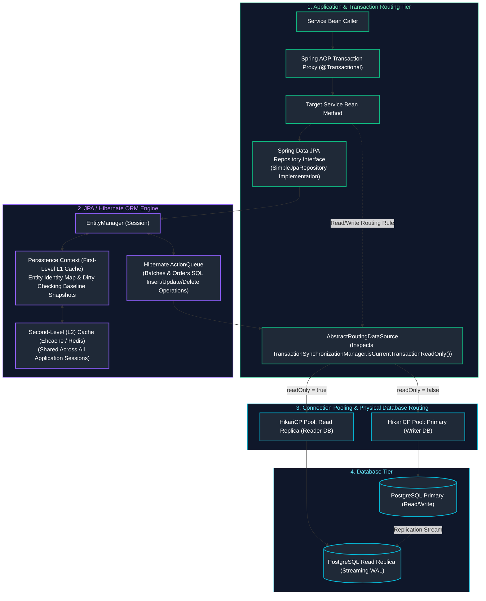
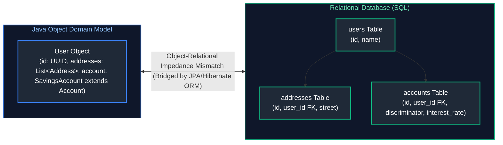
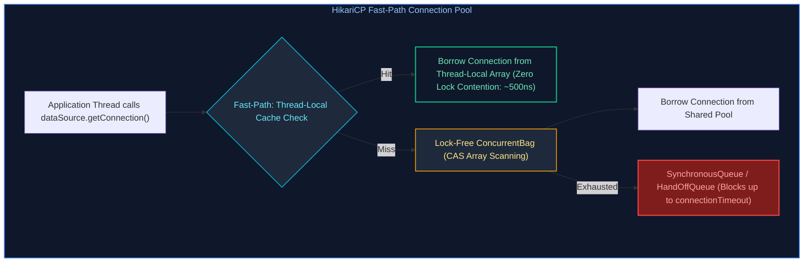
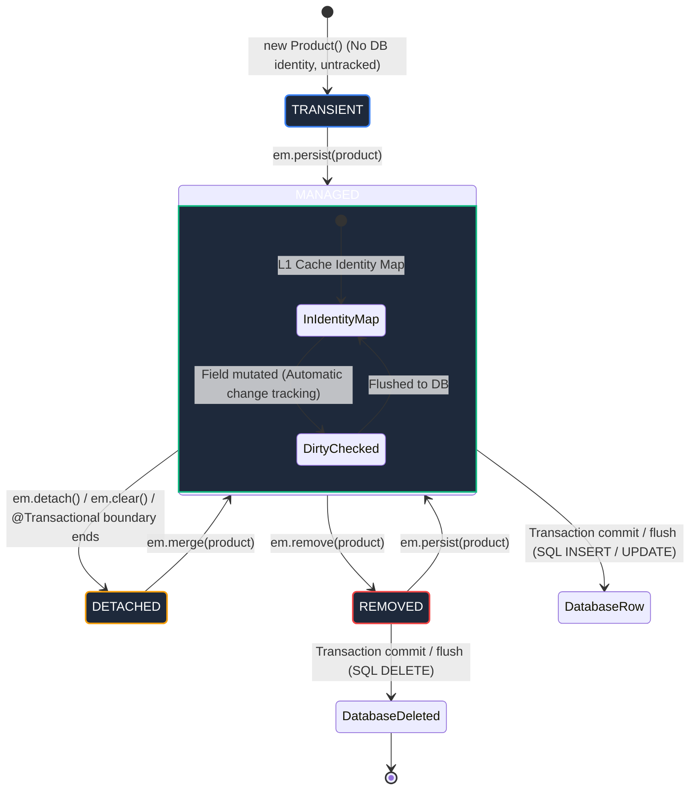
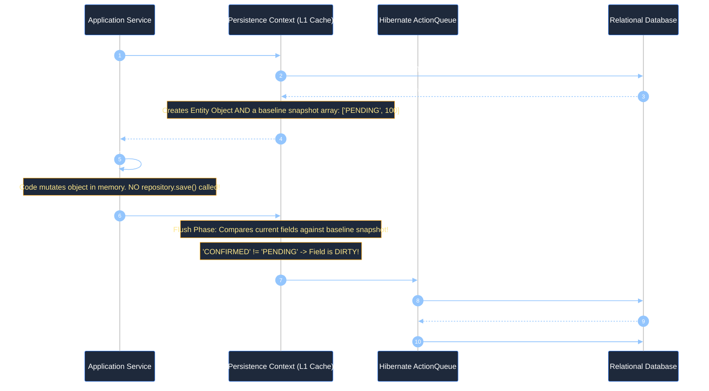
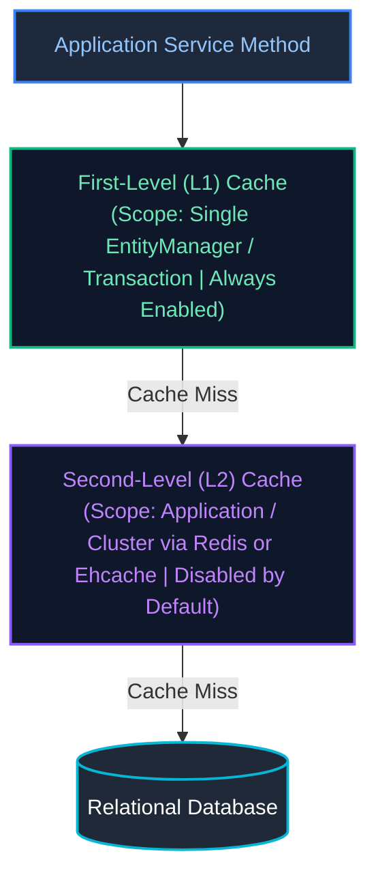
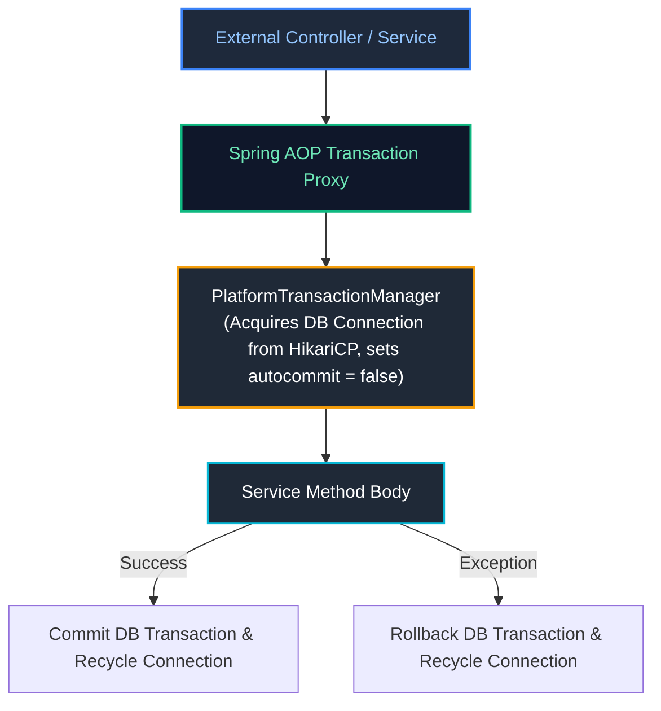
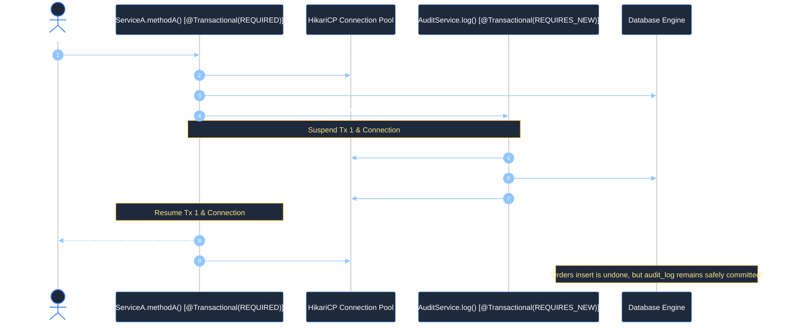
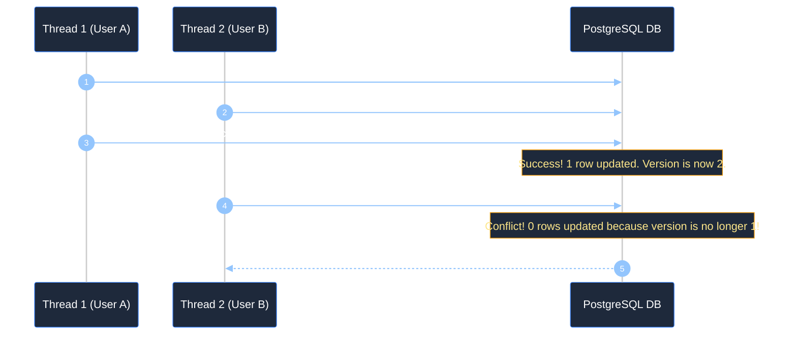

# 10. Spring Data, JDBC, JPA, Hibernate & Transactions

A comprehensive, production-grade guide covering low-level JDBC mechanics, connection pool architecture, Object-Relational Mapping (ORM) fundamentals, Java Persistence API (JPA), Hibernate internals (Persistence Context, First-Level & Second-Level caching, Dirty Checking, ByteBuddy proxies), relationship mappings, the N+1 query problem and its 3 production fixes, Cartesian product resolution, declarative transaction management (`@Transactional`, propagation, rollback rules), concurrency locking (Optimistic vs Pessimistic), and dynamic Read/Write replica routing.

---

## Architectural Overview: Enterprise JPA, Hibernate & Transaction Architecture



---

## Table of Contents
1. [From Raw JDBC to Spring Data: The Persistence Evolution](#1-from-raw-jdbc-to-spring-data-the-persistence-evolution)
   - [1.1 The Object-Relational Impedance Mismatch in Depth](#11-the-object-relational-impedance-mismatch-in-depth)
   - [1.2 Raw JDBC Anatomy: Sockets, Drivers & The SQL Injection Attack Vector](#12-raw-jdbc-anatomy-sockets-drivers--the-sql-injection-attack-vector)
   - [1.3 `Statement` vs `PreparedStatement` vs `CallableStatement`](#13-statement-vs-preparedstatement-vs-callablestatement)
   - [1.4 JDBC Batching & Network Round-Trip Optimization](#14-jdbc-batching--network-round-trip-optimization)
   - [1.5 Connection Pooling Architecture: HikariCP Fast-Path & Sizing Mechanics](#15-connection-pooling-architecture-hikaricp-fast-path--sizing-mechanics)
2. [JPA Architecture & The Entity Lifecycle State Machine](#2-jpa-architecture--the-entity-lifecycle-state-machine)
   - [2.1 JPA Specification vs Hibernate ORM Implementation Engine](#21-jpa-specification-vs-hibernate-orm-implementation-engine)
   - [2.2 The Persistence Context as an Identity Map](#22-the-persistence-context-as-an-identity-map)
   - [2.3 The 4 Entity Lifecycle States: Transient, Managed, Detached, Removed](#23-the-4-entity-lifecycle-states-transient-managed-detached-removed)
   - [2.4 Step-by-Step Entity State Transition Code Walkthrough](#24-step-by-step-entity-state-transition-code-walkthrough)
   - [2.5 Automatic Dirty Checking Mechanics & Flush Synchronization](#25-automatic-dirty-checking-mechanics--flush-synchronization)
   - [2.6 First-Level (L1) Cache vs Second-Level (L2) Cache Architecture](#26-first-level-l1-cache-vs-second-level-l2-cache-architecture)
3. [Entity Relationship Modeling & Object Graph Integrity](#3-entity-relationship-modeling--object-graph-integrity)
   - [3.1 Basic Mappings: `@Entity`, `@Table`, `@Id`, and Primary Key Generation Strategies](#31-basic-mappings-entity-table-id-and-primary-key-generation-strategies)
   - [3.2 Relationship Mappings: `@OneToOne`, `@ManyToOne`, `@OneToMany`, `@ManyToMany`](#32-relationship-mappings-onetoone-manytoone-onetomany-manytomany)
   - [3.3 The Owning Side Invariant & The `mappedBy` Attribute](#33-the-owning-side-invariant--the-mappedby-attribute)
   - [3.4 Bidirectional Relationship Synchronization Helper Methods](#34-bidirectional-relationship-synchronization-helper-methods)
   - [3.5 Why Decomposing `@ManyToMany` into an Intermediate Entity is Mandatory](#35-why-decomposing-manytomany-into-an-intermediate-entity-is-mandatory)
   - [3.6 Cascading Options (`CascadeType`) vs `orphanRemoval = true`](#36-cascading-options-cascadetype-vs-orphanremoval--true)
4. [Hibernate Proxies, Lazy Loading & Performance Traps](#4-hibernate-proxies-lazy-loading--performance-traps)
   - [4.1 How Hibernate Implements Lazy Loading: ByteBuddy Dynamic Proxies](#41-how-hibernate-implements-lazy-loading-bytebuddy-dynamic-proxies)
   - [4.2 Why Eager Loading (`FetchType.EAGER`) is a Critical Production Anti-Pattern](#42-why-eager-loading-fetchtypeeager-is-a-critical-production-anti-pattern)
   - [4.3 The `LazyInitializationException`: Root Cause & Solutions](#43-the-lazyinitializationexception-root-cause--solutions)
   - [4.4 The Open-Session-In-View (OSIV) Anti-Pattern: Hazards & Safe Disabling](#44-the-open-session-in-view-osiv-anti-pattern-hazards--safe-disabling)
5. [The N+1 Query Problem & Advanced Query Optimization](#5-the-n1-query-problem--advanced-query-optimization)
   - [5.1 Diagnosing the N+1 Query Disaster with SQL Logs](#51-diagnosing-the-n1-query-disaster-with-sql-logs)
   - [5.2 Production Fix 1: JPQL `JOIN FETCH` & The Pagination Trap (`HHH000104`)](#52-production-fix-1-jpql-join-fetch--the-pagination-trap-hhh000104)
   - [5.3 Production Fix 2: Spring Data JPA `@EntityGraph`](#53-production-fix-2-spring-data-jpa-entitygraph)
   - [5.4 Production Fix 3: Hibernate Batch Fetching (`@BatchSize`)](#54-production-fix-3-hibernate-batch-fetching-batchsize)
   - [5.5 The Cartesian Product Problem & `MultipleBagFetchException`](#55-the-cartesian-product-problem--multiplebagfetchexception)
   - [5.6 Read Projections: Interface Projections vs DTO Constructor Expressions](#56-read-projections-interface-projections-vs-dto-constructor-expressions)
6. [Declarative Transaction Management (`@Transactional`)](#6-declarative-transaction-management-transactional)
   - [6.1 ACID Guarantees in Enterprise Java](#61-acid-guarantees-in-enterprise-java)
   - [6.2 Spring AOP Transaction Interception Architecture](#62-spring-aop-transaction-interception-architecture)
   - [6.3 The Self-Invocation Proxy Bypass Trap & 3 Production Solutions](#63-the-self-invocation-proxy-bypass-trap--3-production-solutions)
   - [6.4 Transaction Propagation Levels Deep-Dive (With Scenario Traces)](#64-transaction-propagation-levels-deep-dive-with-scenario-traces)
   - [6.5 The Connection Pool Deadlock Hazard of `REQUIRES_NEW`](#65-the-connection-pool-deadlock-hazard-of-requires_new)
   - [6.6 Rollback Rules: The Checked vs Unchecked Exception Trap](#66-rollback-rules-the-checked-vs-unchecked-exception-trap)
   - [6.7 Read-Only Transactions (`readOnly = true`) Performance Optimizations](#67-read-only-transactions-readonly--true-performance-optimizations)
7. [Database Concurrency & Locking Strategies](#7-database-concurrency--locking-strategies)
   - [7.1 Lost Updates & Concurrency Anomalies](#71-lost-updates--concurrency-anomalies)
   - [7.2 Optimistic Locking (`@Version`): Implementation & Automated Spring Retry](#72-optimistic-locking-version-implementation--automated-spring-retry)
   - [7.3 Pessimistic Locking (`SELECT FOR UPDATE`), Non-Blocking Queue with `SKIP LOCKED`](#73-pessimistic-locking-select-for-update-non-blocking-queue-with-skip-locked)
8. [Advanced Production Case Study: Dynamic Read/Write Replica Routing](#8-advanced-production-case-study-dynamic-readwrite-replica-routing)
   - [8.1 Master-Replica Topologies & Asynchronous Replication Lag](#81-master-replica-topologies--asynchronous-replication-lag)
   - [8.2 Complete Production Implementation: `AbstractRoutingDataSource` with `LazyConnectionDataSourceProxy`](#82-complete-production-implementation-abstractroutingdatasource-with-lazyconnectiondatasourceproxy)
9. [Production Troubleshooting Playbook](#9-production-troubleshooting-playbook)
10. [Summary Comparison & Engineering Reference Matrix](#10-summary-comparison--engineering-reference-matrix)
11. [References & Further Reading](#11-references--further-reading)

---

# 1. From Raw JDBC to Spring Data: The Persistence Evolution

---

### 1.1 The Object-Relational Impedance Mismatch in Depth

Relational databases and object-oriented programming languages are built upon fundamentally conflicting mathematical paradigms:

* **Object Model (Java)**: Based on software engineering principles: encapsulation, state, polymorphism, inheritance, and directional pointer associations.
* **Relational Model (SQL)**: Based on relational algebra and set theory: relations (tables), tuples (rows), attributes (columns), primary keys, and foreign keys.



#### The Five Primary Impedance Mismatch Dimensions:
1. **Granularity Problem**: A domain model often possesses complex value objects (e.g. `Money` consisting of an amount and currency, or `Coordinates` with latitude and longitude). In a relational table, there are no composite data types; everything must be flattened into primitive columns (`money_amount`, `money_currency`).
2. **Subtyping & Inheritance Problem**: Java natively models class hierarchies (`class SavingsAccount extends BankAccount`). Relational database tables have no concept of inheritance; tables cannot extend other tables. Bridging this requires mapping strategies (`SINGLE_TABLE`, `JOINED`, `TABLE_PER_CLASS`).
3. **Identity Problem**: Java distinguishes between **Value Equality** (`equals()`) and **Reference Identity** (`==` checking memory addresses). Relational databases define identity strictly through primary key values.
4. **Association Problem**: In Java, associations are unidirectional object references (`customer.getOrders()`). In SQL, foreign keys represent bidirectional relationships navigated via JOIN operations.
5. **Data Navigation Problem**: In Java, code navigates object graphs by chaining getters (`order.getCustomer().getAddress().getCity()`). In SQL, fetching this data requires multi-table JOINs; accessing un-joined relations triggers separate database queries.

---

### 1.2 Raw JDBC Anatomy: Sockets, Drivers & The SQL Injection Attack Vector

Java Database Connectivity (JDBC) is the low-level API (`java.sql`) that opens TCP sockets to relational database servers, formats query packets according to vendor wire protocols, and streams tabular result sets.

#### The Anatomy of an SQL Injection Attack:
When an application uses dynamic string concatenation to construct SQL:

```java
// ❌ CRITICAL SECURITY VULNERABILITY: SQL Injection
public User findByUsername(String userInput) throws SQLException {
    String query = "SELECT * FROM users WHERE username = '" + userInput + "'";
    try (Connection conn = dataSource.getConnection();
         Statement stmt = conn.createStatement();
         ResultSet rs = stmt.executeQuery(query)) {
        if (rs.next()) return mapUser(rs);
        return null;
    }
}
```

If an attacker inputs: `' OR '1'='1' --`
The constructed SQL statement executed by the database engine becomes:
```sql
SELECT * FROM users WHERE username = '' OR '1'='1' --'
```
The database parser evaluates `'1'='1'` to `TRUE` for every row in the table, returning all user records in the system!

---

### 1.3 `Statement` vs `PreparedStatement` vs `CallableStatement`

| Dimension | `Statement` | `PreparedStatement` | `CallableStatement` |
| :--- | :--- | :--- | :--- |
| **SQL Parsing** | Sent as raw text; database parses, checks syntax, and compiles an execution plan on **every single execution**. | Precompiled by the database. The query execution plan is **cached** and reused. | Calls stored procedures and functions compiled inside the database engine. |
| **Parameters** | Inlined via string concatenation. | Bound via indexed or named parameter placeholders (`?`). | Supports `IN`, `OUT`, and `INOUT` parameters. |
| **Security** | **Extremely vulnerable to SQL Injection**. | **Completely immune to SQL Injection**. | Immune to SQL Injection when using placeholders. |
| **Binary Protocol** | Uses text-based SQL protocol. | Passes parameters as typed binary data over wire protocol. | Uses database vendor procedure wire protocol. |

#### Production `PreparedStatement` Implementation:
```java
public Optional<Account> findAccountById(String accountId) {
    String sql = "SELECT id, owner_name, balance, status FROM accounts WHERE id = ? AND status = ?";

    try (Connection conn = dataSource.getConnection();
         PreparedStatement ps = conn.prepareStatement(sql)) {

        // Parameters bound strictly as typed data literals, NEVER executable SQL!
        ps.setString(1, accountId);
        ps.setString(2, "ACTIVE");

        try (ResultSet rs = ps.executeQuery()) {
            if (rs.next()) {
                Account account = new Account(
                    rs.getString("id"),
                    rs.getString("owner_name"),
                    rs.getBigDecimal("balance"),
                    rs.getString("status")
                );
                return Optional.of(account);
            }
        }
    } catch (SQLException ex) {
        log.error("Database query failed for accountId: {}", accountId, ex);
        throw new DatabaseOperationException("Failed to fetch account", ex);
    }
    return Optional.empty();
}
```

---

### 1.4 JDBC Batching & Network Round-Trip Optimization

When inserting or updating thousands of rows, executing statements individually incurs massive network round-trip overhead:

```java
// ❌ CATASTROPHIC PERFORMANCE: 10,000 network round-trips! Takes ~30 seconds!
for (OrderLineItem item : items) {
    ps.setString(1, item.getId());
    ps.setBigDecimal(2, item.getPrice());
    ps.executeUpdate(); // Sends packet over network, waits for ACK
}

// ✅ PRODUCTION STANDARD: JDBC Batching (Sends 1,000 rows in a single network packet)
String batchSql = "INSERT INTO order_items (id, order_id, price) VALUES (?, ?, ?)";
try (PreparedStatement ps = conn.prepareStatement(batchSql)) {
    int batchSize = 1000;
    int count = 0;

    for (OrderLineItem item : items) {
        ps.setString(1, item.getId());
        ps.setString(2, orderId);
        ps.setBigDecimal(3, item.getPrice());
        ps.addBatch(); // Buffers locally in memory

        if (++count % batchSize == 0) {
            ps.executeBatch(); // Transmits batch over network in single packet!
        }
    }
    ps.executeBatch(); // Flush remainder
}
```

> [!TIP]
> In PostgreSQL and MySQL JDBC drivers, batching requires setting explicit driver connection properties:
> * **PostgreSQL**: `reWriteBatchedInserts=true`
> * **MySQL**: `rewriteBatchedStatements=true`
> Without these flags, JDBC drivers secretly execute individual round-trips behind the scenes!

---

### 1.5 Connection Pooling Architecture: HikariCP Fast-Path & Sizing Mechanics

Opening a physical database connection requires TCP handshakes, TLS parameter negotiation, authentication, and backend server process allocation (costing $50\text{ to }100\text{ ms}$).

**HikariCP** maintains a pool of pre-allocated, healthy physical connections:



#### The Connection Pool Sizing Formula (Brett Wooldridge):
A pervasive beginner fallacy is configuring large connection pools (`maximum-pool-size=100`). In relational databases, database connections compete for physical CPU cores, RAM, and disk spindle I/O. As connection count increases beyond hardware capacity, the database spends $90\%$ of its CPU cycles context-switching between competing threads rather than executing queries!

$$\text{Optimal Pool Size} = \text{CPU Core Count} \times 2 + \text{Effective Spindle Count}$$

For a database server with 4 CPU cores and SSD storage:
$$\text{Pool Size} = (4 \times 2) + 1 = 9 \text{ to } 12 \text{ connections!}$$
A pool of 10 connections routinely delivers **higher throughput and lower latency** than a pool of 100 connections!

```properties
# Production HikariCP Configuration in Spring Boot
spring.datasource.hikari.maximum-pool-size=15
spring.datasource.hikari.minimum-idle=10
spring.datasource.hikari.connection-timeout=30000
spring.datasource.hikari.idle-timeout=600000
spring.datasource.hikari.max-lifetime=1800000
# Connection Leak Detection: Emits full stack trace if a thread holds connection > 5 seconds!
spring.datasource.hikari.leak-detection-threshold=5000
```

---

# 2. JPA Architecture & The Entity Lifecycle State Machine

---

### 2.1 JPA Specification vs Hibernate ORM Implementation Engine

* **JPA (Jakarta Persistence)**: An official Java Community Process (JCP) standard. It consists purely of interfaces (`EntityManager`, `EntityTransaction`, `Query`) and metadata annotations (`@Entity`, `@Table`, `@Column`, `@Id`). JPA contains **zero executable implementation code**.
* **Hibernate ORM**: The concrete open-source engine developed by Red Hat that implements the JPA standard, generates vendor-specific SQL dialects, manages the persistence context, executes dirty checking, and orchestrates caching.

---

### 2.2 The Persistence Context as an Identity Map

The **Persistence Context** is an in-memory cache managed by `EntityManager`. It acts as an **Identity Map**:
* For any given database table row (identified by its primary key), the Persistence Context guarantees that **exactly one Java object instance exists in memory**.
* If code queries for `accountRepository.findById(101L)` multiple times within the same transaction, Hibernate executes the SQL query once, stores the object in the Persistence Context, and returns the **identical memory reference** (`a1 == a2` returns `true`) for subsequent calls without hitting the database again!

---

### 2.3 The 4 Entity Lifecycle States: Transient, Managed, Detached, Removed



1. **Transient (New)**:
   * Created using standard Java `new` operator (`Product p = new Product()`).
   * Has no persistent database identity (primary key is null).
   * Not associated with any `EntityManager` Persistence Context.
2. **Managed (Persistent)**:
   * Associated with an active Persistence Context.
   * Has a persistent database identity (primary key).
   * **Monitored by Dirty Checking**: Any setter called on a managed entity is automatically tracked and synchronized to the database upon transaction commit.
3. **Detached**:
   * Previously managed, but its Persistence Context closed (e.g. after the `@Transactional` method returned) or was explicitly cleared (`em.detach(p)`, `em.clear()`).
   * Has a primary key, but field modifications are **ignored** by Hibernate.
   * Can be re-attached to a new session using `em.merge(p)`.
4. **Removed**:
   * Scheduled for deletion from the database via `em.remove(p)`.
   * Will emit an SQL `DELETE` statement upon transaction commit.

---

### 2.4 Step-by-Step Entity State Transition Code Walkthrough

```java
@Service
public class EntityLifecycleDemoService {

    @PersistenceContext
    private EntityManager em;

    @Transactional
    public void demonstrateLifecycle() {
        // 1. TRANSIENT STATE: Pure Java object in heap; DB knows nothing about it
        Product product = new Product("Laptop", new BigDecimal("1200.00"));
        System.out.println("Transient: ID is " + product.getId()); // null

        // 2. MANAGED STATE: Attached to Persistence Context
        em.persist(product);
        System.out.println("Managed: ID generated is " + product.getId()); // e.g. 101L

        // 3. DIRTY CHECKING IN ACTION:
        product.setPrice(new BigDecimal("1150.00")); // Field modified in memory!
        // Notice: We do NOT call em.persist() or repository.save()!

        // 4. DETACHED STATE: Explicitly detach entity from context
        em.detach(product);
        product.setPrice(new BigDecimal("999.00")); // This modification is IGNORED!

        // 5. RE-ATTACHING VIA MERGE:
        // merge() creates a NEW managed copy and copies detached state into it!
        Product mergedProduct = em.merge(product);
        mergedProduct.setPrice(new BigDecimal("1050.00"));

        // 6. REMOVED STATE:
        // em.remove(mergedProduct); // Would emit DELETE on commit
    } // Transaction commits here! Hibernate flushes SQL INSERT and SQL UPDATE!
}
```

---

### 2.5 Automatic Dirty Checking Mechanics & Flush Synchronization

How does Hibernate know an entity was modified without explicit save calls?



> [!IMPORTANT]
> **Production Standard**: Calling `repository.save(entity)` on an already managed entity inside a `@Transactional` method is redundant and indicates a misunderstanding of JPA dirty checking.

---

### 2.6 First-Level (L1) Cache vs Second-Level (L2) Cache Architecture



| Dimension | First-Level (L1) Cache | Second-Level (L2) Cache |
| :--- | :--- | :--- |
| **Scope** | Single `EntityManager` / `Session` | Shared across all sessions in the JVM or cluster |
| **Configuration** | **Always enabled** (Mandatory part of JPA specification) | **Disabled by default** (Requires Ehcache, Hazelcast, or Redis) |
| **Storage Format** | Live Java object instances (Identity Map) | Hydrated disassembled state arrays / serialized payloads |
| **Concurrency** | Thread-confined (Inherently thread-safe) | Multi-threaded (Requires lock policies: `READ_WRITE`, `NONSTRICT_READ_WRITE`) |

#### The 4 L2 Cache Concurrency Strategies:
1. **`READ_ONLY`**:
   * For static reference data that never changes (e.g. country codes, tax brackets).
   * Highest performance; zero lock overhead. If mutated, throws an exception.
2. **`NONSTRICT_READ_WRITE`**:
   * For entities that are rarely mutated and where occasional stale reads are acceptable.
   * Updates invalidate the cache upon transaction commit without locking.
3. **`READ_WRITE`**:
   * Standard for read-heavy entities with infrequent updates.
   * Uses soft-locks (sentinels) in the cache during transactions to prevent concurrent transactions from reading uncommitted dirty data.
4. **`TRANSACTIONAL`**:
   * Provides JTA/XA transactional consistency. Requires a distributed cache manager supporting JTA (e.g., Infinispan).

#### Production Spring Boot L2 Cache Configuration with Redisson:
```properties
# Enable Hibernate Second-Level Cache
spring.jpa.properties.hibernate.cache.use_second_level_cache=true
spring.jpa.properties.hibernate.cache.region.factory_class=org.redisson.hibernate.RedissonRegionFactory
spring.jpa.properties.hibernate.cache.use_query_cache=true
spring.jpa.properties.hibernate.cache.redisson.config=classpath:redisson.yaml
```

#### Entity L2 Cache Mapping:
```java
@Entity
@Table(name = "currencies")
@jakarta.persistence.Cacheable
@org.hibernate.annotations.Cache(
    usage = CacheConcurrencyStrategy.READ_ONLY,
    region = "currency-cache"
)
public class CurrencyEntity {
    @Id
    private String code;
    private String name;
    private BigDecimal exchangeRate;
}
```

#### The Hibernate Query Cache Trap:
Enabling `hibernate.cache.use_query_cache=true` caches the results of queries, but comes with a massive caveat:
* **The Query Cache stores ONLY primary keys, NOT full entities**: A cached query result is an array of IDs: `[101, 102, 103]`.
* When the query is executed again, Hibernate fetches the ID array from the Query Cache and then does an individual lookup for each ID in the L2 Entity Cache. **If the entities are NOT also cached in L2, the query cache causes an N+1 query storm!**
* **Aggressive Invalidation**: If *any* transaction commits an `INSERT`, `UPDATE`, or `DELETE` on the `orders` table, Hibernate invalidates the entire query cache region for `orders`, drastically reducing hit rates on write-heavy tables. Use Query Cache strictly for read-only tables!

---

# 3. Entity Relationship Modeling & Object Graph Integrity

---

### 3.1 Basic Mappings: `@Entity`, `@Table`, `@Id`, and Primary Key Generation Strategies

```java
@Entity
@Table(name = "customers", indexes = {
    @Index(name = "idx_customer_email", columnList = "email", unique = true)
})
public class CustomerEntity {

    // GenerationType.IDENTITY: Relies on DB auto-increment column (e.g. SERIAL in Postgres).
    // Hazard: Disables JDBC batching because Hibernate must execute INSERT immediately to fetch ID!
    //
    // GenerationType.SEQUENCE (Preferred): Uses database sequence generator.
    // Supports allocationSize pre-allocation, enabling high-performance JDBC batch inserts!
    @Id
    @GeneratedValue(strategy = GenerationType.SEQUENCE, generator = "cust_seq_gen")
    @SequenceGenerator(name = "cust_seq_gen", sequenceName = "customers_id_seq", allocationSize = 50)
    private Long id;

    @Column(name = "email", nullable = false, length = 150)
    private String email;

    // Enums: ALWAYS map as STRING!
    // Using default ORDINAL means if someone reorders enum constants, data is permanently corrupted!
    @Enumerated(EnumType.STRING)
    @Column(name = "tier", nullable = false)
    private CustomerTier tier;

    @CreationTimestamp
    @Column(name = "created_at", nullable = false, updatable = false)
    private Instant createdAt;
}
```

---

### 3.2 Relationship Mappings: `@OneToOne`, `@ManyToOne`, `@OneToMany`, `@ManyToMany`


---

### 3.3 The Owning Side Invariant & The `mappedBy` Attribute

In bidirectional relationships, **one side MUST be designated the Owning Side**:
* The **Owning Side** owns the physical foreign key column in the database schema. It defines the `@JoinColumn` annotation.
* The **Inverse Side** is marked with the `mappedBy` attribute, which points to the field name on the owning entity.
* **The Golden Invariant**: Hibernate updates database foreign keys **based strictly on the state of the Owning Side**! If you add an order to `customer.getOrders()`, but fail to call `order.setCustomer(customer)`, **Hibernate will write `NULL` to the foreign key column**!

---

### 3.4 Bidirectional Relationship Synchronization Helper Methods

To guarantee object graph consistency in memory and database, always implement bidirectional synchronization helper methods on the parent entity:

```java
@Entity
@Table(name = "orders")
public class OrderEntity {
    @Id @GeneratedValue(strategy = GenerationType.SEQUENCE)
    private Long id;

    // Inverse side of relationship
    @OneToMany(mappedBy = "order", cascade = CascadeType.ALL, orphanRemoval = true)
    private List<OrderItemEntity> items = new ArrayList<>();

    // ✅ MANDATORY PRODUCTION SYNCHRONIZATION HELPERS
    public void addItem(OrderItemEntity item) {
        items.add(item);
        item.setOrder(this); // Updates the owning side foreign key pointer!
    }

    public void removeItem(OrderItemEntity item) {
        items.remove(item);
        item.setOrder(null); // Triggers orphan removal in DB!
    }

    public List<OrderItemEntity> getItems() {
        return Collections.unmodifiableList(items);
    }
}

@Entity
@Table(name = "order_items")
public class OrderItemEntity {
    @Id @GeneratedValue(strategy = GenerationType.SEQUENCE)
    private Long id;

    // Owning side: Holds the physical foreign key column!
    @ManyToOne(fetch = FetchType.LAZY)
    @JoinColumn(name = "order_id", nullable = false)
    private OrderEntity order;

    public void setOrder(OrderEntity order) {
        this.order = order;
    }
}
```

---

### 3.5 Why Decomposing `@ManyToMany` into an Intermediate Entity is Mandatory

Using a direct `@ManyToMany` annotation between `Student` and `Course` creates an invisible join table managed entirely by Hibernate.
* **Why this fails in production**: Real business applications always require metadata on the relationship itself (e.g., `enrolledAt`, `grade`, `paymentStatus`, `status`). Direct `@ManyToMany` cannot accommodate extra columns.
* **The Production Standard**: Decompose `@ManyToMany` into an explicit intermediate entity (`EnrollmentEntity`) mapped via two `@ManyToOne` relationships:


---

### 3.6 Cascading Options (`CascadeType`) vs `orphanRemoval = true`

* **`CascadeType.PERSIST`**: When parent is saved, child entities are saved.
* **`CascadeType.MERGE`**: When parent is merged, child entities are merged.
* **`CascadeType.REMOVE`**: When parent is deleted, all children are deleted.
  * *Production Warning*: Never place `CascadeType.REMOVE` on a `@ManyToOne` or `@ManyToMany`! Doing so will delete the shared parent or related entities across the entire table!
* **`orphanRemoval = true`**: If a child entity is removed from the parent's collection (`order.getItems().remove(0)`), Hibernate marks the orphaned child as `REMOVED` and emits an SQL `DELETE` statement.

---

# 4. Hibernate Proxies, Lazy Loading & Performance Traps

---

### 4.1 How Hibernate Implements Lazy Loading: ByteBuddy Dynamic Proxies

When an entity declares a lazy relationship (`@ManyToOne(fetch = FetchType.LAZY)`):
1. Hibernate does not execute a SQL query to load the related entity.
2. Instead, it instantiates a **ByteBuddy Dynamic Proxy** subclassing the target entity class.
3. The proxy contains an uninitialized target pointer.
4. When application code invokes any business getter on the proxy (e.g. `order.getCustomer().getName()`), the ByteBuddy interceptor wakes up, checks if an active `Session` exists, executes an SQL query to load the customer row, and populates the entity.

---

### 4.2 Why Eager Loading (`FetchType.EAGER`) is a Critical Production Anti-Pattern

```java
// ❌ CRITICAL PRODUCTION PERFORMANCE TRAP
@Entity
public class OrderEntity {
    @ManyToOne(fetch = FetchType.EAGER) // DEFAULT for @ManyToOne and @OneToOne!
    private CustomerEntity customer;
}
```

* **The Problem**: Whenever code queries `orderRepository.findById(id)` or `orderRepository.findAll()`, Hibernate **forces an immediate SQL JOIN or additional queries** to fetch the customer, even if your business logic only needed the order total amount!
* **Cascading Joins**: If `Customer` eagerly loads `Address`, and `Address` eagerly loads `Country`, querying a single Order triggers a monstrous 10-table join!
* **Production Rule**: **Always explicitly declare `fetch = FetchType.LAZY` on ALL relationships without exception**.

---

### 4.3 The `LazyInitializationException`: Root Cause & Solutions

```text
org.hibernate.LazyInitializationException: could not initialize proxy [com.enterprise.Customer#101] - no Session
```

#### Why it Happens:
1. Service method annotated with `@Transactional` finishes execution.
2. The Spring transaction commits and closes the Hibernate `Session` / `EntityManager`.
3. In the Web Controller or JSON serializer, Jackson calls `order.getCustomer().getName()`.
4. The ByteBuddy proxy attempts to fetch data from the database, but discovers the `Session` is closed, throwing `LazyInitializationException`!

#### How to Solve:
* Do NOT use Open-Session-In-View.
* Fetch the required association within the transactional service layer using **`JOIN FETCH`**, **`@EntityGraph`**, or **DTO Projections**.

---

### 4.4 The Open-Session-In-View (OSIV) Anti-Pattern: Hazards & Safe Disabling

Spring Boot ships with `spring.jpa.open-in-view=true` by default.
* **What OSIV Does**: A Servlet Filter opens a Hibernate Session at the start of an HTTP request and keeps it open until the response has finished streaming back to the browser.
* **The Production Outage Hazard**: A database connection from HikariCP is held hostage during slow HTTP rendering. If a client is on a slow 3G mobile network and takes 3 seconds to receive the JSON response, **the physical database connection is locked for 3 full seconds**! Under modest traffic spikes, all 10 HikariCP connections are exhausted in seconds, bringing down the entire microservice!
* **Remedy**: Always disable OSIV in production `application.properties`:
  ```properties
  spring.jpa.open-in-view=false
  ```

---

# 5. The N+1 Query Problem & Advanced Query Optimization

---

### 5.1 Diagnosing the N+1 Query Disaster with SQL Logs

The **N+1 Query Problem** occurs when fetching $N$ parent records requires $1$ initial query, followed by $N$ separate queries to fetch children:

```java
// Query 1: Returns 100 Orders
List<OrderEntity> orders = orderRepository.findAll();

// Triggers 100 separate queries: SELECT * FROM customers WHERE id = ?
for (OrderEntity order : orders) {
    System.out.println(order.getCustomer().getName());
}
// Total: 1 + 100 = 101 queries! Database latency explodes from 2ms to 250ms!
```

#### Automated Unit Testing for N+1 Query Regressions:
In CI/CD pipelines, use Hypersistence Utils or QuickPerf to assert exact SQL statement counts:

```java
package com.enterprise.repository;

import io.hypersistence.utils.jdbc.validator.SQLStatementCountValidator;
import org.junit.jupiter.api.Test;
import org.springframework.beans.factory.annotation.Autowired;
import org.springframework.boot.test.context.SpringBootTest;
import org.springframework.transaction.annotation.Transactional;

@SpringBootTest
public class QueryCountIntegrationTest {

    @Autowired
    private OrderRepository orderRepository;

    @Test
    @Transactional
    public void testNoNPlusOneQueries() {
        SQLStatementCountValidator.reset();

        // Fetch orders using optimized fetch join
        var orders = orderRepository.findAllWithCustomerFetch(OrderStatus.CONFIRMED);

        // Access lazily mapped properties
        orders.forEach(o -> o.getCustomer().getName());

        // Assert strictly 1 SELECT statement was executed across the wire!
        SQLStatementCountValidator.assertSelectCount(1);
    }
}
```

---

### 5.2 Production Fix 1: JPQL `JOIN FETCH` & The Pagination Trap (`HHH000104`)

`JOIN FETCH` instructs Hibernate to write an explicit SQL `JOIN` statement that loads the parent and associated children in a single network round-trip:

```java
public interface OrderRepository extends JpaRepository<OrderEntity, Long> {

    // Single query executes:
    // SELECT o.*, c.* FROM orders o INNER JOIN customers c ON o.customer_id = c.id WHERE o.status = ?
    @Query("SELECT o FROM OrderEntity o JOIN FETCH o.customer WHERE o.status = :status")
    List<OrderEntity> findAllWithCustomerFetch(@Param("status") OrderStatus status);
}
```

#### The Lethal Pagination Trap with Collection `JOIN FETCH`:
If you attempt to paginate (`Pageable`) while executing a `JOIN FETCH` on a `@OneToMany` collection:

```java
// ⚠️ DANGEROUS OUTAGE TRAP:
@Query("SELECT o FROM OrderEntity o JOIN FETCH o.items")
Page<OrderEntity> findOrdersWithItems(Pageable pageable);
```

Hibernate outputs this alarming warning in the logs:
```text
WARN: HHH000104: firstResult/maxResults specified with collection fetch; applying in memory!
```
* **Why this happens**: An SQL JOIN with a collection duplicates parent rows. If Order 1 has 5 items, the SQL result contains 5 rows for Order 1. The database cannot execute `LIMIT 10 OFFSET 20` correctly without cutting an order in half!
* **The Disaster**: Hibernate **strips the `LIMIT` and `OFFSET` clauses entirely**, queries **ALL 5,000,000 orders into the JVM heap**, and filters the 10 rows in Java RAM! This instantly exhausts JVM memory $\to$ `OutOfMemoryError: Java heap space`!

#### The Two-Step Pagination Solution:
1. Paginate parent IDs **without** joining collections.
2. Fetch full entities and collections using `WHERE id IN (:ids)` and let Hibernate reconstitute the graph:

```java
public interface OrderRepository extends JpaRepository<OrderEntity, Long> {

    // Step 1: Paginate only parent IDs (Uses fast SQL LIMIT & OFFSET in database!)
    @Query("SELECT o.id FROM OrderEntity o WHERE o.status = :status ORDER BY o.createdAt DESC")
    Page<Long> findOrderIds(@Param("status") OrderStatus status, Pageable pageable);

    // Step 2: Fetch collections for the current page slice using IN clause
    @Query("SELECT DISTINCT o FROM OrderEntity o JOIN FETCH o.items WHERE o.id IN :ids")
    List<OrderEntity> findOrdersWithItemsByIds(@Param("ids") List<Long> ids);
}
```

---

### 5.3 Production Fix 2: Spring Data JPA `@EntityGraph`

`@EntityGraph` provides a declarative way to override lazy loading paths on a per-query basis without writing custom JPQL joins:

```java
public interface OrderRepository extends JpaRepository<OrderEntity, Long> {

    @EntityGraph(attributePaths = {"customer", "items"})
    List<OrderEntity> findByStatus(OrderStatus status);
}
```
* `EntityGraphType.FETCH` (default): Specified attributes are fetched eagerly; all other attributes are loaded lazily.
* `EntityGraphType.LOAD`: Specified attributes are fetched eagerly; other attributes respect their explicit entity mapping annotations.

---

### 5.4 Production Fix 3: Hibernate Batch Fetching (`@BatchSize`)

If entities are loaded lazily, batch fetching replaces $N$ individual queries with a few batched `WHERE id IN (?, ?, ...)` queries:

```properties
# application.properties: Global Batch Fetching
spring.jpa.properties.hibernate.default_batch_fetch_size=25
```
Instead of 100 individual queries, Hibernate executes only $1 + \frac{100}{25} = 5$ queries!

You can also place `@BatchSize(size = 25)` directly on entity collections:
```java
@Entity
public class OrderEntity {
    @OneToMany(mappedBy = "order")
    @org.hibernate.annotations.BatchSize(size = 25)
    private List<OrderItemEntity> items = new ArrayList<>();
}
```

---

### 5.5 The Cartesian Product Problem & `MultipleBagFetchException`

When you attempt to `JOIN FETCH` two collection relationships (`List<OrderItem>` and `List<OrderTag>`) simultaneously, Hibernate throws:
```text
org.hibernate.loader.MultipleBagFetchException: cannot simultaneously fetch multiple bags
```
* **Why**: An SQL JOIN across two independent collections produces a **Cartesian Product** ($10\text{ items} \times 10\text{ tags} = 100\text{ rows}$ returned for a single order!).
* **Solution 1 (Change List to Set)**:
  ```java
  @OneToMany(mappedBy = "order")
  private Set<OrderItemEntity> items = new HashSet<>();
  ```
* **Solution 2 (Split-Query Entity Reconstitution)**:
  Execute two sequential queries within the same transaction. The Persistence Context (L1 cache) automatically stitches the second collection onto the already-loaded managed entities in memory without Cartesian blowup!
  ```java
  // Query 1: Loads orders with items into Persistence Context
  List<OrderEntity> orders = em.createQuery(
      "SELECT DISTINCT o FROM OrderEntity o JOIN FETCH o.items WHERE o.status = :s", OrderEntity.class)
      .setParameter("s", status).getResultList();

  // Query 2: Loads tags for those orders; L1 cache attaches tags to existing instances!
  em.createQuery(
      "SELECT DISTINCT o FROM OrderEntity o JOIN FETCH o.tags WHERE o IN :orders", OrderEntity.class)
      .setParameter("orders", orders).getResultList();
  ```

### 5.6 Read Projections: Interface Projections vs DTO Constructor Expressions

Loading full entities into the Persistence Context incurs dirty checking and memory overhead. For read-only API responses, use **DTO Projections**:

```java
public record OrderSummaryDto(Long orderId, String customerName, BigDecimal total) {}

public interface OrderRepository extends JpaRepository<OrderEntity, Long> {

    // Fast, lightweight: Fetches ONLY requested columns directly into record! Zero entity overhead!
    @Query("SELECT new com.enterprise.dto.OrderSummaryDto(o.id, o.customer.name, o.totalAmount) " +
           "FROM OrderEntity o WHERE o.id = :id")
    Optional<OrderSummaryDto> findSummaryById(@Param("id") Long id);
}
```

---

# 6. Declarative Transaction Management (`@Transactional`)

---

### 6.1 ACID Guarantees in Enterprise Java

* **Atomicity**: All operations in the transaction complete successfully, or all are rolled back.
* **Consistency**: The database transitions from one valid state to another, preserving all schema constraints.
* **Isolation**: Concurrent transactions execute without cross-transaction interference or data corruption.
* **Durability**: Committed data survives physical system crashes or power failures (persisted in write-ahead logs).

---

### 6.2 Spring AOP Transaction Interception Architecture



---

### 6.3 The Self-Invocation Proxy Bypass Trap & 3 Production Solutions

The most common transaction bug in Spring applications:

```java
@Service
public class BillingService {

    public void processMonthlyBilling() {
        // ❌ SELF-INVOCATION BUG: Internal call bypasses Spring AOP Proxy!
        // Calling this.chargeCustomer() calls the raw instance directly without going through the proxy.
        // The @Transactional annotation is completely IGNORED!
        chargeCustomer("CUST-101");
    }

    @Transactional
    public void chargeCustomer(String customerId) {
        // Database writes execute without a transaction!
    }
}
```

#### Production Fixes:
1. **Extract to Separate Collaborator Service (Best Practice)**: Move `chargeCustomer` to a dedicated `PaymentChargeService`.
2. **Self-Injection with `@Lazy`**: Inject a lazy proxy reference to self.
3. **Use Programmatic `TransactionTemplate`**.

---

### 6.4 Transaction Propagation Levels Deep-Dive (With Scenario Traces)

| Propagation | Behavior | Production Scenario |
| :--- | :--- | :--- |
| **`REQUIRED`** (Default) | Joins existing transaction if present; creates new transaction if none exists. | Standard default for 95% of business services. |
| **`REQUIRES_NEW`** | **Suspends** current transaction, opens a **completely new physical connection & transaction**. | Audit logging or payment authorization that must commit even if main transaction rolls back. |
| **`MANDATORY`** | Requires an existing transaction; throws `IllegalTransactionStateException` if called without one. | Low-level internal repository routines that must never run standalone. |
| **`SUPPORTS`** | Executes within transaction if present; executes non-transactionally if none exists. | Read-only queries. |
| **`NOT_SUPPORTED`** | Suspends current transaction and executes non-transactionally. | Slow external REST API calls or file uploads. |
| **`NEVER`** | Throws exception if active transaction exists. | Enforcing non-transactional execution. |
| **`NESTED`** | Creates a JDBC Savepoint within the current transaction. Can roll back child savepoint without rolling back parent. | Batch processing loops where individual item failures shouldn't abort the entire batch. |

#### Propagation Scenario Traces:

##### Scenario A: `REQUIRED` calling `REQUIRES_NEW`:



##### Scenario B: `REQUIRED` calling `NESTED` (JDBC Savepoints):

```mermaid
%%{init: {'theme': 'dark', 'themeVariables': { 'actorBkg': '#1e293b', 'actorBorder': '#3b82f6', 'actorTextColor': '#ffffff', 'signalColor': '#93c5fd', 'signalTextColor': '#ffffff', 'noteBkgColor': '#1e293b', 'noteBorderColor': '#f59e0b', 'noteTextColor': '#fde68a', 'activationBkgColor': '#3b82f6', 'sequenceNumberColor': '#ffffff' }}}%%
sequenceDiagram
    autonumber
    actor BatchJob as Batch Job Runner
    participant BatchSvc as BatchOrderService [@Transactional(REQUIRED)]
    participant Pool as HikariCP Connection Pool
    participant DB as Database (JDBC Connection #1)

    BatchJob->>BatchSvc: processBatch(100 Orders)
    BatchSvc->>Pool: Borrows Connection #1 (Tx 1 Started)
    
    loop For each Order item in Batch
        BatchSvc->>DB: SAVEPOINT item_savepoint_N
        alt Successful Processing
            BatchSvc->>DB: INSERT INTO order_items ...
        else Item Validation / Processing Failure
            BatchSvc->>DB: ROLLBACK TO SAVEPOINT item_savepoint_N
            Note over BatchSvc,DB: Only failed item reverted; outer Tx 1 remains healthy!
        end
    end

    BatchSvc->>Pool: COMMIT Tx 1 & Returns Connection #1
    Note over DB: All valid order items committed atomically!
```

#### Programmatic Transaction Management with `TransactionTemplate`:
When declarative `@Transactional` annotations cause proxy self-invocation issues or when fine-grained transaction scopes are required (avoiding holding database connections across slow third-party API calls):

```java
package com.enterprise.transaction;

import org.springframework.stereotype.Service;
import org.springframework.transaction.PlatformTransactionManager;
import org.springframework.transaction.TransactionDefinition;
import org.springframework.transaction.support.TransactionTemplate;

@Service
public class ProgrammaticOrderService {

    private final TransactionTemplate transactionTemplate;
    private final OrderRepository orderRepository;
    private final ThirdPartyPaymentClient paymentClient;

    public ProgrammaticOrderService(PlatformTransactionManager transactionManager,
                                   OrderRepository orderRepository,
                                   ThirdPartyPaymentClient paymentClient) {
        this.transactionTemplate = new TransactionTemplate(transactionManager);
        this.transactionTemplate.setIsolationLevel(TransactionDefinition.ISOLATION_READ_COMMITTED);
        this.transactionTemplate.setPropagationBehavior(TransactionDefinition.PROPAGATION_REQUIRED);
        this.transactionTemplate.setTimeout(10); // 10 seconds timeout
        this.orderRepository = orderRepository;
        this.paymentClient = paymentClient;
    }

    public OrderResult processOrder(OrderRequest request) {
        // Step 1: Slow external HTTP payment call (NO DATABASE CONNECTION HELD!)
        PaymentConfirmation confirmation = paymentClient.authorizePayment(request.paymentToken());

        // Step 2: Fine-grained database transaction (Holds connection for only ~2 milliseconds!)
        return transactionTemplate.execute(status -> {
            try {
                OrderEntity order = new OrderEntity(request.customerId(), confirmation.authCode());
                orderRepository.save(order);
                return new OrderResult(order.getId(), OrderStatus.SUCCESS);
            } catch (Exception ex) {
                status.setRollbackOnly(); // Programmatic rollback trigger
                throw new OrderProcessingException("Database write failed", ex);
            }
        });
    }
}
```

---

### 6.5 The Connection Pool Deadlock Hazard of `REQUIRES_NEW`

When Method A (`REQUIRED`) calls Method B (`REQUIRES_NEW`):
* The executing thread holds **TWO active physical database connections** simultaneously!
* If a small connection pool (e.g. 10 connections) receives 10 concurrent requests at Method A, all 10 threads borrow connection #1 and block waiting for connection #2.
* Result: **Complete System Deadlock**! The application freezes permanently until connection timeout occurs!
* **Mathematical Sizing Rule**:
  $$\text{HikariCP Max Pool Size} \ge (\text{Max Concurrent Threads} \times (\text{Max Nesting Depth of REQUIRES\_NEW} + 1)) + 1$$

---

### 6.6 Rollback Rules: The Checked vs Unchecked Exception Trap

By default, Spring rolls back transactions **ONLY for unchecked exceptions** (`RuntimeException` and `Error`):

```java
// ❌ PRODUCTION OUTAGE BUG: Checked Exception DOES NOT ROLL BACK BY DEFAULT!
@Transactional
public void processTransfer(Long fromId, Long toId, BigDecimal amount) throws InsufficientFundsException {
    debit(fromId, amount);
    credit(toId, amount);
    if (balanceNegative()) {
        throw new InsufficientFundsException("Checked exception"); // DB TRANSACTION COMMITS ANYWAY!
    }
}

// ✅ MANDATORY PRODUCTION REMEDY: Explicit rollbackFor declaration
@Transactional(rollbackFor = Exception.class)
public void processTransferFixed(...) throws InsufficientFundsException { ... }
```

---

### 6.7 Read-Only Transactions (`readOnly = true`) Performance Optimizations

Annotating read queries with `@Transactional(readOnly = true)` delivers major performance gains:
1. **Hibernate Disables Dirty Checking**: Hibernate does not create baseline snapshot arrays, cutting memory consumption and CPU usage significantly.
2. **JDBC Driver Optimizations**: Some JDBC drivers route read queries directly to read-only database replicas.
3. **Flushing Suppressed**: Hibernate omits pre-query flushing checks.

---

# 7. Database Concurrency & Locking Strategies

---

### 7.1 Lost Updates & Concurrency Anomalies

A **Lost Update** occurs when two concurrent transactions read the same record, modify it, and commit. The second commit completely overwrites the first transaction's modifications without awareness!

---

### 7.2 Optimistic Locking (`@Version`): Implementation & Automated Spring Retry

Optimistic locking assumes conflicts are rare. It uses a version column without holding database locks:



```java
@Entity
public class AccountEntity {
    @Id
    private Long id;
    private BigDecimal balance;

    @Version // Automatically managed by JPA/Hibernate!
    private Long version;
}

// Service with automated Spring Retry on conflict
@Service
public class AccountService {

    @Retryable(
        retryFor = OptimisticLockingFailureException.class,
        maxAttempts = 3,
        backoff = @Backoff(delay = 100, multiplier = 2.0, random = true)
    )
    @Transactional
    public void deposit(Long accountId, BigDecimal amount) {
        AccountEntity account = accountRepository.findById(accountId).orElseThrow();
        account.setBalance(account.getBalance().add(amount));
    }
}
```

---

### 7.3 Pessimistic Locking (`SELECT FOR UPDATE`), Non-Blocking Queue with `SKIP LOCKED`

Pessimistic locking physically locks database rows using database row-level locks:

* **`PESSIMISTIC_READ`**: Emits `SELECT ... FOR SHARE`. Allows other concurrent transactions to read the row, but prevents anyone from writing/updating until current transaction commits.
* **`PESSIMISTIC_WRITE`**: Emits `SELECT ... FOR UPDATE`. Prevents all other transactions from reading (`FOR UPDATE`) or writing.
* **`PESSIMISTIC_FORCE_INCREMENT`**: Acquires pessimistic write lock and increments the `@Version` property immediately.

#### Building a High-Throughput Worker Queue with PostgreSQL `SKIP LOCKED`:
In high-throughput microservices, multiple background workers poll a `tasks` table for pending work. If all workers execute `SELECT ... FOR UPDATE`, they block each other sequentially.
* **The Solution**: Use **`SKIP LOCKED`**. A worker locks the next available task and instructs PostgreSQL to skip any rows currently locked by peer workers:

```java
public interface TaskQueueRepository extends JpaRepository<TaskEntity, Long> {

    // ✅ LOCK-FREE DISTRIBUTED TASK CONSUMER:
    // Emits SQL: SELECT * FROM tasks WHERE status = 'PENDING' ORDER BY priority DESC LIMIT 1 FOR UPDATE SKIP LOCKED
    @Lock(LockModeType.PESSIMISTIC_WRITE)
    @QueryHints({
        @QueryHint(name = "jakarta.persistence.lock.timeout", value = "-2") // -2 maps to SKIP LOCKED in Hibernate!
    })
    @Query("SELECT t FROM TaskEntity t WHERE t.status = 'PENDING' ORDER BY t.priority DESC LIMIT 1")
    Optional<TaskEntity> pollNextPendingTask();
}
```

---

# 8. Advanced Production Case Study: Dynamic Read/Write Replica Routing

---

### 8.1 Master-Replica Topologies & Asynchronous Replication Lag

In high-scale systems, writes occur on the Primary database, and reads are offloaded to one or more Read Replicas.
* **Replication Lag Hazard**: Because replication is asynchronous, reading from a replica immediately after writing to primary risks reading stale data (**Read-After-Write Inconsistency**).

---

### 8.2 Complete Production Implementation: `AbstractRoutingDataSource` with `LazyConnectionDataSourceProxy`

```java
package com.enterprise.datasource;

import org.springframework.jdbc.datasource.LazyConnectionDataSourceProxy;
import org.springframework.jdbc.datasource.lookup.AbstractRoutingDataSource;
import org.springframework.transaction.support.TransactionSynchronizationManager;
import javax.sql.DataSource;
import java.util.HashMap;
import java.util.Map;

public class DynamicRoutingDataSource extends AbstractRoutingDataSource {

    public enum RouteKey { PRIMARY, REPLICA }

    @Override
    protected Object determineCurrentLookupKey() {
        boolean isReadOnly = TransactionSynchronizationManager.isCurrentTransactionReadOnly();
        return isReadOnly ? RouteKey.REPLICA : RouteKey.PRIMARY;
    }

    public static DataSource createRoutingProxy(DataSource primaryDs, DataSource replicaDs) {
        DynamicRoutingDataSource routingDataSource = new DynamicRoutingDataSource();

        Map<Object, Object> targetDataSources = new HashMap<>();
        targetDataSources.put(RouteKey.PRIMARY, primaryDs);
        targetDataSources.put(RouteKey.REPLICA, replicaDs);

        routingDataSource.setTargetDataSources(targetDataSources);
        routingDataSource.setDefaultTargetDataSource(primaryDs);
        routingDataSource.afterPropertiesSet();

        // ✅ CRITICAL: LazyConnectionDataSourceProxy defers physical connection acquisition
        // until the first SQL statement is actually executed, allowing TransactionSynchronizationManager
        // to establish whether the transaction is readOnly before borrowing a connection!
        return new LazyConnectionDataSourceProxy(routingDataSource);
    }
}
```

#### Production Multi-DataSource Spring Boot Configuration:
```java
package com.enterprise.datasource.config;

import com.enterprise.datasource.DynamicRoutingDataSource;
import com.zaxxer.hikari.HikariDataSource;
import org.springframework.boot.autoconfigure.jdbc.DataSourceProperties;
import org.springframework.boot.context.properties.ConfigurationProperties;
import org.springframework.context.annotation.Bean;
import org.springframework.context.annotation.Configuration;
import org.springframework.context.annotation.Primary;

import javax.sql.DataSource;

@Configuration
public class RoutingDataSourceConfig {

    @Bean
    @ConfigurationProperties("spring.datasource.primary")
    public DataSourceProperties primaryDataSourceProperties() {
        return new DataSourceProperties();
    }

    @Bean
    @ConfigurationProperties("spring.datasource.replica")
    public DataSourceProperties replicaDataSourceProperties() {
        return new DataSourceProperties();
    }

    @Bean
    public DataSource primaryDataSource() {
        return primaryDataSourceProperties()
                .initializeDataSourceBuilder()
                .type(HikariDataSource.class)
                .build();
    }

    @Bean
    public DataSource replicaDataSource() {
        return replicaDataSourceProperties()
                .initializeDataSourceBuilder()
                .type(HikariDataSource.class)
                .build();
    }

    @Bean
    @Primary
    public DataSource dataSource() {
        return DynamicRoutingDataSource.createRoutingProxy(primaryDataSource(), replicaDataSource());
    }
}
```

#### Mitigating Replication Lag: Sticky Write-Context Routing
When a user updates their profile, redirecting their next GET request to a read replica often shows their old data because replication lag is 50-200ms.
* **The Solution**: Store a sticky timestamp in a Cookie or Redis user session. If the user executed a write within the last 3 seconds, override `RouteKey.REPLICA` and force routing to `RouteKey.PRIMARY` even for `@Transactional(readOnly = true)`:

```java
package com.enterprise.datasource;

public class UserWriteContextHolder {
    private static final ThreadLocal<Boolean> FORCE_PRIMARY = ThreadLocal.withInitial(() -> Boolean.FALSE);

    public static void setForcePrimary(boolean force) {
        FORCE_PRIMARY.set(force);
    }

    public static boolean isForcePrimary() {
        return Boolean.TRUE.equals(FORCE_PRIMARY.get());
    }

    public static void clear() {
        FORCE_PRIMARY.remove();
    }
}
```
In `DynamicRoutingDataSource.determineCurrentLookupKey()`:
```java
if (UserWriteContextHolder.isForcePrimary()) {
    return RouteKey.PRIMARY; // Overrides readOnly to prevent reading stale replicated data!
}
return TransactionSynchronizationManager.isCurrentTransactionReadOnly() ? RouteKey.REPLICA : RouteKey.PRIMARY;
```

---

# 9. Production Troubleshooting Playbook

### Incident 1: `LazyInitializationException: could not initialize proxy - no Session`
* **Symptom**: REST API calls fail during JSON serialization with:
  `org.hibernate.LazyInitializationException: could not initialize proxy [com.enterprise.entity.Customer#402] - no Session`.
* **Root Cause**: The service method annotated with `@Transactional` completes, closing the Hibernate `Session` and returning the database connection to HikariCP. When Jackson attempts to serialize the detached entity's uninitialized `LAZY` collection or proxy association, no active database session exists to fetch the data.
* **Anti-Pattern "Quick-Fix" to Avoid**:
  Enabling `spring.jpa.open-in-view=true` (OSIV). OSIV keeps database connections held by worker threads throughout the entire HTTP view-rendering phase, leading to connection pool exhaustion under load.
* **Production Remedy**:
  1. **Fetch Necessary Associations in Query**:
     ```java
     @Query("SELECT o FROM Order o JOIN FETCH o.items JOIN FETCH o.customer WHERE o.id = :id")
     Optional<Order> findByIdWithDetails(@Param("id") Long id);
     ```
  2. **Map to Flat DTOs Inside Transaction Boundary**: Never expose JPA entities directly to `@RestController` responses; map to immutable Java Records inside the `@Transactional` service layer.

---

### Incident 2: Unexpected Rollback Exception (`UnexpectedRollbackException`)
* **Symptom**: Application fails with:
  `org.springframework.transaction.UnexpectedRollbackException: Transaction silently rolled back because it has been marked as rollback-only`.
* **Root Cause**:
  Method A calls Method B, both using default `Propagation.REQUIRED`. Method B throws a `RuntimeException`, which is caught and swallowed by Method A:
  ```java
  @Transactional
  public void outerMethod() {
      try {
          innerService.failingMethod(); // Throws RuntimeException!
      } catch (Exception ex) {
          log.warn("Handled inner failure"); // Swallows exception!
      }
      // Attempts to commit outer transaction... FAILS!
  }
  ```
  Even though Method A swallowed the exception, Spring's transaction interceptor around Method B already marked the underlying physical transaction as **Rollback-Only**! When Method A attempts to commit, Spring aborts the commit and throws `UnexpectedRollbackException`.
* **Production Remedy**:
  1. If inner failures must not abort the outer transaction, isolate the inner method with `Propagation.REQUIRES_NEW`:
     ```java
     @Transactional(propagation = Propagation.REQUIRES_NEW)
     public void failingMethod() { ... }
     ```
  2. Alternatively, rethrow the exception or use `TransactionTemplate` to manage sub-transaction savepoints programmatically.

---

### Incident 3: Massive Memory & CPU Spikes from Hibernate Dirty Checking on Bulk Queries
* **Symptom**: Querying 20,000 entities for CSV export causes prolonged Garbage Collection pauses, high Old Gen memory consumption, and thread stalls during transaction commit.
* **Root Cause**: When JPA loads 20,000 managed entities into the First-Level (L1) Cache, Hibernate creates duplicate snapshot copies of all 20,000 objects in memory. Upon transaction completion, the **Automatic Dirty Checking** mechanism performs a deep field-by-field equality comparison between every loaded entity and its initial snapshot!
* **Production Remedy**:
  1. **Mark Transaction Read-Only**: Disables dirty-check snapshot creation:
     ```java
     @Transactional(readOnly = true)
     public void exportReport() { ... }
     ```
  2. **Use Hibernate `StatelessSession` for Bulk Batch ETL**:
     ```java
     // Bypasses L1 cache, dirty checking, and first-level entity snapshots completely
     try (StatelessSession session = sessionFactory.openStatelessSession()) {
         Transaction tx = session.beginTransaction();
         ScrollableResults<Order> orders = session.createQuery("FROM Order", Order.class).scroll();
         while (orders.next()) {
             Order order = orders.get();
             csvWriter.write(order);
         }
         tx.commit();
     }
     ```

---

### Incident 4: High-Concurrency Deadlocks on Cascading Foreign Key Locks
* **Symptom**: High-throughput order placements crash intermittently with `PSQLException: ERROR: deadlock detected` or `MySQLTransactionRollbackException: Deadlock found when trying to get lock`.
* **Root Cause**: Updating a parent row acquires a row lock. Inserting or updating child records verifies foreign keys against the parent table. If concurrent transactions insert child rows for different parent entities while modifying parent counters in varying sequence, a database lock cycle forms.
* **Production Remedy**:
  1. **Index All Foreign Key Columns**: Databases perform sequential table scans or broader table locks if foreign key columns lack indexes.
  2. **Sort Resource Updates Deterministically**: Always lock parent and child entities in strict sorted primary key order.

---

### Incident 5: Primary Key `IDENTITY` Generation Disabling JDBC Batching
* **Symptom**: Batch inserting 10,000 entities takes minutes instead of seconds; application metrics show 10,000 individual SQL `INSERT` statements executing sequentially despite `spring.jpa.properties.hibernate.jdbc.batch_size=50`.
* **Root Cause**: `GenerationType.IDENTITY` relies on database auto-increment columns. To obtain the generated ID for the managed entity, Hibernate must execute the `INSERT` statement **immediately** upon `entityManager.persist()` to fetch the ID via `LAST_INSERT_ID()` or PostgreSQL `RETURNING id`. This completely defeats JDBC batching!
* **Production Remedy**:
  Migrate to `GenerationType.SEQUENCE` with optimized `allocationSize`:
  ```java
  @Id
  @GeneratedValue(strategy = GenerationType.SEQUENCE, generator = "order_seq")
  @SequenceGenerator(name = "order_seq", sequenceName = "order_id_seq", allocationSize = 50)
  private Long id;
  ```
  *Hibernate pre-allocates blocks of 50 IDs in memory using a single database round-trip, restoring full JDBC batch insertion capability.*

---

### Incident 6: Connection Pool Starvation from `@Transactional` Over External Network Calls
* **Symptom**: HTTP latency spikes to 30s; HikariCP throws `ConnectionTimeoutException: Connection is not available`.
* **Root Cause**:
  ```java
  @Transactional
  public void placeOrder(OrderRequest request) {
      Order order = orderRepository.save(new Order(request)); // Borrows DB connection
      paymentGatewayClient.authorizeCard(request);            // SLOW 5-SECOND REST CALL!
      emailService.sendConfirmation(order);                   // NETWORK I/O!
  } // Database connection held hostage for 5+ seconds!
  ```
* **Production Remedy**:
  Shrink the `@Transactional` scope strictly to database read/write operations using `TransactionTemplate`:
  ```java
  @Service
  public class OrderPlacementService {
      private final TransactionTemplate transactionTemplate;
      private final PaymentGatewayClient paymentGatewayClient;

      public void placeOrder(OrderRequest request) {
          // 1. External HTTP call executed WITHOUT holding a DB connection!
          PaymentResult payment = paymentGatewayClient.authorizeCard(request);

          // 2. Short, atomic DB transaction (< 10ms)
          transactionTemplate.executeWithoutResult(status -> {
              orderRepository.save(new Order(request, payment.transactionId()));
          });
      }
  }
  ```

---

# 10. Summary Comparison & Engineering Reference Matrix

| Feature / Subsystem | Low-Level JPA / Hibernate Mechanism | Senior Production Standard |
| :--- | :--- | :--- |
| **`PreparedStatement`** | Parameter binding at driver protocol level | Eliminates SQL injection; caches database execution plans. |
| **HikariCP Sizing** | Direct disk/CPU concurrency formula | Keep pools small ($10\text{--}20$ connections); enable `leak-detection-threshold`. |
| **Persistence Context** | L1 cache acts as identity map & dirty checking baseline | Never call `save()` manually on managed entities within `@Transactional`. |
| **Lazy Loading** | ByteBuddy dynamic proxy subclass intercepts getters | Ban `FetchType.EAGER` across all relationships. |
| **OSIV Anti-Pattern** | Keeps Hibernate Session bound to HTTP request thread | Set `spring.jpa.open-in-view=false` to protect HikariCP from exhaustion. |
| **N+1 Problem** | 1 parent query followed by $N$ child queries | Resolve via `JOIN FETCH`, `@EntityGraph`, or `default_batch_fetch_size`. |
| **Cartesian Products** | Joining multiple collections multiplies row counts | Avoid fetching two `List` collections simultaneously; use `Set` or 2 queries. |
| **Transaction Rollback** | Default rolls back on `RuntimeException` only | Always declare `@Transactional(rollbackFor = Exception.class)`. |
| **`REQUIRES_NEW`** | Suspends parent connection and opens a second connection | Risk of connection pool deadlock; ensure pool size exceeds thread concurrency. |
| **Optimistic Locking** | Checks `@Version` column in SQL UPDATE WHERE clause | Use for high-read/low-write domains; pair with Spring Retry. |

---

# 11. References & Further Reading

- [Jakarta Persistence (JPA) Specification (Version 3.1)](https://jakarta.ee/specifications/persistence/3.1/)
- [Hibernate ORM User Guide & Performance Tuning](https://docs.jboss.org/hibernate/orm/current/userguide/html_single/Hibernate_User_Guide.html)
- [Vlad Mihalcea - High-Performance Java Persistence](https://vladmihalcea.com/books/high-performance-java-persistence/)
- [Brett Wooldridge - HikariCP Connection Pool Sizing Formula](https://github.com/brettwooldridge/HikariCP/wiki/About-Pool-Sizing)
- [Baeldung - Entity Lifecycle in JPA and Hibernate](https://www.baeldung.com/jpa-entity-lifecycle-events)
