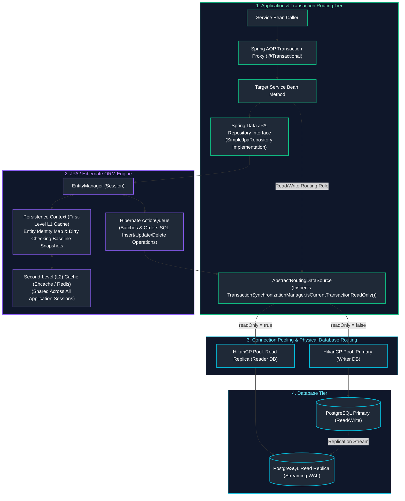
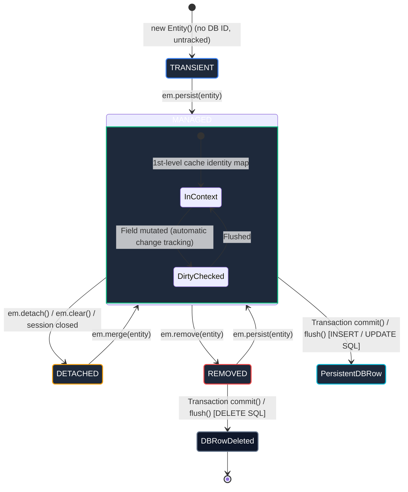
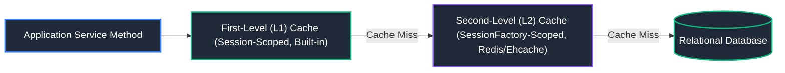
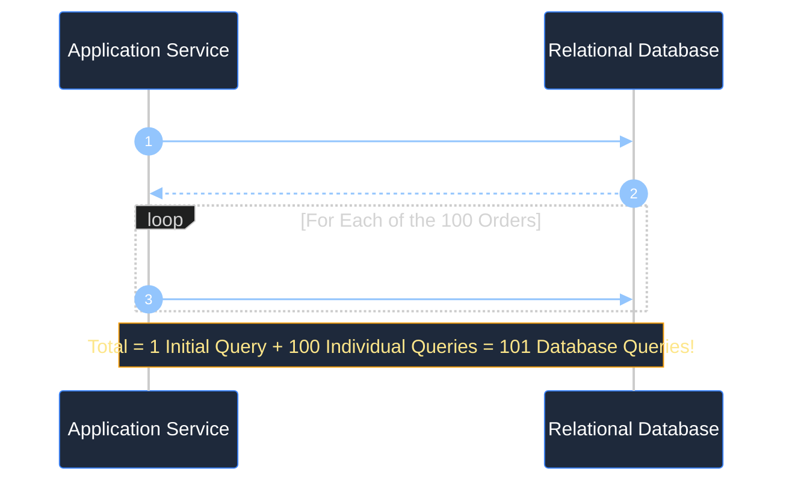
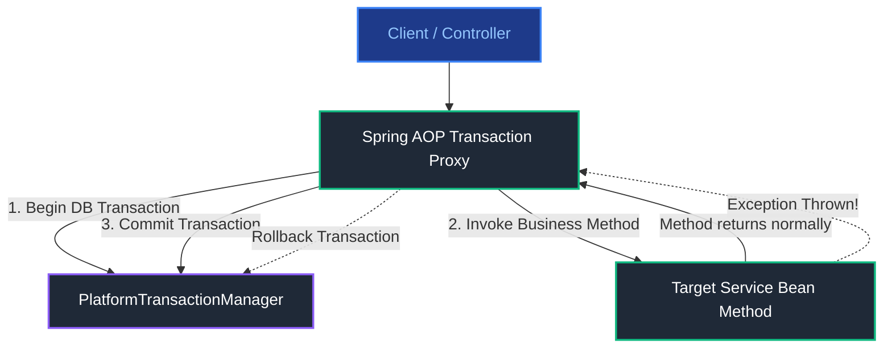
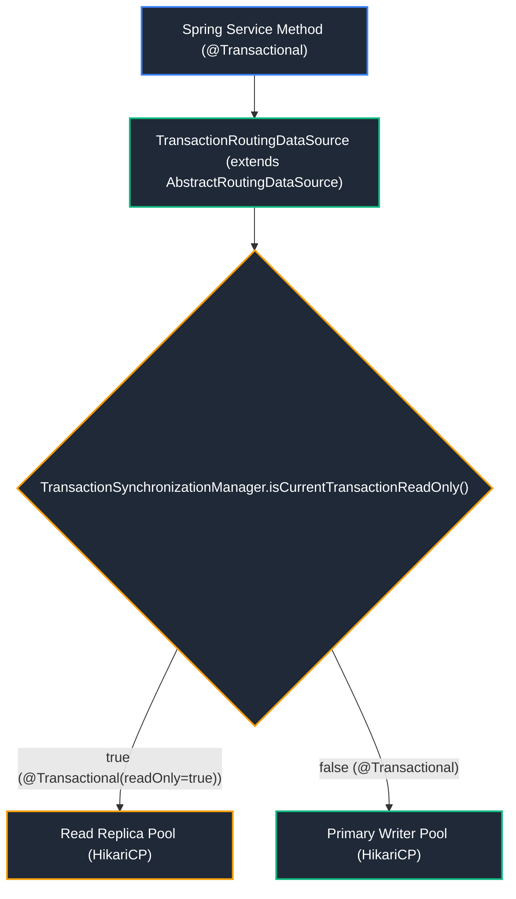

# 10. Spring Data, JDBC, JPA, Hibernate & Transactions

A comprehensive, production-grade guide covering low-level JDBC mechanics, Java Persistence API (JPA), Hibernate ORM internals (Persistence Context, First-Level and Second-Level caching, Dirty Checking, ByteBuddy proxies), entity relationship modeling, the N+1 query problem and its 3 production fixes, Cartesian product issues (`MultipleBagFetchException`), dynamic Read/Write splitting (`AbstractRoutingDataSource`), the Open-Session-In-View (OSIV) anti-pattern, optimistic locking retries, transaction management (`@Transactional`, propagation, isolation), and connection leak diagnostics.

---

## Architectural Overview: Enterprise JPA, Hibernate & Transaction Architecture



---

## Table of Contents
1. [JDBC Foundations & Connection Pooling](#1-jdbc-foundations-connection-pooling)
   - [1.1 JDBC Architecture & `PreparedStatement` Precompilation](#11-jdbc-architecture-preparedstatement-precompilation)
   - [1.2 Connection Pooling & HikariCP Configuration Defaults](#12-connection-pooling-hikaricp-configuration-defaults)
2. [JPA Architecture & The 4 Entity Lifecycle States](#2-jpa-architecture-the-4-entity-lifecycle-states)
   - [2.1 JPA Specification vs Hibernate Implementation](#21-jpa-specification-vs-hibernate-implementation)
   - [2.2 The Persistence Context & Entity Lifecycle State Machine](#22-the-persistence-context-entity-lifecycle-state-machine)
   - [2.3 Query Paradigms: JPQL vs Native SQL vs Criteria API](#23-query-paradigms-jpql-vs-native-sql-vs-criteria-api)
3. [Hibernate ORM Internals & Caching Layers](#3-hibernate-orm-internals-caching-layers)
   - [3.1 First-Level (L1) Cache vs Second-Level (L2) Cache](#31-first-level-l1-cache-vs-second-level-l2-cache)
   - [3.2 Automatic Dirty Checking & Flush Modes](#32-automatic-dirty-checking-flush-modes)
   - [3.3 Hibernate Bytecode Proxies & Lazy vs Eager Loading](#33-hibernate-bytecode-proxies-lazy-vs-eager-loading)
4. [Entity Relationships & Mapping Rules](#4-entity-relationships-mapping-rules)
   - [4.1 Relationship Mappings (`@OneToOne`, `@ManyToOne`, `@OneToMany`, `@ManyToMany`)](#41-relationship-mappings-onetoone-manytoone-onetomany-manytomany)
   - [4.2 The Ownership Rule & `mappedBy`](#42-the-ownership-rule-mappedby)
   - [4.3 Cascading (`CascadeType.ALL`) & `orphanRemoval = true`](#43-cascading-cascadetypeall-orphanremoval-true)
5. [JPA Performance Hazards, Locking & Remedies](#5-jpa-performance-hazards-locking-remedies)
   - [5.1 The N+1 Query Problem: Root Cause & 3 Production Fixes (`JOIN FETCH`, `@EntityGraph`, `@BatchSize`)](#51-the-n1-query-problem-root-cause-3-production-fixes-join-fetch-entitygraph-batchsize)
   - [5.2 The Cartesian Product Problem & `MultipleBagFetchException`](#52-the-cartesian-product-problem-multiplebagfetchexception)
   - [5.3 Optimistic Locking (`@Version`) with Automated Spring Retry](#53-optimistic-locking-version-with-automated-spring-retry)
   - [5.4 Pessimistic Locking (`SELECT FOR UPDATE`) & Deadlock Prevention](#54-pessimistic-locking-select-for-update-deadlock-prevention)
6. [Spring Data JPA Abstractions](#6-spring-data-jpa-abstractions)
   - [6.1 Derived Query Methods & Custom `@Query`](#61-derived-query-methods-custom-query)
   - [6.2 Interface-based vs DTO Projections](#62-interface-based-vs-dto-projections)
7. [Transaction Management & Advanced Database Routing](#7-transaction-management-advanced-database-routing)
   - [7.1 Spring Transaction AOP Proxies & The Self-Invocation Trap](#71-spring-transaction-aop-proxies-the-self-invocation-trap)
   - [7.2 Transaction Propagation Levels Explained](#72-transaction-propagation-levels-explained)
   - [7.3 Transaction Isolation Levels & Rollback Rules (`readOnly = true`)](#73-transaction-isolation-levels-rollback-rules-readonly-true)
   - [7.4 Dynamic Read/Write Splitting via `AbstractRoutingDataSource`](#74-dynamic-readwrite-splitting-via-abstractroutingdatasource)
   - [7.5 The Open-Session-In-View (OSIV) Anti-Pattern: Hazards & Clean Deactivation](#75-the-open-session-in-view-osiv-anti-pattern-hazards-clean-deactivation)
   - [7.6 HikariCP Connection Leak Detection & Nested Transaction Deadlock Prevention](#76-hikaricp-connection-leak-detection-nested-transaction-deadlock-prevention)
8. [JPA & Database Performance Best Practices Reference](#8-jpa-database-performance-best-practices-reference)
9. [Summary Comparison & Engineering Reference Matrix](#9-summary-comparison-engineering-reference-matrix)
10. [References & Further Reading](#10-references-further-reading)

---

# 1. JDBC Foundations & Connection Pooling

---

### 1.1 JDBC Architecture & `PreparedStatement` Precompilation

Java Database Connectivity (JDBC) is the foundational low-level Java API (`java.sql`) that communicates directly with relational databases via database drivers.

#### Why `PreparedStatement` Over `Statement`
1. **Zero SQL Injection Vulnerability**: SQL templates are precompiled by the database parser. Parameters supplied via `setXxx()` placeholders (`?`) are bound strictly as data literals, never as executable SQL commands.
2. **Precompilation & Execution Plan Caching**: The database compiles and optimizes the query plan once; repeated executions reuse the cached execution plan.

```java
String sql = "SELECT id, name, balance FROM accounts WHERE balance > ? AND status = ?";

try (Connection conn = dataSource.getConnection();
     PreparedStatement ps = conn.prepareStatement(sql)) {

    ps.setDouble(1, 1000.0);
    ps.setString(2, "ACTIVE");

    try (ResultSet rs = ps.executeQuery()) {
        while (rs.next()) {
            long id = rs.getLong("id");
            String name = rs.getString("name");
            double bal = rs.getDouble("balance");
            System.out.println("Account #" + id + ": " + name + " ($" + String.format("%.2f", bal) + ")");
        }
    }
}
```

---

### 1.2 Connection Pooling & HikariCP Configuration Defaults

Establishing raw database connections involves TCP handshakes, SSL negotiation, and process authentication (~50–100ms per connection). **HikariCP** maintains a pool of pre-allocated, healthy connections ready for instant borrowing.

```properties
# Production HikariCP Defaults in Spring Boot application.properties
spring.datasource.hikari.maximum-pool-size=10
spring.datasource.hikari.minimum-idle=5
spring.datasource.hikari.connection-timeout=30000
spring.datasource.hikari.idle-timeout=600000
spring.datasource.hikari.max-lifetime=1800000
# Leak detection: Emits stack trace if a thread holds a connection > 5 seconds!
spring.datasource.hikari.leak-detection-threshold=5000
```

---

# 2. JPA Architecture & The 4 Entity Lifecycle States

---

### 2.1 JPA Specification vs Hibernate Implementation

- **JPA (Jakarta Persistence)**: An official Java specification consisting of interfaces (`EntityManager`, `EntityTransaction`), annotations (`@Entity`, `@Table`, `@Column`), and querying rules (JPQL).
- **Hibernate ORM**: The concrete open-source implementation engine that executes the JPA specification, translates JPQL into dialect-specific SQL, manages caches, and coordinates transactions.

---

### 2.2 The Persistence Context & Entity Lifecycle State Machine

The **Persistence Context** is an in-memory storage area managed by `EntityManager` where managed entity instances are held. It acts as an **Identity Map** (ensuring only one Java object instance exists per database primary key within a session).



1. **Transient / New**: Instantiated via `new Product()`; not associated with any Persistence Context; has no primary key ID in the database.
2. **Managed**: Associated with an active Persistence Context; has a database primary key; changes to fields are automatically tracked by dirty checking.
3. **Detached**: Previously managed, but the Persistence Context was closed or cleared (`em.detach()`). Changes are not tracked.
4. **Removed**: Marked for deletion; physical `DELETE` SQL executes upon transaction flush/commit.

---

### 2.3 Query Paradigms: JPQL vs Native SQL vs Criteria API

- **JPQL (Java Persistence Query Language)**: Queries against the object-oriented domain model (`SELECT o FROM Order o WHERE o.totalAmount > :val`) rather than database tables. Portable across database vendors.
- **Native SQL**: Direct database-specific SQL (`@Query(value = "SELECT * FROM orders WHERE ...", nativeQuery = true)`). Used when vendor-specific SQL extensions are required (e.g. Postgres JSONB operators).
- **Criteria API**: Type-safe programmatic query construction using Java code, ideal for dynamic multi-criteria search filters.

---

# 3. Hibernate ORM Internals & Caching Layers

---

### 3.1 First-Level (L1) Cache vs Second-Level (L2) Cache



| Dimension | First-Level (L1) Cache | Second-Level (L2) Cache |
| :--- | :--- | :--- |
| **Scope** | Single `EntityManager` / `Session` | Global `EntityManagerFactory` / Application |
| **Default State** | **Always enabled** (cannot be disabled) | **Disabled by default** (requires explicit config) |
| **Thread Safety** | Thread-confined (not shared across threads) | Thread-safe (shared cluster-wide via Redis/Ehcache) |
| **Lifecycle** | Destroyed when transaction / Session ends | Persists across transactions and user sessions |

---

### 3.2 Automatic Dirty Checking & Flush Modes

- **Dirty Checking**: Upon loading an entity, Hibernate preserves a bit-level snapshot of its initial state in the L1 cache. During `flush()`, Hibernate compares current field values against the snapshot. If any value changed, it automatically schedules an `UPDATE` statement without calling `save()`.
- **Flush**: Synchronizes in-memory persistence context changes with the underlying database by executing queued SQL statements (`INSERT`, `UPDATE`, `DELETE`). Flush occurs automatically before transaction commit or before executing queries that touch modified tables.

---

### 3.3 Hibernate Bytecode Proxies & Lazy vs Eager Loading

- **Lazy Loading (`FetchType.LAZY`)**: Association is not fetched immediately. Hibernate injects a **ByteBuddy Proxy**. The query executes only when an association method is first invoked (`order.getCustomer().getName()`).
- **Eager Loading (`FetchType.EAGER`)**: Association is loaded immediately using an outer join. Can cause severe performance bottlenecks when entity trees are large.

---

# 4. Entity Relationships & Mapping Rules

---

### 4.1 Relationship Mappings (`@OneToOne`, `@ManyToOne`, `@OneToMany`, `@ManyToMany`)

```java
@Entity
@Table(name = "orders")
public class Order {
    @Id
    @GeneratedValue(strategy = GenerationType.IDENTITY)
    private Long id;

    // Best Practice: Always configure ManyToOne as LAZY
    @ManyToOne(fetch = FetchType.LAZY)
    @JoinColumn(name = "customer_id", nullable = false)
    private Customer customer;

    @OneToMany(mappedBy = "order", cascade = CascadeType.ALL, orphanRemoval = true)
    private List<OrderItem> items = new ArrayList<>();
}
```

---

### 4.2 The Ownership Rule & `mappedBy`

- **Owner of the Relationship**: The entity whose table contains the physical foreign key column (`@JoinColumn`).
- **Inverse Side**: Declares `mappedBy = "fieldName"` pointing to the owning field in the child entity. Modifying collections on the inverse side without updating the owning side will **not** update foreign keys in the database!

---

### 4.3 Cascading (`CascadeType.ALL`) & `orphanRemoval = true`

- **`CascadeType.ALL`**: Propagates all lifecycle events (`PERSIST`, `MERGE`, `REMOVE`, `REFRESH`, `DETACH`) from parent to child.
- **`orphanRemoval = true`**: When an element is removed from the parent's collection (`order.getItems().remove(item)`), Hibernate automatically issues a SQL `DELETE` for that orphaned record in the database.

---

# 5. JPA Performance Hazards, Locking & Remedies

---

### 5.1 The N+1 Query Problem: Root Cause & 3 Production Fixes (`JOIN FETCH`, `@EntityGraph`, `@BatchSize`)

The N+1 problem occurs when an application executes 1 initial query to fetch $N$ parent records, and subsequently fires $N$ individual separate queries to fetch lazy associations for each parent row:



#### Production Solution 1: JPQL `JOIN FETCH` (Single Query Inner/Left Join)
```java
public interface OrderRepository extends JpaRepository<Order, Long> {
    @Query("SELECT o FROM Order o JOIN FETCH o.customer JOIN FETCH o.items")
    List<Order> findAllWithAssociations();
}
```

#### Production Solution 2: Spring Data `@EntityGraph` (Declarative Fetch Plan)
```java
public interface OrderRepository extends JpaRepository<Order, Long> {
    @EntityGraph(attributePaths = {"customer", "items"})
    List<Order> findAll();
}
```

#### Production Solution 3: Hibernate Batch Fetching (`@BatchSize`)
Replaces $N$ individual queries with a single query using an `IN (?, ?, ...)` clause:
```properties
# application.properties: Automatically batches lazy collection fetches
spring.jpa.properties.hibernate.default_batch_fetch_size=25
```

---

### 5.2 The Cartesian Product Problem & `MultipleBagFetchException`

When an entity has more than one `@OneToMany` collection relationship mapped as a `java.util.List` (known as a "Bag" in Hibernate):

```java
@Entity
public class Order {
    @OneToMany(mappedBy = "order")
    private List<OrderItem> items; // Bag 1

    @OneToMany(mappedBy = "order")
    private List<OrderTag> tags;   // Bag 2
}
```

If you attempt to write:
`SELECT o FROM Order o JOIN FETCH o.items JOIN FETCH o.tags`

#### What Goes Wrong?
1. **`MultipleBagFetchException`**: Hibernate refuses to execute this query with `org.hibernate.loader.MultipleBagFetchException: cannot simultaneously fetch multiple bags`.
2. **Cartesian Product Multiplication**: If an order has 20 items and 20 tags, SQL generates $20 \times 20 = \mathbf{400 \text{ rows}}$ per order! For 1,000 orders, 400,000 rows are transmitted across the network, exhausting JVM heap memory.

#### Production Solutions:
- **Solution A (Use `Set`)**: Map collections as `java.util.Set` instead of `List`.
- **Solution B (Two Separate Queries - Recommended)**:
  ```java
  // Query 1: Fetches orders and items
  List<Order> orders = entityManager.createQuery(
      "SELECT DISTINCT o FROM Order o LEFT JOIN FETCH o.items", Order.class).getResultList();

  // Query 2: Fetches tags for the already managed orders in Persistence Context
  orders = entityManager.createQuery(
      "SELECT DISTINCT o FROM Order o LEFT JOIN FETCH o.tags WHERE o IN :orders", Order.class)
      .setParameter("orders", orders)
      .getResultList();
  ```

---

### 5.3 Optimistic Locking (`@Version`) with Automated Spring Retry

Optimistic locking assumes collisions are rare and verifies that no concurrent transaction updated the record by checking a `@Version` field. When a collision occurs, Spring throws `OptimisticLockingFailureException`.

#### Production Solution: Automatic Spring Retry with Backoff

```java
package com.company.service;

import jakarta.persistence.OptimisticLockException;
import org.springframework.dao.OptimisticLockingFailureException;
import org.springframework.retry.annotation.Backoff;
import org.springframework.retry.annotation.Retryable;
import org.springframework.stereotype.Service;
import org.springframework.transaction.annotation.Transactional;

@Service
public class InventoryService {

    private final ProductStockRepository stockRepository;

    public InventoryService(ProductStockRepository stockRepository) {
        this.stockRepository = stockRepository;
    }

    // Automatically retries up to 3 times with exponential backoff on version conflict!
    @Retryable(
        retryFor = {OptimisticLockingFailureException.class, OptimisticLockException.class},
        maxAttempts = 3,
        backoff = @Backoff(delay = 100, multiplier = 2.0)
    )
    @Transactional
    public void deductStock(Long productId, int quantity) {
        ProductStock stock = stockRepository.findById(productId)
            .orElseThrow(() -> new IllegalArgumentException("Product not found"));

        if (stock.getAvailableQuantity() < quantity) {
            throw new IllegalStateException("Insufficient inventory");
        }

        stock.setAvailableQuantity(stock.getAvailableQuantity() - quantity);
        // Hibernate automatically emits: UPDATE product_stock SET quantity = ?, version = ? + 1
        // WHERE id = ? AND version = ?
    }
}
```

---

### 5.4 Pessimistic Locking (`SELECT FOR UPDATE`) & Deadlock Prevention

Pessimistic locking holds physical database row locks when high contention makes optimistic retries inefficient:

```java
public interface ProductStockRepository extends JpaRepository<ProductStock, Long> {

    // Emits SQL: SELECT * FROM product_stock WHERE id = ? FOR UPDATE
    @Lock(LockModeType.PESSIMISTIC_WRITE)
    @Query("SELECT ps FROM ProductStock ps WHERE ps.id = :id")
    Optional<ProductStock> findByIdWithExclusiveLock(@Param("id") Long id);
}
```

> [!WARNING]
> **Deadlock Prevention Rule**: When multiple transactions lock multiple rows, **always acquire locks in a consistent, deterministic order** (e.g. sorted by `id` ASC). If Transaction A locks row 1 then row 2, while Transaction B locks row 2 then row 1, the database triggers a **Deadlock Exception**!

---

# 6. Spring Data JPA Abstractions

---

### 6.1 Derived Query Methods & Custom `@Query`

```java
public interface UserRepository extends JpaRepository<User, Long> {
    // Derived query: Spring Data parses method signature into SQL
    List<User> findByStatusAndAgeGreaterThan(String status, int age);

    // Custom JPQL
    @Query("SELECT u FROM User u WHERE LOWER(u.email) LIKE LOWER(CONCAT('%', :domain))")
    List<User> findUsersByEmailDomain(@Param("domain") String domain);

    // Modifying DML query
    @Modifying
    @Query("UPDATE User u SET u.status = 'INACTIVE' WHERE u.lastLogin < :cutoff")
    int deactivateInactiveUsers(@Param("cutoff") Instant cutoff);
}
```

---

### 6.2 Interface-based vs DTO Projections

Prevent fetching 40 database columns when only 2 are needed:

```java
// Interface-based Projection: Hibernate selects only id and email
public interface UserSummary {
    Long getId();
    String getEmail();
}

public interface UserRepository extends JpaRepository<User, Long> {
    List<UserSummary> findByDepartment(String department);
}
```

---

# 7. Transaction Management & Advanced Database Routing

---

### 7.1 Spring Transaction AOP Proxies & The Self-Invocation Trap

Spring implements declarative transaction boundaries using **AOP Dynamic Proxies**:



> [!WARNING]
> **The Self-Invocation Trap**: Calling a `@Transactional` method from another method in the **same class** (`this.updateData()`) bypasses the Spring AOP proxy. The transaction annotations are completely ignored! Fix by extracting to a separate service bean or injecting the self-reference via `@Autowired`.

---

### 7.2 Transaction Propagation Levels Explained

| Propagation | Behavior If Transaction Exists | Behavior If No Transaction Exists |
| :--- | :--- | :--- |
| **`REQUIRED` (Default)** | Joins the active transaction | Starts a new transaction |
| **`REQUIRES_NEW`** | **Suspends** active transaction; creates an independent new transaction | Starts a new transaction |
| **`MANDATORY`** | Joins the active transaction | Throws `TransactionRequiredException` |
| **`SUPPORTS`** | Joins the active transaction | Executes non-transactionally |
| **`NOT_SUPPORTED`** | Suspends active transaction | Executes non-transactionally |
| **`NEVER`** | Throws exception | Executes non-transactionally |

---

### 7.3 Transaction Isolation Levels & Rollback Rules (`readOnly = true`)

- **`readOnly = true` Optimization**: Informs Hibernate that the transaction will not modify data. Hibernate disables dirty checking snapshots in the Persistence Context, reducing memory consumption and CPU usage.
- **Rollback Rules**: By default, Spring rolls back transactions **only on unchecked exceptions** (`RuntimeException` and `Error`). Checked exceptions (`Exception`) do **not** trigger rollbacks unless configured explicitly:
  ```java
  @Transactional(rollbackFor = Exception.class)
  public void processOrder() throws BusinessException { ... }
  ```

---

### 7.4 Dynamic Read/Write Splitting via `AbstractRoutingDataSource`

In high-throughput enterprise systems, read queries should be offloaded to Read Replicas, preserving Primary database capacity for writes:



#### Working Code Example: `TransactionRoutingDataSource`

```java
package com.company.datasource;

import org.springframework.jdbc.datasource.lookup.AbstractRoutingDataSource;
import org.springframework.transaction.support.TransactionSynchronizationManager;

public class TransactionRoutingDataSource extends AbstractRoutingDataSource {

    public enum DataSourceType { PRIMARY, REPLICA }

    @Override
    protected Object determineCurrentLookupKey() {
        // Automatically route to REPLICA if current Spring transaction is marked readOnly
        boolean isReadOnly = TransactionSynchronizationManager.isCurrentTransactionReadOnly();
        return isReadOnly ? DataSourceType.REPLICA : DataSourceType.PRIMARY;
    }
}
```

---

### 7.5 The Open-Session-In-View (OSIV) Anti-Pattern: Hazards & Clean Deactivation

By default, Spring Boot enables `spring.jpa.open-in-view=true`.

#### How OSIV Works:
Spring binds an `EntityManager` (and holds an active JDBC connection) throughout the **entire HTTP request lifecycle**, spanning the servlet filter chain, controller, and Jackson JSON serialization.

#### Why OSIV Is Dangerous in Production:
1. **Connection Pool Starvation**: If Jackson serializes a large payload over a slow client connection, or if a controller executes slow REST calls, the database connection is held hostage for seconds, starving the HikariCP connection pool.
2. **Hidden Queries during JSON Serialization**: Accessing lazy fields inside DTO mapping triggers unexpected SQL queries outside the transactional boundary.

#### The Production Fix:
```properties
# Always disable OSIV in production application.properties
spring.jpa.open-in-view=false
```
Always fetch required associations inside the service layer using `@EntityGraph`, `JOIN FETCH`, or explicit DTO projections!

---

### 7.6 HikariCP Connection Leak Detection & Nested Transaction Deadlock Prevention

#### 1. Diagnosing Connection Leaks
When an application thread borrows a connection from HikariCP and fails to close it (or executes long-running HTTP calls inside a transaction), configure:
```properties
# Emits full stack trace if connection is not returned within 5 seconds
spring.datasource.hikari.leak-detection-threshold=5000
```

#### 2. The Nested Transaction Deadlock Hazard
```java
@Transactional // Borrows Connection A from HikariCP pool
public void outerMethod() {
    auditService.recordAudit(); // @Transactional(propagation = REQUIRES_NEW) -> Borrows Connection B!
}
```
If the HikariCP pool size is set to `maximum-pool-size=1` (or if all pool connections are held by concurrent outer methods), the inner `REQUIRES_NEW` method will wait forever for a free connection that can only be released when the outer method finishes, causing a **fatal connection pool deadlock**!

---

# 8. JPA & Database Performance Best Practices Reference

| Best Practice Rule | Why It Matters in Production | Implementation Pattern |
| :--- | :--- | :--- |
| **Default to `LAZY` for `@ManyToOne`** | `@ManyToOne` defaults to `EAGER` in JPA, silently triggering unwanted joins on every query | `@ManyToOne(fetch = FetchType.LAZY)` |
| **Always use `JOIN FETCH` or `@EntityGraph`** | Prevents the N+1 query problem from exhausting database connection pools | `@EntityGraph(attributePaths = {"..."})` |
| **Avoid `MultipleBagFetchException`** | Prevents cartesian product row explosion when fetching multiple collections | Map as `Set` or execute two separate queries |
| **Always Disable OSIV in Production** | Prevents slow client requests and JSON rendering from holding DB connections open | `spring.jpa.open-in-view=false` |
| **Enable Batch Inserts & Updates** | Groups hundreds of separate SQL `INSERT` statements into a single batch network call | `spring.jpa.properties.hibernate.jdbc.batch_size=50` |
| **Mark read operations `readOnly = true`** | Disables Hibernate dirty checking memory snapshots & enables replica routing | `@Transactional(readOnly = true)` |
| **Add HikariCP Leak Detection** | Surfaces stack traces of code holding connections excessively long | `spring.datasource.hikari.leak-detection-threshold=5000` |

---

# 9. Summary Comparison & Engineering Reference Matrix

| Persistence Dimension | Plain JDBC / JdbcClient | Spring Data JPA / Hibernate | jOOQ | MyBatis |
| :--- | :--- | :--- | :--- | :--- |
| **Primary Abstraction** | Direct SQL over `java.sql.Connection` | Object-Relational Mapping (Entities & Persistence Context) | Type-safe fluent Java DSL generated from DB schema | XML/Annotation SQL mapper to POJOs |
| **Query Flexibility** | Total control; raw SQL strings | High for CRUD/navigational; complex for OLAP/reporting | High; compiles to precise dialect SQL | High; raw SQL with dynamic templating |
| **Type Safety** | None (String queries, manual index extraction) | Compile-time validation via Metamodel / Criteria | Total compile-time type safety via generated metamodel | Low (Strings/XML maps verified at runtime) |
| **Memory & Performance Overhead** | Near-zero overhead | High (entity proxying, hydration snapshot, dirty checking) | Near-zero (thin wrapper around JDBC result sets) | Low (direct mapping from result sets to POJOs) |
| **Write Optimization** | Manual `addBatch()` calls | Automatic write-behind dirty checking & JDBC batching | Fluent `batchInsert()` / `batchUpdate()` | Dynamic XML `<foreach>` batch inserts |
| **N+1 Query Hazard** | Non-existent (developer explicitly writes joins) | Severe risk if lazy relationships are traversed naively | Non-existent (explicit joins and multiset arrays) | Non-existent (explicit joins and result maps) |
| **Best Production Use Case** | Ultra-low latency micro-benchmarks or simple scripts | Enterprise CRUD microservices with transactional state machines | Complex analytical SQL, dynamic filtering & financial ledgers | Legacy DB integration with heavily customized stored procedures |

---

# 10. References & Further Reading

- [GeeksforGeeks - Spring Boot JPA and Hibernate Guide](https://www.geeksforgeeks.org/spring-boot-jpa/)
- [GeeksforGeeks - Transactions in Spring Data JPA](https://www.geeksforgeeks.org/transaction-management-in-spring/)
- [Baeldung - Learn JPA and Hibernate Guide](https://www.baeldung.com/learn-jpa-hibernate)
- [Baeldung - N+1 Query Problem in Hibernate and Solutions](https://www.baeldung.com/hibernate-n-plus-one)
- [Vlad Mihalcea - High-Performance Java Persistence Blog Tutorials](https://vladmihalcea.com/tutorials/)
- [Hibernate ORM Official User Guide & Performance Tuning](https://hibernate.org/orm/documentation/)
- [Spring Data JPA Reference Documentation](https://docs.spring.io/spring-data/jpa/docs/current/reference/html/)
