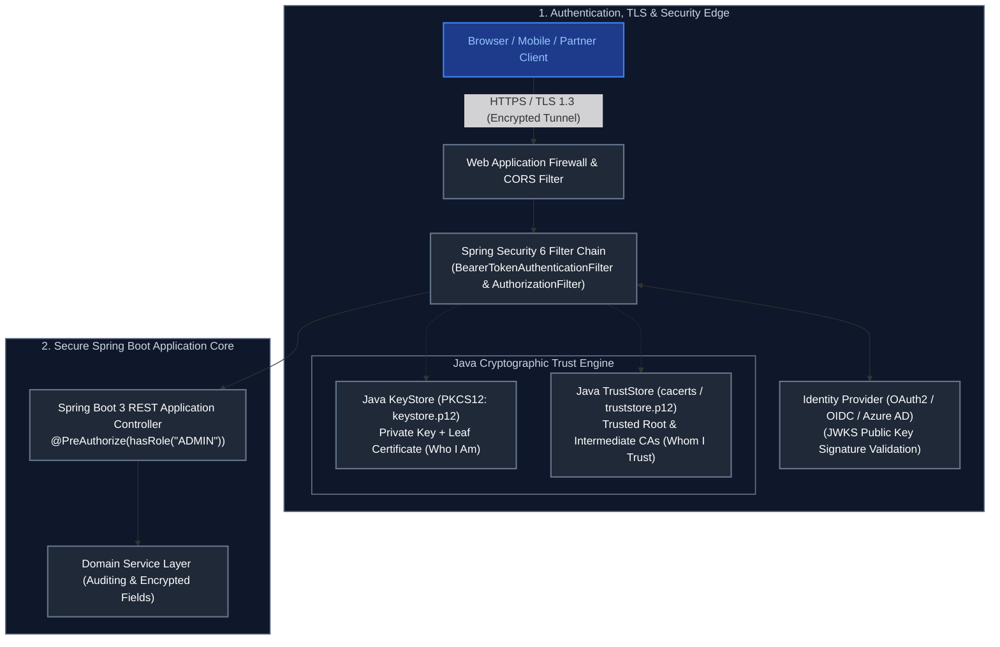
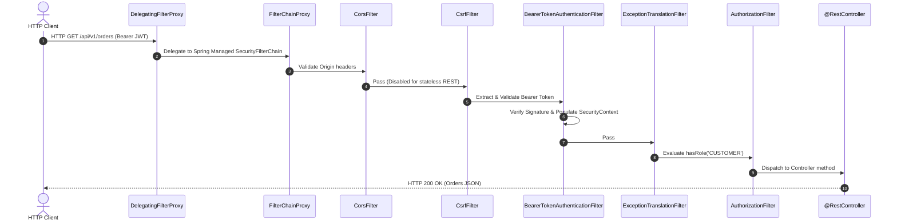
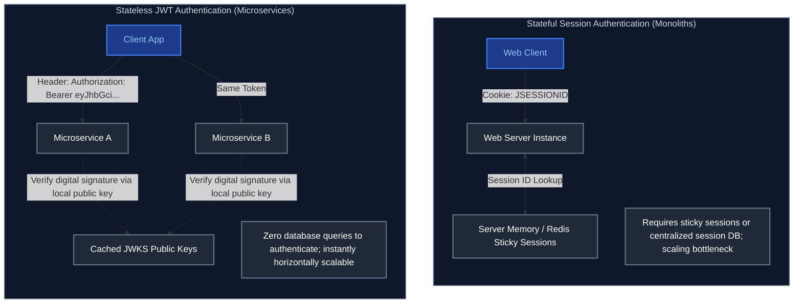
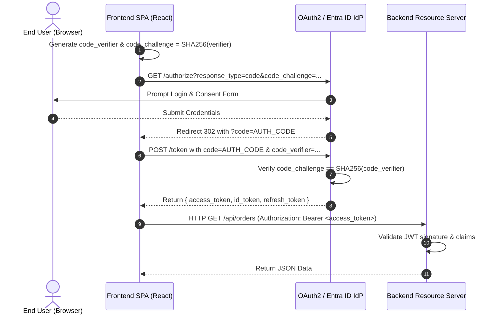
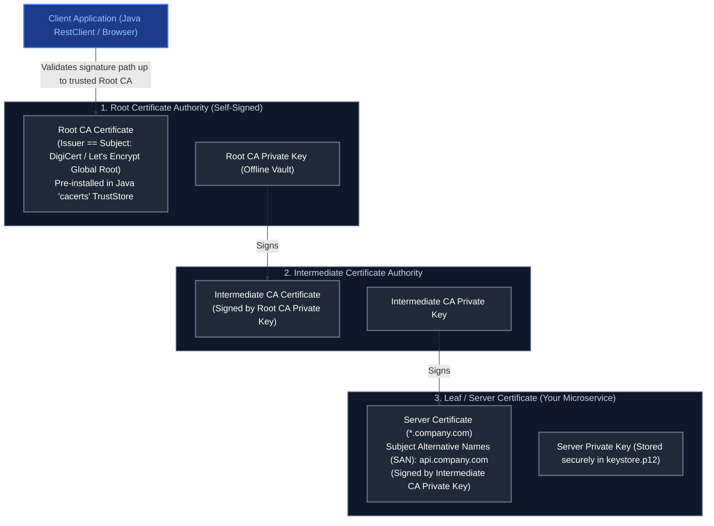
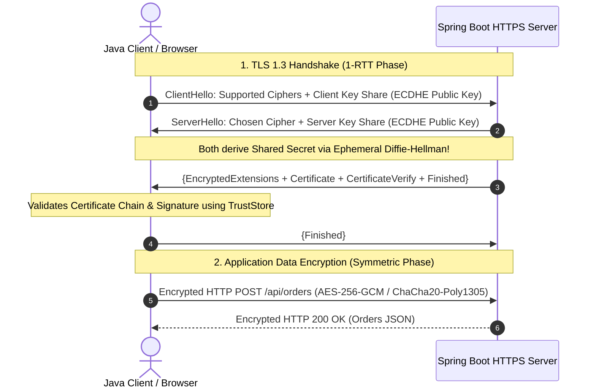
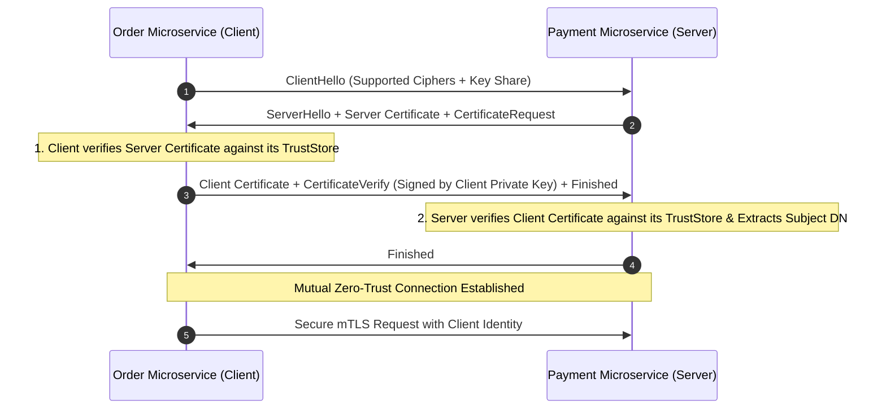
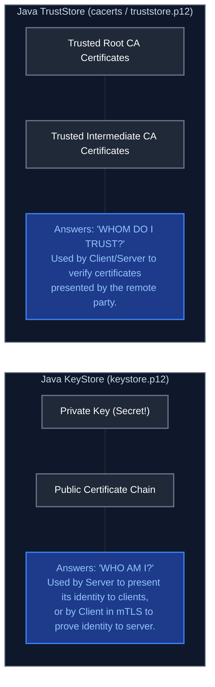

# 11. Security, Identity & Cryptographic Certificate Management

A comprehensive, production-grade guide covering Spring Security 6 internal filter architectures, stateless OAuth 2.0 / OIDC authentication with PKCE, Web application defense (OWASP Top 10), Security response headers, Public Key Infrastructure (PKI), TLS 1.3 handshakes, Java Keystores (`KeyStore`) vs Truststores (`TrustStore`), Mutual TLS (mTLS), Spring Boot 3.1+ SSL Bundles (`SslBundle`), and production SSL/TLS diagnostics (`keytool`, `openssl`).

---

## Architectural Overview: Enterprise Security & Cryptographic Trust Architecture



---

## Table of Contents
1. [Spring Security 6 & API Authentication](#1-spring-security-6-api-authentication)
   - [1.1 Authentication (AuthN) vs Authorization (AuthZ)](#11-authentication-authn-vs-authorization-authz)
   - [1.2 The Spring Security Filter Chain Internal Architecture](#12-the-spring-security-filter-chain-internal-architecture)
   - [1.3 Password Hashing Algorithms: BCrypt vs Argon2](#13-password-hashing-algorithms-bcrypt-vs-argon2)
   - [1.4 Stateful Session-Based vs Stateless JWT Token Authentication](#14-stateful-session-based-vs-stateless-jwt-token-authentication)
   - [1.5 OAuth 2.0 & OpenID Connect (PKCE & Client Credentials Flow)](#15-oauth-20-openid-connect-pkce-client-credentials-flow)
   - [1.6 Role-Based (RBAC), Attribute-Based (ABAC) & Method Security (`@PreAuthorize`)](#16-role-based-rbac-attribute-based-abac-method-security-preauthorize)
2. [Web Application Security & OWASP Defense](#2-web-application-security-owasp-defense)
   - [2.1 OWASP Top Vulnerabilities & Spring Boot Defenses (CSRF, XSS, SQLi, SSRF, IDOR)](#21-owasp-top-vulnerabilities-spring-boot-defenses-csrf-xss-sqli-ssrf-idor)
   - [2.2 Security Response Headers, HTTPS/TLS & Secrets Management](#22-security-response-headers-httpstls-secrets-management)
3. [Certificate Management, SSL/TLS, Keystores & Mutual TLS (mTLS) in Java](#3-certificate-management-ssltls-keystores-mutual-tls-mtls-in-java)
   - [3.1 Public Key Infrastructure (PKI) & X.509 Certificate Chain of Trust](#31-public-key-infrastructure-pki-x509-certificate-chain-of-trust)
   - [3.2 TLS 1.3 vs TLS 1.2 Handshake Deep-Dive & Perfect Forward Secrecy](#32-tls-13-vs-tls-12-handshake-deep-dive-perfect-forward-secrecy)
   - [3.3 Mutual TLS (mTLS / Two-Way SSL) in Microservices & Banking APIs](#33-mutual-tls-mtls-two-way-ssl-in-microservices-banking-apis)
   - [3.4 Java Keystore (`KeyStore`) vs Truststore (`TrustStore`)](#34-java-keystore-keystore-vs-truststore-truststore)
   - [3.5 Spring Boot 3.1+ SSL Bundles (`SslBundle`) & Dynamic Certificate Reloading](#35-spring-boot-31-ssl-bundles-sslbundle-dynamic-certificate-reloading)
   - [3.6 Certificate Management CLI (`keytool` & `openssl`) Cheatsheet](#36-certificate-management-cli-keytool-openssl-cheatsheet)
   - [3.7 Production SSL/TLS Troubleshooting & Top Java Exceptions (PKIX Path Building Failed)](#37-production-ssltls-troubleshooting-top-java-exceptions-pkix-path-building-failed)
4. [Summary Comparison & Engineering Reference Matrix](#4-summary-comparison-engineering-reference-matrix)
5. [References & Further Reading](#5-references-further-reading)

---

# 1. Spring Security 6 & API Authentication

---

### 1.1 Authentication (AuthN) vs Authorization (AuthZ)

- **Authentication (AuthN)**: "Who are you?" Verifying the claimed identity of an entity (e.g., verifying user credentials, validating a cryptographic JWT signature against a JWKS public key, or verifying a client mTLS x509 certificate).
- **Authorization (AuthZ)**: "What are you permitted to do?" Evaluating whether an already-authenticated principal holds the requisite roles, scopes, or authorities to access a target URI or method (e.g. `ROLE_ADMIN` deleting a record).

---

### 1.2 The Spring Security Filter Chain Internal Architecture

In Spring Boot 3, all HTTP traffic is intercepted by standard servlet filters orchestrated by `DelegatingFilterProxy` and `FilterChainProxy`:



#### Production Spring Security 6 Configuration

```java
package com.company.security;

import org.springframework.context.annotation.Bean;
import org.springframework.context.annotation.Configuration;
import org.springframework.security.config.annotation.method.configuration.EnableMethodSecurity;
import org.springframework.security.config.annotation.web.builders.HttpSecurity;
import org.springframework.security.config.annotation.web.configuration.EnableWebSecurity;
import org.springframework.security.config.http.SessionCreationPolicy;
import org.springframework.security.crypto.bcrypt.BCryptPasswordEncoder;
import org.springframework.security.crypto.password.PasswordEncoder;
import org.springframework.security.oauth2.server.resource.authentication.JwtAuthenticationConverter;
import org.springframework.security.oauth2.server.resource.authentication.JwtGrantedAuthoritiesConverter;
import org.springframework.security.web.SecurityFilterChain;

@Configuration
@EnableWebSecurity
@EnableMethodSecurity // Enables @PreAuthorize, @PostAuthorize
public class SecurityConfiguration {

    @Bean
    public SecurityFilterChain securityFilterChain(HttpSecurity http) throws Exception {
        return http
            // 1. Disable CSRF for stateless REST APIs using Bearer tokens
            .csrf(csrf -> csrf.disable())
            // 2. Enforce strictly stateless session management (no HTTP sessions created)
            .sessionManagement(sm -> sm.sessionCreationPolicy(SessionCreationPolicy.STATELESS))
            // 3. Define explicit endpoint authorization rules
            .authorizeHttpRequests(auth -> auth
                .requestMatchers("/api/v1/public/**", "/actuator/health/**").permitAll()
                .requestMatchers("/api/v1/admin/**").hasRole("ADMIN")
                .requestMatchers("/api/v1/orders/**").hasAnyRole("CUSTOMER", "ADMIN")
                .anyRequest().authenticated()
            )
            // 4. Configure OAuth2 Resource Server for JWT token validation
            .oauth2ResourceServer(oauth2 -> oauth2
                .jwt(jwt -> jwt.jwtAuthenticationConverter(jwtAuthenticationConverter()))
            )
            .build();
    }

    @Bean
    public JwtAuthenticationConverter jwtAuthenticationConverter() {
        JwtGrantedAuthoritiesConverter grantedAuthoritiesConverter = new JwtGrantedAuthoritiesConverter();
        grantedAuthoritiesConverter.setAuthoritiesClaimName("roles");
        grantedAuthoritiesConverter.setAuthorityPrefix("ROLE_");

        JwtAuthenticationConverter jwtConverter = new JwtAuthenticationConverter();
        jwtConverter.setJwtGrantedAuthoritiesConverter(grantedAuthoritiesConverter);
        return jwtConverter;
    }

    @Bean
    public PasswordEncoder passwordEncoder() {
        return new BCryptPasswordEncoder(12); // Work factor = 12 (4096 rounds)
    }
}
```

---

### 1.3 Password Hashing Algorithms: BCrypt vs Argon2

| Dimension | BCrypt | Argon2 (Argon2id) |
| :--- | :--- | :--- |
| **Algorithm Type** | Adaptive cryptographic work factor ($2^{\text{cost}}$) | Memory-hard password hashing function |
| **Hardware Resistance**| Vulnerable to dedicated ASIC and FPGA brute-force arrays | Highly resistant to GPU and custom ASIC cracking |
| **Salt Handling** | Automatically embeds 128-bit salt within hash string | Configurable salt length, memory cost, and thread count |
| **OWASP Status** | Approved legacy standard | **Top recommendation** for new enterprise systems |

---

### 1.4 Stateful Session-Based vs Stateless JWT Token Authentication



---

### 1.5 OAuth 2.0 & OpenID Connect (PKCE & Client Credentials Flow)



---

### 1.6 Role-Based (RBAC), Attribute-Based (ABAC) & Method Security (`@PreAuthorize`)

- **RBAC**: Access granted based strictly on static user roles (`hasRole('ADMIN')`).
- **ABAC**: Access granted dynamically based on user attributes, resource state, and environmental context (e.g. "A doctor can read patient records *only if* the patient is currently admitted to the doctor's department").
- **Method Security**: Decorate service layer methods with Spring Expression Language (SpEL):
  ```java
  @PreAuthorize("hasRole('ADMIN') or #order.customerId == authentication.principal.id")
  public void cancelOrder(Order order) { ... }
  ```

---

# 2. Web Application Security & OWASP Defense

---

### 2.1 OWASP Top Vulnerabilities & Spring Boot Defenses (CSRF, XSS, SQLi, SSRF, IDOR)

1. **Cross-Site Request Forgery (CSRF)**: Attacker tricks an authenticated user's browser into submitting unauthorized requests. *Defense*: For stateless REST APIs using `Authorization: Bearer` headers, CSRF is disabled because browsers never attach custom authorization headers automatically. For cookie-based apps, enforce `SameSite=Strict` cookies and CSRF tokens.
2. **Cross-Site Scripting (XSS)**: Injection of malicious scripts executed inside a victim's browser. *Defense*: Context-aware output encoding (HTML, JavaScript, CSS), Content Security Policy (`CSP`) headers, and sanitize user HTML input with OWASP Java HTML Sanitizer.
3. **SQL Injection (SQLi)**: Untrusted input concatenated directly into SQL query strings. *Defense*: Always use parameterized queries, PreparedStatement, or Spring Data JPA repositories with named parameters (`@Param`).
4. **Server-Side Request Forgery (SSRF)**: Attacker tricks the backend into making unauthorized HTTP requests to internal networks or cloud metadata services (`http://169.254.169.254`). *Defense*: Whitelist permitted external target domains; block internal IP ranges (`10.0.0.0/8`, `172.16.0.0/12`, `192.168.0.0/16`, `127.0.0.1`).
5. **Insecure Direct Object Reference (IDOR)**: Accessing resources directly via user-supplied IDs without verifying ownership (`/api/documents/1029`). *Defense*: Always verify that the authenticated user owns the requested entity ID before returning data.

---

### 2.2 Security Response Headers, HTTPS/TLS & Secrets Management

Production Spring Boot applications should enforce mandatory HTTP response security headers:
- `Strict-Transport-Security: max-age=31536000; includeSubDomains` (Enforces HTTPS).
- `X-Content-Type-Options: nosniff` (Prevents MIME sniffing attacks).
- `X-Frame-Options: DENY` (Prevents Clickjacking).
- `Content-Security-Policy: default-src 'self'` (Restricts resource loading).

---

# 3. Certificate Management, SSL/TLS, Keystores & Mutual TLS (mTLS) in Java

---

### 3.1 Public Key Infrastructure (PKI) & X.509 Certificate Chain of Trust

Public Key Infrastructure (PKI) underpins secure Internet and inter-service communications by combining **Asymmetric Cryptography** (for authentication and key exchange) with **Symmetric Cryptography** (for high-speed bulk data encryption):



#### X.509 Certificate Components
1. **Subject**: The identity owner of the certificate (e.g. `CN=api.company.com, O=Enterprise Corp`).
2. **Subject Alternative Name (SAN)**: The list of valid hostnames and IP addresses (`DNS:api.company.com, DNS:orders.internal`). Modern TLS clients reject certificates if the requested hostname is not in the SAN extension.
3. **Issuer**: The Certificate Authority (CA) that cryptographically signed this certificate.
4. **Validity Window**: `NotBefore` and `NotAfter` timestamps. Expired certificates cause immediate connection termination.
5. **Public Key & Signature Algorithm**: The public key algorithm (RSA 2048/4096 or ECDSA P-256/P-384) and the cryptographic signature generated by the issuing CA.

---

### 3.2 TLS 1.3 vs TLS 1.2 Handshake Deep-Dive & Perfect Forward Secrecy

TLS 1.3 significantly enhances both security and performance over TLS 1.2, reducing handshake latency from 2 Round Trips (2-RTT) down to **1 Round Trip (1-RTT)**:



#### Why TLS 1.3 Outperforms TLS 1.2
1. **1-RTT Handshake**: Halves network connection setup latency (especially noticeable on cross-region cloud calls).
2. **Elimination of Legacy Vulnerable Primitives**: Completely drops insecure legacy cipher suites (static RSA key exchange, CBC-mode ciphers, SHA-1, RC4, 3DES).
3. **Mandatory Perfect Forward Secrecy (PFS)**: Every session generates ephemeral Diffie-Hellman keys (`ECDHE`). Even if an attacker steals the server's private key a year later, they cannot decrypt previously recorded network traffic.

---

### 3.3 Mutual TLS (mTLS / Two-Way SSL) in Microservices & Banking APIs

In standard One-Way TLS, only the server proves its identity to the client. In **Mutual TLS (mTLS)**, both the client and the server cryptographically authenticate each other:



- **Zero-Trust Networking**: Guarantees that only authorized microservices with valid private keys issued by the enterprise internal CA can invoke payment endpoints.
- **Identity Extraction**: Spring Security can inspect the client certificate subject (`X509AuthenticationFilter`) to authorize roles directly (`CN=order-service`).

---

### 3.4 Java Keystore (`KeyStore`) vs Truststore (`TrustStore`)

Understanding the distinction between Keystore and Truststore is essential for every Java backend developer:



#### Key Store File Formats
- **`PKCS12` (`.p12` / `.pfx`)**: Modern industry-standard format (RFC 7292). **Default in Java 9+**. Highly portable across Java, OpenSSL, Windows, and Linux.
- **`JKS` (Java KeyStore)**: Proprietary legacy format. Deprecated for new systems in favor of PKCS12.
- **Default JVM TrustStore**: Located at `$JAVA_HOME/lib/security/cacerts` (password default: `changeit`).

---

### 3.5 Spring Boot 3.1+ SSL Bundles (`SslBundle`) & Dynamic Certificate Reloading

Spring Boot 3.1 introduced **SSL Bundles**, allowing centralized, named SSL configurations and dynamic certificate reloading without restarting the JVM:

#### 1. Server HTTPS & mTLS Configuration (`application.yml`)

```yaml
server:
  port: 8443
  ssl:
    bundle: server-bundle
    client-auth: need # Enforces Mutual TLS (mTLS)

spring:
  ssl:
    bundle:
      jks:
        server-bundle:
          key:
            alias: "api-server"
          keystore:
            type: "PKCS12"
            location: "classpath:ssl/server-keystore.p12"
            password: "keystorepassword"
          truststore:
            type: "PKCS12"
            location: "classpath:ssl/server-truststore.p12"
            password: "truststorepassword"
          reload-on-update: true # Dynamically reloads when cert file updates on disk!
```

#### 2. Calling an External mTLS API using Spring `RestClient` with SSL Bundle

```java
package com.company.client;

import org.springframework.boot.ssl.SslBundles;
import org.springframework.context.annotation.Bean;
import org.springframework.context.annotation.Configuration;
import org.springframework.http.client.JdkClientHttpRequestFactory;
import org.springframework.web.client.RestClient;

import javax.net.ssl.SSLContext;
import java.net.http.HttpClient;

@Configuration
public class PaymentClientConfig {

    @Bean
    public RestClient paymentRestClient(SslBundles sslBundles) {
        // Fetch pre-configured SSL Bundle containing Client Private Key & Partner TrustStore
        SSLContext sslContext = sslBundles.getBundle("payment-partner-bundle").createSslContext();

        // Configure Java HTTP Client with mTLS SSLContext
        HttpClient httpClient = HttpClient.newBuilder()
            .sslContext(sslContext)
            .build();

        return RestClient.builder()
            .baseUrl("https://api.partnerbank.com/v1")
            .requestFactory(new JdkClientHttpRequestFactory(httpClient))
            .build();
    }
}
```

---

### 3.6 Certificate Management CLI (`keytool` & `openssl`) Cheatsheet

| Task & Command | Flags & Parameters Explained | What Does What | Practical Production Scenario |
| :--- | :--- | :--- | :--- |
| `keytool -genkeypair -alias myapp -keyalg RSA -keysize 2048 -validity 365 -keystore keystore.p12 -storetype PKCS12` | `-alias`: Identifier<br>`-keyalg`: Algorithm<br>`-keysize`: Bit length<br>`-storetype PKCS12`: Modern format | Generates a new private key and self-signed certificate in PKCS12 file | Creating local development SSL certificates |
| `keytool -certreq -alias myapp -keystore keystore.p12 -file myapp.csr` | `-certreq`: Certificate Signing Request<br>`-file`: Output `.csr` | Generates a CSR to send to an enterprise or commercial CA (DigiCert) | Requesting a real signed enterprise certificate |
| `keytool -importcert -alias myrootca -file ca.crt -keystore truststore.p12 -storepass changeit -noprompt` | `-importcert`: Import cert<br>`-noprompt`: Auto-accept trust | Imports an enterprise Root or Intermediate CA certificate into truststore | Enabling Java to trust an internal corporate CA |
| `keytool -list -v -keystore keystore.p12 -storepass changeit` | `-v`: Verbose output | Dumps full certificate details, expiration dates, and SAN extensions | Inspecting certificate validity and debugging cert mismatches |
| `openssl pkcs12 -export -in cert.crt -inkey priv.key -out keystore.p12 -name "server-cert"` | `-export`: Combine to PKCS12<br>`-inkey`: Private key file | Converts PEM format certificate and private key into a Java-compatible PKCS12 store | Converting Kubernetes or Let's Encrypt certificates for Spring Boot |
| `openssl s_client -connect api.company.com:443 -showcerts -servername api.company.com` | `-servername`: Send SNI header<br>`-showcerts`: Print all certs | Connects to remote HTTPS endpoint and dumps entire certificate chain | Diagnosing remote server certificate expiration or broken chain |

---

### 3.7 Production SSL/TLS Troubleshooting & Top Java Exceptions (PKIX Path Building Failed)

#### 1. `javax.net.ssl.SSLHandshakeException: PKIX path building failed: unable to find valid certification path to requested target`
- **Root Cause**: The Java application is connecting to an external HTTPS server whose certificate is signed by an untrusted Root CA (e.g. internal enterprise private CA or self-signed certificate) that is **not present** in the JVM's `cacerts` TrustStore.
- **Resolution**:
  1. Download the remote server's Root CA certificate:
     ```bash
     openssl s_client -connect internal-service.corp:443 -showcerts </dev/null 2>/dev/null | openssl x509 -outform PEM > corporate-root-ca.crt
     ```
  2. Import it into your application's truststore or Java's `cacerts`:
     ```bash
     keytool -importcert -alias corp-root-ca -file corporate-root-ca.crt -keystore truststore.p12 -storepass changeit -noprompt
     ```
  3. Start the Spring Boot application with `-Djavax.net.ssl.trustStore=/path/to/truststore.p12 -Djavax.net.ssl.trustStorePassword=changeit`.

#### 2. `javax.net.ssl.SSLPeerUnverifiedException: Certificate for <host> doesn't match common name of the certificate subject: [...]`
- **Root Cause**: The hostname being called in the URL (e.g. `https://orders-service:8443`) does not match the Common Name (CN) or any Subject Alternative Name (SAN) in the server's certificate.
- **Resolution**: Re-issue the certificate with the proper SAN DNS entries (`SAN:DNS:orders-service,DNS:localhost`).

#### 3. How to Enable Live TLS Handshake Debugging in Java
Add this JVM flag during startup to stream the raw cryptographic handshake steps directly to standard error:
```bash
java -Djavax.net.debug=ssl:handshake:verbose -jar app.jar
```

---

---

# 4. Summary Comparison & Engineering Reference Matrix

| Security / Identity Mechanism | Session Cookies | JWT (Stateless Bearer) | OAuth 2.0 / OIDC | Mutual TLS (mTLS) | API Key / HMAC Signature |
| :--- | :--- | :--- | :--- | :--- | :--- |
| **Primary Architectural Scope** | Traditional Monolithic Web Apps (SSR) | Distributed Microservices / SPAs | Delegated Federated Authorization | Zero-Trust Service-to-Service Mesh | B2B Partner API Integration |
| **State Storage** | Server-side (Redis / DB Session Store) | Client-side (Encrypted HTTP-Only Cookie or Storage) | Identity Provider (Keycloak, Okta, Entra ID) | Cryptographic Hardware / X.509 Keystore | DB / Vault Secret Store |
| **Revocation Velocity** | Immediate ($O(1)$ delete session ID) | Difficult before TTL expiry (requires Redis blacklist) | Immediate at Token Endpoint / Refresh cycle | Immediate via CRL / OCSP Stapling | Immediate revocation of key hash |
| **Payload Size** | Minimal (32-byte opaque session ID) | Moderate to High (base64 claims, roles, signatures) | High (Token payload + metadata) | Zero HTTP payload (negotiated at TLS layer) | Minimal (HTTP Header string) |
| **Vulnerability Surface** | CSRF, Session Fixation | XSS (if in localStorage), Signature Forgery | Redirect URI poisoning, PKCE downgrade | Private key leakage, expired CA certs | Key leakage, Replay attacks |
| **Verification Overhead** | DB / Cache roundtrip lookup | Local cryptographic CPU verification (RS256 / EdDSA) | JWKS endpoint caching + signature verify | Asymmetric handshake during TLS session setup | Constant-time SHA256 string comparison |
| **Java / Spring Implementation** | `HttpSession`, Spring Session Redis | `NimbusJwtDecoder`, Spring Security Resource Server | `spring-boot-starter-oauth2-client` | Spring Boot 3.1+ `ssl.bundle.jks`, Netty SslContext | Custom Spring `OncePerRequestFilter` |

---

# 5. References & Further Reading

- [Spring Security Reference Documentation](https://docs.spring.io/spring-security/reference/)
- [Java Cryptography Architecture (JCA) Reference Guide](https://docs.oracle.com/en/java/javase/21/security/java-cryptography-architecture-jca-reference-guide.html)
- [Spring Boot 3 SSL Bundles Documentation](https://docs.spring.io/spring-boot/docs/current/reference/html/features.html#features.ssl)
- [RFC 8446: The Transport Layer Security (TLS) Protocol Version 1.3](https://datatracker.ietf.org/doc/html/rfc8446)
- [OWASP Top 10 Security Risks & Defenses](https://owasp.org/www-project-top-ten/)
