# 13. Microservices, Distributed Systems & System Design

A comprehensive, production-grade architectural and engineering guide covering Microservice design patterns, distributed resilience (Circuit Breaker, Bulkhead, Idempotency, Rate Limiting), distributed transactions (Saga Orchestration & Choreography, Transactional Outbox CDC), core distributed systems theory (CAP, PACELC, Raft Consensus, Distributed ID generation), and high-level backend system design blueprints (URL Shortener, Distributed Rate Limiter, Notification Engine, Resilient Payment Gateway).

---

## Architectural Overview: Enterprise Distributed Microservices Architecture

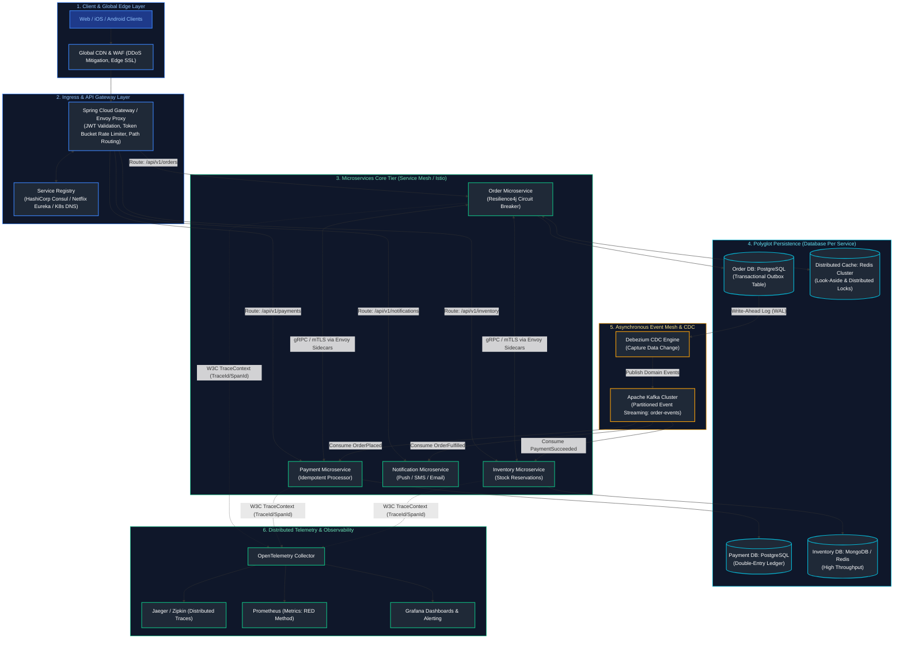

---

## Table of Contents
1. [Microservice Architecture & Core Components](#1-microservice-architecture-core-components)
   - [1.1 Monolith vs Microservices Architecture Deep-Dive](#11-monolith-vs-microservices-architecture-deep-dive)
   - [1.2 Domain-Driven Design (DDD) & Service Decomposition](#12-domain-driven-design-ddd-service-decomposition)
   - [1.3 Database-per-Service Pattern & Schema Isolation](#13-database-per-service-pattern-schema-isolation)
   - [1.4 API Gateway: Routing, Security Offloading & L4 vs L7 Load Balancing](#14-api-gateway-routing-security-offloading-l4-vs-l7-load-balancing)
   - [1.5 Service Discovery: Client-Side vs Server-Side](#15-service-discovery-client-side-vs-server-side)
   - [1.6 Service Mesh (Istio / Envoy): Sidecar Proxies & Mutual TLS (mTLS)](#16-service-mesh-istio-envoy-sidecar-proxies-mutual-tls-mtls)
   - [1.7 Distributed Tracing: W3C TraceContext, OpenTelemetry, Trace ID & Span ID Propagation](#17-distributed-tracing-w3c-tracecontext-opentelemetry-trace-id-span-id-propagation)
   - [1.8 The Backend for Frontend (BFF) Pattern & Edge Routing](#18-the-backend-for-frontend-bff-pattern-edge-routing)
2. [Resilience & Fault Tolerance Patterns](#2-resilience-fault-tolerance-patterns)
   - [2.1 Circuit Breaker Pattern & State Machine (Closed, Open, Half-Open)](#21-circuit-breaker-pattern-state-machine-closed-open-half-open)
   - [2.2 Retry with Exponential Backoff and Full Jitter](#22-retry-with-exponential-backoff-and-full-jitter)
   - [2.3 Bulkhead Isolation (Thread Pool vs Semaphore) & Timeouts](#23-bulkhead-isolation-thread-pool-vs-semaphore-timeouts)
   - [2.4 API Rate Limiting Algorithms (Token Bucket, Leaky Bucket, Sliding Window Counter)](#24-api-rate-limiting-algorithms-token-bucket-leaky-bucket-sliding-window-counter)
   - [2.5 API Idempotency & Distributed Deduplication (Redisson Distributed Lock)](#25-api-idempotency-distributed-deduplication-redisson-distributed-lock)
3. [Distributed Transactions & Event-Driven Patterns](#3-distributed-transactions-event-driven-patterns)
   - [3.1 Two-Phase Commit (2PC) vs Saga Pattern](#31-two-phase-commit-2pc-vs-saga-pattern)
   - [3.2 Saga Choreography vs Saga Orchestration](#32-saga-choreography-vs-saga-orchestration)
   - [3.3 Production Saga Orchestrator Implementation with Persistent State Machine](#33-production-saga-orchestrator-implementation-with-persistent-state-machine)
   - [3.4 The Transactional Outbox Pattern & CDC with Debezium](#34-the-transactional-outbox-pattern-cdc-with-debezium)
   - [3.5 CQRS (Command Query Responsibility Segregation) Architecture](#35-cqrs-command-query-responsibility-segregation-architecture)
   - [3.6 Event Sourcing Fundamentals & Aggregate Snapshots](#36-event-sourcing-fundamentals-aggregate-snapshots)
   - [3.7 The Strangler Fig Application Migration Pattern](#37-the-strangler-fig-application-migration-pattern)
4. [Distributed Systems Fundamentals](#4-distributed-systems-fundamentals)
   - [4.1 The CAP Theorem & PACELC Theorem Deep-Dive](#41-the-cap-theorem-pacelc-theorem-deep-dive)
   - [4.2 Consistency Models (Linearizable, Causal, Eventual)](#42-consistency-models-linearizable-causal-eventual)
   - [4.3 Distributed Consensus: Raft vs Paxos (Leader Election & Log Replication)](#43-distributed-consensus-raft-vs-paxos-leader-election-log-replication)
   - [4.4 Distributed Unique ID Generation: Twitter Snowflake Algorithm](#44-distributed-unique-id-generation-twitter-snowflake-algorithm)
   - [4.5 Distributed Locking: Redlock Algorithm vs Database Advisory Locks](#45-distributed-locking-redlock-algorithm-vs-database-advisory-locks)
   - [4.6 Consistent Hashing Algorithm with Virtual Nodes](#46-consistent-hashing-algorithm-with-virtual-nodes)
   - [4.7 Database Replication Topologies & Quorum Consistency ($R + W > N$)](#47-database-replication-topologies-quorum-consistency-r-w-n)
5. [Real-World Backend System Designs](#5-real-world-backend-system-designs)
   - [5.1 Global URL Shortener (TinyURL) Design](#51-global-url-shortener-tinyurl-design)
   - [5.2 High-Throughput Distributed Rate Limiter Design](#52-high-throughput-distributed-rate-limiter-design)
   - [5.3 Enterprise Multi-Channel Notification System Design](#53-enterprise-multi-channel-notification-system-design)
   - [5.4 Resilient Financial Payment Gateway Design](#54-resilient-financial-payment-gateway-design)
6. [Operational Commands & Diagnostic Tools Cheatsheet](#6-operational-commands-diagnostic-tools-cheatsheet)
7. [Summary Comparison & Engineering Reference Matrix](#7-summary-comparison-engineering-reference-matrix)
8. [References & Further Reading](#8-references-further-reading)

---

# 1. Microservice Architecture & Core Components

---

### 1.1 Monolith vs Microservices Architecture Deep-Dive

A Monolithic architecture unifies the entire application codebase, data models, and business logic into a single deployable artifact (JAR/WAR). A Microservices architecture decomposes the enterprise domain into a distributed collection of independently deployable, loosely coupled, polyglot services organized around business capabilities.

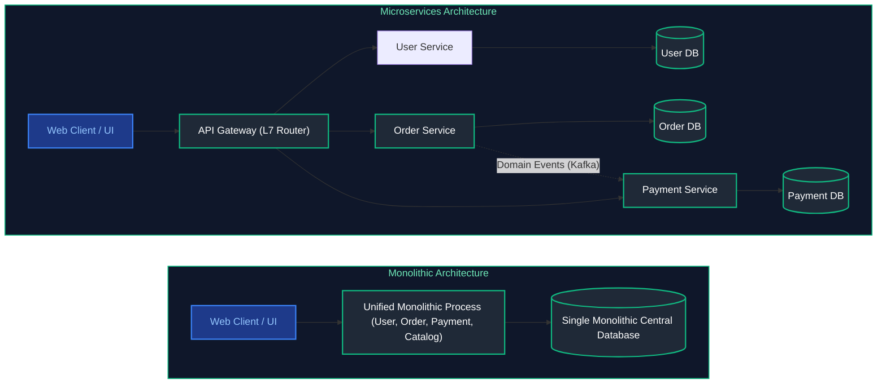

#### Multi-Dimensional Architectural Comparison

| Architectural Dimension | Monolithic Architecture | Microservices Architecture |
| :--- | :--- | :--- |
| **Deployment Independence** | Single artifact deployed as one unit; change in one module requires redeploying everything | Independent deployment lifecycles per microservice via autonomous CI/CD pipelines |
| **Scalability & Cost** | Coarse-grained: Entire monolith must be scaled horizontally, even if only one module is loaded | Fine-grained: Scale only compute-intensive or bottleneck services (e.g. scale Payment, leave Catalog) |
| **Fault Isolation** | Poor: Memory leak, unhandled exception, or deadlocked thread in one module can crash entire process | High: Failure in one service is contained via Circuit Breakers without cascading to other services |
| **Technology Stack** | Rigid: Entire team is locked into a single language version and framework (e.g. Java 17 + Spring) | Polyglot: Teams select the best tool for the job (Java/Spring for Core, Python for AI, Go for Networking) |
| **Database Coupling** | High: Shared tables, cross-domain foreign keys, and complex direct SQL joins | Zero: Database-per-service pattern; all data sharing occurs via public APIs or event streams |
| **Operational Complexity** | Low: Easy local debugging, single build artifact, simple deployment | High: Requires container orchestration (Kubernetes), distributed tracing, and service mesh |

---

### 1.2 Domain-Driven Design (DDD) & Service Decomposition

Decomposing a system improperly results in a **Distributed Monolith** (all the network latency and deployment complexity of microservices with none of the autonomy).

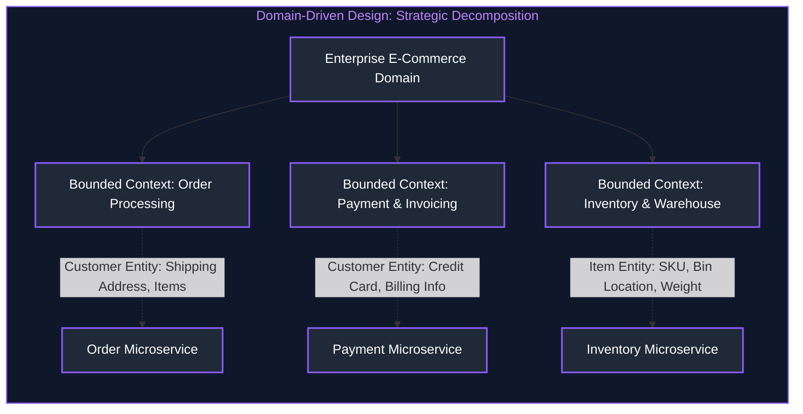

1. **Strategic DDD & Bounded Contexts**:
   - A **Bounded Context** defines the explicit boundary within which a domain model applies.
   - The concept of a `Customer` in the Order context focuses on delivery addresses and order history, whereas in the Payment context it focuses on credit cards and billing identity. Attempting to unify these into a single global `User` object causes catastrophic coupling.
2. **Decomposition Strategies**:
   - **Decomposition by Business Capability**: Align services with enterprise business functions (e.g. Invoicing, Fulfillment, Catalog).
   - **Decomposition by Subdomain**:
     - *Core Domain*: The primary business differentiator (e.g., proprietary recommendation engine).
     - *Supporting Domain*: Complementary domain logic (e.g., inventory management).
     - *Generic Domain*: Standard off-the-shelf business needs (e.g., identity & authentication).

---

### 1.3 Database-per-Service Pattern & Schema Isolation

In an enterprise microservices architecture, **no service is permitted to query another service's private database directly**.
- **Schema Isolation**: Each service owns its tables, indexes, and migrations (Flyway/Liquibase). Teams modify internal database schemas without breaking downstream callers.
- **Polyglot Persistence**: The Order service uses a relational database (PostgreSQL) for ACID compliance; the Catalog service uses MongoDB for document flexibility; the Recommendation engine uses Neo4j for graph relationships; the Search service uses Elasticsearch.
- **Data Sharing Rule**: Services exchange data strictly via **Public REST/gRPC APIs** or **Asynchronous Domain Events (Kafka)**.

---

### 1.4 API Gateway: Routing, Security Offloading & L4 vs L7 Load Balancing

The API Gateway is the single public entry point for all external clients (mobile, browser, third-party partners):

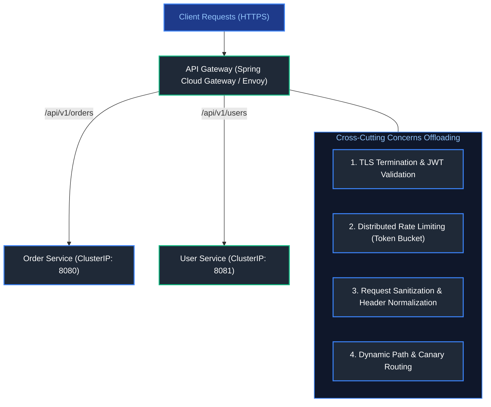

#### Layer 4 (L4) vs Layer 7 (L7) Load Balancing

| Dimension | Layer 4 Load Balancing (Transport) | Layer 7 Load Balancing (Application) |
| :--- | :--- | :--- |
| **OSI Layer** | Layer 4 (TCP / UDP) | Layer 7 (HTTP / HTTPS / gRPC / WebSockets) |
| **Inspection Capability** | IP address and TCP/UDP port only; cannot inspect payload | Full HTTP headers, cookies, URL paths, query parameters, JSON payload |
| **Routing Capability** | Simple round-robin or least-connections per connection | Content-based routing (e.g. route `/api/v1/orders` to Cluster A, `/api/v1/users` to Cluster B) |
| **Performance & Latency** | Ultra-high throughput, sub-millisecond latency (Packet-level NAT) | Slightly higher compute cost due to parsing HTTP/TLS sessions |
| **Security Features** | SYN flood protection, IP whitelisting | WAF, OAuth2 token inspection, header injection, CORS enforcement |
| **Industry Examples** | AWS NLB (Network Load Balancer), Azure Load Balancer, HAProxy TCP | AWS ALB, Azure Application Gateway, NGINX, Spring Cloud Gateway, Envoy |

#### Core Load Balancing Algorithms
1. **Round Robin**: Requests distributed sequentially across backend nodes. Optimal when all worker nodes have identical hardware specs and request costs are uniform.
2. **Weighted Round Robin**: Assigns higher request quotas to nodes with larger CPU/RAM capacity (e.g. Node A gets 3x traffic of Node B).
3. **Least Connections**: Dynamically routes traffic to the server instance with the fewest active TCP/HTTP concurrent connections. Optimal for long-lived WebSocket or database sessions.
4. **IP Hash**: Computes hash of client source IP (`hash(client_ip) % N`) to map a user deterministically to the same backend server (session affinity / sticky sessions).
5. **Consistent Hashing**: Minimizes key and connection migration when backend servers scale up or down (see [Section 4.6](#46-consistent-hashing-algorithm-with-virtual-nodes)).

---

### 1.5 Service Discovery: Client-Side vs Server-Side

In containerized clouds (Kubernetes), microservice instances have dynamic, ephemeral IP addresses.

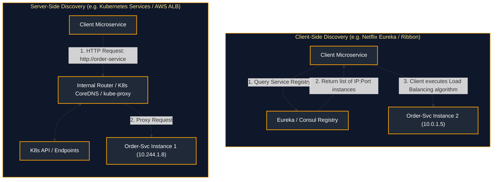

- **Client-Side Discovery**: The client microservice queries the registry directly, caches healthy instance IPs locally, and uses client-side load balancing algorithms (Round Robin, Weighted Response Time) to pick a target node. *Downside*: Tight coupling to registry client library in every programming language.
- **Server-Side Discovery (Cloud-Native Standard)**: The client makes a call to a stable DNS name (`http://order-service`). An intermediate router (Kubernetes `kube-proxy` or Cloud Load Balancer) resolves the name and proxies the request to healthy instances. *Benefit*: Complete language independence.

---

### 1.6 Service Mesh (Istio / Envoy): Sidecar Proxies & Mutual TLS (mTLS)

A Service Mesh is a dedicated infrastructure layer that handles service-to-service communication transparently:

```mermaid
flowchart LR
    subgraph Pod1["Pod: Order Service"]
        App1["Spring Boot App 1"] <-->|"Localhost (Plain HTTP)"| Envoy1["Envoy Sidecar Proxy 1"]
    end

    subgraph Pod2["Pod: Payment Service"]
        Envoy2["Envoy Sidecar Proxy 2"] <-->|"Localhost (Plain HTTP)"| App2["Spring Boot App 2"]
    end

    Envoy1 <===>|"Zero-Trust Mutual TLS (mTLS) Tunnel + Distributed Tracing"| Envoy2

    style Pod1 fill:#0f172a,stroke:#10b981,stroke-width:1.5px,color:#6ee7b7
    style Pod2 fill:#0f172a,stroke:#10b981,stroke-width:1.5px,color:#6ee7b7

    style App1 fill:#1f2937,stroke:#10b981,stroke-width:2px,color:#fff
    style Envoy1 fill:#1f2937,stroke:#10b981,stroke-width:2px,color:#fff
    style Envoy2 fill:#1f2937,stroke:#10b981,stroke-width:2px,color:#fff
    style App2 fill:#1f2937,stroke:#10b981,stroke-width:2px,color:#fff
```

1. **Sidecar Pattern**: An **Envoy proxy** runs alongside each application container inside the same Kubernetes Pod, intercepting all ingress and egress network traffic.
2. **Zero-Trust Security via mTLS**: Envoy automatically encrypts all service-to-service communication with mutual TLS and validates cryptographic identities (SPIFFE/SPIRE certificates) without modifying application code.
3. **Advanced Traffic Management**: Supports canary traffic splitting (e.g., 90% to v1, 10% to v2), fault injection testing, and circuit breaking directly at the infrastructure layer.

---

### 1.7 Distributed Tracing: W3C TraceContext, OpenTelemetry, Trace ID & Span ID Propagation

In a distributed microservices call chain, a single incoming user transaction touches dozens of services. Without distributed tracing, isolating the root cause of high latency or failures is impossible.

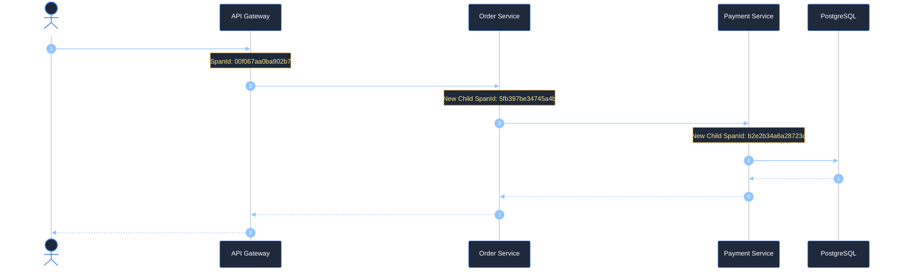

#### W3C `traceparent` Header Format Explained
The industry standard W3C `traceparent` header follows the syntax:
`version - trace_id - parent_id / span_id - trace_flags`
- `00`: W3C Specification version.
- `4bf92f3577b34da6a3ce929d0e0e4736`: **Trace ID** (16-byte hex). Globally unique identifier for the entire end-to-end distributed request chain. Remains identical across every microservice hop.
- `00f067aa0ba902b7`: **Parent Span ID** (8-byte hex). Identifies the specific hop or sub-operation that triggered the current call.
- `01`: **Trace Flags** (8-bit field). `01` signals that the trace was sampled and recorded by the OpenTelemetry collector.

---

### 1.8 The Backend for Frontend (BFF) Pattern & Edge Routing

In modern multi-platform architectures, mobile apps, desktop browsers, and public third-party partners have vastly divergent requirements:
- **Mobile Clients (iOS/Android)**: Constrained cellular bandwidth, small screens, high battery consumption; require **aggregated, stripped-down payloads** to avoid over-fetching.
- **Desktop Web Clients**: High-bandwidth fiber connections, wide multi-pane dashboards; require **deep, rich, uncompressed data structures**.
- **Third-Party Partner APIs**: Strict backward-compatible semantic versioning and rate quotas.

Having a single monolithic API Gateway cater to all clients forces complex conditionals into the gateway, causing organizational friction. The **Backend for Frontend (BFF)** pattern introduces dedicated gateway tiers for each client category:

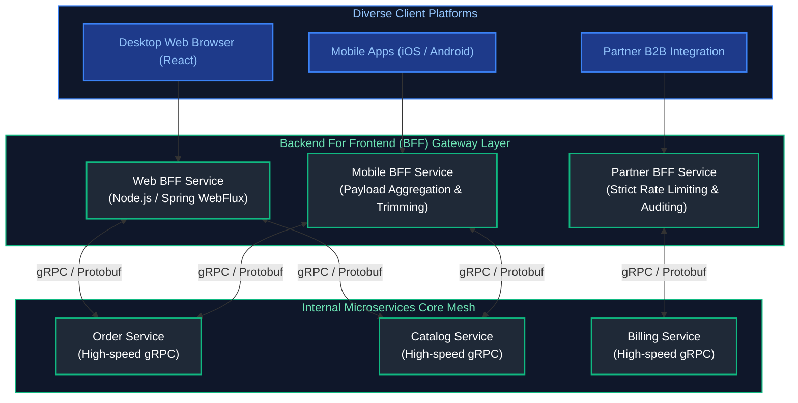

> [!TIP]
> **Inter-Service Protocol Harmony**: While public clients talk **REST / JSON** or GraphQL to their respective BFFs over the internet, the BFFs communicate with internal downstream microservices over **multiplexed, low-latency gRPC** (see [07. Spring Web & REST APIs - Section 8: REST vs gRPC](08_spring_web_rest_apis.md#8-api-communication-paradigms-rest-vs-rpc-vs-grpc-protocol-buffers)).

---

# 2. Resilience & Fault Tolerance Patterns

---

### 2.1 Circuit Breaker Pattern & State Machine (Closed, Open, Half-Open)

The Circuit Breaker pattern prevents an application from repeatedly executing an operation that is failing, preventing cascading thread pool exhaustion across microservices:

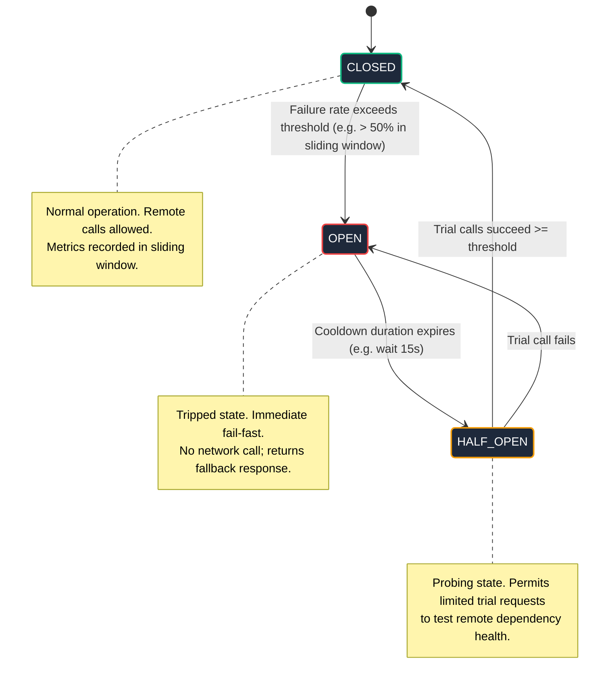

1. **`CLOSED`**: Requests flow normally. The circuit tracks call outcomes in a sliding window (e.g., last 100 calls). If the failure rate exceeds the configured threshold (e.g., 50%), the circuit transitions to `OPEN`.
2. **`OPEN`**: Requests are blocked immediately without invoking the remote service. Calls fail fast, returning an instant fallback response to preserve caller thread pools.
3. **`HALF_OPEN`**: After a cooldown period (e.g., 15 seconds), the circuit permits a small number of trial requests. If all trial calls succeed, the circuit resets to `CLOSED`; if any trial call fails, the circuit returns to `OPEN`.

#### Production Resilience4j Configuration (`application.yml`)

```yaml
resilience4j:
  circuitbreaker:
    instances:
      paymentService:
        slidingWindowType: COUNT_BASED
        slidingWindowSize: 100
        minimumNumberOfCalls: 20
        failureRateThreshold: 50.0
        slowCallRateThreshold: 70.0
        slowCallDurationThreshold: 2000ms
        waitDurationInOpenState: 15000ms
        permittedNumberOfCallsInHalfOpenState: 10
        automaticTransitionFromOpenToHalfOpenEnabled: true
  retry:
    instances:
      paymentService:
        maxAttempts: 3
        waitDuration: 500ms
        enableExponentialBackoff: true
        exponentialBackoffMultiplier: 2
```

---

### 2.2 Retry with Exponential Backoff and Full Jitter

Blindly retrying failed network calls causes the **Thundering Herd Problem**: thousands of retrying clients strike an already overwhelmed downstream database at the exact same synchronized millisecond, preventing recovery.

$$\text{Sleep} = \text{random}\left(0, \, \min\left(\text{MaxWait}, \, \text{Base} \times 2^{\text{attempt}}\right)\right)$$

```java
public class ExponentialBackoffJitter {
    private static final long BASE_WAIT_MS = 200;
    private static final long MAX_WAIT_MS = 5000;
    private static final java.util.Random RANDOM = new java.util.Random();

    public static long calculateSleep(int attempt) {
        long exponentialWait = Math.min(MAX_WAIT_MS, BASE_WAIT_MS * (1L << attempt));
        // Full Jitter: Uniform random distribution between 0 and exponentialWait
        return (long) (RANDOM.nextDouble() * exponentialWait);
    }
}
```

---

### 2.3 Bulkhead Isolation (Thread Pool vs Semaphore) & Timeouts

The Bulkhead pattern isolates computing resources into independent compartments so that a failure in one module cannot deplete resources across the entire system:
- **Thread Pool Bulkhead**: Allocates a separate, bounded queue and thread pool for calls to a specific downstream service. If the "Recommendation Service" hangs, only its 10 dedicated threads get blocked; the remaining application threads serving "Order Checkout" continue uninterrupted.
- **Semaphore Bulkhead**: Bounded counter enforcing concurrency limits on the calling thread without context-switching overhead.

---

### 2.4 API Rate Limiting Algorithms (Token Bucket, Leaky Bucket, Sliding Window Counter)

| Algorithm | Mechanism | Handles Bursts? | Memory Footprint | Best Production Use Case |
| :--- | :--- | :--- | :--- | :--- |
| **Token Bucket** | Tokens added to bucket at steady rate; request consumes token. Rejects if empty. | Yes (up to bucket capacity) | Minimal (2 variables: token count, last timestamp) | API Gateways, REST API user tiers |
| **Leaky Bucket** | Requests enter FIFO queue; processed at fixed, steady leak rate. Drops if queue full. | Smooths bursts into flat rate | Moderate (FIFO queue capacity) | Ingestion systems, egress webhooks |
| **Fixed Window Counter** | Counts requests in fixed time interval (e.g. 00:00 - 00:01). Resets at window boundary. | No (suffers 2x burst at boundary) | Ultra-low (single integer counter) | Simple internal threshold checks |
| **Sliding Window Counter** | Blends previous window count with current window weight: $\text{Count} = C_{\text{prev}} \times (1 - \text{weight}) + C_{\text{curr}}$. | Yes (eliminates boundary burst) | Low (2 counters per client) | Enterprise distributed rate limiting |

---

### 2.5 API Idempotency & Distributed Deduplication (Redisson Distributed Lock)

In distributed networks, timeouts can leave callers uncertain whether a request succeeded. An **Idempotency Key** ensures that repeating an API call produces the exact same result without executing the business logic twice:

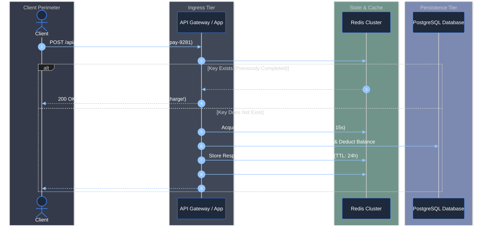

> [!NOTE]
> For the complete Spring Boot HTTP Servlet Filter implementation with request payload SHA-256 collision detection (`409 Conflict`), and RFC standard header specifications, see [07. Spring Web & REST APIs - Section 3: Production API Idempotency Architecture](08_spring_web_rest_apis.md#3-production-api-idempotency-architecture).

---

# 3. Distributed Transactions & Event-Driven Patterns

---

### 3.1 Two-Phase Commit (2PC) vs Saga Pattern

| Architectural Dimension | Two-Phase Commit (2PC) | Saga Pattern |
| :--- | :--- | :--- |
| **Coordination Type** | Synchronous blocking protocol across distributed database nodes | Asynchronous sequence of local transactions coordinated via events |
| **Isolation Level** | Full ACID (Holds distributed locks on records across all nodes) | Eventual Consistency (ACID local, BASE global; no distributed locks) |
| **Throughput & Scalability** | Low: Bottlenecked by slowest node; network partitions stall entire cluster | High: Local transactions commit instantly; highly scalable |
| **Availability (CAP)** | Strongly favors Consistency ($CP$); vulnerable to coordinator failure | Strongly favors Availability ($AP$); guarantees eventual convergence |
| **Error Recovery** | Global abort and automatic rollback | Executes explicit compensating transactions to undo committed local work |

---

### 3.2 Saga Choreography vs Saga Orchestration

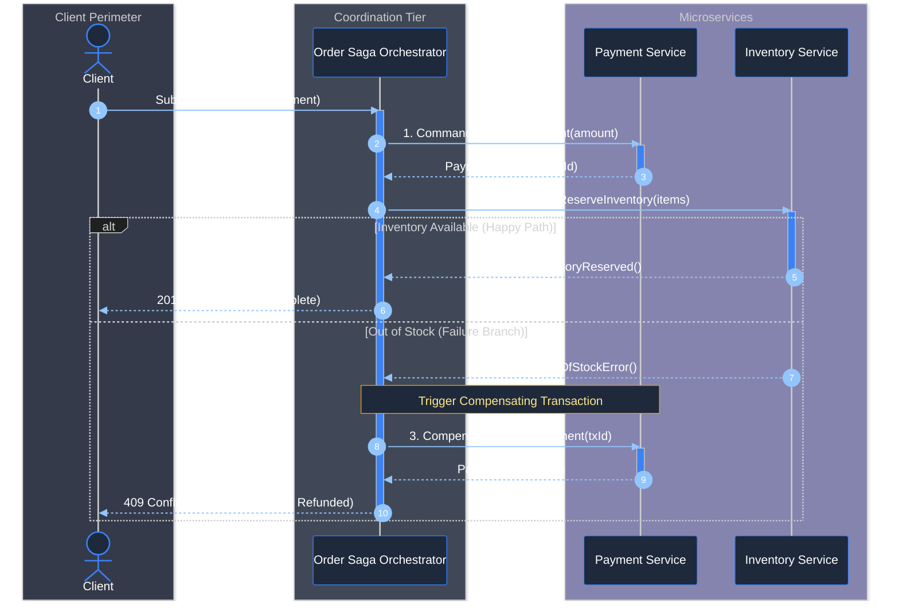

---

---

### 3.3 Production Saga Orchestrator Implementation with Persistent State Machine

A production-grade Saga Orchestrator cannot simply rely on in-memory procedural calls; if the orchestrator pod crashes midway through a transaction, uncompensated distributed state will be orphaned indefinitely. A resilient orchestrator must persist its execution state machine to durable storage at each step boundary.

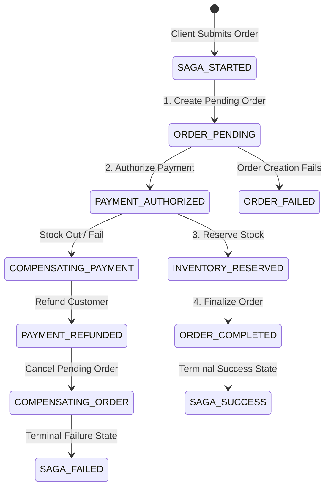

#### Production Saga Schema DDL (PostgreSQL)

```sql
CREATE TABLE saga_instance (
    saga_id UUID PRIMARY KEY,
    saga_type VARCHAR(64) NOT NULL,
    current_state VARCHAR(64) NOT NULL,
    payload JSONB NOT NULL,
    created_at TIMESTAMP WITH TIME ZONE DEFAULT CURRENT_TIMESTAMP,
    updated_at TIMESTAMP WITH TIME ZONE DEFAULT CURRENT_TIMESTAMP
);

CREATE TABLE saga_step_log (
    step_id UUID PRIMARY KEY DEFAULT gen_random_uuid(),
    saga_id UUID NOT NULL REFERENCES saga_instance(saga_id) ON DELETE CASCADE,
    step_name VARCHAR(64) NOT NULL,
    step_status VARCHAR(32) NOT NULL, -- PENDING, COMPLETED, COMPENSATED, FAILED
    error_message TEXT,
    executed_at TIMESTAMP WITH TIME ZONE DEFAULT CURRENT_TIMESTAMP
);

CREATE INDEX idx_saga_lookup ON saga_instance (saga_type, current_state);
```

#### Production Saga Orchestrator Java Implementation

```java
package com.company.saga.orchestrator;

import com.fasterxml.jackson.databind.ObjectMapper;
import org.slf4j.Logger;
import org.slf4j.LoggerFactory;
import org.springframework.jdbc.core.JdbcTemplate;
import org.springframework.stereotype.Service;
import org.springframework.transaction.annotation.Transactional;

import java.time.Instant;
import java.util.UUID;

public record OrderSagaPayload(UUID orderId, UUID customerId, double amount, String itemId, int quantity) {}

public enum SagaState {
    STARTED,
    ORDER_PENDING,
    PAYMENT_AUTHORIZED,
    INVENTORY_RESERVED,
    COMPENSATING_PAYMENT,
    COMPENSATING_ORDER,
    COMPLETED,
    FAILED
}

@Service
public class ResilientOrderSagaOrchestrator {

    private static final Logger log = LoggerFactory.getLogger(ResilientOrderSagaOrchestrator.class);

    private final JdbcTemplate jdbcTemplate;
    private final ObjectMapper objectMapper;
    private final OrderServiceClient orderService;
    private final PaymentServiceClient paymentService;
    private final InventoryServiceClient inventoryService;

    public ResilientOrderSagaOrchestrator(JdbcTemplate jdbcTemplate,
                                          ObjectMapper objectMapper,
                                          OrderServiceClient orderService,
                                          PaymentServiceClient paymentService,
                                          InventoryServiceClient inventoryService) {
        this.jdbcTemplate = jdbcTemplate;
        this.objectMapper = objectMapper;
        this.orderService = orderService;
        this.paymentService = paymentService;
        this.inventoryService = inventoryService;
    }

    public UUID startSaga(OrderSagaPayload payload) {
        UUID sagaId = UUID.randomUUID();
        try {
            String jsonPayload = objectMapper.writeValueAsString(payload);
            jdbcTemplate.update(
                "INSERT INTO saga_instance (saga_id, saga_type, current_state, payload, updated_at) VALUES (?, ?, ?, ?::jsonb, ?)",
                sagaId, "ORDER_FULFILLMENT", SagaState.STARTED.name(), jsonPayload, Instant.now()
            );
        } catch (Exception e) {
            throw new RuntimeException("Failed to persist initial Saga state", e);
        }

        // Execute Saga state machine transitions asynchronously or synchronously
        executeNextTransition(sagaId, payload);
        return sagaId;
    }

    public void executeNextTransition(UUID sagaId, OrderSagaPayload payload) {
        try {
            // Step 1: Create Order in Pending State
            transitionState(sagaId, SagaState.ORDER_PENDING);
            recordStep(sagaId, "CREATE_PENDING_ORDER", "PENDING");
            orderService.createPendingOrder(payload.orderId(), payload.customerId(), payload.amount());
            recordStep(sagaId, "CREATE_PENDING_ORDER", "COMPLETED");

            // Step 2: Authorize Payment
            recordStep(sagaId, "AUTHORIZE_PAYMENT", "PENDING");
            boolean paymentSuccess = paymentService.charge(payload.orderId(), payload.amount());
            if (!paymentSuccess) {
                recordStep(sagaId, "AUTHORIZE_PAYMENT", "FAILED", "Insufficient funds or gateway decline");
                triggerCompensations(sagaId, payload, SagaState.COMPENSATING_ORDER);
                return;
            }
            transitionState(sagaId, SagaState.PAYMENT_AUTHORIZED);
            recordStep(sagaId, "AUTHORIZE_PAYMENT", "COMPLETED");

            // Step 3: Reserve Inventory
            recordStep(sagaId, "RESERVE_INVENTORY", "PENDING");
            boolean stockReserved = inventoryService.reserveStock(payload.orderId(), payload.itemId(), payload.quantity());
            if (!stockReserved) {
                recordStep(sagaId, "RESERVE_INVENTORY", "FAILED", "Stock unavailable");
                // Inventory failed: Compensate Payment first, then Cancel Order
                triggerCompensations(sagaId, payload, SagaState.COMPENSATING_PAYMENT);
                return;
            }
            transitionState(sagaId, SagaState.INVENTORY_RESERVED);
            recordStep(sagaId, "RESERVE_INVENTORY", "COMPLETED");

            // Step 4: Finalize Order Fulfillment
            orderService.markOrderConfirmed(payload.orderId());
            transitionState(sagaId, SagaState.COMPLETED);
            log.info("Saga {} successfully completed for order {}", sagaId, payload.orderId());

        } catch (Exception ex) {
            log.error("Unhandled exception during saga {} execution. Triggering fallback compensation", sagaId, ex);
            triggerCompensations(sagaId, payload, SagaState.COMPENSATING_PAYMENT);
        }
    }

    private void triggerCompensations(UUID sagaId, OrderSagaPayload payload, SagaState fromState) {
        log.warn("Initiating compensating transactions for Saga {} starting from {}", sagaId, fromState);

        if (fromState == SagaState.COMPENSATING_PAYMENT) {
            transitionState(sagaId, SagaState.COMPENSATING_PAYMENT);
            try {
                paymentService.refund(payload.orderId(), payload.amount());
                recordStep(sagaId, "REFUND_PAYMENT", "COMPENSATED");
            } catch (Exception e) {
                log.error("CRITICAL: Failed to compensate payment for order {}. Flagged for manual SRE intervention.", payload.orderId(), e);
                recordStep(sagaId, "REFUND_PAYMENT", "FAILED", e.getMessage());
            }
        }

        // Always compensate order back to CANCELLED
        transitionState(sagaId, SagaState.COMPENSATING_ORDER);
        try {
            orderService.cancelOrder(payload.orderId(), "Saga aborted due to downstream dependency failure");
            recordStep(sagaId, "CANCEL_ORDER", "COMPENSATED");
        } catch (Exception e) {
            log.error("CRITICAL: Failed to cancel order {}. SRE alerted.", payload.orderId(), e);
            recordStep(sagaId, "CANCEL_ORDER", "FAILED", e.getMessage());
        }

        transitionState(sagaId, SagaState.FAILED);
    }

    private void transitionState(UUID sagaId, SagaState state) {
        jdbcTemplate.update(
            "UPDATE saga_instance SET current_state = ?, updated_at = ? WHERE saga_id = ?",
            state.name(), Instant.now(), sagaId
        );
    }

    private void recordStep(UUID sagaId, String stepName, String status) {
        recordStep(sagaId, stepName, status, null);
    }

    private void recordStep(UUID sagaId, String stepName, String status, String errorMessage) {
        jdbcTemplate.update(
            "INSERT INTO saga_step_log (saga_id, step_name, step_status, error_message, executed_at) VALUES (?, ?, ?, ?, ?)",
            sagaId, stepName, status, errorMessage, Instant.now()
        );
    }
}
```

---

### 3.4 The Transactional Outbox Pattern & CDC with Debezium

The **Dual-Write Problem** is one of the most dangerous anti-patterns in distributed systems. It occurs when an application writes to a database and publishes to a message broker (e.g. Kafka) in two separate operations:

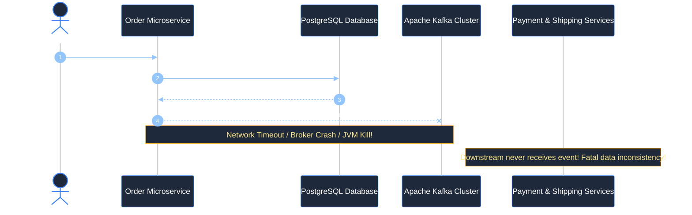

If we flip the order and publish to Kafka first, a database constraint violation will leave downstream services processing a phantom order that doesn't exist.

#### The Transactional Outbox Solution

Instead of publishing directly to Kafka, the application writes both the business entity (`orders`) and an outbox event record (`outbox_events`) into the **same database within a single local ACID transaction**. A dedicated Change Data Capture (CDC) agent (Debezium) monitors the database's Write-Ahead Log (WAL) and streams events to Kafka with at-least-once delivery guarantees.

```mermaid
flowchart LR
    subgraph Microservice["Order Microservice"]
        App["Order Application Service"]
    end

    subgraph RelationalDB["PostgreSQL Database (ACID Boundary)"]
        App -->|"1. Single ACID Transaction (INSERT)"| OrdersTable["orders table"]
        App -->|"1. Single ACID Transaction (INSERT)"| OutboxTable["outbox_events table"]
    end

    subgraph CDC_Pipeline["Zero-Overhead CDC Engine"]
        PostgresWAL["PostgreSQL Write-Ahead Log (WAL)"]
        Debezium["Debezium CDC Connector (pgoutput)"]
        PostgresWAL --> Debezium
        Debezium -->|2. Reliable Stream Publish| KafkaTopic["Kafka Topic: 'order-events'"]
    end

    OrdersTable -.-> PostgresWAL
    OutboxTable -.-> PostgresWAL

    subgraph Downstream_Tiers["Downstream Microservices"]
        KafkaTopic -->|"3. At-Least-Once Consumption"| PaymentConsumer["Payment Microservice<br/>(Idempotent Deduplication)"]
    end

    style Microservice fill:#0f172a,stroke:#10b981,stroke-width:1.5px,color:#6ee7b7
    style RelationalDB fill:#0f172a,stroke:#06b6d4,stroke-width:1.5px,color:#67e8f9
    style CDC_Pipeline fill:#0f172a,stroke:#f59e0b,stroke-width:1.5px,color:#fde68a
    style Downstream_Tiers fill:#0f172a,stroke:#8b5cf6,stroke-width:1.5px,color:#c084fc

    style App fill:#1f2937,stroke:#10b981,stroke-width:2px,color:#fff
    style OrdersTable fill:#1f2937,stroke:#06b6d4,stroke-width:2px,color:#fff
    style OutboxTable fill:#1f2937,stroke:#06b6d4,stroke-width:2px,color:#fff
    style PostgresWAL fill:#1f2937,stroke:#f59e0b,stroke-width:2px,color:#fff
    style Debezium fill:#1f2937,stroke:#f59e0b,stroke-width:2px,color:#fff
    style KafkaTopic fill:#1f2937,stroke:#f59e0b,stroke-width:2px,color:#fff
    style PaymentConsumer fill:#1f2937,stroke:#8b5cf6,stroke-width:2px,color:#fff
```

#### Production PostgreSQL Outbox DDL & Sharding-Friendly Design

```sql
-- Outbox Table: Optimized for WAL Streaming and Fast Cleanup
CREATE TABLE outbox_events (
    id UUID PRIMARY KEY DEFAULT gen_random_uuid(),
    aggregate_type VARCHAR(64) NOT NULL,
    aggregate_id VARCHAR(64) NOT NULL,
    event_type VARCHAR(64) NOT NULL,
    payload JSONB NOT NULL,
    trace_id VARCHAR(128),
    created_at TIMESTAMP WITH TIME ZONE DEFAULT CURRENT_TIMESTAMP
);

-- Index for optional fallback polling worker (if CDC is down)
CREATE INDEX idx_outbox_created_at ON outbox_events (created_at);
```

#### Atomic Outbox Publisher in Spring Boot

```java
package com.company.outbox;

import com.fasterxml.jackson.databind.ObjectMapper;
import org.springframework.jdbc.core.JdbcTemplate;
import org.springframework.stereotype.Service;
import org.springframework.transaction.annotation.Transactional;

import java.time.Instant;
import java.util.UUID;

@Service
public class OrderServiceWithOutbox {

    private final JdbcTemplate jdbcTemplate;
    private final ObjectMapper objectMapper;

    public OrderServiceWithOutbox(JdbcTemplate jdbcTemplate, ObjectMapper objectMapper) {
        this.jdbcTemplate = jdbcTemplate;
        this.objectMapper = objectMapper;
    }

    @Transactional
    public UUID createOrder(UUID customerId, double totalAmount, String itemId) {
        UUID orderId = UUID.randomUUID();

        // 1. Insert domain entity into orders table
        jdbcTemplate.update(
            "INSERT INTO orders (id, customer_id, total_amount, status, created_at) VALUES (?, ?, ?, ?, ?)",
            orderId, customerId, totalAmount, "CREATED", Instant.now()
        );

        // 2. Insert event into outbox_events table within THE SAME DATABASE TRANSACTION
        try {
            var eventPayload = new OrderCreatedEvent(orderId, customerId, totalAmount, itemId, Instant.now());
            String jsonPayload = objectMapper.writeValueAsString(eventPayload);

            jdbcTemplate.update(
                "INSERT INTO outbox_events (id, aggregate_type, aggregate_id, event_type, payload, created_at) " +
                "VALUES (?, ?, ?, ?, ?::jsonb, ?)",
                UUID.randomUUID(), "Order", orderId.toString(), "OrderCreated", jsonPayload, Instant.now()
            );
        } catch (Exception e) {
            throw new RuntimeException("Failed to serialize Outbox event", e);
        }

        // Commit guarantees both Order and OutboxEvent are durably stored together!
        return orderId;
    }

    public record OrderCreatedEvent(UUID orderId, UUID customerId, double totalAmount, String itemId, Instant timestamp) {}
}
```

#### Production Debezium PostgreSQL Connector Configuration

```json
{
  "name": "order-outbox-connector",
  "config": {
    "connector.class": "io.debezium.connector.postgresql.PostgresConnector",
    "tasks.max": "1",
    "plugin.name": "pgoutput",
    "database.hostname": "postgres-order-db.internal",
    "database.port": "5432",
    "database.user": "debezium_cdc",
    "database.password": "${file:/secrets/db-credentials.properties:cdc_password}",
    "database.dbname": "order_db",
    "database.server.name": "order_service",
    "table.include.list": "public.outbox_events",
    "tombstones.on.delete": "false",
    "transforms": "outbox",
    "transforms.outbox.type": "io.debezium.transforms.outbox.EventRouter",
    "transforms.outbox.route.topic.replacement": "${routedByValue}.events",
    "transforms.outbox.table.fields.additional.placement": "trace_id:header:traceparent"
  }
}
```

#### Idempotent Consumer Implementation in Downstream Services

Because Debezium and Kafka guarantee **at-least-once delivery**, consumers will occasionally receive duplicate messages during network retries or consumer group rebalances. Consumers must implement an idempotent deduplication filter:

```java
package com.company.consumer;

import org.slf4j.Logger;
import org.slf4j.LoggerFactory;
import org.springframework.dao.DuplicateKeyException;
import org.springframework.jdbc.core.JdbcTemplate;
import org.springframework.kafka.annotation.KafkaListener;
import org.springframework.stereotype.Component;
import org.springframework.transaction.annotation.Transactional;

import java.time.Instant;
import java.util.UUID;

@Component
public class IdempotentPaymentConsumer {

    private static final Logger log = LoggerFactory.getLogger(IdempotentPaymentConsumer.class);
    private final JdbcTemplate jdbcTemplate;

    public IdempotentPaymentConsumer(JdbcTemplate jdbcTemplate) {
        this.jdbcTemplate = jdbcTemplate;
    }

    @KafkaListener(topics = "Order.events", groupId = "payment-service-group")
    @Transactional
    public void consumeOrderEvent(String eventJson) {
        // Extract eventId from message header or payload
        UUID eventId = extractEventId(eventJson);

        // Insert into processed_events table using primary key constraint for deduplication
        try {
            jdbcTemplate.update(
                "INSERT INTO processed_events (event_id, consumer_group, processed_at) VALUES (?, ?, ?)",
                eventId, "payment-service-group", Instant.now()
            );
        } catch (DuplicateKeyException ex) {
            log.warn("Duplicate event detected with ID: {}. Skipping execution safely.", eventId);
            return; // Idempotently ignore already processed message!
        }

        // Execute core business mutation
        processPaymentBusinessLogic(eventJson);
    }

    private UUID extractEventId(String json) {
        // Parse ID from payload
        return UUID.randomUUID(); 
    }

    private void processPaymentBusinessLogic(String json) {
        log.info("Processing payment for verified new event payload");
    }
}
```

---

### 3.5 CQRS (Command Query Responsibility Segregation) Architecture

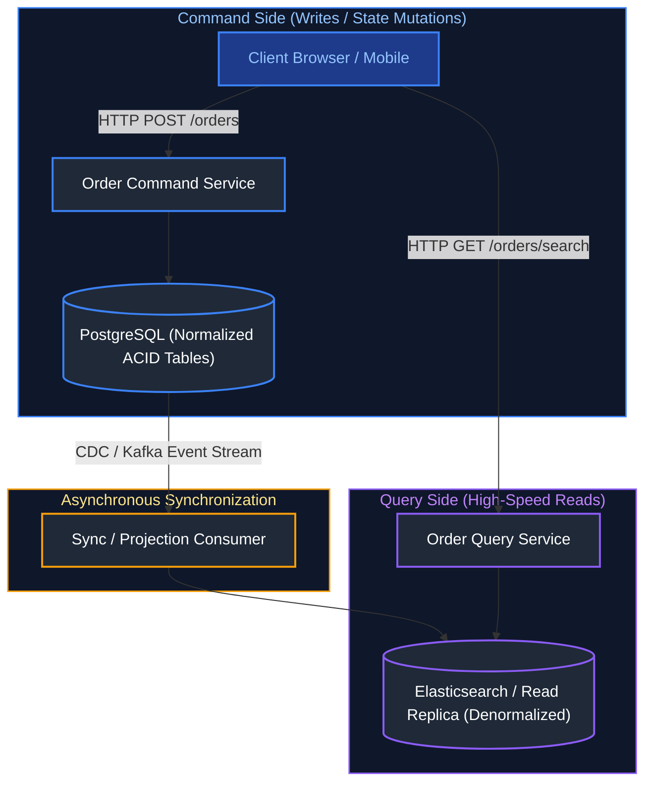

---

### 3.6 Event Sourcing Fundamentals & Aggregate Snapshots

Instead of overwriting rows in a table (`UPDATE accounts SET balance = 150`), Event Sourcing records an append-only log of immutable domain events:
- `AccountCreated(id=1, initial=100)`
- `MoneyWithdrawn(id=1, amount=40)`
- `MoneyDeposited(id=1, amount=90)`
Current state is derived by replaying all historical events. To prevent performance degradation when an entity accumulates thousands of events, periodic **Snapshots** capture aggregate state at interval $N$ (e.g. every 100 events).

---

### 3.7 The Strangler Fig Application Migration Pattern

The Strangler Fig pattern migrates legacy monoliths safely without risky "big bang" rewrites:
1. Deploy an **API Gateway / Reverse Proxy** in front of the legacy monolith.
2. Build new business features exclusively as independent microservices.
3. Identify a cohesive domain in the monolith (e.g. `Notification`), implement it as a microservice, and redirect Gateway traffic from the monolith to the new microservice.
4. Repeat until the monolith handles zero traffic, then safely decommission it.

---

# 4. Distributed Systems Fundamentals

---

### 4.1 The CAP Theorem & PACELC Theorem Deep-Dive

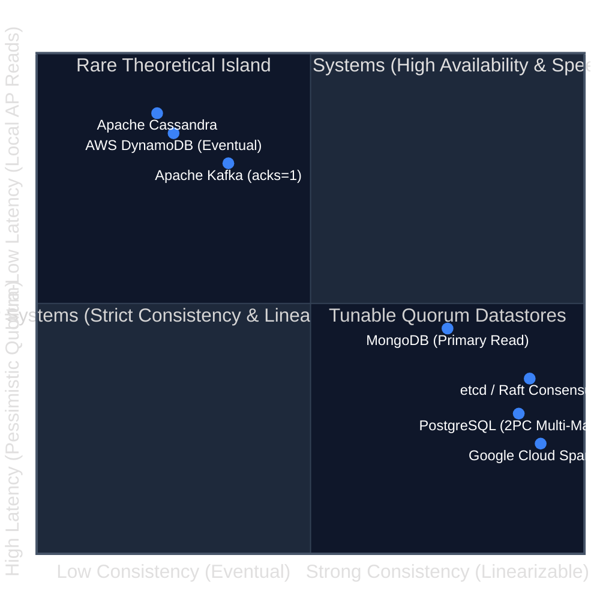

#### PACELC Real-World Database Classification Matrix

$$\text{If Partition (P)} \rightarrow \text{Choose (A) or (C)}; \quad \text{Else (E)} \rightarrow \text{Choose (L) or (C)}$$

| System | PACELC Classification | Partition Behavior | Normal Execution Behavior |
| :--- | :--- | :--- | :--- |
| **Apache Cassandra** | **PA / EL** | Chooses Availability (accepts local writes) | Chooses Latency (returns reads quickly without quorum wait) |
| **Google Cloud Spanner** | **PC / EC** | Chooses Consistency (fails uncommitted quorum) | Chooses Consistency (linearizable reads via TrueTime sync) |
| **MongoDB** | **PA / EC** (Default) | Chooses Availability on secondaries | Chooses Consistency on primary node |
| **PostgreSQL (Semi-sync)**| **PC / EC** | Blocks commits if replica unreachable | Commits synchronously for strict data durability |

---

### 4.2 Consistency Models (Linearizable, Causal, Eventual)

1. **Linearizable (Strong) Consistency**: An operation appears to take effect instantaneously across the entire cluster between its invocation and completion. Every read returns the absolute latest write globally.
2. **Sequential Consistency**: Operations appear in the same sequential order to all observers, though they may lag real-time clock time.
3. **Causal Consistency**: Causally related operations must be seen by every node in the same relative order. Concurrent, unrelated operations can be seen in different orders.
4. **Eventual Consistency**: If no new updates are made, all replicas eventually converge to identical values. Maximizes availability and write throughput.

---

### 4.3 Distributed Consensus: Raft vs Paxos (Leader Election & Log Replication)

Consensus algorithms guarantee that a cluster of distributed nodes agree on a sequence of state machine actions despite arbitrary network splits and crashes:
- **Paxos**: Formulated by Leslie Lamport. Mathematically elegant, notoriously difficult to understand and implement in real software.
- **Raft**: Designed specifically for understandability. Decomposes consensus into three independent sub-problems:
  1. **Leader Election**: Heartbeat timeouts trigger randomized election timers. A candidate must collect votes from a **Quorum ($N/2 + 1$)** to become Leader.
  2. **Log Replication**: The Leader appends entries locally and issues `AppendEntries` RPCs to followers.
  3. **Safety**: A committed log entry is guaranteed to be present in all future Leaders.

---

### 4.4 Distributed Unique ID Generation: Twitter Snowflake Algorithm


#### Production Java Twitter Snowflake ID Implementation

```java
package com.company.distributed;

public class SnowflakeIdGenerator {
    private static final long CUSTOM_EPOCH = 1735689600000L; // 2025-01-01 00:00:00 UTC
    private static final long WORKER_ID_BITS = 10L;
    private static final long SEQUENCE_BITS = 12L;
    private static final long MAX_WORKER_ID = ~(-1L << WORKER_ID_BITS); // 1023
    private static final long MAX_SEQUENCE = ~(-1L << SEQUENCE_BITS);   // 4095

    private final long workerId;
    private long sequence = 0L;
    private long lastTimestamp = -1L;

    public SnowflakeIdGenerator(long workerId) {
        if (workerId < 0 || workerId > MAX_WORKER_ID) {
            throw new IllegalArgumentException("Worker ID must be between 0 and " + MAX_WORKER_ID);
        }
        this.workerId = workerId;
    }

    public synchronized long nextId() {
        long timestamp = System.currentTimeMillis();

        if (timestamp < lastTimestamp) {
            throw new IllegalStateException("Clock moved backwards. Refusing to generate ID");
        }

        if (lastTimestamp == timestamp) {
            sequence = (sequence + 1) & MAX_SEQUENCE;
            if (sequence == 0) {
                // Sequence exhausted in current millisecond; spin-wait for next millisecond
                while (timestamp <= lastTimestamp) {
                    timestamp = System.currentTimeMillis();
                }
            }
        } else {
            sequence = 0L;
        }

        lastTimestamp = timestamp;

        return ((timestamp - CUSTOM_EPOCH) << (WORKER_ID_BITS + SEQUENCE_BITS))
                | (workerId << SEQUENCE_BITS)
                | sequence;
    }
}
```

---

### 4.5 Distributed Locking: Redlock Algorithm vs Database Advisory Locks

- **Single Redis Lock (`SET key value NX PX 10000`)**: Fast, but if the Redis primary crashes before replicating the key to its replica, a failover allows a second client to acquire the same lock.
- **Redlock Algorithm**: Client attempts to acquire the lock sequentially across $N$ independent Redis masters (e.g. 5 nodes). The lock is considered acquired only if a quorum ($N/2 + 1 = 3$) nodes grant the lock within the validity time.
- **PostgreSQL Advisory Locks (`pg_try_advisory_lock(key)`)**: Application-level locks managed directly in PostgreSQL memory, guaranteed consistent by the database engine.

---

### 4.6 Consistent Hashing Algorithm with Virtual Nodes

In distributed caching (Redis Cluster, Memcached) and distributed storage (Cassandra, DynamoDB), keys must be partitioned across $N$ servers.

#### The Modulo Hashing Bottleneck
Under naive modulo hashing ($\text{serverIndex} = \text{hash}(\text{key}) \pmod N$):
- Adding or removing a single node changes $N$ to $N+1$ or $N-1$.
- **Result**: $\approx \frac{N-1}{N}$ of all keys are remapped to new servers (over 90% cache eviction storm, instantly crushing database backends).

#### The Consistent Hash Ring & Virtual Nodes
Consistent Hashing maps both servers and data keys onto a continuous logical ring ($0$ to $2^{32}-1$):
- A key is mapped to the first server encountered moving **clockwise** along the ring.
- Adding a server only redistributes keys between the new node and its counter-clockwise predecessor ($\approx K/N$ keys).
- **Virtual Nodes (Vnodes)**: To avoid data skew caused by non-uniform server placement, each physical node is replicated $V$ times (e.g., 100 virtual positions) around the ring.

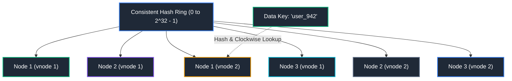

#### Production Java Consistent Hashing Ring Implementation:
```java
package com.company.distributed;

import java.nio.charset.StandardCharsets;
import java.security.MessageDigest;
import java.util.*;

public class ConsistentHashRouter<T> {
    private final int numberOfReplicas; // Virtual nodes per physical node
    private final SortedMap<Long, T> ring = new TreeMap<>();

    public ConsistentHashRouter(int numberOfReplicas, Collection<T> nodes) {
        this.numberOfReplicas = numberOfReplicas;
        for (T node : nodes) {
            addNode(node);
        }
    }

    public synchronized void addNode(T node) {
        for (int i = 0; i < numberOfReplicas; i++) {
            long hash = hash(node.toString() + "-VN-" + i);
            ring.put(hash, node);
        }
    }

    public synchronized void removeNode(T node) {
        for (int i = 0; i < numberOfReplicas; i++) {
            long hash = hash(node.toString() + "-VN-" + i);
            ring.remove(hash);
        }
    }

    public T route(String key) {
        if (ring.isEmpty()) return null;
        long hash = hash(key);
        // Find the first virtual node clockwise of this hash
        SortedMap<Long, T> tailMap = ring.tailMap(hash);
        long targetHash = tailMap.isEmpty() ? ring.firstKey() : tailMap.firstKey();
        return ring.get(targetHash);
    }

    private long hash(String key) {
        try {
            MessageDigest md = MessageDigest.getInstance("MD5");
            byte[] digest = md.digest(key.getBytes(StandardCharsets.UTF_8));
            // Extract 32-bit unsigned integer from first 4 bytes
            return ((long) (digest[3] & 0xFF) << 24) |
                   ((long) (digest[2] & 0xFF) << 16) |
                   ((long) (digest[1] & 0xFF) << 8)  |
                   ((long) (digest[0] & 0xFF));
        } catch (Exception e) {
            throw new RuntimeException(e);
        }
    }
}
```

---

### 4.7 Database Replication Topologies & Quorum Consistency ($R + W > N$)

Distributed data stores replicate data across multiple nodes to ensure high availability and durability.

| Topology | Write Path | Read Path | Conflict Handling | Best Use Case |
| :--- | :--- | :--- | :--- | :--- |
| **Single-Leader (Active-Passive)** | Writes sent exclusively to Primary node | Reads served by Primary or Read Replicas | None (Leader is single source of truth) | ACID RDBMS (PostgreSQL, MySQL) |
| **Multi-Leader (Active-Active)** | Writes accepted by leaders across multiple DCs | Reads served locally per data center | Last-Write-Wins (LWW) or CRDTs | Multi-region collaborative apps |
| **Leaderless (Dynamo-Style)** | Writes broadcast to all $N$ peer nodes | Reads broadcast to all $N$ peer nodes | Version vectors, Quorum read-repair | Cassandra, DynamoDB, Riak |

#### The Quorum Consistency Guarantee
In a leaderless system with Replication Factor $N$:
- **$W$ (Write Quorum)**: Minimum number of nodes that must acknowledge a write for it to be deemed successful.
- **$R$ (Read Quorum)**: Minimum number of nodes that must respond to a read request.

$$\mathbf{R + W > N}$$

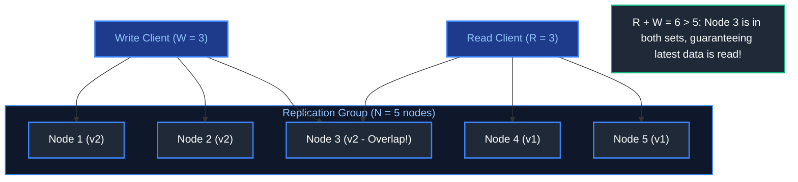

- When $R + W > N$, the read set and write set must overlap in at least **one node**, ensuring the reader always retrieves the latest write timestamp/version vector.
- **Sloppy Quorum & Hinted Handoff**: If network partitions prevent reaching $W$ designated nodes, the cluster accepts writes on temporary fallback nodes ("hinted handoff"), replay-syncing when the partition heals.

---

# 5. Real-World Backend System Designs

---

### 5.1 Global URL Shortener (TinyURL) Design

A URL shortener accepts long URLs (e.g. `https://example.com/products/electronics/laptops/123456?ref=summer_promo`) and produces a concise, readable link (e.g. `https://tiny.url/7aBc9Z`). When a client accesses the short link, the service redirects them to the original destination.

#### 5.1.1 Requirements & Scale Estimation

**Functional Requirements:**
1. Given a long URL, generate a unique, short alias (e.g. 7 characters).
2. Given a short alias, redirect the user to the original URL with minimal latency (<10ms p99).
3. Optional custom alias support (e.g. `tiny.url/my-custom-promo`).
4. Links expire after a default TTL (e.g. 2 years) or user-specified duration.
5. Click analytics (access count, country, referrer, user agent).

**Non-Functional Requirements:**
1. **High Availability**: 99.99% uptime; URL redirection must not fail.
2. **Read-Heavy Workload**: Read to write ratio is estimated at 100:1.
3. **Low Latency**: Redirection must be near-instantaneous via CDN and distributed caching.

**Mathematical Capacity Estimation (5-Year Horizon):**
- **Traffic Estimation**:
  - New URLs created: $100 \text{ Million}$ per month.
  - Write QPS: $\frac{100 \times 10^6}{30 \times 24 \times 3600} \approx 40 \text{ writes/sec}$.
  - Read QPS ($100:1$ ratio): $40 \times 100 = 4,000 \text{ reads/sec}$ average ($8,000$ peak).
- **Storage Estimation**:
  - Average record size: Long URL (500 bytes) + Short Code (7 bytes) + Metadata (100 bytes) $\approx 600 \text{ bytes}$.
  - 5-Year URL records: $100 \times 10^6 \times 12 \times 5 = 6 \text{ Billion records}$.
  - Total 5-Year Database Storage: $6 \times 10^9 \times 600 \text{ bytes} \approx 3.6 \text{ TB}$.
- **Memory Estimation for Caching (Pareto 80/20 Rule):**
  - Daily read requests: $4,000 \times 86,400 \approx 345 \text{ Million reads/day}$.
  - Caching top 20% of daily requests: $0.20 \times 345 \times 10^6 \times 600 \text{ bytes} \approx 41.4 \text{ GB RAM}$.
  - A 3-node Redis cluster with 32 GB RAM per node easily accommodates this with room for growth.

#### 5.1.2 End-to-End Architecture

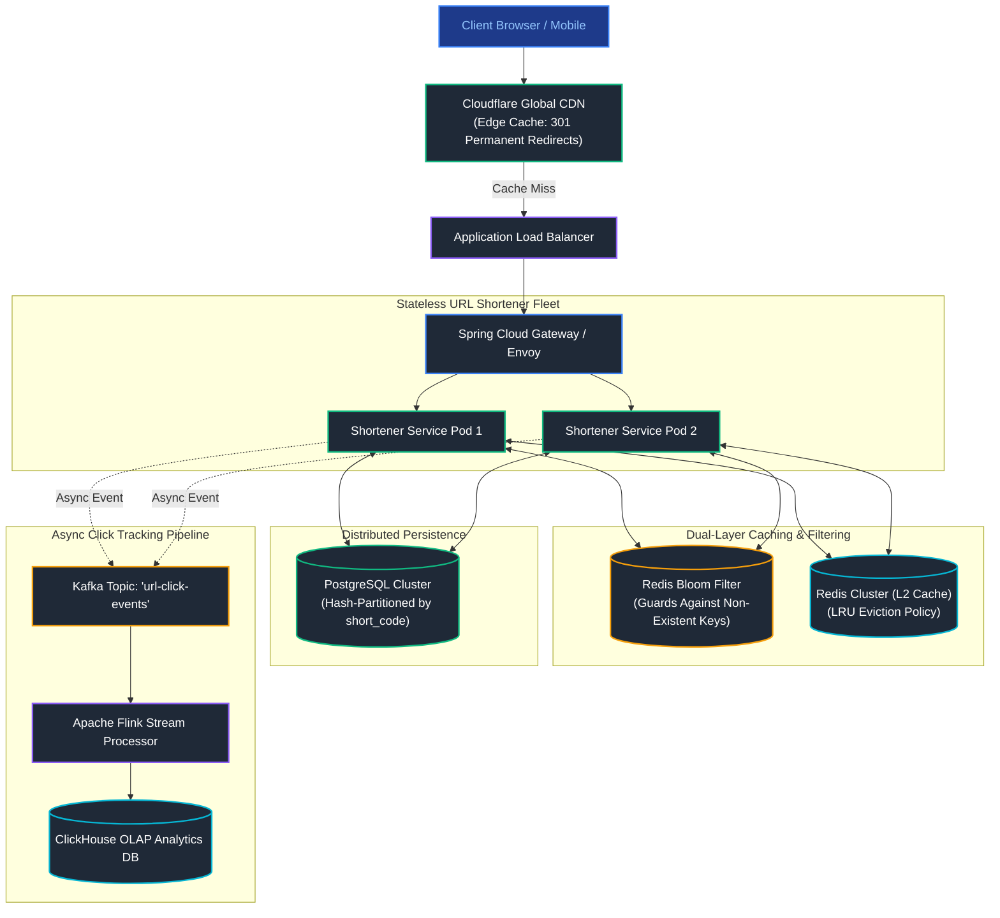

#### 5.1.3 Base62 Encoding vs MD5 Hashing

- **Why Not MD5/SHA-256 Hashing?** An MD5 hash produces a 128-bit hex string (32 characters). Taking the first 7 characters causes high collision probabilities (Birthday Paradox). Resolving collisions requires database lookups and appending salt, increasing write latency.
- **The Base62 Bijection Approach**:
  Using characters `[0-9, a-z, A-Z]` gives $10 + 26 + 26 = 62$ distinct symbols.
  A 7-character Base62 string represents:
  $$62^7 = 3,521,614,606,208 \approx 3.52 \text{ Trillion unique URLs}$$
  By generating a unique 64-bit integer ID (via Twitter Snowflake or a centralized range allocator), we convert the ID to a Base62 string with zero possibility of collision!

#### 5.1.4 Production Base62 & Snowflake Generator Implementation

```java
package com.company.tinyurl.util;

public final class Base62Converter {

    private static final String ALPHABET = "0123456789abcdefghijklmnopqrstuvwxyzABCDEFGHIJKLMNOPQRSTUVWXYZ";
    private static final int BASE = ALPHABET.length();

    private Base62Converter() {}

    public static String encode(long id) {
        if (id <= 0) {
            return String.valueOf(ALPHABET.charAt(0));
        }
        StringBuilder sb = new StringBuilder();
        while (id > 0) {
            int remainder = (int) (id % BASE);
            sb.append(ALPHABET.charAt(remainder));
            id /= BASE;
        }
        // Reverse because digits were collected from least to most significant
        return sb.reverse().toString();
    }

    public static long decode(String shortCode) {
        long id = 0;
        for (int i = 0; i < shortCode.length(); i++) {
            char c = shortCode.charAt(i);
            int charIndex = ALPHABET.indexOf(c);
            if (charIndex == -1) {
                throw new IllegalArgumentException("Invalid Base62 character: " + c);
            }
            id = id * BASE + charIndex;
        }
        return id;
    }
}
```

#### 5.1.5 Database Partitioned Schema (PostgreSQL)

```sql
-- Partitioned table by Hash of short_code across 16 physical partitions
CREATE TABLE url_mappings (
    id BIGINT NOT NULL,
    short_code VARCHAR(16) NOT NULL,
    original_url TEXT NOT NULL,
    user_id UUID,
    created_at TIMESTAMP WITH TIME ZONE DEFAULT CURRENT_TIMESTAMP,
    expires_at TIMESTAMP WITH TIME ZONE,
    PRIMARY KEY (short_code, id)
) PARTITION BY HASH (short_code);

-- Create 16 hash partitions
CREATE TABLE url_mappings_p0 PARTITION OF url_mappings FOR VALUES WITH (MODULUS 16, REMAINDER 0);
CREATE TABLE url_mappings_p1 PARTITION OF url_mappings FOR VALUES WITH (MODULUS 16, REMAINDER 1);
-- ... (p2 to p15 created similarly)

CREATE INDEX idx_url_short_code ON url_mappings (short_code);
```

#### 5.1.6 Dual-Layer Caching & Controller Implementation

```java
package com.company.tinyurl.service;

import com.company.tinyurl.util.Base62Converter;
import org.slf4j.Logger;
import org.slf4j.LoggerFactory;
import org.springframework.data.redis.core.StringRedisTemplate;
import org.springframework.http.HttpHeaders;
import org.springframework.http.HttpStatus;
import org.springframework.http.ResponseEntity;
import org.springframework.jdbc.core.JdbcTemplate;
import org.springframework.web.bind.annotation.*;

import java.net.URI;
import java.time.Duration;
import java.time.Instant;
import java.util.Optional;

@RestController
@RequestMapping
public class UrlShortenerController {

    private static final Logger log = LoggerFactory.getLogger(UrlShortenerController.class);
    private static final String CACHE_PREFIX = "tinyurl:";
    private static final String BLOOM_FILTER_KEY = "url_bloom_filter";

    private final StringRedisTemplate redisTemplate;
    private final JdbcTemplate jdbcTemplate;

    public UrlShortenerController(StringRedisTemplate redisTemplate, JdbcTemplate jdbcTemplate) {
        this.redisTemplate = redisTemplate;
        this.jdbcTemplate = jdbcTemplate;
    }

    @GetMapping("/{shortCode:[a-zA-Z0-9]{6,8}}")
    public ResponseEntity<Void> redirect(@PathVariable String shortCode) {
        // Step 1: L1/L2 Redis Cache Lookup
        String cacheKey = CACHE_PREFIX + shortCode;
        String cachedOriginalUrl = redisTemplate.opsForValue().get(cacheKey);

        if (cachedOriginalUrl != null) {
            // Check for sentinel value preventing cache penetration
            if ("NOT_FOUND".equals(cachedOriginalUrl)) {
                return ResponseEntity.status(HttpStatus.NOT_FOUND).build();
            }
            return buildRedirectResponse(cachedOriginalUrl);
        }

        // Step 2: Database Fallback Lookup
        var sql = "SELECT original_url FROM url_mappings WHERE short_code = ? AND (expires_at IS NULL OR expires_at > ?)";
        var results = jdbcTemplate.query(sql, (rs, rowNum) -> rs.getString("original_url"), shortCode, Instant.now());

        if (results.isEmpty()) {
            // Prevent Cache Penetration: Cache negative lookup with short TTL (2 minutes)
            redisTemplate.opsForValue().set(cacheKey, "NOT_FOUND", Duration.ofMinutes(2));
            return ResponseEntity.status(HttpStatus.NOT_FOUND).build();
        }

        String originalUrl = results.get(0);

        // Step 3: Populate Redis Cache with 24h TTL
        redisTemplate.opsForValue().set(cacheKey, originalUrl, Duration.ofHours(24));

        return buildRedirectResponse(originalUrl);
    }

    private ResponseEntity<Void> buildRedirectResponse(String destinationUrl) {
        // HTTP 302 Found (Temporary Redirect): Ensures all future clicks hit our servers for click analytics!
        // HTTP 301 Moved Permanently: Cached by browser; bypasses our servers (loses analytics).
        return ResponseEntity.status(HttpStatus.FOUND)
            .location(URI.create(destinationUrl))
            .header(HttpHeaders.CACHE_CONTROL, "no-cache, no-store, max-age=0, must-revalidate")
            .build();
    }
}
```

---

### 5.2 High-Throughput Distributed Rate Limiter Design

Rate limiting protects downstream APIs against abuse, brute-force attacks, resource exhaustion, and noisy-neighbor denial of service.

#### 5.2.1 Comparison of Core Algorithms

| Algorithm | Mechanism | Burst Handling | Memory Overhead | Complexity | Best Use Case |
| :--- | :--- | :--- | :--- | :--- | :--- |
| **Token Bucket** | Central bucket refilled at rate $r$. Each request consumes 1 token. Rejects if empty. | Allows bursts up to bucket capacity $B$. | Minimal (2 numbers: timestamp + token count). | Low | General API Gateway rate limiting (AWS API Gateway, Stripe). |
| **Leaky Bucket** | Requests placed in FIFO queue; drained at constant steady rate. Drops if queue overflows. | Smooths bursts into uniform outbound stream. | Moderate (memory for queued requests). | Medium | Ingestion pipelines, payment processors with strict concurrency. |
| **Fixed Window Counter** | Counts requests in fixed time interval (e.g. 10:00 to 10:01). Resets counter at interval edge. | Suffers 2x boundary burst (e.g. 100 requests at 10:00:59, 100 at 10:01:00). | Ultra-low (single integer per client). | Very Low | Coarse-grained rate limiting where bursts are tolerable. |
| **Sliding Window Log** | Stores exact epoch timestamp for every request in a Redis Sorted Set (ZSET). Evicts old timestamps. | Extremely precise; prevents boundary bursts entirely. | High memory ($O(N)$ entries per client where $N$ is request volume). | Medium | Low-volume, high-security endpoints (Login, Password Reset). |
| **Sliding Window Counter** | Blends count of previous window with current window: $\text{Count} = C_{\text{prev}} \times (1 - \text{weight}) + C_{\text{curr}}$. | Effectively smooths boundary bursts with zero timestamp tracking. | Minimal (2 counters per client). | Low | High-throughput distributed microservices rate limiting. |

#### 5.2.2 Atomic Sliding Window Counter via Redis Lua Script

Because multiple concurrent API Gateway instances process incoming requests in parallel, reading and writing counters in Redis without concurrency control causes race conditions. A Redis Lua script executes atomically on the Redis single-threaded engine:

```lua
-- KEYS[1]: Rate limit key (e.g., "ratelimit:user_8123:minute")
-- ARGV[1]: Current UNIX epoch timestamp in milliseconds
-- ARGV[2]: Window size in milliseconds (e.g., 60000 for 1 minute)
-- ARGV[3]: Max allowed requests per window (e.g., 100)

local key = KEYS[1]
local current_time = tonumber(ARGV[1])
local window_size = tonumber(ARGV[2])
local max_requests = tonumber(ARGV[3])
local clear_before = current_time - window_size

-- 1. Remove all request log entries older than the active window
redis.call('ZREMRANGEBYSCORE', key, '-inf', clear_before)

-- 2. Count current entries in window
local current_count = redis.call('ZCARD', key)

if current_count < max_requests then
    -- 3. Add current request timestamp (using timestamp as both member and score)
    redis.call('ZADD', key, current_time, current_time)
    -- Set TTL on key equal to window size to auto-evict idle keys
    redis.call('PEXPIRE', key, window_size)
    -- Return allowed (1), remaining requests, and reset time
    return {1, max_requests - (current_count + 1), math.ceil(window_size / 1000)}
else
    -- Request rate limit exceeded
    local oldest_time = redis.call('ZRANGE', key, 0, 0, 'WITHSCORES')
    local retry_after = 1
    if #oldest_time > 0 then
        retry_after = math.ceil((tonumber(oldest_time[2]) + window_size - current_time) / 1000)
    end
    return {0, 0, math.max(1, retry_after)}
end
```

#### 5.2.3 Spring Boot Rate Limiting Interceptor Implementation

```java
package com.company.ratelimiter;

import jakarta.servlet.http.HttpServletRequest;
import jakarta.servlet.http.HttpServletResponse;
import org.springframework.core.io.ClassPathResource;
import org.springframework.data.redis.core.StringRedisTemplate;
import org.springframework.data.redis.core.script.DefaultRedisScript;
import org.springframework.http.HttpStatus;
import org.springframework.stereotype.Component;
import org.springframework.web.servlet.HandlerInterceptor;

import java.time.Instant;
import java.util.Collections;
import java.util.List;

@Component
public class DistributedRateLimitingInterceptor implements HandlerInterceptor {

    private final StringRedisTemplate redisTemplate;
    private final DefaultRedisScript<List> rateLimitScript;

    public DistributedRateLimitingInterceptor(StringRedisTemplate redisTemplate) {
        this.redisTemplate = redisTemplate;
        this.rateLimitScript = new DefaultRedisScript<>();
        this.rateLimitScript.setLocation(new ClassPathResource("scripts/sliding_window_rate_limiter.lua"));
        this.rateLimitScript.setResultType(List.class);
    }

    @Override
    public boolean preHandle(HttpServletRequest request, HttpServletResponse response, Object handler) throws Exception {
        String clientIdentifier = resolveClientKey(request);
        String redisKey = "ratelimit:" + clientIdentifier;

        long nowMs = Instant.now().toEpochMilli();
        long windowSizeMs = 60_000L; // 1 minute
        long maxRequests = 100L;     // 100 requests per minute

        List<Long> result = redisTemplate.execute(
            rateLimitScript,
            Collections.singletonList(redisKey),
            String.valueOf(nowMs),
            String.valueOf(windowSizeMs),
            String.valueOf(maxRequests)
        );

        if (result == null || result.isEmpty()) {
            // Fail-open strategy: If Redis fails, allow request to avoid outage
            return true;
        }

        boolean allowed = result.get(0) == 1L;
        long remaining = result.get(1);
        long retryAfterSec = result.get(2);

        // Standard RFC Rate Limit Headers
        response.setHeader("X-RateLimit-Limit", String.valueOf(maxRequests));
        response.setHeader("X-RateLimit-Remaining", String.valueOf(Math.max(0, remaining)));

        if (!allowed) {
            response.setStatus(HttpStatus.TOO_MANY_REQUESTS.value()); // HTTP 429
            response.setHeader("Retry-After", String.valueOf(retryAfterSec));
            response.setContentType("application/json");
            response.getWriter().write(String.format("{\"error\": \"Rate limit exceeded. Retry in %d seconds.\"}", retryAfterSec));
            return false;
        }

        return true;
    }

    private String resolveClientKey(HttpServletRequest request) {
        // Prefer authenticated User ID or API Key; fallback to client IP
        String apiKey = request.getHeader("X-API-KEY");
        if (apiKey != null && !apiKey.isBlank()) {
            return "apikey:" + apiKey;
        }
        String forwardedFor = request.getHeader("X-Forwarded-For");
        if (forwardedFor != null && !forwardedFor.isBlank()) {
            return "ip:" + forwardedFor.split(",")[0].trim();
        }
        return "ip:" + request.getRemoteAddr();
    }
}
```

---

### 5.3 Enterprise Multi-Channel Notification System Design

An enterprise notification engine delivers SMS, Email, and Mobile Push Notifications with guaranteed delivery, vendor fallbacks, priority-based throttling, and deduplication.

#### 5.3.1 System Requirements & Architecture

**Requirements:**
1. **Multi-Channel**: SMS (Twilio, AWS SNS), Email (SendGrid, AWS SES), Push (Apple APNs, Google FCM).
2. **Priority Tiers**: High-priority alerts (OTP, payment confirmation) must deliver within $<3$ seconds; bulk marketing campaigns must not delay high-priority alerts.
3. **Vendor Redundancy & Automatic Failover**: If Twilio returns 5xx errors or throttles, transparently fail over to AWS SNS.
4. **Deduplication**: Prevent sending duplicate messages within a 5-minute sliding window (e.g. client double-clicks checkout).

```mermaid
flowchart TD
    subgraph IngressTier["1. Ingress & Deduplication"]
        Caller["Upstream Microservices"] --> API["Notification Gateway"]
        API <--> DedupCache[("Redis Dedup Cache<br/>(Key: Hash of userId+msg, TTL: 5m)")]
    end

    subgraph KafkaPriorityMesh["2. Priority Event Streaming"]
        API -->|High Priority| FastQueue["Kafka: 'notif-otp-urgent'<br/>(16 Partitions)"]
        API -->|Normal Priority| BulkQueue["Kafka: 'notif-marketing-bulk'<br/>(4 Partitions)"]
    end

    subgraph WorkerFleet["3. Worker Fleet with Circuit Breaker"]
        FastQueue --> UrgentWorkers["Urgent Worker Fleet (Auto-scaled)"]
        BulkQueue --> BulkWorkers["Bulk Worker Fleet (Rate-Capped)"]
    end

    subgraph Providers["4. Third-Party Vendor Redundancy"]
        UrgentWorkers & BulkWorkers --> Twilio["Primary SMS: Twilio"]
        Twilio -.->|Failover on 5xx| AWSSNS["Fallback SMS: AWS SNS"]

        UrgentWorkers & BulkWorkers --> SendGrid["Primary Email: SendGrid"]
        SendGrid -.->|Failover on 5xx| AWSSES["Fallback Email: AWS SES"]

        UrgentWorkers & BulkWorkers --> FCM["Push: Google FCM / Apple APNs"]
    end

    subgraph DLQ_And_Audit["5. Audit & Dead Letter Queue (DLQ)"]
        UrgentWorkers & BulkWorkers -->|Failed after 3 retries| DLQ["Kafka: 'notif-dlq'"]
        DLQ --> AlertEngine["SRE PagerDuty Alert Engine"]
        UrgentWorkers & BulkWorkers --> AuditDB[("Cassandra / ScyllaDB Notification Log")]
    end

    style IngressTier fill:#0f172a,stroke:#3b82f6,stroke-width:1.5px,color:#93c5fd
    style KafkaPriorityMesh fill:#0f172a,stroke:#f59e0b,stroke-width:1.5px,color:#fde68a
    style WorkerFleet fill:#0f172a,stroke:#10b981,stroke-width:1.5px,color:#6ee7b7
    style Providers fill:#0f172a,stroke:#8b5cf6,stroke-width:1.5px,color:#c084fc
    style DLQ_And_Audit fill:#0f172a,stroke:#ef4444,stroke-width:1.5px,color:#fca5a5

    style Caller fill:#1e3a8a,stroke:#3b82f6,stroke-width:2px,color:#93c5fd
    style API fill:#1f2937,stroke:#3b82f6,stroke-width:2px,color:#fff
    style DedupCache fill:#1f2937,stroke:#06b6d4,stroke-width:2px,color:#fff
    style FastQueue fill:#1f2937,stroke:#f59e0b,stroke-width:2px,color:#fff
    style BulkQueue fill:#1f2937,stroke:#f59e0b,stroke-width:2px,color:#fff
    style UrgentWorkers fill:#1f2937,stroke:#10b981,stroke-width:2px,color:#fff
    style BulkWorkers fill:#1f2937,stroke:#64748b,stroke-width:2px,color:#fff
    style Twilio fill:#1f2937,stroke:#8b5cf6,stroke-width:2px,color:#fff
    style AWSSNS fill:#1f2937,stroke:#8b5cf6,stroke-width:2px,color:#fff
    style SendGrid fill:#1f2937,stroke:#8b5cf6,stroke-width:2px,color:#fff
    style AWSSES fill:#1f2937,stroke:#8b5cf6,stroke-width:2px,color:#fff
    style FCM fill:#1f2937,stroke:#8b5cf6,stroke-width:2px,color:#fff
    style DLQ fill:#1f2937,stroke:#ef4444,stroke-width:2px,color:#fff
    style AlertEngine fill:#1f2937,stroke:#ef4444,stroke-width:2px,color:#fff
    style AuditDB fill:#1f2937,stroke:#06b6d4,stroke-width:2px,color:#fff
```

#### 5.3.2 Resilient Multi-Provider Dispatcher with Circuit Breaker

```java
package com.company.notification.dispatcher;

import io.github.resilience4j.circuitbreaker.annotation.CircuitBreaker;
import org.slf4j.Logger;
import org.slf4j.LoggerFactory;
import org.springframework.stereotype.Service;

public record SmsPayload(String phoneNumber, String message, String idempotencyKey) {}

@Service
public class ResilientSmsDispatcher {

    private static final Logger log = LoggerFactory.getLogger(ResilientSmsDispatcher.class);

    private final TwilioSmsClient twilioClient;
    private final AwsSnsClient awsSnsClient;

    public ResilientSmsDispatcher(TwilioSmsClient twilioClient, AwsSnsClient awsSnsClient) {
        this.twilioClient = twilioClient;
        this.awsSnsClient = awsSnsClient;
    }

    @CircuitBreaker(name = "smsProviderCircuitBreaker", fallbackMethod = "sendViaAwsSnsFallback")
    public boolean sendSms(SmsPayload payload) {
        log.info("Attempting primary dispatch via Twilio for recipient {}", payload.phoneNumber());
        return twilioClient.dispatch(payload.phoneNumber(), payload.message());
    }

    /**
     * Fallback triggered automatically if Twilio fails or Circuit Breaker opens.
     */
    public boolean sendViaAwsSnsFallback(SmsPayload payload, Throwable ex) {
        log.warn("Twilio dispatch failed or circuit open. Failing over to AWS SNS for recipient: {}. Cause: {}",
            payload.phoneNumber(), ex.getMessage());
        return awsSnsClient.dispatch(payload.phoneNumber(), payload.message());
    }
}
```

---

### 5.4 Resilient Financial Payment Gateway Design

Financial systems require zero tolerance for lost money, balance drift, or phantom transactions. Every transaction must adhere strictly to double-entry bookkeeping, absolute idempotency, and automated discrepancy reconciliation.

#### 5.4.1 Fundamental Double-Entry Bookkeeping Equation

In an immutable double-entry ledger, money is never created or destroyed; it moves between accounts via balanced journal entries. Every entry consists of at least one Debit and at least one Credit such that:

$$\sum \text{Debits} \equiv \sum \text{Credits}$$

- **Asset & Expense Accounts**: Debits increase balance ($+$), Credits decrease balance ($-$).
- **Liability & Equity Accounts**: Credits increase balance ($+$), Debits decrease balance ($-$).

#### 5.4.2 Production Immutable Ledger Schema (PostgreSQL)

```sql
-- Accounts Table: Master chart of accounts
CREATE TABLE accounts (
    id UUID PRIMARY KEY DEFAULT gen_random_uuid(),
    account_number VARCHAR(64) UNIQUE NOT NULL,
    account_type VARCHAR(32) NOT NULL, -- ASSET, LIABILITY, EQUITY, REVENUE, EXPENSE
    currency VARCHAR(3) NOT NULL,
    created_at TIMESTAMP WITH TIME ZONE DEFAULT CURRENT_TIMESTAMP
);

-- Journal Entries: Logical business transactions (e.g. Order #1001 Payment)
CREATE TABLE journal_entries (
    id UUID PRIMARY KEY DEFAULT gen_random_uuid(),
    idempotency_key VARCHAR(128) UNIQUE NOT NULL,
    reference_id VARCHAR(64) NOT NULL,
    description TEXT NOT NULL,
    posted_at TIMESTAMP WITH TIME ZONE DEFAULT CURRENT_TIMESTAMP
);

-- Ledger Lines: Immutable atomic debits and credits
CREATE TABLE ledger_lines (
    id UUID PRIMARY KEY DEFAULT gen_random_uuid(),
    journal_entry_id UUID NOT NULL REFERENCES journal_entries(id) ON DELETE RESTRICT,
    account_id UUID NOT NULL REFERENCES accounts(id) ON DELETE RESTRICT,
    amount NUMERIC(18, 4) NOT NULL CHECK (amount > 0),
    direction VARCHAR(6) NOT NULL CHECK (direction IN ('DEBIT', 'CREDIT')),
    created_at TIMESTAMP WITH TIME ZONE DEFAULT CURRENT_TIMESTAMP
);

CREATE INDEX idx_ledger_account_time ON ledger_lines (account_id, created_at);
```

#### 5.4.3 Payment State Machine & Asynchronous Webhook Architecture

```mermaid
flowchart TD
    subgraph ClientPerimeter ["1. Client Submission"]
        Checkout["Client Submits Checkout<br/>(Idempotency-Key: 'ord-8102-pay')"]
    end

    subgraph LedgerReservation ["2. Double-Entry Authorization"]
        LockAcquired["Acquire Redis Distributed Lock"]
        LedgerHold["INSERT PENDING Journal Entry<br/>(Debit: Customer Receivable, Credit: Escrow Pending)"]
    end

    subgraph PSPGateway ["3. Payment Service Provider (Stripe / Adyen)"]
        PSPRequest["Dispatch REST API to PSP"]
        PSPOutcome{"PSP Synchronous Response"}
    end

    subgraph WebhookAndSettlement ["4. Asynchronous Settlement & Webhooks"]
        WebhookReceived["PSP Sends Webhook: 'payment_intent.succeeded'"]
        HMACVerified["Verify HMAC-SHA256 Signature"]
        LedgerSettled["Finalize Ledger Entry<br/>(Debit: PSP Cash, Credit: Merchant Payable)"]
    end

    Checkout --> LockAcquired
    LockAcquired --> LedgerHold
    LedgerHold --> PSPRequest
    PSPRequest --> PSPOutcome
    PSPOutcome -->|Success / Pending| WebhookReceived
    PSPOutcome -->|Immediate Decline| Reversal["Compensate: Release Ledger Hold"]
    WebhookReceived --> HMACVerified
    HMACVerified --> LedgerSettled

    style ClientPerimeter fill:#0f172a,stroke:#3b82f6,stroke-width:1.5px,color:#93c5fd
    style LedgerReservation fill:#0f172a,stroke:#10b981,stroke-width:1.5px,color:#6ee7b7
    style PSPGateway fill:#0f172a,stroke:#f59e0b,stroke-width:1.5px,color:#fde68a
    style WebhookAndSettlement fill:#0f172a,stroke:#8b5cf6,stroke-width:1.5px,color:#c084fc

    style Checkout fill:#1f2937,stroke:#3b82f6,stroke-width:2px,color:#fff
    style LockAcquired fill:#1f2937,stroke:#10b981,stroke-width:2px,color:#fff
    style LedgerHold fill:#1f2937,stroke:#10b981,stroke-width:2px,color:#fff
    style PSPRequest fill:#1f2937,stroke:#f59e0b,stroke-width:2px,color:#fff
    style PSPOutcome fill:#1f2937,stroke:#f59e0b,stroke-width:2px,color:#fff
    style WebhookReceived fill:#1f2937,stroke:#8b5cf6,stroke-width:2px,color:#fff
    style HMACVerified fill:#1f2937,stroke:#8b5cf6,stroke-width:2px,color:#fff
    style LedgerSettled fill:#1f2937,stroke:#8b5cf6,stroke-width:2px,color:#fff
    style Reversal fill:#1f2937,stroke:#ef4444,stroke-width:2px,color:#fff
```

#### 5.4.4 Automated Reconciliation Engine

Even with webhook retries, network glitches or unexpected database restarts can cause dropped webhooks. A payment gateway must run an **Asynchronous Nightly Reconciliation Job**:
1. Download official settlement CSV reports from payment processors (Stripe/Adyen/PayPal) at 02:00 UTC.
2. Stream-parse settlement records and compare them against internal `journal_entries` within the corresponding settlement window:
   $$\Delta = \text{Internal Ledger} - \text{External PSP Report}$$
3. For any unmatched transaction:
   - **Type 1: Captured in PSP, missing in local ledger**: Automatically inject a backdated adjustment journal entry and notify accounting.
   - **Type 2: Captured in local ledger, missing in PSP**: Flag transaction as critical; trigger dispute investigation workflow.

---

# 6. Operational Commands & Diagnostic Tools Cheatsheet

| Command & Syntax | Key Flags Explained | What Does What | Practical Operational Scenario |
| :--- | :--- | :--- | :--- |
| `istioctl analyze -n <ns>` | `-n <ns>`: Target namespace | Analyzes Service Mesh configuration for broken routing rules or syntax errors | Verifying Istio `VirtualService` or `DestinationRule` health before rollout |
| `istioctl proxy-config endpoints <pod>` | `--cluster <name>`: Filter by upstream cluster | Inspects live Envoy routing tables and active backend IP endpoints inside sidecar | Debugging why traffic is not reaching a specific Pod replica |
| `grpcurl -plaintext <host>:<port> list` | `-plaintext`: Disable TLS encryption | Queries gRPC server reflection to enumerate exposed services and methods | Testing and discovering internal gRPC APIs without client SDK |
| `hey -n 10000 -c 100 -m POST -H "..." <url>` | `-n`: Total requests<br>`-c`: Concurrent workers<br>`-m`: HTTP method | High-speed HTTP load generator outputting latency percentiles (p50, p95, p99) | Benchmarking API Gateway rate limiters and autoscaling response |
| `curl -w "@curl-format.txt" -o /dev/null -s <url>` | `-w`: Format timing output (DNS, TCP, TLS, TTFB) | Measures exact millisecond breakdown of network connection and server response | Diagnosing whether latency is caused by DNS resolution, TLS, or server processing |

---

# 7. Summary Comparison & Engineering Reference Matrix

| Distributed Communication & Coordination Dimension | Synchronous REST (HTTP/1.1 JSON) | High-Performance gRPC (HTTP/2 Protobuf) | Asynchronous Messaging (AMQP / RabbitMQ) | Distributed Event Log (Kafka Event Streams) |
| :--- | :--- | :--- | :--- | :--- |
| **Transport & Framing** | HTTP/1.1 TCP, text headers | HTTP/2 multiplexed binary streams | AMQP 0-9-1 TCP binary framing | Custom TCP protocol over sequential disk logs |
| **Payload Format** | Verbose human-readable JSON string | Strongly typed binary Protocol Buffers | Arbitrary byte stream (JSON / Avro / Protobuf) | Schema-governed Avro / Protobuf / JSON |
| **Coupling Level** | Tight temporal and spatial coupling | Tight temporal coupling, loose interface contract | Loose temporal and spatial coupling (queues) | Loose temporal and spatial coupling (topics) |
| **Latency Profile** | High ($15 - 50$ ms average) | Minimal ($1 - 5$ ms p99) | Low ($5 - 15$ ms) | Near-zero write latency ($2 - 10$ ms) |
| **Resilience & Fault Isolation** | Requires explicit Circuit Breakers & Retries | Requires Client Retries & Deadline propagation | Inherent temporal decoupling via broker queue buffer | Inherent decoupling; consumers process at own pace |
| **Service Mesh Integration** | Standard Ingress / L7 Gateway | Envoy / Istio HTTP/2 multiplexing & gRPC status | TCP Layer 4 pass-through or proxy | TCP Layer 4 pass-through or specialized Kafka mesh |
| **Primary Production Pattern** | Public-facing client APIs & B2B integrations | High-throughput internal inter-service RPC | Async command processing, transactional tasks | Core enterprise event backbone, CDC, event sourcing |

---

# 8. References & Further Reading

- [GeeksforGeeks - System Design Tutorial & High-Level Architecture](https://www.geeksforgeeks.org/system-design-tutorial/)
- [GeeksforGeeks - Microservices Architecture](https://www.geeksforgeeks.org/microservices/)
- [Baeldung - Spring Cloud and Microservices Architecture Series](https://www.baeldung.com/spring-cloud-series)
- [Martin Fowler - Microservices Guide & Distributed Design Patterns](https://martinfowler.com/articles/microservices.html)
- [Martin Fowler - Patterns of Distributed Systems](https://martinfowler.com/articles/patterns-of-distributed-systems/)
- [Resilience4j Official Documentation & Circuit Breaker Guides](https://resilience4j.readme.io/)
- [The Raft Consensus Algorithm (Interactive Stanford Visualization)](https://raft.github.io/)
