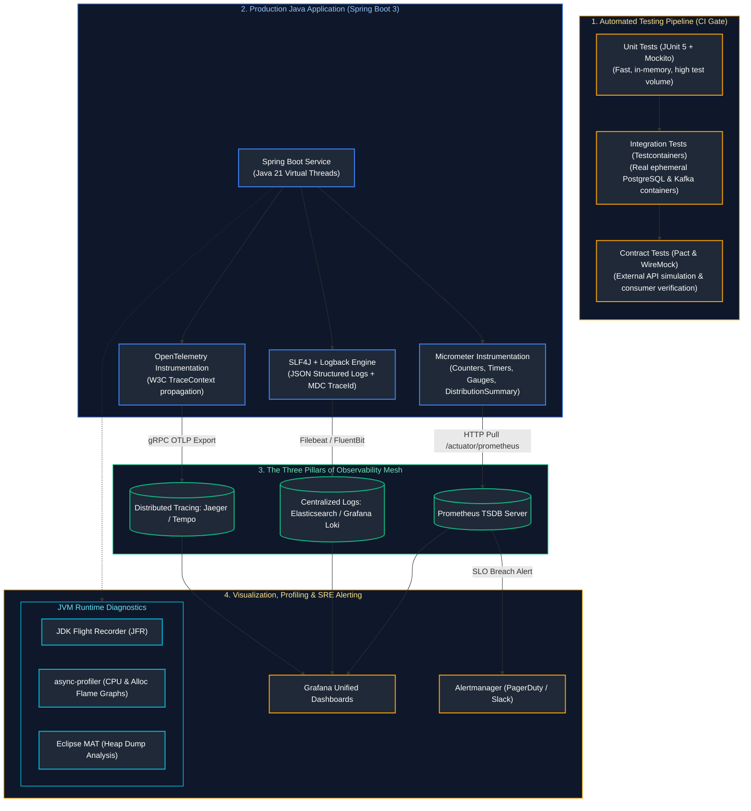
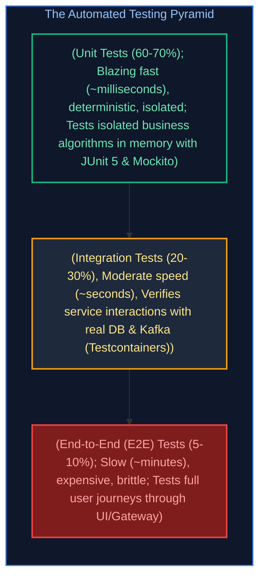
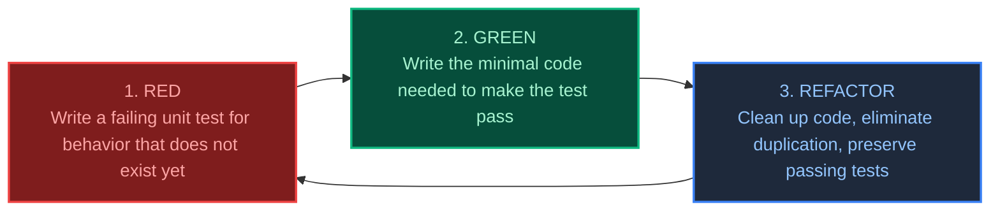
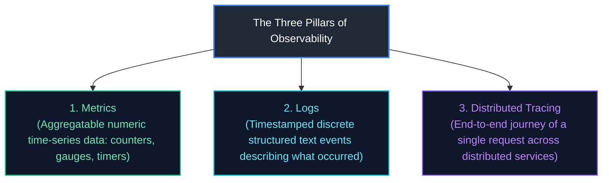
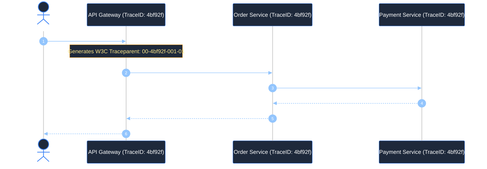

# 14. Testing, Observability, Performance & Production Engineering

A comprehensive, production-grade engineering guide covering the Testing Pyramid, TDD Red-Green-Refactor cycles, JUnit 5 extensions, Mockito advanced behaviors, Spring Boot test slices (`@WebMvcTest`, `@DataJpaTest`), Testcontainers integration testing, WireMock fault injection, enterprise logging architectures (SLF4J, Logback, MDC correlation IDs, PII masking), the Three Pillars of Observability (Metrics, Logs, Traces), Prometheus pull architecture, Grafana dashboards, OpenTelemetry distributed tracing, async-profiler flame graphs, Eclipse MAT heap dump analysis, and high-concurrency load testing.

---

## Architectural Overview: Enterprise Testing, Observability & Performance Architecture



---

## Table of Contents
1. [The Testing Pyramid & Unit Testing Foundations](#1-the-testing-pyramid--unit-testing-foundations)
   - [1.1 The Testing Pyramid: Balancing Speed, Determinism & Fidelity](#11-the-testing-pyramid-balancing-speed-determinism--fidelity)
   - [1.2 Test-Driven Development (TDD): The Red-Green-Refactor Cycle](#12-test-driven-development-tdd-the-red-green-refactor-cycle)
   - [1.3 JUnit 5 Architecture & Test Lifecycle (`@BeforeEach`, `@Nested`)](#13-junit-5-architecture--test-lifecycle-beforeeach-nested)
   - [1.4 Custom JUnit 5 Extensions (Timing & Benchmark Extensions)](#14-custom-junit-5-extensions-timing--benchmark-extensions)
   - [1.5 Parameterized Testing Mastery (`@CsvSource`, `@MethodSource`)](#15-parameterized-testing-mastery-csvsource-methodsource)
   - [1.6 Test Doubles: Dummy vs Stub vs Mock vs Spy](#16-test-doubles-dummy-vs-stub-vs-mock-vs-spy)
   - [1.7 Mockito Deep-Dive: `@Mock`, `@InjectMocks`, `ArgumentCaptor` & Static Mocking](#17-mockito-deep-dive-mock-injectmocks-argumentcaptor--static-mocking)
   - [1.8 Fluent Assertions with AssertJ & Deep Object Graph Comparison](#18-fluent-assertions-with-assertj--deep-object-graph-comparison)
2. [Spring Boot Test Slicing & Real Integration Testing](#2-spring-boot-test-slicing--real-integration-testing)
   - [2.1 Why `@SpringBootTest` is an Anti-Pattern for Simple Tests](#21-why-springboottest-is-an-anti-pattern-for-simple-tests)
   - [2.2 Controller Slice Testing with `@WebMvcTest` & `MockMvc`](#22-controller-slice-testing-with-webmvctest--mockmvc)
   - [2.3 Data Persistence Slicing with `@DataJpaTest`](#23-data-persistence-slicing-with-datajpatest)
   - [2.4 Why H2 In-Memory DB Fails in Production Integration Tests](#24-why-h2-in-memory-db-fails-in-production-integration-tests)
   - [2.5 Real Integration Testing with Testcontainers & Spring Boot 3.1+ `@ServiceConnection`](#25-real-integration-testing-with-testcontainers--spring-boot-31-serviceconnection)
3. [Contract Testing, Mocking & Code Quality Gates](#3-contract-testing-mocking--code-quality-gates)
   - [3.1 External HTTP API Mocking with WireMock (Fault Injection, Delays & Stateful Scenarios)](#31-external-http-api-mocking-with-wiremock-fault-injection-delays--stateful-scenarios)
   - [3.2 Consumer-Driven Contract Testing with Pact](#32-consumer-driven-contract-testing-with-pact)
   - [3.3 Code Coverage (JaCoCo) vs Mutation Testing (PITest)](#33-code-coverage-jacoco-vs-mutation-testing-pitest)
4. [Enterprise Logging, MDC & Structured Diagnostics](#4-enterprise-logging-mdc--structured-diagnostics)
   - [4.1 The Logging Facade Pattern: SLF4J over Logback](#41-the-logging-facade-pattern-slf4j-over-logback)
   - [4.2 Mapped Diagnostic Context (MDC): Correlation IDs & Distributed Request Tracing](#42-mapped-diagnostic-context-mdc-correlation-ids--distributed-request-tracing)
   - [4.3 Structured JSON Logging for ELK & Grafana Loki](#43-structured-json-logging-for-elk--grafana-loki)
   - [4.4 Production Logback PII Masking Converter (GDPR & PCI-DSS Compliance)](#44-production-logback-pii-masking-converter-gdpr--pci-dss-compliance)
5. [The Three Pillars of Observability & APM](#5-the-three-pillars-of-observability--apm)
   - [5.1 The Three Pillars Multi-Dimensional Comparison (Metrics vs Logs vs Traces)](#51-the-three-pillars-multi-dimensional-comparison-metrics-vs-logs-vs-traces)
   - [5.2 Micrometer Metrics: Counters, Timers, Gauges & DistributionSummaries](#52-micrometer-metrics-counters-timers-gauges--distributionsummaries)
   - [5.3 Prometheus Pull Model & Grafana Dashboarding](#53-prometheus-pull-model--grafana-dashboarding)
   - [5.4 The 4 Golden Signals (Latency, Traffic, Errors, Saturation)](#54-the-4-golden-signals-latency-traffic-errors-saturation)
   - [5.5 Distributed Tracing with OpenTelemetry & W3C TraceContext](#55-distributed-tracing-with-opentelemetry--w3c-tracecontext)
   - [5.6 Production Prometheus Alerting Rules for SLO Monitoring](#56-production-prometheus-alerting-rules-for-slo-monitoring)
6. [Production Performance Profiling & Diagnostic Troubleshooting](#6-production-performance-profiling--diagnostic-troubleshooting)
   - [6.1 Low-Overhead CPU & Memory Profiling with async-profiler (Flame Graphs)](#61-low-overhead-cpu--memory-profiling-with-async-profiler-flame-graphs)
   - [6.2 Heap Dump Analysis with Eclipse Memory Analyzer Tool (MAT)](#62-heap-dump-analysis-with-eclipse-memory-analyzer-tool-mat)
   - [6.3 Load Testing with k6: Simulating High-Concurrency Traffic](#63-load-testing-with-k6-simulating-high-concurrency-traffic)
7. [Production Troubleshooting Playbook](#7-production-troubleshooting-playbook)
8. [Summary Comparison & Engineering Reference Matrix](#8-summary-comparison--engineering-reference-matrix)
9. [References & Further Reading](#9-references--further-reading)

---

# 1. The Testing Pyramid & Unit Testing Foundations

---

### 1.1 The Testing Pyramid: Balancing Speed, Determinism & Fidelity

Originally formulated by Mike Cohn and popularized by Martin Fowler, the **Testing Pyramid** provides the foundational architectural strategy for automated testing in high-velocity software engineering:



#### The Ice Cream Cone Anti-Pattern:
In dysfunctional engineering organizations, teams write very few unit tests and rely predominantly on hundreds of end-to-end UI tests.
* **Result**: CI builds take 2 hours to complete; tests frequently fail due to network timeouts or database state pollution (**Flaky Tests**); developers stop trusting the test suite.

---

### 1.2 Test-Driven Development (TDD): The Red-Green-Refactor Cycle

Test-Driven Development inverts traditional development: you write the automated specification **before** writing implementation code:



* **Why TDD Matters for Staff Engineers**: TDD forces modular, loosely-coupled object design. If a class is difficult to test in a unit test, its architectural design is flawed (e.g. violating SRP, using static global state, or missing dependency injection).

---

### 1.3 JUnit 5 Architecture & Test Lifecycle (`@BeforeEach`, `@Nested`)

JUnit 5 is decoupled into three independent modules:
* **JUnit Platform**: The underlying test engine foundation running on the JVM.
* **JUnit Jupiter**: The modern programming and extension model (`@Test`, `@ParameterizedTest`).
* **JUnit Vintage**: Backwards-compatibility engine running legacy JUnit 3 and 4 tests.

#### Hierarchical BDD Lifecycle with `@Nested`:
```java
package com.enterprise.banking.service;

import org.junit.jupiter.api.*;
import java.math.BigDecimal;
import static org.assertj.core.api.Assertions.*;

@DisplayName("BankAccount Domain Operations")
class BankAccountTest {

    private BankAccount account;

    @BeforeEach
    void setUp() {
        // Runs before every individual @Test method
        account = new BankAccount("ACC-101", new BigDecimal("100.00"));
    }

    @Nested
    @DisplayName("Deposit Operations")
    class DepositTests {

        @Test
        @DisplayName("Should increment balance when deposit is strictly positive")
        void depositValidAmount() {
            account.deposit(new BigDecimal("50.00"));
            assertThat(account.getCurrentBalance()).isEqualByComparingTo("150.00");
        }

        @Test
        @DisplayName("Should throw IllegalArgumentException when deposit is zero or negative")
        void depositInvalidAmount() {
            assertThatThrownBy(() -> account.deposit(new BigDecimal("-10.00")))
                .isInstanceOf(IllegalArgumentException.class)
                .hasMessageContaining("strictly positive");
        }
    }

    @Nested
    @DisplayName("Withdrawal Operations")
    class WithdrawalTests {

        @Test
        @DisplayName("Should decrement balance when funds are sufficient")
        void withdrawSufficientFunds() {
            account.withdraw(new BigDecimal("40.00"));
            assertThat(account.getCurrentBalance()).isEqualByComparingTo("60.00");
        }

        @Test
        @DisplayName("Should throw InsufficientFundsException when balance is exceeded")
        void withdrawInsufficientFunds() {
            assertThatThrownBy(() -> account.withdraw(new BigDecimal("200.00")))
                .isInstanceOf(InsufficientFundsException.class);
        }
    }
}
```

---

### 1.4 Custom JUnit 5 Extensions (Timing & Benchmark Extensions)

Custom JUnit 5 extensions let you intercept test lifecycle events without modifying test code:

```java
public class ExecutionTimeExtension implements BeforeTestExecutionCallback, AfterTestExecutionCallback {

    private static final Logger log = LoggerFactory.getLogger(ExecutionTimeExtension.class);
    private static final String START_TIME = "start_time";

    @Override
    public void beforeTestExecution(ExtensionContext context) {
        context.getStore(ExtensionContext.Namespace.GLOBAL).put(START_TIME, System.currentTimeMillis());
    }

    @Override
    public void afterTestExecution(ExtensionContext context) {
        long start = context.getStore(ExtensionContext.Namespace.GLOBAL).remove(START_TIME, long.class);
        long duration = System.currentTimeMillis() - start;
        if (duration > 500) {
            log.warn("SLOW TEST ALERT: Test [{}] took {} ms to execute!", context.getDisplayName(), duration);
        }
    }
}
```

#### Production Database Truncation Extension (`DatabaseCleanupExtension`)

In integration test suites, tests that write to a database can cause test order pollution (e.g. Test A creates a user with email `test@corp.com`, causing Test B to fail with a unique constraint violation). Wrapping tests in `@Transactional` causes rollback, but breaks tests that test asynchronous listeners or committed states.

A custom JUnit 5 extension cleanly truncates all database tables between test executions:

```java
package com.enterprise.integration.extension;

import org.junit.jupiter.api.extension.AfterEachCallback;
import org.junit.jupiter.api.extension.ExtensionContext;
import org.springframework.context.ApplicationContext;
import org.springframework.jdbc.core.JdbcTemplate;
import org.springframework.test.context.junit.jupiter.SpringExtension;

import java.util.List;

public class DatabaseCleanupExtension implements AfterEachCallback {

    @Override
    public void afterEach(ExtensionContext context) {
        ApplicationContext appCtx = SpringExtension.getApplicationContext(context);
        JdbcTemplate jdbcTemplate = appCtx.getBean(JdbcTemplate.class);

        // Fetch all user tables in PostgreSQL public schema (ignoring Flyway/Liquibase history)
        List<String> tableNames = jdbcTemplate.queryForList(
            "SELECT table_name FROM information_schema.tables " +
            "WHERE table_schema = 'public' AND table_type = 'BASE TABLE' " +
            "AND table_name NOT IN ('flyway_schema_history', 'databasechangelog', 'databasechangeloglock')",
            String.class
        );

        if (!tableNames.isEmpty()) {
            // Disable referential integrity and truncate all tables concurrently with CASCADE
            String truncateSql = "TRUNCATE TABLE " + String.join(", ", tableNames) + " RESTART IDENTITY CASCADE";
            jdbcTemplate.execute(truncateSql);
        }
    }
}
```

Apply at test class or base class level: `@ExtendWith(DatabaseCleanupExtension.class)`!

---

### 1.5 Parameterized Testing Mastery (`@CsvSource`, `@MethodSource`)

Parameterized tests execute the exact same test logic across multiple input-output data sets without code duplication:

```java
public class PasswordValidator {
    public boolean isValid(String password) {
        if (password == null || password.length() < 8) return false;
        return password.matches(".*[A-Z].*") && password.matches(".*[0-9].*");
    }
}

class PasswordValidatorTest {

    private final PasswordValidator validator = new PasswordValidator();

    @ParameterizedTest(name = "Password ''{0}'' validity should be {1}")
    @CsvSource({
        "Secret123, true",
        "weak, false",
        "NoNumberPass, false",
        "12345678, false",
        ", false"
    })
    void validatePasswords(String candidatePassword, boolean expectedResult) {
        assertThat(validator.isValid(candidatePassword)).isEqualTo(expectedResult);
    }
}
```

---

### 1.6 Test Doubles: Dummy vs Stub vs Mock vs Spy

In automated testing, replacing a real dependency with a surrogate is called using a **Test Double** (Gerard Meszaros taxonomy):

| Test Double | Purpose | Typical Implementation |
| :--- | :--- | :--- |
| **Dummy** | Passed around to satisfy parameter lists; never actually invoked or inspected. | `new User("dummy", null)` |
| **Stub** | Provides canned, hardcoded responses to method calls during the test. | `when(repo.findById(1L)).thenReturn(Optional.of(user))` |
| **Mock** | Pre-programmed with expectations; verifies **behavior** (which methods were called with what arguments). | `verify(emailService, times(1)).sendWelcomeEmail("user@corp.com")` |
| **Spy** | A wrapper around a **real object** that records interactions while executing real code. | `@Spy private AuditLogger logger = new AuditLogger();` |

---

### 1.7 Mockito Deep-Dive: `@Mock`, `@InjectMocks`, `ArgumentCaptor` & Static Mocking

```java
@ExtendWith(MockitoExtension.class)
class OrderServiceTest {

    @Mock
    private OrderRepository orderRepository;

    @Mock
    private PaymentGateway paymentGateway;

    @InjectMocks
    private OrderService orderService; // Injects mocked repository and payment gateway into OrderService

    @Captor
    private ArgumentCaptor<OrderEntity> orderCaptor;

    @Test
    void shouldCreateOrderAndProcessPaymentSuccessfully() {
        // 1. Arrange (Stub dependencies)
        CreateOrderRequest request = new CreateOrderRequest("CUST-101", new BigDecimal("99.00"));
        when(paymentGateway.charge(eq("CUST-101"), any(BigDecimal.class)))
            .thenReturn(new PaymentResult("TX-999", true));

        // 2. Act
        OrderResponse response = orderService.createOrder(request);

        // 3. Assert & Verify
        assertThat(response.status()).isEqualTo("CONFIRMED");

        // Verify paymentGateway was called exactly once
        verify(paymentGateway, times(1)).charge("CUST-101", new BigDecimal("99.00"));

        // Capture the internal entity passed to repository.save() to assert fields
        verify(orderRepository).save(orderCaptor.capture());
        OrderEntity savedEntity = orderCaptor.getValue();
        assertThat(savedEntity.getCustomerId()).isEqualTo("CUST-101");
        assertThat(savedEntity.getTotalAmount()).isEqualByComparingTo("99.00");
    }

    @Test
    void shouldMockStaticUtilityMethod() {
        // Mockito 3.4+ supports mocking static methods using try-with-resources!
        try (MockedStatic<UUIDGenerator> mocked = mockStatic(UUIDGenerator.class)) {
            mocked.when(UUIDGenerator::generate).thenReturn("STATIC-UUID-123");

            String token = orderService.generateToken();
            assertThat(token).isEqualTo("STATIC-UUID-123");
        }
    }

    @Test
    void shouldVerifyMethodExecutionOrderAndHandleVoidMethods() {
        // 1. Mocking void methods with doThrow and doAnswer
        doNothing().when(orderRepository).deleteById(99L);
        doThrow(new DataIntegrityViolationException("Foreign key violation"))
            .when(orderRepository).deleteById(100L);

        // 2. InOrder Verification: Proves method A was strictly executed before method B
        InOrder inOrder = inOrder(paymentGateway, orderRepository);

        orderService.processAndAuditOrder("CUST-1", new BigDecimal("50.00"));

        inOrder.verify(paymentGateway).charge(eq("CUST-1"), any(BigDecimal.class));
        inOrder.verify(orderRepository).save(any(OrderEntity.class));
    }
}
```

---

### 1.8 Fluent Assertions with AssertJ & Deep Object Graph Comparison

AssertJ provides readable, fluent assertions that produce diagnostic failure messages. For enterprise integration tests comparing domain objects with database entities, **Recursive Comparison** eliminates dozens of boilerplate getters:

```java
// AssertJ Fluent API: Collections & Strings
assertThat(orderList)
    .hasSize(3)
    .extracting(Order::getStatus)
    .containsExactly(OrderStatus.PENDING, OrderStatus.CONFIRMED, OrderStatus.SHIPPED);

assertThat(customer.getEmail())
    .isNotBlank()
    .contains("@")
    .endsWith(".com");

// Deep Object Graph Comparison (Ignores auto-generated IDs and Timestamps)
OrderEntity actualEntity = orderRepository.findById(1L).orElseThrow();
OrderExpectedDto expectedDto = new OrderExpectedDto("CUST-101", new BigDecimal("99.00"), OrderStatus.CONFIRMED);

assertThat(actualEntity)
    .usingRecursiveComparison()
    .ignoringFields("id", "createdAt", "updatedAt", "version")
    .ignoringCollectionOrder()
    .withStrictTypeChecking()
    .isEqualTo(expectedDto);
```

---

# 2. Spring Boot Test Slicing & Real Integration Testing

---

### 2.1 Why `@SpringBootTest` is an Anti-Pattern for Simple Tests

* **What `@SpringBootTest` Does**: Scans the entire classpath, boots the full `ApplicationContext`, instantiates every `@Component`, `@Service`, and `@Repository`, and optionally starts an embedded Tomcat server.
* **The Cost**: Startup time takes **5 to 15 seconds per test class**! A suite of 200 `@SpringBootTest` classes takes 30 minutes to execute.
* **The Solution**: **Test Slicing** (`@WebMvcTest`, `@DataJpaTest`). Test slices boot only the minimal subset of Spring beans required for that specific architectural tier, cutting startup time to $< 1\text{ second}$!

---

### 2.2 Controller Slice Testing with `@WebMvcTest` & `MockMvc`

`@WebMvcTest` configures only the presentation layer (Spring MVC, filters, converters, `@ControllerAdvice`):

```java
@WebMvcTest(OrderController.class)
class OrderControllerTest {

    @Autowired
    private MockMvc mockMvc;

    @MockBean // Replaces service bean in WebMvc context with a Mockito mock
    private OrderService orderService;

    @Autowired
    private ObjectMapper objectMapper;

    @Test
    void shouldReturn201WhenOrderIsValid() throws Exception {
        CreateOrderRequest request = new CreateOrderRequest("CUST-101", new BigDecimal("50.00"));
        OrderResponse response = new OrderResponse("ORD-1", "CONFIRMED");

        when(orderService.createOrder(any())).thenReturn(response);

        mockMvc.perform(post("/api/v1/orders")
                .contentType(MediaType.APPLICATION_JSON)
                .content(objectMapper.writeValueAsString(request)))
            .andExpect(status().isCreated())
            .andExpect(jsonPath("$.orderId").value("ORD-1"))
            .andExpect(jsonPath("$.status").value("CONFIRMED"));
    }

    @Test
    void shouldReturn400BadRequestWhenValidationFails() throws Exception {
        CreateOrderRequest invalidRequest = new CreateOrderRequest("", new BigDecimal("-5.00"));

        mockMvc.perform(post("/api/v1/orders")
                .contentType(MediaType.APPLICATION_JSON)
                .content(objectMapper.writeValueAsString(invalidRequest)))
            .andExpect(status().isBadRequest())
            .andExpect(jsonPath("$.title").value("Bad Request"));
    }
}
```

---

### 2.3 Data Persistence Slicing with `@DataJpaTest`

`@DataJpaTest` scans only `@Entity` classes and Spring Data JPA repositories. It automatically wraps each test in a database transaction and **rolls it back at the end of the test**, leaving the database spotless!

---

### 2.4 Why H2 In-Memory DB Fails in Production Integration Tests

For years, developers configured H2 in-memory databases for JPA testing. In modern cloud architectures, this is a dangerous practice:
1. **Dialect Divergence**: H2 does not support PostgreSQL-specific types (`JSONB`, `UUID`, spatial geometries, array columns, CTEs).
2. **Locking Differences**: H2's concurrency and table-locking mechanics are completely different from PostgreSQL's Multi-Version Concurrency Control (MVCC).
3. **False Confidence**: Tests pass on H2 in CI, then immediately crash with SQL syntax errors upon deployment to PostgreSQL production!

---

### 2.5 Real Integration Testing with Testcontainers & Spring Boot 3.1+ `@ServiceConnection`

**Testcontainers** launches real, ephemeral Docker containers (PostgreSQL, Kafka, Redis) for the duration of the test suite.

Spring Boot 3.1 introduces **`@ServiceConnection`**, which automatically discovers container ports and binds `spring.datasource.url`, username, and password automatically without manual `@DynamicPropertySource` methods!

```java
package com.enterprise.integration;

import org.junit.jupiter.api.Test;
import org.springframework.beans.factory.annotation.Autowired;
import org.springframework.boot.test.context.SpringBootTest;
import org.springframework.boot.testcontainers.service.connection.ServiceConnection;
import org.testcontainers.containers.PostgreSQLContainer;
import org.testcontainers.junit.jupiter.Container;
import org.testcontainers.junit.jupiter.Testcontainers;

import java.math.BigDecimal;
import static org.assertj.core.api.Assertions.assertThat;

@SpringBootTest(webEnvironment = SpringBootTest.WebEnvironment.RANDOM_PORT)
@Testcontainers
class OrderServiceIntegrationTest {

    // 1. Spawns real PostgreSQL Docker container
    @Container
    @ServiceConnection // Automatically sets spring.datasource.* properties!
    static PostgreSQLContainer<?> postgres = new PostgreSQLContainer<>("postgres:16-alpine");

    @Autowired
    private OrderRepository orderRepository;

    @Autowired
    private OrderService orderService;

    @Test
    void shouldPersistOrderInRealPostgresDatabase() {
        CreateOrderRequest request = new CreateOrderRequest("CUST-999", new BigDecimal("120.00"));
        OrderResponse response = orderService.createOrder(request);

        assertThat(response.orderId()).isNotNull();

        // Verify row was physically written to PostgreSQL Docker container!
        assertThat(orderRepository.findById(response.orderId())).isPresent();
    }
}
```

#### Production Singleton Container Pattern (High-Speed CI Execution)

When a project contains 40 integration test classes, annotating each class with `@Container` causes Docker to spin up and tear down 40 separate PostgreSQL containers—adding 5 to 10 minutes of pure container overhead!

The **Singleton Container Pattern** starts the containers **once** for the entire test JVM execution, sharing the same database and Kafka cluster across all test classes:

```java
package com.enterprise.integration.base;

import org.springframework.boot.test.context.SpringBootTest;
import org.springframework.boot.testcontainers.service.connection.ServiceConnection;
import org.testcontainers.containers.KafkaContainer;
import org.testcontainers.containers.PostgreSQLContainer;
import org.testcontainers.utility.DockerImageName;

@SpringBootTest(webEnvironment = SpringBootTest.WebEnvironment.RANDOM_PORT)
public abstract class AbstractSharedIntegrationTest {

    // Started statically before any Spring ApplicationContext boots
    @ServiceConnection
    protected static final PostgreSQLContainer<?> POSTGRES = 
        new PostgreSQLContainer<>("postgres:16-alpine")
            .withDatabaseName("test_db")
            .withReuse(true); // Enables Testcontainers local container reuse

    @ServiceConnection
    protected static final KafkaContainer KAFKA = 
        new KafkaContainer(DockerImageName.parse("confluentinc/cp-kafka:7.6.0"));

    static {
        // Start containers concurrently
        POSTGRES.start();
        KAFKA.start();
    }
}
```
Any test class simply extends `AbstractSharedIntegrationTest` and immediately inherits the running PostgreSQL and Kafka instances with zero repeated startup latency!

---

# 3. Contract Testing, Mocking & Code Quality Gates

---

### 3.1 External HTTP API Mocking with WireMock (Fault Injection, Delays & Stateful Scenarios)

When your microservice depends on an external third-party payment API (e.g. Stripe), running automated tests against real sandbox endpoints introduces network flakiness.

**WireMock** runs an in-memory HTTP server that stubs external endpoints, simulates production failures, and verifies stateful retry loops:

```java
package com.enterprise.integration;

import com.github.tomakehurst.wiremock.stubbing.Scenario;
import org.junit.jupiter.api.Test;
import org.springframework.beans.factory.annotation.Autowired;
import org.springframework.boot.test.context.SpringBootTest;
import org.springframework.cloud.contract.wiremock.AutoConfigureWireMock;

import java.math.BigDecimal;

import static com.github.tomakehurst.wiremock.client.WireMock.*;
import static org.assertj.core.api.Assertions.assertThat;
import static org.assertj.core.api.Assertions.assertThatThrownBy;

@SpringBootTest
@AutoConfigureWireMock(port = 8089)
class StripePaymentClientTest {

    @Autowired
    private StripePaymentClient paymentClient;

    @Test
    void shouldHandleDownstreamTimeoutGracefully() {
        // Stub external Stripe API to delay response by 5 seconds (simulating network outage)
        stubFor(post(urlEqualTo("/v1/charges"))
            .willReturn(aResponse()
                .withFixedDelay(5000)
                .withStatus(200)));

        assertThatThrownBy(() -> paymentClient.charge("CUST-1", new BigDecimal("100.00")))
            .isInstanceOf(PaymentTimeoutException.class);
    }

    @Test
    void shouldVerifyStatefulRetryLoopUsingWireMockScenarios() {
        // Stateful Scenario: 1st call returns HTTP 503 Service Unavailable, 2nd call returns HTTP 200 OK
        stubFor(post(urlEqualTo("/v1/charges"))
            .inScenario("Retry Scenario")
            .whenScenarioStateIs(Scenario.STARTED)
            .willReturn(aResponse().withStatus(503))
            .willSetStateTo("FIRST_CALL_FAILED"));

        stubFor(post(urlEqualTo("/v1/charges"))
            .inScenario("Retry Scenario")
            .whenScenarioStateIs("FIRST_CALL_FAILED")
            .willReturn(aResponse()
                .withStatus(200)
                .withHeader("Content-Type", "application/json")
                .withBody("{\"transactionId\": \"TX-RETRY-SUCCESS\"}")));

        // Calling service with Resilience4j @Retry enabled
        PaymentResult result = paymentClient.chargeWithRetry("CUST-1", new BigDecimal("50.00"));

        assertThat(result.transactionId()).isEqualTo("TX-RETRY-SUCCESS");
        // Verify wiremock received exactly 2 requests (1 failure + 1 retry)
        verify(2, postRequestedFor(urlEqualTo("/v1/charges")));
    }
}
```

---

### 3.2 Consumer-Driven Contract Testing with Pact

In microservice architectures, service A calls service B's REST API. If Team B changes an endpoint field name, Service A breaks in production.
* **Consumer-Driven Contract Testing (Pact)**:
  1. The consumer (Service A) writes a contract defining exactly what requests it sends and what response structure it expects.
  2. The contract is published to a central **Pact Broker**.
  3. The provider (Service B) runs automated tests in its CI pipeline verifying that its live endpoints satisfy the contract before merging code!

---

### 3.3 Code Coverage (JaCoCo) vs Mutation Testing (PITest)

* **Code Coverage (JaCoCo)**: Measures what percentage of lines/branches were executed during tests.
  * *Fatal Flaw*: A test can achieve 100% line coverage **without asserting anything**!
* **Mutation Testing (PITest)**: Inserts deliberate bugs ("mutants") into your compiled bytecode (e.g., changing `if (a > b)` to `if (a >= b)` or replacing `return true;` with `return false;`).
  * If your test suite fails, the mutant is **killed** (good!).
  * If your test suite passes despite the injected bug, the mutant **survives**, proving your assertions are deficient!

#### Production JaCoCo Enforcement Maven Configuration

```xml
<plugin>
    <groupId>org.jacoco</groupId>
    <artifactId>jacoco-maven-plugin</artifactId>
    <version>0.8.12</version>
    <executions>
        <execution>
            <goals>
                <goal>prepare-agent</goal>
            </goals>
        </execution>
        <execution>
            <id>report</id>
            <phase>verify</phase>
            <goals>
                <goal>report</goal>
            </goals>
        </execution>
        <execution>
            <id>check-coverage-gate</id>
            <goals>
                <goal>check</goal>
            </goals>
            <configuration>
                <rules>
                    <rule>
                        <element>BUNDLE</element>
                        <limits>
                            <!-- Require at least 80% instruction coverage across the project -->
                            <limit>
                                <counter>INSTRUCTION</counter>
                                <value>COVEREDRATIO</value>
                                <minimum>0.80</minimum>
                            </limit>
                            <!-- Require at least 75% branch coverage across the project -->
                            <limit>
                                <counter>BRANCH</counter>
                                <value>COVEREDRATIO</value>
                                <minimum>0.75</minimum>
                            </limit>
                        </limits>
                    </rule>
                </rules>
                <!-- Exclude generated classes, DTOs, and configuration beans from coverage gate -->
                <excludes>
                    <exclude>**/dto/**</exclude>
                    <exclude>**/model/**</exclude>
                    <exclude>**/config/**</exclude>
                    <exclude>**/*Application.*</exclude>
                </excludes>
            </configuration>
        </execution>
    </executions>
</plugin>
```

#### Production PITest Mutation Testing Configuration

```xml
<plugin>
    <groupId>org.pitest</groupId>
    <artifactId>pitest-maven</artifactId>
    <version>1.16.1</version>
    <dependencies>
        <dependency>
            <groupId>org.pitest</groupId>
            <artifactId>pitest-junit5-plugin</artifactId>
            <version>1.2.1</version>
        </dependency>
    </dependencies>
    <configuration>
        <targetClasses>
            <param>com.enterprise.service.*</param>
            <param>com.enterprise.domain.*</param>
        </targetClasses>
        <targetTests>
            <param>com.enterprise.*Test</param>
        </targetTests>
        <mutators>
            <mutator>DEFAULTS</mutator>
            <mutator>STRONGER</mutator>
            <mutator>CONDITIONALS_BOUNDARY</mutator>
            <mutator>INVERT_NEGS</mutator>
            <mutator>MATH</mutator>
        </mutators>
        <mutationThreshold>75</mutationThreshold> <!-- Fail build if <75% of mutants killed! -->
    </configuration>
</plugin>
```

---

# 4. Enterprise Logging, MDC & Structured Diagnostics

---

### 4.1 The Logging Facade Pattern: SLF4J over Logback

* **SLF4J (Simple Logging Facade for Java)**: An abstraction layer decoupling application code from concrete logging implementations.
* **Logback**: The high-performance native implementation underlying Spring Boot.
* **Parameterized Logging**: Always use curly-brace placeholders (`{}`) instead of string concatenation to avoid string allocation overhead when debug logging is disabled:
  ```java
  // ❌ SLOW: String concatenation allocates heap memory even if log level is INFO!
  log.debug("Processing user " + user.getId() + " with payload " + user.getPayload());

  // ✅ FAST: Arguments are evaluated only if DEBUG level is actively enabled
  log.debug("Processing user {} with payload {}", user.getId(), user.getPayload());
  ```

---

### 4.2 Mapped Diagnostic Context (MDC): Correlation IDs & Distributed Request Tracing

In concurrent web applications, hundreds of threads interleave log statements in the console. Without a **Correlation ID**, reconstructing the sequential log trace of a specific user request is impossible!

**MDC (Mapped Diagnostic Context)** stores contextual key-value pairs in a `ThreadLocal` map, automatically prepending them to every log statement emitted by that thread:

```java
package com.enterprise.logging;

import jakarta.servlet.*;
import jakarta.servlet.http.HttpServletRequest;
import org.slf4j.MDC;
import org.springframework.stereotype.Component;
import java.io.IOException;
import java.util.UUID;

@Component
public class CorrelationIdFilter implements Filter {

    public static final String CORRELATION_ID_HEADER = "X-Correlation-ID";
    public static final String MDC_KEY = "traceId";

    @Override
    public void doFilter(ServletRequest request, ServletResponse response, FilterChain chain)
            throws IOException, ServletException {
        HttpServletRequest httpReq = (HttpServletRequest) request;
        String correlationId = httpReq.getHeader(CORRELATION_ID_HEADER);

        if (correlationId == null || correlationId.isBlank()) {
            correlationId = UUID.randomUUID().toString();
        }

        MDC.put(MDC_KEY, correlationId); // Bound to current thread!

        try {
            chain.doFilter(request, response);
        } finally {
            // Mandatory: Clear MDC on thread completion to prevent thread pool pollution!
            MDC.remove(MDC_KEY);
        }
    }
}
```

---

### 4.3 Structured JSON Logging for ELK & Grafana Loki

In cloud production, logs should never be written as raw unstructured text. They must be formatted as **Structured JSON** for ingestion into Elasticsearch or Grafana Loki:

```xml
<!-- logback-spring.xml -->
<configuration>
    <appender name="JSON_CONSOLE" class="ch.qos.logback.core.ConsoleAppender">
        <encoder class="net.logstash.logback.encoder.LogstashEncoder">
            <includeMdcKeyName>traceId</includeMdcKeyName>
            <customFields>{"service":"order-service","environment":"production"}</customFields>
        </encoder>
    </appender>
    <root level="INFO">
        <appender-ref ref="JSON_CONSOLE"/>
    </root>
</configuration>
```

---

### 4.4 Production Logback PII Masking Converter (GDPR & PCI-DSS Compliance)

Writing unmasked credit card numbers, passwords, or emails to production logs violates PCI-DSS and GDPR regulations. A custom Logback `CompositeConverter` intercepts all log statements and scrubs sensitive patterns with asterisks:

```java
package com.enterprise.logging;

import ch.qos.logback.classic.pattern.CompositeConverter;
import ch.qos.logback.classic.spi.ILoggingEvent;

import java.util.regex.Matcher;
import java.util.regex.Pattern;

public class PiiMaskingLogConverter extends CompositeConverter<ILoggingEvent> {

    // Regex for credit card numbers (13-16 digits with optional hyphens/spaces)
    private static final Pattern CREDIT_CARD_PATTERN = 
        Pattern.compile("\\b(?:\\d[ -]*?){13,16}\\b");

    // Regex for email addresses
    private static final Pattern EMAIL_PATTERN = 
        Pattern.compile("([a-zA-Z0-9._%+-]+)@([a-zA-Z0-9.-]+\\.[a-zA-Z]{2,6})");

    // Regex for sensitive JSON keys (password, secret, token, apiKey)
    private static final Pattern JSON_SECRET_PATTERN = 
        Pattern.compile("\"(password|secret|token|apiKey|ssn)\"\\s*:\\s*\"([^\"]+)\"", Pattern.CASE_INSENSITIVE);

    @Override
    protected String transform(ILoggingEvent event, String in) {
        if (in == null || in.isEmpty()) {
            return in;
        }

        // 1. Mask JSON secrets
        String masked = JSON_SECRET_PATTERN.matcher(in).replaceAll("\"$1\":\"***MASKED***\"");

        // 2. Mask Credit Card numbers (keep last 4 digits)
        Matcher ccMatcher = CREDIT_CARD_PATTERN.matcher(masked);
        StringBuffer ccBuffer = new StringBuffer();
        while (ccMatcher.find()) {
            String card = ccMatcher.group().replaceAll("[ -]", "");
            String maskedCard = "****-****-****-" + card.substring(card.length() - 4);
            ccMatcher.appendReplacement(ccBuffer, Matcher.quoteReplacement(maskedCard));
        }
        ccMatcher.appendTail(ccBuffer);

        return ccBuffer.toString();
    }
}
```

```xml
<!-- Register custom conversion rule in logback-spring.xml -->
<conversionRule conversionWord="maskedMsg" converterClass="com.enterprise.logging.PiiMaskingLogConverter" />
<appender name="CONSOLE" class="ch.qos.logback.core.ConsoleAppender">
    <encoder>
        <pattern>%d{yyyy-MM-dd HH:mm:ss.SSS} [%thread] %-5level %logger{36} [traceId=%X{traceId}] - %maskedMsg%n</pattern>
    </encoder>
</appender>
```

---

# 5. The Three Pillars of Observability & APM

---

### 5.1 The Three Pillars Multi-Dimensional Comparison (Metrics vs Logs vs Traces)



---

### 5.2 Micrometer Metrics: Counters, Timers, Gauges & DistributionSummaries

Micrometer is the vendor-neutral metrics facade for JVM applications (the "SLF4J for metrics"):

1. **`Counter`**: Monotonically increasing metric tracking event counts (e.g. total HTTP requests, error occurrences).
2. **`Gauge`**: Measures an instantaneous value that can fluctuate up or down (e.g. active worker threads, HikariCP pool connection count).
3. **`Timer`**: Measures both event duration and rate (e.g. latency of database queries).
4. **`DistributionSummary`**: Tracks distribution of values that are not time-based (e.g. HTTP payload byte sizes).

```java
@Service
public class MetricInstrumentedOrderService {

    private final Counter orderCounter;
    private final Timer orderProcessingTimer;

    public MetricInstrumentedOrderService(MeterRegistry registry) {
        this.orderCounter = Counter.builder("app.orders.created.total")
                .description("Total successfully placed orders")
                .tag("region", "us-east")
                .register(registry);

        this.orderProcessingTimer = Timer.builder("app.orders.processing.time")
                .description("Time taken to process and commit an order")
                .publishPercentiles(0.5, 0.95, 0.99) // p50, p95, p99 latencies
                .register(registry);
    }

    public OrderResponse placeOrder(CreateOrderRequest req) {
        return orderProcessingTimer.record(() -> {
            // Execute business logic...
            orderCounter.increment();
            return new OrderResponse("ORD-1", "CONFIRMED");
        });
    }
}
```

---

### 5.3 Prometheus Pull Model & Grafana Dashboarding

Prometheus uses a **Pull Model (Scraping)**:
* Every 15 seconds, the Prometheus server fires an HTTP GET request to each microservice pod at `http://pod-ip:8080/actuator/prometheus`.
* Spring Boot exposes all Micrometer metrics formatted in the standard Prometheus text format.
* Grafana connects to Prometheus as a data source to render real-time dashboards.

---

### 5.4 The 4 Golden Signals (Latency, Traffic, Errors, Saturation)

Defined in the *Google Site Reliability Engineering (SRE) Handbook*, every production dashboard must monitor:
1. **Latency**: The time taken to service a request (distinguishing between success latency and error latency).
2. **Traffic**: Demand placed on the system (HTTP requests per second).
3. **Errors**: Rate of requests that fail (HTTP 5xx responses).
4. **Saturation**: How full the service's resources are (CPU utilization, HikariCP connection pool usage, memory pressure).

---

### 5.5 Distributed Tracing with OpenTelemetry & W3C TraceContext

When a request traverses 10 independent microservices, identifying which service caused a 3-second delay requires **Distributed Tracing**:



* **W3C TraceContext Specification**: Standardized HTTP header:
  `traceparent: 00-4bf92f3577b34da6a3ce929d0e0e4736-00f067aa0ba902b7-01`
  * `4bf92f...`: **Trace ID** (Identifies the entire end-to-end transaction journey).
  * `00f067...`: **Span ID** (Identifies this specific service segment).

#### Manual OpenTelemetry Java SDK Instrumentation

While the OpenTelemetry Java Agent auto-instruments HTTP controllers and JDBC queries, critical business methods require custom spans, domain attributes, and exception recordings:

```java
package com.enterprise.telemetry;

import io.opentelemetry.api.GlobalOpenTelemetry;
import io.opentelemetry.api.trace.Span;
import io.opentelemetry.api.trace.StatusCode;
import io.opentelemetry.api.trace.Tracer;
import io.opentelemetry.context.Scope;
import org.springframework.stereotype.Service;

import java.math.BigDecimal;

@Service
public class OrderFulfillmentService {

    private final Tracer tracer = GlobalOpenTelemetry.getTracer("com.enterprise.order-service", "1.0.0");

    public void processFulfillment(String orderId, String customerId, BigDecimal amount) {
        // 1. Start a new child span
        Span span = tracer.spanBuilder("processFulfillment")
            .setAttribute("order.id", orderId)
            .setAttribute("customer.id", customerId)
            .setAttribute("order.amount", amount.doubleValue())
            .startSpan();

        // 2. Put span into active Scope for thread context propagation
        try (Scope scope = span.makeCurrent()) {
            span.addEvent("validating_fraud_score");
            executeFraudCheck(customerId);

            span.addEvent("allocating_warehouse_inventory");
            allocateStock(orderId);

            span.setStatus(StatusCode.OK);
        } catch (Exception ex) {
            // Record exception details directly into span telemetry
            span.recordException(ex);
            span.setStatus(StatusCode.ERROR, "Fulfillment failed: " + ex.getMessage());
            throw ex;
        } finally {
            // Mandatory: Always close span to compute duration
            span.end();
        }
    }

    private void executeFraudCheck(String customerId) { /* ... */ }
    private void allocateStock(String orderId) { /* ... */ }
}
```

---

### 5.6 Production Prometheus Alerting Rules for SLO Monitoring

Production alerting should trigger on **User-Facing Symptoms** (SLO breaches on latency and error rate) rather than noisy server-level metrics like raw CPU:

```yaml
# prometheus-rules.yaml
groups:
  - name: enterprise_slo_alerts
    rules:
      # 1. Alert when 5xx error rate exceeds 1% of total requests over 5 minutes
      - alert: HighHttpErrorRate
        expr: >
          sum(rate(http_server_requests_seconds_count{status=~"5.."}[5m]))
          /
          sum(rate(http_server_requests_seconds_count[5m])) > 0.01
        for: 2m
        labels:
          severity: critical
          pagerduty: sre-team
        annotations:
          summary: "HTTP 5xx error rate elevated on service {{ $labels.app }}"
          description: "Service {{ $labels.app }} error rate is {{ $value | humanizePercentage }} (threshold > 1%)."

      # 2. Alert when p99 latency breaches 500ms
      - alert: HighLatencyP99Breach
        expr: >
          histogram_quantile(0.99, sum(rate(http_server_requests_seconds_bucket[5m])) by (le, app)) > 0.500
        for: 3m
        labels:
          severity: warning
        annotations:
          summary: "p99 latency breach on service {{ $labels.app }}"
          description: "99th percentile latency is {{ $value }}s for over 3 minutes."

      # 3. Alert when HikariCP connection pool is nearing exhaustion
      - alert: HikariCpPoolExhaustion
        expr: >
          hikaricp_connections_active / hikaricp_connections_max > 0.85
        for: 1m
        labels:
          severity: critical
        annotations:
          summary: "HikariCP database pool saturation on {{ $labels.instance }}"
          description: "Pool is 85% saturated; pending threads risk ConnectionTimeoutException."
```

---

# 6. Production Performance Profiling & Diagnostic Troubleshooting

---

### 6.1 Low-Overhead CPU & Memory Profiling with async-profiler (Flame Graphs)

Traditional Java profilers suffer from **Safepoint Bias**: they sample thread stacks only when threads reach safepoints, skewing performance data.

**async-profiler** bypasses safepoints using the HotSpot `AsyncGetCallTrace` API and Linux `perf_events`, generating ultra-accurate **Flame Graphs**:

```bash
# 1. Profile CPU consumption for 60 seconds and generate an interactive SVG Flame Graph
./asprof -d 60 -e cpu -f /tmp/cpu_flamegraph.html <PID>

# 2. Profile memory allocation pressure (identifies lines allocating millions of objects)
./asprof -d 60 -e alloc -f /tmp/alloc_flamegraph.html <PID>
```

#### How to Read a Flame Graph:
* **Horizontal Axis**: Shows the population proportion of samples (wider bars = more CPU time or memory allocated).
* **Vertical Axis**: Represents the call stack depth (bottom = entry method; top = leaf function executing instructions).
* Look for **wide plateaus at the top**: these are the exact method hotspots consuming your CPU!

---

### 6.2 Heap Dump Analysis with Eclipse Memory Analyzer Tool (MAT)

```bash
# Trigger an on-demand live heap dump
jcmd <PID> GC.heap_dump /tmp/live_dump.hprof
```

#### Triage Steps in Eclipse MAT:
1. **Shallow vs Retained Size**:
   * **Shallow Heap**: Memory consumed by the object itself (header + reference pointers).
   * **Retained Heap**: Total memory that would be freed if this object was garbage collected (the object plus all exclusively reachable child objects).
2. **Dominator Tree**: Lists objects sorted by retained size. If a single `ConcurrentHashMap` holds 70% of the heap, expand its node to find the offending cached entities!

---

### 6.3 Load Testing with k6: Simulating High-Concurrency Traffic

Before launching any microservice to production, execute high-concurrency stress testing using **k6**:

```javascript
// load_test.js
import http from 'k6/http';
import { check, sleep } from 'k6';

export const options = {
  stages: [
    { duration: '30s', target: 50 },  // Ramp up to 50 concurrent users
    { duration: '1m', target: 200 },  // Surge to 200 concurrent users
    { duration: '30s', target: 0 },    // Ramp down
  ],
  thresholds: {
    http_req_duration: ['p(95)<200'],  // 95% of requests must complete under 200ms!
    http_req_failed: ['rate<0.01'],    // Error rate must be under 1%
  },
};

export default function () {
  const payload = JSON.stringify({
    customerId: 'CUST-101',
    amount: 75.50,
  });

  const params = {
    headers: { 'Content-Type': 'application/json' },
  };

  const res = http.post('http://localhost:8080/api/v1/orders', payload, params);

  check(res, {
    'status is 201': (r) => r.status === 201,
  });

  sleep(0.1);
}
```

```bash
# Execute load test against target service
k6 run load_test.js
```

---

# 7. Production Troubleshooting Playbook

### Incident 1: 100% CPU Spike on Production JVM Pod
* **Symptom**: Pod CPU utilization spikes to 100%, health checks time out, and Kubernetes restarts the pod repeatedly.
* **Triage Steps**:
  1. Capture a thread dump before the container dies:
     ```bash
     jcmd <PID> Thread.print > /tmp/threaddump.txt
     ```
  2. Identify the OS thread ID consuming the CPU:
     ```bash
     top -H -p <PID> # Press Shift+P to sort by CPU. Note the top thread PID (e.g. 14205)
     printf '%x\n' 14205 # Convert to hex: 377d
     ```
  3. Search `/tmp/threaddump.txt` for `nid=0x377d` to locate the exact Java stack trace spinning on a tight loop or infinite regex!

### Incident 2: `java.lang.OutOfMemoryError: Java heap space`
* **Symptom**: Pod crashes with OOM error.
* **Triage Steps**:
  1. Ensure JVM flags are configured to capture dumps automatically on OOM:
     `-XX:+HeapDumpOnOutOfMemoryError -XX:HeapDumpPath=/dumps/oom.hprof`
  2. Open the `.hprof` file in **Eclipse MAT**.
  3. Run the **Leak Suspects Report**.
  4. Inspect the **Dominator Tree** to identify large collections that were not cleaned up.

### Incident 3: Lost Correlation ID Across Async Worker Threads
* **Symptom**: Logs from asynchronous `@Async` tasks or Kafka consumers are missing `traceId`, making end-to-end debugging impossible.
* **Root Cause**: Standard `ThreadLocal` MDC context does not transfer to child threads in a thread pool.
* **Remedy**:
  Configure a `TaskDecorator` in Spring's `ThreadPoolTaskExecutor`:
  ```java
  @Bean
  public ThreadPoolTaskExecutor taskExecutor() {
      ThreadPoolTaskExecutor executor = new ThreadPoolTaskExecutor();
      executor.setTaskDecorator(runnable -> {
          Map<String, String> contextMap = MDC.getCopyOfContextMap();
          return () -> {
              try {
                  if (contextMap != null) MDC.setContextMap(contextMap);
                  runnable.run();
              } finally {
                  MDC.clear();
              }
          };
      });
      return executor;
  }
  ```

### Incident 4: Database Connection Pool Exhaustion (`ConnectionTimeoutException`)
* **Symptom**: Incoming HTTP requests hang and fail after 30 seconds with:
  `java.sql.SQLTransientConnectionException: HikariPool-1 - Connection is not available, request timed out after 30000ms`.
* **Root Cause**:
  1. Leaked connections (transactions left uncommitted or unclosed).
  2. Long-running external REST calls or slow queries held inside `@Transactional` methods, hogging connections.
  3. `maximumPoolSize` undersized for current request concurrency.
* **Triage & Remediation**:
  1. Enable HikariCP leak detection in `application.properties`:
     `spring.datasource.hikari.leak-detection-threshold=5000` (logs warning if connection checked out $>5\text{s}$).
  2. Inspect active vs idle pool metrics in Prometheus: `hikaricp_connections_pending` vs `hikaricp_connections_active`.
  3. Remove external HTTP calls from `@Transactional` boundaries using the Saga pattern or asynchronous workers.

### Incident 5: Virtual Thread Carrier Pinning (`ForkJoinPool` Starvation)
* **Symptom**: Migrating to Java 21 Virtual Threads (`spring.threads.virtual.enabled=true`) degrades throughput rather than improving it, with thread dumps showing `ForkJoinPool` carrier threads pinned at 100%.
* **Root Cause**: Virtual threads executing inside a `synchronized (obj) { ... }` block or invoking native methods (`JNI`) cannot unmount from their underlying OS carrier thread during blocking I/O (Pinning).
* **Triage & Remediation**:
  1. Launch JVM with the pinning detector flag:
     `-Djdk.tracePinnedThreads=full`
  2. Inspect logs for stack traces showing blocking I/O inside `monitorenter`:
     ```
     Pinned thread:
     java.base/java.lang.VirtualThread.park(VirtualThread.java:582)
     org.postgresql.core.v3.QueryExecutorImpl.execute(QueryExecutorImpl.java:345) <== PINNED on synchronized!
     ```
  3. Replace legacy `synchronized` blocks with `java.util.concurrent.locks.ReentrantLock`, which permits virtual threads to unmount cleanly during I/O blocking.

---

### Incident 6: Thread Pool Deadlock from Nested Subtask Submission
* **Symptom**: Under burst traffic, a critical batch or calculation pipeline freezes completely; active thread count equals `maxPoolSize`, CPU drops to 0%, and thread dumps show all worker threads in `WAITING` on `java.util.concurrent.FutureTask.get()`.
* **Root Cause**:
  Parent tasks running on worker threads inside a fixed-size `ThreadPoolExecutor` submit child tasks to the **same** thread pool and synchronously block awaiting their results:
  ```java
  // LETHAL THREAD POOL DEADLOCK:
  // If pool size = 4, and 4 parent tasks submit subtasks simultaneously,
  // all 4 parent threads wait for child subtasks that sit queued behind them!
  Future<String> childFuture = sameExecutor.submit(() -> computeSubtask());
  String result = childFuture.get(); // BLOCKS INDEFINITELY!
  ```
* **Remedy & Architectural Isolation**:
  1. **Strictly Segregate Thread Pools**: Parent coordination tasks and child execution subtasks must run on separate, independent `ThreadPoolExecutor` instances.
  2. **Migrate Subtasks to Java 21 Virtual Threads**: Virtual threads eliminate thread pool starvation because spawning a subtask does not consume a scarce OS platform thread:
     ```java
     try (var scope = new StructuredTaskScope.ShutdownOnFailure()) {
         Supplier<SubtaskResult> subtask = scope.fork(() -> computeSubtask());
         scope.join().throwIfFailed();
         return subtask.get();
     }
     ```

---

### Incident 7: OpenTelemetry Span Queue Saturation & High GC Pressure
* **Symptom**: Production JVM logs display `BatchSpanProcessor: maxQueueSize reached, dropping spans`; young generation garbage collection pauses increase from 10ms to 400ms.
* **Root Cause**: High-throughput microservices ($>10,000\text{ RPS}$) auto-instrument every internal method and JDBC query. OpenTelemetry's default in-memory ring buffer (`maxQueueSize=2048`) overflows before the background gRPC exporter can transmit spans to the OTel Collector. Millions of short-lived `ImmutableSpanData` objects flood Young Gen Eden space.
* **Remedy & Collector Sizing**:
  1. **Configure Head-Based Probabilistic Sampling**: Sample 10% of standard traffic while retaining 100% of errors:
     ```properties
     otel.traces.sampler=parentbased_traceidratio
     otel.traces.sampler.arg=0.1
     ```
  2. **Tune BatchSpanProcessor Buffer Sizing & Compression**:
     ```properties
     otel.bsp.max.queue.size=8192
     otel.bsp.max.export.batch.size=1024
     otel.bsp.schedule.delay=500ms
     otel.exporter.otlp.compression=gzip
     ```

---

### Incident 8: Logback Synchronous Appender Disk I/O Bottleneck
* **Symptom**: Application throughput caps at $\approx 2,500\text{ TPS}$ despite $75\%$ available CPU and ample database connection capacity. Thread dumps reveal 80% of application worker threads in `BLOCKED` state waiting on monitor `0x00000007...` inside `ch.qos.logback.core.OutputStreamAppender.subAppend()`.
* **Root Cause**: Standard console and file appenders acquire an intrinsic synchronization lock per logged line and execute blocking synchronous OS write calls (`write()` and `fsync()`) on the active HTTP worker thread. When the underlying EBS or NVMe disk encounters write queue spikes, every logging thread stalls.
* **Remedy & Asynchronous Logback Configuration**:
  Wrap all file and console appenders in Logback's non-blocking `AsyncAppender`:
  ```xml
  <configuration>
      <!-- Base Console Appender -->
      <appender name="CONSOLE_SYNC" class="ch.qos.logback.core.ConsoleAppender">
          <encoder class="net.logstash.logback.encoder.LogstashEncoder" />
      </appender>

      <!-- Non-blocking Asynchronous Wrapper Appender -->
      <appender name="ASYNC_CONSOLE" class="ch.qos.logback.classic.AsyncAppender">
          <appender-ref ref="CONSOLE_SYNC" />
          <queueSize>10000</queueSize>
          <!-- discardingThreshold=0 ensures INFO and WARN logs are never dropped under load -->
          <discardingThreshold>0</discardingThreshold>
          <!-- neverBlock=false applies backpressure instead of crashing when queue is 100% full -->
          <neverBlock>false</neverBlock>
          <includeCallerData>false</includeCallerData>
      </appender>

      <root level="INFO">
          <appender-ref ref="ASYNC_CONSOLE" />
      </root>
  </configuration>
  ```

---

# 8. Summary Comparison & Engineering Reference Matrix

| Engineering Discipline | Technical Tool / Pattern | Production Senior Standard |
| :--- | :--- | :--- |
| **Unit Testing** | JUnit 5 + Mockito + AssertJ | Test domain logic in pure memory; never boot Spring context for simple units. |
| **Slice Testing** | `@WebMvcTest` & `@DataJpaTest` | Slice tests boot in $<1\text{s}$; eliminates slow monolithic `@SpringBootTest`. |
| **Integration Testing**| Testcontainers with `@ServiceConnection` | Ban H2 in-memory databases; test against real Docker PostgreSQL and Kafka. |
| **API Mocking** | WireMock | Test network timeouts, socket delays, and 500 errors deterministically. |
| **MDC Logging** | SLF4J MDC filter | Mandatory correlation ID injection into every thread to link distributed logs. |
| **Metrics** | Micrometer + Prometheus | Monitor the 4 Golden Signals; alert on p99 latency breaches, not CPU averages. |
| **Tracing** | OpenTelemetry W3C Context | Propagate `traceparent` headers across all HTTP and Kafka boundaries. |
| **CPU Profiling** | async-profiler Flame Graphs | Use async-profiler to diagnose CPU spikes without safepoint bias. |
| **Memory Analysis** | Eclipse Memory Analyzer (MAT) | Inspect Retained Heap in Dominator Tree to locate leak suspects. |

---

# 9. References & Further Reading

- [Martin Fowler - The Practical Test Pyramid](https://martinfowler.com/articles/practical-test-pyramid.html)
- [JUnit 5 User Guide](https://junit.org/junit5/docs/current/user-guide/)
- [Testcontainers Official Documentation](https://testcontainers.com/)
- [Google Site Reliability Engineering (SRE) Handbook - Monitoring Distributed Systems](https://sre.google/sre-book/monitoring-distributed-systems/)
- [OpenTelemetry Specification & Java Auto-Instrumentation](https://opentelemetry.io/docs/languages/java/)
- [async-profiler GitHub Repository & Flame Graph Manual](https://github.com/async-profiler/async-profiler)
