# Java Backend Engineering Interview Questions & Comprehensive Solutions Master Guide

This directory contains the production-grade, deeply analyzed answers to the complete collection of real-world Java Backend Engineering interview questions from [`java_backend_interview_questions.md`](java_backend_interview_questions.md).

All questions have been systematically grouped by conceptual similarity, mapped to enterprise Java backend disciplines, and organized in the **optimal chronological order in which they should be studied**. Each guide provides formal definitions, architectural diagrams, mathematical/memory analysis, production-grade code snippets, edge-case handling, and troubleshooting playbooks matching the rigorous style of the base concepts guides.

---

## Recommended Chronological Study Order

```mermaid
flowchart TD
    subgraph Tier1 ["Tier 1: Core Java Language, Data Structures & Concurrency"]
        direction LR
        Step1["01. Core Java & Algorithms<br/>(Memory, two-pointers, virtual threads)"] --> Step2["02. Collections Framework<br/>(HashMap, ConcurrentHashMap CAS)"] --> Step3["03. Java 8+ Modern Features<br/>(Lambdas, Streams, Optional)"] --> Step4["04. Concurrency & Async<br/>(JMM, volatile, ThreadPools, deadlocks)"]
    end

    subgraph Tier2 ["Tier 2: Spring Framework, REST, Security & Databases"]
        direction LR
        Step5["05. Spring Framework Core<br/>(IoC container, Bean lifecycle, auto-config)"] --> Step6["06. REST APIs & Web<br/>(Idempotency, ProblemDetail, gRPC)"] --> Step7["07. Security, OAuth2 & JWT<br/>(SecurityFilterChain, BCrypt, PKCE)"] --> Step8["08. Databases, JPA & Hibernate<br/>(ACID, N+1 query, @Transactional)"]
    end

    subgraph Tier3 ["Tier 3: Distributed Systems, Cloud Containers & Reliability"]
        direction LR
        Step9["09. Messaging: Kafka & RMQ<br/>(Partitions, consumer groups, DLQ)"] --> Step10["10. Microservices Design<br/>(Circuit Breakers, Saga, Outbox, CAP)"] --> Step11["11. Cloud & Containers<br/>(Docker, K8s probes, Azure Key Vault)"] --> Step12["12. Production Troubleshooting<br/>(Thread dumps, GC tuning, leak triage)"]
    end

    Step4 --> Step5
    Step8 --> Step9

    style Tier1 fill:#0f172a,stroke:#3b82f6,stroke-width:1.5px,color:#93c5fd
    style Tier2 fill:#0f172a,stroke:#8b5cf6,stroke-width:1.5px,color:#c4b5fd
    style Tier3 fill:#0f172a,stroke:#10b981,stroke-width:1.5px,color:#6ee7b7

    style Step1 fill:#1f2937,stroke:#3b82f6,stroke-width:2px,color:#fff
    style Step2 fill:#1f2937,stroke:#3b82f6,stroke-width:2px,color:#fff
    style Step3 fill:#1f2937,stroke:#3b82f6,stroke-width:2px,color:#fff
    style Step4 fill:#1f2937,stroke:#06b6d4,stroke-width:2px,color:#fff
    style Step5 fill:#1f2937,stroke:#06b6d4,stroke-width:2px,color:#fff
    style Step6 fill:#1f2937,stroke:#06b6d4,stroke-width:2px,color:#fff
    style Step7 fill:#1f2937,stroke:#8b5cf6,stroke-width:2px,color:#fff
    style Step8 fill:#1f2937,stroke:#8b5cf6,stroke-width:2px,color:#fff
    style Step9 fill:#1f2937,stroke:#10b981,stroke-width:2px,color:#fff
    style Step10 fill:#1f2937,stroke:#10b981,stroke-width:2px,color:#fff
    style Step11 fill:#1f2937,stroke:#f59e0b,stroke-width:2px,color:#fff
    style Step12 fill:#1f2937,stroke:#ef4444,stroke-width:2px,color:#fff
```

---

## Topic Guides & Coverage Overview

| Study Order | Guide File | Questions Covered | Corresponding Base Concepts | Key Topics & Grouped Scenarios |
| :---: | :--- | :--- | :--- | :--- |
| **01** | [`01_core_java_oop_and_algorithms.md`](01_core_java_oop_and_algorithms.md) | Java Core Q1–Q40 | [`01_core_java_and_oop.md`](../01_core_java_and_oop.md) [`03_modern_java_records_sealed_streams_functional.md`](../03_modern_java_records_sealed_streams_functional.md) [`05_jvm_memory_io_reflection_runtime.md`](../05_jvm_memory_io_reflection_runtime.md) | String/Array two-pointers, Sieve of Eratosthenes, Binary Tree Path Sum, `==` vs `equals()` & String Pool, Composition vs Inheritance, Interface default/static methods, Method Hiding, Immutability, ClassLoaders, Reflection, Dynamic Proxies, Records, Sealed classes, Java 21 Virtual Threads. |
| **02** | [`02_collections_framework.md`](02_collections_framework.md) | Collections Q1–Q34 | [`02_java_collections_generics_data_handling.md`](../02_java_collections_generics_data_handling.md) | `List` vs `Set`, `ArrayList` vs `LinkedList`, `Arrays.asList` vs `List.of`, `HashSet` internal backing map, `hashCode` & `equals` contract, `HashMap` capacity/threshold/resizing, bucket treeification, `ConcurrentHashMap` CAS, `TreeMap` Red-Black tree, Fail-Fast vs Fail-Safe, $O(1)$ LRU Cache. |
| **03** | [`03_java8_functional_and_modern_features.md`](03_java8_functional_and_modern_features.md) | Java 8 Q1–Q14 | [`03_modern_java_records_sealed_streams_functional.md`](../03_modern_java_records_sealed_streams_functional.md) | Functional interfaces, `@FunctionalInterface`, `Predicate`/`Function`/`Consumer`/`Supplier`, Method references (`::`), `Optional` monadic null safety, Stream internal pipeline fusion, `map` vs `flatMap`, `ForkJoinPool` parallelism traps, live coding problems (vowels, 2nd highest, prefix filters). |
| **04** | [`04_multithreading_concurrency_and_async.md`](04_multithreading_concurrency_and_async.md) | Concurrency Q1–Q17 | [`04_java_concurrency_multithreading.md`](../04_java_concurrency_multithreading.md) | `Runnable` vs `Callable`, `run()` vs `start()`, `synchronized` monitors, `sleep()` vs `wait()`, `volatile` memory barrier vs `AtomicInteger` CAS vs mutexes, Coffman deadlocks, `ThreadPoolExecutor` internals, `CompletableFuture` composition, bank balance race condition, non-daemon threads. |
| **05** | [`05_spring_framework_and_spring_boot_core.md`](05_spring_framework_and_spring_boot_core.md) | Spring Core Q1–Q19 | [`07_spring_framework_spring_boot.md`](../07_spring_framework_spring_boot.md) [`06_design_patterns_solid_software_architecture.md`](../06_design_patterns_solid_software_architecture.md) | Spring Framework vs Spring Boot, `ApplicationContext`, DI constructor injection mechanics, `@Component` stereotypes & classpath scanning, `@Primary` vs `@Qualifier`, `@Bean` vs `@Autowired`, Bean lifecycle pipeline, Bean scopes, Auto-configuration engine (`@ConditionalOnClass`), Actuator security. |
| **06** | [`06_rest_apis_and_web_services.md`](06_rest_apis_and_web_services.md) | REST APIs Q1–Q19 | [`08_spring_web_rest_apis.md`](../08_spring_web_rest_apis.md) | REST statelessness, `@Controller` vs `@RestController`, `@RequestParam` vs `@PathVariable` vs `@RequestBody`, `PUT` vs `PATCH`, Idempotency keys via Redis `SETNX`, HTTP status code taxonomy, `@RestControllerAdvice` RFC 7807 ProblemDetail, `WebClient` vs `Feign`, REST vs gRPC vs GraphQL. |
| **07** | [`07_spring_security_and_oauth2_jwt.md`](07_spring_security_and_oauth2_jwt.md) | Security Q1–Q20 | [`11_security_identity_certificate_management.md`](../11_security_identity_certificate_management.md) | AuthN vs AuthZ, `SecurityFilterChain` execution sequence, `AuthenticationManager`, `UserDetailsService`, BCrypt work factor & salting, `@PreAuthorize` SpEL, CSRF mechanics, JWT structure & RS256 cryptographic verification, HttpOnly storage, refresh token rotation, OAuth2 PKCE, Client Credentials. |
| **08** | [`08_databases_jpa_and_hibernate.md`](08_databases_jpa_and_hibernate.md) | Databases Q1–Q22 | [`09_relational_databases_and_sql.md`](../09_relational_databases_and_sql.md) [`10_spring_data_jdbc_jpa_hibernate_transactions.md`](../10_spring_data_jdbc_jpa_hibernate_transactions.md) | ACID properties, transaction isolation levels, ANSI joins, B-Tree clustered vs non-clustered indexes, multi-datasource setup, Hibernate entity lifecycle states, `LAZY` vs `EAGER`, N+1 query problem (`JOIN FETCH`), 1st vs 2nd level cache, `@Transactional` propagation pitfalls, train seat double-booking locking. |
| **09** | [`09_messaging_systems_kafka_rabbitmq.md`](09_messaging_systems_kafka_rabbitmq.md) | Messaging Q1–Q8 | [`12_caching_redis_messaging_kafka_event_driven.md`](../12_caching_redis_messaging_kafka_event_driven.md) | Message broker role in enterprise Java, AMQP exchange types, RabbitMQ vs Apache Kafka selection criteria, Kafka partitioned commit logs, consumer groups & rebalancing, Spring Boot `@KafkaListener`, Dead Letter Queues (`@RetryableTopic`), mitigating slow consumers and heartbeat timeouts. |
| **10** | [`10_microservices_and_system_design.md`](10_microservices_and_system_design.md) | Microservices Q1–Q26 | [`13_microservices_distributed_systems_system_design.md`](../13_microservices_distributed_systems_system_design.md) [`06_design_patterns_solid_software_architecture.md`](../06_design_patterns_solid_software_architecture.md) | Microservices trade-offs, DDD Bounded Contexts, Eureka vs Consul discovery, API Gateway pattern, mTLS & JWT security, Resilience4j Circuit Breakers, Saga Orchestration, Transactional Outbox pattern, CQRS, Distributed Tracing (OpenTelemetry), CAP theorem, DB scaling, URL Shortener & Chat System Design. |
| **11** | [`11_cloud_devops_docker_k8s_azure.md`](11_cloud_devops_docker_k8s_azure.md) | Cloud & DevOps Q1–Q17 | [`15_docker_kubernetes_cicd_cloud.md`](../15_docker_kubernetes_cicd_cloud.md) | Docker images vs containers, multi-stage Temurin distroless Dockerfile, K8s Liveness vs Readiness probes, HPA/KEDA autoscaling & CoreDNS discovery, CI/CD pipeline structuring, Blue-Green vs Canary vs Rolling, Azure Managed Identities, Blob vs Files, Service Bus, AKS Zero-Downtime, AWS VPC. |
| **12** | [`12_troubleshooting_performance_and_production.md`](12_troubleshooting_performance_and_production.md) | Troubleshooting Q1–Q17 | [`14_testing_observability_performance_production_engineering.md`](../14_testing_observability_performance_production_engineering.md) [`05_jvm_memory_io_reflection_runtime.md`](../05_jvm_memory_io_reflection_runtime.md) | JDWP local & remote debugging, Low CPU vs High CPU triage (`top -H`, `jstack`), progressive slowdowns, thread deadlocks, off-heap native memory tracking, HashMap collision skew, GC pause tuning (ZGC vs G1), connection pool collapse, retry storms, `NoSuchBeanDefinitionException`, 503/504 errors. |
