# Java Backend Engineering Interview Questions & Comprehensive Solutions Master Guide

This directory contains the production-grade, deeply analyzed answers to the complete collection of real-world Java Backend Engineering interview questions from [`java_backend_interview_questions.md`](java_backend_interview_questions.md).

All questions have been systematically grouped by conceptual similarity, mapped to enterprise Java backend disciplines, and organized in the **optimal chronological order in which they should be studied**. Each guide provides formal definitions, architectural diagrams, mathematical/memory analysis, production-grade code snippets, edge-case handling, and troubleshooting playbooks matching the rigorous style of the base concepts guides.

---

## Recommended Chronological Study Order

```mermaid
flowchart TD
    subgraph Tier1 ["Tier 1: Core Java Language, Data Structures & Concurrency"]
        direction LR
        Step1["01. Core Java & Algorithms<br/>(Memory, two-pointers, virtual threads)"] --> Step2["02. Collections Framework<br/>(HashMap, ConcurrentHashMap CAS)"] --> Step3["03. Java 8+ Modern Features<br/>(Lambdas, Streams, Optional)"] --> Step4["04. Concurrency & Async<br/>(JMM, volatile, ThreadPools, deadlocks)"]
    end

    subgraph Tier2 ["Tier 2: Spring Framework, REST, Security & Databases"]
        direction LR
        Step5["05. Spring Framework Core<br/>(IoC container, Bean lifecycle, auto-config)"] --> Step6["06. REST APIs & Web<br/>(Idempotency, ProblemDetail, gRPC)"] --> Step7["07. Security, OAuth2 & JWT<br/>(SecurityFilterChain, BCrypt, PKCE)"] --> Step8["08. Databases, JPA & Hibernate<br/>(ACID, N+1 query, @Transactional)"]
    end

    subgraph Tier3 ["Tier 3: Distributed Systems, Cloud Containers & Reliability"]
        direction LR
        Step9["09. Messaging: Kafka & RMQ<br/>(Partitions, consumer groups, DLQ)"] --> Step10["10. Microservices Design<br/>(Circuit Breakers, Saga, Outbox, CAP)"] --> Step11["11. Cloud & Containers<br/>(Docker, K8s probes, Azure Key Vault)"] --> Step12["12. Production Troubleshooting<br/>(Thread dumps, GC tuning, leak triage)"]
    end

    Step4 --> Step5
    Step8 --> Step9

    style Tier1 fill:#0f172a,stroke:#3b82f6,stroke-width:1.5px,color:#93c5fd
    style Tier2 fill:#0f172a,stroke:#8b5cf6,stroke-width:1.5px,color:#c4b5fd
    style Tier3 fill:#0f172a,stroke:#10b981,stroke-width:1.5px,color:#6ee7b7

    style Step1 fill:#1f2937,stroke:#3b82f6,stroke-width:2px,color:#fff
    style Step2 fill:#1f2937,stroke:#3b82f6,stroke-width:2px,color:#fff
    style Step3 fill:#1f2937,stroke:#3b82f6,stroke-width:2px,color:#fff
    style Step4 fill:#1f2937,stroke:#06b6d4,stroke-width:2px,color:#fff
    style Step5 fill:#1f2937,stroke:#06b6d4,stroke-width:2px,color:#fff
    style Step6 fill:#1f2937,stroke:#06b6d4,stroke-width:2px,color:#fff
    style Step7 fill:#1f2937,stroke:#8b5cf6,stroke-width:2px,color:#fff
    style Step8 fill:#1f2937,stroke:#8b5cf6,stroke-width:2px,color:#fff
    style Step9 fill:#1f2937,stroke:#10b981,stroke-width:2px,color:#fff
    style Step10 fill:#1f2937,stroke:#10b981,stroke-width:2px,color:#fff
    style Step11 fill:#1f2937,stroke:#f59e0b,stroke-width:2px,color:#fff
    style Step12 fill:#1f2937,stroke:#ef4444,stroke-width:2px,color:#fff
```

---

## Topic Guides & Coverage Overview

| Study Order | Guide File | Questions Covered | Corresponding Base Concepts | Key Topics & Grouped Scenarios |
| :---: | :--- | :--- | :--- | :--- |
| **01** | [`01_core_java_oop_and_algorithms_faq.md`](01_core_java_oop_and_algorithms_faq.md) | Java Core Q1–Q45 | [`01_core_java_and_oop.md`](../01_core_java_and_oop.md) [`03_modern_java_records_sealed_streams_functional.md`](../03_modern_java_records_sealed_streams_functional.md) [`05_jvm_memory_io_reflection_runtime.md`](../05_jvm_memory_io_reflection_runtime.md) | Two-pointers, Sieve of Eratosthenes, Floyd's Cycle Detection, Tree Path Sum, `==` vs `equals()`, Method Hiding, Immutability, ClassLoaders, Reflection, Dynamic Proxies, Records, Sealed classes, Java 21 Virtual Threads, Exception handling. |
| **02** | [`02_collections_framework_faq.md`](02_collections_framework_faq.md) | Collections Q1–Q38 | [`02_java_collections_generics_data_handling.md`](../02_java_collections_generics_data_handling.md) | `List` vs `Set`, `ArrayList` vs `LinkedList`, `Arrays.asList` vs `List.of`, `HashSet` backing map, `hashCode` & `equals` contract, `HashMap` resizing/treeification, `ConcurrentHashMap` CAS, `TreeMap`, Meeting Rooms II Min-Heap, Nth-largest, $O(1)$ LRU Cache. |
| **03** | [`03_java8_functional_and_modern_features_faq.md`](03_java8_functional_and_modern_features_faq.md) | Java 8 Q1–Q17 | [`03_modern_java_records_sealed_streams_functional.md`](../03_modern_java_records_sealed_streams_functional.md) | Functional interfaces, `@FunctionalInterface`, `Predicate`/`Function`/`Consumer`/`Supplier`, Method references, `Optional`, Stream pipeline fusion, `map` vs `flatMap`, Max salary per dept, dynamic age bucketing, unique char detection. |
| **04** | [`04_multithreading_concurrency_and_async_faq.md`](04_multithreading_concurrency_and_async_faq.md) | Concurrency Q1–Q21 | [`04_java_concurrency_multithreading.md`](../04_java_concurrency_multithreading.md) | `Runnable` vs `Callable`, `synchronized` monitors, `volatile` vs `AtomicInteger` CAS, Deadlocks & Thread Dumps, `ThreadPoolExecutor`, `CompletableFuture` async orchestration, JMM visibility, virtual threads, `ReentrantLock` conditions. |
| **05** | [`05_spring_framework_and_spring_boot_core_faq.md`](05_spring_framework_and_spring_boot_core_faq.md) | Spring Core Q1–Q22 | [`07_spring_framework_spring_boot.md`](../07_spring_framework_spring_boot.md) [`06_design_patterns_solid_software_architecture.md`](../06_design_patterns_solid_software_architecture.md) | Spring vs Spring Boot, `ApplicationContext`, Constructor DI, `@Component` stereotypes, `@Primary` vs `@Qualifier`, Bean Lifecycle pipeline, Bean scopes, Auto-configuration engine (`@ConditionalOnClass`), `SpringApplication.run()` bootstrapping. |
| **06** | [`06_rest_apis_and_web_services_faq.md`](06_rest_apis_and_web_services_faq.md) | REST APIs Q1–Q22 | [`08_spring_web_rest_apis.md`](../08_spring_web_rest_apis.md) | REST statelessness, `@Controller` vs `@RestController`, `@RequestParam` vs `@PathVariable`, `PUT` vs `PATCH`, Idempotency keys via Redis, HTTP status codes, ProblemDetail, `RestTemplate` enterprise headers, API versioning strategies. |
| **07** | [`07_spring_security_and_oauth2_jwt_faq.md`](07_spring_security_and_oauth2_jwt_faq.md) | Security Q1–Q22 | [`11_security_identity_certificate_management.md`](../11_security_identity_certificate_management.md) | AuthN vs AuthZ, `SecurityFilterChain`, `AuthenticationManager`, BCrypt work factor, `@PreAuthorize` SpEL, CSRF, JWT RS256 signing, HttpOnly storage, refresh token rotation, cross-service JWT propagation via Feign, reuse detection. |
| **08** | [`08_databases_jpa_and_hibernate_faq.md`](08_databases_jpa_and_hibernate_faq.md) | Databases Q1–Q27 | [`09_relational_databases_and_sql.md`](../09_relational_databases_and_sql.md) [`10_spring_data_jdbc_jpa_hibernate_transactions.md`](../10_spring_data_jdbc_jpa_hibernate_transactions.md) | ACID properties, isolation levels, B-Tree indexes, Entity lifecycle, `LAZY` vs `EAGER`, N+1 query problem, `@Transactional` propagation/savepoints, ShedLock vs SKIP LOCKED, Optimistic vs Pessimistic locking, SQL deduplication CTEs. |
| **09** | [`09_messaging_systems_kafka_rabbitmq_faq.md`](09_messaging_systems_kafka_rabbitmq_faq.md) | Messaging Q1–Q11 | [`12_caching_redis_messaging_kafka_event_driven.md`](../12_caching_redis_messaging_kafka_event_driven.md) | Message broker role, RabbitMQ exchanges vs Apache Kafka commit log, Partitions, consumer groups & rebalancing, Spring Boot `@KafkaListener`, DLQ retries, Debezium CDC & Outbox pattern, Schema Registry & Avro compatibility modes. |
| **10** | [`10_microservices_and_system_design_faq.md`](10_microservices_and_system_design_faq.md) | Microservices Q1–Q31 | [`13_microservices_distributed_systems_system_design.md`](../13_microservices_distributed_systems_system_design.md) [`06_design_patterns_solid_software_architecture.md`](../06_design_patterns_solid_software_architecture.md) | Microservices trade-offs, Service Discovery, API Gateway, Resilience4j Circuit Breakers, Saga Orchestration vs Choreography, Outbox, Distributed Tracing, CAP theorem, Distributed Rate Limiter, 10k concurrent requests, Payment platform. |
| **11** | [`11_cloud_devops_docker_k8s_azure_faq.md`](11_cloud_devops_docker_k8s_azure_faq.md) | Cloud & DevOps Q1–Q20 | [`15_docker_kubernetes_cicd_cloud.md`](../15_docker_kubernetes_cicd_cloud.md) | Docker multi-stage build, K8s Liveness/Readiness probes, HPA autoscaling, CI/CD pipelines, Blue-Green/Canary, Azure Key Vault CSI driver, Full AWS deployment pipeline (ECR to EKS), AWS SDK services, JVM container memory limits (cgroups v2). |
| **12** | [`12_troubleshooting_performance_and_production_faq.md`](12_troubleshooting_performance_and_production_faq.md) | Troubleshooting Q1–Q22 | [`14_testing_observability_performance_production_engineering.md`](../14_testing_observability_performance_production_engineering.md) [`05_jvm_memory_io_reflection_runtime.md`](../05_jvm_memory_io_reflection_runtime.md) | JDWP remote debugging, Low CPU vs High CPU triage, thread deadlocks, native memory tracking (NMT), GC pause tuning (ZGC vs G1), 10s query EXPLAIN triage, silent log failures, PR Code Review Checklist, 90-day improvement plan, Strangler Fig. |
