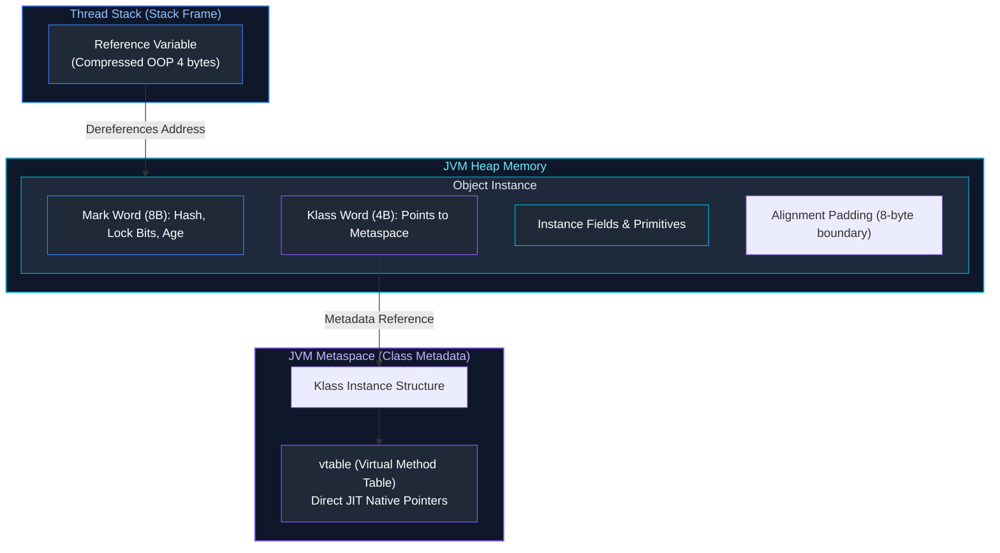
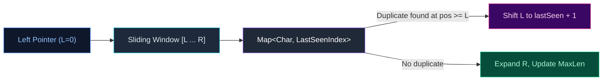
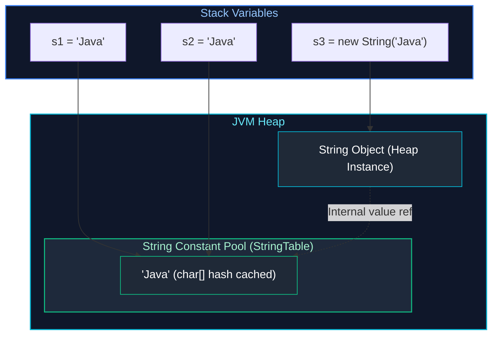
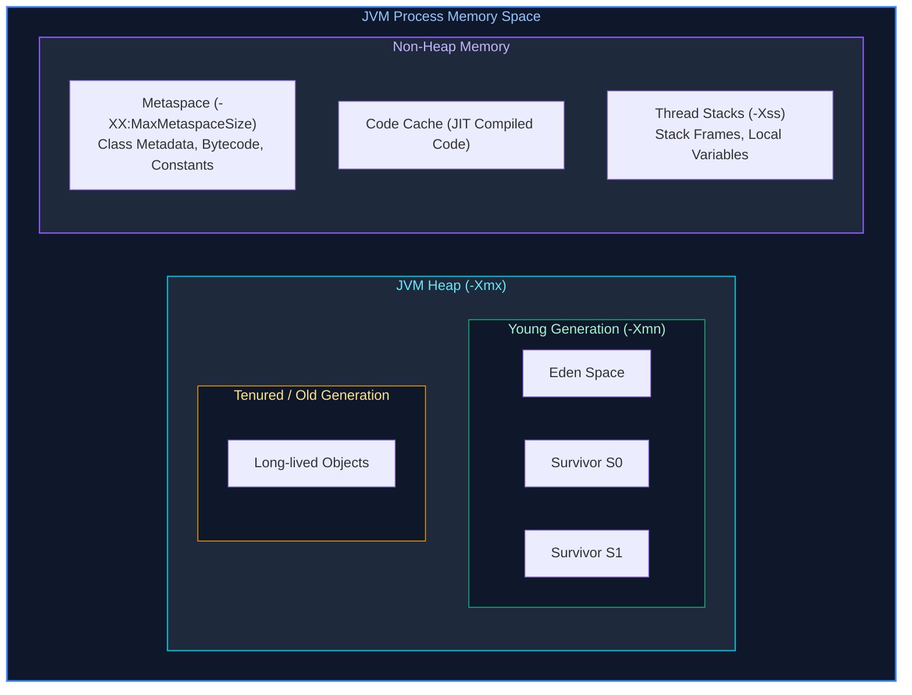

# 01. Core Java, Object-Oriented Programming & Core Algorithms

A comprehensive study guide covering Core Java language mechanics, JVM object internals, Object-Oriented principles, core algorithmic challenges, class loading, memory layout, reflection, NIO, and modern Java (Java 17–21) features.

---

## Architectural Overview: Object Execution & Method Dispatch



---

## Table of Contents & Question Mapping

1. **Algorithmic Foundations & String Manipulation**
   - [Q1. Reverse a String Without Built-ins](#q1-reverse-a-string-without-built-ins)
   - [Q2. Convert First Half to Lowercase & Second Half to Uppercase](#q2-convert-first-half-to-lowercase--second-half-to-uppercase)
   - [Q3. First Non-Repeating Character in a String](#q3-first-non-repeating-character-in-a-string)
   - [Q4. Longest Substring Without Repeating Characters](#q4-longest-substring-without-repeating-characters)
   - [Q5. Longest Common Prefix in an Array of Strings](#q5-longest-common-prefix-in-an-array-of-strings)
2. **Array & Data Structure Manipulations**
   - [Q6. Remove Duplicates from an Array in a Single Iteration](#q6-remove-duplicates-from-an-array-in-a-single-iteration)
   - [Q7. Rearrange Integer Array: Even Before Odd](#q7-rearrange-integer-array-even-before-odd)
   - [Q8. Print Prime Numbers Between 1 and 200 (Minimal Complexity)](#q8-print-prime-numbers-between-1-and-200-minimal-complexity)
   - [Q9. Reverse a Singly Linked List (Iterative & Recursive)](#q9-reverse-a-singly-linked-list-iterative--recursive)
   - [Q10. Path Sum Verification in a Binary Tree (Root to Leaf)](#q10-path-sum-verification-in-a-binary-tree-root-to-leaf)
3. **Core Language Semantics & Keywords**
   - [Q11 & Q25. `==` vs `equals()` and the String Pool Mechanism](#q11--q25--vs-equals-and-the-string-pool-mechanism)
   - [Q12. Short-Circuiting with Logical Operators (`&&`, `||`)](#q12-short-circuiting-with-logical-operators---)
   - [Q13 & Q14. Constructors and Invoking Static Methods Inside Constructors](#q13--q14-constructors-and-invoking-static-methods-inside-constructors)
   - [Q26 & Q27. `final`, `finally`, and `finalize()`](#q26--q27-final-finally-and-finalize)
   - [Q28. `ClassCastException`: Root Causes and Prevention](#q28-classcastexception-root-causes-and-prevention)
4. **Object-Oriented Design & Polymorphism**
   - [Q15. Composition Over Inheritance](#q15-composition-over-inheritance)
   - [Q16 & Q17. Interface vs Abstract Class & Static vs Default Methods](#q16--q17-interface-vs-abstract-class--static-vs-default-methods)
   - [Q18. Marker Interfaces and Modern Alternatives](#q18-marker-interfaces-and-modern-alternatives)
   - [Q19 & Q20. Overriding Static Methods & Method Hiding](#q19--q20-overriding-static-methods--method-hiding)
   - [Q21. Anonymous Inner Classes & Scoping](#q21-anonymous-inner-classes--scoping)
   - [Q22. Designing Completely Immutable Classes](#q22-designing-completely-immutable-classes)
   - [Q23. Shallow Copy vs Deep Copy](#q23-shallow-copy-vs-deep-copy)
   - [Q24. `StringBuffer` vs `StringBuilder`](#q24-stringbuffer-vs-stringbuilder)
5. **JVM Internals, Memory Management & Runtime**
   - [Q29 & Q30. JVM Memory Architecture & Handling `OutOfMemoryError`](#q29--q30-jvm-memory-architecture--handling-outofmemoryerror)
   - [Q31. ClassLoader Architecture and Delegation Model](#q31-classloader-architecture-and-delegation-model)
   - [Q32 & Q33. Java Reflection API & Dynamic Proxies](#q32--q33-java-reflection-api--dynamic-proxies)
   - [Q34. Java NIO `Path` vs Classic IO `File`](#q34-java-nio-path-vs-classic-io-file)
   - [Q35. Tail Call Optimization in Java](#q35-tail-call-optimization-in-java)
6. **Modern Java Features (Java 17 to Java 21+)**
   - [Q36. Text Blocks and Multiline Strings](#q36-text-blocks-and-multiline-strings)
   - [Q37. Pattern Matching for `switch`](#q37-pattern-matching-for-switch)
   - [Q38 & Q39. Records, Standard Classes & Sealed Classes in Production](#q38--q39-records-standard-classes--sealed-classes-in-production)
   - [Q40. Virtual Threads (Project Loom) vs Platform Threads](#q40-virtual-threads-project-loom-vs-platform-threads)

---

# 1. Algorithmic Foundations & String Manipulation

---

### Q1. Reverse a String Without Built-ins
**Topic Covered:** String Manipulation & In-Place Algorithms  
**Definition:** Reversing a string requires rearranging its characters so that the first character becomes the last and vice versa, without invoking helper methods like `StringBuilder.reverse()`.

```java
public class StringReversal {
    public static String reverse(String input) {
        if (input == null || input.length() <= 1) {
            return input;
        }
        char[] chars = input.toCharArray();
        int left = 0;
        int right = chars.length - 1;
        while (left < right) {
            char temp = chars[left];
            chars[left] = chars[right];
            chars[right] = temp;
            left++;
            right--;
        }
        return new String(chars);
    }
}
```
- **Time Complexity:** $O(N)$ — touches $N/2$ elements.
- **Space Complexity:** $O(N)$ — strictly for the output character array due to Java's string immutability.

---

### Q2. Convert First Half to Lowercase & Second Half to Uppercase
**Topic Covered:** String Slicing & ASCII Transformation  
**Definition:** Given a string of length $N$, divide it at index $\lfloor N / 2 \rfloor$. Characters in the first segment are mapped to lowercase; characters in the second segment are mapped to uppercase.

```java
public class HalfCaseTransformer {
    public static String transformHalves(String str) {
        if (str == null || str.isEmpty()) {
            return str;
        }
        int mid = str.length() / 2;
        char[] chars = str.toCharArray();

        for (int i = 0; i < mid; i++) {
            if (chars[i] >= 'A' && chars[i] <= 'Z') {
                chars[i] = (char) (chars[i] + 32); // Convert to lowercase
            }
        }
        for (int i = mid; i < chars.length; i++) {
            if (chars[i] >= 'a' && chars[i] <= 'z') {
                chars[i] = (char) (chars[i] - 32); // Convert to uppercase
            }
        }
        return new String(chars);
    }
}
```

---

### Q3. First Non-Repeating Character in a String
**Topic Covered:** Frequency Hashing & Stream Processing  
**Definition:** Identify the earliest character index in a string whose frequency throughout the string equals exactly 1.

```java
public class FirstUniqueChar {
    public static char findFirstNonRepeating(String str) {
        if (str == null || str.isEmpty()) {
            throw new IllegalArgumentException("String cannot be null or empty");
        }
        int[] freq = new int[256]; // Assuming standard ASCII
        for (int i = 0; i < str.length(); i++) {
            freq[str.charAt(i)]++;
        }
        for (int i = 0; i < str.length(); i++) {
            if (freq[str.charAt(i)] == 1) {
                return str.charAt(i);
            }
        }
        throw new NoSuchElementException("No non-repeating character found");
    }
}
```
- **Time Complexity:** $O(N)$ where $N$ is string length.
- **Space Complexity:** $O(1)$ fixed 256-integer array.

---

### Q4. Longest Substring Without Repeating Characters
**Topic Covered:** Sliding Window & Dynamic Frequency Tracking  
**Definition:** Find the maximum length of a contiguous substring where every character is unique.



```java
import java.util.HashMap;
import java.util.Map;

public class LongestUniqueSubstring {
    public static int lengthOfLongestSubstring(String s) {
        if (s == null || s.isEmpty()) return 0;

        Map<Character, Integer> lastSeen = new HashMap<>();
        int maxLength = 0;
        int left = 0;

        for (int right = 0; right < s.length(); right++) {
            char current = s.charAt(right);
            if (lastSeen.containsKey(current)) {
                left = Math.max(left, lastSeen.get(current) + 1);
            }
            lastSeen.put(current, right);
            maxLength = Math.max(maxLength, right - left + 1);
        }
        return maxLength;
    }
}
```
- **Time Complexity:** $O(N)$ single pass across the string.
- **Space Complexity:** $O(\min(N, \Sigma))$ where $\Sigma$ is the alphabet size.

---

### Q5. Longest Common Prefix in an Array of Strings
**Topic Covered:** Horizontal & Vertical String Scanning  
**Definition:** Identify the longest string prefix shared across all strings in an array.

```java
public class LongestCommonPrefix {
    public static String getLongestCommonPrefix(String[] strs) {
        if (strs == null || strs.length == 0) return "";
        String prefix = strs[0];

        for (int i = 1; i < strs.length; i++) {
            while (!strs[i].startsWith(prefix)) {
                prefix = prefix.substring(0, prefix.length() - 1);
                if (prefix.isEmpty()) return "";
            }
        }
        return prefix;
    }
}
```

---

# 2. Array & Data Structure Manipulations

---

### Q6. Remove Duplicates from an Array in a Single Iteration
**Topic Covered:** In-Place Two-Pointer Deduplication  
**Definition:** Given a sorted array, remove duplicates in-place such that each unique element appears once, returning the length of the deduplicated sub-array in $O(N)$ time and $O(1)$ memory.

```java
public class ArrayDeduplication {
    public static int removeDuplicatesSorted(int[] nums) {
        if (nums == null || nums.length == 0) return 0;
        int writeIndex = 1;

        for (int readIndex = 1; readIndex < nums.length; readIndex++) {
            if (nums[readIndex] != nums[readIndex - 1]) {
                nums[writeIndex++] = nums[readIndex];
            }
        }
        return writeIndex;
    }
}
```

---

### Q7. Rearrange Integer Array: Even Before Odd
**Topic Covered:** Partitioning / Two-Pointer Technique (Hoare Variant)  
**Definition:** Segregate an array such that all even integers precede odd integers.

```java
public class EvenOddPartition {
    public static void rearrangeEvenOdd(int[] nums) {
        if (nums == null || nums.length <= 1) return;
        int left = 0;
        int right = nums.length - 1;

        while (left < right) {
            while (left < right && nums[left] % 2 == 0) left++;
            while (left < right && nums[right] % 2 != 0) right--;
            if (left < right) {
                int temp = nums[left];
                nums[left] = nums[right];
                nums[right] = temp;
                left++;
                right--;
            }
        }
    }
}
```
- **Time Complexity:** $O(N)$ single iteration.
- **Space Complexity:** $O(1)$ strictly in-place.

---

### Q8. Print Prime Numbers Between 1 and 200 (Minimal Complexity)
**Topic Covered:** Number Theory & Sieve of Eratosthenes  
**Definition:** Identifying primes up to $M = 200$ using the Sieve of Eratosthenes in $O(M \log(\log M))$.

```java
import java.util.Arrays;

public class PrimeSieve {
    public static void printPrimesUpTo(int limit) {
        boolean[] isPrime = new boolean[limit + 1];
        Arrays.fill(isPrime, true);
        isPrime[0] = false;
        isPrime[1] = false;

        for (int p = 2; p * p <= limit; p++) {
            if (isPrime[p]) {
                for (int i = p * p; i <= limit; i += p) {
                    isPrime[i] = false;
                }
            }
        }

        for (int i = 2; i <= limit; i++) {
            if (isPrime[i]) {
                System.out.print(i + " ");
            }
        }
        System.out.println();
    }
}
```

---

### Q9. Reverse a Singly Linked List (Iterative & Recursive)
**Topic Covered:** Linked List Pointer Manipulation  
**Definition:** Given the head of a singly linked list, invert pointer directions such that the tail becomes the new head.

```java
public class LinkedListReversal {
    public static class ListNode {
        int val;
        ListNode next;
        ListNode(int val) { this.val = val; }
    }

    // Iterative: O(N) time, O(1) space
    public static ListNode reverseIterative(ListNode head) {
        ListNode prev = null;
        ListNode curr = head;
        while (curr != null) {
            ListNode nextTemp = curr.next;
            curr.next = prev;
            prev = curr;
            curr = nextTemp;
        }
        return prev;
    }

    // Recursive: O(N) time, O(N) call-stack space
    public static ListNode reverseRecursive(ListNode head) {
        if (head == null || head.next == null) {
            return head;
        }
        ListNode newHead = reverseRecursive(head.next);
        head.next.next = head;
        head.next = null;
        return newHead;
    }
}
```

---

### Q10. Path Sum Verification in a Binary Tree (Root to Leaf)
**Topic Covered:** Tree Traversal & Depth-First Search (DFS)  
**Definition:** Determine if there exists a root-to-leaf path where the sum of node values along the path equals a specified target sum.

```java
public class BinaryTreePathSum {
    public static class TreeNode {
        int val;
        TreeNode left;
        TreeNode right;
        TreeNode(int val) { this.val = val; }
    }

    public static boolean hasPathSum(TreeNode root, int targetSum) {
        if (root == null) return false;

        if (root.left == null && root.right == null) {
            return targetSum == root.val;
        }

        int remaining = targetSum - root.val;
        return hasPathSum(root.left, remaining) || hasPathSum(root.right, remaining);
    }
}
```

---

# 3. Core Language Semantics & Keywords

---

### Q11 & Q25. `==` vs `equals()` and the String Pool Mechanism
*(Grouped together: Identity vs Equivalence and String Pool Allocation)*  
**Topic Covered:** Object Memory Identity, Value Equivalence, String Interning  
- `==`: Reference identity operator. Evaluates whether two reference variables point to the exact same physical memory address on the JVM Heap.
- `equals()`: Method on `Object`. Evaluates semantic value equivalence when overridden.
- **String Pool:** A specialized hash table (`StringTable`) allocated in the JVM Heap that stores a single canonical copy of each string literal.



```java
String s1 = "Hello";
String s2 = "Hello";
String s3 = new String("Hello");

System.out.println(s1 == s2);      // true  (Shared string pool reference)
System.out.println(s1 == s3);      // false (s3 is a distinct heap instance)
System.out.println(s1.equals(s3)); // true  (Equal character contents)
```

---

### Q12. Short-Circuiting with Logical Operators (`&&`, `||`)
**Topic Covered:** Boolean Evaluation & Control Flow  
- `&&` (Logical AND): Halts evaluation as `false` as soon as the first operand evaluates to `false`.
- `||` (Logical OR): Halts evaluation as `true` as soon as the first operand evaluates to `true`.

```java
// Prevents NullPointerException:
if (user != null && user.isActive()) {
    // user.isActive() is NEVER invoked if user is null
}
```

---

### Q13 & Q14. Constructors and Invoking Static Methods Inside Constructors
*(Grouped together: Constructor Mechanics and Static Invocations)*  
**Topic Covered:** Object Lifecycle & Class Loading  
**Can you invoke a static method inside a constructor?**
**Yes.** Static methods belong to class metadata in Metaspace and are initialized during class loading, well before constructor execution. They are commonly used for defensive argument checks and unique ID generation.

```java
public class Order {
    private final String orderId;

    public Order(double amount) {
        validateAmount(amount); // Invoking static method
        this.orderId = generateId();
    }

    private static void validateAmount(double amount) {
        if (amount <= 0) throw new IllegalArgumentException("Amount must be positive");
    }

    private static String generateId() {
        return "ORD-" + System.currentTimeMillis();
    }
}
```

---

### Q26 & Q27. `final`, `finally`, and `finalize()`
*(Grouped together: Keyword distinctions and Lifecycle handling)*  
**Topic Covered:** Java Core Keywords & Resource Management  

| Feature | Type | Purpose / Scope | Execution Guarantee |
| :--- | :--- | :--- | :--- |
| `final` | Modifier | Applied to variable (immutable ref), method (cannot override), class (cannot subclass). | Compile-time constraint. |
| `finally` | Block | Accompanying `try`/`catch`. Used for mandatory cleanup. | Guaranteed unless `System.exit()` or JVM crash. |
| `finalize()` | Method | Deprecated method on `Object` invoked by GC. | **No guarantee**. Deprecated Java 9, removed Java 18+. |

---

### Q28. `ClassCastException`: Root Causes and Prevention
**Topic Covered:** Type Safety & Pattern Matching  
- **Cause:** Attempting to cast an object reference to an incompatible type at runtime.
- **Prevention:** Use Java 16+ **Pattern Matching for `instanceof`** or enforce generic types at compile-time:
  ```java
  if (obj instanceof String s) {
      System.out.println("Length: " + s.length());
  }
  ```

---

# 4. Object-Oriented Design & Polymorphism

---

### Q15. Composition Over Inheritance
**Topic Covered:** Architectural Design Principles  
**Why Prefer Composition?**
1. **Protects Encapsulation:** Inheriting from a concrete superclass creates tight coupling to its internal implementation details (Fragile Base Class problem).
2. **Runtime Flexibility:** Behavior can be dynamically swapped by injecting different strategy implementations.
3. **Single Inheritance Limitation:** Java classes can extend only one superclass, but can compose multiple delegates.

---

### Q16 & Q17. Interface vs Abstract Class & Static vs Default Methods
*(Grouped together: Abstraction Mechanisms in Java)*  
**Topic Covered:** Interface Contracts & Multiple Inheritance of Behavior  

| Criterion | Abstract Class | Interface (Java 8+) |
| :--- | :--- | :--- |
| **State** | Holds mutable instance fields. | Only `public static final` constants. |
| **Constructors**| Has constructors. | No constructors. |
| **Inheritance** | Single inheritance (`extends`). | Multiple inheritance (`implements`). |
| **Methods** | Abstract, concrete, `protected`, `private`. | Abstract, `default`, `static`, and `private` (Java 9+). |

- **Default Methods (`default`):** Non-breaking method additions with default implementation that implementing classes can override.
- **Static Methods (`static`):** Namespace utility methods that cannot be overridden by implementing classes.

---

### Q18. Marker Interfaces and Modern Alternatives
**Topic Covered:** Type Tagging & Metadata  
A marker interface is an interface with **zero method declarations** (`Serializable`, `Cloneable`). Modern enterprise Java replaces marker interfaces with **Annotations** (`@Entity`, `@Component`, `@Audited`), which support typed metadata without polluting type hierarchies.

---

### Q19 & Q20. Overriding Static Methods & Method Hiding
*(Grouped together: Static Polymorphism Semantics)*  
**Topic Covered:** Compile-Time Resolution vs Dynamic Dispatch  
**Rule:** You **cannot** override a static method. If a subclass declares a static method with the same signature, it is **Method Hiding**, resolved at compile-time via `invokestatic` based on the reference type, not the runtime object instance.

---

### Q21. Anonymous Inner Classes & Scoping
**Topic Covered:** Local Classes & Closures  
An anonymous class is declared and instantiated in a single expression. Any local variable accessed inside it must be explicitly `final` or **effectively final** to ensure thread and stack lifetime safety.

---

### Q22. Designing Completely Immutable Classes
**Topic Covered:** Thread Safety & Invariant Protection  
1. Declare the class `final`.
2. Declare all fields `private final`.
3. Provide no setters.
4. Perform **defensive copies** in constructors for mutable fields (`Date`, `List`, `Map`).
5. Return **unmodifiable views** or defensive copies in getters.

---

### Q23. Shallow Copy vs Deep Copy
**Topic Covered:** Object Cloning & Memory References  
- **Shallow Copy:** Copies primitive fields and duplicates object references directly (both original and copy point to the same child objects on the heap).
- **Deep Copy:** Recursively clones the entire object graph, creating fully independent child copies.

---

### Q24. `StringBuffer` vs `StringBuilder`
**Topic Covered:** Mutability & Synchronization Overhead  
- **`StringBuffer`:** Thread-safe (methods use `synchronized`). Has lock acquisition overhead.
- **`StringBuilder` (Preferred):** Not thread-safe. Significantly faster for single-threaded string concatenation.

---

# 5. JVM Internals, Memory Management & Runtime

---

### Q29 & Q30. JVM Memory Architecture & Handling `OutOfMemoryError`
*(Grouped together: Memory layout and OOM diagnosis)*  
**Topic Covered:** JVM Memory Spaces, GC Generations, Diagnostic Procedures  



#### Common OOME Types:
1. `java.lang.OutOfMemoryError: Java heap space`: Unbounded collections, memory leaks. Diagnose using Eclipse Memory Analyzer (MAT) on heap dumps (`-XX:+HeapDumpOnOutOfMemoryError`).
2. `java.lang.OutOfMemoryError: Metaspace`: Dynamic class generation leaks (CGLIB/ByteBuddy). Tune `-XX:MaxMetaspaceSize`.
3. `java.lang.OutOfMemoryError: Unable to create new native thread`: OS process/thread limits reached (`ulimit -u`).

---

### Q31. ClassLoader Architecture and Delegation Model
**Topic Covered:** JVM Class Loading & Parent Delegation  
1. **Bootstrap ClassLoader:** Loads core runtime classes (`java.base`).
2. **Platform ClassLoader:** Loads modular platform libraries.
3. **Application ClassLoader:** Loads classpath JARs.
- **Parent Delegation Principle:** Child classloaders always delegate class lookup to their parent first, preventing core classes like `java.lang.String` from being overridden.

---

### Q32 & Q33. Java Reflection API & Dynamic Proxies
*(Grouped together: Introspection and Dynamic Interception)*  
**Topic Covered:** Runtime Bytecode Introspection & Dynamic Invocation  
`java.lang.reflect.Proxy` generates dynamic proxy classes at runtime that intercept interface method calls via an `InvocationHandler`. Used heavily by Spring AOP, `@Transactional`, and Mockito.

---

### Q34. Java NIO `Path` vs Classic IO `File`
**Topic Covered:** File System Abstraction & Modern I/O  
`Path` (Java 7+) throws descriptive `IOException` subclasses instead of returning `false`, supports symbolic links, native file attributes, memory-mapped buffers, and asynchronous channels.

---

### Q35. Tail Call Optimization in Java
**Topic Covered:** Call Stack Mechanics  
The standard HotSpot JVM does **not** implement Tail Call Optimization (TCO) to preserve complete stack traces for debugging and security permission stack-walks. Deep recursion results in `StackOverflowError`.

---

# 6. Modern Java Features (Java 17 to Java 21+)

---

### Q36. Text Blocks and Multiline Strings
**Topic Covered:** Modern Syntax (Java 15+)  
Text blocks (`""" ... """`) simplify JSON, SQL, and HTML string definitions without escape characters.

---

### Q37. Pattern Matching for `switch`
**Topic Covered:** Pattern Matching & Type Narrowing (Java 17 / 21)  
Enables pattern matching over types with `when` guard clauses:
```java
return switch (payment) {
    case CreditCard c && c.limit() > 10000 -> "VIP Credit Card";
    case CreditCard c                      -> "Standard Credit Card";
    case BankTransfer b                    -> "Bank transfer IBAN: " + b.iban();
    case null                              -> "Null payment";
    default                                -> "Unknown: " + payment;
};
```

---

### Q38 & Q39. Records, Standard Classes & Sealed Classes in Production
*(Grouped together: Modern Type Hierarchies and Domain Modeling)*  
**Topic Covered:** Data-Oriented Programming (Java 16/17+)  
- **`record`:** Compact, shallowly immutable data carriers with auto-generated getters, `equals()`, `hashCode()`, and `toString()`.
- **`sealed` class/interface:** Restricts which implementations are allowed (`permits`). Guarantees compile-time exhaustiveness in `switch` statements without requiring a `default` case.

---

### Q40. Virtual Threads (Project Loom) vs Platform Threads
**Topic Covered:** High-Throughput Lightweight Concurrency (Java 21)  
- **Platform Thread:** 1:1 mapped to OS kernel thread with ~1 MB memory footprint.
- **Virtual Thread:** User-mode thread managed directly by the JVM with a few KB footprint. When blocking on network I/O, the virtual thread unmounts from its carrier thread, allowing millions of concurrent connections on standard server hardware.
