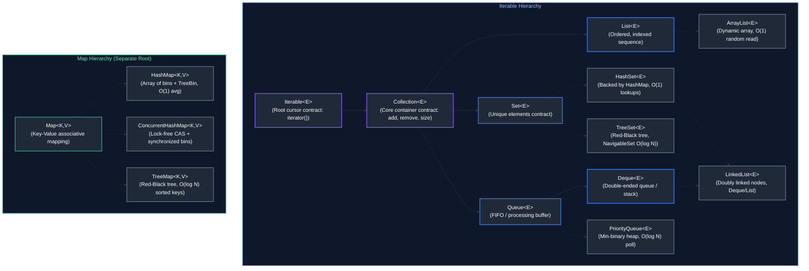
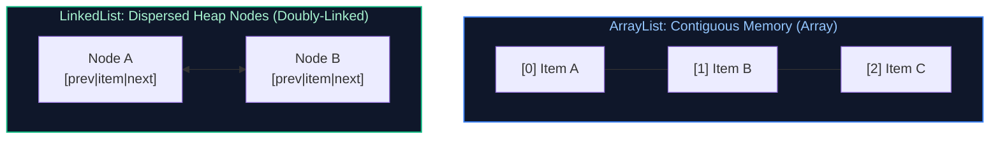
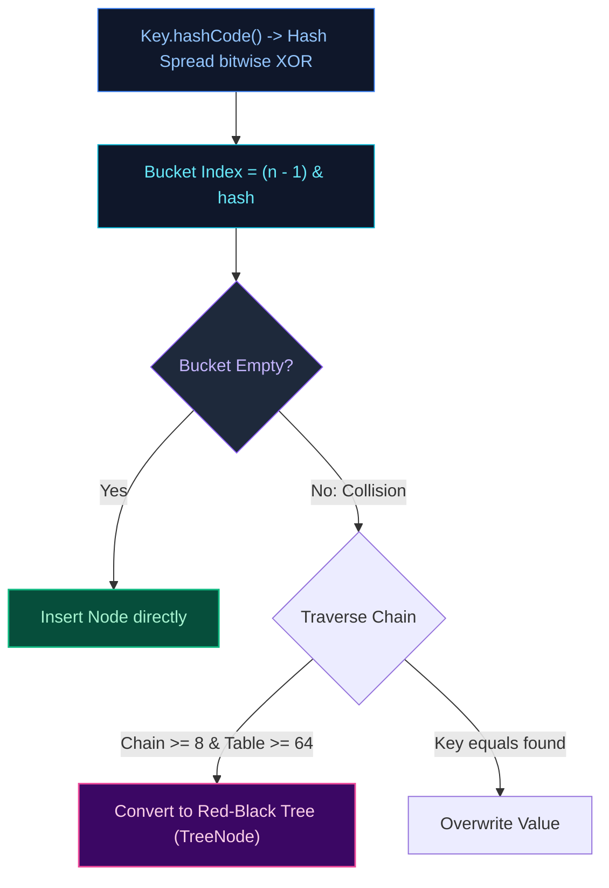

# 02. Java Collections Framework & Data Structures

A comprehensive guide answering all 34 frequently asked interview questions on the Java Collections Framework, internal data structure mechanics, time complexities, thread safety, hash collisions, and practical algorithmic problems.

---

## Architectural Overview: Java Collections Hierarchy & Map Tree



---

## Table of Contents & Question Mapping

1. **Core Collection Contracts & List Implementations**
   - [Q1. `List` vs `Set` Interfaces](#q1-list-vs-set-interfaces)
   - [Q2. `ArrayList` vs `LinkedList`](#q2-arraylist-vs-linkedlist)
   - [Q3 & Q4. `Arrays.asList()` vs `List.of()` vs `new ArrayList<>()`](#q3--q4-arraysaslist-vs-listof-vs-new-arraylist)
2. **Set Implementations & Uniqueness Mechanics**
   - [Q5. `HashSet` vs `LinkedHashSet` vs `TreeSet`](#q5-hashset-vs-linkedhashset-vs-treeset)
   - [Q6. `HashSet` Internal Working & Uniqueness Guarantee](#q6-hashset-internal-working--uniqueness-guarantee)
3. **Map Internals, Hashing & Concurrency**
   - [Q7 & Q8. The `hashCode()` and `equals()` Contract & Custom Keys](#q7--q8-the-hashcode-and-equals-contract--custom-keys)
   - [Q9, Q10 & Q11. `HashMap` Internals: Capacity, Load Factor, Resizing, Null Keys & Collisions](#q9-q10--q11-hashmap-internals-capacity-load-factor-resizing-null-keys--collisions)
   - [Q12 & Q13. `HashMap` vs `ConcurrentHashMap` vs `Hashtable` & Concurrency Mechanics](#q12--q13-hashmap-vs-concurrenthashmap-vs-hashtable--concurrency-mechanics)
   - [Q14. `WeakHashMap` vs `HashMap`](#q14-weakhashmap-vs-hashmap)
   - [Q15 & Q16. `TreeMap` Red-Black Tree Sorting & Null Keys](#q15--q16-treemap-red-black-tree-sorting--null-keys)
   - [Q17. `EnumSet` and `EnumMap`](#q17-enumset-and-enummap)
4. **Queues, Iterators & Sorting Mechanics**
   - [Q18. `Queue` vs `Deque`](#q18-queue-vs-deque)
   - [Q19. `PriorityQueue` Internal Working](#q19-priorityqueue-internal-working)
   - [Q20. `poll()` vs `peek()` vs `remove()`](#q20-poll-vs-peek-vs-remove)
   - [Q21. `Iterator` vs `ListIterator`](#q21-iterator-vs-listiterator)
   - [Q22, Q23 & Q24. Fail-Fast vs Fail-Safe, `ConcurrentModificationException` & Safe Removal](#q22-q23--q24-fail-fast-vs-fail-safe-concurrentmodificationexception--safe-removal)
   - [Q25. `Comparable` vs `Comparator`](#q25-comparable-vs-comparator)
   - [Q26. Stable vs In-Place Sorting Algorithms](#q26-stable-vs-in-place-sorting-algorithms)
   - [Q27. Creating Truly Immutable Collections](#q27-creating-truly-immutable-collections)
   - [Q28. Handling Large Datasets in Memory Using Collections](#q28-handling-large-datasets-in-memory-using-collections)
5. **Collection Coding Scenarios & Algorithms**
   - [Q29. Filter Employees by Salary > 10,000](#q29-filter-employees-by-salary--10000)
   - [Q30. Rearrange List: Min at First Index, Max at Last Index](#q30-rearrange-list-min-at-first-index-max-at-last-index)
   - [Q31 & Q33. Finding Frequency of Elements & Most Frequent Element](#q31--q33-finding-frequency-of-elements--most-frequent-element)
   - [Q32. LRU Cache Implementation with $O(1)$ Operations](#q32-lru-cache-implementation-with-o1-operations)
   - [Q34. Sorting a `Map` by Values](#q34-sorting-a-map-by-values)

---

# 1. Core Collection Contracts & List Implementations

---

### Q1. `List` vs `Set` Interfaces
**Topic Covered:** Core Collection Abstractions  
- **`List`:** Ordered sequence preserving insertion order. Elements have indices. Allows duplicates and multiple `null` entries.
- **`Set`:** Unordered mathematical set. Prohibits duplicate elements. Allows at most one `null` element in `HashSet`.

---

### Q2. `ArrayList` vs `LinkedList`
**Topic Covered:** Sequential Data Structures & Memory Locality  



| Operation | `ArrayList` | `LinkedList` |
| :--- | :--- | :--- |
| **Random Access `get(i)`** | $O(1)$ | $O(N)$ |
| **Insertion at Tail** | Amortized $O(1)$ | $O(1)$ |
| **Insertion at Head/Middle** | $O(N)$ | $O(1)$ (once node reached) |
| **Memory & CPU Cache** | Compact, contiguous CPU cache lines. | Heavy memory overhead (24B Node object per item) causing cache misses. |

*Always prefer `ArrayList` in production.*

---

### Q3 & Q4. `Arrays.asList()` vs `List.of()` vs `new ArrayList<>()`
*(Grouped together: List Instantiation Factories and Mutability Contracts)*  
**Topic Covered:** List Creation Mechanisms & Mutability Guarantees  

| Feature | `new ArrayList<>(...)` | `Arrays.asList(...)` | `List.of(...)` (Java 9+) |
| :--- | :--- | :--- | :--- |
| **Mutability** | **Fully Mutable** (`add`, `remove`, `set`). | **Fixed-size view** (`set` allowed, `add`/`remove` throw exception). | **Completely Immutable** (modifications throw exception). |
| **Backing Storage** | Independent heap array. | Backed by the exact array passed in (mutates original array). | Compact immutable optimized list. |
| **Null Tolerance** | Permits `null`. | Permits `null`. | **Throws `NullPointerException`**. |

---

# 2. Set Implementations & Uniqueness Mechanics

---

### Q5. `HashSet` vs `LinkedHashSet` vs `TreeSet`
**Topic Covered:** Set Implementations & Big-O Characteristics  

| Implementation | Underlying Structure | Element Ordering | Time Complexity | Null Support |
| :--- | :--- | :--- | :--- | :--- |
| **`HashSet`** | `HashMap` instance | Unordered | $O(1)$ amortized | Permits 1 `null` |
| **`LinkedHashSet`** | `LinkedHashMap` | Insertion-order | $O(1)$ amortized | Permits 1 `null` |
| **`TreeSet`** | `TreeMap` (Red-Black tree) | Sorted order | $O(\log N)$ | **No nulls** (throws NPE) |

---

### Q6. `HashSet` Internal Working & Uniqueness Guarantee
**Topic Covered:** `HashSet` Encapsulation & Backing Map  
Every `HashSet` wraps an internal `HashMap<E, Object>` instance. Adding element `set.add(e)` invokes `map.put(e, PRESENT)` where `PRESENT` is a static dummy `new Object()`. Since `HashMap` replaces existing duplicate keys and returns previous value, uniqueness is guaranteed.

---

# 3. Map Internals, Hashing & Concurrency

---

### Q7 & Q8. The `hashCode()` and `equals()` Contract & Custom Keys
*(Grouped together: Hashing Contracts and Custom Object Keys)*  
**Topic Covered:** Hashing Mechanics & Map Key Invariants  
1. If two objects are equal according to `equals(Object)`, they **MUST** produce identical `hashCode()` integers.
2. If two objects have equal `hashCode()`, they are not necessarily equal (Hash Collision).
3. If `equals()` is overridden without `hashCode()`, identical entities land in different buckets, returning `null` when fetched from `HashMap`.
- Always override both using the same fields, and ensure key fields are **immutable** (`final`).

---

### Q9, Q10 & Q11. `HashMap` Internals: Capacity, Load Factor, Resizing, Null Keys & Collisions
*(Grouped together: Complete HashMap Deep Dive)*  
**Topic Covered:** `HashMap` Internal Architecture  



- **Initial Capacity:** 16 (always a power of 2).
- **Load Factor:** 0.75.
- **Threshold:** $16 \times 0.75 = 12$. Doubles capacity to 32 upon crossing.
- **Null Keys:** Stored strictly at **bucket index 0** (hash forced to 0).
- **Treeification:** Buckets with $\ge 8$ colliding elements convert into Red-Black Trees if capacity $\ge 64$ ($O(\log N)$ worst-case). Untreeifies below 6 during shrink.

---

### Q12 & Q13. `HashMap` vs `ConcurrentHashMap` vs `Hashtable` & Concurrency Mechanics
*(Grouped together: Concurrent Map Architecture)*  
**Topic Covered:** Multi-Threaded Map Locking Strategies  
- **`HashMap`:** Not thread-safe. Concurrent writes cause data loss or infinite loops.
- **`Hashtable`:** Thread-safe via global `synchronized` lock on entire table (severe bottleneck). Prohibits null keys/values.
- **`ConcurrentHashMap` (Java 8+):** Lock-free volatile reads + CAS for empty buckets + synchronized lock on individual bucket heads. High concurrent throughput. Prohibits null keys/values.

---

### Q14. `WeakHashMap` vs `HashMap`
**Topic Covered:** Garbage Collection & Reference Types  
In `WeakHashMap`, keys are wrapped in `WeakReference`. When a key is no longer strongly referenced outside the map, the Garbage Collector purges the entry automatically.

---

### Q15 & Q16. `TreeMap` Red-Black Tree Sorting & Null Keys
*(Grouped together: Ordered Map Mechanics)*  
**Topic Covered:** Balanced Search Trees & Key Comparison  
- Backed by Red-Black Tree with $O(\log N)$ search/insertion.
- Does **not** allow `null` keys; calling `key.compareTo()` on `null` throws `NullPointerException`.

---

### Q17. `EnumSet` and `EnumMap`
**Topic Covered:** High-Performance Enum Collections  
- **`EnumSet`:** Backed by bitwise integer/long bit-vectors. Constant time bit operations with zero memory overhead.
- **`EnumMap`:** Backed by a compact Java array indexed by enum `ordinal()`. Ultra-fast $O(1)$ lookups without hashing overhead.

---

# 4. Queues, Iterators & Sorting Mechanics

---

### Q18. `Queue` vs `Deque`
**Topic Covered:** Queue Abstractions  
- **`Queue`:** FIFO single-ended collection (`offer()`, `poll()`).
- **`Deque`:** Double-ended queue supporting insertion and removal at both ends (`addFirst`, `pollLast`). Replaces legacy `Stack`.

---

### Q19. `PriorityQueue` Internal Working
**Topic Covered:** Heap Data Structures  
Backed by a **Min-Heap array**. Root is always smallest element ($O(1)$ peek). Insertion (`offer`) and removal (`poll`) run in $O(\log N)$ via heapify operations.

---

### Q20. `poll()` vs `peek()` vs `remove()`
**Topic Covered:** Queue API Failure Handling  
- `peek()`: Returns `null` if empty; does not remove.
- `poll()`: Returns `null` if empty; retrieves and removes head.
- `remove()`: Throws `NoSuchElementException` if empty; retrieves and removes head.

---

### Q21. `Iterator` vs `ListIterator`
**Topic Covered:** Collection Traversal  
- `Iterator`: Forward-only traversal for all collections. Supports only `remove()`.
- `ListIterator`: Bi-directional traversal strictly for `List`. Supports `add()`, `set()`, and index queries.

---

### Q22, Q23 & Q24. Fail-Fast vs Fail-Safe, `ConcurrentModificationException` & Safe Removal
*(Grouped together: Iteration Safety and Structural Modification)*  
**Topic Covered:** Iterator Modification Mechanics  
- **Fail-Fast:** Iterators check internal `modCount`. Modifying the collection outside the iterator throws `ConcurrentModificationException`.
- **Fail-Safe / Weakly Consistent:** Iterates over snapshots or volatile chains (`CopyOnWriteArrayList`, `ConcurrentHashMap`). Never throws exception.
- **Safe Removal:** Use `it.remove()` or modern Java 8+ `list.removeIf(predicate)`.

---

### Q25. `Comparable` vs `Comparator`
**Topic Covered:** Sorting Contracts  
- `Comparable<T>`: Implemented by domain class (`int compareTo(T o)`). Defines natural ordering.
- `Comparator<T>`: External strategy (`int compare(T o1, T o2)`). Defines custom/multiple orderings.

---

### Q26. Stable vs In-Place Sorting Algorithms
**Topic Covered:** Sorting Theory  
- **Stable:** Preserves relative order of equal keys (e.g., `TimSort`).
- **In-Place:** Modifies array using $O(1)$ auxiliary memory (e.g., Quicksort).

---

### Q27. Creating Truly Immutable Collections
**Topic Covered:** Immutability Contracts  
- `List.of()`, `Set.of()`, `Map.of()` (Java 9+): Truly immutable compact collections.
- `Collections.unmodifiableList(list)`: View wrapper; still reflects changes made to the underlying list.

---

### Q28. Handling Large Datasets in Memory Using Collections
**Topic Covered:** Memory Optimization  
1. Use primitive arrays (`int[]`) or specialized libraries (`fastutil`) instead of boxed wrappers (`List<Integer>`) to eliminate object header overhead.
2. Pre-size collections with expected capacity: `new ArrayList<>(1_000_000)`.
3. Process data via streams or off-heap buffers (`ByteBuffer.allocateDirect`) rather than loading everything into heap memory.

---

# 5. Collection Coding Scenarios & Algorithms

---

### Q29. Filter Employees by Salary > 10,000
**Topic Covered:** Stream Filtering  

```java
public record Employee(int id, String name, double salary) {}

public List<Employee> filterHighEarners(List<Employee> employees) {
    return employees.stream()
            .filter(e -> e.salary() > 10_000.0)
            .toList();
}
```

---

### Q30. Rearrange List: Min at First Index, Max at Last Index
**Topic Covered:** Array Manipulation  

```java
public static List<Integer> rearrange(List<Integer> list) {
    if (list == null || list.size() <= 2) return list;
    int minVal = Collections.min(list);
    int maxVal = Collections.max(list);
    int minIdx = list.indexOf(minVal);
    int maxIdx = list.indexOf(maxVal);

    List<Integer> result = new ArrayList<>(list.size());
    result.add(minVal);
    for (int i = 0; i < list.size(); i++) {
        if (i != minIdx && i != maxIdx) result.add(list.get(i));
    }
    result.add(maxVal);
    return result;
}
```

---

### Q31 & Q33. Finding Frequency of Elements & Most Frequent Element
*(Grouped together: Frequency Hashing and Mode Calculation)*  
**Topic Covered:** Frequency Analysis  

```java
// Q33: Calculate frequency of each element
public static <T> Map<T, Long> calculateFrequencies(List<T> items) {
    return items.stream().collect(Collectors.groupingBy(Function.identity(), Collectors.counting()));
}

// Q31: Find most frequent element
public static <T> T findMostFrequent(List<T> items) {
    return calculateFrequencies(items).entrySet().stream()
            .max(Map.Entry.comparingByValue())
            .map(Map.Entry::getKey)
            .orElseThrow();
}
```

---

### Q32. LRU Cache Implementation with $O(1)$ Operations
**Topic Covered:** Custom Data Structure Architecture  

```java
import java.util.LinkedHashMap;
import java.util.Map;

public class LRUCache<K, V> extends LinkedHashMap<K, V> {
    private final int capacity;

    public LRUCache(int capacity) {
        super(capacity, 0.75f, true); // true enables access-order
        this.capacity = capacity;
    }

    @Override
    protected boolean removeEldestEntry(Map.Entry<K, V> eldest) {
        return size() > capacity; // O(1) eviction
    }
}
```

---

### Q34. Sorting a `Map` by Values
**Topic Covered:** Map Entry Sorting  

```java
public static <K, V extends Comparable<? super V>> Map<K, V> sortByValue(Map<K, V> map) {
    return map.entrySet().stream()
            .sorted(Map.Entry.comparingByValue())
            .collect(Collectors.toMap(
                    Map.Entry::getKey,
                    Map.Entry::getValue,
                    (e1, e2) -> e1,
                    LinkedHashMap::new
            ));
}
```
