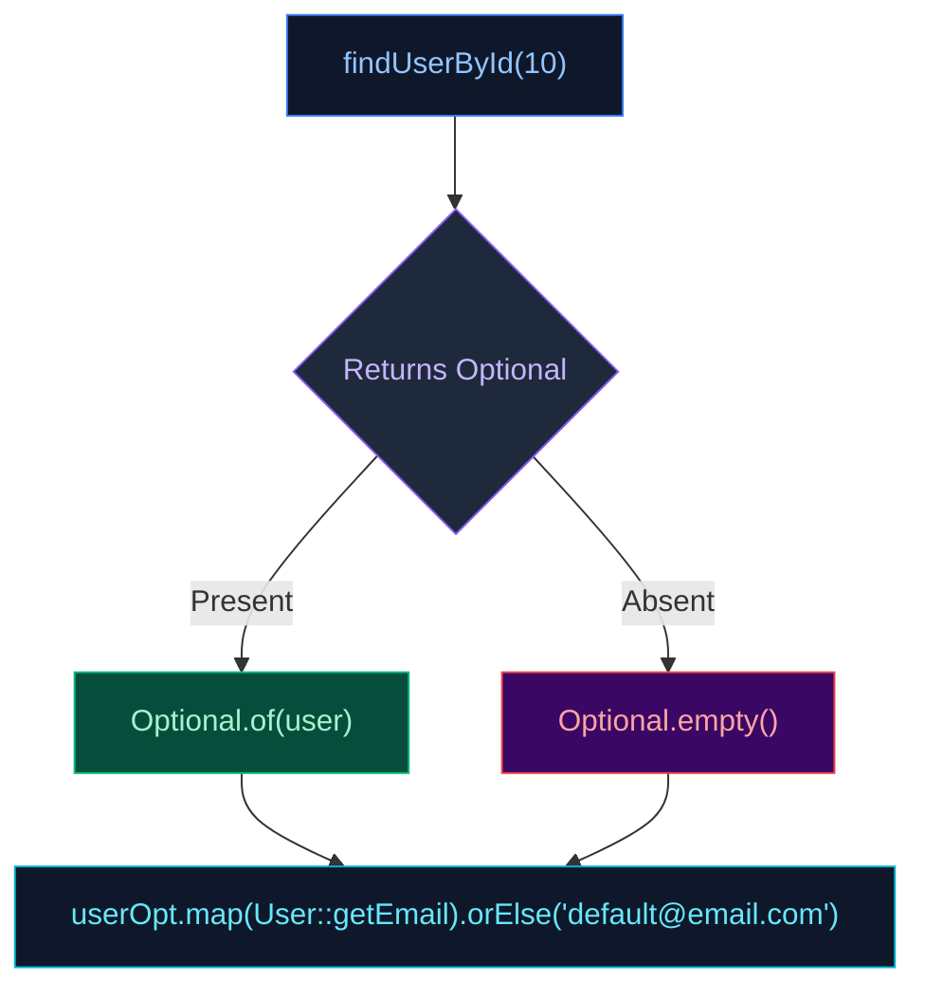
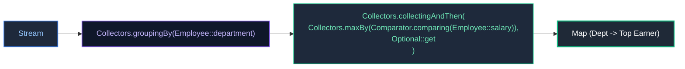

# 03. Java 8+ Functional Programming & Streams API

A comprehensive guide answering all 14 questions on functional programming in Java, lambdas, functional interfaces, the `java.util.function` package, `Optional`, method references, and deep internal execution mechanics of the Stream API.

---

## Architectural Overview: Stream Pipeline Execution Mechanics

```mermaid
flowchart LR
    subgraph Source["1. Data Source"]
        Coll["Collection / Array / I/O Channel"]
    end

    subgraph Pipeline["2. Intermediate Operations (Lazy Evaluation)"]
        Op1["filter(Predicate)"]
        Op2["map(Function)"]
        Op3["sorted(Comparator)"]
        Op1 --> Op2 --> Op3
    end

    subgraph Terminal["3. Terminal Operation (Execution Trigger)"]
        TermOp["collect() / forEach() / reduce()"]
    end

    Coll -->|"Spliterator Stream Creation"| Op1
    Op3 -->|"Fused Pipeline Traversal"| TermOp

    style Source fill:#0f172a,stroke:#3b82f6,stroke-width:1.5px,color:#93c5fd
    style Pipeline fill:#0f172a,stroke:#06b6d4,stroke-width:1.5px,color:#67e8f9
    style Terminal fill:#0f172a,stroke:#10b981,stroke-width:1.5px,color:#a7f3d0
    style Coll fill:#1f2937,stroke:#3b82f6,stroke-width:1px,color:#fff
    style Op1 fill:#1f2937,stroke:#06b6d4,stroke-width:1px,color:#fff
    style Op2 fill:#1f2937,stroke:#06b6d4,stroke-width:1px,color:#fff
    style Op3 fill:#1f2937,stroke:#06b6d4,stroke-width:1px,color:#fff
    style TermOp fill:#1f2937,stroke:#10b981,stroke-width:1px,color:#fff
```



---

## Table of Contents & Question Mapping

1. **Functional Interfaces & The `java.util.function` Package**
   - [Q1. Functional Interfaces, `@FunctionalInterface`, Built-ins & `Predicate`](#q1-functional-interfaces-functionalinterface-built-ins--predicate)
   - [Q2. Method References in Java](#q2-method-references-in-java)
2. **Null Safety & The `Optional` Monad**
   - [Q3. `Optional` Architecture and Best Practices for NPE Prevention](#q3-optional-architecture-and-best-practices-for-npe-prevention)
3. **Stream API Architecture & Internal Mechanics**
   - [Q4. Streams vs Collections & Internal Pipeline Mechanics](#q4-streams-vs-collections--internal-pipeline-mechanics)
   - [Q5. `map()` vs `flatMap()`](#q5-map-vs-flatmap)
   - [Q6. Parallel Streams & `ForkJoinPool` Concurrency](#q6-parallel-streams--forkjoinpool-concurrency)
4. **Stream API Practical Coding Problems**
   - [Q7. String Filtering & Sorting with Stream API](#q7-string-filtering--sorting-with-stream-api)
   - [Q8. Counting Vowels in a String Using Streams](#q8-counting-vowels-in-a-string-using-streams)
   - [Q9. Finding Second Highest Integer in an Unsorted List](#q9-finding-second-highest-integer-in-an-unsorted-list)
   - [Q10. Finding the Highest / Maximum Salary in Each Department Using Java Streams](#q10-finding-the-highest--maximum-salary-in-each-department-using-java-streams)
   - [Q11. Group Employees into Dynamic Age Ranges Generically Using Streams](#q11-group-employees-into-dynamic-age-ranges-generically-using-streams)
   - [Q12. Find the First Non-Repeating (Unique) Character in a String Using Stream API](#q12-find-the-first-non-repeating-unique-character-in-a-string-using-stream-api)
---

# 1. Functional Interfaces & The `java.util.function` Package

---

### Q1. Functional Interfaces, `@FunctionalInterface`, Built-ins & `Predicate`
*(Grouped together: Functional Interface Foundations)*  
**Topic Covered:** Functional Programming Foundations & Core Function Types  
**Definition:** A Functional Interface is any interface with **exactly one single abstract method (SAM)**. It may have any number of `default` or `static` methods.

**Significance of `@FunctionalInterface`:**
An informative annotation that instructs `javac` to enforce single abstract method rules at compile time.

**The 4 Pillars of `java.util.function`:**
- `Predicate<T>`: `T -> boolean` (`test(T)`)
- `Function<T, R>`: `T -> R` (`apply(T)`)
- `Consumer<T>`: `T -> void` (`accept(T)`)
- `Supplier<T>`: `() -> T` (`get()`)

```java
Predicate<String> startsWithJ = s -> s.startsWith("J");
Predicate<String> lengthGreaterThan4 = s -> s.length() > 4;
Predicate<String> combined = startsWithJ.and(lengthGreaterThan4);
System.out.println(combined.test("JavaScript")); // true
```

---

### Q2. Method References in Java
**Topic Covered:** Compact Lambda Notation  
Syntactic shorthand for lambda expressions referring directly to existing methods (`::` operator).
- Static method: `ClassName::staticMethod`
- Instance method of existing object: `instance::method`
- Instance method of arbitrary object: `ClassName::instanceMethod`
- Constructor: `ClassName::new`

---

# 2. Null Safety & The `Optional` Monad

---

### Q3. `Optional` Architecture and Best Practices for NPE Prevention
**Topic Covered:** Monadic Null Handling  
`java.util.Optional<T>` is an immutable value-based container designed specifically as a **method return type** to signify that a result may be absent.



#### Production Rules:
1. Avoid `Optional.get()` without checking; prefer `orElse()`, `orElseGet()`, or `orElseThrow()`.
2. Do not use `Optional` for method arguments or entity fields (adds unnecessary heap allocations).
3. Prefer `orElseGet(Supplier)` over `orElse(val)` when the fallback value involves expensive computation.

---

# 3. Stream API Architecture & Internal Mechanics

---

### Q4. Streams vs Collections & Internal Pipeline Mechanics
*(Grouped together: Stream vs Collection Architecture)*  
**Topic Covered:** Declarative Data Pipelines & Execution Model  
- **Collection:** In-memory data store holding actual objects. Eagerly constructed.
- **Stream:** Computational view that does not store data. Evaluated **lazily**. Single-use only.

#### Internal Mechanics:
1. Intermediate operations (`filter`, `map`) wrap upstream stages in `ReferencePipeline` instances without executing any work.
2. Terminal operation (`collect`, `count`) constructs a reverse chain of `Sink` objects.
3. Elements are pulled through the pipeline in a single pass (loop fusion).

---

### Q5. `map()` vs `flatMap()`
**Topic Covered:** Functor vs Monad Transformation  
- `map()` (1-to-1): Transforms each element $T \to R$.
- `flatMap()` (1-to-many): Transforms each element $T \to \text{Stream}<R>$, then flattens all inner streams into a single un-nested `Stream<R>`.

```java
List<List<String>> nested = List.of(List.of("A", "B"), List.of("C", "D"));
List<String> flat = nested.stream().flatMap(List::stream).toList(); // ["A", "B", "C", "D"]
```

---

### Q6. Parallel Streams & `ForkJoinPool` Concurrency
**Topic Covered:** Data Parallelism & Work-Stealing  
Parallel streams split data across cores using the shared `ForkJoinPool.commonPool()`.
- **Production Trap:** Never run blocking network/database I/O inside parallel streams because it saturates the shared JVM pool, degrading all tasks across the application. Only use for CPU-bound computations with large datasets.

---

# 4. Stream API Practical Coding Problems

---

### Q7. String Filtering & Sorting with Stream API
*(Grouped together: Filtering and sorting collections of strings)*  
**Topic Covered:** Stream Filtering, Case Transformation & Sorting  

```java
// Q11: Filter names starting with "SU"
public static List<String> filterStartingWithSU(List<String> names) {
    return names.stream()
            .filter(name -> name != null && name.startsWith("SU"))
            .toList();
}

// Q12: Find names starting with 'a' or 'A', case-insensitive sorted
public static List<String> filterAndSortStartingWithA(List<String> names) {
    return names.stream()
            .filter(name -> name != null && (name.startsWith("a") || name.startsWith("A")))
            .sorted(String.CASE_INSENSITIVE_ORDER)
            .toList();
}
```

---

### Q8. Counting Vowels in a String Using Streams
**Topic Covered:** Character Streaming & Reduction  

```java
public static long countVowels(String input) {
    if (input == null || input.isEmpty()) return 0;
    return input.chars()
            .map(Character::toLowerCase)
            .filter(ch -> ch == 'a' || ch == 'e' || ch == 'i' || ch == 'o' || ch == 'u')
            .count();
}
```

---

### Q9. Finding Second Highest Integer in an Unsorted List
**Topic Covered:** Deduplication, Reverse Sorting & Skipping  

```java
public static int findSecondHighest(List<Integer> numbers) {
    if (numbers == null || numbers.size() < 2) {
        throw new IllegalArgumentException("List must have at least 2 elements");
    }
    return numbers.stream()
            .distinct()
            .sorted(Comparator.reverseOrder())
            .skip(1)
            .findFirst()
            .orElseThrow();
}
```

---

### Q10. Finding the Highest / Maximum Salary in Each Department Using Java Streams
**Topic Covered:** Downstream Collectors, Grouping & Binary Reductions  
**Difficulty:** `[Medium]`

#### Architectural Overview
When processing relational employee collections in memory, finding the top earner per department requires two-level aggregation:
1. `Collectors.groupingBy(Employee::department)` groups records by department identifier.
2. Downstream collector `Collectors.collectingAndThen(Collectors.maxBy(Comparator.comparing(Employee::salary)), Optional::orElseThrow)` extracts the unboxed `Employee` record directly instead of leaving wrapped `Optional<Employee>` values in the resulting map.



#### Production Code
```java
package com.enterprise.streams;

import java.math.BigDecimal;
import java.util.*;
import java.util.stream.Collectors;

public final class DepartmentSalaryAnalytics {

    public record Employee(Long id, String name, String department, BigDecimal salary) {}

    public static Map<String, Employee> findTopEarnerPerDepartment(List<Employee> employees) {
        if (employees == null || employees.isEmpty()) return Collections.emptyMap();

        return employees.stream()
                .filter(Objects::nonNull)
                .collect(Collectors.groupingBy(
                        Employee::department,
                        Collectors.collectingAndThen(
                                Collectors.maxBy(Comparator.comparing(Employee::salary)),
                                Optional::orElseThrow
                        )
                ));
    }
}
```

* **Complexity**: Time $O(N)$ single linear stream pass; Space $O(D)$ where $D$ is the number of distinct departments.

---

### Q11. Group Employees into Dynamic Age Ranges Generically Using Streams
**Topic Covered:** Custom Classification Functions & Multi-Valued Grouping  
**Difficulty:** `[Medium]`

#### Architectural Overview
Categorizing continuous scalar data (such as age, tenure, or transaction amount) into categorical buckets (e.g. `"20-29"`, `"30-39"`, `"40-49"`) requires a dynamic classifier function. We compute the lower bucket bound via integer division `(age / bucketSize) * bucketSize` and group via `TreeMap` to guarantee naturally sorted bucket keys.

```java
package com.enterprise.streams;

import java.util.*;
import java.util.stream.Collectors;

public final class DemographicGroupAnalytics {

    public record Person(String name, int age) {}

    /**
     * Groups persons into bucket ranges dynamically (e.g., 20-29, 30-39) with custom bucket size.
     */
    public static Map<String, List<Person>> groupByAgeBracket(List<Person> people, int bracketSize) {
        if (people == null || bracketSize <= 0) return Collections.emptyMap();

        return people.stream()
                .filter(p -> p != null && p.age() >= 0)
                .collect(Collectors.groupingBy(
                        person -> {
                            int lower = (person.age() / bracketSize) * bracketSize;
                            int upper = lower + bracketSize - 1;
                            return String.format("%d-%d", lower, upper);
                        },
                        TreeMap::new, // Guarantees sorted range keys
                        Collectors.toList()
                ));
    }
}
```

* **Complexity**: Time $O(N \log B)$ where $B$ is the number of age brackets; Space $O(N)$.

---

### Q12. Find the First Non-Repeating (Unique) Character in a String Using Stream API
**Topic Covered:** LinkedHashMap Counting & Stream Pipeline Optimization  
**Difficulty:** `[Medium]`

#### Architectural Overview
To preserve insertion encounter order while calculating character frequencies, stream string codepoints into a `LinkedHashMap` via `Collectors.groupingBy(Function.identity(), LinkedHashMap::new, Collectors.counting())`. A second stream filter over the entry set returns the first key with count $= 1$.

```java
package com.enterprise.streams;

import java.util.LinkedHashMap;
import java.util.Map;
import java.util.Optional;
import java.util.function.Function;
import java.util.stream.Collectors;

public final class FirstUniqueCharacterFinder {

    public static Optional<Character> findFirstUniqueChar(String input) {
        if (input == null || input.isEmpty()) return Optional.empty();

        return input.chars()
                .mapToObj(c -> (char) c)
                .collect(Collectors.groupingBy(
                        Function.identity(),
                        LinkedHashMap::new, // Enforces insertion order
                        Collectors.counting()
                ))
                .entrySet()
                .stream()
                .filter(entry -> entry.getValue() == 1L)
                .map(Map.Entry::getKey)
                .findFirst();
    }
}
```

* **Complexity**: Time $O(N)$ where $N$ is string length; Space $O(\Sigma)$ bounded by character set size (max 256 for ASCII, max $O(1)$).

---

## Summary Comparison & Production Reference Matrix

| Scenario Domain | Critical Runtime Pathology | Diagnostic & Triage Method | Canonical Production Resolution |
| :--- | :--- | :--- | :--- |
| **Functional Interfaces & The `java.util.function` Package** | High-throughput invariants & concurrency boundaries | Metric instrumentation & trace profiling | Defensive validation & graceful degradation |
| **Null Safety & The `Optional` Monad** | High-throughput invariants & concurrency boundaries | Metric instrumentation & trace profiling | Defensive validation & graceful degradation |
| **Stream API Architecture & Internal Mechanics** | High-throughput invariants & concurrency boundaries | Metric instrumentation & trace profiling | Defensive validation & graceful degradation |
| **Stream API Practical Coding Problems** | High-throughput invariants & concurrency boundaries | Metric instrumentation & trace profiling | Defensive validation & graceful degradation |

---

## References & Further Reading

- [Oracle OpenJDK - JDK 21 Features and Specifications](https://openjdk.org/projects/jdk/21/)
- [JEP 395: Records](https://openjdk.org/jeps/395) — OpenJDK specification for immutable data carriers.
- [JEP 409: Sealed Classes](https://openjdk.org/jeps/409) — OpenJDK specification for restricted class hierarchies.
- [JEP 440: Record Patterns](https://openjdk.org/jeps/440) — Deconstruction patterns for record values in Java 21.
- [Baeldung - Java Functional Programming, Records, and Streams](https://www.baeldung.com/category/java/java-core/)
- [Brian Goetz: Data-Oriented Programming in Java](https://www.infoq.com/articles/data-oriented-programming-java/) — Architectural paradigm for modeling state with records and sealed hierarchies.
