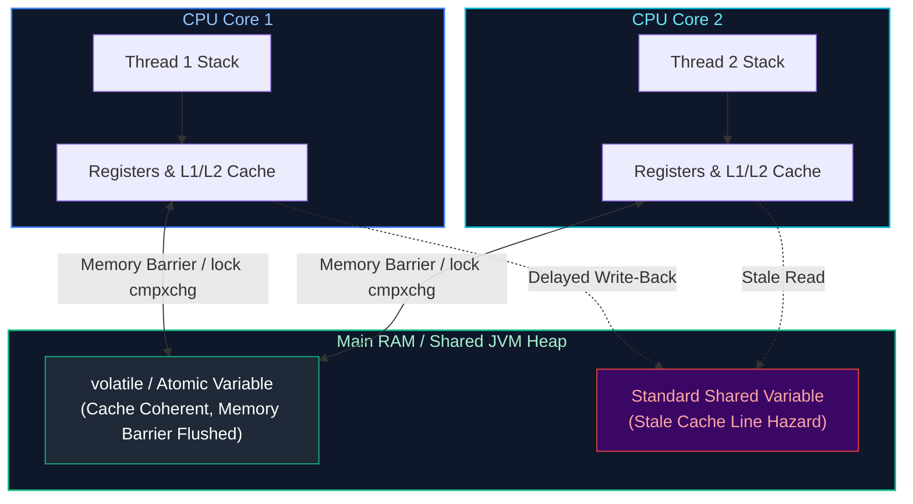
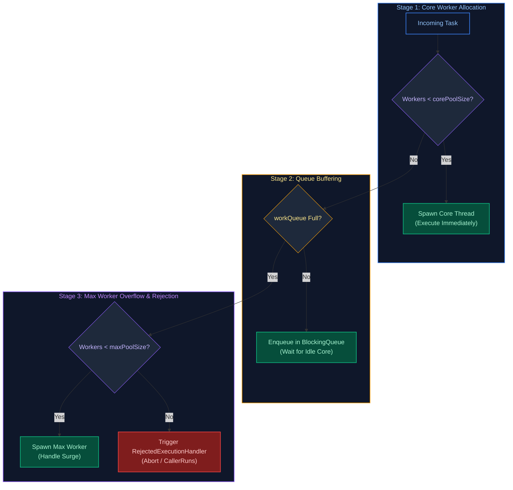
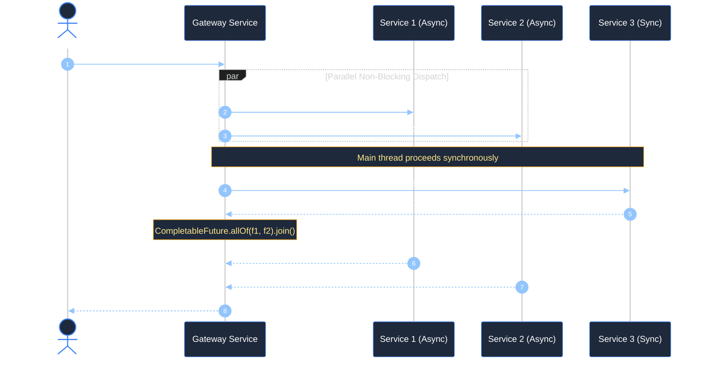
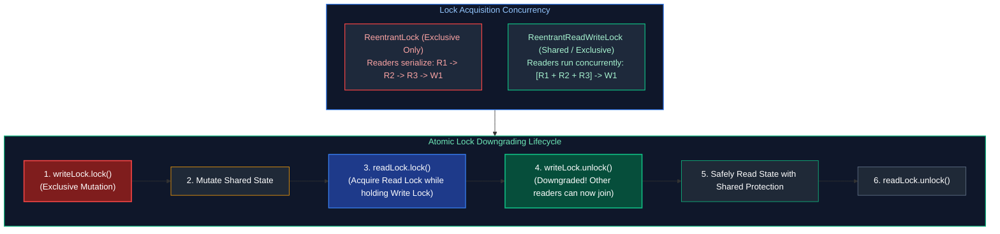

# 04. Java Concurrency, Multithreading & Asynchronous Programming

A comprehensive guide answering all 17 questions on the Java Memory Model (JMM), thread lifecycles, synchronization mechanisms, `volatile`, atomic variables, thread pool engineering, `CompletableFuture`, and production concurrency pitfalls.

---

## Architectural Overview: Java Memory Model (JMM) & Thread Caches



---

## Table of Contents & Question Mapping

1. **Thread Foundations & Execution Mechanics**
   - [Q1. `Runnable` vs `Callable` & Calling `run()` vs `start()`](#q1-runnable-vs-callable--calling-run-vs-start)
   - [Q2. Why the JVM Fails to Terminate After `main()` Completes](#q2-why-the-jvm-fails-to-terminate-after-main-completes)
2. **Synchronization, Locks & Memory Visibility**
   - [Q3. The `synchronized` Monitor & `sleep()` vs `wait()`](#q3-the-synchronized-monitor--sleep-vs-wait)
   - [Q4. `volatile` vs `AtomicInteger` vs `synchronized`](#q4-volatile-vs-atomicinteger-vs-synchronized)
   - [Q5. Deadlock Conditions, Thread Dumps & Prevention](#q5-deadlock-conditions-thread-dumps--prevention)
3. **Data Races & Thread-Unsafe Scenarios**
   - [Q6. Fixing Inconsistent Shared State (Bank Balance Race Condition)](#q6-fixing-inconsistent-shared-state-bank-balance-race-condition)
   - [Q7. Concurrent Access Hazards on `HashMap` & Fixes](#q7-concurrent-access-hazards-on-hashmap--fixes)
4. **Thread Pools & `ExecutorService` Engineering**
   - [Q8. `ExecutorService` Architecture, Saturated Queues & Silent Failures](#q8-executorservice-architecture-saturated-queues--silent-failures)
5. **Asynchronous Pipelines & Parallel Streams**
   - [Q9. `Future` vs `CompletableFuture`, `thenApply` vs `thenCompose` & Concurrency Optimization](#q9-future-vs-completablefuture-thenapply-vs-thencompose--concurrency-optimization)
   - [Q10. Why Parallel Streams Degrade Production Latency](#q10-why-parallel-streams-degrade-production-latency)
   - [Q11. Orchestrating Asynchronous and Synchronous Remote Calls with `CompletableFuture`](#q11-orchestrating-asynchronous-and-synchronous-remote-calls-with-completablefuture)
   - [Q12. Shared Mutable Object Hazards: Race Conditions, Memory Visibility & JMM](#q12-shared-mutable-object-hazards-race-conditions-memory-visibility--jmm)
   - [Q13. Modern Thread Creation Strategies: Platform Threads, `ExecutorService` & Java 21 Virtual Threads](#q13-modern-thread-creation-strategies-platform-threads-executorservice--java-21-virtual-threads)
   - [Q14. `synchronized` vs `ReentrantLock`: Feature Matrix & Trade-Offs](#q14-synchronized-vs-reentrantlock-feature-matrix--trade-offs)
   - [Q15. ReentrantLock vs ReentrantReadWriteLock: Read/Write Contention & Lock Downgrading](#q15-reentrantlock-vs-reentrantreadwritelock-readwrite-contention--lock-downgrading)
---

# 1. Thread Foundations & Execution Mechanics

---

### Q1. `Runnable` vs `Callable` & Calling `run()` vs `start()`
*(Grouped together: Thread invocation and execution contracts)*  
**Topic Covered:** Thread Lifecycle & Task Execution  
- `Runnable`: `void run()`, cannot return value, cannot throw checked exceptions.
- `Callable<V>`: `V call() throws Exception`, returns parameterized value `V`.

#### What happens if you call `run()` directly instead of `start()`?
- `start()` invokes native OS thread creation (`JVM_StartThread`), creates a new call stack, and runs asynchronously.
- `run()` simply executes the method synchronously within the **calling thread's existing stack frame** without creating any new thread.

---

### Q2. Why the JVM Fails to Terminate After `main()` Completes
**Topic Covered:** JVM Lifecycle & Daemon Threads  
The JVM halts only when all **non-daemon (user) threads** finish or `System.exit()` is called. If `main()` finishes but the application stays alive, active user threads exist (such as an unclosed `ExecutorService` created via `newFixedThreadPool`). Always shut down thread pools gracefully via `executor.shutdown()`.

---

# 2. Synchronization, Locks & Memory Visibility

---

### Q3. The `synchronized` Monitor & `sleep()` vs `wait()`
*(Grouped together: Monitor locks and thread suspension)*  
**Topic Covered:** Java Intrinsic Monitors  
- `synchronized`: Mutual exclusion lock guaranteeing **Happens-Before** memory visibility.
- `Thread.sleep()`: Pauses execution **without releasing the monitor lock**.
- `Object.wait()`: Must be called inside a `synchronized` block; **releases the monitor lock** so other threads can proceed, resuming upon `notify()` or timeout.

---

### Q4. `volatile` vs `AtomicInteger` vs `synchronized`
*(Grouped together: Memory Visibility vs Atomicity)*  
**Topic Covered:** Java Memory Model (JMM)  
- `volatile`: Guarantees memory visibility across CPU caches and prevents reordering. Does **not** guarantee atomicity (e.g. `count++` is not thread-safe).
- `AtomicInteger`: Guarantees visibility and atomicity using hardware lock-free Compare-And-Swap (CAS).
- `synchronized`: Mutual exclusion blocking entire critical sections with OS mutexes under contention.

---

### Q5. Deadlock Conditions, Thread Dumps & Prevention
**Topic Covered:** Concurrency Failures & Diagnostics  
A state where two or more threads are permanently blocked, each holding a lock the other needs.
- **4 Coffman Conditions:** Mutual Exclusion, Hold & Wait, No Preemption, Circular Wait.
- **Prevention:** Always acquire locks in a globally consistent order (e.g., sort account IDs before locking both accounts). Use `ReentrantLock.tryLock(timeout)`.
- **Diagnosis:** Run `jstack <PID>` or `jcmd <PID> Thread.print` to view cyclic dependencies.

---

# 3. Data Races & Thread-Unsafe Scenarios

---

### Q6. Fixing Inconsistent Shared State (Bank Balance Race Condition)
**Topic Covered:** Race Conditions & Thread Synchronization  

```java
public class SafeBankAccount {
    private final AtomicLong balanceCents = new AtomicLong(0);

    public void deposit(long amount) {
        if (amount <= 0) throw new IllegalArgumentException("Amount must be positive");
        balanceCents.addAndGet(amount);
    }

    public boolean withdraw(long amount) {
        if (amount <= 0) throw new IllegalArgumentException("Amount must be positive");
        while (true) {
            long current = balanceCents.get();
            if (current < amount) return false;
            if (balanceCents.compareAndSet(current, current - amount)) {
                return true;
            }
        }
    }
}
```

---

### Q7. Concurrent Access Hazards on `HashMap` & Fixes
**Topic Covered:** Thread Safety & Memory Corruption  
Concurrent modification on `HashMap` causes lost updates, data corruption, and (in older JDKs) circular linked-list references resulting in 100% CPU infinite loops.
- **Fix:** Replace with `ConcurrentHashMap` for high concurrency or `Collections.synchronizedMap()` for legacy code.

---

# 4. Thread Pools & `ExecutorService` Engineering

---

### Q8. `ExecutorService` Architecture, Saturated Queues & Silent Failures
*(Grouped together: Thread Pool Architecture and Diagnostics)*  
**Topic Covered:** `ThreadPoolExecutor` Mechanics & Failure Modes  



- **Requests waiting unexpectedly:** `Executors.newFixedThreadPool()` uses an unbounded `LinkedBlockingQueue`. The pool never scales beyond `corePoolSize`; tasks accumulate in memory while threads block on external I/O. Use a bounded queue with `CallerRunsPolicy`.
- **Silent task failures:** Exceptions inside `executor.submit()` are captured inside the `Future` and only thrown if `future.get()` is invoked. Wrap tasks in `try-catch` blocks logging errors.

---

# 5. Asynchronous Pipelines & Parallel Streams

---

### Q9. `Future` vs `CompletableFuture`, `thenApply` vs `thenCompose` & Concurrency Optimization
*(Grouped together: Asynchronous Reactive Orchestration)*  
**Topic Covered:** Non-Blocking Asynchronous Composition  
- `Future`: Only provides blocking `get()`.
- `CompletableFuture`: Non-blocking composable reactive pipeline.
- `thenApply(Function<T, U>)`: Synchronous transformation $T \to U$ (like `map`).
- `thenCompose(Function<T, CompletableFuture<U>>)`: Asynchronous flattening $T \to \text{CompletableFuture}<U>$ (like `flatMap`).

```java
CompletableFuture<User> userF = CompletableFuture.supplyAsync(() -> userService.getUser(id));
CompletableFuture<Score> scoreF = CompletableFuture.supplyAsync(() -> scoreService.getScore(id));

CompletableFuture<Approval> approvalF = userF.thenCombine(scoreF, (u, s) -> new Approval(u, s.isValid()));
```

---

### Q10. Why Parallel Streams Degrade Production Latency
**Topic Covered:** ForkJoinPool Contention & Thread Starvation  
All parallel streams share the single global `ForkJoinPool.commonPool()`. If tasks perform blocking database or HTTP operations, pool threads stall, degrading all parallel stream workflows across the entire JVM. Use parallel streams solely for non-blocking CPU operations.

---

### Q11. Orchestrating Asynchronous and Synchronous Remote Calls with `CompletableFuture`
**Topic Covered:** Multi-Service Async Orchestration Pattern  
**Difficulty:** `[Hard]`

#### Architectural Overview
A standard enterprise orchestration pattern requires querying two independent microservices concurrently (API 1 and API 2) to eliminate cumulative network latency, performing local processing or invoking a third dependent service synchronously (API 3), and finally joining the async results to build the composite response:



#### Production Code
```java
package com.enterprise.concurrency;

import java.time.Duration;
import java.util.concurrent.*;

public final class ServiceOrchestrator {

    private final ExecutorService customExecutor = Executors.newFixedThreadPool(
            32,
            r -> {
                Thread t = new Thread(r, "api-worker");
                t.setDaemon(true);
                return t;
            }
    );

    public record AggregateResponse(String res1, String res2, String res3) {}

    public AggregateResponse orchestrateCalls() {
        // Step 1: Fire API 1 and API 2 asynchronously on dedicated thread pool
        CompletableFuture<String> future1 = CompletableFuture.supplyAsync(
                () -> callRemoteService("http://api1.internal/data", 200), customExecutor
        );

        CompletableFuture<String> future2 = CompletableFuture.supplyAsync(
                () -> callRemoteService("http://api2.internal/data", 250), customExecutor
        );

        // Step 2: Execute API 3 synchronously on caller thread
        String result3 = callRemoteService("http://api3.internal/data", 100);

        // Step 3: Await completion of future1 and future2 with strict timeout
        try {
            CompletableFuture.allOf(future1, future2).get(2, TimeUnit.SECONDS);
            return new AggregateResponse(future1.join(), future2.join(), result3);
        } catch (InterruptedException e) {
            Thread.currentThread().interrupt();
            throw new CompletionException("Call interrupted", e);
        } catch (ExecutionException | TimeoutException e) {
            throw new CompletionException("Asynchronous API failure or SLA timeout", e);
        }
    }

    private String callRemoteService(String endpoint, long delayMs) {
        try {
            Thread.sleep(delayMs);
            return "Payload from " + endpoint;
        } catch (InterruptedException e) {
            Thread.currentThread().interrupt();
            throw new RuntimeException("Service call failed", e);
        }
    }
}
```

* **Complexity**: Total latency $= \max(\text{Latency}(\text{API 1}), \text{Latency}(\text{API 2}), \text{Latency}(\text{API 3}))$, reducing sequential latency from $T_1 + T_2 + T_3$ down to the slowest concurrent call.
* **Production Trap**: Never omit passing a bounded custom `ExecutorService` to `supplyAsync()`; defaulting to `ForkJoinPool.commonPool()` causes worker starvation across the entire JVM.

---

### Q12. Shared Mutable Object Hazards: Race Conditions, Memory Visibility & JMM
**Topic Covered:** Java Memory Model (JMM) & Thread Safety  
**Difficulty:** `[Medium]`

#### Architectural Overview
When multiple threads modify a shared mutable object without synchronization:
1. **Atomicity Violations (Race Conditions)**: Compound actions like `count++` decompose into 3 distinct CPU bytecode steps (`getfield`, `iadd`, `putfield`). Interleaved execution causes lost updates.
2. **Memory Visibility Violations**: Modern CPUs maintain local L1/L2 hardware caches. Writes made by Core 1 are buffered in store buffers and may never become visible to Core 2 without a **memory barrier** (cache flush).
3. **Instruction Reordering**: JIT compilers and CPU out-of-order execution pipelines reorder independent instructions, exposing partially constructed objects.

* **Resolution Hierarchy**: Immutability > `AtomicInteger` / CAS > `volatile` (visibility only) > `ReentrantLock` / `synchronized` (mutual exclusion + visibility).

---

### Q13. Modern Thread Creation Strategies: Platform Threads, `ExecutorService` & Java 21 Virtual Threads
**Topic Covered:** Threading Lifecycle & Scalability  
**Difficulty:** `[Easy]`

#### Architectural Overview
| Mechanism | Backing Implementation | Memory Footprint | Best Production Use Case |
| :--- | :--- | :--- | :--- |
| **`new Thread(r).start()`** | 1:1 OS Kernel Thread | ~1 MB heap/stack | **Anti-pattern in production** (unbounded thread creation exhausts OS PIDs). |
| **`ExecutorService` (Fixed)** | Bounded Pool of Platform Threads | Controlled ($N \times 1\text{ MB}$) | High-throughput CPU-bound processing (cryptography, hashing, parsing). |
| **Java 21 Virtual Threads** | JVM-scheduled user-mode threads | ~$1\text{ KB}$ | High-concurrency I/O-bound web and database requests (`Executors.newVirtualThreadPerTaskExecutor()`). |

```java
// Java 21+ Virtual Thread Executor
try (var executor = Executors.newVirtualThreadPerTaskExecutor()) {
    IntStream.range(0, 100_000).forEach(i -> executor.submit(() -> {
        Thread.sleep(Duration.ofMillis(100)); // Unmounts carrier thread; zero CPU waste!
        return i;
    }));
} // Automatically awaits termination
```

---

### Q14. `synchronized` vs `ReentrantLock`: Feature Matrix & Trade-Offs
**Topic Covered:** Mutual Exclusion Mechanics  
**Difficulty:** `[Medium]`

#### Architectural Overview
- **`synchronized`**: Language keyword managed by JVM object monitor. Automatically releases lock on exception exit. Highly optimized by JIT via lock elision and biased/lightweight locking.
- **`ReentrantLock`**: API-based lock (`java.util.concurrent.locks`). Requires explicit `lock()` and `finally { unlock(); }`.

#### Feature Matrix:
| Feature | `synchronized` | `ReentrantLock` |
| :--- | :--- | :--- |
| **Fairness Policy** | Unfair (thread barging) | Configurable (`new ReentrantLock(true)`) |
| **Non-blocking Acquisition** | No | `tryLock()` |
| **Timed Acquisition** | No | `tryLock(1, TimeUnit.SECONDS)` |
| **Interruptible Lock** | No | `lockInterruptibly()` |
| **Multiple Wait Conditions**| Single monitor (`wait`/`notify`) | Multiple `Condition` instances (`newCondition()`) |

---

### Q15. ReentrantLock vs ReentrantReadWriteLock: Read/Write Contention & Lock Downgrading
**Topic Covered:** Explicit Locks, Read-Write Separation & Lock Downgrading  
**Question:** ReentrantLock vs. ReentrantReadWriteLock. When would you use a ReadWriteLock over a standard ReentrantLock, how does lock downgrading work, and what are the writer starvation pitfalls?

#### Definition & Core Concepts
Mutual exclusion locks like `ReentrantLock` enforce exclusive access regardless of operation type. Even if 1,000 threads only read data without modifying state, `ReentrantLock` forces them to execute sequentially, introducing artificial queueing delays.

`ReentrantReadWriteLock` resolves this by decoupling synchronization into two complementary locks:
1. **Shared Read Lock (`readLock()`):** Can be held simultaneously by an arbitrary number of reader threads, provided no thread holds the write lock.
2. **Exclusive Write Lock (`writeLock()`):** Can only be held by exactly one thread at a time, completely locking out all readers and other writers.

**Lock Downgrading vs. Upgrading Semantics:**
- **Lock Downgrading is Supported:** A thread holding the write lock can acquire the read lock, and subsequently release the write lock:
  $$\text{writeLock.lock()} \to \text{readLock.lock()} \to \text{writeLock.unlock()} \to \text{readLock.unlock()}$$
  This pattern allows a thread to modify shared data, atomically downgrade to a shared read lock, and read the modified state without giving another writer the opportunity to intervene.
- **Lock Upgrading is Strictly Prohibited:** A thread holding a read lock **cannot** acquire a write lock without first releasing its read lock. If two reader threads attempt to acquire the write lock simultaneously while holding their read locks, a fatal deadlock ensues.

**Writer Starvation Pitfall:**
Under continuous high-throughput read workloads, the read lock is constantly held by overlapping readers, preventing waiting writers from acquiring the write lock indefinitely (Writer Starvation). Configuring fairness (`new ReentrantReadWriteLock(true)`) mitigates starvation at the cost of throughput. In ultra-high-throughput systems, Java 8 `StampedLock` is preferred due to its lock-free optimistic read capability (`tryOptimisticRead()`).

#### Visual Flow


#### Production Implementation / Code Solution
```java
package com.enterprise.concurrency;

import java.util.HashMap;
import java.util.Map;
import java.util.concurrent.locks.Lock;
import java.util.concurrent.locks.ReentrantReadWriteLock;

public final class ThreadSafeCache<K, V> {

    private final Map<K, V> internalMap = new HashMap<>();
    private final ReentrantReadWriteLock rwLock = new ReentrantReadWriteLock();
    private final Lock readLock = rwLock.readLock();
    private final Lock writeLock = rwLock.writeLock();

    public V get(K key) {
        readLock.lock();
        try {
            return internalMap.get(key);
        } finally {
            readLock.unlock();
        }
    }

    public void put(K key, V value) {
        writeLock.lock();
        try {
            internalMap.put(key, value);
        } finally {
            writeLock.unlock();
        }
    }

    /**
     * Demonstrates safe Lock Downgrading:
     * Write Lock -> Acquire Read Lock -> Release Write Lock -> Release Read Lock.
     */
    public V updateAndGet(K key, V newValue) {
        writeLock.lock();
        try {
            internalMap.put(key, newValue);

            // Step 1: Acquire read lock before releasing write lock (Lock Downgrading)
            readLock.lock();
        } finally {
            // Step 2: Release write lock; other readers can now read concurrently
            writeLock.unlock();
        }

        try {
            // Step 3: Safely use the value under shared read lock
            return internalMap.get(key);
        } finally {
            // Step 4: Release read lock
            readLock.unlock();
        }
    }
}
```
- **Time Complexity:** $O(1)$ read and write lock acquisition without contention; $O(1)$ map lookups.
- **Space Complexity:** $O(N)$ for $N$ stored cache elements.

#### Engineering Implications & Production Pitfalls
1. **The Lock Upgrade Deadlock Trap:** Never attempt to call `writeLock.lock()` while holding the `readLock()`. The current thread will wait forever for all read locks to be released (including its own!), causing a self-deadlock that halts the service thread.
2. **Interview Talking Point:** In high-concurrency microservices with 99% read workloads (e.g., config lookups, routing tables), `ReentrantReadWriteLock` dramatically outperforms `ReentrantLock`. However, if writers are frequent or readers hold locks during I/O operations, context-switching overhead can make `ConcurrentHashMap` or `StampedLock` far superior.

#### Core Curriculum Cross-Reference
*Deep-dive theoretical reference: See [04. Java Concurrency & Multithreading](../04_java_concurrency_and_multithreading.md#5-locks--explicit-synchronizers)*

---

## Summary Comparison & Production Reference Matrix

| Scenario Domain | Critical Runtime Pathology | Diagnostic & Triage Method | Canonical Production Resolution |
| :--- | :--- | :--- | :--- |
| **Thread Foundations & Execution Mechanics** | High-throughput invariants & concurrency boundaries | Metric instrumentation & trace profiling | Defensive validation & graceful degradation |
| **Synchronization, Locks & Memory Visibility** | High-throughput invariants & concurrency boundaries | Metric instrumentation & trace profiling | Defensive validation & graceful degradation |
| **Data Races & Thread-Unsafe Scenarios** | High-throughput invariants & concurrency boundaries | Metric instrumentation & trace profiling | Defensive validation & graceful degradation |
| **Thread Pools & `ExecutorService` Engineering** | High-throughput invariants & concurrency boundaries | Metric instrumentation & trace profiling | Defensive validation & graceful degradation |
| **Asynchronous Pipelines & Parallel Streams** | High-throughput invariants & concurrency boundaries | Metric instrumentation & trace profiling | Defensive validation & graceful degradation |

---

## References & Further Reading

---
- [Oracle OpenJDK - JEP 444: Virtual Threads](https://openjdk.org/jeps/444) — Specification for user-mode virtual threads in Java 21.
- [JEP 453: Structured Concurrency (Preview)](https://openjdk.org/jeps/453) — OpenJDK API simplifying multi-threaded error propagation and cancellation.
- [Brian Goetz: Java Concurrency in Practice](https://jcip.net/) — The definitive guide to thread safety, synchronization, and the Java Memory Model.
- [Doug Lea: Concurrent Programming in Java](https://gee.cs.oswego.edu/dl/cpj/) — Design principles from the lead author of `java.util.concurrent`.
- [Baeldung - Java Concurrency and Multithreading Guide](https://www.baeldung.com/java-concurrency)
