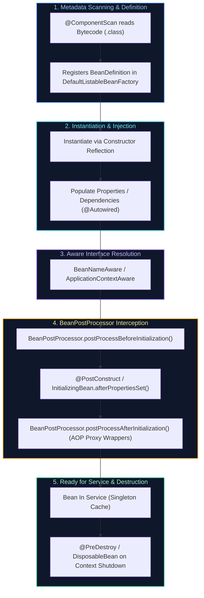

# 05. Spring Framework & Spring Boot Core

A comprehensive guide answering all 19 questions on Spring core architecture, the IoC container, Dependency Injection internals, Bean lifecycle, auto-configuration mechanics, configuration properties, Actuator, and production application structuring.

---

## Architectural Overview: Spring Bean Lifecycle & Container Pipeline



---

## Table of Contents & Question Mapping

1. **Spring vs Spring Boot & Container Foundations**
   - [Q1. Spring Framework vs Spring Boot](#q1-spring-framework-vs-spring-boot)
   - [Q2. What is `ApplicationContext` in Spring?](#q2-what-is-applicationcontext-in-spring)
2. **Dependency Injection & Stereotypes**
   - [Q3 & Q4. Dependency Injection Internals & Best Practices in Spring Boot](#q3--q4-dependency-injection-internals--best-practices-in-spring-boot)
   - [Q5 & Q6. Stereotype Annotations (`@Component`, `@Service`, `@Repository`, `@Controller`) & Scanning](#q5--q6-stereotype-annotations-component-service-repository-controller--scanning)
   - [Q7. `@Primary` vs `@Qualifier`](#q7-primary-vs-qualifier)
   - [Q8. `@Bean` vs `@Autowired` in Dependency & Database Management](#q8-bean-vs-autowired-in-dependency--database-management)
3. **Bean Lifecycle, Scopes & Proxies**
   - [Q9. The Complete Spring Bean Lifecycle](#q9-the-complete-spring-bean-lifecycle)
   - [Q10 & Q11. Spring Bean Scopes & Switching via `@Scope`](#q10--q11-spring-bean-scopes--switching-via-scope)
4. **Auto-Configuration, Properties & Profiles**
   - [Q12 & Q13. `@SpringBootApplication` & Auto-Configuration Internals](#q12--q13-springbootapplication--auto-configuration-internals)
   - [Q14. Property Injection via `@Value` vs `@ConfigurationProperties`](#q14-property-injection-via-value-vs-configurationproperties)
   - [Q15. Multi-Environment Spring Profiles](#q15-multi-environment-spring-profiles)
5. **Web MVC, Actuator & Module Design**
   - [Q16. `ViewResolver` in Spring MVC Architecture](#q16-viewresolver-in-spring-mvc-architecture)
   - [Q17. Spring Web Exception Handling Annotations](#q17-spring-web-exception-handling-annotations)
   - [Q18. Spring Boot Actuator in Production & Endpoint Security](#q18-spring-boot-actuator-in-production--endpoint-security)
   - [Q19. Architectural Approach to Developing a New Spring Boot Module](#q19-architectural-approach-to-developing-a-new-spring-boot-module)

---

# 1. Spring vs Spring Boot & Container Foundations

---

### Q1. Spring Framework vs Spring Boot
**Topic Covered:** Spring Platform Evolution  
- **Spring Framework:** Flexible dependency injection framework requiring extensive manual configuration (XML or Java `@Configuration`) and an external deployment container (WAR file in Tomcat/WildFly).
- **Spring Boot:** Convention-over-configuration rapid development extension providing embedded web servers (JAR execution), **Starter POMs**, automatic dependency management, **Auto-Configuration**, and production-ready **Actuator** telemetry.

---

### Q2. What is `ApplicationContext` in Spring?
**Topic Covered:** Inversion of Control (IoC) Container  
The central interface representing the advanced Spring IoC Container (extending `BeanFactory`). It eagerly instantiates singletons on startup, manages dependency injection, and integrates application events (`ApplicationEventPublisher`), resource loading, and environment configuration.

---

# 2. Dependency Injection & Stereotypes

---

### Q3 & Q4. Dependency Injection Internals & Best Practices in Spring Boot
*(Grouped together: DI Engine and Production Usage)*  
**Topic Covered:** Inversion of Control Mechanics & Injection Styles  
Spring inspects registered `BeanDefinition` metadata and uses constructor reflection to inject dependencies from its internal singleton cache.

#### Production Standard: Constructor Injection
```java
@Service
public class OrderService {
    private final PaymentClient paymentClient;
    private final OrderRepository orderRepository;

    public OrderService(PaymentClient paymentClient, OrderRepository orderRepository) {
        this.paymentClient = paymentClient;
        this.orderRepository = orderRepository;
    }
}
```
- Guarantees immutability (`final` fields).
- Prevents uninitialized object references.
- Allows simple unit testing without Spring context initialization.

---

### Q5 & Q6. Stereotype Annotations (`@Component`, `@Service`, `@Repository`, `@Controller`) & Scanning
*(Grouped together: Stereotypes and Container Detection)*  
**Topic Covered:** Semantic Component Classification  
- `@Component`: Root stereotype for Spring-managed beans.
- `@Service`: Semantic specialization for business logic.
- `@Repository`: Semantic specialization for persistence; automatically registers `PersistenceExceptionTranslationPostProcessor` to convert native DB errors into Spring's `DataAccessException` hierarchy.
- `@Controller`: Presentation layer controller for HTTP request handling.
- **Detection:** `@ComponentScan` scans package bytecode via ASM at startup to locate classes annotated with `@Component`.

---

### Q7. `@Primary` vs `@Qualifier`
**Topic Covered:** Bean Disambiguation  
- `@Primary`: Defines the default bean when multiple candidates share the same type.
- `@Qualifier("beanName")`: Explicitly specifies a candidate by bean name at the injection site, overriding `@Primary`.

---

### Q8. `@Bean` vs `@Autowired` in Dependency & Database Management
**Topic Covered:** Bean Registration vs Bean Injection  
- `@Bean`: Method-level annotation inside `@Configuration` classes used to configure third-party classes (e.g., `HikariDataSource`, `RedisTemplate`).
- `@Autowired`: Field/constructor level annotation instructing the container to inject an existing bean into a target dependent class.

---

# 3. Bean Lifecycle, Scopes & Proxies

---

### Q9. The Complete Spring Bean Lifecycle
**Topic Covered:** Container Lifecycle Pipeline  
1. `BeanDefinition` registered from classpath.
2. Instantiation via constructor reflection.
3. Property population / Dependency injection.
4. Aware interfaces called (`BeanNameAware`, `ApplicationContextAware`).
5. `BeanPostProcessor.postProcessBeforeInitialization()`.
6. `@PostConstruct` / `InitializingBean.afterPropertiesSet()` initialization.
7. `BeanPostProcessor.postProcessAfterInitialization()` (AOP proxies applied).
8. Ready in Singleton cache.
9. `@PreDestroy` / `DisposableBean.destroy()` on shutdown.

---

### Q10 & Q11. Spring Bean Scopes & Switching via `@Scope`
*(Grouped together: Bean Scopes and Lifecycle Demarcation)*  
**Topic Covered:** Bean Scoping Models  
- `singleton` (Default): Exactly one instance per Spring container.
- `prototype`: A brand new instance created every time the bean is requested.
- `request`: One instance per HTTP request.
- `session`: One instance per HTTP session.
- Switch scope using `@Scope("prototype")`.

---

# 4. Auto-Configuration, Properties & Profiles

---

### Q12 & Q13. `@SpringBootApplication` & Auto-Configuration Internals
*(Grouped together: Boot Metaprogramming and Auto-Configuration)*  
**Topic Covered:** Spring Boot Core Engine  
`@SpringBootApplication` combines `@SpringBootConfiguration`, `@EnableAutoConfiguration`, and `@ComponentScan`.

#### Auto-Configuration Mechanics:
Spring Boot reads `META-INF/spring/org.springframework.boot.autoconfigure.AutoConfiguration.imports` and evaluates conditional annotations like `@ConditionalOnClass(DataSource.class)` and `@ConditionalOnMissingBean(DataSource.class)`. If the class is present on the classpath and no custom bean is defined by the user, Spring registers its default auto-configuration bean automatically.

---

### Q14. Property Injection via `@Value` vs `@ConfigurationProperties`
**Topic Covered:** Externalized Configuration  
- `@Value("${app.url}")`: Simple expression injection, lacks type validation or hierarchical structures.
- `@ConfigurationProperties(prefix = "app")` (Recommended): Strongly-typed, hierarchical binding to a POJO or Record supporting JSR-303 validation (`@Validated`).

---

### Q15. Multi-Environment Spring Profiles
**Topic Covered:** Environment Segregation  
Organize configurations using `application-dev.yaml` and `application-prod.yaml`. Activate via `SPRING_PROFILES_ACTIVE=prod` or `-Dspring.profiles.active=prod`. Conditionally register beans with `@Profile("prod")`.

---

# 5. Web MVC, Actuator & Module Design

---

### Q16. `ViewResolver` in Spring MVC Architecture
**Topic Covered:** Template Rendering & View Mapping  
In traditional MVC apps, the `DispatcherServlet` uses a `ViewResolver` (e.g. `ThymeleafViewResolver`) to map a logical string view name (e.g. `"index"`) to an actual HTML template. In REST APIs, `ViewResolver` is bypassed by `@ResponseBody` in favor of Jackson JSON serialization.

---

### Q17. Spring Web Exception Handling Annotations
**Topic Covered:** Exception Demarcation  
- `@ExceptionHandler`: Intercepts specific exception classes within a controller.
- `@ControllerAdvice` / `@RestControllerAdvice`: Global exception interceptor across all controllers.
- `@ResponseStatus`: Maps an exception class directly to an HTTP status code.

---

### Q18. Spring Boot Actuator in Production & Endpoint Security
**Topic Covered:** Observability & Production Hardening  
Exposes production health, metrics, and environment diagnostic endpoints (`/actuator/health`, `/actuator/metrics`, `/actuator/prometheus`). Sensitive endpoints must be restricted with Spring Security role checks (`hasRole('ADMIN')`).

---

### Q19. Architectural Approach to Developing a New Spring Boot Module
**Topic Covered:** Enterprise Architecture & Clean Layering  
1. **API Contracts & DTOs:** Define request/response records and OpenAPI contracts.
2. **Controller Layer:** Validates inputs (`@Valid`) and delegates to domain service.
3. **Service Layer:** Houses domain logic and transaction boundaries (`@Transactional`).
4. **Repository Layer:** Spring Data JPA persistence interfaces.
5. **Testing Pyramid:** Unit tests (JUnit 5 + Mockito) and slice tests (`@DataJpaTest` with Testcontainers).
