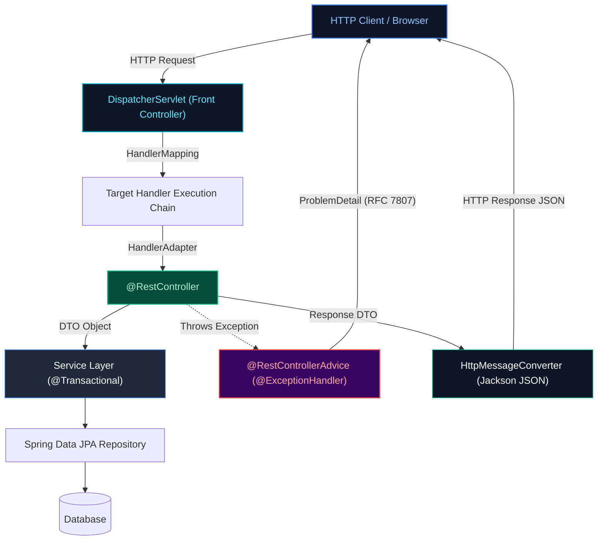
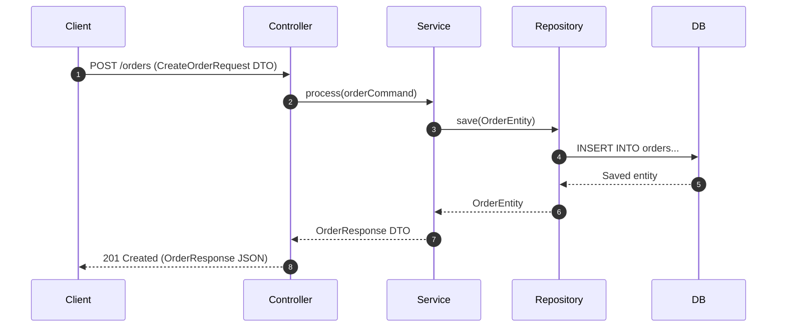

# 06. REST APIs, Web Services & HTTP Architecture

A comprehensive guide answering all 19 questions on REST architectural constraints, Spring MVC dispatching, HTTP verb semantics, status code taxonomy, global exception handling, HTTP clients, rate limiting, and modern API communication protocols (REST vs gRPC vs GraphQL).

---

## Architectural Overview: Spring REST Request Processing Pipeline



---

## Table of Contents & Question Mapping

1. **REST Architecture & HTTP Semantics**
   - [Q1. Is REST Architecture Stateless or Stateful, and Why?](#q1-is-rest-architecture-stateless-or-stateful-and-why)
   - [Q5 & Q6. `PUT` vs `PATCH` & Designing Idempotent API Operations](#q5--q6-put-vs-patch--designing-idempotent-api-operations)
   - [Q7. Comprehensive HTTP Status Codes Taxonomy](#q7-comprehensive-http-status-codes-taxonomy)
2. **Spring MVC Annotations & Request Flow**
   - [Q2 & Q3. `@Controller` vs `@RestController` & HTTP Request Mapping Annotations](#q2--q3-controller-vs-restcontroller--http-request-mapping-annotations)
   - [Q4. Parameter Binding: `@RequestParam` vs `@PathVariable` vs `@RequestBody`](#q4-parameter-binding-requestparam-vs-pathvariable-vs-requestbody)
   - [Q9 & Q10. The DTO Pattern & Request Flow Across Controller, Service, and Repository](#q9--q10-the-dto-pattern--request-flow-across-controller-service-and-repository)
3. **Exception Handling & Resilience**
   - [Q8 & Q11. Graceful Error Handling & Global Exception Management via `@RestControllerAdvice`](#q8--q11-graceful-error-handling--global-exception-management-via-restcontrolleradvice)
   - [Q19. Handling Inconsistent External API Calls (Nulls & Failures Gracefully)](#q19-handling-inconsistent-external-api-calls-nulls--failures-gracefully)
4. **Client Communication & Concurrency**
   - [Q12. HTTP Clients: `RestTemplate` vs `WebClient` vs `FeignClient`](#q12-http-clients-resttemplate-vs-webclient-vs-feignclient)
   - [Q13. API Versioning Strategies in Production](#q13-api-versioning-strategies-in-production)
   - [Q15. How Spring Boot Handles High-Concurrency Requests](#q15-how-spring-boot-handles-high-concurrency-requests)
   - [Q16. Rate Limiting & Throttling in Spring Boot APIs](#q16-rate-limiting--throttling-in-spring-boot-apis)
   - [Q17. Configuring Spring Security for JWT on a Subset of Endpoints](#q17-configuring-spring-security-for-jwt-on-a-subset-of-endpoints)
5. **Practical Endpoint Implementation & Protocols**
   - [Q14. Designing a REST Endpoint for Last N Orders (Spring Boot + Spring Data JPA)](#q14-designing-a-rest-endpoint-for-last-n-orders-spring-boot--spring-data-jpa)
   - [Q18. REST vs gRPC vs GraphQL Architectural Comparison](#q18-rest-vs-grpc-vs-graphql-architectural-comparison)

---

# 1. REST Architecture & HTTP Semantics

---

### Q1. Is REST Architecture Stateless or Stateful, and Why?
**Topic Covered:** REST Architectural Constraints  
REST is strictly **stateless**. Every incoming client request must contain all contextual information (e.g., Bearer JWT token) needed to authenticate and process it. The server never stores client session state between requests, enabling horizontal scalability, easy routing across server clusters, and simple failover.

---

### Q5 & Q6. `PUT` vs `PATCH` & Designing Idempotent API Operations
*(Grouped together: Update Semantics and Idempotency)*  
**Topic Covered:** HTTP Method Specifications & Idempotent Design  
- `PUT`: Complete resource replacement. Idempotent. Unspecified fields are overwritten/nulled out.
- `PATCH`: Partial resource update. Non-idempotent by strict RFC specification (though often implemented idempotently). Only modifies specified delta fields.

#### Designing Idempotent `POST` Operations:
Clients supply a unique UUID `Idempotency-Key` header. The server checks Redis via `SET lock:<key> "LOCKED" NX EX 30`. If the key exists, the cached result is returned without re-executing business logic.

---

### Q7. Comprehensive HTTP Status Codes Taxonomy
**Topic Covered:** HTTP Protocol Standards  
- `200 OK`: Successful read or update.
- `201 Created`: Successful creation via POST; returns `Location` header.
- `204 No Content`: Successful action with empty response body (typical for `DELETE`).
- `400 Bad Request`: Input validation failed (`MethodArgumentNotValidException`).
- `401 Unauthorized`: Missing or invalid authentication token.
- `403 Forbidden`: Authenticated identity lacks permission/role.
- `404 Not Found`: Resource ID does not exist.
- `409 Conflict`: Resource state conflict (e.g. duplicate key or concurrent update).
- `502 Bad Gateway`: Downstream external service returned an invalid response.
- `503 Service Unavailable`: Server overloaded or undergoing maintenance.

---

# 2. Spring MVC Annotations & Request Flow

---

### Q2 & Q3. `@Controller` vs `@RestController` & HTTP Request Mapping Annotations
*(Grouped together: Controller Stereotypes & Mapping)*  
**Topic Covered:** Spring MVC Web Layer  
- `@Controller`: Traditional MVC controller returning view template names.
- `@RestController`: Convenience composite annotation (`@Controller` + `@ResponseBody`) serializing returned objects directly to JSON via Jackson.
- Mappings: `@GetMapping`, `@PostMapping`, `@PutMapping`, `@DeleteMapping`, `@PatchMapping`.

---

### Q4. Parameter Binding: `@RequestParam` vs `@PathVariable` vs `@RequestBody`
**Topic Covered:** Request Data Extraction  
- `@PathVariable`: Extracts variable from URI path (`/orders/{id}`).
- `@RequestParam`: Extracts query parameters (`/orders?status=PENDING&page=1`).
- `@RequestBody`: Deserializes JSON HTTP request body into a Java POJO/Record.

---

### Q9 & Q10. The DTO Pattern & Request Flow Across Controller, Service, and Repository
*(Grouped together: Layered Architecture and Data Encapsulation)*  
**Topic Covered:** Enterprise Architecture & DTOs  
DTOs decouple public API contracts from internal database entity schemas, preventing mass-assignment vulnerabilities and eliminating Jackson circular reference errors in bidirectional JPA relationships.



---

# 3. Exception Handling & Resilience

---

### Q8 & Q11. Graceful Error Handling & Global Exception Management via `@RestControllerAdvice`
*(Grouped together: Production REST Error Handling)*  
**Topic Covered:** Exception Translation & RFC 7807 Problem Details  

```java
@RestControllerAdvice
public class GlobalExceptionHandler {
    @ExceptionHandler(ResourceNotFoundException.class)
    public ResponseEntity<ProblemDetail> handleNotFound(ResourceNotFoundException ex) {
        ProblemDetail problem = ProblemDetail.forStatusAndDetail(HttpStatus.NOT_FOUND, ex.getMessage());
        problem.setTitle("Resource Not Found");
        return ResponseEntity.status(HttpStatus.NOT_FOUND).body(problem);
    }
}
```

---

### Q19. Handling Inconsistent External API Calls (Nulls & Failures Gracefully)
**Topic Covered:** Resilient Client Design  
Use Resilience4j `@CircuitBreaker` with fallback methods, wrap responses in Java `Optional`, and map raw external responses through an adapter layer providing safe domain defaults.

---

# 4. Client Communication & Concurrency

---

### Q12. HTTP Clients: `RestTemplate` vs `WebClient` vs `FeignClient`
**Topic Covered:** Microservice Client Implementations  
- `RestTemplate`: Synchronous, blocking (1 thread per call). Maintenance mode.
- `WebClient` (Spring WebFlux): Modern, non-blocking, reactive client. Ultra-high throughput.
- `OpenFeign`: Declarative annotation-driven interface proxy. Popular for Spring Cloud microservices.

---

### Q13. API Versioning Strategies in Production
**Topic Covered:** API Evolution & Backward Compatibility  
- **URI Path (Recommended):** `/api/v1/orders` vs `/api/v2/orders`. Clear, intuitive, easily routed by gateways.
- **Header:** `X-API-Version: 2`. Keeps URIs clean.
- **Accept Header (Content Negotiation):** `Accept: application/vnd.company.v2+json`.

---

### Q15. How Spring Boot Handles High-Concurrency Requests
**Topic Covered:** Web Server Thread Models  
- Traditional Spring MVC uses Tomcat worker thread pools (`server.tomcat.threads.max=200`). When 200 threads block on database queries, requests queue up.
- Spring Boot 3.2+ supports Java 21 **Virtual Threads** (`spring.threads.virtual.enabled=true`), enabling 100,000+ concurrent requests without thread starvation.

---

### Q16. Rate Limiting & Throttling in Spring Boot APIs
**Topic Covered:** Traffic Shaping & API Defense  
Implement the Token Bucket algorithm using **Bucket4j** with a Redis distributed backend to enforce quotas across a clustered service fleet.

---

### Q17. Configuring Spring Security for JWT on a Subset of Endpoints
**Topic Covered:** Declarative Security Filter Chain  

```java
@Bean
public SecurityFilterChain filterChain(HttpSecurity http, JwtAuthFilter jwtFilter) throws Exception {
    return http
        .csrf(AbstractHttpConfigurer::disable)
        .authorizeHttpRequests(auth -> auth
            .requestMatchers("/api/v1/auth/**", "/actuator/health").permitAll()
            .requestMatchers("/api/v1/admin/**").hasRole("ADMIN")
            .anyRequest().authenticated()
        )
        .addFilterBefore(jwtFilter, UsernamePasswordAuthenticationFilter.class)
        .build();
}
```

---

# 5. Practical Endpoint Implementation & Protocols

---

### Q14. Designing a REST Endpoint for Last N Orders (Spring Boot + Spring Data JPA)
**Topic Covered:** REST Design & Spring Data JPA Pagination  

```java
@GetMapping("/customers/{id}/orders/recent")
public ResponseEntity<List<OrderResponse>> getRecentOrders(
        @PathVariable UUID id,
        @RequestParam(defaultValue = "5") int limit) {
    PageRequest pageRequest = PageRequest.of(0, limit, Sort.by("createdAt").descending());
    List<OrderResponse> orders = orderRepository.findByCustomerId(id, pageRequest)
            .stream().map(OrderResponse::fromEntity).toList();
    return ResponseEntity.ok(orders);
}
```

---

### Q18. REST vs gRPC vs GraphQL Architectural Comparison
**Topic Covered:** Modern API Protocols  
- **REST:** HTTP/1.1 or HTTP/2 + JSON. Universal client/mobile compatibility.
- **gRPC:** HTTP/2 + Binary Protobuf. Ultra-low latency, bidirectional streaming. Ideal for internal microservice-to-microservice traffic.
- **GraphQL:** Client-specified query payloads. Eliminates over-fetching; best for diverse frontend data dashboards.
