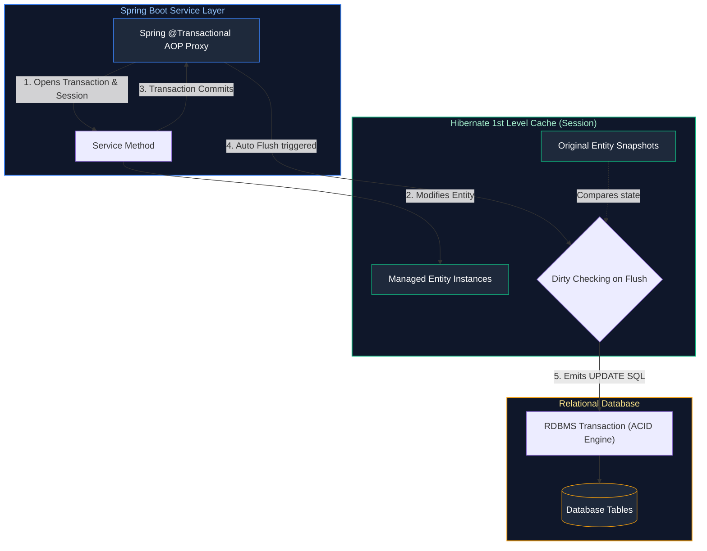
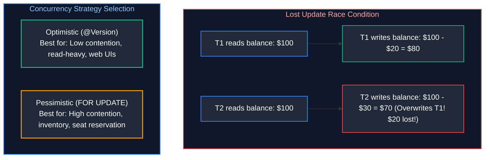
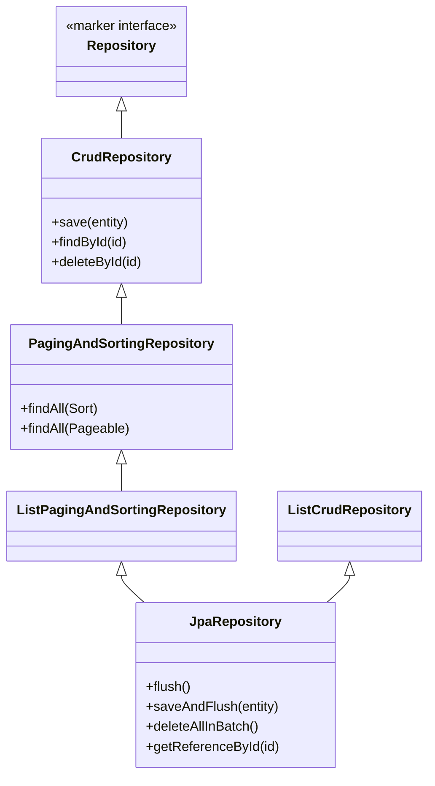
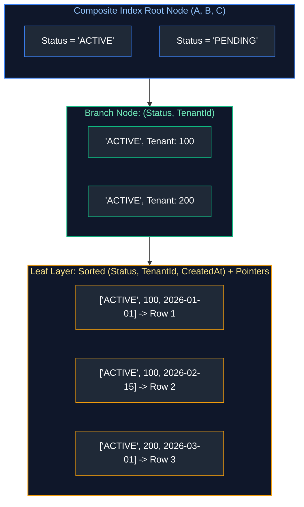
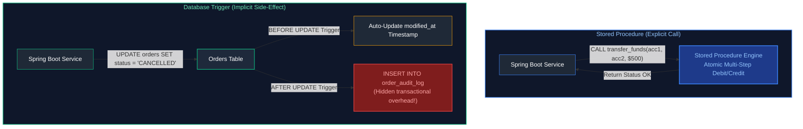
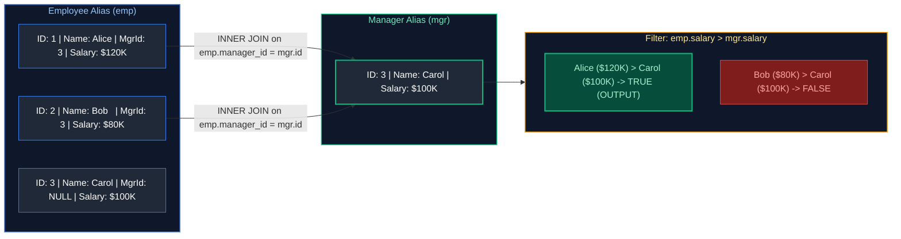

# 07. Databases, SQL, JPA & Hibernate Architecture

A comprehensive guide answering all 22 questions on ACID properties, database isolation levels, SQL joins and optimization, Spring Boot multi-datasource configuration, Hibernate entity lifecycles, lazy loading, N+1 query problem, transaction propagation, and concurrency locking strategies.

---

## Architectural Overview: Hibernate Persistence Context & Transaction Boundary



---

## Table of Contents & Question Mapping

1. **RDBMS Foundations, ACID & SQL Query Engineering**
   - [Q1. ACID Properties & Database Transaction Isolation Levels](#q1-acid-properties--database-transaction-isolation-levels)
   - [Q2. SQL Joins: `INNER`, `LEFT`, `RIGHT`, and `FULL OUTER`](#q2-sql-joins-inner-left-right-and-full-outer)
   - [Q3. Practical SQL Queries: Second-Highest Salary & Department-Wise Averages](#q3-practical-sql-queries-second-highest-salary--department-wise-averages)
   - [Q4. Clustered vs Non-Clustered Indexes & Slow Query Optimization](#q4-clustered-vs-non-clustered-indexes--slow-query-optimization)
   - [Q5. Invoking Stored Procedures via JDBC](#q5-invoking-stored-procedures-via-jdbc)
2. **Spring Boot Datasources & JPA Entity Mapping**
   - [Q6. Connecting Multiple DataSources in Spring Boot](#q6-connecting-multiple-datasources-in-spring-boot)
   - [Q7. JPA Primary Key Annotations: `@Id` & `@GeneratedValue`](#q7-jpa-primary-key-annotations-id--generatedvalue)
   - [Q8. Hibernate Entity Lifecycle States](#q8-hibernate-entity-lifecycle-states)
   - [Q9. Criteria API vs JPQL](#q9-criteria-api-vs-jpql)
3. **ORM Performance: Fetching, N+1 Problem & Caching**
   - [Q10. `LAZY` vs `EAGER`, `LazyInitializationException` & The N+1 Select Problem](#q10-lazy-vs-eager-lazyinitializationexception--the-n1-select-problem)
   - [Q11. Hibernate Caching: 1st Level vs 2nd Level Cache](#q11-hibernate-caching-1st-level-vs-2nd-level-cache)
   - [Q12. Dirty Checking & Flush Modes](#q12-dirty-checking--flush-modes)
   - [Q13. `CascadeType.ALL` vs `orphanRemoval`](#q13-cascadetypeall-vs-orphanremoval)
4. **Transactions, Concurrency & Enterprise Architectures**
   - [Q14. Spring `@Transactional`, Propagation Levels & Pitfalls](#q14-spring-transactional-propagation-levels--pitfalls)
   - [Q15. Optimistic vs Pessimistic Locking & The Train Seat Booking Race Condition](#q15-optimistic-vs-pessimistic-locking--the-train-seat-booking-race-condition)
   - [Q16. Pagination and Sorting in Spring Data JPA](#q16-pagination-and-sorting-in-spring-data-jpa)
   - [Q17. Multi-Tenancy Architecture in JPA](#q17-multi-tenancy-architecture-in-jpa)
   - [Q18. Multi-Instance Cron Worker Row Concurrency: `ShedLock` vs `SELECT FOR UPDATE SKIP LOCKED`](#q18-multi-instance-cron-worker-row-concurrency-shedlock-vs-select-for-update-skip-locked)
   - [Q19. Lost Update Anomaly: Optimistic vs Pessimistic Locking Strategy Selection](#q19-lost-update-anomaly-optimistic-vs-pessimistic-locking-strategy-selection)
   - [Q20. Managing Transaction Rollbacks Across a Series of SQL Statements](#q20-managing-transaction-rollbacks-across-a-series-of-sql-statements)
   - [Q21. `JpaRepository` vs `CrudRepository` vs `PagingAndSortingRepository`](#q21-jparepository-vs-crudrepository-vs-pagingandsortingrepository)
   - [Q22. Deleting Duplicate Rows While Retaining Exactly One Copy in SQL](#q22-deleting-duplicate-rows-while-retaining-exactly-one-copy-in-sql)
   - [Q23. Database Indexing Mechanics & Composite Index Leftmost Prefix Rule](#q23-database-indexing-mechanics--composite-index-leftmost-prefix-rule)
   - [Q24. Stored Procedures vs Database Triggers: Performance & Architecture Trade-offs](#q24-stored-procedures-vs-database-triggers-performance--architecture-trade-offs)
   - [Q25. SQL Self-Join: Finding Employees Earning More Than Their Managers](#q25-sql-self-join-finding-employees-earning-more-than-their-managers)
---

# 1. RDBMS Foundations, ACID & SQL Query Engineering

---

### Q1. ACID Properties & Database Transaction Isolation Levels
**Topic Covered:** Relational Database Engine Foundations  
- **Atomicity:** All-or-nothing execution.
- **Consistency:** Transactions preserve valid database integrity constraints.
- **Isolation:** Prevents concurrent transaction interference.
- **Durability:** Committed changes persist across crashes.

| Isolation Level | Dirty Read | Non-Repeatable Read | Phantom Read |
| :--- | :---: | :---: | :---: |
| **Read Uncommitted** | Yes | Yes | Yes |
| **Read Committed** | No | Yes | Yes |
| **Repeatable Read** | No | No | Yes |
| **Serializable** | No | No | No |

---

### Q2. SQL Joins: `INNER`, `LEFT`, `RIGHT`, and `FULL OUTER`
**Topic Covered:** Relational Set Operations  
- `INNER JOIN`: Matching records present in both tables.
- `LEFT JOIN`: All records from left table plus matching records from right.
- `RIGHT JOIN`: All records from right table plus matching records from left.
- `FULL OUTER JOIN`: All rows from both tables, filling nulls where matches do not exist.

---

### Q3. Practical SQL Queries: Second-Highest Salary & Department-Wise Averages
*(Grouped together: Analytical SQL Queries)*  
**Topic Covered:** SQL Window Functions & Aggregation  

```sql
-- Q3: Second highest salary via DENSE_RANK() (handles ties correctly)
WITH Ranked AS (
    SELECT salary, DENSE_RANK() OVER (ORDER BY salary DESC) as rk FROM employees
)
SELECT salary FROM Ranked WHERE rk = 2 LIMIT 1;

-- Q4: Department-wise average salary
SELECT department_id, COUNT(*) as emp_count, ROUND(AVG(salary), 2) as avg_sal
FROM employees
GROUP BY department_id;
```

---

### Q4. Clustered vs Non-Clustered Indexes & Slow Query Optimization
*(Grouped together: Database Indexing & Performance Tuning)*  
**Topic Covered:** B-Tree Physical Layout & Query Optimization  
- **Clustered Index:** Dictates physical row storage on disk (Primary Key). One per table. Leaf nodes contain the row data.
- **Non-Clustered Index:** Separate B-tree structure holding indexed columns and pointers to the row.
- **Optimization:** Use `EXPLAIN ANALYZE`, build **Covering Indexes**, and avoid leading wildcards in `LIKE` queries.

---

### Q5. Invoking Stored Procedures via JDBC
**Topic Covered:** JDBC Callable Statements  
Use `CallableStatement cs = connection.prepareCall("{call proc_name(?, ?)}")` registering OUT parameters with `Types.*`.

---

# 2. Spring Boot Datasources & JPA Entity Mapping

---

### Q6. Connecting Multiple DataSources in Spring Boot
**Topic Covered:** Spring Boot Multi-Database Configuration  
Create two `@Configuration` classes, mark one `DataSource` `@Primary`, and configure independent `EntityManagerFactory` and `PlatformTransactionManager` beans pointing to distinct package namespaces.

---

### Q7. JPA Primary Key Annotations: `@Id` & `@GeneratedValue`
**Topic Covered:** Entity Identification Strategies  
- `@Id`: Marks primary key.
- `GenerationType.IDENTITY`: Uses DB auto-increment; disables JDBC batch inserts.
- `GenerationType.SEQUENCE`: Uses DB sequences; supports batching (`allocationSize = 50`).

---

### Q8. Hibernate Entity Lifecycle States
**Topic Covered:** Persistence Context Management  
- **Transient:** New instance, unattached to Session.
- **Persistent:** Managed by active `EntityManager`; modifications dirty-checked automatically.
- **Detached:** Previously persistent entity whose Session has closed.
- **Removed:** Marked for deletion on transaction commit.

---

### Q9. Criteria API vs JPQL
**Topic Covered:** JPA Query Paradigms  
- `JPQL`: String-based entity query language. Simple but runtime syntax discovery.
- `Criteria API`: Type-safe programmatic API builder for dynamic queries.

---

# 3. ORM Performance: Fetching, N+1 Problem & Caching

---

### Q10. `LAZY` vs `EAGER`, `LazyInitializationException` & The N+1 Select Problem
*(Grouped together: Complete ORM Performance Tuning)*  
**Topic Covered:** Association Fetching & Query Optimization  
- `LAZY`: Association loaded on demand via proxy.
- `EAGER`: Association loaded immediately.
- `LazyInitializationException`: Caused by accessing a lazy proxy outside an open Hibernate session. Avoid by mapping to DTOs in `@Transactional` service layer.
- **N+1 Problem:** 1 query to fetch parents + $N$ queries to fetch each child. Prevent using `JOIN FETCH` or `@EntityGraph`.

```java
@Query("SELECT DISTINCT a FROM Author a LEFT JOIN FETCH a.books")
List<Author> findAllWithBooks();
```

---

### Q11. Hibernate Caching: 1st Level vs 2nd Level Cache
**Topic Covered:** ORM Caching Layers  
- **1st Level Cache (Session):** Mandatory. Scoped to current transaction.
- **2nd Level Cache (Process/Cluster):** Optional (e.g. Ehcache/Redis). Scoped to `EntityManagerFactory` across transactions.

---

### Q12. Dirty Checking & Flush Modes
**Topic Covered:** Session Synchronization  
Hibernate compares entity snapshots against current state during session flush, auto-emitting SQL `UPDATE` statements. `FlushModeType.AUTO` flushes before queries and at commit.

---

### Q13. `CascadeType.ALL` vs `orphanRemoval`
**Topic Covered:** Entity Relationship Cascading  
- `CascadeType.ALL`: Cascades entity state operations (`PERSIST`, `REMOVE`).
- `orphanRemoval = true`: Deletes child from DB when severed from parent collection.

---

# 4. Transactions, Concurrency & Enterprise Architectures

---

### Q14. Spring `@Transactional`, Propagation Levels & Pitfalls
**Topic Covered:** Declarative Transaction Demarcation  
- Propagation: `REQUIRED` (default), `REQUIRES_NEW`, `SUPPORTS`, `MANDATORY`.
- **Pitfalls:** Self-invocation bypasses AOP proxy. By default, Spring rolls back only on unchecked exceptions; specify `@Transactional(rollbackFor = Exception.class)`.

---

### Q15. Optimistic vs Pessimistic Locking & The Train Seat Booking Race Condition
*(Grouped together: Concurrency Locking and Real-World Scenarios)*  
**Topic Covered:** High-Concurrency Conflict Resolution  
- **Optimistic Locking (`@Version`):** Verifies version column on update. Throws `OptimisticLockException` on concurrent write. Best for low collision workloads.
- **Pessimistic Locking (`PESSIMISTIC_WRITE`):** Issues `SELECT ... FOR UPDATE` row lock.

#### Train Seat Booking Race Condition Solution:
```java
@Lock(LockModeType.PESSIMISTIC_WRITE)
@Query("SELECT s FROM Seat s WHERE s.id = :id")
Optional<Seat> findByIdForUpdate(@Param("id") Long id);
```
Acquires exclusive row lock in DB; competing booking requests wait until the first commits.

---

### Q16. Pagination and Sorting in Spring Data JPA
**Topic Covered:** Large Result Set Management  
Pass `Pageable` (`PageRequest.of(0, 20)`). Prefer `Slice<T>` over `Page<T>` when total count queries are expensive.

---

### Q17. Multi-Tenancy Architecture in JPA
**Topic Covered:** Multi-Tenant Persistence Strategies  
1. Database-Per-Tenant (via `AbstractRoutingDataSource`).
2. Schema-Per-Tenant (via `MultiTenantConnectionProvider`).
3. Shared Schema Discriminator Column (via Hibernate `@TenantId`).

---

### Q18. Multi-Instance Cron Worker Row Concurrency: `ShedLock` vs `SELECT FOR UPDATE SKIP LOCKED`
**Topic Covered:** Distributed Scheduling & Queue Processing  
**Difficulty:** `[Hard]`

#### Architectural Overview
When scaling scheduled jobs across multi-replica Kubernetes clusters, instances collide if both read and update the same pending records:
1. **Singleton Scheduled Jobs**: Use **ShedLock** to acquire a distributed lock in a shared database table (`shedlock`). Exactly one pod executes the cron job while others skip.
2. **High-Throughput Queue Processing**: Use PostgreSQL / MySQL 8+ `SELECT ... FOR UPDATE SKIP LOCKED` inside worker transactions. Each worker thread immediately locks and processes distinct rows without blocking or duplicate execution.

```sql
-- Claims 50 unclaimed jobs without waiting on rows locked by concurrent pods
SELECT id, task_payload 
FROM scheduled_tasks 
WHERE status = 'PENDING' 
ORDER BY priority DESC, created_at ASC 
LIMIT 50 
FOR UPDATE SKIP LOCKED;
```

---

### Q19. Lost Update Anomaly: Optimistic vs Pessimistic Locking Strategy Selection
**Topic Covered:** Concurrency Control & Race Condition Diagnostics  
**Difficulty:** `[Medium]`

#### Architectural Overview
The **Lost Update Anomaly** occurs when Transaction 1 and Transaction 2 read the same row concurrently, and Transaction 2 commits after Transaction 1, completely overwriting Transaction 1's write without knowing about it.



* **Optimistic Locking**: Place `@Version private Long version;` on the JPA entity. Generates `UPDATE ... WHERE id = :id AND version = :version`. Throws `OptimisticLockException` on collision; retry with exponential backoff.
* **Pessimistic Locking**: Use `@Lock(LockModeType.PESSIMISTIC_WRITE)` to place an exclusive database lock (`SELECT FOR UPDATE`).

---

### Q20. Managing Transaction Rollbacks Across a Series of SQL Statements
**Topic Covered:** Transaction Demarcation, Nested Transactions & Savepoints  
**Difficulty:** `[Medium]`

#### Architectural Overview
When executing a sequence of SQL statements, if Step 4 fails out of 5:
- In pure JDBC: Set `connection.setAutoCommit(false)`. On exception in `catch`, invoke `connection.rollback()`. To roll back partially, use **JDBC Savepoints**: `Savepoint sp = connection.setSavepoint(); connection.rollback(sp);`.
- In Spring: By default, Spring rolls back on `RuntimeException` and `Error`, but NOT checked exceptions (`SQLException`, `IOException`). Always configure `@Transactional(rollbackFor = Exception.class)`. To isolate a sub-step without failing the outer transaction, use `@Transactional(propagation = Propagation.REQUIRES_NEW)` or `NESTED` (which uses JDBC savepoints).

---

### Q21. `JpaRepository` vs `CrudRepository` vs `PagingAndSortingRepository`
**Topic Covered:** Spring Data JPA Repository Hierarchy  
**Difficulty:** `[Easy]`

#### Architectural Overview

- **`CrudRepository`**: Basic CRUD operations (`save`, `findById`, `delete`).
- **`PagingAndSortingRepository`**: Adds pagination and sorting methods.
- **`JpaRepository`**: Extends both; adds JPA-specific flush methods (`flush()`, `saveAndFlush()`), batch deletion (`deleteAllInBatch()`), and returns `List` instead of `Iterable`.

---

### Q22. Deleting Duplicate Rows While Retaining Exactly One Copy in SQL
**Topic Covered:** SQL Deduplication Algorithms  
**Difficulty:** `[Medium]`

#### Architectural Overview
Given a table `employees` containing duplicate records for `email`:
```sql
-- Solution using CTE with ROW_NUMBER()
WITH RankedDuplicates AS (
    SELECT id,
           ROW_NUMBER() OVER (
               PARTITION BY email 
               ORDER BY created_at ASC, id ASC
           ) AS row_num
    FROM employees
)
DELETE FROM employees
WHERE id IN (
    SELECT id 
    FROM RankedDuplicates 
    WHERE row_num > 1
);
```
Retains the oldest original entry (`row_num = 1`) and purges all redundant duplicates in a single atomic statement.

---

### Q23. Database Indexing Mechanics & Composite Index Leftmost Prefix Rule
**Topic Covered:** B-Tree Index Internals, Composite Indexes & Covering Queries  
**Question:** Indexing and composite indexes: How does a composite index work under the hood, why does the leftmost prefix rule apply, and when is an index ignored by the query planner?

#### Definition & Core Concepts
Relational database engines (PostgreSQL, MySQL InnoDB, Oracle) structure indexes as self-balancing **B+ Trees**. Leaf nodes contain sorted key values and physical row pointers (`ctid` in Postgres, clustered PK in InnoDB).

A **Composite Index** indexes multiple columns in a strict declared sequence:
```sql
CREATE INDEX idx_user_status_created ON users (status, tenant_id, created_at);
```

**The Leftmost Prefix Rule:**
A composite index on `(A, B, C)` is physically sorted first by $A$, then by $B$ within identical values of $A$, and finally by $C$ within identical values of $(A, B)$.
- **Can Use Index:**
  - Queries filtering on `A` alone.
  - Queries filtering on `A AND B`.
  - Queries filtering on `A AND B AND C`.
- **Cannot Efficiently Use Index:**
  - Queries filtering on `B` alone, `C` alone, or `B AND C` (the B+ tree cannot skip to $B$ because values of $B$ are scattered across different branches of $A$).
- **The Range Predicate Boundary:** If a range filter (`>`, `<`, `BETWEEN`) is applied on column $B$, the database can use the index for $A$ and $B$, but **cannot** use the index for column $C$. Equality predicates must precede range predicates.

**Covering Indexes (`INDEX ... INCLUDE`):**
If an index contains all columns requested in the query `SELECT` clause, the database satisfies the query entirely from the B+ Tree leaf nodes, eliminating expensive **Table Heap Lookups** (Index-Only Scan).

#### Visual Flow


#### Production Implementation / SQL Solution
```sql
-- Optimal composite index matching: equality on high-cardinality tenant_id, equality on status, range on created_at
CREATE INDEX idx_orders_composite ON orders (tenant_id, status, created_at)
INCLUDE (total_amount, customer_id);

-- Query benefiting from full Index-Only Scan (Zero Table Heap Lookups)
EXPLAIN ANALYZE
SELECT customer_id, total_amount
FROM orders
WHERE tenant_id = 'tenant_east_01'
  AND status = 'SHIPPED'
  AND created_at >= '2026-01-01 00:00:00'
ORDER BY created_at DESC;
```
- **Time Complexity:** $O(\log N + K)$ B+ Tree binary search to leaf + range scan of $K$ matching rows.
- **Space Complexity:** $O(M)$ extra disk storage consumed by the index file.

#### Engineering Implications & Production Pitfalls
1. **Low Cardinality Index Ignored:** If a column has only 2 values (e.g. `gender` or `is_deleted = false` where 95% of rows are `false`), the query planner will ignore the index and perform a sequential table scan because random disk I/O through index leaf pointers is slower than sequential reads.
2. **Implicit Type Casting Pitfall:** If `tenant_id` is `VARCHAR` but the query passes an integer (`WHERE tenant_id = 100`), the database wraps the column with `CAST(tenant_id AS integer)`, completely invalidating the B-Tree index!

---

### Q24. Stored Procedures vs Database Triggers: Performance & Architecture Trade-offs
**Topic Covered:** Server-Side RDBMS Logic vs Domain Layer Orchestration  
**Question:** Stored procedures vs. triggers: What are the architectural differences, performance characteristics, maintainability challenges, and when should business logic reside in the database versus the application service layer?

#### Definition & Core Concepts
- **Stored Procedures:** Named blocks of procedural SQL code compiled and stored on the database server. Explicitly called by application code (`CALL process_monthly_payroll()`).
- **Database Triggers:** Implicit procedural routines tied to a table that execute automatically in response to DML operations (`BEFORE/AFTER INSERT`, `UPDATE`, `DELETE`).

#### Architectural Comparison Matrix:
| Architectural Dimension | Stored Procedures | Database Triggers | Application Service Layer |
| :--- | :--- | :--- | :--- |
| **Invocation** | Explicitly invoked by code | Implicitly executed by DML events | Orchestrated via Java / Spring |
| **Network Roundtrips** | Minimal (executes multi-step logic inside DB) | Zero application roundtrips | Multiple network hops per query |
| **Maintainability** | Difficult; procedural SQL differs across vendors | Extremely difficult; invisible side-effects | High; clean OOP, Git branching, CI/CD |
| **Compute Scalability** | Low; scaling database CPUs is very expensive | Low; triggers block writer transactions | High; scale stateless Spring Boot Pods horizontally |
| **Observability** | Opaque; hard to trace with OpenTelemetry | Invisible; triggers cause unexpected latency | Full OpenTelemetry APM & distributed tracing |

#### Visual Flow


#### Production Implementation / SQL Example
```sql
-- Production Trigger Pattern: Enforcing Immutable Audit History
CREATE TABLE account_audit_log (
    audit_id BIGSERIAL PRIMARY KEY,
    account_id BIGINT NOT NULL,
    old_balance NUMERIC(15, 2),
    new_balance NUMERIC(15, 2),
    changed_by VARCHAR(50),
    changed_at TIMESTAMP DEFAULT CURRENT_TIMESTAMP
);

CREATE OR REPLACE FUNCTION audit_account_balance_change()
RETURNS TRIGGER AS $$
BEGIN
    IF NEW.balance <> OLD.balance THEN
        INSERT INTO account_audit_log (account_id, old_balance, new_balance, changed_by, changed_at)
        VALUES (OLD.id, OLD.balance, NEW.balance, CURRENT_USER, CURRENT_TIMESTAMP);
    END IF;
    RETURN NEW;
END;
$$ LANGUAGE plpgsql;

CREATE TRIGGER trg_account_balance_audit
AFTER UPDATE ON accounts
FOR EACH ROW
EXECUTE FUNCTION audit_account_balance_change();
```

#### Engineering Implications & Production Pitfalls
1. **The Cascading Trigger Deadlock:** Trigger A updates Table 2, which fires Trigger B updating Table 1. Under concurrent transactions, this creates circular locks and immediate deadlocks. Avoid triggers for complex business domain logic.
2. **Production Recommendation:** Use stored procedures solely for bulk database-internal maintenance (e.g. monthly partition pruning). Keep all core business rules in the Java application layer where they can be unit-tested, versioned, and horizontally scaled.

---

### Q25. SQL Self-Join: Finding Employees Earning More Than Their Managers
**Topic Covered:** Relational Self-Joins, Hierarchical Data & Hash Joins  
**Question:** Write a query to find employees earning more than their managers. Explain the join mechanics, NULL handling for the CEO, and optimization strategies.

#### Definition & Core Concepts
In hierarchical relational schemas (e.g., employee reporting trees, bill-of-materials, category hierarchies), parent-child relationships reside within a single table:
- `id`: Employee's Primary Key.
- `manager_id`: Self-referential Foreign Key pointing to `id` in the same table.
- `salary`: Numerical compensation value.

To compare attributes between an employee and their immediate superior, perform a **Self-Join** by aliasing the table twice: once as the employee (`emp`) and once as the manager (`mgr`).

**CEO / Top-Level Executive Edge Case:**
The CEO or root entity has `manager_id IS NULL`. An `INNER JOIN` automatically excludes the CEO from the left table (since `NULL = id` evaluates to `UNKNOWN`), which is correct because a CEO has no manager to compare against.

#### Visual Flow


#### Production Implementation / SQL Solution
```sql
-- Production SQL Query: Self-Join with Salary Comparison
SELECT emp.id AS employee_id,
       emp.name AS employee_name,
       emp.salary AS employee_salary,
       mgr.name AS manager_name,
       mgr.salary AS manager_salary
FROM employees emp
INNER JOIN employees mgr 
        ON emp.manager_id = mgr.id
WHERE emp.salary > mgr.salary;

-- Indexing Strategy to guarantee O(N) Hash Join or Index Nested Loop:
-- 1. Primary key index on id (already exists by default)
-- 2. Covering composite index on (manager_id, salary) INCLUDE (name):
CREATE INDEX idx_emp_mgr_salary ON employees (manager_id, salary) INCLUDE (name);
```
- **Time Complexity:** $O(N)$ using hash join or index nested loop lookup where $N$ is total employee records.
- **Space Complexity:** $O(M)$ memory hash table built on the manager dataset during query execution.

#### Engineering Implications & Production Pitfalls
1. **Missing Index on Foreign Key:** Relational databases do not automatically index foreign keys. If `manager_id` lacks an index, the database is forced to execute an $O(N^2)$ nested loop scan, causing catastrophic latency on large tables.
2. **Recursive Traversal Nuance:** A self-join only compares an employee with their *immediate* manager (1 level). If the interviewer asks to find employees earning more than *any* manager above them in the chain of command, a **Recursive Common Table Expression (CTE)** is required.

#### Core Curriculum Cross-Reference
*Deep-dive theoretical reference: See [09. Relational Databases & SQL: Query Design](../07_databases_jpa_and_hibernate.md#4-indexing-mechanics--query-execution-plan-tuning)*

---

## Summary Comparison & Production Reference Matrix

| Scenario Domain | Critical Runtime Pathology | Diagnostic & Triage Method | Canonical Production Resolution |
| :--- | :--- | :--- | :--- |
| **RDBMS Foundations, ACID & SQL Query Engineering** | High-throughput invariants & concurrency boundaries | Metric instrumentation & trace profiling | Defensive validation & graceful degradation |
| **Spring Boot Datasources & JPA Entity Mapping** | High-throughput invariants & concurrency boundaries | Metric instrumentation & trace profiling | Defensive validation & graceful degradation |
| **ORM Performance: Fetching, N+1 Problem & Caching** | High-throughput invariants & concurrency boundaries | Metric instrumentation & trace profiling | Defensive validation & graceful degradation |
| **Transactions, Concurrency & Enterprise Architectures** | High-throughput invariants & concurrency boundaries | Metric instrumentation & trace profiling | Defensive validation & graceful degradation |

---

## References & Further Reading

---
- [PostgreSQL Official Documentation (Internals & Indexing)](https://www.postgresql.org/docs/current/internals.html)
- [MySQL 8.0 Reference Manual - The InnoDB Storage Engine](https://dev.mysql.com/doc/refman/8.0/en/innodb-storage-engine.html)
- [Markus Winand - Use The Index, Luke! (A Guide to Database Performance)](https://use-the-index-luke.com/)
- [Martin Kleppmann - Designing Data-Intensive Applications (O'Reilly)](https://dataintensive.net/)
- [Brett Wooldridge - HikariCP Connection Pool Sizing](https://github.com/brettwooldridge/HikariCP/wiki/About-Pool-Sizing)
