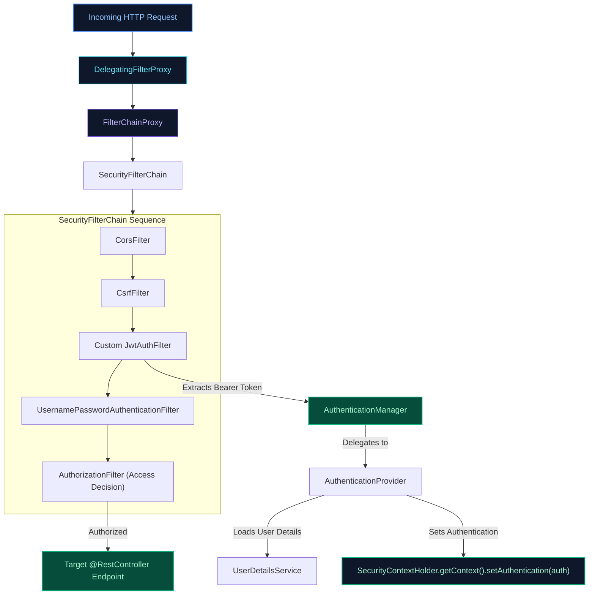

# 07. Spring Security, OAuth2 & JWT Architecture

A comprehensive guide answering all 20 questions on authentication vs authorization, Spring Security internal architecture, the Security Filter Chain, `AuthenticationManager`, password hashing, CSRF protection, JSON Web Tokens (JWT), token revocation, and OAuth2 authorization flows.

---

## Architectural Overview: Spring Security Internal Request Flow

---

## Table of Contents & Question Mapping

1. **Authentication vs Authorization & Core Architecture**
   - [Q1. Authentication vs Authorization](#q1-authentication-vs-authorization)
   - [Q2, Q3, Q4 & Q5. Spring Security Internal Architecture, Filter Chain & `AuthenticationManager`](#q2-q3-q4--q5-spring-security-internal-architecture-filter-chain--authenticationmanager)
2. **User Details, Providers & Password Security**
   - [Q6 & Q7. `UserDetailsService` & Custom `AuthenticationProvider`](#q6--q7-userdetailsservice--custom-authenticationprovider)
   - [Q8. `BCryptPasswordEncoder` vs Plain Text Passwords](#q8-bcryptpasswordencoder-vs-plain-text-passwords)
3. **Method Security & Web Protections**
   - [Q9 & Q10. Method-Level Security: `@PreAuthorize` vs `@Secured` vs `@RolesAllowed`](#q9--q10-method-level-security-preauthorize-vs-secured-vs-rolesallowed)
   - [Q11. Spring Security CSRF Protection Mechanics](#q11-spring-security-csrf-protection-mechanics)
   - [Q12. Remember-Me Authentication Architecture](#q12-remember-me-authentication-architecture)
4. **JSON Web Tokens (JWT) Deep Dive**
   - [Q13. Why Use JWT Tokens Instead of Stateful Sessions?](#q13-why-use-jwt-tokens-instead-of-stateful-sessions)
   - [Q14. Structure of a JWT Token & Cryptographic Validation](#q14-structure-of-a-jwt-token--cryptographic-validation)
   - [Q15. Client-Side JWT Storage & Early Token Revocation](#q15-client-side-jwt-storage--early-token-revocation)
   - [Q16. Expired Tokens, Refresh Token Rotation & Concurrency](#q16-expired-tokens-refresh-token-rotation--concurrency)
   - [Q17. JWT Security Risks & Mitigations](#q17-jwt-security-risks--mitigations)
5. **OAuth2 & Modern Federated Identity**
   - [Q18. OAuth2 vs Basic Authentication](#q18-oauth2-vs-basic-authentication)
   - [Q19. OAuth2 Authorization Code Flow with PKCE](#q19-oauth2-authorization-code-flow-with-pkce)
   - [Q20. OAuth2 Client Credentials Grant for Microservices](#q20-oauth2-client-credentials-grant-for-microservices)

---

# 1. Authentication vs Authorization & Core Architecture

---

### Q1. Authentication vs Authorization
**Topic Covered:** Identity & Access Fundamentals  
- **Authentication (AuthN):** *"Who are you?"* Validates identity using credentials. Returns `401 Unauthorized` if invalid.
- **Authorization (AuthZ):** *"What are you permitted to do?"* Validates roles/permissions after identity is established. Returns `403 Forbidden` if denied.

---

### Q2, Q3, Q4 & Q5. Spring Security Internal Architecture, Filter Chain & `AuthenticationManager`
*(Grouped together: Core Security Architecture)*  
**Topic Covered:** Spring Security Engine & Filter Pipeline  
1. `DelegatingFilterProxy`: Bridges servlet container to Spring-managed `FilterChainProxy`.
2. `FilterChainProxy`: Passes requests through the configured `SecurityFilterChain`.
3. Filter Sequence: `CorsFilter` $\to$ `CsrfFilter` $\to$ Custom `JwtAuthFilter` $\to$ `UsernamePasswordAuthenticationFilter` $\to$ `AuthorizationFilter`.
4. `AuthenticationManager` (`ProviderManager`): Delegates unauthenticated tokens across registered `AuthenticationProvider`s until one returns an authenticated token stored in `SecurityContextHolder`.

---

# 2. User Details, Providers & Password Security

---

### Q6 & Q7. `UserDetailsService` & Custom `AuthenticationProvider`
*(Grouped together: Credential Providers)*  
**Topic Covered:** Custom Identity Resolution  
- `UserDetailsService`: Database lookup contract (`UserDetails loadUserByUsername(String username)`).
- Custom `AuthenticationProvider`: Used when authentication involves external enterprise systems (LDAP, Active Directory, hardware MFA tokens).

---

### Q8. `BCryptPasswordEncoder` vs Plain Text Passwords
**Topic Covered:** Cryptographic Password Storage  
1. **Configurable Work Factor (Cost Parameter):** Slows computation deliberately to thwart GPU brute-force attacks.
2. **Built-in Salt:** Automatically includes a random 128-bit salt in the generated hash to defeat rainbow tables.
3. **Constant-time comparison:** Protects against side-channel timing attacks.

---

# 3. Method Security & Web Protections

---

### Q9 & Q10. Method-Level Security: `@PreAuthorize` vs `@Secured` vs `@RolesAllowed`
*(Grouped together: Method Authorization & Parameter Security)*  
**Topic Covered:** Method Interception & Spring Expression Language (SpEL)  
- `@PreAuthorize` (Recommended): Supports rich SpEL expressions (`@PreAuthorize("hasRole('ADMIN') or #id == authentication.principal.id")`).
- `@Secured` & `@RolesAllowed`: Legacy role string arrays without SpEL support.
- `@PostAuthorize`: Evaluates return value permissions before returning.

---

### Q11. Spring Security CSRF Protection Mechanics
**Topic Covered:** Cross-Site Request Forgery Defense  
Requires state-changing HTTP requests (`POST`, `PUT`, `DELETE`) to submit a unique server-generated CSRF token in an `X-XSRF-TOKEN` header. Disabled in stateless REST APIs authenticated exclusively via Bearer tokens in headers.

---

### Q12. Remember-Me Authentication Architecture
**Topic Covered:** Persistent Login Mechanics  
Uses a persistent token repository database table storing series and token hashes. Each automatic login regenerates the token to thwart cookie theft replay attacks.

---

# 4. JSON Web Tokens (JWT) Deep Dive

---

### Q13. Why Use JWT Tokens Instead of Stateful Sessions?
**Topic Covered:** Stateless Authentication Architecture  
Stateful sessions require server RAM or centralized Redis lookups. JWT tokens are self-contained, stateless, and cryptographically signed, allowing any microservice to validate tokens independently without database roundtrips.

---

### Q14. Structure of a JWT Token & Cryptographic Validation
**Topic Covered:** RFC 7519 Standards & Cryptography  
A JWT consists of three Base64URL-encoded parts separated by dots:
1. **Header:** Algorithm & token type (`{"alg": "RS256", "typ": "JWT"}`).
2. **Payload:** Claims (`sub`, `roles`, `exp`, `iss`).
3. **Signature:** Cryptographic signature computed over Header and Payload using an asymmetric private key or secret key.

---

### Q15. Client-Side JWT Storage & Early Token Revocation
**Topic Covered:** Token Security & State Management  
- **Storage:** Access token in memory; Refresh token in an **`HttpOnly`, `Secure`, `SameSite=Strict` Cookie** to prevent XSS.
- **Early Revocation:** Store revoked token IDs (`jti`) in Redis with a TTL equal to the token's remaining validity. The auth filter rejects blacklisted tokens.

---

### Q16. Expired Tokens, Refresh Token Rotation & Concurrency
**Topic Covered:** Token Refresh Workflows  
When the short-lived access token expires (e.g. 15 mins), the client calls `/auth/refresh` presenting the refresh token. The auth server invalidates the old refresh token and issues a new access token and rotated refresh token simultaneously.

---

### Q17. JWT Security Risks & Mitigations
**Topic Covered:** Vulnerability Defense  
1. **`alg: none` attack:** Whitelist allowed algorithms (e.g. `RS256`) explicitly in parser.
2. **Sensitive payload data:** Base64 is not encryption; never store secrets or PII in payload claims.
3. **Weak secret keys:** Use 2048-bit RSA keys or 256-bit+ random HMAC keys.

---

# 5. OAuth2 & Modern Federated Identity

---

### Q18. OAuth2 vs Basic Authentication
**Topic Covered:** Modern Authorization Frameworks  
Basic Auth sends static credentials on every request. OAuth2 is a delegated authorization framework where users authenticate via identity providers (Keycloak, Okta) and issue short-lived scoped access tokens to client applications.

---

### Q19. OAuth2 Authorization Code Flow with PKCE
**Topic Covered:** RFC 7636 Authorization Protocol  
Proof Key for Code Exchange (PKCE) protects single-page and mobile apps by creating a dynamic `code_verifier` and hashed `code_challenge`, preventing authorization code interception attacks.

---

### Q20. OAuth2 Client Credentials Grant for Microservices
**Topic Covered:** Machine-to-Machine (M2M) Security  
Used for backend service-to-service communication without an end-user. The calling microservice passes its own `client_id` and `client_secret` to obtain a scoped access token.
