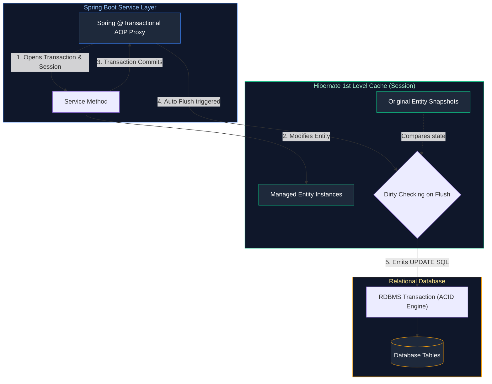

# 08. Databases, SQL, JPA & Hibernate Architecture

A comprehensive guide answering all 22 questions on ACID properties, database isolation levels, SQL joins and optimization, Spring Boot multi-datasource configuration, Hibernate entity lifecycles, lazy loading, N+1 query problem, transaction propagation, and concurrency locking strategies.

---

## Architectural Overview: Hibernate Persistence Context & Transaction Boundary



---

## Table of Contents & Question Mapping

1. **RDBMS Foundations, ACID & SQL Query Engineering**
   - [Q1. ACID Properties & Database Transaction Isolation Levels](#q1-acid-properties--database-transaction-isolation-levels)
   - [Q2. SQL Joins: `INNER`, `LEFT`, `RIGHT`, and `FULL OUTER`](#q2-sql-joins-inner-left-right-and-full-outer)
   - [Q3 & Q4. Practical SQL Queries: Second-Highest Salary & Department-Wise Averages](#q3--q4-practical-sql-queries-second-highest-salary--department-wise-averages)
   - [Q5 & Q6. Clustered vs Non-Clustered Indexes & Slow Query Optimization](#q5--q6-clustered-vs-non-clustered-indexes--slow-query-optimization)
   - [Q7. Invoking Stored Procedures via JDBC](#q7-invoking-stored-procedures-via-jdbc)
2. **Spring Boot Datasources & JPA Entity Mapping**
   - [Q8. Connecting Multiple DataSources in Spring Boot](#q8-connecting-multiple-datasources-in-spring-boot)
   - [Q9. JPA Primary Key Annotations: `@Id` & `@GeneratedValue`](#q9-jpa-primary-key-annotations-id--generatedvalue)
   - [Q10. Hibernate Entity Lifecycle States](#q10-hibernate-entity-lifecycle-states)
   - [Q11. Criteria API vs JPQL](#q11-criteria-api-vs-jpql)
3. **ORM Performance: Fetching, N+1 Problem & Caching**
   - [Q12, Q13 & Q14. `LAZY` vs `EAGER`, `LazyInitializationException` & The N+1 Select Problem](#q12-q13--q14-lazy-vs-eager-lazyinitializationexception--the-n1-select-problem)
   - [Q15. Hibernate Caching: 1st Level vs 2nd Level Cache](#q15-hibernate-caching-1st-level-vs-2nd-level-cache)
   - [Q16. Dirty Checking & Flush Modes](#q16-dirty-checking--flush-modes)
   - [Q17. `CascadeType.ALL` vs `orphanRemoval`](#q17-cascadetypeall-vs-orphanremoval)
4. **Transactions, Concurrency & Enterprise Architectures**
   - [Q18. Spring `@Transactional`, Propagation Levels & Pitfalls](#q18-spring-transactional-propagation-levels--pitfalls)
   - [Q19 & Q20. Optimistic vs Pessimistic Locking & The Train Seat Booking Race Condition](#q19--q20-optimistic-vs-pessimistic-locking--the-train-seat-booking-race-condition)
   - [Q21. Pagination and Sorting in Spring Data JPA](#q21-pagination-and-sorting-in-spring-data-jpa)
   - [Q22. Multi-Tenancy Architecture in JPA](#q22-multi-tenancy-architecture-in-jpa)

---

# 1. RDBMS Foundations, ACID & SQL Query Engineering

---

### Q1. ACID Properties & Database Transaction Isolation Levels
**Topic Covered:** Relational Database Engine Foundations  
- **Atomicity:** All-or-nothing execution.
- **Consistency:** Transactions preserve valid database integrity constraints.
- **Isolation:** Prevents concurrent transaction interference.
- **Durability:** Committed changes persist across crashes.

| Isolation Level | Dirty Read | Non-Repeatable Read | Phantom Read |
| :--- | :---: | :---: | :---: |
| **Read Uncommitted** | Yes | Yes | Yes |
| **Read Committed** | No | Yes | Yes |
| **Repeatable Read** | No | No | Yes |
| **Serializable** | No | No | No |

---

### Q2. SQL Joins: `INNER`, `LEFT`, `RIGHT`, and `FULL OUTER`
**Topic Covered:** Relational Set Operations  
- `INNER JOIN`: Matching records present in both tables.
- `LEFT JOIN`: All records from left table plus matching records from right.
- `RIGHT JOIN`: All records from right table plus matching records from left.
- `FULL OUTER JOIN`: All rows from both tables, filling nulls where matches do not exist.

---

### Q3 & Q4. Practical SQL Queries: Second-Highest Salary & Department-Wise Averages
*(Grouped together: Analytical SQL Queries)*  
**Topic Covered:** SQL Window Functions & Aggregation  

```sql
-- Q3: Second highest salary via DENSE_RANK() (handles ties correctly)
WITH Ranked AS (
    SELECT salary, DENSE_RANK() OVER (ORDER BY salary DESC) as rk FROM employees
)
SELECT salary FROM Ranked WHERE rk = 2 LIMIT 1;

-- Q4: Department-wise average salary
SELECT department_id, COUNT(*) as emp_count, ROUND(AVG(salary), 2) as avg_sal
FROM employees
GROUP BY department_id;
```

---

### Q5 & Q6. Clustered vs Non-Clustered Indexes & Slow Query Optimization
*(Grouped together: Database Indexing & Performance Tuning)*  
**Topic Covered:** B-Tree Physical Layout & Query Optimization  
- **Clustered Index:** Dictates physical row storage on disk (Primary Key). One per table. Leaf nodes contain the row data.
- **Non-Clustered Index:** Separate B-tree structure holding indexed columns and pointers to the row.
- **Optimization:** Use `EXPLAIN ANALYZE`, build **Covering Indexes**, and avoid leading wildcards in `LIKE` queries.

---

### Q7. Invoking Stored Procedures via JDBC
**Topic Covered:** JDBC Callable Statements  
Use `CallableStatement cs = connection.prepareCall("{call proc_name(?, ?)}")` registering OUT parameters with `Types.*`.

---

# 2. Spring Boot Datasources & JPA Entity Mapping

---

### Q8. Connecting Multiple DataSources in Spring Boot
**Topic Covered:** Spring Boot Multi-Database Configuration  
Create two `@Configuration` classes, mark one `DataSource` `@Primary`, and configure independent `EntityManagerFactory` and `PlatformTransactionManager` beans pointing to distinct package namespaces.

---

### Q9. JPA Primary Key Annotations: `@Id` & `@GeneratedValue`
**Topic Covered:** Entity Identification Strategies  
- `@Id`: Marks primary key.
- `GenerationType.IDENTITY`: Uses DB auto-increment; disables JDBC batch inserts.
- `GenerationType.SEQUENCE`: Uses DB sequences; supports batching (`allocationSize = 50`).

---

### Q10. Hibernate Entity Lifecycle States
**Topic Covered:** Persistence Context Management  
- **Transient:** New instance, unattached to Session.
- **Persistent:** Managed by active `EntityManager`; modifications dirty-checked automatically.
- **Detached:** Previously persistent entity whose Session has closed.
- **Removed:** Marked for deletion on transaction commit.

---

### Q11. Criteria API vs JPQL
**Topic Covered:** JPA Query Paradigms  
- `JPQL`: String-based entity query language. Simple but runtime syntax discovery.
- `Criteria API`: Type-safe programmatic API builder for dynamic queries.

---

# 3. ORM Performance: Fetching, N+1 Problem & Caching

---

### Q12, Q13 & Q14. `LAZY` vs `EAGER`, `LazyInitializationException` & The N+1 Select Problem
*(Grouped together: Complete ORM Performance Tuning)*  
**Topic Covered:** Association Fetching & Query Optimization  
- `LAZY`: Association loaded on demand via proxy.
- `EAGER`: Association loaded immediately.
- `LazyInitializationException`: Caused by accessing a lazy proxy outside an open Hibernate session. Avoid by mapping to DTOs in `@Transactional` service layer.
- **N+1 Problem:** 1 query to fetch parents + $N$ queries to fetch each child. Prevent using `JOIN FETCH` or `@EntityGraph`.

```java
@Query("SELECT DISTINCT a FROM Author a LEFT JOIN FETCH a.books")
List<Author> findAllWithBooks();
```

---

### Q15. Hibernate Caching: 1st Level vs 2nd Level Cache
**Topic Covered:** ORM Caching Layers  
- **1st Level Cache (Session):** Mandatory. Scoped to current transaction.
- **2nd Level Cache (Process/Cluster):** Optional (e.g. Ehcache/Redis). Scoped to `EntityManagerFactory` across transactions.

---

### Q16. Dirty Checking & Flush Modes
**Topic Covered:** Session Synchronization  
Hibernate compares entity snapshots against current state during session flush, auto-emitting SQL `UPDATE` statements. `FlushModeType.AUTO` flushes before queries and at commit.

---

### Q17. `CascadeType.ALL` vs `orphanRemoval`
**Topic Covered:** Entity Relationship Cascading  
- `CascadeType.ALL`: Cascades entity state operations (`PERSIST`, `REMOVE`).
- `orphanRemoval = true`: Deletes child from DB when severed from parent collection.

---

# 4. Transactions, Concurrency & Enterprise Architectures

---

### Q18. Spring `@Transactional`, Propagation Levels & Pitfalls
**Topic Covered:** Declarative Transaction Demarcation  
- Propagation: `REQUIRED` (default), `REQUIRES_NEW`, `SUPPORTS`, `MANDATORY`.
- **Pitfalls:** Self-invocation bypasses AOP proxy. By default, Spring rolls back only on unchecked exceptions; specify `@Transactional(rollbackFor = Exception.class)`.

---

### Q19 & Q20. Optimistic vs Pessimistic Locking & The Train Seat Booking Race Condition
*(Grouped together: Concurrency Locking and Real-World Scenarios)*  
**Topic Covered:** High-Concurrency Conflict Resolution  
- **Optimistic Locking (`@Version`):** Verifies version column on update. Throws `OptimisticLockException` on concurrent write. Best for low collision workloads.
- **Pessimistic Locking (`PESSIMISTIC_WRITE`):** Issues `SELECT ... FOR UPDATE` row lock.

#### Train Seat Booking Race Condition Solution:
```java
@Lock(LockModeType.PESSIMISTIC_WRITE)
@Query("SELECT s FROM Seat s WHERE s.id = :id")
Optional<Seat> findByIdForUpdate(@Param("id") Long id);
```
Acquires exclusive row lock in DB; competing booking requests wait until the first commits.

---

### Q21. Pagination and Sorting in Spring Data JPA
**Topic Covered:** Large Result Set Management  
Pass `Pageable` (`PageRequest.of(0, 20)`). Prefer `Slice<T>` over `Page<T>` when total count queries are expensive.

---

### Q22. Multi-Tenancy Architecture in JPA
**Topic Covered:** Multi-Tenant Persistence Strategies  
1. Database-Per-Tenant (via `AbstractRoutingDataSource`).
2. Schema-Per-Tenant (via `MultiTenantConnectionProvider`).
3. Shared Schema Discriminator Column (via Hibernate `@TenantId`).
