# 09. Messaging Systems: Kafka & RabbitMQ Architecture

A comprehensive guide answering all 8 questions on message broker concepts, RabbitMQ AMQP exchanges, Apache Kafka partitioned commit logs, consumer groups, Spring Boot integration, Dead Letter Queues (DLQ), and resilience against slow consumers.

---

## Architectural Overview: RabbitMQ vs Apache Kafka

```mermaid
flowchart TD
    subgraph RabbitMQArch["RabbitMQ: AMQP Broker & Ephemeral Queue"]
        P1["Producer"] --> EX["Exchange (Direct/Topic/Fanout)"]
        EX -->|"Routing Key"| Q1["Queue 1"]
        Q1 -->|"Pushes message"| C1["Consumer"]
    end

    subgraph KafkaArch["Apache Kafka: Distributed Commit Log"]
        P2["Producer"] --> TP["Topic: orders"]
        TP --> Part0["Partition 0 [0|1|2|3|4]"]
        TP --> Part1["Partition 1 [0|1|2|3]"]
        Part0 -->|"Pulls offset"| CG1["Consumer Group Worker 1"]
        Part1 -->|"Pulls offset"| CG2["Consumer Group Worker 2"]
    end

    style RabbitMQArch fill:#0f172a,stroke:#3b82f6,stroke-width:1.5px,color:#93c5fd
    style KafkaArch fill:#0f172a,stroke:#10b981,stroke-width:1.5px,color:#a7f3d0
    style EX fill:#1e293b,stroke:#3b82f6,stroke-width:1px,color:#fff
    style Q1 fill:#1f2937,stroke:#06b6d4,stroke-width:1px,color:#fff
    style Part0 fill:#1f2937,stroke:#10b981,stroke-width:1px,color:#fff
    style Part1 fill:#1f2937,stroke:#10b981,stroke-width:1px,color:#fff
```



---

## Table of Contents & Question Mapping

1. **Broker Fundamentals & RabbitMQ AMQP Architecture**
   - [Q1. Message Broker Services in Enterprise Java Architecture](#q1-message-broker-services-in-enterprise-java-architecture)
   - [Q2. What is an Exchange in AMQP / RabbitMQ?](#q2-what-is-an-exchange-in-amqp--rabbitmq)
2. **Kafka vs RabbitMQ Architectural Selection**
   - [Q3. Kafka vs RabbitMQ: Core Differences & Selection Criteria](#q3-kafka-vs-rabbitmq-core-differences--selection-criteria)
3. **Apache Kafka Core Internals**
   - [Q4 & Q5. Kafka Architecture: Brokers, Partitions, Consumer Groups & Scalability](#q4--q5-kafka-architecture-brokers-partitions-consumer-groups--scalability)
4. **Spring Boot Integration & Production Resilience**
   - [Q6. Integrating Apache Kafka with Spring Boot](#q6-integrating-apache-kafka-with-spring-boot)
   - [Q7 & Q8. Dead Letter Queues (DLQ), Retry Policies & Mitigating Slow Consumers](#q7--q8-dead-letter-queues-dlq-retry-policies--mitigating-slow-consumers)

---

# 1. Broker Fundamentals & RabbitMQ AMQP Architecture

---

### Q1. Message Broker Services in Enterprise Java Architecture
**Topic Covered:** Event-Driven Architecture & Asynchronous Decoupling  
An intermediary system enabling asynchronous communication between independent systems. Provides temporal decoupling, traffic peak shaving/buffering, and failure isolation.

---

### Q2. What is an Exchange in AMQP / RabbitMQ?
**Topic Covered:** RabbitMQ Routing Mechanics  
Producers publish messages to an Exchange, which routes messages to queues according to binding keys:
- **Direct Exchange:** Matches exact routing key.
- **Fanout Exchange:** Broadcasts to all bound queues.
- **Topic Exchange:** Matches routing keys using wildcards (`*` for one word, `#` for multiple words).
- **Headers Exchange:** Routes based on message header attributes.

---

# 2. Kafka vs RabbitMQ Architectural Selection

---

### Q3. Kafka vs RabbitMQ: Core Differences & Selection Criteria
**Topic Covered:** Messaging Platform Comparison  

| Dimension | RabbitMQ | Apache Kafka |
| :--- | :--- | :--- |
| **Model** | Smart Broker, Dumb Consumer. | Dumb Broker, Smart Consumer (immutable append log). |
| **Delivery** | Push-based. | **Pull-based** batch polling. |
| **Retention** | Ephemeral (deleted upon ACK). | Durable on disk; supports offset rewinds and replay. |
| **Throughput** | Moderate (~50k msg/sec). | **Millions msg/sec** via zero-copy OS transfers (`sendfile`). |
| **Ordering** | Per single queue. | Guaranteed **strictly within a partition**. |
| **Best Used For** | Complex message routing, RPC task queues. | Event sourcing, high-throughput streaming, log aggregation. |

---

# 3. Apache Kafka Core Internals

---

### Q4 & Q5. Kafka Architecture: Brokers, Partitions, Consumer Groups & Scalability
*(Grouped together: Kafka Distributed Architecture)*  
**Topic Covered:** Log Partitioning & Scalable Parallelism  
- **Partition:** Fundamental unit of parallelism. An ordered, immutable commit log.
- **Partition Key:** Hashed by producer (`MurmurHash2(key) % numPartitions`) to guarantee that all events for a given entity land in the same partition in strict chronological order.
- **Consumer Group:** A logical pool of consumer instances. Each partition is consumed by **exactly one consumer instance** within the group at any given time. Scaling consumers beyond partition count results in idle worker instances.

---

# 4. Spring Boot Integration & Production Resilience

---

### Q6. Integrating Apache Kafka with Spring Boot
**Topic Covered:** Spring for Apache Kafka  

```java
// Producer
@Service
public class OrderProducer {
    private final KafkaTemplate<String, OrderEvent> kafkaTemplate;
    public OrderProducer(KafkaTemplate<String, OrderEvent> kafkaTemplate) {
        this.kafkaTemplate = kafkaTemplate;
    }
    public void sendOrder(OrderEvent event) {
        kafkaTemplate.send("orders", event.orderId(), event);
    }
}

// Consumer
@Component
public class OrderConsumer {
    @KafkaListener(topics = "orders", groupId = "order-group")
    public void consume(OrderEvent event, Acknowledgment ack) {
        // Business logic...
        ack.acknowledge();
    }
}
```

---

### Q7 & Q8. Dead Letter Queues (DLQ), Retry Policies & Mitigating Slow Consumers
*(Grouped together: Error Handling and Backpressure)*  
**Topic Covered:** Message Failure Strategies & Backpressure Management  
- **Dead Letter Queue (DLQ):** Unprocessable messages are forwarded to a DLQ/DLT topic via `@RetryableTopic` with exponential backoff retries.
- **Slow Consumers & Heartbeat Timeouts:** If processing exceeds `max.poll.interval.ms` (default 5 min), Kafka assumes the consumer is dead and triggers an expensive partition rebalance. Prevent by decreasing `max.poll.records` or offloading work to background worker threads.

---

### Q9. How Kafka Interacts with Databases: CDC (Debezium), Kafka Connect & Transactional Outbox
**Topic Covered:** Database & Event Streaming Integration  
**Difficulty:** `[Hard]`

#### Architectural Overview
Direct dual-writing from application code to both a database and Kafka creates data inconsistency if one write fails. Three enterprise patterns govern database-Kafka integration:
1. **Transactional Outbox Pattern**: The service writes business data and an event record into an `outbox` table in the *same* ACID database transaction. A separate relay publisher reads the outbox table and publishes to Kafka.
2. **Change Data Capture (CDC via Debezium)**: Debezium reads the database transaction log (PostgreSQL WAL or MySQL binlog) directly and streams every INSERT, UPDATE, and DELETE event into Kafka topics with zero application code changes.
3. **Kafka Connect**: Distributed framework for streaming data between Kafka and external datastores via pluggable Source (DB $\to$ Kafka) and Sink (Kafka $\to$ DB / Elasticsearch) connectors.


---

### Q10. Kafka Schema Registry Architecture, Avro Serialization & Schema Evolution
**Topic Covered:** Message Contracts & Compatibility Enforcement  
**Difficulty:** `[Hard]`

#### Architectural Overview
In high-throughput event architectures, JSON payloads introduce schema drift and high bandwidth overhead. **Confluent Schema Registry** provides centralized schema governance using **Apache Avro**:
- Producers register their schema on first publish; the registry assigns a unique 4-byte Schema ID.
- The producer prepends Magic Byte `0` + Schema ID to the binary Avro payload.
- Consumers read the Schema ID, fetch the schema from the registry (cached locally), and deserialize dynamically.
- **Compatibility Rules**:
  - `BACKWARD`: New schema can read records written by old schema. (New fields must have defaults).
  - `FORWARD`: Old schema can read records written by new schema.
  - `FULL`: Combines both backward and forward compatibility.

---

### Q11. Consumer Groups, Partition Rebalancing & Manual Offset Commit Strategies
**Topic Covered:** Consumer Scaling, Commit Semantics & Rebalance Protocols  
**Difficulty:** `[Medium]`

#### Architectural Overview
- **Partition Assignment**: If Topic has 4 partitions and Consumer Group has 2 pods, each pod consumes 2 partitions. If pods scale to 4, each consumes 1. If pods scale to 5, the 5th sits idle.
- **Rebalance Protocols**:
  - *Eager Rebalance*: Stops all consumption, revoking all partitions during group member change.
  - *Cooperative Sticky Rebalance (Modern Default)*: Reassigns only migrating partitions, allowing uninterrupted consumption on unaffected pods.
- **Offset Commits**:
  - `enable.auto.commit = true`: Risks data loss (commits before processing completes) or duplicate processing (commits after processing if crash occurs).
  - `AckMode.MANUAL_IMMEDIATE`: Application manually acknowledges after DB transaction commits (`ack.acknowledge()`), ensuring **at-least-once** processing. Pair with consumer idempotency (Redis/DB unique constraints) to achieve end-to-end **exactly-once processing semantics**.
