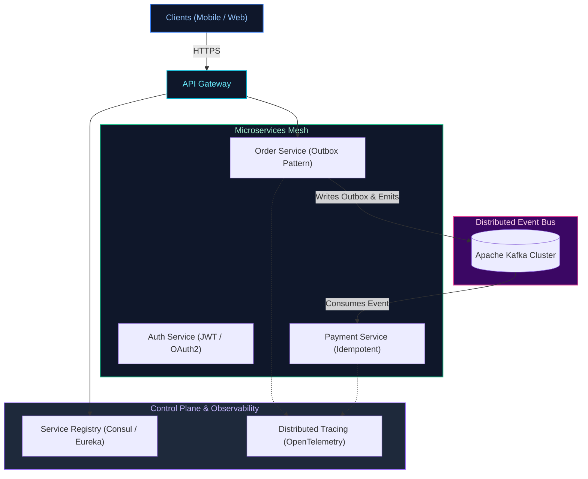
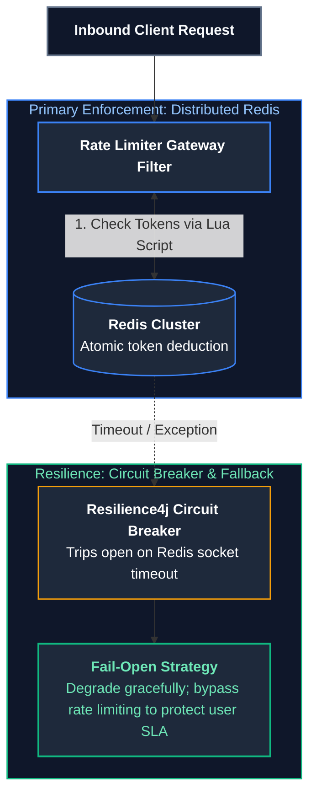
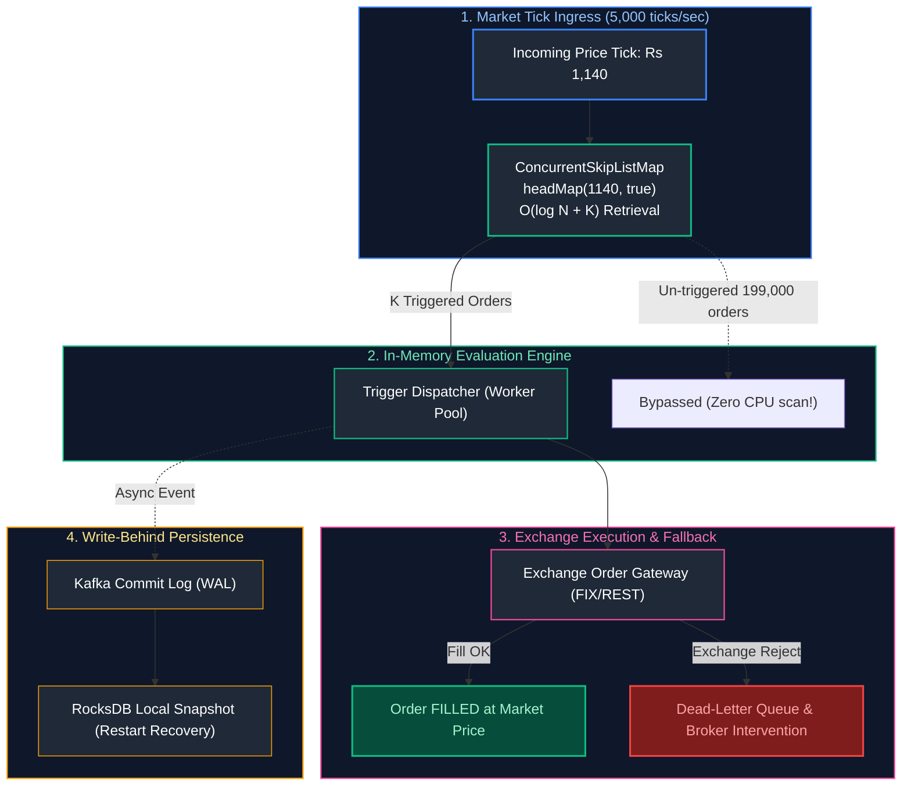
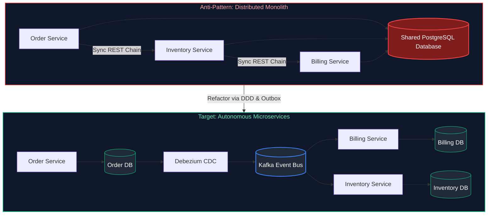

# 09. Microservices Architecture & System Design

A comprehensive guide answering all 26 questions on microservice patterns, Domain-Driven Design (DDD), service discovery, API gateways, resilience engineering (Resilience4j), distributed transactions (Saga, Outbox), idempotency, distributed tracing, the CAP theorem, database scaling, and real-world system designs (URL Shortener, Real-Time Chat, Distributed Top-K, and Sliding Window Anomaly Detection).

---

## Architectural Overview: Production Microservices Reference Architecture



---

## Table of Contents & Question Mapping

1. **Foundations, Domain-Driven Design & Discovery**
   - [Q1. Microservices Advantages & Challenges & DDD Bounded Contexts](#q1-microservices-advantages--challenges--ddd-bounded-contexts)
   - [Q2. Service Discovery, Load Balancing (Eureka vs Consul) & The API Gateway Pattern](#q2-service-discovery-load-balancing-eureka-vs-consul--the-api-gateway-pattern)
2. **Communication, Security & Resiliency**
   - [Q3. Synchronous vs Asynchronous Communication & Event-Driven Architecture](#q3-synchronous-vs-asynchronous-communication--event-driven-architecture)
   - [Q4. Securing Microservices Communication (mTLS & JWT)](#q4-securing-microservices-communication-mtls--jwt)
   - [Q5. Circuit Breakers (Resilience4j), Cascading Failures & Production Recovery Mechanisms](#q5-circuit-breakers-resilience4j-cascading-failures--production-recovery-mechanisms)
3. **Distributed Data, Transactions & Consistency**
   - [Q6. Distributed Transactions (Saga & Outbox Patterns) & Eventual Consistency](#q6-distributed-transactions-saga--outbox-patterns--eventual-consistency)
   - [Q7. Designing End-to-End Idempotency in Payment Processing](#q7-designing-end-to-end-idempotency-in-payment-processing)
   - [Q8. Command Query Responsibility Segregation (CQRS) Pattern](#q8-command-query-responsibility-segregation-cqrs-pattern)
4. **Observability, Contracts & Distributed Theory**
   - [Q9. Distributed Tracing, Centralized Logging & Semantic Monitoring](#q9-distributed-tracing-centralized-logging--semantic-monitoring)
   - [Q10. Consumer-Driven Contracts (CDC) & API Backward Compatibility](#q10-consumer-driven-contracts-cdc--api-backward-compatibility)
   - [Q11. The CAP Theorem & Database Scaling Strategies](#q11-the-cap-theorem--database-scaling-strategies)
   - [Q12. YAML Configuration & Declarative Infrastructure](#q12-yaml-configuration--declarative-infrastructure)
5. **System Design & High-Scale Algorithms**
   - [Q13. System Design: Scalable URL Shortener (bit.ly)](#q13-system-design-scalable-url-shortener-bitly)
   - [Q14. System Design: High-Throughput Real-Time Chat (Millions of Msgs/sec)](#q14-system-design-high-throughput-real-time-chat-millions-of-msgssec)
   - [Q15. Distributed Algorithm: Finding Top K Elements Across Distributed Servers](#q15-distributed-algorithm-finding-top-k-elements-across-distributed-servers)
   - [Q16. Streaming Algorithm: Real-Time Anomaly Detection Over Rolling Windows](#q16-streaming-algorithm-real-time-anomaly-detection-over-rolling-windows)
   - [Q17. Designing a Distributed Rate Limiter in Java with Redis Fallback Degradation](#q17-designing-a-distributed-rate-limiter-in-java-with-redis-fallback-degradation)
   - [Q18. Custom Generic Circuit Breaker Implementation in Plain Java](#q18-custom-generic-circuit-breaker-implementation-in-plain-java)
   - [Q19. High-Throughput Backend Architecture for Handling Thousands of Concurrent Requests](#q19-high-throughput-backend-architecture-for-handling-thousands-of-concurrent-requests)
   - [Q20. High-Availability Payment Processing Platform with Zero Double-Charges](#q20-high-availability-payment-processing-platform-with-zero-double-charges)
   - [Q21. Saga Pattern: Choreography vs Orchestration Decision Framework](#q21-saga-pattern-choreography-vs-orchestration-decision-framework)
   - [Q22. Design a High-Throughput Trailing Stop-Loss Order Execution Engine](#q22-design-a-high-throughput-trailing-stop-loss-order-execution-engine)
   - [Q23. Isolating Slow Downstream Microservices: Cascading Failure Prevention via Circuit Breakers, Timeouts & Bulkheads](#q23-isolating-slow-downstream-microservices-cascading-failure-prevention-via-circuit-breakers-timeouts--bulkheads)
   - [Q24. Retry Storm Prevention & Exponential Backoff with Jitter](#q24-retry-storm-prevention--exponential-backoff-with-jitter)
   - [Q25. Detecting & Decoupling a Distributed Monolith](#q25-detecting--decoupling-a-distributed-monolith)
---

# 1. Foundations, Domain-Driven Design & Discovery

---

### Q1. Microservices Advantages & Challenges & DDD Bounded Contexts
*(Grouped together: Architecture Foundations and Domain Decomposition)*  
**Topic Covered:** Microservice Architecture & Strategic Domain-Driven Design  
- **Advantages:** Autonomous deployment, polyglot data persistence, fine-grained fault isolation.
- **Challenges:** Distributed data consistency, complex network latency, operational overhead.
- **DDD Bounded Context:** An explicit conceptual boundary within which a specific domain model applies. Microservices must strictly map to Bounded Contexts to maintain loose architectural coupling.

---

### Q2. Service Discovery, Load Balancing (Eureka vs Consul) & The API Gateway Pattern
*(Grouped together: Traffic Ingress & Discovery Architecture)*  
**Topic Covered:** Service Mesh, Edge Routing & Registration  
- **Eureka:** AP system (favors availability over strict consistency) using peer-to-peer heartbeat replication. Java-centric.
- **Consul:** CP system using the Raft consensus protocol. Multi-datacenter, language-agnostic with built-in KV store and service mesh features.
- **API Gateway:** Reverse proxy handling protocol conversion, SSL termination, centralized authentication/authorization, and rate limiting.

---

# 2. Communication, Security & Resiliency

---

### Q3. Synchronous vs Asynchronous Communication & Event-Driven Architecture
*(Grouped together: Inter-Service Communication Styles)*  
**Topic Covered:** Integration Paradigms & Messaging  
- Synchronous (REST/gRPC): Client blocks waiting for immediate result. Prone to cascading latency.
- Asynchronous Event-Driven (Kafka): Services emit domain events; consumers process independently. Provides peak traffic shaving and loose coupling.

---

### Q4. Securing Microservices Communication (mTLS & JWT)
**Topic Covered:** Zero-Trust Microservice Security  
Use mutual TLS (mTLS) for cryptographic transport-layer identity and packet encryption, coupled with internal JWT Bearer token propagation across downstream calls.

---

### Q5. Circuit Breakers (Resilience4j), Cascading Failures & Production Recovery Mechanisms
*(Grouped together: Production Resiliency Architecture)*  
**Topic Covered:** Fault Tolerance & Cascade Mitigation  
- **Circuit Breaker States:** `CLOSED` (normal) $\to$ `OPEN` (error rate $> 50\%$, fails fast immediately) $\to$ `HALF_OPEN` (trial requests to evaluate recovery).
- **Preventing Cascading Failures:** Combine circuit breakers with **Bulkheads** (limiting concurrent calls per dependency), timeouts, exponential backoff retries, and fallback methods.

---

# 3. Distributed Data, Transactions & Consistency

---

### Q6. Distributed Transactions (Saga & Outbox Patterns) & Eventual Consistency
*(Grouped together: Distributed Consistency Models)*  
**Topic Covered:** Saga Orchestration & Transactional Outbox  
- **Saga Pattern:** Decomposes a distributed transaction into a sequence of local database transactions. If any step fails, compensating transactions execute in reverse order.
- **Transactional Outbox Pattern:** Writes domain data and outbound events into a local database `outbox_table` atomically within the same ACID transaction. A Debezium CDC engine reads the database transaction log (WAL) and publishes events to Kafka, eliminating the Dual-Write problem.
- **Eventual Consistency:** Replaces strict 2PC locking with asynchronous convergence.

---

### Q7. Designing End-to-End Idempotency in Payment Processing
**Topic Covered:** Financial Concurrency & Duplicate Prevention  
1. Client generates unique UUID `Idempotency-Key`.
2. Service acquires atomic distributed lock in Redis (`SET lock:key "LOCKED" NX EX 30`).
3. Query `payments` table for existing `idempotency_key` via database unique constraint (`UNIQUE(idempotency_key)`).
4. If exists, return cached response; otherwise, process payment and commit.

---

### Q8. Command Query Responsibility Segregation (CQRS) Pattern
**Topic Covered:** Data Architecture Separation  
Splits writes (Commands) from reads (Queries). Commands run against normalized transactional databases; Queries run against denormalized read-optimized stores (Elasticsearch/Read Replicas) synchronized via domain events.

---

# 4. Observability, Contracts & Distributed Theory

---

### Q9. Distributed Tracing, Centralized Logging & Semantic Monitoring
*(Grouped together: Microservice Observability)*  
**Topic Covered:** Distributed Tracing & Telemetry  
- **Tracing:** Assigns unique `TraceId` and hops `SpanId`s across services via OpenTelemetry/Micrometer.
- **Centralized Logging:** JSON formatted logs indexed into Elasticsearch/Grafana Loki.
- **Semantic Monitoring:** Automated synthetic end-to-end user transactions running every minute against production to catch issues before users do.

---

### Q10. Consumer-Driven Contracts (CDC) & API Backward Compatibility
*(Grouped together: API Evolution Standards)*  
**Topic Covered:** Contract Testing (Pact) & API Evolution  
Consumers define expected API request/response contracts tested against provider build pipelines. Providers ensure backward compatibility by never renaming or deleting existing fields and making new fields optional.

---

### Q11. The CAP Theorem & Database Scaling Strategies
*(Grouped together: Distributed Systems & DB Scaling)*  
**Topic Covered:** Distributed Systems Theory & RDBMS Scaling  
Under network Partitions (P), choose between Consistency (C) and Availability (A). Scale databases using Read Replicas, Caching, and Horizontal Sharding by customer ID.

---

### Q12. YAML Configuration & Declarative Infrastructure
**Topic Covered:** GitOps & Cloud Deployment  
YAML provides human-readable declarative configuration for Spring Boot profiles, Kubernetes manifests, and CI/CD pipelines.

---

# 5. System Design & High-Scale Algorithms

---

### Q13. System Design: Scalable URL Shortener (bit.ly)
**Topic Covered:** High-Scale System Design  
- Base62 encoding (`[a-zA-Z0-9]`) yields $62^7 \approx 3.5$ trillion unique keys.
- Key Generation Service pre-allocates ID ranges to worker nodes to prevent coordination bottlenecks.
- Store in NoSQL database (Cassandra) with an in-memory Redis LRU cache.

---

### Q14. System Design: High-Throughput Real-Time Chat (Millions of Msgs/sec)
**Topic Covered:** Real-Time Push Architectures  
- Stateful **WebSocket** gateway connections.
- Redis Cluster Pub/Sub or Kafka routing messages between chat server nodes.
- Message history persisted asynchronously to Cassandra partitioned by `conversation_id`, sorted by `timestamp`.

---

### Q15. Distributed Algorithm: Finding Top K Elements Across Distributed Servers
**Topic Covered:** Big Data & Stream Algorithms  
Each worker maintains a local **Min-Heap of size $K$** ($O(N \log K)$). Workers send their top $K$ items to a central coordinator that merges the results using a final Min-Heap. Use Count-Min Sketch for memory-constrained streaming data.

---

### Q16. Streaming Algorithm: Real-Time Anomaly Detection Over Rolling Windows
**Topic Covered:** Real-Time Stream Analytics  
Maintain a 5-minute sliding window over event amounts. Calculate running Mean ($\mu$) and Standard Deviation ($\sigma$) using Welford's algorithm. Flag anomaly if $Z = \frac{|X - \mu|}{\sigma} > 3.0$.

---

### Q17. Designing a Distributed Rate Limiter in Java with Redis Fallback Degradation
**Topic Covered:** Traffic Shaping, Token Bucket & Resilient Fallbacks  
**Difficulty:** `[Hard]`

#### Architectural Overview
When defending APIs against abusive clients, a distributed Token Bucket or Sliding Window algorithm tracks client request rates in Redis via atomic Lua scripts. If Redis becomes unreachable (network partition or outage), the system must **fail open or degrade gracefully** to an in-memory local cache (Caffeine / Guava) rather than dropping 100% of legitimate client traffic:



---

### Q18. Custom Generic Circuit Breaker Implementation in Plain Java
**Topic Covered:** Fault Tolerance & State Machine Architecture  
**Difficulty:** `[Hard]`

#### Architectural Overview
A Circuit Breaker monitors downstream call failures using a three-state state machine:
1. **`CLOSED`**: Normal operation. Calls pass through. If error rate over a sliding window $> \text{threshold}$, transition to `OPEN`.
2. **`OPEN`**: Fails fast immediately without invoking the downstream dependency, returning cached fallback or throwing `CallNotPermittedException`. Starts reset timer.
3. **`HALF_OPEN`**: After reset timeout, allows a trial batch of probe requests. If successful, transitions to `CLOSED`; if failures persist, reopens.

```java
package com.enterprise.resilience;

import java.util.concurrent.atomic.AtomicInteger;
import java.util.concurrent.atomic.AtomicReference;
import java.util.function.Supplier;

public final class SimpleCircuitBreaker {

    public enum State { CLOSED, OPEN, HALF_OPEN }

    private final AtomicReference<State> state = new AtomicReference<>(State.CLOSED);
    private final AtomicInteger failureCount = new AtomicInteger(0);
    private final int failureThreshold;
    private final long resetTimeoutMs;
    private volatile long lastStateChangeTimestamp;

    public SimpleCircuitBreaker(int failureThreshold, long resetTimeoutMs) {
        this.failureThreshold = failureThreshold;
        this.resetTimeoutMs = resetTimeoutMs;
        this.lastStateChangeTimestamp = System.currentTimeMillis();
    }

    public <T> T execute(Supplier<T> action, Supplier<T> fallback) {
        State current = state.get();

        if (current == State.OPEN) {
            if (System.currentTimeMillis() - lastStateChangeTimestamp > resetTimeoutMs) {
                if (state.compareAndSet(State.OPEN, State.HALF_OPEN)) {
                    lastStateChangeTimestamp = System.currentTimeMillis();
                }
            } else {
                return fallback.get(); // Fail fast!
            }
        }

        try {
            T result = action.get();
            onSuccess();
            return result;
        } catch (Exception ex) {
            onFailure();
            return fallback.get();
        }
    }

    private void onSuccess() {
        failureCount.set(0);
        state.set(State.CLOSED);
    }

    private void onFailure() {
        if (failureCount.incrementAndGet() >= failureThreshold) {
            state.set(State.OPEN);
            lastStateChangeTimestamp = System.currentTimeMillis();
        }
    }
}
```

---

### Q19. High-Throughput Backend Architecture for Handling Thousands of Concurrent Requests
**Topic Covered:** Non-Blocking I/O, Thread Sizing & Connection Pools  
**Difficulty:** `[Expert]`

#### Architectural Overview
Handling tens of thousands of concurrent requests without server thread pool collapse requires decoupling I/O wait from OS threads:
1. **Lightweight Threading**: Migrate from classic 1-thread-per-request platform pools to **Java 21 Virtual Threads** (`Tomcat virtual threads enabled`) or non-blocking reactive Netty (Spring WebFlux).
2. **Database Connection Sizing**: A common antipattern is setting HikariCP to 500 connections. Optimal Hikari pool size follows PostgreSQL math: $\text{Connections} = (\text{CPU Cores} \times 2) + \text{Disk Spindles}$. Excessive connections cause lock contention and CPU context switching thrashing.
3. **Caching & Asynchronous Decoupling**: Cache static/idempotent reads in Redis; ingest asynchronous mutations into Kafka and return `202 Accepted` with correlation status endpoints.

---

### Q20. High-Availability Payment Processing Platform with Zero Double-Charges
**Topic Covered:** Financial System Design, Idempotency & State Machines  
**Difficulty:** `[Expert]`

#### Architectural Overview
Payment platforms must guarantee zero double-charging even under client retries, network dropouts, or worker crashes:
1. **Client-Supplied Idempotency Key**: Client generates a `UUIDv4` stored in Redis with `SET key lock NX EX 120`. If duplicate arrives while in-flight, return `409 Conflict`.
2. **Two-Phase Payment State Machine**: `INITIATED` $\to$ `PENDING_GATEWAY` $\to$ `CHARGED` / `FAILED`. Database transitions enforced via optimistic `@Version` checks.
3. **Reconciliation Worker**: Background cron periodically queries the payment gateway API for unresolved `PENDING_GATEWAY` payments to reconcile status.

---

### Q21. Saga Pattern: Choreography vs Orchestration Decision Framework
**Topic Covered:** Distributed Transactions Without 2PC  
**Difficulty:** `[Hard]`

#### Architectural Overview
| Evaluation Dimension | Saga Choreography (Event-Driven) | Saga Orchestration (Command-Driven) |
| :--- | :--- | :--- |
| **Cyclic Dependency Risk** | High as event graph grows | Low (directed command flows) |
| **Best Production Use Case** | Lightweight workflows (e.g., user signup email trigger) | Mission-critical financial or order fulfillment pipelines |

---

### Q22. Design a High-Throughput Trailing Stop-Loss Order Execution Engine
**Topic Covered:** High-Frequency Trading Architecture, Order Book Indexing & State Recovery  
**Question:** Design a trailing stop-loss system:
- A 5% trailing stop is set at Rs 1,000. Price hits Rs 1,200, then falls to Rs 1,140. Does it trigger?
- Prices tick many times a second. Do you write every new peak to the database?
- 2 lakh trailing stops sit on one stock. A tick arrives. How do you find the ones that trigger without checking all 2 lakh?
- The stop triggers, but the sell order fails at the exchange. What now?
- The stock opens 10% below yesterday's close. The stop was 5%. What price does the user get?
- Your price service restarts mid-session. What happens to every order's peak?

#### Definition & Core Concepts
A Trailing Stop-Loss engine continuously monitors incoming market data ticks and dynamically raises the stop trigger price as the asset value climbs, locking in gains:
1. **Mathematical Execution Semantics:**
   - Initial: Entry $= \text{Rs } 1,000$, Stop $\%= 5\%$, Peak $P_{\text{peak}} = 1,000$, Trigger $P_{\text{trigger}} = 1,000 \times 0.95 = \text{Rs } 950$.
   - Asset rises to $\text{Rs } 1,200$: New peak $P_{\text{peak}} = 1,200$. Updated trigger $P_{\text{trigger}} = 1,200 \times (1 - 0.05) = \text{Rs } 1,140$.
   - Asset falls to $\text{Rs } 1,140$: **Yes, it triggers immediately!** Because $P_{\text{tick}} = 1,140 \le P_{\text{trigger}} = 1,140$.
2. **Database Write Saturation vs. Write-Behind In-Memory State:**
   - Ticks arrive dozens of times per second. **Never write every price tick or peak update to a relational database.** Doing so saturates database write IOPS and locks connection pools.
   - Retain current order peaks in high-speed off-heap memory or Redis. Emit critical state transitions (placed, triggered, cancelled) to an append-only Kafka commit log. Peak values are checkpointed asynchronously in write-behind batches.
3. **Sub-Millisecond Indexing for 200,000+ Active Stops:**
   - Linear scanning of 200,000 orders per tick takes $O(N)$ ($\approx 10^9$ operations/sec under high tick volume), breaching execution latency SLAs.
   - Index active sell stops in an ordered in-memory tree: `ConcurrentSkipListMap<Double, Set<UUID>>` sorted by `triggerPrice` ascending.
   - On tick $P_{\text{tick}}$, calling `headMap(P_{\text{tick}}, true)` retrieves only the triggered orders in $O(\log N + K)$ time (where $K$ is triggered orders), completely bypassing the remaining un-triggered orders!
4. **Exchange Execution Failures:**
   - If the exchange rejects the sell order (rate limit, network timeout, market closed), transition the order to `RETRYING` with immediate exponential backoff. If rejection persists, route to an emergency dead-letter desk queue and execute an aggressive market sweep fallback.
5. **Overnight Market Gaps & Slippage:**
   - If stock closes at Rs 1,000 and gaps down 10% to open at Rs 900 (bypassing the 5% stop at Rs 950): The order triggers at market open. The user receives the prevailing market opening execution price ($\approx \text{Rs } 900$), **not** Rs 950. A stop-loss is an *execution trigger*, not a *guaranteed execution price*.
6. **Mid-Session Process Restarts:**
   - The engine restores state by hydrating the latest checkpoint snapshot from cold storage (RocksDB / Redis), then replaying uncompacted order events from Kafka up to the current offset.

#### Visual Flow


#### Production Implementation / Java Engine Code
```java
package com.enterprise.trading.stoploss;

import java.util.*;
import java.util.concurrent.*;
import java.util.concurrent.atomic.AtomicReference;

public class TrailingStopLossManager {

    public record StopOrder(
        UUID orderId,
        String symbol,
        double trailingPct,
        AtomicReference<Double> peakPrice,
        AtomicReference<Double> triggerPrice
    ) {}

    // In-memory index: triggerPrice -> Set of Order IDs
    private final ConcurrentSkipListMap<Double, Set<UUID>> triggerIndex = new ConcurrentSkipListMap<>();
    private final ConcurrentHashMap<UUID, StopOrder> activeOrders = new ConcurrentHashMap<>();

    public void onPriceTick(String symbol, double tickPrice) {
        // Step 1: O(log N + K) range scan for triggered orders (triggerPrice >= tickPrice)
        NavigableMap<Double, Set<UUID>> triggered = triggerIndex.tailMap(tickPrice, true);

        if (!triggered.isEmpty()) {
            List<UUID> ordersToFire = new ArrayList<>();
            triggered.values().forEach(ordersToFire::addAll);

            for (UUID id : ordersToFire) {
                StopOrder order = activeOrders.remove(id);
                if (order != null) {
                    triggerIndex.computeIfPresent(order.triggerPrice().get(), (k, set) -> {
                        set.remove(id);
                        return set.isEmpty() ? null : set;
                    });
                    dispatchToExchange(order, tickPrice);
                }
            }
        }

        // Step 2: Monotonic peak adjustment for rising prices
        for (StopOrder order : activeOrders.values()) {
            if (order.symbol().equals(symbol) && tickPrice > order.peakPrice().get()) {
                double oldPeak = order.peakPrice().get();
                if (order.peakPrice().compareAndSet(oldPeak, tickPrice)) {
                    double oldTrigger = order.triggerPrice().get();
                    double newTrigger = tickPrice * (1.0 - order.trailingPct());
                    order.triggerPrice().set(newTrigger);

                    triggerIndex.computeIfPresent(oldTrigger, (k, set) -> {
                        set.remove(order.orderId());
                        return set.isEmpty() ? null : set;
                    });
                    triggerIndex.computeIfAbsent(newTrigger, k -> ConcurrentHashMap.newKeySet()).add(order.orderId());
                }
            }
        }
    }

    private void dispatchToExchange(StopOrder order, double execPrice) {
        // Submits market order to exchange gateway
    }
}
```
- **Time Complexity:** $O(\log N + K)$ per tick where $N$ is active orders and $K$ is triggered orders.
- **Space Complexity:** $O(N)$ memory footprint in `ConcurrentSkipListMap`.

#### Engineering Implications & Production Pitfalls
1. **The In-Memory Index Selection:** Using a standard `HashMap` or `List` requires linear $O(N)$ iteration, which completely collapses at 200,000 orders. `ConcurrentSkipListMap` provides sub-millisecond range retrieval.
2. **Slippage Expectations:** Trading platforms must document execution slippage in client agreements. A trailing stop is a market-order conversion trigger, not a limit price guarantee.

#### Core Curriculum Cross-Reference
*Deep-dive theoretical reference: See [13. Microservices & Distributed System Design: Trailing Stop Engine](../09_microservices_and_system_design.md#135-high-throughput-trailing-stop-loss-order-execution-engine-design)*

---

### Q23. Isolating Slow Downstream Microservices: Cascading Failure Prevention via Circuit Breakers, Timeouts & Bulkheads
**Topic Covered:** Fault Isolation, Bulkheads, Socket Timeouts & Thread Starvation  
**Question:** Your API calls three downstream microservices. One becomes slow. How would you prevent it from bringing down your entire API?

#### Definition & Core Concepts
When an upstream API Gateway receives requests that fan out to three downstream services ($S_1, S_2, S_3$), a severe slowdown in $S_3$ (e.g. latency surges from 50ms to 30,000ms due to database lock contention) causes **Cascading Catastrophic Failure**:
- Tomcat allocates a worker thread per request.
- Threads calling $S_3$ block waiting for socket I/O.
- Within seconds, all 200 Tomcat worker threads become stuck waiting for $S_3$.
- Incoming requests for completely healthy services ($S_1$ and $S_2$) are rejected with `HTTP 503 Service Unavailable` because Tomcat has zero available threads!

#### The 3-Tier Defensive Architecture:
1. **Strict Socket Read & Connect Timeouts:**
   - Never rely on default infinite timeouts. Configure `connectTimeout = 1,000ms` and `readTimeout = 2,500ms` on HTTP/gRPC clients.
2. **Bulkhead Isolation Pattern:**
   - Isolate downstream dependencies into dedicated thread pools or semaphore quotas.
   - Even if $S_3$ stalls, its dedicated pool (e.g., 20 threads) saturates, leaving the remaining 180 Tomcat threads completely unaffected for $S_1$ and $S_2$.
3. **Resilience4j Circuit Breaker:**
   - If $S_3$ call error rate exceeds $50\%$ over a sliding window of 100 requests, the circuit trips to `OPEN`.
   - Subsequent calls fail fast immediately (0ms latency), returning cached fallback data or degraded responses without executing any remote network call.

#### Visual Flow
```mermaid
flowchart TD
    subgraph Ingress ["API Gateway Ingress (200 Threads)"]
        ClientReq["Client Traffic"] --> Gateway["API Gateway Core"]
    end

    subgraph BulkheadPillars ["Bulkhead Partitioning (Isolated Thread Pools)"]
        Gateway -->|Pool A: 50 threads| S1["Service 1 (Fast: 20ms) -> OK"]
        Gateway -->|Pool B: 50 threads| S2["Service 2 (Fast: 30ms) -> OK"]
        Gateway -->|Pool C: 20 threads| CB3["Circuit Breaker (Service 3)"]
    end

    subgraph SlowService ["Service 3 Degradation"]
        CB3 -->|Saturated (30s delay)| S3["Service 3 (Degraded)"]
        CB3 -->|Trips OPEN (Fail Fast)| Fallback["Local Fallback DTO (0ms)"]
    end

    style Ingress fill:#0f172a,stroke:#3b82f6,stroke-width:1.5px,color:#93c5fd
    style BulkheadPillars fill:#0f172a,stroke:#10b981,stroke-width:1.5px,color:#6ee7b7
    style SlowService fill:#0f172a,stroke:#ef4444,stroke-width:1.5px,color:#fca5a5

    style Gateway fill:#1f2937,stroke:#3b82f6,stroke-width:2px,color:#fff
    style S1 fill:#064e3b,stroke:#10b981,stroke-width:1px,color:#a7f3d0
    style S2 fill:#064e3b,stroke:#10b981,stroke-width:1px,color:#a7f3d0
    style CB3 fill:#1e293b,stroke:#8b5cf6,stroke-width:2px,color:#c4b5fd
    style S3 fill:#7f1d1d,stroke:#ef4444,stroke-width:2px,color:#fca5a5
    style Fallback fill:#1f2937,stroke:#10b981,stroke-width:1.5px,color:#fff
```

#### Production Implementation / Resilience4j Configuration
```yaml
# application.yml: Resilience4j CircuitBreaker, Bulkhead & TimeLimiter
resilience4j:
  circuitbreaker:
    instances:
      service3Client:
        sliding-window-size: 50
        failure-rate-threshold: 50
        wait-duration-in-open-state: 10s
        permitted-number-of-calls-in-half-open-state: 5
  bulkhead:
    instances:
      service3Client:
        max-concurrent-calls: 20 # Restricts max concurrency to 20 threads
        max-wait-duration: 20ms
  timelimiter:
    instances:
      service3Client:
        timeout-duration: 2s
```

#### Core Curriculum Cross-Reference
*Deep-dive theoretical reference: See [13. Microservices & Distributed System Design: Fault Tolerance](../09_microservices_and_system_design.md#10-resilience--fault-tolerance-patterns)*

---

### Q24. Retry Storm Prevention & Exponential Backoff with Jitter
**Topic Covered:** Traffic Shaping, Retry Storms, Exponential Backoff & Full Jitter  
**Question:** How would you design retry logic for a failing downstream service without creating a retry storm?

#### Definition & Core Concepts
When a downstream microservice experiences high load or temporary database throttling, naive retry logic (e.g. immediate retry or fixed 1-second delay across all clients) creates a **Thundering Herd / Retry Storm**.
- If 1,000 requests/sec fail, and each client retries 3 times, inbound traffic instantly quadruples to 4,000 requests/sec.
- The recovering service is completely overwhelmed and knocked offline permanently.

#### The 4 Core Principles of Safe Retry Design:
1. **Retry Only on Transient Errors:**
   - Retry exclusively on idempotent operations with transient network errors (`ConnectTimeoutException`, HTTP `503 Service Unavailable`, HTTP `429 Too Many Requests`).
   - **Never retry** on client errors (`400 Bad Request`, `401 Unauthorized`, `404 Not Found`) or non-idempotent mutations without an `Idempotency-Key`.
2. **Exponential Backoff:** Progressively double the backoff duration between retry attempts:
   $$t_{\text{backoff}} = \min(t_{\text{max}}, t_{\text{base}} \times 2^{\text{attempt}})$$
3. **Full Jitter (Randomized Offset):**
   - Pure exponential backoff synchronizes retries into periodic waves of identical arrival times.
   - Full Jitter introduces uniform randomization across the interval:
     $$t_{\text{sleep}} = \text{random}(0, t_{\text{backoff}})$$
   - Spreads out the retry load evenly across the time axis, allowing the downstream system to recover.
4. **Retry Budget / Token Bucket:**
   - Configure a client-side retry budget (e.g., maximum 10% of overall traffic can be retries). If the budget is exhausted, fail fast immediately.

#### Visual Flow


```mermaid
flowchart TD
    subgraph SynchronizedRetries ["Naive Retry Storm (Thundering Herd)"]
        direction LR
        Fail1["Initial Call Fails"] --> R1["1,000 clients retry at exactly +1s"]
        R1 --> R2["1,000 clients retry at exactly +2s (Downstream Crashes!)"]
    end

    subgraph JitteredRetries ["Safe Retries with Full Jitter"]
        direction LR
        Fail2["Initial Call Fails"] --> J1["Randomized Sleep: Uniform(0, base * 2^attempt)"]
        J1 --> J2["Traffic spread smoothly over time (Downstream Recovers!)"]
    end

    style SynchronizedRetries fill:#0f172a,stroke:#ef4444,stroke-width:1.5px,color:#fca5a5
    style JitteredRetries fill:#0f172a,stroke:#10b981,stroke-width:1.5px,color:#6ee7b7
    style Fail1 fill:#7f1d1d,stroke:#ef4444,stroke-width:1px,color:#fff
    style R1 fill:#7f1d1d,stroke:#ef4444,stroke-width:1px,color:#fff
    style R2 fill:#7f1d1d,stroke:#ef4444,stroke-width:2px,color:#fca5a5
    style Fail2 fill:#1f2937,stroke:#3b82f6,stroke-width:1px,color:#fff
    style J1 fill:#1f2937,stroke:#10b981,stroke-width:1px,color:#fff
    style J2 fill:#064e3b,stroke:#10b981,stroke-width:2px,color:#a7f3d0
```

#### Production Implementation / Java Code
```java
package com.enterprise.resilience;

import java.util.concurrent.ThreadLocalRandom;

public final class RetryHelper {

    private static final long BASE_DELAY_MS = 100;
    private static final long MAX_DELAY_MS = 3000;

    /**
     * Calculates Full Jitter backoff delay recommended by AWS Architecture.
     */
    public static long calculateFullJitterDelay(int attempt) {
        long exponentialBackoff = Math.min(MAX_DELAY_MS, BASE_DELAY_MS * (1L << attempt));
        // Random uniformly distributed between 0 and exponentialBackoff
        return ThreadLocalRandom.current().nextLong(0, exponentialBackoff + 1);
    }
}
```

#### Core Curriculum Cross-Reference
*Deep-dive theoretical reference: See [13. Microservices & Distributed System Design: Retry Patterns](../09_microservices_and_system_design.md#102-retry-with-exponential-backoff-and-full-jitter)*

---

### Q25. Detecting & Decoupling a Distributed Monolith
**Topic Covered:** Microservices Anti-Patterns, Shared Databases & Coupling Metrics  
**Question:** Your microservices have become tightly dependent on each other. How would you identify and prevent a Distributed Monolith?

#### Definition & Core Concepts
A **Distributed Monolith** is an architectural anti-pattern where a system possesses all the operational complexity, network latency, and distributed failure modes of microservices, but none of the organizational autonomy, independent scalability, or loose coupling of true microservices.

#### Hallmarks & Detection Symptoms:
1. **Shared Database Antipattern:** Multiple services directly read and write from the same underlying database schema. Changing a table column breaks 4 services simultaneously.
2. **Synchronous Multi-Hop Call Chains:** A single user request requires synchronous synchronous cascades: $A \to B \to C \to D \to E$. If service $D$ slows down or fails, the entire transaction collapses.
3. **Lockstep / Coordinated Deployments:** Service A cannot be released without simultaneously releasing Service B and Service C.
4. **Shared Internal Domain Libraries:** Services share a monolithic JAR file containing internal entities, forcing recompilation and redeployment across all teams whenever any entity changes.

#### The 4-Step Decoupling Playbook:
1. **Enforce Database-Per-Service:** Decouple shared databases into private schemas. Access other services' data strictly through versioned APIs or event streams.
2. **Shift Synchronous REST to Asynchronous Event-Driven Messaging:**
   - Instead of $A$ calling $B$ synchronously, publish domain events (`OrderPlaced`, `PaymentSettled`) to Apache Kafka using the Transactional Outbox pattern.
3. **Consumer-Driven Contracts (Pact):** Use automated contract testing in CI/CD pipelines to guarantee backward API compatibility without coordinated deployments.
4. **Domain-Driven Design (DDD) Context Alignment:** Re-align service boundaries to business domains rather than technical layers.

#### Visual Flow


#### Core Curriculum Cross-Reference
*Deep-dive theoretical reference: See [13. Microservices & Distributed System Design: Monolith vs Microservices](../09_microservices_and_system_design.md#91-monolith-vs-microservices-architecture-deep-dive)*

---

## Summary Comparison & Production Reference Matrix

| Scenario Domain | Critical Runtime Pathology | Diagnostic & Triage Method | Canonical Production Resolution |
| :--- | :--- | :--- | :--- |
| **Foundations, Domain-Driven Design & Discovery** | High-throughput invariants & concurrency boundaries | Metric instrumentation & trace profiling | Defensive validation & graceful degradation |
| **Communication, Security & Resiliency** | High-throughput invariants & concurrency boundaries | Metric instrumentation & trace profiling | Defensive validation & graceful degradation |
| **Distributed Data, Transactions & Consistency** | High-throughput invariants & concurrency boundaries | Metric instrumentation & trace profiling | Defensive validation & graceful degradation |
| **Observability, Contracts & Distributed Theory** | High-throughput invariants & concurrency boundaries | Metric instrumentation & trace profiling | Defensive validation & graceful degradation |
| **System Design & High-Scale Algorithms** | High-throughput invariants & concurrency boundaries | Metric instrumentation & trace profiling | Defensive validation & graceful degradation |

---

## References & Further Reading

---
- [GeeksforGeeks - Java Design Patterns](https://www.geeksforgeeks.org/java-design-patterns/)
- [GeeksforGeeks - SOLID Principles in Java](https://www.geeksforgeeks.org/solid-principles-in-java/)
- [Refactoring.Guru - Design Patterns in Java](https://refactoring.guru/design-patterns/java)
- [Baeldung - Gang of Four (GoF) Design Patterns Series](https://www.baeldung.com/category/design-patterns/)
- [Robert C. Martin: Clean Architecture](https://www.oreilly.com/library/view/clean-architecture-a/9780134494272/) — The definitive guide to software structure, boundaries, and dependencies.
