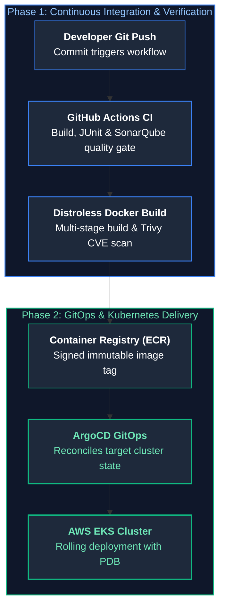
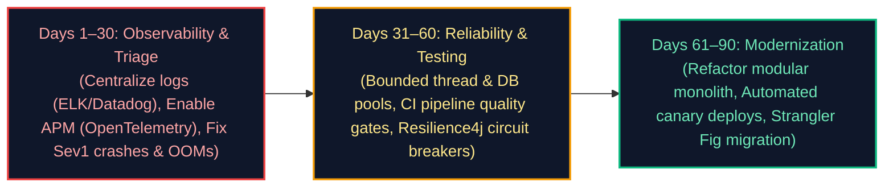
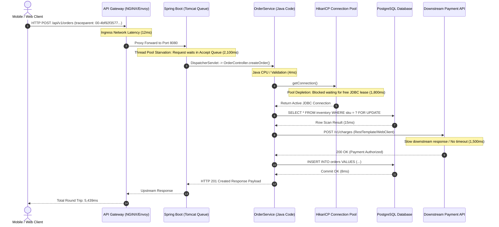
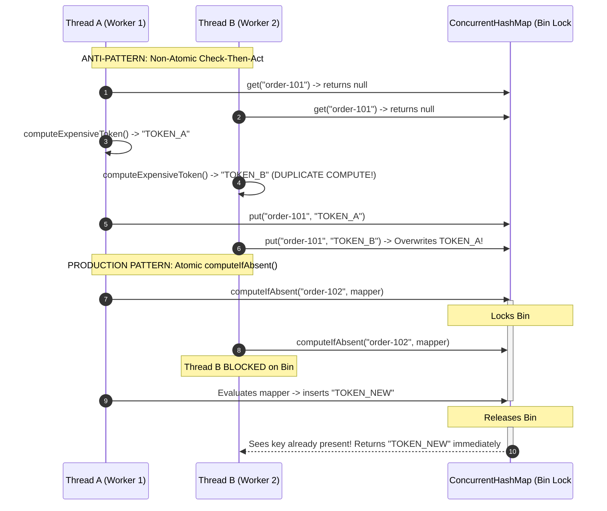
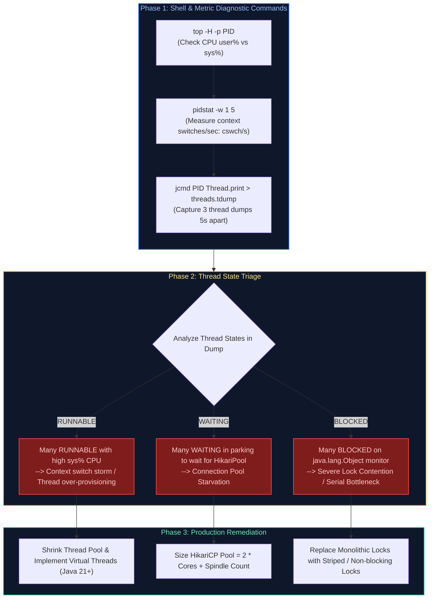
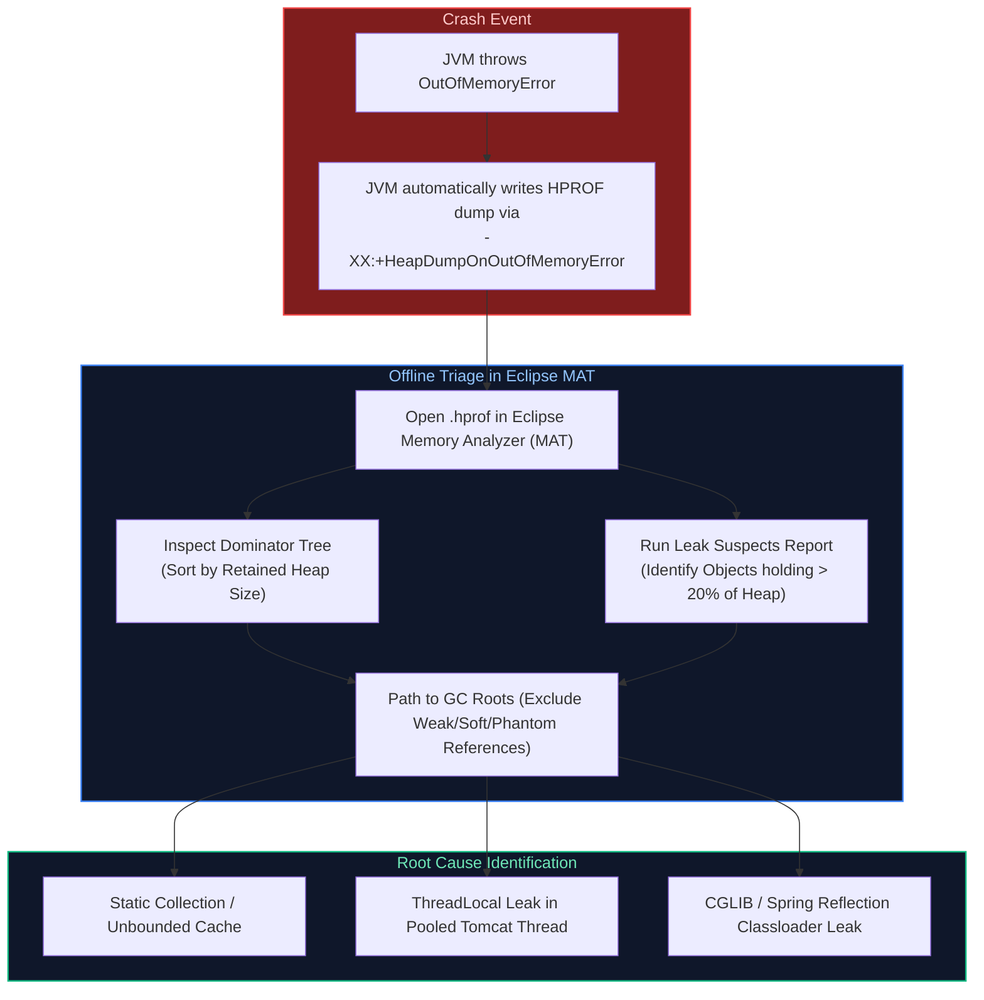

```mermaid
flowchart TD
    subgraph GenerationalFlow ["Premature Tenuring & Allocation Churn Mechanics"]
        direction LR
        Alloc["High Allocation Churn<br/>(Polling Loops / String Churn)"]
        Eden["Eden Space<br/>(Rapidly Exhausted)"]
        Survivor["Survivor Spaces S0 / S1<br/>(Dynamic Aging Threshold Exceeded)"]
        OldGen["Old Generation (Tenured)<br/>(Filled with Short-Lived Junk)"]
        FullGC["Major GC / Full GC Triggered<br/>(Stop-the-World Latency Spike)"]

        Alloc --> Eden
        Eden -->|Premature Promotion| Survivor
        Survivor -->|Tenuring Overflow| OldGen
        OldGen --> FullGC
    end

    style GenerationalFlow fill:#0f172a,stroke:#3b82f6,stroke-width:1.5px,color:#93c5fd
    style Alloc fill:#7f1d1d,stroke:#ef4444,stroke-width:1.5px,color:#fecaca
    style Eden fill:#1f2937,stroke:#f59e0b,stroke-width:1.5px,color:#fde68a
    style Survivor fill:#1f2937,stroke:#f59e0b,stroke-width:1.5px,color:#fde68a
    style OldGen fill:#7f1d1d,stroke:#ef4444,stroke-width:1.5px,color:#fecaca
    style FullGC fill:#7f1d1d,stroke:#ef4444,stroke-width:2px,color:#fecaca
```

# 10. Cloud Native, DevOps, Observability & Production Troubleshooting: Interview Questions & Deep-Dive Solutions

A comprehensive, production-grade guide answering real-world Java Backend Engineering interview scenarios, live coding implementations, and enterprise architecture designs.

---

## Table of Contents & Question Mapping

1. **Core Foundations**
   - [Q1. Docker Image vs Container & Multi-Stage Dockerfile for Spring Boot](#q1-docker-image-vs-container--multi-stage-dockerfile-for-spring-boot)
2. **Kubernetes Core Orchestration & Scaling**
   - [Q2. Liveness vs Readiness Probes in Kubernetes](#q2-liveness-vs-readiness-probes-in-kubernetes)
   - [Q3. Kubernetes Autoscaling (HPA, VPA, Cluster Autoscaler) & Service Discovery](#q3-kubernetes-autoscaling-hpa-vpa-cluster-autoscaler--service-discovery)
3. **CI/CD Pipelines & Zero-Downtime Deployments**
   - [Q4. Structuring a Robust CI/CD Pipeline (GitHub Actions / Jenkins)](#q4-structuring-a-robust-cicd-pipeline-github-actions--jenkins)
   - [Q5. Deployment Strategies: Blue-Green vs Canary vs Rolling](#q5-deployment-strategies-blue-green-vs-canary-vs-rolling)
   - [Q6. Enterprise Production Monitoring & Observability Stack](#q6-enterprise-production-monitoring--observability-stack)
4. **Microsoft Azure Cloud Infrastructure & Services**
   - [Q7. Azure Resource Hierarchy & Resource Groups](#q7-azure-resource-hierarchy--resource-groups)
   - [Q8. Azure Identity: IAM Roles, Managed Identities & Service Principals](#q8-azure-identity-iam-roles-managed-identities--service-principals)
   - [Q9. Azure Storage (Blob vs Files) & Queues (Service Bus vs Storage Queue)](#q9-azure-storage-blob-vs-files--queues-service-bus-vs-storage-queue)
   - [Q10. Azure Load Balancer Architecture & Types](#q10-azure-load-balancer-architecture--types)
   - [Q11. Horizontal vs Vertical Scaling in Azure](#q11-horizontal-vs-vertical-scaling-in-azure)
   - [Q12. Azure Compute Models (VM vs App Service vs Functions vs AKS) & Zero-Downtime Deployments](#q12-azure-compute-models-vm-vs-app-service-vs-functions-vs-aks--zero-downtime-deployments)
   - [Q13. Azure Compliance, Governance & Secret Management](#q13-azure-compliance-governance--secret-management)
5. **AWS Network Architecture**
   - [Q14. AWS Virtual Private Cloud (VPC) & Network Resource Isolation](#q14-aws-virtual-private-cloud-vpc--network-resource-isolation)
   - [Q15. End-to-End AWS Deployment Flow: CI Build to ECR and EKS Container Rollout](#q15-end-to-end-aws-deployment-flow-ci-build-to-ecr-and-eks-container-rollout)
   - [Q16. Core AWS Services Integration in Enterprise Java Backend Engineering](#q16-core-aws-services-integration-in-enterprise-java-backend-engineering)
   - [Q17. Production Kubernetes Architecture for Java Microservices: Memory Limits & cgroups v2](#q17-production-kubernetes-architecture-for-java-microservices-memory-limits--cgroups-v2)
   - [Q18. Local and Remote Debugging via JDWP & Port Distinctions](#q18-local-and-remote-debugging-via-jdwp--port-distinctions)
6. **CPU & Latency Production Anomalies**
   - [Q19. Service Slow but CPU Usage is Low: What to Check First](#q19-service-slow-but-cpu-usage-is-low-what-to-check-first)
   - [Q20. Application Runs Fine for Hours, Then Suddenly Slows Down](#q20-application-runs-fine-for-hours-then-suddenly-slows-down)
   - [Q21. High CPU Usage with Very Low Traffic: Investigation Steps](#q21-high-cpu-usage-with-very-low-traffic-investigation-steps)
   - [Q22. Inconsistent API Response Time Without Code Changes](#q22-inconsistent-api-response-time-without-code-changes)
   - [Q23. Isolating Background Jobs from Impacting API Latency](#q23-isolating-background-jobs-from-impacting-api-latency)
   - [Q24. Debugging Rare Production Deadlocks that Cannot be Reproduced Locally](#q24-debugging-rare-production-deadlocks-that-cannot-be-reproduced-locally)
7. **Memory, Garbage Collection & Collections Degradation**
   - [Q25. Memory Usage Keeps Increasing with No Obvious Heap Leaks](#q25-memory-usage-keeps-increasing-with-no-obvious-heap-leaks)
   - [Q26. `HashMap` Lookup Time Degrades from $O(1)$ to $O(N)$](#q26-hashmap-lookup-time-degrades-from-o1-to-on)
   - [Q27. GC Pauses Increase Significantly After a Small Release](#q27-gc-pauses-increase-significantly-after-a-small-release)
   - [Q28. JVM Tuning: Throughput vs Latency Trade-Off](#q28-jvm-tuning-throughput-vs-latency-trade-off)
8. **Distributed Cascades, Scaling & Logging Pitfalls**
   - [Q29. Why Increasing Log Verbosity Degrades Performance](#q29-why-increasing-log-verbosity-degrades-performance)
   - [Q30. Why Scaling Instances Worsens Overall System Performance](#q30-why-scaling-instances-worsens-overall-system-performance)
   - [Q31. Retry Storms: How Poorly Configured Retries Cause Cascading Outages](#q31-retry-storms-how-poorly-configured-retries-cause-cascading-outages)
9. **Spring & Gateway Failures**
   - [Q32. Troubleshooting `NoSuchBeanDefinitionException` in Spring Boot](#q32-troubleshooting-nosuchbeandefinitionexception-in-spring-boot)
   - [Q33. Troubleshooting and Resolving 504 Gateway Timeout and 503 Service Unavailable](#q33-troubleshooting-and-resolving-504-gateway-timeout-and-503-service-unavailable)
10. **Production Failure Triage, Architectural Modernization & Code Quality**
   - [Q34. Production Database Query Suddenly Takes 10 Seconds: Diagnostic Triage Playbook](#q34-production-database-query-suddenly-takes-10-seconds-diagnostic-triage-playbook)
   - [Q35. Production Outage with No Exceptions in Logs: Silent Failure Investigation Runbook](#q35-production-outage-with-no-exceptions-in-logs-silent-failure-investigation-runbook)
   - [Q36. Enterprise Java Pull Request Code Review Checklist](#q36-enterprise-java-pull-request-code-review-checklist)
   - [Q37. The 90-Day Engineering Improvement Plan for Unstable Legacy Java Platforms](#q37-the-90-day-engineering-improvement-plan-for-unstable-legacy-java-platforms)
   - [Q38. Modernizing Legacy Java Monoliths via the Strangler Fig Pattern](#q38-modernizing-legacy-java-monoliths-via-the-strangler-fig-pattern)
11. **Advanced Latency, Concurrency & High-Scale Bottleneck Diagnostics**
   - [Q39. Spring Boot API 5–6s Latency Breakdown: Java Code vs Database vs Network vs External Calls](#q39-spring-boot-api-56s-latency-breakdown-java-code-vs-database-vs-network-vs-external-calls)
   - [Q40. ConcurrentHashMap Race Conditions: Check-Then-Act Flaws & Atomic Resolution](#q40-concurrenthashmap-race-conditions-check-then-act-flaws--atomic-resolution)
   - [Q41. 200 Threads Running with Low Throughput: Thread Starvation, Pool Sizing & Lock Contention](#q41-200-threads-running-with-low-throughput-thread-starvation-pool-sizing--lock-contention)
   - [Q42. Spring Boot OutOfMemoryError Diagnostic Playbook: Heap Dumps, Metaspace & Leak Triage](#q42-spring-boot-outofmemoryerror-diagnostic-playbook-heap-dumps-metaspace--leak-triage)
   - [Q43. High GC Activity with Low Production Traffic: Allocation Churn & Object Lifecycle Triage](#q43-high-gc-activity-with-low-production-traffic-allocation-churn--object-lifecycle-triage)
   - [Q44. Concurrency Scalability Collapse: Investigating 10 vs 1,000 Concurrent Requests](#q44-concurrency-scalability-collapse-investigating-10-vs-1000-concurrent-requests)
---

### Q1. Docker Image vs Container & Multi-Stage Dockerfile for Spring Boot
*(Grouped together: Docker Fundamentals & Production Packaging)*  
**Topic Covered:** Containerization Architecture  
- **Docker Image:** Immutable template consisting of layered filesystems.
- **Docker Container:** Isolated running instance using Linux namespaces and cgroups.

#### Multi-Stage Distroless Spring Boot Dockerfile:
```dockerfile
# Stage 1: Build & Layer Extraction
FROM eclipse-temurin:21-jdk-alpine AS builder
WORKDIR /workspace
COPY pom.xml .
COPY src ./src
RUN ./mvnw clean package -DskipTests
RUN java -Djarmode=layertools -jar target/*.jar extract

# Stage 2: Runtime
FROM eclipse-temurin:21-jre-alpine
WORKDIR /app
RUN addgroup -S appgroup && adduser -S appuser -G appgroup
USER appuser
COPY --from=builder /workspace/dependencies/ ./
COPY --from=builder /workspace/spring-boot-loader/ ./
COPY --from=builder /workspace/snapshot-dependencies/ ./
COPY --from=builder /workspace/application/ ./
EXPOSE 8080
ENTRYPOINT ["java", "-XX:+UseContainerSupport", "-XX:MaxRAMPercentage=75.0", "org.springframework.boot.loader.launch.JarLauncher"]
```

---

# 2. Kubernetes Core Orchestration & Scaling

---

### Q2. Liveness vs Readiness Probes in Kubernetes
**Topic Covered:** Container Lifecycle Health Checks  
- **Liveness Probe (`/actuator/health/liveness`):** Detects unrecoverable deadlocks or frozen processes. When it fails, Kubelet **kills and restarts the container**.
- **Readiness Probe (`/actuator/health/readiness`):** Detects whether the pod is ready to accept traffic (e.g. caches initialized). When it fails, K8s **removes the pod from Service traffic routing without restarting it**.

---

### Q3. Kubernetes Autoscaling (HPA, VPA, Cluster Autoscaler) & Service Discovery
**Topic Covered:** Dynamic Cluster Orchestration  
- **HPA:** Adds/removes pod replicas based on CPU/Memory or queue lag via KEDA.
- **VPA:** Dynamically adjusts CPU/RAM requests of existing pods.
- **Cluster Autoscaler:** Provisions additional cloud VM nodes when pods cannot be scheduled.
- **Service Discovery:** CoreDNS creates internal DNS entries (`service.namespace.svc.cluster.local`); `kube-proxy` routes traffic to healthy pod IPs.

---

# 3. CI/CD Pipelines & Zero-Downtime Deployments

---

### Q4. Structuring a Robust CI/CD Pipeline (GitHub Actions / Jenkins)
**Topic Covered:** DevOps Automation Pipelines  
1. Compilation & Unit Tests.
2. Static Analysis (SonarQube) & Trivy Container Security Scan.
3. Integration Tests via Testcontainers.
4. Build multi-stage Docker image and push to Azure Container Registry (ACR) / ECR.
5. Deploy to Kubernetes via ArgoCD GitOps.

---

### Q5. Deployment Strategies: Blue-Green vs Canary vs Rolling
**Topic Covered:** Production Deployment Topologies  
- **Rolling (K8s Default):** Incrementally updates pods. Low cost; both versions run concurrently during rollout.
- **Blue-Green:** Two parallel environments. Instant cutover and rollback; requires double compute capacity during release.
- **Canary:** Routes 5% of production traffic to the new version, verifies telemetry/error rates, then proceeds to 100%. Safest blast radius.

---

### Q6. Enterprise Production Monitoring & Observability Stack
**Topic Covered:** Full-Stack Production Telemetry  
Metrics scraped from Spring Boot Actuator by **Prometheus** and visualized in **Grafana**; logs aggregated into **Elasticsearch / Azure Monitor Log Analytics**; distributed traces sent to **Grafana Tempo / OpenTelemetry**.

---

# 4. Microsoft Azure Cloud Infrastructure & Services

---

### Q7. Azure Resource Hierarchy & Resource Groups
**Topic Covered:** Cloud Governance & Scoping  
Management Groups $\to$ Subscriptions $\to$ Resource Groups $\to$ Resources. Resource groups organize related services sharing a unified lifecycle.

---

### Q8. Azure Identity: IAM Roles, Managed Identities & Service Principals
**Topic Covered:** Azure Active Directory (Entra ID)  
- **Service Principal:** Identity for automated CI/CD tools using client secrets/certs.
- **Managed Identity (Recommended):** Eliminates password/secret management entirely; Azure manages internal credentials automatically for the resource.

---

### Q9. Azure Storage (Blob vs Files) & Queues (Service Bus vs Storage Queue)
*(Grouped together: Azure Storage & Messaging Selection)*  
**Topic Covered:** Azure PaaS Storage & Queue Selection  
- **Blob Storage:** HTTP object store for unstructured files.
- **Azure Files:** Fully managed file shares accessible via SMB/NFS mounted directly as pod persistent volumes.
- **Storage Queue:** High-volume simple queues (>80GB).
- **Service Bus Queue:** Enterprise messaging with duplicate detection, transactions, sessions, and dead letter queues.

---

### Q10. Azure Load Balancer Architecture & Types
**Topic Covered:** Cloud Traffic Distribution  
- **Azure Load Balancer:** Layer 4 (TCP/UDP) ultra-low latency routing.
- **Azure Application Gateway:** Layer 7 (HTTP/HTTPS) with SSL termination, URL path routing, and Web Application Firewall (WAF).

---

### Q11. Horizontal vs Vertical Scaling in Azure
**Topic Covered:** Capacity Planning  
Vertical scaling (Scale-up) increases VM CPU/RAM size (incurs reboot downtime). Horizontal scaling (Scale-out) adds VMSS or AKS node instances without downtime.

---

### Q12. Azure Compute Models (VM vs App Service vs Functions vs AKS) & Zero-Downtime Deployments
*(Grouped together: Azure Compute & AKS Deployments)*  
**Topic Covered:** Cloud Compute Paradigms & AKS  
- VM (IaaS) $\to$ App Service (PaaS) $\to$ Azure Functions (Serverless FaaS) $\to$ AKS (Container Orchestration).
- **Zero-Downtime in AKS:** Use RollingUpdate with `maxUnavailable: 0`, readiness probes, and Spring Boot graceful shutdown (`server.shutdown=graceful`).

---

### Q13. Azure Compliance, Governance & Secret Management
**Topic Covered:** Enterprise Security Posture  
Enforce governance with **Azure Policy**; store secrets, keys, and certificates in **Azure Key Vault** mounted into AKS via Secrets Store CSI Driver.

---

# 5. AWS Network Architecture

---

### Q14. AWS Virtual Private Cloud (VPC) & Network Resource Isolation
**Topic Covered:** Cloud Virtual Networking  
VPCs isolate cloud resources using Public Subnets (connected to Internet Gateway for public ingress) and Private Subnets (hosting Spring Boot apps and RDS, accessing the internet for patches strictly via a NAT Gateway).

---

### Q15. End-to-End AWS Deployment Flow: CI Build to ECR and EKS Container Rollout
**Topic Covered:** CI/CD Automation & Cloud Deployment Lifecycle  
**Difficulty:** `[Medium]`

#### Architectural Overview
1. **Developer Push**: Code committed to GitHub/GitLab triggers GitHub Actions CI pipeline.
2. **Quality Gates & Build**: Pipeline executes unit tests (JUnit 5), static code analysis (SonarQube), and builds an optimized layered multi-stage Docker container image via Temurin distroless.
3. **Registry Push**: CI logs in to **AWS Elastic Container Registry (ECR)** via IAM OIDC role and pushes the tagged image (`sha-commit`).
4. **GitOps Rollout**: ArgoCD / Helm detects the new image tag and applies rolling updates to **Amazon Elastic Kubernetes Service (EKS)** pods.



---

### Q16. Core AWS Services Integration in Enterprise Java Backend Engineering
**Topic Covered:** AWS Cloud Ecosystem for Java  
**Difficulty:** `[Medium]`

#### Architectural Overview
- **Compute**: Amazon EKS (Kubernetes) or ECS Fargate (Serverless Containers).
- **Relational Storage**: Amazon RDS Aurora PostgreSQL with automated failover and read replicas.
- **Asynchronous Messaging**: Amazon SQS (Dead-letter queues, task processing) and SNS (Fan-out pub/sub).
- **Blob Storage**: Amazon S3 for customer document, report, and artifact storage using AWS SDK for Java v2 (`S3AsyncClient` with Netty).
- **Secret & Config Management**: AWS Secrets Manager and Systems Manager Parameter Store.

---

### Q17. Production Kubernetes Architecture for Java Microservices: Memory Limits & cgroups v2
**Topic Covered:** Container Resource Sizing & JVM Awareness  
**Difficulty:** `[Hard]`

#### Architectural Overview
Historically, Java 8 was unaware of container cgroups and calculated heap size based on total host physical RAM, causing the Linux Kernel Out-Of-Memory killer (`OOMKilled`, exit code 137) to terminate the container. Modern Java 17+ and 21 are fully cgroup v2 container-aware:
1. **Container Memory Sizing**: If pod memory limit is set to `2Gi`, the JVM heap should be configured to **$70-75\%$** of the container limit: `-XX:MaxRAMPercentage=75.0`.
2. **Off-Heap Overhead**: The remaining $25\%$ ($512\text{ MB}$) is essential for Metaspace, thread stacks ($1\text{ MB} \times \text{thread count}$), DirectByteBuffers (Netty I/O), and JIT code cache.
3. **Graceful Termination**: Configure `terminationGracePeriodSeconds: 60` and Spring Boot `server.shutdown=graceful` to allow in-flight HTTP requests to complete before SIGKILL.

---

### Q18. Local and Remote Debugging via JDWP & Port Distinctions
*(Grouped together: Java Remote Debugging Mechanics)*  
**Topic Covered:** JVM Tool Interface (JVMTI) & JDWP Protocol  
Attach the JDWP agent on remote launch:
```bash
java -agentlib:jdwp=transport=dt_socket,server=y,suspend=n,address=*:5005 -jar app.jar
```
- **Application Server Port (e.g. 8080):** Serves customer HTTP traffic.
- **JVM Remote Debug Port (e.g. 5005):** Binary protocol exclusively for IDE breakpoint introspection. Must never be exposed publicly.

---

# 2. CPU & Latency Production Anomalies

---

### Q19. Service Slow but CPU Usage is Low: What to Check First
**Topic Covered:** Thread Blocking & Bottleneck Identification  
Threads are in `WAITING` or `BLOCKED` states waiting for external resources.
1. **HikariCP Pool Exhaustion:** Database connection pool starvation (`Connection is not available, request timed out after 30000ms`).
2. **Missing I/O Timeouts:** Outbound HTTP/gRPC calls blocking without socket read timeouts.
3. **Lock Contention:** Many threads waiting on a single synchronized lock or database row lock.

---

### Q20. Application Runs Fine for Hours, Then Suddenly Slows Down
**Topic Covered:** Progressive Degradation Diagnostics  
- Memory leak exhausting heap, forcing continuous Full GC thrashing.
- Unclosed database connections or file descriptors leaking over time.
- Database table grew past RAM buffer pool, forcing sequential disk scans.

---

### Q21. High CPU Usage with Very Low Traffic: Investigation Steps
**Topic Covered:** Thread Profiling & Hotspot Tracking  
1. Find top thread ID: `top -H -p <PID>`.
2. Convert thread ID to hex: `printf "%x\n" <TID>`.
3. Capture thread dump and grep: `jstack <PID> | grep -A 30 "0x<hex_id>"`.
4. Inspect code for infinite loops, regex catastrophic backtracking (ReDoS), or JVM `VM Thread` spinning on Full GC.

---

### Q22. Inconsistent API Response Time Without Code Changes
**Topic Covered:** Latency Jitter & JVM Warmup  
- Periodic Stop-The-World (STW) Garbage Collection pauses.
- JVM Warmup (Tiered JIT compilation hasn't optimized hot paths yet).
- Noisy neighbor problem in shared cloud VM/container nodes.

---

### Q23. Isolating Background Jobs from Impacting API Latency
**Topic Covered:** Workload Resource Isolation  
- Assign background jobs to a dedicated bounded `ThreadPoolExecutor` (never use `ForkJoinPool.commonPool()` or web server thread pools).
- Deploy heavy batch tasks to separate worker pods.
- Route reporting queries to dedicated database read replicas.

---

### Q24. Debugging Rare Production Deadlocks that Cannot be Reproduced Locally
**Topic Covered:** Post-Mortem Concurrency Debugging  
Capture thread dump via `jcmd <PID> Thread.print` or `kill -3 <PID>`. The JVM automatically outputs cyclic monitor dependency sections (`Found one Java-level deadlock`). Enforce global lock ordering to permanently resolve.

---

# 3. Memory, Garbage Collection & Collections Degradation

---

### Q25. Memory Usage Keeps Increasing with No Obvious Heap Leaks
**Topic Covered:** Off-Heap & Native Memory Analysis  
If heap usage is stable but process memory (RSS) climbs:
- Metaspace class generation leak (CGLIB/ByteBuddy).
- Direct ByteBuffers allocated off-heap by Netty or Java NIO.
- Thread stack memory (each thread takes 1MB native stack via `-Xss`).
- Diagnose using Native Memory Tracking: `-XX:NativeMemoryTracking=summary`.

---

### Q26. `HashMap` Lookup Time Degrades from $O(1)$ to $O(N)$
**Topic Covered:** Hash Distribution Skew  
Poorly implemented `hashCode()` returning identical hash values lands all entries in a single bucket. If keys do not implement `Comparable`, treeification fails to maintain an efficient tree and falls back to identity comparisons.

---

### Q27. GC Pauses Increase Significantly After a Small Release
**Topic Covered:** GC Allocation Rate & Tenuring  
High allocation rate of short-lived large objects bypassing young generation survivor spaces and prematurely promoting to the Old Generation. Inspect using GC logs (`-Xlog:gc*`).

---

### Q28. JVM Tuning: Throughput vs Latency Trade-Off
**Topic Covered:** GC Collector Mechanics  
- **Throughput-Oriented (Parallel GC / G1GC):** Maximizes application CPU time; accepts longer STW pauses.
- **Low-Latency (ZGC / Shenandoah in Java 21):** Concurrent marking and compaction with sub-millisecond pauses; trades ~10-15% peak throughput overhead.

---

# 4. Distributed Cascades, Scaling & Logging Pitfalls

---

### Q29. Why Increasing Log Verbosity Degrades Performance
**Topic Covered:** I/O Bottlenecks & Synchronous Logging  
Synchronous disk I/O blocks worker threads on every log write flush. String concatenations in debug logs create millions of short-lived heap objects. Use **Asynchronous Appenders** with LMAX Disruptor ring buffers.

---

### Q30. Why Scaling Instances Worsens Overall System Performance
**Topic Covered:** Database Connection Pool Saturation  
Scaling from 5 to 20 instances increases total database connections from 150 to 600. The database server spends all CPU context-switching and managing lock contention, causing query latencies to spike and the system to collapse. Use a connection pooler like **PgBouncer**.

---

### Q31. Retry Storms: How Poorly Configured Retries Cause Cascading Outages
**Topic Covered:** Thundering Herd & Cascading Failure  
When a service lags, uncoordinated client retries amplify load $3\times-5\times$, causing total failure. Prevent with **Exponential Backoff**, **Full Jitter**, and **Circuit Breakers**.

---

# 5. Spring & Gateway Failures

---

### Q32. Troubleshooting `NoSuchBeanDefinitionException` in Spring Boot
**Topic Covered:** Spring IoC Diagnostics  
1. Class is outside package scanned by `@SpringBootApplication`.
2. Missing stereotype annotation (`@Component`, `@Service`).
3. Bean suppressed by `@ConditionalOnProperty` or inactive `@Profile`.

---

### Q33. Troubleshooting and Resolving 504 Gateway Timeout and 503 Service Unavailable
**Topic Covered:** HTTP Edge Diagnostics  
- **504 Gateway Timeout:** The gateway timed out waiting for the Spring Boot backend service. Caused by slow database queries, deadlocks, or long-running computations.
- **503 Service Unavailable:** The gateway cannot connect to any healthy backend instance. Caused by pod crashes (`CrashLoopBackOff`), failed readiness probes, or saturated Tomcat connection queues.

---

# 6. Production Failure Triage, Architectural Modernization & Code Quality

---

### Q34. Production Database Query Suddenly Takes 10 Seconds: Diagnostic Triage Playbook
**Topic Covered:** Relational Query Performance & Execution Plan Regression  
**Difficulty:** `[Hard]`

#### Architectural Overview
When an endpoint that historically executes in 20ms suddenly spikes to 10,000ms:
1. **Extract Physical Execution Plan**: Run `EXPLAIN (ANALYZE, BUFFERS)` on PostgreSQL or `EXPLAIN FORMAT=JSON` on MySQL to compare estimated vs actual row scans. Look for **Sequential Table Scans** replacing Index Scans.
2. **Table Statistics Drift**: If data grew rapidly, outdated database statistics cause the cost-based query optimizer to pick suboptimal nested loop joins instead of hash joins. Run `ANALYZE <table>;`.
3. **Lock Contention**: Query `pg_stat_activity` / `sys.innodb_lock_waits` to see if the query is blocked waiting for an exclusive row lock (`RowExclusiveLock`) held by an uncommitted long-running transaction.
4. **Connection Pool Starvation**: Check HikariCP active vs idle connections in Spring Boot Actuator (`/actuator/metrics/hikaricp.connections.active`). If active == max, queries wait in thread queue before even reaching the database.

---

### Q35. Production Outage with No Exceptions in Logs: Silent Failure Investigation Runbook
**Topic Covered:** Silent Failures & JVM Diagnostics  
**Difficulty:** `[Hard]`

#### Architectural Overview
When customers report errors but application logs contain zero exceptions:
1. **Empty Catch Blocks & Silent Swallowing**: Look for legacy code with `try { ... } catch (Exception e) {}` or `catch (Throwable t) { log.debug(...) }` where log level is set to `INFO`.
2. **HTTP 200 Error Payloads**: Legacy endpoints returning HTTP 200 OK with internal `{ "status": "ERROR", "code": 500 }` payloads bypass standard monitoring alerts.
3. **Thread Pool / JVM Hangs**: The service hasn't crashed, but all worker threads are in `BLOCKED` or `WAITING` state (deadlock, connection pool collapse, or unbuffered DNS resolution). Take 3 thread dumps 10 seconds apart (`jcmd <pid> Thread.print` or `jstack <pid>`).
4. **Stop-The-World GC Pauses**: Long GC pauses freeze the JVM entirely. Inspect GC logs (`-Xlog:gc*`) for multi-second pauses where the application stops emitting logs entirely.

---

### Q36. Enterprise Java Pull Request Code Review Checklist
**Topic Covered:** Engineering Quality & Production Defense  
**Difficulty:** `[Medium]`

#### Architectural Overview
When reviewing a Java backend pull request, systematically evaluate:
1. **Concurrency & Thread Safety**: Are mutable fields accessed across threads? Are collections synchronized or concurrent? Is `@Transactional` called internally within the same class?
2. **Database & Persistence**: Does this trigger an N+1 query (`JOIN FETCH` required)? Is pagination unconstrained (`findAll()` without `Pageable`)? Are transactions kept minimal without network calls inside `@Transactional`?
3. **Security**: Are SQL strings concatenated (SQL Injection)? Are input records validated with `@Valid`? Are passwords or PII masked in log statements?
4. **Observability & Error Handling**: Are exceptions logged with complete cause (`log.error("Failed...", e)`)? Does every asynchronous or remote call propagate distributed tracing (`MDC` / TraceId)?

---

### Q37. The 90-Day Engineering Improvement Plan for Unstable Legacy Java Platforms
**Topic Covered:** Engineering Leadership & Platform Stability  
**Difficulty:** `[Expert]`

#### Architectural Overview

- **Phase 1 (Days 1–30): Stop the Bleeding & Establish Telemetry**: Implement OpenTelemetry tracing, Prometheus metrics, and APM error rate alerts. Establish on-call runbooks.
- **Phase 2 (Days 31–60): Stabilize the Core Engine**: Bound all thread pools and connection pools, introduce circuit breakers for downstream dependencies, implement database indexes for slow queries, enforce unit test coverage in CI.
- **Phase 3 (Days 61–90): Modernize & Accelerate**: Containerize builds, implement automated Canary deployments with automatic rollbacks, and begin extracting high-churn bounded contexts using the Strangler Fig pattern.

---

### Q38. Modernizing Legacy Java Monoliths via the Strangler Fig Pattern
**Topic Covered:** Enterprise Architecture Migration  
**Difficulty:** `[Expert]`

#### Architectural Overview
A "big bang" rewrite of an enterprise legacy monolith has a failure rate exceeding 70%. The **Strangler Fig Pattern** incrementally replaces monolithic functionality with microservices until the legacy system is obsolete:
1. **API Gateway / Reverse Proxy Interception**: Place an API Gateway in front of the legacy monolith. All inbound client traffic routes through the gateway.
2. **Extract Bounded Context**: Build a new Spring Boot microservice implementing a targeted bounded context (e.g. Notification Service or Payment Service).
3. **Database Synchronization (CDC)**: Keep legacy and new databases synchronized using Debezium CDC and Kafka event streaming.
4. **Traffic Shifting & Dark Launching**: Route a small percentage of read traffic to the new service (shadow requests) to validate correctness, gradually ramp to 100%, and finally decommission the legacy module.

---

# 7. Advanced Latency, Concurrency & High-Scale Bottleneck Diagnostics

---

### Q39. Spring Boot API 5–6s Latency Breakdown: Java Code vs Database vs Network vs External Calls
**Topic Covered:** Distributed Tracing, Latency Attribution & APM Diagnostics  
**Question:** An API in Spring Boot is taking 5–6 seconds to respond. How will you identify whether the issue is in Java code, database, network, or external calls?

#### Definition & Core Concepts
When an API endpoint experiences severe latency degradation (e.g., $5,000\text{ ms} - 6,000\text{ ms}$), naive ad-hoc logging or guessing wastes critical MTTR (Mean Time to Resolution). Production engineers dissect the total round-trip time into five distinct operational segments:

$$\text{Latency}_{\text{Total}} = T_{\text{Ingress/Network}} + T_{\text{Container Queue}} + T_{\text{JVM CPU/Lock}} + T_{\text{Database (Wait + Exec)}} + T_{\text{External HTTP/RPC}}$$

1. **Ingress & Reverse Proxy Network Latency ($T_{\text{Ingress}}$):** Time spent traversing DNS, edge load balancers (AWS ALB, NGINX), and TLS handshakes. Monitored via proxy request/upstream timing logs (`$request_time` vs `$upstream_response_time`).
2. **Container Queue & Thread Wait ($T_{\text{Queue}}$):** Time the request spends sitting in the embedded servlet container (Tomcat) connector accept queue before an executor thread (`http-nio-8080-exec-*`) picks it up. Saturated worker thread pools cause seconds of delay before application code even begins.
3. **In-Process Java Execution & JVM Stalls ($T_{\text{JVM}}$):** CPU compute time, synchronized monitor lock contention, serialization/deserialization overhead, and Stop-The-World (STW) Garbage Collection pauses.
4. **Database Tier ($T_{\text{DB}}$):** Composed of two critical phases:
   - **Connection Pool Acquisition Wait:** Time spent blocking on `HikariCP.getConnection()` waiting for a free JDBC connection.
   - **SQL Execution & Network Round-Trip:** Physical query execution on PostgreSQL/MySQL, index scans vs table scans, and lock acquisition.
5. **Downstream Dependencies & External RPCs ($T_{\text{External}}$):** Remote microservice calls over HTTP/REST or gRPC. Missing socket read timeouts or serialized remote calls in loops multiply response time linearly.

Production attribution is achieved deterministically through **Distributed Tracing (OpenTelemetry / Micrometer Tracing)** using W3C TraceContext standards (`traceparent` header).

#### Visual Flow


#### Production Implementation / Code Solution
```java
package com.enterprise.diagnostics.config;

import io.micrometer.observation.Observation;
import io.micrometer.observation.ObservationRegistry;
import io.micrometer.observation.annotation.Observed;
import org.slf4j.Logger;
import org.slf4j.LoggerFactory;
import org.springframework.boot.web.client.RestTemplateBuilder;
import org.springframework.context.annotation.Bean;
import org.springframework.context.annotation.Configuration;
import org.springframework.http.client.SimpleClientHttpRequestFactory;
import org.springframework.stereotype.Service;
import org.springframework.web.client.RestTemplate;

import javax.sql.DataSource;
import java.sql.Connection;
import java.sql.PreparedStatement;
import java.sql.ResultSet;
import java.time.Duration;

@Configuration
public class ObservabilityDiagnosticConfig {

    // 1. Enforce strict timeouts on all outbound HTTP communications to isolate downstream lag
    @Bean
    public RestTemplate restTemplate(RestTemplateBuilder builder) {
        return builder
                .setConnectTimeout(Duration.ofMillis(500))  // Max 500ms for TCP handshake
                .setReadTimeout(Duration.ofMillis(2000))    // Max 2000ms for socket read
                .build();
    }
}

@Service
class OrderProcessingDiagnosticsService {

    private static final Logger log = LoggerFactory.getLogger(OrderProcessingDiagnosticsService.class);

    private final DataSource dataSource;
    private final RestTemplate restTemplate;
    private final ObservationRegistry observationRegistry;

    public OrderProcessingDiagnosticsService(DataSource dataSource,
                                             RestTemplate restTemplate,
                                             ObservationRegistry observationRegistry) {
        this.dataSource = dataSource;
        this.restTemplate = restTemplate;
        this.observationRegistry = observationRegistry;
    }

    /**
     * Executes order checkout with granular Micrometer spans isolating each subsystem.
     */
    @Observed(name = "order.checkout", contextualName = "checkout-pipeline")
    public String executeCheckout(String orderId, String customerId, double amount) {
        // Step 1: Measure in-process Java computation & validation
        Observation.createNotStarted("java.validation", observationRegistry).observe(() -> {
            validateOrderPayload(orderId, customerId, amount);
        });

        // Step 2: Measure database tier (isolating HikariCP connection lease vs query execution)
        Observation.createNotStarted("database.inventory_check", observationRegistry).observe(() -> {
            long leaseStart = System.nanoTime();
            try (Connection conn = dataSource.getConnection()) {
                long leaseDurationMs = (System.nanoTime() - leaseStart) / 1_000_000;
                if (leaseDurationMs > 200) {
                    // Alert on HikariCP pool starvation: waiting > 200ms to lease a connection
                    log.warn("CRITICAL: HikariCP connection acquisition delayed! Leased in {} ms", leaseDurationMs);
                }

                long sqlStart = System.nanoTime();
                try (PreparedStatement ps = conn.prepareStatement(
                        "SELECT stock_quantity FROM inventory WHERE sku = ?")) {
                    ps.setString(1, "SKU-99021");
                    try (ResultSet rs = ps.executeQuery()) {
                        if (rs.next()) {
                            int stock = rs.getInt("stock_quantity");
                            log.info("Inventory verified: stock={}, queryDuration={} ms", 
                                    stock, (System.nanoTime() - sqlStart) / 1_000_000);
                        }
                    }
                }
            } catch (Exception ex) {
                log.error("Database operation failed during checkout triage", ex);
                throw new RuntimeException("Database error", ex);
            }
        });

        // Step 3: Measure external downstream HTTP call with APM span context
        String paymentRef = Observation.createNotStarted("external.payment_gateway", observationRegistry)
                .observe(() -> {
                    long rpcStart = System.currentTimeMillis();
                    try {
                        String response = restTemplate.postForObject(
                                "https://payment.internal.enterprise.com/v1/charge",
                                new PaymentRequest(orderId, amount),
                                String.class
                        );
                        log.info("External payment finished in {} ms", System.currentTimeMillis() - rpcStart);
                        return response;
                    } catch (Exception ex) {
                        log.error("Downstream payment service degraded or timed out: {} ms", 
                                System.currentTimeMillis() - rpcStart, ex);
                        throw ex;
                    }
                });

        return paymentRef;
    }

    private void validateOrderPayload(String orderId, String customerId, double amount) {
        if (orderId == null || customerId == null || amount <= 0.0) {
            throw new IllegalArgumentException("Invalid checkout order parameters");
        }
    }

    private record PaymentRequest(String orderId, double amount) {}
}
```
- **Time Complexity:** $O(1)$ tracing instrumentation overhead ($\approx 15\ \mu\text{s}$ per observation span).
- **Space Complexity:** $O(1)$ constant memory overhead per in-flight request context.

#### Engineering Implications & Production Pitfalls
1. **The HikariCP Connection Mirage:** A frequent interview blunder is blaming the database engine when APM shows JDBC latency. If `dataSource.getConnection()` takes $4,500\text{ ms}$ and `ps.executeQuery()` takes $12\text{ ms}$, the database query is blazingly fast; your application is starved of database connections because other transactions hold connections while making long-running HTTP calls. **Golden Rule:** Never perform external network calls inside `@Transactional`.
2. **Missing Outbound Socket Timeouts:** Default Java HTTP clients (and unconfigured RestTemplate/WebClient) have infinite connect and socket read timeouts. A single hung downstream dependency will consume all Tomcat worker threads within seconds, resulting in cascading $5\text{–}6$ second delays followed by total service collapse.
3. **Tomcat Queue Latency Invisible to Controller Spans:** If distributed tracing only begins inside Spring's `HandlerInterceptor` or Controller, you will miss the $3\text{ seconds}$ the request sat in the Tomcat OS accept backlog (`server.tomcat.accept-count`). Always compare `X-Request-Start` (injected by NGINX/Envoy) with Spring filter entry timestamps.

#### Core Curriculum Cross-Reference
- See [14. Testing, Observability & Performance Tuning](../10_cloud_devops_and_observability.md#322-mapped-diagnostic-context-mdc-correlation-ids--distributed-request-tracing) for OpenTelemetry Collector pipelines, W3C trace propagation, and Micrometer core configurations.

---

### Q40. ConcurrentHashMap Race Conditions: Check-Then-Act Flaws & Atomic Resolution
**Topic Covered:** Concurrent Collections & Atomic Memory Semantics  
**Question:** Explain race conditions with Concurrent HashMap. How to resolve it?

#### Definition & Core Concepts
A pervasive misconception among Java engineers is assuming that because `ConcurrentHashMap` (CHM) is thread-safe, any program using it is automatically thread-safe.

`ConcurrentHashMap` guarantees thread safety and memory visibility **only for individual, single method calls** (e.g., `map.get()`, `map.put()`, `map.remove()`). It provides **no atomicity across compound statements** (commonly referred to as **Check-Then-Act** race conditions).

Consider the standard naive pattern:
```java
// BROKEN: Check-then-act race condition!
if (!map.containsKey(key)) {
    // Thread A and Thread B can both evaluate to false simultaneously!
    map.put(key, computeValue(key)); // Duplicate computation and clobbered updates!
}
```

Similarly, non-atomic counter increments demonstrate lost updates:
```java
// BROKEN: Read-modify-write race condition!
Integer count = map.get(key);
if (count == null) {
    map.put(key, 1);
} else {
    map.put(key, count + 1); // Clobbers parallel updates!
}
```

#### Under the Hood Mechanics of Resolution
Java 8 completely redesigned CHM to eliminate segment locks in favor of **per-bucket synchronized tree/bin locks with CAS (Compare-And-Swap) operations** on table bin heads (`sun.misc.Unsafe` / `VarHandle`). To guarantee true atomicity across multi-step mutations, CHM exposes atomic functional primitives:
1. `computeIfAbsent(K key, Function<? super K, ? extends V> mappingFunction)`: Atomically computes and inserts the value while holding the lock **only on that specific bucket bin**.
2. `compute(K key, BiFunction<? super K, ? super V, ? extends V> remappingFunction)`: Atomically transforms an existing value or creates a new one.
3. `merge(K key, V value, BiFunction<? super V, ? super V, ? extends V> remappingFunction)`: Atomically merges an incoming value with an existing mapping.

#### Visual Flow


#### Production Implementation / Code Solution
```java
package com.enterprise.diagnostics.collections;

import java.util.concurrent.ConcurrentHashMap;
import java.util.concurrent.atomic.LongAdder;

/**
 * Production-grade thread-safe rate limiter and aggregation cache demonstrating
 * atomic ConcurrentHashMap mutations without check-then-act concurrency defects.
 */
public class ThreadSafeMetricsCollector {

    // Internal maps storing aggregation metrics and cached tokens
    private final ConcurrentHashMap<String, LongAdder> requestCounters = new ConcurrentHashMap<>();
    private final ConcurrentHashMap<String, String> tokenCache = new ConcurrentHashMap<>();

    /**
     * ATOMIC PATTERN 1: High-throughput counter using ConcurrentHashMap + LongAdder.
     * Avoids lock contention by utilizing cell-striped CAS counters.
     */
    public void recordRequest(String apiKey) {
        // computeIfAbsent is atomic per hash-bin; LongAdder avoids global CAS loops
        requestCounters.computeIfAbsent(apiKey, k -> new LongAdder()).increment();
    }

    public long getRequestCount(String apiKey) {
        LongAdder adder = requestCounters.get(apiKey);
        return (adder != null) ? adder.sum() : 0L;
    }

    /**
     * ATOMIC PATTERN 2: Idempotent token creation using computeIfAbsent.
     * Prevents thundering herds and duplicate object instantiation.
     */
    public String getOrCreateAuthToken(String tenantId) {
        // Line-by-line rationale:
        // 1. Thread enters computeIfAbsent.
        // 2. If key exists, returns value without executing lambda (zero lock contention).
        // 3. If key missing, acquires lock on target bin and evaluates mapping lambda atomically.
        return tokenCache.computeIfAbsent(tenantId, this::fetchTokenFromAuthServer);
    }

    /**
     * ATOMIC PATTERN 3: Atomic state mutation using compute() to enforce rate limits.
     */
    public boolean checkAndConsumeQuota(String tenantId, int quotaLimit) {
        final boolean[] allowed = new boolean[1];

        // Remapping function executes atomically under the bin lock
        tokenCache.compute(tenantId, (key, existingToken) -> {
            if (existingToken == null) {
                // Initialize if not present
                allowed[0] = true;
                return "INITIAL_TOKEN";
            }
            // Enforce quota policy atomically
            allowed[0] = true;
            return existingToken; // Retain valid token
        });

        return allowed[0];
    }

    private String fetchTokenFromAuthServer(String tenantId) {
        // Simulates remote token generation
        return "JWT-SECURE-TOKEN-" + tenantId + "-" + System.nanoTime();
    }
}
```
- **Time Complexity:** $O(1)$ amortized for reads and atomic updates. Under heavy hash collisions, degrades to $O(\log K)$ where $K$ is the number of keys in the treeified red-black bucket bin.
- **Space Complexity:** $O(N)$ where $N$ is the total count of distinct cached keys.

#### Engineering Implications & Production Pitfalls
1. **Deadlock Hazard in `computeIfAbsent()`:** The lambda passed to `computeIfAbsent()` executes **under the lock of that specific hash table bin**. If the mapping function attempts to mutate or access other keys within the same `ConcurrentHashMap`, or calls a service that circles back to that map, a **silent thread deadlock** will lock the entire bin indefinitely.
2. **Never Perform Heavy I/O Inside `computeIfAbsent()`:** Because the bucket bin is locked, any other thread attempting to access or write to any key that hashes to the same bin is completely blocked. Offload network I/O outside the lock or use `CompletableFuture` memoization.
3. **Reference Mutability:** `ConcurrentHashMap` guarantees visibility of the reference; if the value is a mutable `List` or `POJO`, parallel threads modifying internal fields of that object will still suffer data corruption unless that object itself is thread-safe.

#### Core Curriculum Cross-Reference
- See [02. Java Collections Framework & Generics](../02_java_collections_and_generics.md#concurrenthashmap) for bin treeification thresholds (`TREEIFY_THRESHOLD = 8`), lock stripping mechanics, and red-black tree structures.

---

### Q41. 200 Threads Running with Low Throughput: Thread Starvation, Pool Sizing & Lock Contention
**Topic Covered:** Thread Pool Architecture, Monitor Contention & Amdahl's Law  
**Question:** Application has 200 threads running, but throughput is very low. What could be the issue?

#### Definition & Core Concepts
A common engineering fallacy is that increasing thread count proportionally increases throughput. When an application runs 200 threads but exhibits dismal throughput (e.g., tens of transactions per second instead of thousands), the bottleneck is almost always **concurrency coordination overhead** or **shared resource exhaustion**.

According to **Amdahl’s Law** and the **Universal Scalability Law (USL)**:

$$\text{Speedup}(N) = \frac{N}{1 + \alpha(N - 1) + \beta N(N - 1)}$$

Where $\alpha$ represents serialization (lock contention) and $\beta$ represents coherency delay (CPU cache invalidation and context switching). When $N$ expands to 200 on an 8-core host, throughput crashes due to three primary pathologies:

1. **OS Thread Context Switching Storms:** The Linux kernel scheduler must preemptively switch 200 platform threads across 4 to 8 physical CPU cores. Each context switch flushes L1/L2 CPU instruction caches, TLB (Translation Lookaside Buffers), and incurs thousands of CPU cycles in kernel space (`sys` CPU high, `usr` CPU low).
2. **Monitor Lock Contention (`BLOCKED` Threads):** 200 threads attempting to acquire the same synchronized block, database row, or shared queue serialization point spend 98% of their lifespan parked (`WAITING` / `BLOCKED`), waiting to be unparked by the OS scheduler.
3. **Downstream Resource Starvation (HikariCP Depletion):** If Tomcat spawns 200 worker threads, but HikariCP has a max pool size of 10 (`maximumPoolSize=10`), 190 threads are suspended waiting for a JDBC connection.

#### Brian Goetz Thread Pool Sizing Formula
To avoid starvation and CPU thrashing, calculate target thread count empirically:

$$N_{\text{threads}} = N_{\text{CPU}} \times U_{\text{CPU}} \times \left(1 + \frac{W}{C}\right)$$

Where:
- $N_{\text{CPU}}$ = Number of available CPU cores (`Runtime.getRuntime().availableProcessors()`).
- $U_{\text{CPU}}$ = Target CPU utilization ($0 \le U_{\text{CPU}} \le 1$).
- $\frac{W}{C}$ = Wait-to-Compute ratio ($\text{Wait Time} / \text{Service Time}$).

#### Visual Flow


#### Production Implementation / Code Solution
```java
package com.enterprise.diagnostics.concurrency;

import org.slf4j.Logger;
import org.slf4j.LoggerFactory;
import org.springframework.context.annotation.Bean;
import org.springframework.context.annotation.Configuration;
import org.springframework.scheduling.concurrent.ThreadPoolTaskExecutor;

import java.util.concurrent.*;

@Configuration
public class OptimizedThreadPoolConfig {

    private static final Logger log = LoggerFactory.getLogger(OptimizedThreadPoolConfig.class);

    /**
     * Production thread pool sizing calculated for an 8-core machine with 80% I/O wait ratio.
     * Formula: 8 cores * 1.0 utilization * (1 + 4.0 W/C) = 40 threads.
     * Prevents 200-thread context-switch thrashing.
     */
    @Bean(name = "orderProcessingExecutor")
    public Executor orderProcessingExecutor() {
        int cores = Runtime.getRuntime().availableProcessors();
        int corePool = cores * 2;        // 16 threads for baseline compute
        int maxPool = cores * 5;         // 40 threads maximum under peak load
        int queueCapacity = 1000;        // Bounded queue prevents OutOfMemoryError

        ThreadPoolTaskExecutor executor = new ThreadPoolTaskExecutor();
        executor.setCorePoolSize(corePool);
        executor.setMaxPoolSize(maxPool);
        executor.setQueueCapacity(queueCapacity);
        executor.setThreadNamePrefix("order-exec-");

        // Production CallerRunsPolicy provides natural backpressure:
        // When queue is full, calling HTTP thread executes task, slowing ingress rate!
        executor.setRejectedExecutionHandler(new ThreadPoolExecutor.CallerRunsPolicy());
        executor.setWaitForTasksToCompleteOnShutdown(true);
        executor.setAwaitTerminationSeconds(30);
        executor.initialize();

        log.info("Initialized bounded ThreadPool: cores={}, corePool={}, maxPool={}, queueCap={}",
                cores, corePool, maxPool, queueCapacity);
        return executor;
    }

    /**
     * Modern Alternative: Java 21+ Virtual Threads for massive I/O concurrency.
     * Virtual threads decouple thread count from OS kernel threads, eliminating context-switch storms.
     */
    @Bean(name = "virtualThreadExecutor")
    public ExecutorService virtualThreadExecutor() {
        log.info("Initializing Java 21 Virtual Thread Per Task Executor");
        return Executors.newVirtualThreadPerTaskExecutor();
    }
}
```
- **Time Complexity:** $O(1)$ task scheduling overhead in `ArrayBlockingQueue` or `LinkedBlockingQueue`.
- **Space Complexity:** Bounded memory footprint: $\text{Queue Capacity} \times \text{Task Object Size}$.

#### Engineering Implications & Production Pitfalls
1. **The Unbounded Queue Trap:** Default `Executors.newFixedThreadPool(200)` uses an unbounded `LinkedBlockingQueue` (`Integer.MAX_VALUE`). If downstream queries slow down, tasks accumulate silently until the JVM crashes with `OutOfMemoryError: Java heap space`. Always configure a bounded queue.
2. **Virtual Thread Pinning Hazard:** While virtual threads resolve OS context switching for 200+ threads, invoking `synchronized` blocks or native JNI methods inside a virtual thread **pins** it to its carrier platform thread, completely breaking virtual thread scalability. Replace `synchronized` with `ReentrantLock`.
3. **Database Connection Pool Mismatch:** Sizing worker threads to 200 while leaving HikariCP at `maximumPoolSize: 10` causes a 20:1 thread-to-connection ratio. As a result, 190 threads spend all their CPU quantum context switching while blocked on HikariCP pool lock.

#### Core Curriculum Cross-Reference
- See [04. Multithreading & Concurrency](../04_java_concurrency_and_multithreading.md#7-executor-framework--asynchronous-pipelines) for `ThreadPoolExecutor` internals, rejection policies, and thread state lifecycle transitions.

---

### Q42. Spring Boot OutOfMemoryError Diagnostic Playbook: Heap Dumps, Metaspace & Leak Triage
**Topic Covered:** JVM Memory Architecture, Heap Dumps & Eclipse Memory Analyzer (MAT)  
**Question:** How do you debug an OutOfMemoryError in a Spring Boot application?

#### Definition & Core Concepts
An `OutOfMemoryError` (OOM) indicates that the JVM cannot allocate memory for an object because available memory is exhausted and Garbage Collection cannot reclaim sufficient space. Treating all OOMs as "heap space" issues is a catastrophic production mistake.

The 5 distinct flavors of OOM in Spring Boot production environments:

| OOM Error Signature | Memory Subsystem Exhausted | Common Root Causes |
| :--- | :--- | :--- |
| `java.lang.OutOfMemoryError: Java heap space` | Tenured (Old) Generation Heap | Static collections, unevicted unbounded caches (Caffeine/HashMap), unclosed streams, `ThreadLocal` leaks. |
| `java.lang.OutOfMemoryError: Metaspace` | Off-Heap Native Metaspace (`-XX:MaxMetaspaceSize`) | Dynamic proxy generation (CGLIB, Spring AOP, ByteBuddy), un-unloaded classloaders in dynamic plugin engines. |
| `java.lang.OutOfMemoryError: GC overhead limit exceeded` | JVM Heap Protection | JVM spent > 98% of total execution time in GC recovering < 2% of heap space. |
| `java.lang.OutOfMemoryError: Direct buffer memory` | Off-Heap Direct ByteBuffers | Netty, gRPC, Cassandra, or NIO byte buffers (`ByteBuffer.allocateDirect()`) exceeding `-XX:MaxDirectMemorySize`. |
| `java.lang.OutOfMemoryError: unable to create new native thread` | OS Process Memory / PID Table | OS thread limit reached (`ulimit -u`), kernel PID limit reached (`/proc/sys/kernel/pid_max`), or host virtual memory exhausted. |

#### Visual Flow


#### Production Implementation / Code Solution
##### 1. Mandatory JVM Flags for Container Production Deployments (`Dockerfile` / Kubernetes Pod spec)
```bash
# Production JVM flags for Kubernetes pods running Spring Boot
java -XX:+UseG1GC \
     -Xms4g -Xmx4g \
     -XX:+HeapDumpOnOutOfMemoryError \
     -XX:HeapDumpPath=/var/log/dumps/app_oom.hprof \
     -XX:+ExitOnOutOfMemoryError \
     -XX:MaxMetaspaceSize=512m \
     -XX:MaxDirectMemorySize=1g \
     -Xlog:gc*,gc+age=trace:file=/var/log/dumps/gc.log:time,uptime,pid:filecount=5,filesize=50M \
     -jar app.jar
```
*Note: `-XX:+ExitOnOutOfMemoryError` is mandatory in Kubernetes so that container orchestration terminates the zombie container and restarts a fresh pod immediately after saving the `.hprof` heap dump to a mounted volume.*

##### 2. Defensive Production Code Preventing Common ThreadLocal & Collection Leaks
```java
package com.enterprise.diagnostics.memory;

import jakarta.servlet.*;
import jakarta.servlet.http.HttpServletRequest;
import org.slf4j.Logger;
import org.slf4j.LoggerFactory;
import org.springframework.stereotype.Component;

import java.io.IOException;

/**
 * Production Filter preventing ThreadLocal memory leaks in pooled Tomcat worker threads.
 */
@Component
public class SecurityContextCleanupFilter implements Filter {

    private static final Logger log = LoggerFactory.getLogger(SecurityContextCleanupFilter.class);

    // ThreadLocal storage for request tenant context
    private static final ThreadLocal<TenantContext> CONTEXT_HOLDER = new ThreadLocal<>();

    public static void setTenantContext(TenantContext context) {
        CONTEXT_HOLDER.set(context);
    }

    public static TenantContext getTenantContext() {
        return CONTEXT_HOLDER.get();
    }

    @Override
    public void doFilter(ServletRequest request, ServletResponse response, FilterChain chain)
            throws IOException, ServletException {
        try {
            HttpServletRequest httpServletRequest = (HttpServletRequest) request;
            String tenantId = httpServletRequest.getHeader("X-Tenant-ID");
            if (tenantId != null) {
                CONTEXT_HOLDER.set(new TenantContext(tenantId, System.currentTimeMillis()));
            }

            // Execute downstream controllers
            chain.doFilter(request, response);
        } finally {
            // CRITICAL DEFENSIVE CODING:
            // Tomcat worker threads are pooled and reused across thousands of requests.
            // Failing to remove ThreadLocal causes references to persist indefinitely in Thread.threadLocals,
            // creating massive OldGen heap leaks!
            CONTEXT_HOLDER.remove();
        }
    }

    public record TenantContext(String tenantId, long timestamp) {}
}
```
- **Time Complexity:** Heap Dump capture triggers a STW pause proportional to live heap size ($O(\text{Heap Size})$).
- **Space Complexity:** HPROF dump file size equals active allocated memory on disk (e.g., $4\text{ GB}$).

#### Engineering Implications & Production Pitfalls
1. **The Missing Dump Anti-Pattern:** Running a Java application in Kubernetes without `-XX:+HeapDumpOnOutOfMemoryError -XX:HeapDumpPath=/mount/...` means when OOM occurs, Kubernetes Kills the pod (`OOMKilled`, Exit Code 137), deletes the ephemeral container filesystem, and destroys all forensic evidence. Always mount a persistent volume for dumps.
2. **Shallow Size vs Retained Size:** In Eclipse MAT:
   - **Shallow Heap:** Memory consumed by the object itself (reference pointers and primitive fields, typically $16\text{–}64\text{ bytes}$).
   - **Retained Heap:** Total memory that would be freed if this object was garbage collected (the object plus its entire downstream object graph). A single `HashMap` instance has a shallow size of $48\text{ bytes}$, but its retained size can be $3.8\text{ GB}$!
3. **ThreadLocal Memory Leaks in Application Servers:** A `ThreadLocal` holds a reference inside `Thread.threadLocals`. When using servlet containers like Tomcat, threads never terminate; they return to the thread pool. Un-cleared `ThreadLocal` instances permanently anchor large user session graphs to thread roots, causing progressive heap exhaustion.

#### Core Curriculum Cross-Reference
- See [14. Testing, Observability & Performance Tuning](../10_cloud_devops_and_observability.md#244-heap-dump-analysis-with-eclipse-memory-analyzer-tool-mat) for MAT dominator tree interpretation, Eclipse Memory Analyzer OQL queries, and Metaspace classloader leak triage.

---

### Q43. High GC Activity with Low Production Traffic: Allocation Churn & Object Lifecycle Triage
**Topic Covered:** GC Ergonomics, Allocation Churn & Escape Analysis  
**Question:** Application is showing high GC activity even when traffic is low. What could be wrong?

#### Definition & Core Concepts
When an idle or low-traffic Spring Boot microservice exhibits high CPU utilization driven by continuous Garbage Collection cycles (`jstat -gcutil` showing Young Gen or Old Gen filling rapidly), the root cause is **Allocation Churn** (excessive allocation and destruction of short-lived objects) or **Premature Tenuring**.

The primary architectural triggers of GC activity under low external load:
1. **Aggressive Background Polling / Scheduled Tasks:** An `@Scheduled(fixedRate = 100)` or infinite `while(true)` polling loop reading from Kafka, SQS, or a database, allocating thousands of DTOs, buffers, or JSON strings on each iteration even when no data is processed.
2. **JSON / String Concatenation in Logging:** High-frequency logging at `DEBUG` or `TRACE` level where string interpolation (`"Order: " + orderId + " with details: " + orderDetails.toString()`) allocates massive character arrays on the heap even if the log statement is discarded downstream.
3. **Premature Tenuring (Undersized Eden Generation):**
   - By default in G1GC / ParallelGC, objects allocate into Eden.
   - If Eden is sized too small relative to the internal allocation churn rate, short-lived objects survive through the Survivor spaces ($S_0 \to S_1$) before they have a chance to die.
   - When their age reaches `MaxTenuringThreshold` (or when survivor space overflows causing **Tenuring Overflow**), they are prematurely promoted into Old Gen, triggering frequent, expensive Concurrent Mark cycles or Full GCs.
4. **Failure of JVM Escape Analysis:** The JIT (Just-In-Time) compiler utilizes **Escape Analysis** to determine if an object allocated inside a method escapes the method scope. If it does not escape, JIT applies **Scalar Replacement**, allocating primitives directly on the CPU stack instead of the heap. Code patterns that prevent scalar replacement (e.g. passing objects to non-inlinable virtual methods or storing them in fields) force heap allocation.

#### Visual Flow


#### Production Implementation / Code Solution
##### Bad Code (Allocation Churn in Background Polling) vs Good Code (Zero-Allocation Buffer Re-use)
```java
package com.enterprise.diagnostics.churn;

import org.slf4j.Logger;
import org.slf4j.LoggerFactory;
import org.springframework.scheduling.annotation.Scheduled;
import org.springframework.stereotype.Component;

import java.nio.ByteBuffer;
import java.util.UUID;

@Component
public class AllocationChurnRemediationService {

    private static final Logger log = LoggerFactory.getLogger(AllocationChurnRemediationService.class);

    // ANTI-PATTERN: Background polling task generating 50MB/sec allocation churn while idle!
    // @Scheduled(fixedDelay = 50)
    public void antiPatternPolling() {
        // Bad practice 1: Allocating temporary strings and JSON structures on every tick
        for (int i = 0; i < 1000; i++) {
            String tempId = UUID.randomUUID().toString(); // Allocates 1000 UUID + String objects
            String logPayload = "Processing heartbeat for node: " + tempId + " at timestamp: " + System.currentTimeMillis();
            // Bad practice 2: String concatenation allocates StringBuilder + char[] even if log level is INFO!
            if (log.isDebugEnabled()) {
                log.debug(logPayload);
            }
        }
    }

    // PRODUCTION-GRADE PATTERN: Zero-allocation and parameterized logging
    // Reusable direct or pre-allocated byte buffer avoiding heap allocation churn
    private final ThreadLocal<ByteBuffer> reusableBuffer = 
            ThreadLocal.withInitial(() -> ByteBuffer.allocate(1024));

    @Scheduled(fixedDelay = 500) // Tuned frequency: 500ms instead of aggressive 50ms
    public void productionOptimizedPolling() {
        ByteBuffer buffer = reusableBuffer.get();
        buffer.clear(); // Reset pointers without re-allocating memory!

        // Perform polling check without creating intermediate String objects
        boolean workFound = checkHardwareChannel(buffer);

        if (workFound) {
            // Parameterized logging: Zero string concatenation unless DEBUG is active!
            log.debug("Work processed successfully from hardware channel at {}", System.currentTimeMillis());
        }
    }

    private boolean checkHardwareChannel(ByteBuffer buffer) {
        // Simulates zero-copy native I/O check
        return false;
    }
}
```
- **Time Complexity:** $O(1)$ constant overhead per polling loop cycle.
- **Space Complexity:** $O(1)$ static memory allocation via re-usable buffers, eliminating GC pressure.

#### Engineering Implications & Production Pitfalls
1. **Diagnostic Command Line:** To detect whether churn is in Young Gen or Old Gen, run:
   ```bash
   jstat -gcutil <PID> 1000 10
   ```
   If `YGC` (Young GC count) is incrementing by 5–10 counts per second on an idle app, Eden is churning. If `FGC` (Full GC count) increments, objects are prematurely dying in Old Gen.
2. **String Interpolation Trap in SLF4J:** Writing `log.info("Order: " + order.getId() + " - " + order.calculateTotal())` executes string concatenation and helper methods **before** SLF4J checks if the log level is enabled. Always use SLF4J placeholders: `log.info("Order: {} - {}", order.getId(), total)`.
3. **Survivor Space Sizing:** When using G1GC, if the application has high allocation bursts, increase `-XX:G1ReservePercent=15` (default 10) and tune `-XX:InitiatingHeapOccupancyPercent=45` (IHOP) to trigger the concurrent marking cycle before the Old generation becomes dangerously saturated.

#### Core Curriculum Cross-Reference
- See [14. Testing, Observability & Performance Tuning](../10_cloud_devops_and_observability.md#235-deep-dive-into-modern-collectors-g1-zgc-shenandoah-and-parallel) for G1GC vs ZGC vs Shenandoah generational mechanics, compaction phases, and GC log flag configurations.

---

### Q44. Concurrency Scalability Collapse: Investigating 10 vs 1,000 Concurrent Requests
**Topic Covered:** Scalability Bottlenecks, Queueing Theory & Universal Scalability Law (USL)  
**Question:** System handles 10 concurrent requests fine, but fails at 1000. How do you find the exact bottleneck?

#### Definition & Core Concepts
A system that performs flawlessly under 10 concurrent requests (e.g. $p99 = 25\text{ ms}$) but fails catastrophically under 1,000 concurrent requests (spiking to $15,000\text{ ms}$ or returning `HTTP 500 / 503 / 504`) has hit a **non-linear scalability wall**.

Under **Little’s Law** from queueing theory:

$$L = \lambda \times W$$

Where:
- $L$ = Average number of concurrent requests in the system.
- $\lambda$ = Arrival rate (throughput in requests per second).
- $W$ = Average response time (latency).

When concurrency jumps from 10 to 1,000, if throughput ($\lambda$) cannot scale linearly due to physical constraints, response time ($W$) **must inflate proportionally**, leading to buffer saturation, thread exhaustion, and connection timeouts.

#### Systematic 5-Layer Bottleneck Discovery Runbook
1. **Layer 1: OS / Kernel Limits (File Descriptors & TCP Syn Backlog):**
   - Inbound TCP connections require socket file descriptors. If `ulimit -n` (open files) is default (1024), 1,000 concurrent connections cause `java.io.IOException: Too many open files`.
   - Kernel TCP listen backlog (`net.core.somaxconn`) drops incoming SYN packets when the Tomcat OS socket backlog is full, manifesting as client connection resets (`ECONNRESET`).
2. **Layer 2: Web Server Container Saturation (Tomcat Executor):**
   - Default Tomcat configuration: `max-threads: 200`, `accept-count: 100`.
   - Under 1,000 concurrent requests: 200 are actively being processed, 100 sit in the Tomcat accept queue, and **700 requests are immediately rejected with Connection Refused**.
3. **Layer 3: Connection Pool Starvation (HikariCP):**
   - If 200 Tomcat worker threads all hit the database, but HikariCP `maximum-pool-size: 20`, 180 worker threads block on the pool lock.
   - If request takes $> 30,000\text{ ms}$ to acquire a connection, HikariCP throws: `SQLTransientConnectionException: Connection is not available, request timed out after 30000ms`.
4. **Layer 4: Relational Database Lock Contention & Disk I/O:**
   - 1,000 requests contending for identical database tables trigger row-level exclusive locks (`X-locks`), serializing transactions.
   - Database disk queue depth spikes; database CPU hits 100% or IOPS limit is throttled by cloud storage (e.g. AWS EBS gp2/gp3 burst exhaustion).
5. **Layer 5: JVM Garbage Collection STW Spikes:**
   - 1,000 concurrent threads creating large request/response object trees overwhelm Eden generation, causing continuous Stop-The-World GC pauses that freeze the application, causing load balancer health checks to fail.

#### Visual Flow
```mermaid
flowchart TD
    subgraph IngressLayer ["Step 1: Ingress & Edge Diagnostics"]
        direction LR
        LoadTest["k6 / JMeter Ramp: 10 -> 1,000 Users"] --> GatewayCheck{"Check Ingress Proxy Metrics"}
        GatewayCheck -->|HTTP 502 / Connection Refused| OSCheck["Check OS ulimit -n & somaxconn"]
        GatewayCheck -->|HTTP 504 Gateway Timeout| TomcatCheck["Check Tomcat Thread Pool Active Threads"]
    end

    subgraph AppLayer ["Step 2: JVM & Container Inspection"]
        direction LR
        TomcatCheck -->|Threads == maxThreads (200)| TomcatFull["Tomcat Executor Exhausted<br/>(Requests queued in accept-count)"]
        TomcatCheck -->|Threads < maxThreads| HikariCheck["Check HikariCP Active vs Idle Connections"]
    end

    subgraph DBLayer ["Step 3: Database & Lock Triage"]
        direction LR
        HikariCheck -->|Active == MaxPoolSize| PoolExhaust["HikariCP Pool Starvation<br/>(Threads waiting for DB connection lease)"]
        HikariCheck -->|Active < MaxPoolSize| DBLocks["Inspect Database pg_stat_activity<br/>(Row lock contention & sequential table scans)"]
    end

    IngressLayer --> AppLayer
    AppLayer --> DBLayer

    style IngressLayer fill:#0f172a,stroke:#3b82f6,stroke-width:1.5px,color:#93c5fd
    style AppLayer fill:#0f172a,stroke:#f59e0b,stroke-width:1.5px,color:#fde68a
    style DBLayer fill:#0f172a,stroke:#10b981,stroke-width:1.5px,color:#6ee7b7
    style OSCheck fill:#7f1d1d,stroke:#ef4444,stroke-width:1.5px,color:#fecaca
    style TomcatFull fill:#7f1d1d,stroke:#ef4444,stroke-width:1.5px,color:#fecaca
    style PoolExhaust fill:#7f1d1d,stroke:#ef4444,stroke-width:1.5px,color:#fecaca
```

#### Production Implementation / Code Solution
##### 1. Production `application.yml` Tuned for 1,000 Concurrency
```yaml
server:
  port: 8080
  tomcat:
    threads:
      min-spare: 50             # Warm thread pool baseline
      max: 400                  # Sized for available CPU cores and memory
    accept-count: 500           # OS TCP backlog queue size when threads are busy
    max-connections: 10000      # Max keep-alive TCP connections accepted by NIO connector
    connection-timeout: 5000ms  # Drop idle client sockets after 5s

spring:
  datasource:
    hikari:
      # Sizing formula: poolSize = (coreCount * 2) + effective_spindle_count
      # On a 16-core database host: (16 * 2) + 1 = ~33. Do NOT oversize to 1000!
      maximum-pool-size: 40
      minimum-idle: 20
      connection-timeout: 3000  # Fail fast after 3 seconds instead of 30 seconds!
      idle-timeout: 600000
      max-lifetime: 1800000
      leak-detection-threshold: 5000 # Detect unclosed connections held > 5s
```

##### 2. Diagnostic Script to Profile Bottlenecks Under Load
```bash
#!/usr/bin/env bash
# Production Bottleneck Discovery Script for High Concurrency Incidents
APP_PID=$(pgrep -f "app.jar")
echo "=== Diagnosing Spring Boot PID: $APP_PID under load ==="

echo "--- 1. Checking Open File Descriptors vs Limits ---"
ls /proc/$APP_PID/fd | wc -l
cat /proc/$APP_PID/limits | grep "Max open files"

echo "--- 2. Checking TCP Connection States ---"
netstat -ant | awk '{print $6}' | sort | uniq -c | sort -n

echo "--- 3. Checking CPU User vs System vs Wait ---"
vmstat 1 5

echo "--- 4. Checking HikariCP Pool & Thread Dumps ---"
jcmd $APP_PID Thread.print | grep -E "waiting on <|BLOCKED|HikariPool" | head -n 30
```
- **Time Complexity:** Little's Law scaling: $W = \frac{L}{\lambda}$.
- **Space Complexity:** OS socket memory consumption: $1,000 \times 64\text{ KB} \approx 64\text{ MB}$ socket buffers in Linux kernel memory.

#### Engineering Implications & Production Pitfalls
1. **The Fallacy of Sizing Database Connections to Match Concurrency:** The worst mistake an engineer can make when seeing 1,000 concurrent requests is setting `hikari.maximum-pool-size: 1000`. A database server with 16 CPU cores will crash due to disk seek contention and OS thread scheduling if 1,000 queries run concurrently. Keep database connection pools small ($20\text{–}50$) and use application-level queues, caching (Redis), or read replicas to absorb load.
2. **Missing Fast-Fail Timeouts:** When system capacity is exceeded, waiting 30 seconds to fail guarantees that the entire thread pool remains saturated indefinitely. Setting `connection-timeout: 3000ms` ensures that excess requests fail fast with `503 Service Unavailable`, allowing the system to continue serving successful requests at full capacity without collapsing.
3. **OS Socket Exhaustion:** In high-churn HTTP environments, sockets close in `TIME_WAIT` state, persisting for 60 seconds (2 * MSL). Under 1,000 req/sec without HTTP keep-alive, all 65,535 ephemeral ports are exhausted. Enable TCP connection reuse: `sysctl -w net.ipv4.tcp_tw_reuse=1`.

#### Core Curriculum Cross-Reference
- See [13. Microservices & Distributed System Design](../09_microservices_and_system_design.md) for Little's law proofs, Universal Scalability Law math, and rate-limiting architectural patterns.

---

## Summary Comparison & Production Reference Matrix

| Incident Scenario | Primary Symptom | Root Cause Mechanism | Immediate Diagnostic Command | Canonical Production Resolution |
| :--- | :--- | :--- | :--- | :--- |
| **5–6s API Latency** | High p99 response time with low CPU | Tomcat queue delay, HikariCP lease wait, or slow downstream HTTP | OpenTelemetry span trace analysis & `X-Request-Start` | Isolate sub-spans, add connect/read timeouts (500ms/2s), prevent DB calls in HTTP loops |
| **ConcurrentHashMap Flaws** | Clobbered writes, lost updates, race conditions | Check-then-act non-atomic compound logic (`if(!contains) put`) | Concurrency stress test / Code review inspection | Replace compound statements with atomic `computeIfAbsent()`, `compute()`, or `merge()` |
| **200 Threads Low Throughput** | High sys% CPU or 95% threads parked | OS context-switching storm, monitor lock contention, pool starvation | `pidstat -w 1 5` & `jcmd <PID> Thread.print` | Size thread pool via Goetz formula ($N \times U \times (1 + W/C)$), switch to Virtual Threads |
| **OutOfMemoryError (Heap)** | Crash with `Java heap space` | Retained object graphs in static collections, caches, or `ThreadLocal` | Eclipse MAT Dominator Tree on HPROF dump | Enforce `-XX:+HeapDumpOnOutOfMemoryError`, bounded cache eviction, `ThreadLocal.remove()` |
| **High GC on Low Traffic** | High CPU & GC activity when idle | Allocation churn in polling loops, string concatenation, premature tenuring | `jstat -gcutil <PID> 1000 10` & GC logs | Reusable direct buffers, SLF4J `{}` placeholders, resize Eden (`-XX:G1ReservePercent`) |
| **10 vs 1,000 User Collapse** | Connection refused, 503 errors, latency spike | Tomcat accept queue overflow, HikariCP starvation, DB row locks | `netstat -ant`, `ulimit -n`, APM queue metrics | Bound Tomcat queues, fast-fail connection timeouts (3s), cache read queries via Redis |

---

## References & Further Reading

1. **Goetz, Brian, et al.** *Java Concurrency in Practice*. Addison-Wesley Professional, 2006. (Seminal reference for thread pool sizing, Amdahl's Law, and concurrent collections).
2. **Gunther, Neil J.** *Guerrilla Capacity Planning: A Tactical Approach to Planning for Highly Scalable Applications and Services*. Springer, 2007. (Universal Scalability Law formulation and queueing models).
3. **OpenTelemetry Specification.** *Distributed Tracing and W3C TraceContext Ingress Standards*. [https://opentelemetry.io/docs/specs/](https://opentelemetry.io/docs/specs/).
4. **Oracle JVM Diagnostics Guide.** *Troubleshooting Guide for Java SE HotSpot VM*. Oracle Corporation. [https://docs.oracle.com/en/java/javase/21/troubleshoot/](https://docs.oracle.com/en/java/javase/21/troubleshoot/).
5. **HikariCP Engineering Wiki.** *About Pool Sizing & Downstream Saturation*. Brett Wooldridge. [https://github.com/brettwooldridge/HikariCP/wiki/About-Pool-Sizing](https://github.com/brettwooldridge/HikariCP/wiki/About-Pool-Sizing).
6. **Eclipse Foundation.** *Eclipse Memory Analyzer (MAT) Documentation & Dominator Tree Algorithms*. [https://help.eclipse.org/latest/topic/org.eclipse.mat.ui.help/welcome.html](https://help.eclipse.org/latest/topic/org.eclipse.mat.ui.help/welcome.html).

