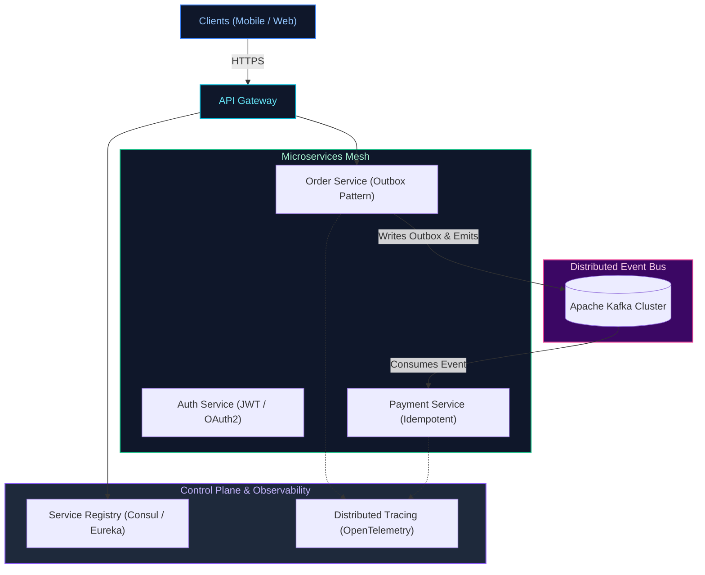
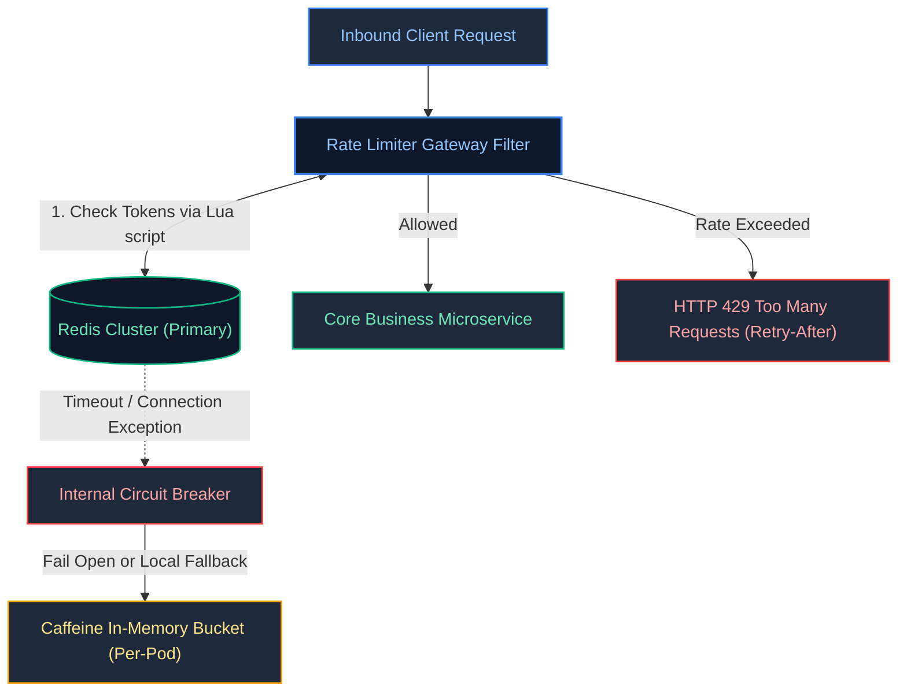

# 10. Microservices Architecture & System Design

A comprehensive guide answering all 26 questions on microservice patterns, Domain-Driven Design (DDD), service discovery, API gateways, resilience engineering (Resilience4j), distributed transactions (Saga, Outbox), idempotency, distributed tracing, the CAP theorem, database scaling, and real-world system designs (URL Shortener, Real-Time Chat, Distributed Top-K, and Sliding Window Anomaly Detection).

---

## Architectural Overview: Production Microservices Reference Architecture



---

## Table of Contents & Question Mapping

1. **Foundations, Domain-Driven Design & Discovery**
   - [Q1 & Q2. Microservices Advantages & Challenges & DDD Bounded Contexts](#q1--q2-microservices-advantages--challenges--ddd-bounded-contexts)
   - [Q3, Q4 & Q5. Service Discovery, Load Balancing (Eureka vs Consul) & The API Gateway Pattern](#q3--q4--q5-service-discovery-load-balancing-eureka-vs-consul--the-api-gateway-pattern)
2. **Communication, Security & Resiliency**
   - [Q6 & Q15. Synchronous vs Asynchronous Communication & Event-Driven Architecture](#q6--q15-synchronous-vs-asynchronous-communication--event-driven-architecture)
   - [Q7. Securing Microservices Communication (mTLS & JWT)](#q7-securing-microservices-communication-mtls--jwt)
   - [Q8, Q9 & Q10. Circuit Breakers (Resilience4j), Cascading Failures & Production Recovery Mechanisms](#q8-q9--q10-circuit-breakers-resilience4j-cascading-failures--production-recovery-mechanisms)
3. **Distributed Data, Transactions & Consistency**
   - [Q11 & Q12. Distributed Transactions (Saga & Outbox Patterns) & Eventual Consistency](#q11--q12-distributed-transactions-saga--outbox-patterns--eventual-consistency)
   - [Q13. Designing End-to-End Idempotency in Payment Processing](#q13-designing-end-to-end-idempotency-in-payment-processing)
   - [Q14. Command Query Responsibility Segregation (CQRS) Pattern](#q14-command-query-responsibility-segregation-cqrs-pattern)
4. **Observability, Contracts & Distributed Theory**
   - [Q16 & Q17. Distributed Tracing, Centralized Logging & Semantic Monitoring](#q16--q17-distributed-tracing-centralized-logging--semantic-monitoring)
   - [Q18 & Q19. Consumer-Driven Contracts (CDC) & API Backward Compatibility](#q18--q19-consumer-driven-contracts-cdc--api-backward-compatibility)
   - [Q20 & Q21. The CAP Theorem & Database Scaling Strategies](#q20--q21-the-cap-theorem--database-scaling-strategies)
   - [Q22. YAML Configuration & Declarative Infrastructure](#q22-yaml-configuration--declarative-infrastructure)
5. **System Design & High-Scale Algorithms**
   - [Q23. System Design: Scalable URL Shortener (bit.ly)](#q23-system-design-scalable-url-shortener-bitly)
   - [Q24. System Design: High-Throughput Real-Time Chat (Millions of Msgs/sec)](#q24-system-design-high-throughput-real-time-chat-millions-of-msgssec)
   - [Q25. Distributed Algorithm: Finding Top K Elements Across Distributed Servers](#q25-distributed-algorithm-finding-top-k-elements-across-distributed-servers)
   - [Q26. Streaming Algorithm: Real-Time Anomaly Detection Over Rolling Windows](#q26-streaming-algorithm-real-time-anomaly-detection-over-rolling-windows)

---

# 1. Foundations, Domain-Driven Design & Discovery

---

### Q1 & Q2. Microservices Advantages & Challenges & DDD Bounded Contexts
*(Grouped together: Architecture Foundations and Domain Decomposition)*  
**Topic Covered:** Microservice Architecture & Strategic Domain-Driven Design  
- **Advantages:** Autonomous deployment, polyglot data persistence, fine-grained fault isolation.
- **Challenges:** Distributed data consistency, complex network latency, operational overhead.
- **DDD Bounded Context:** An explicit conceptual boundary within which a specific domain model applies. Microservices must strictly map to Bounded Contexts to maintain loose architectural coupling.

---

### Q3, Q4 & Q5. Service Discovery, Load Balancing (Eureka vs Consul) & The API Gateway Pattern
*(Grouped together: Traffic Ingress & Discovery Architecture)*  
**Topic Covered:** Service Mesh, Edge Routing & Registration  
- **Eureka:** AP system (favors availability over strict consistency) using peer-to-peer heartbeat replication. Java-centric.
- **Consul:** CP system using the Raft consensus protocol. Multi-datacenter, language-agnostic with built-in KV store and service mesh features.
- **API Gateway:** Reverse proxy handling protocol conversion, SSL termination, centralized authentication/authorization, and rate limiting.

---

# 2. Communication, Security & Resiliency

---

### Q6 & Q15. Synchronous vs Asynchronous Communication & Event-Driven Architecture
*(Grouped together: Inter-Service Communication Styles)*  
**Topic Covered:** Integration Paradigms & Messaging  
- Synchronous (REST/gRPC): Client blocks waiting for immediate result. Prone to cascading latency.
- Asynchronous Event-Driven (Kafka): Services emit domain events; consumers process independently. Provides peak traffic shaving and loose coupling.

---

### Q7. Securing Microservices Communication (mTLS & JWT)
**Topic Covered:** Zero-Trust Microservice Security  
Use mutual TLS (mTLS) for cryptographic transport-layer identity and packet encryption, coupled with internal JWT Bearer token propagation across downstream calls.

---

### Q8, Q9 & Q10. Circuit Breakers (Resilience4j), Cascading Failures & Production Recovery Mechanisms
*(Grouped together: Production Resiliency Architecture)*  
**Topic Covered:** Fault Tolerance & Cascade Mitigation  
- **Circuit Breaker States:** `CLOSED` (normal) $\to$ `OPEN` (error rate $> 50\%$, fails fast immediately) $\to$ `HALF_OPEN` (trial requests to evaluate recovery).
- **Preventing Cascading Failures:** Combine circuit breakers with **Bulkheads** (limiting concurrent calls per dependency), timeouts, exponential backoff retries, and fallback methods.

---

# 3. Distributed Data, Transactions & Consistency

---

### Q11 & Q12. Distributed Transactions (Saga & Outbox Patterns) & Eventual Consistency
*(Grouped together: Distributed Consistency Models)*  
**Topic Covered:** Saga Orchestration & Transactional Outbox  
- **Saga Pattern:** Decomposes a distributed transaction into a sequence of local database transactions. If any step fails, compensating transactions execute in reverse order.
- **Transactional Outbox Pattern:** Writes domain data and outbound events into a local database `outbox_table` atomically within the same ACID transaction. A Debezium CDC engine reads the database transaction log (WAL) and publishes events to Kafka, eliminating the Dual-Write problem.
- **Eventual Consistency:** Replaces strict 2PC locking with asynchronous convergence.

---

### Q13. Designing End-to-End Idempotency in Payment Processing
**Topic Covered:** Financial Concurrency & Duplicate Prevention  
1. Client generates unique UUID `Idempotency-Key`.
2. Service acquires atomic distributed lock in Redis (`SET lock:key "LOCKED" NX EX 30`).
3. Query `payments` table for existing `idempotency_key` via database unique constraint (`UNIQUE(idempotency_key)`).
4. If exists, return cached response; otherwise, process payment and commit.

---

### Q14. Command Query Responsibility Segregation (CQRS) Pattern
**Topic Covered:** Data Architecture Separation  
Splits writes (Commands) from reads (Queries). Commands run against normalized transactional databases; Queries run against denormalized read-optimized stores (Elasticsearch/Read Replicas) synchronized via domain events.

---

# 4. Observability, Contracts & Distributed Theory

---

### Q16 & Q17. Distributed Tracing, Centralized Logging & Semantic Monitoring
*(Grouped together: Microservice Observability)*  
**Topic Covered:** Distributed Tracing & Telemetry  
- **Tracing:** Assigns unique `TraceId` and hops `SpanId`s across services via OpenTelemetry/Micrometer.
- **Centralized Logging:** JSON formatted logs indexed into Elasticsearch/Grafana Loki.
- **Semantic Monitoring:** Automated synthetic end-to-end user transactions running every minute against production to catch issues before users do.

---

### Q18 & Q19. Consumer-Driven Contracts (CDC) & API Backward Compatibility
*(Grouped together: API Evolution Standards)*  
**Topic Covered:** Contract Testing (Pact) & API Evolution  
Consumers define expected API request/response contracts tested against provider build pipelines. Providers ensure backward compatibility by never renaming or deleting existing fields and making new fields optional.

---

### Q20 & Q21. The CAP Theorem & Database Scaling Strategies
*(Grouped together: Distributed Systems & DB Scaling)*  
**Topic Covered:** Distributed Systems Theory & RDBMS Scaling  
Under network Partitions (P), choose between Consistency (C) and Availability (A). Scale databases using Read Replicas, Caching, and Horizontal Sharding by customer ID.

---

### Q22. YAML Configuration & Declarative Infrastructure
**Topic Covered:** GitOps & Cloud Deployment  
YAML provides human-readable declarative configuration for Spring Boot profiles, Kubernetes manifests, and CI/CD pipelines.

---

# 5. System Design & High-Scale Algorithms

---

### Q23. System Design: Scalable URL Shortener (bit.ly)
**Topic Covered:** High-Scale System Design  
- Base62 encoding (`[a-zA-Z0-9]`) yields $62^7 \approx 3.5$ trillion unique keys.
- Key Generation Service pre-allocates ID ranges to worker nodes to prevent coordination bottlenecks.
- Store in NoSQL database (Cassandra) with an in-memory Redis LRU cache.

---

### Q24. System Design: High-Throughput Real-Time Chat (Millions of Msgs/sec)
**Topic Covered:** Real-Time Push Architectures  
- Stateful **WebSocket** gateway connections.
- Redis Cluster Pub/Sub or Kafka routing messages between chat server nodes.
- Message history persisted asynchronously to Cassandra partitioned by `conversation_id`, sorted by `timestamp`.

---

### Q25. Distributed Algorithm: Finding Top K Elements Across Distributed Servers
**Topic Covered:** Big Data & Stream Algorithms  
Each worker maintains a local **Min-Heap of size $K$** ($O(N \log K)$). Workers send their top $K$ items to a central coordinator that merges the results using a final Min-Heap. Use Count-Min Sketch for memory-constrained streaming data.

---

### Q26. Streaming Algorithm: Real-Time Anomaly Detection Over Rolling Windows
**Topic Covered:** Real-Time Stream Analytics  
Maintain a 5-minute sliding window over event amounts. Calculate running Mean ($\mu$) and Standard Deviation ($\sigma$) using Welford's algorithm. Flag anomaly if $Z = \frac{|X - \mu|}{\sigma} > 3.0$.

---

### Q27. Designing a Distributed Rate Limiter in Java with Redis Fallback Degradation
**Topic Covered:** Traffic Shaping, Token Bucket & Resilient Fallbacks  
**Difficulty:** `[Hard]`

#### Architectural Overview
When defending APIs against abusive clients, a distributed Token Bucket or Sliding Window algorithm tracks client request rates in Redis via atomic Lua scripts. If Redis becomes unreachable (network partition or outage), the system must **fail open or degrade gracefully** to an in-memory local cache (Caffeine / Guava) rather than dropping 100% of legitimate client traffic:



---

### Q28. Custom Generic Circuit Breaker Implementation in Plain Java
**Topic Covered:** Fault Tolerance & State Machine Architecture  
**Difficulty:** `[Hard]`

#### Architectural Overview
A Circuit Breaker monitors downstream call failures using a three-state state machine:
1. **`CLOSED`**: Normal operation. Calls pass through. If error rate over a sliding window $> \text{threshold}$, transition to `OPEN`.
2. **`OPEN`**: Fails fast immediately without invoking the downstream dependency, returning cached fallback or throwing `CallNotPermittedException`. Starts reset timer.
3. **`HALF_OPEN`**: After reset timeout, allows a trial batch of probe requests. If successful, transitions to `CLOSED`; if failures persist, reopens.

```java
package com.enterprise.resilience;

import java.util.concurrent.atomic.AtomicInteger;
import java.util.concurrent.atomic.AtomicReference;
import java.util.function.Supplier;

public final class SimpleCircuitBreaker {

    public enum State { CLOSED, OPEN, HALF_OPEN }

    private final AtomicReference<State> state = new AtomicReference<>(State.CLOSED);
    private final AtomicInteger failureCount = new AtomicInteger(0);
    private final int failureThreshold;
    private final long resetTimeoutMs;
    private volatile long lastStateChangeTimestamp;

    public SimpleCircuitBreaker(int failureThreshold, long resetTimeoutMs) {
        this.failureThreshold = failureThreshold;
        this.resetTimeoutMs = resetTimeoutMs;
        this.lastStateChangeTimestamp = System.currentTimeMillis();
    }

    public <T> T execute(Supplier<T> action, Supplier<T> fallback) {
        State current = state.get();

        if (current == State.OPEN) {
            if (System.currentTimeMillis() - lastStateChangeTimestamp > resetTimeoutMs) {
                if (state.compareAndSet(State.OPEN, State.HALF_OPEN)) {
                    lastStateChangeTimestamp = System.currentTimeMillis();
                }
            } else {
                return fallback.get(); // Fail fast!
            }
        }

        try {
            T result = action.get();
            onSuccess();
            return result;
        } catch (Exception ex) {
            onFailure();
            return fallback.get();
        }
    }

    private void onSuccess() {
        failureCount.set(0);
        state.set(State.CLOSED);
    }

    private void onFailure() {
        if (failureCount.incrementAndGet() >= failureThreshold) {
            state.set(State.OPEN);
            lastStateChangeTimestamp = System.currentTimeMillis();
        }
    }
}
```

---

### Q29. High-Throughput Backend Architecture for Handling Thousands of Concurrent Requests
**Topic Covered:** Non-Blocking I/O, Thread Sizing & Connection Pools  
**Difficulty:** `[Expert]`

#### Architectural Overview
Handling tens of thousands of concurrent requests without server thread pool collapse requires decoupling I/O wait from OS threads:
1. **Lightweight Threading**: Migrate from classic 1-thread-per-request platform pools to **Java 21 Virtual Threads** (`Tomcat virtual threads enabled`) or non-blocking reactive Netty (Spring WebFlux).
2. **Database Connection Sizing**: A common antipattern is setting HikariCP to 500 connections. Optimal Hikari pool size follows PostgreSQL math: $\text{Connections} = (\text{CPU Cores} \times 2) + \text{Disk Spindles}$. Excessive connections cause lock contention and CPU context switching thrashing.
3. **Caching & Asynchronous Decoupling**: Cache static/idempotent reads in Redis; ingest asynchronous mutations into Kafka and return `202 Accepted` with correlation status endpoints.

---

### Q30. High-Availability Payment Processing Platform with Zero Double-Charges
**Topic Covered:** Financial System Design, Idempotency & State Machines  
**Difficulty:** `[Expert]`

#### Architectural Overview
Payment platforms must guarantee zero double-charging even under client retries, network dropouts, or worker crashes:
1. **Client-Supplied Idempotency Key**: Client generates a `UUIDv4` stored in Redis with `SET key lock NX EX 120`. If duplicate arrives while in-flight, return `409 Conflict`.
2. **Two-Phase Payment State Machine**: `INITIATED` $\to$ `PENDING_GATEWAY` $\to$ `CHARGED` / `FAILED`. Database transitions enforced via optimistic `@Version` checks.
3. **Reconciliation Worker**: Background cron periodically queries the payment gateway API for unresolved `PENDING_GATEWAY` payments to reconcile status.

---

### Q31. Saga Pattern: Choreography vs Orchestration Decision Framework
**Topic Covered:** Distributed Transactions Without 2PC  
**Difficulty:** `[Hard]`

#### Architectural Overview
| Evaluation Dimension | Saga Choreography (Event-Driven) | Saga Orchestration (Command-Driven) |
| :--- | :--- | :--- |
| **Coordination Model** | Decentralized; services react to domain events | Centralized orchestrator service coordinates steps |
| **Coupling** | Loosely coupled pub/sub | Orchestrator knows all workflow participants |
| **Complexity** | Simple for 2–4 services; hard to trace for 5+ | Single place to inspect workflow state and compensations |
| **Cyclic Dependency Risk** | High as event graph grows | Low (directed command flows) |
| **Best Production Use Case** | Lightweight workflows (e.g., user signup email trigger) | Mission-critical financial or order fulfillment pipelines |
