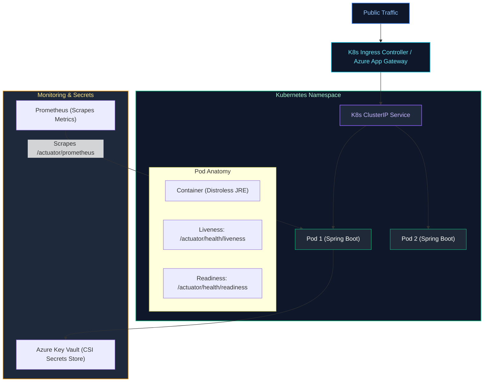

# 11. Cloud Computing, Containers, Kubernetes & DevOps (Azure & AWS)

A comprehensive guide answering all 17 questions on Docker containerization, Kubernetes orchestration, health probes, autoscaling, CI/CD pipelines, modern deployment strategies, production observability, and enterprise cloud architecture across Microsoft Azure and AWS.

---

## Architectural Overview: Kubernetes Microservice Ingress & Pod Architecture



---

## Table of Contents & Question Mapping

1. **Docker Containerization Engineering**
   - [Q1 & Q2. Docker Image vs Container & Multi-Stage Dockerfile for Spring Boot](#q1--q2-docker-image-vs-container--multi-stage-dockerfile-for-spring-boot)
2. **Kubernetes Core Orchestration & Scaling**
   - [Q3. Liveness vs Readiness Probes in Kubernetes](#q3-liveness-vs-readiness-probes-in-kubernetes)
   - [Q4. Kubernetes Autoscaling (HPA, VPA, Cluster Autoscaler) & Service Discovery](#q4-kubernetes-autoscaling-hpa-vpa-cluster-autoscaler--service-discovery)
3. **CI/CD Pipelines & Zero-Downtime Deployments**
   - [Q5. Structuring a Robust CI/CD Pipeline (GitHub Actions / Jenkins)](#q5-structuring-a-robust-cicd-pipeline-github-actions--jenkins)
   - [Q6. Deployment Strategies: Blue-Green vs Canary vs Rolling](#q6-deployment-strategies-blue-green-vs-canary-vs-rolling)
   - [Q7. Enterprise Production Monitoring & Observability Stack](#q7-enterprise-production-monitoring--observability-stack)
4. **Microsoft Azure Cloud Infrastructure & Services**
   - [Q8. Azure Resource Hierarchy & Resource Groups](#q8-azure-resource-hierarchy--resource-groups)
   - [Q9. Azure Identity: IAM Roles, Managed Identities & Service Principals](#q9-azure-identity-iam-roles-managed-identities--service-principals)
   - [Q10 & Q15. Azure Storage (Blob vs Files) & Queues (Service Bus vs Storage Queue)](#q10--q15-azure-storage-blob-vs-files--queues-service-bus-vs-storage-queue)
   - [Q11. Azure Load Balancer Architecture & Types](#q11-azure-load-balancer-architecture--types)
   - [Q12. Horizontal vs Vertical Scaling in Azure](#q12-horizontal-vs-vertical-scaling-in-azure)
   - [Q13 & Q14. Azure Compute Models (VM vs App Service vs Functions vs AKS) & Zero-Downtime Deployments](#q13--q14-azure-compute-models-vm-vs-app-service-vs-functions-vs-aks--zero-downtime-deployments)
   - [Q16. Azure Compliance, Governance & Secret Management](#q16-azure-compliance-governance--secret-management)
5. **AWS Network Architecture**
   - [Q17. AWS Virtual Private Cloud (VPC) & Network Resource Isolation](#q17-aws-virtual-private-cloud-vpc--network-resource-isolation)

---

# 1. Docker Containerization Engineering

---

### Q1 & Q2. Docker Image vs Container & Multi-Stage Dockerfile for Spring Boot
*(Grouped together: Docker Fundamentals & Production Packaging)*  
**Topic Covered:** Containerization Architecture  
- **Docker Image:** Immutable template consisting of layered filesystems.
- **Docker Container:** Isolated running instance using Linux namespaces and cgroups.

#### Multi-Stage Distroless Spring Boot Dockerfile:
```dockerfile
# Stage 1: Build & Layer Extraction
FROM eclipse-temurin:21-jdk-alpine AS builder
WORKDIR /workspace
COPY pom.xml .
COPY src ./src
RUN ./mvnw clean package -DskipTests
RUN java -Djarmode=layertools -jar target/*.jar extract

# Stage 2: Runtime
FROM eclipse-temurin:21-jre-alpine
WORKDIR /app
RUN addgroup -S appgroup && adduser -S appuser -G appgroup
USER appuser
COPY --from=builder /workspace/dependencies/ ./
COPY --from=builder /workspace/spring-boot-loader/ ./
COPY --from=builder /workspace/snapshot-dependencies/ ./
COPY --from=builder /workspace/application/ ./
EXPOSE 8080
ENTRYPOINT ["java", "-XX:+UseContainerSupport", "-XX:MaxRAMPercentage=75.0", "org.springframework.boot.loader.launch.JarLauncher"]
```

---

# 2. Kubernetes Core Orchestration & Scaling

---

### Q3. Liveness vs Readiness Probes in Kubernetes
**Topic Covered:** Container Lifecycle Health Checks  
- **Liveness Probe (`/actuator/health/liveness`):** Detects unrecoverable deadlocks or frozen processes. When it fails, Kubelet **kills and restarts the container**.
- **Readiness Probe (`/actuator/health/readiness`):** Detects whether the pod is ready to accept traffic (e.g. caches initialized). When it fails, K8s **removes the pod from Service traffic routing without restarting it**.

---

### Q4. Kubernetes Autoscaling (HPA, VPA, Cluster Autoscaler) & Service Discovery
**Topic Covered:** Dynamic Cluster Orchestration  
- **HPA:** Adds/removes pod replicas based on CPU/Memory or queue lag via KEDA.
- **VPA:** Dynamically adjusts CPU/RAM requests of existing pods.
- **Cluster Autoscaler:** Provisions additional cloud VM nodes when pods cannot be scheduled.
- **Service Discovery:** CoreDNS creates internal DNS entries (`service.namespace.svc.cluster.local`); `kube-proxy` routes traffic to healthy pod IPs.

---

# 3. CI/CD Pipelines & Zero-Downtime Deployments

---

### Q5. Structuring a Robust CI/CD Pipeline (GitHub Actions / Jenkins)
**Topic Covered:** DevOps Automation Pipelines  
1. Compilation & Unit Tests.
2. Static Analysis (SonarQube) & Trivy Container Security Scan.
3. Integration Tests via Testcontainers.
4. Build multi-stage Docker image and push to Azure Container Registry (ACR) / ECR.
5. Deploy to Kubernetes via ArgoCD GitOps.

---

### Q6. Deployment Strategies: Blue-Green vs Canary vs Rolling
**Topic Covered:** Production Deployment Topologies  
- **Rolling (K8s Default):** Incrementally updates pods. Low cost; both versions run concurrently during rollout.
- **Blue-Green:** Two parallel environments. Instant cutover and rollback; requires double compute capacity during release.
- **Canary:** Routes 5% of production traffic to the new version, verifies telemetry/error rates, then proceeds to 100%. Safest blast radius.

---

### Q7. Enterprise Production Monitoring & Observability Stack
**Topic Covered:** Full-Stack Production Telemetry  
Metrics scraped from Spring Boot Actuator by **Prometheus** and visualized in **Grafana**; logs aggregated into **Elasticsearch / Azure Monitor Log Analytics**; distributed traces sent to **Grafana Tempo / OpenTelemetry**.

---

# 4. Microsoft Azure Cloud Infrastructure & Services

---

### Q8. Azure Resource Hierarchy & Resource Groups
**Topic Covered:** Cloud Governance & Scoping  
Management Groups $\to$ Subscriptions $\to$ Resource Groups $\to$ Resources. Resource groups organize related services sharing a unified lifecycle.

---

### Q9. Azure Identity: IAM Roles, Managed Identities & Service Principals
**Topic Covered:** Azure Active Directory (Entra ID)  
- **Service Principal:** Identity for automated CI/CD tools using client secrets/certs.
- **Managed Identity (Recommended):** Eliminates password/secret management entirely; Azure manages internal credentials automatically for the resource.

---

### Q10 & Q15. Azure Storage (Blob vs Files) & Queues (Service Bus vs Storage Queue)
*(Grouped together: Azure Storage & Messaging Selection)*  
**Topic Covered:** Azure PaaS Storage & Queue Selection  
- **Blob Storage:** HTTP object store for unstructured files.
- **Azure Files:** Fully managed file shares accessible via SMB/NFS mounted directly as pod persistent volumes.
- **Storage Queue:** High-volume simple queues (>80GB).
- **Service Bus Queue:** Enterprise messaging with duplicate detection, transactions, sessions, and dead letter queues.

---

### Q11. Azure Load Balancer Architecture & Types
**Topic Covered:** Cloud Traffic Distribution  
- **Azure Load Balancer:** Layer 4 (TCP/UDP) ultra-low latency routing.
- **Azure Application Gateway:** Layer 7 (HTTP/HTTPS) with SSL termination, URL path routing, and Web Application Firewall (WAF).

---

### Q12. Horizontal vs Vertical Scaling in Azure
**Topic Covered:** Capacity Planning  
Vertical scaling (Scale-up) increases VM CPU/RAM size (incurs reboot downtime). Horizontal scaling (Scale-out) adds VMSS or AKS node instances without downtime.

---

### Q13 & Q14. Azure Compute Models (VM vs App Service vs Functions vs AKS) & Zero-Downtime Deployments
*(Grouped together: Azure Compute & AKS Deployments)*  
**Topic Covered:** Cloud Compute Paradigms & AKS  
- VM (IaaS) $\to$ App Service (PaaS) $\to$ Azure Functions (Serverless FaaS) $\to$ AKS (Container Orchestration).
- **Zero-Downtime in AKS:** Use RollingUpdate with `maxUnavailable: 0`, readiness probes, and Spring Boot graceful shutdown (`server.shutdown=graceful`).

---

### Q16. Azure Compliance, Governance & Secret Management
**Topic Covered:** Enterprise Security Posture  
Enforce governance with **Azure Policy**; store secrets, keys, and certificates in **Azure Key Vault** mounted into AKS via Secrets Store CSI Driver.

---

# 5. AWS Network Architecture

---

### Q17. AWS Virtual Private Cloud (VPC) & Network Resource Isolation
**Topic Covered:** Cloud Virtual Networking  
VPCs isolate cloud resources using Public Subnets (connected to Internet Gateway for public ingress) and Private Subnets (hosting Spring Boot apps and RDS, accessing the internet for patches strictly via a NAT Gateway).
