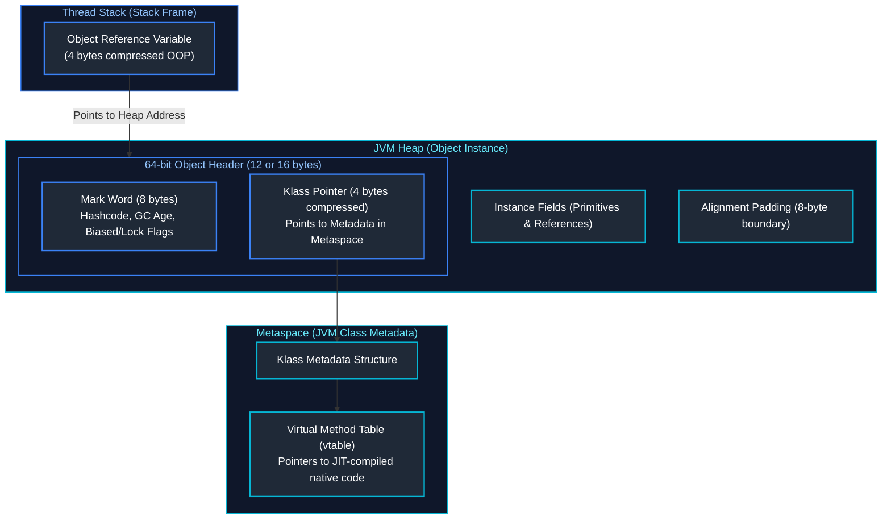
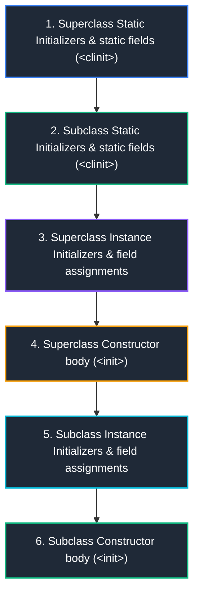

# 01. Core Java & Object-Oriented Programming

A comprehensive, production-grade guide to Java language mechanics, JVM object memory layout, encapsulation, inheritance, polymorphism, dynamic method dispatch, abstraction, keywords, pass-by-value semantics, and the `Object` class contract in modern Java.

---

## Java Object Model & Virtual Method Dispatch Architecture



---

## Table of Contents
1. [JVM Object Model & Memory Layout](#1-jvm-object-model--memory-layout)
   - [1.1 64-bit JVM Object Header (Mark Word & Klass Word)](#11-64-bit-jvm-object-header-mark-word--klass-word)
   - [1.2 Object Allocation & Lifecycle in Heap (TLAB)](#12-object-allocation--lifecycle-in-heap-tlab)
2. [Core Object-Oriented Principles & Mechanics](#2-core-object-oriented-principles--mechanics)
   - [2.1 Encapsulation & Invariant Protection](#21-encapsulation--invariant-protection)
   - [2.2 Inheritance & Class Initialization Order](#22-inheritance--class-initialization-order)
   - [2.3 Polymorphism & Dynamic Method Dispatch (`vtable`)](#23-polymorphism--dynamic-method-dispatch-vtable)
   - [2.4 Abstraction: Abstract Class vs Interface](#24-abstraction-abstract-class-vs-interface)
3. [Java Keywords & Language Guarantees](#3-java-keywords--language-guarantees)
   - [3.1 `this` & `super` Constructor Chaining](#31-this--super-constructor-chaining)
   - [3.2 `static` Keyword & Metaspace Storage](#32-static-keyword--metaspace-storage)
   - [3.3 `final` Keyword & JMM Safe Publication](#33-final-keyword--jmm-safe-publication)
   - [3.4 `instanceof` Operator & Type Safety](#34-instanceof-operator--type-safety)
4. [Method Dispatch: Overloading vs Overriding](#4-method-dispatch-overloading-vs-overriding)
   - [4.1 Method Overloading (Compile-Time Resolution)](#41-method-overloading-compile-time-resolution)
   - [4.2 Method Overriding (Runtime Dynamic Binding)](#42-method-overriding-runtime-dynamic-binding)
   - [4.3 Covariant Return Types & Exception Narrowing Rules](#43-covariant-return-types--exception-narrowing-rules)
5. [Access Modifiers & Architectural Scoping](#5-access-modifiers--architectural-scoping)
   - [5.1 Access Matrix: `public`, `protected`, Package-Private, `private`](#51-access-matrix-public-protected-package-private-private)
   - [5.2 Package-Private as an Architectural Encapsulation Boundary](#52-package-private-as-an-architectural-encapsulation-boundary)
6. [Java Value Semantics, Primitives & Wrappers](#6-java-value-semantics-primitives--wrappers)
   - [6.1 Strictly Pass-by-Value Mechanics](#61-strictly-pass-by-value-mechanics)
   - [6.2 Primitives vs Wrapper Classes & Autoboxing Hazards](#62-primitives-vs-wrapper-classes--autoboxing-hazards)
   - [6.3 The Integer Cache (`-128` to `127`) & Identity Pitfalls](#63-the-integer-cache--128-to-127--identity-pitfalls)
7. [Nested, Inner & Anonymous Classes](#7-nested-inner--anonymous-classes)
   - [7.1 Static Nested vs Non-Static Inner Classes](#71-static-nested-vs-non-static-inner-classes)
   - [7.2 The Hidden Outer `this` Reference Memory Leak Hazard](#72-the-hidden-outer-this-reference-memory-leak-hazard)
8. [The `Object` Class Master Contract](#8-the-object-class-master-contract)
   - [8.1 The `equals()` Contract Requirements](#81-the-equals-contract-requirements)
   - [8.2 The `hashCode()` Contract & Bucket Distribution](#82-the-hashcode-contract--bucket-distribution)
   - [8.3 `toString()`, `getClass()` & Why `clone()` is an Anti-Pattern](#83-tostring-getclass--why-clone-is-an-anti-pattern)
9. [Summary Comparison & Engineering Reference Matrix](#9-summary-comparison--engineering-reference-matrix)
10. [References & Further Reading](#10-references--further-reading)

---

# 1. JVM Object Model & Memory Layout

---

### 1.1 64-bit JVM Object Header (Mark Word & Klass Word)

Every object allocated on the HotSpot JVM heap contains an internal header preceding its instance fields:

```
+-------------------------------------------------------------------------+
|                          64-bit Object Header                           |
+------------------------------------+------------------------------------+
|         Mark Word (8 bytes)        |    Klass Pointer (4 or 8 bytes)    |
| (Identity Hash, GC Age, Locks)     | (Compressed OOP pointing to Klass) |
+------------------------------------+------------------------------------+
|                        Instance Fields Data                             |
| (Primitives & 4-byte Compressed Object Pointers)                        |
+-------------------------------------------------------------------------+
|                     Alignment Padding (0-7 bytes)                       |
| (Pads object to multiple of 8 bytes for 64-bit CPU cache alignment)     |
+-------------------------------------------------------------------------+
```

1. **Mark Word (64 bits / 8 bytes)**: Stores runtime metadata dynamically updated by the JVM:
   * **Hash Code**: Identity hash code generated when `System.identityHashCode(obj)` is called.
   * **GC Age**: 4 bits (values 0–15) tracking object survival cycles in Young Generation (survivor spaces) before promotion to Tenured/Old generation (Tenuring Threshold defaults to 15).
   * **Biased Locking / Lock Flags**: Tracks synchronization state: Normal, Biased, Lightweight (thin lock using basic object monitor), Heavyweight (OS mutex monitor), or Marked for GC.
2. **Klass Word (Compressed OOP - 32 bits / 4 bytes)**:
   * By default, on heaps $<32	ext{ GB}$, HotSpot enables `-XX:+UseCompressedClassPointers`, compressing 64-bit pointers down to 32 bits using 8-byte aligned shifts.
   * Points directly to the class metadata representation residing in **Metaspace**.
3. **Instance Data**: Fields defined in the class hierarchy ordered by the JVM for memory alignment (primitives grouped by size: `long`/`double` (8B), `int`/`float` (4B), `short`/`char` (2B), `byte`/`boolean` (1B), then references).
4. **Padding**: Every object size in HotSpot is aligned to a multiple of 8 bytes. If an object takes 28 bytes, 4 bytes of padding are appended to make it 32 bytes.

---

### 1.2 Object Allocation & Lifecycle in Heap (TLAB)

* **TLAB (Thread-Local Allocation Buffer)**: To avoid lock contention across hundreds of concurrent threads allocating objects simultaneously, the JVM assigns each thread a dedicated buffer within Eden space. Object allocation inside a TLAB is a simple, ultra-fast pointer-bump operation ($O(1)$).
* **Escape Analysis & Scalar Replacement**: If the HotSpot C2 JIT compiler determines an object does not escape the allocating method, heap allocation is omitted entirely; the object's fields are decomposed directly into CPU registers or stack slots (**Scalar Replacement**).

---

# 2. Core Object-Oriented Principles & Mechanics

---

### 2.1 Encapsulation & Invariant Protection

Encapsulation is not merely making fields `private` and generating getters and setters. It is the architectural discipline of **protecting domain invariants** and enforcing business rules at the object boundary.

#### Anti-Pattern: Anemic Domain Model with Leaky Setters
```java
// ❌ ANTI-PATTERN: Leaky setters bypass validation; state can become corrupt
public class Account {
    private BigDecimal balance;
    public BigDecimal getBalance() { return balance; }
    public void setBalance(BigDecimal balance) { this.balance = balance; }
}
// Any caller can execute: account.setBalance(new BigDecimal("-99999999.00"));
```

#### Production Solution: Invariant Enforcement & Defensive Copying
```java
public final class BankAccount {
    private final String accountNumber;
    private BigDecimal balance;
    private final List<TransactionRecord> transactionHistory;

    public BankAccount(String accountNumber, BigDecimal initialDeposit) {
        if (accountNumber == null || accountNumber.isBlank()) {
            throw new IllegalArgumentException("Account number must be valid");
        }
        if (initialDeposit == null || initialDeposit.compareTo(BigDecimal.ZERO) < 0) {
            throw new IllegalArgumentException("Initial deposit cannot be negative");
        }
        this.accountNumber = accountNumber;
        this.balance = initialDeposit;
        this.transactionHistory = new ArrayList<>();
    }

    public synchronized void withdraw(BigDecimal amount) {
        Objects.requireNonNull(amount, "Withdrawal amount cannot be null");
        if (amount.compareTo(BigDecimal.ZERO) <= 0) {
            throw new IllegalArgumentException("Withdrawal amount must be strictly positive");
        }
        if (balance.compareTo(amount) < 0) {
            throw new InsufficientFundsException("Insufficient balance for withdrawal");
        }
        this.balance = this.balance.subtract(amount);
        this.transactionHistory.add(new TransactionRecord(UUID.randomUUID(), "DEBIT", amount, Instant.now()));
    }

    // Defensive Copying: Never expose mutable internal collections directly
    public List<TransactionRecord> getTransactionHistory() {
        return Collections.unmodifiableList(new ArrayList<>(transactionHistory));
    }
}
```

---

### 2.2 Inheritance & Class Initialization Order

When a subclass is instantiated, class initialization (`<clinit>`) and instance initialization (`<init>`) execute in strict hierarchical order:



#### Execution Order Example
```java
class BaseEntity {
    static { System.out.println("1. BaseEntity static init"); }
    { System.out.println("3. BaseEntity instance init"); }
    public BaseEntity() { System.out.println("4. BaseEntity constructor"); }
}

class UserEntity extends BaseEntity {
    static { System.out.println("2. UserEntity static init"); }
    { System.out.println("5. UserEntity instance init"); }
    public UserEntity() { System.out.println("6. UserEntity constructor"); }

    public static void main(String[] args) {
        new UserEntity();
    }
}
```

Class initialization safely publishes initialized static state, but it does not make later mutations of that state thread-safe. See [Topic 04: Java Concurrency & Multithreading](./04_java_concurrency_multithreading.md#3-java-memory-model-jmm) for visibility and synchronization guarantees.

---

### 2.3 Polymorphism & Dynamic Method Dispatch (`vtable`)

Polymorphism enables treating instances of different derived types uniformly via their common base type or interface.

#### Dynamic Dispatch Mechanics: Virtual Method Table (`vtable`)
* In the HotSpot JVM, every loaded class possesses a **vtable** in Metaspace.
* When code calls `account.calculateInterest()`, the bytecode instruction is `invokevirtual`.
* At runtime, the JVM looks up the target object's `Klass` pointer from its object header, traverses the class's `vtable`, and dispatches to the exact implementation for that concrete class.
* **JIT Optimization**: If the HotSpot C2 compiler observes that only one concrete subclass is ever executed at a call-site (**monomorphic call-site**), it performs **Direct Method Inlining**, eliminating call overhead entirely. If two classes are observed (**bimorphic**), it generates conditional inline checks.

```java
public abstract class PaymentProcessor {
    public abstract PaymentReceipt process(PaymentRequest request);
}

public class StripePaymentProcessor extends PaymentProcessor {
    @Override
    public PaymentReceipt process(PaymentRequest request) {
        return executeStripeCharge(request);
    }
}

public class PaypalPaymentProcessor extends PaymentProcessor {
    @Override
    public PaymentReceipt process(PaymentRequest request) {
        return executePaypalCapture(request);
    }
}
```

---

### 2.4 Abstraction: Abstract Class vs Interface

| Dimension | Abstract Class | Interface |
| :--- | :--- | :--- |
| **Inheritance Model** | Single inheritance (`extends BaseClass`) | Multiple inheritance of type (`implements A, B, C`) |
| **State & Instance Fields** | Can maintain mutable instance fields and constructors | Only `public static final` constants; cannot hold mutable state |
| **Constructors** | Yes (called during subclass instantiation) | No constructors |
| **Methods** | Abstract, concrete, `protected`, `final`, `private` | Abstract, `default`, `static`, `private` (Java 9+) |
| **Primary Architectural Intent** | Code reuse, skeletal templates, and shared state across tightly related classes | Behavioral capability contracts across unrelated classes |

---

# 3. Java Keywords & Language Guarantees

---

### 3.1 `this` & `super` Constructor Chaining

* `this`: Reference to the current instance. `this(...)` invokes an overloaded constructor in the same class. Must be the **first line** of the constructor.
* `super`: Reference to the parent class. `super(...)` invokes a parent constructor. If omitted, the compiler implicitly inserts a call to `super()`.

```java
public class SecureToken {
    private final String token;
    private final Instant expiresAt;

    public SecureToken(String token) {
        this(token, Instant.now().plus(Duration.ofHours(1))); // Chaining via this()
    }

    public SecureToken(String token, Instant expiresAt) {
        super(); // Implicit call to Object()
        this.token = Objects.requireNonNull(token);
        this.expiresAt = Objects.requireNonNull(expiresAt);
    }
}
```

---

### 3.2 `static` Keyword & Metaspace Storage

* `static` fields and methods belong to the class, not individual object instances.
* Stored in **Metaspace** as part of the class metadata structure.
* **Thread Safety of `<clinit>`**: Class loading and static block execution are guaranteed to be thread-safe by the JVM specification. The JVM acquires an internal initialization lock on the `Class` object during `<clinit>`, making static initializer blocks inherently synchronized.

---

### 3.3 `final` Keyword & JMM Safe Publication

1. **`final` Variable**: Cannot be reassigned once initialized.
   * *Compile-time constant*: `public static final int MAX_RETRIES = 5;` (inlined directly into consuming bytecodes).
   * *Blank final*: Can be assigned once inside the constructor.
2. **`final` Method**: Cannot be overridden by subclasses (allows HotSpot JIT compiler to aggressively inline method bodies).
3. **`final` Class**: Cannot be subclassed (e.g., `java.lang.String`, `java.lang.Integer`).
4. **JMM Safe Publication Guarantee**: Under the Java Memory Model (JSR-133), fields declared `final` receive a **Freeze Action** upon constructor completion. Any thread reading a reference to an object whose fields are `final` is guaranteed to observe the fully initialized final values without requiring explicit synchronization or `volatile`.

---

### 3.4 `instanceof` Operator & Type Safety

Tests whether an object reference is an instance of a specified class or implements an interface:

```java
// Traditional verbose casting
if (obj instanceof OrderEntity) {
    OrderEntity order = (OrderEntity) obj;
    order.cancel();
}

// Java 16+ Pattern Matching for instanceof (eliminates boilerplate cast)
if (obj instanceof OrderEntity order) {
    order.cancel();
}
```

---

# 4. Method Dispatch: Overloading vs Overriding

---

### 4.1 Method Overloading (Compile-Time Resolution)
* Multiple methods in the same class sharing the same name but different parameter lists.
* **Resolution**: Determined strictly at **compile time** based on reference types.
* **Precedence Order**:
  1. Exact primitive match (`int` $	o$ `int`)
  2. Primitive widening (`int` $	o$ `long` $	o$ `float` $	o$ `double`)
  3. Autoboxing (`int` $	o$ `Integer`)
  4. Varargs (`int...`)

---

### 4.2 Method Overriding (Runtime Dynamic Binding)
* Redefining a parent class method in a subclass with identical signature.
* **Resolution**: Determined at **runtime** based on actual heap object instance type via `invokevirtual`.

---

### 4.3 Covariant Return Types & Exception Narrowing Rules

When overriding a method in Java:
1. **Return Type**: Can be covariant (a subclass of the parent return type).
2. **Access Modifier**: Can be broader or identical, never narrower (`protected` $	o$ `public` is allowed; `public` $	o$ `protected` is rejected).
3. **Exceptions**: Can declare identical, narrower (subclasses), or fewer checked exceptions; can **never declare new or broader checked exceptions**.

```java
class Repository {
    protected Collection<Order> findAll() throws IOException {
        return List.of();
    }
}

class PostgresOrderRepository extends Repository {
    // ✅ Valid: public (broader), List<Order> (covariant return), FileNotFoundException (narrower exception)
    @Override
    public List<Order> findAll() throws FileNotFoundException {
        return List.of();
    }
}
```

---

# 5. Access Modifiers & Architectural Scoping

---

### 5.1 Access Matrix: `public`, `protected`, Package-Private, `private`

| Modifier | Same Class | Same Package | Subclass (Different Package) | World (Everywhere) |
| :--- | :---: | :---: | :---: | :---: |
| `private` | ✅ Yes | ❌ No | ❌ No | ❌ No |
| **Package-Private (default)** | ✅ Yes | ✅ Yes | ❌ No | ❌ No |
| `protected` | ✅ Yes | ✅ Yes | ✅ Yes (via inheritance) | ❌ No |
| `public` | ✅ Yes | ✅ Yes | ✅ Yes | ✅ Yes |

---

### 5.2 Package-Private as an Architectural Encapsulation Boundary

In enterprise Spring Boot codebases, developers routinely declare all classes and methods `public`. This is an architectural anti-pattern that destroys encapsulation.

**Production Architecture Pattern**:
* Expose only the Service Interface and DTOs as `public`.
* Keep the concrete `@Service` implementation, `@Repository` interface, and entity mappers **package-private** within their domain package (e.g., `com.company.order.internal`).
* This guarantees that external modules cannot bypass the domain service boundary or query the database directly.

---

# 6. Java Value Semantics, Primitives & Wrappers

---

### 6.1 Strictly Pass-by-Value Mechanics

Java is **strictly Pass-by-Value**. There is no pass-by-reference in Java:
* When passing a **primitive** (`int`, `boolean`), a copy of the primitive value is pushed onto the method's stack frame.
* When passing an **object reference**, a copy of the **pointer/address value** is passed. Mutating the object via that pointer affects the heap object; reassigning the parameter variable inside the method merely reassigns the local stack copy and has zero impact on the caller's reference.

```java
public class PassByValueDemo {
    public static void modify(Customer c, int id) {
        c.setName("Alice Updated"); // Affects heap object!
        id = 999;                   // Affects only local stack frame!
        c = new Customer("Bob");    // Reassigns local pointer copy only; caller is unaffected!
    }
}
```

---

### 6.2 Primitives vs Wrapper Classes & Autoboxing Hazards

1. **Memory Footprint**:
   * Primitive `int`: 4 bytes.
   * `Integer` object on 64-bit JVM: 16 bytes (8-byte Mark Word + 4-byte Klass pointer + 4-byte `int` field + 0 padding) $	o$ **$4	imes$ memory consumption!**
2. **NullPointerException on Autounboxing**:
   ```java
   // ❌ PRODUCTION OUTAGE TRAP: Unboxing a null wrapper throws NPE
   Integer counter = null;
   if (counter > 0) { // Throws java.lang.NullPointerException!
       // ...
   }
   ```
3. **CPU Cache Line Efficiency**: Primitive arrays (`int[]`) reside in contiguous CPU memory lines (L1/L2 cache pre-fetching). Object arrays (`Integer[]`) are arrays of references pointing to dispersed heap addresses, causing constant cache misses.

---

### 6.3 The Integer Cache (`-128` to `127`) & Identity Pitfalls

The JVM caches `Integer` objects for values from `-128` to `127` (configurable via `-XX:AutoBoxCacheMax`):

```java
Integer a = 100;
Integer b = 100;
System.out.println(a == b);      // true (Both refer to same cached instance in IntegerCache)

Integer c = 200;
Integer d = 200;
System.out.println(c == d);      // false (Different heap instances allocated!)
System.out.println(c.equals(d)); // true (Semantic value equality)
```
> [!IMPORTANT]
> **Production Rule**: Never use `==` for object wrappers. Always use `.equals()` or `Objects.equals(a, b)`.

---

# 7. Nested, Inner & Anonymous Classes

---

### 7.1 Static Nested vs Non-Static Inner Classes

* **Static Nested Class** (`static class Node`): Does not hold a reference to the enclosing class instance. Can be instantiated without an outer class instance. Behaves like a top-level class nested purely for namespace scoping.
* **Non-Static Inner Class** (`class Handler`): Holds an implicit reference (`EnclosingClass.this`) to the enclosing instance. Cannot exist without an outer class instance.

---

### 7.2 The Hidden Outer `this` Reference Memory Leak Hazard

Non-static inner classes and anonymous classes maintain an invisible synthetic reference to their enclosing instance.

```java
public class LargeOrderProcessor {
    private byte[] heavyPayload = new byte[50 * 1024 * 1024]; // 50 MB

    public Runnable createWorker() {
        // ❌ MEMORY LEAK HAZARD: Anonymous Runnable retains hidden reference to LargeOrderProcessor
        return new Runnable() {
            @Override
            public void run() {
                System.out.println("Executing job");
            }
        };
    }
}
// Even if LargeOrderProcessor is no longer needed, if createWorker() is queued in an Executor,
// the 50 MB payload cannot be garbage collected!
```

> [!TIP]
> **Fix**: Always declare nested classes `static`, or pass only required primitives/records to standalone lambdas or static methods.

---

# 8. The `Object` Class Master Contract

---

### 8.1 The `equals()` Contract Requirements

According to the Java Language Specification, any implementation of `equals(Object obj)` must be:
1. **Reflexive**: For any non-null reference $x$, `x.equals(x)` must return `true`.
2. **Symmetric**: For any non-null references $x$ and $y$, `x.equals(y)` returns `true` if and only if `y.equals(x)` returns `true`.
3. **Transitive**: For any non-null references $x$, $y$, and $z$, if `x.equals(y)` is `true` and `y.equals(z)` is `true`, then `x.equals(z)` must return `true`.
4. **Consistent**: Multiple invocations of `x.equals(y)` consistently return `true` or `false`, provided no information used in comparisons is modified.
5. **Non-nullity**: For any non-null reference $x$, `x.equals(null)` must return `false`.

---

### 8.2 The `hashCode()` Contract & Bucket Distribution

1. **Consistency**: Whenever invoked on the same object more than once during an execution, `hashCode()` must consistently return the same integer.
2. **Equality Implication**: If two objects are equal according to `equals(Object)`, then calling `hashCode()` on each must produce the **exact same integer**.
3. **Inequality**: If two objects are unequal, they are *not* required to produce distinct integers (collisions are allowed, but minimizing collisions maximizes hash bucket distribution performance from $O(1)$ to $O(\log N)$).

#### Production Implementation
```java
public final class CustomerId {
    private final UUID id;

    public CustomerId(UUID id) {
        this.id = Objects.requireNonNull(id, "ID cannot be null");
    }

    @Override
    public boolean equals(Object o) {
        if (this == o) return true;
        if (!(o instanceof CustomerId that)) return false;
        return Objects.equals(this.id, that.id);
    }

    @Override
    public int hashCode() {
        return Objects.hash(id);
    }
}
```

---

### 8.3 `toString()`, `getClass()` & Why `clone()` is an Anti-Pattern

* **`toString()`**: Always override in domain classes to provide informative debugging and logging representations.
* **`getClass()`**: Returns the runtime `java.lang.Class` instance. Useful for strict type equality checks in `equals()`.
* **Why `clone()` is an Anti-Pattern**:
  * `Cloneable` is a broken marker interface (it defines no methods; `clone()` is declared protected in `Object`).
  * Performs shallow field copying by default, violating encapsulation for mutable internal references.
  * Bypasses normal constructor execution, circumventing validation invariants.
  * **Production Standard**: Always use **Copy Constructors** or **Static Copy Factory Methods**:
    ```java
    public Customer(Customer other) {
        this(other.id, other.name, List.copyOf(other.addresses));
    }
    ```

---

# 9. Summary Comparison & Engineering Reference Matrix

| Feature | Low-Level JVM / Language Mechanism | Production Engineering Rule |
| :--- | :--- | :--- |
| **Object Header** | 8B Mark Word + 4B Compressed Klass Pointer | Objects require 16 bytes minimum before instance fields. |
| **Dynamic Dispatch** | `invokevirtual` indexes class `vtable` in Metaspace | Monomorphic calls are aggressively inlined by C2 JIT. |
| **Pass-by-Value** | Copies raw bit values (primitives or pointer addresses) | Reassigning parameters inside a method never modifies caller's pointer. |
| **`final` Keyword** | Imposes JMM Freeze Action upon constructor exit | Guarantees safe publication across concurrent threads without locks. |
| **`static` Initializer** | Synchronized by JVM ClassLoader during `<clinit>` | Safe for thread-safe singleton initialization. |
| **Integer Caching** | Reuses flyweight instances between `-128` and `127` | Never use `==` for object comparisons; always use `equals()`. |
| **Inner Class Leak** | Synthetic `Outer.this` pointer embedded in bytecode | Prefer `static class` to avoid retaining enclosing instances in memory. |


---

# 10. References & Further Reading

- [GeeksforGeeks - Java Programming Language & OOP Concepts](https://www.geeksforgeeks.org/java/)
- [GeeksforGeeks - Memory Allocation in Java (Heap vs Stack, Object Header)](https://www.geeksforgeeks.org/memory-allocation-in-java/)
- [Baeldung - Java OOP Principles and Class Hierarchy](https://www.baeldung.com/java-oop)
- [Baeldung - Java equals() and hashCode() Contracts](https://www.baeldung.com/java-equals-hashcode-contracts)
- [Oracle Java Documentation - The Java Tutorials (Object-Oriented Programming)](https://docs.oracle.com/javase/tutorial/java/concepts/)
