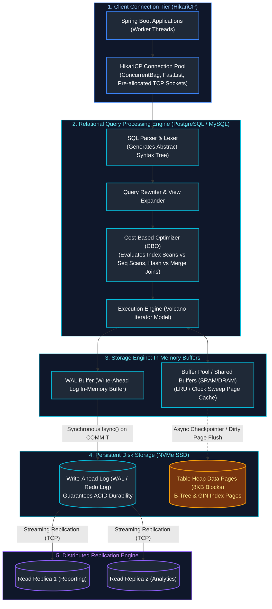
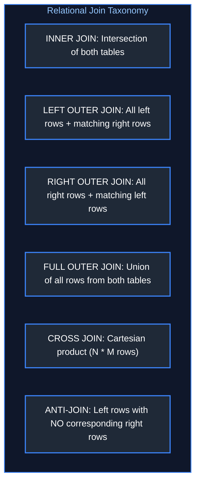
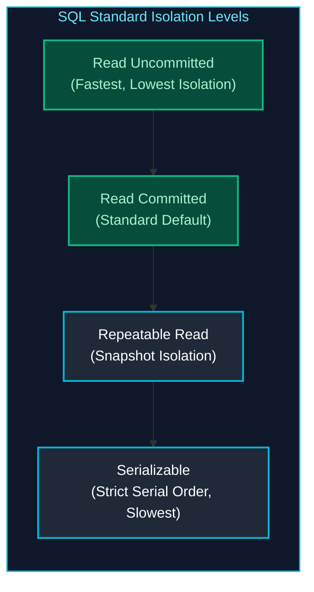
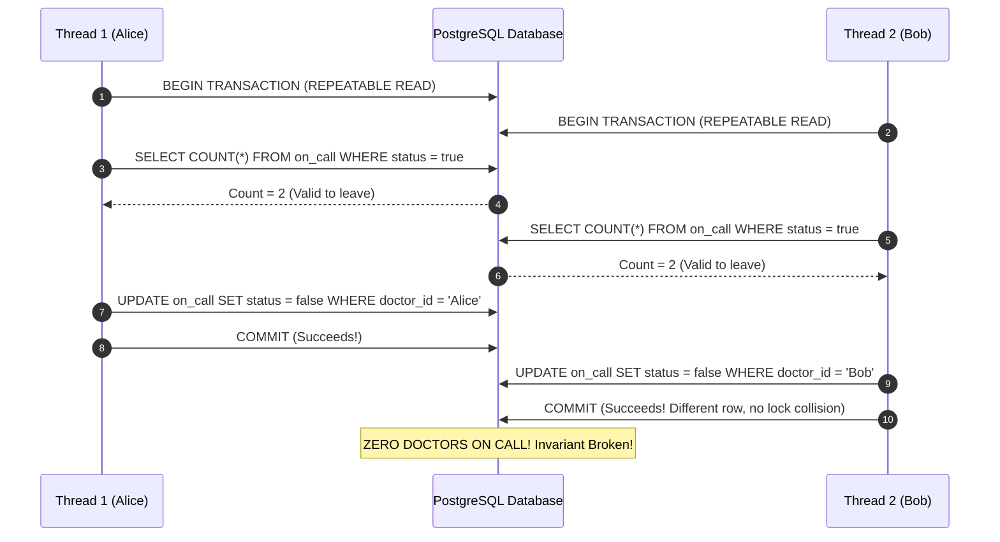
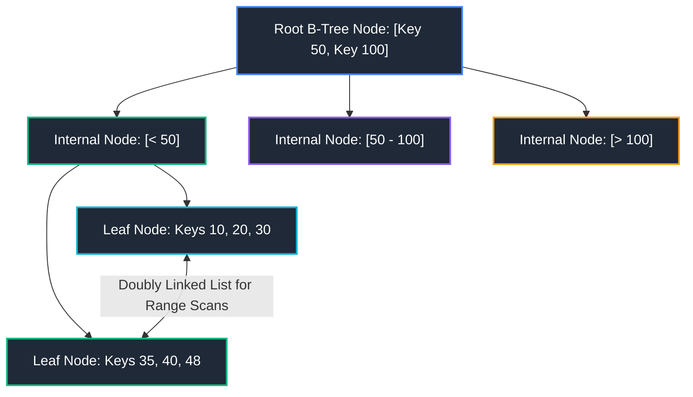
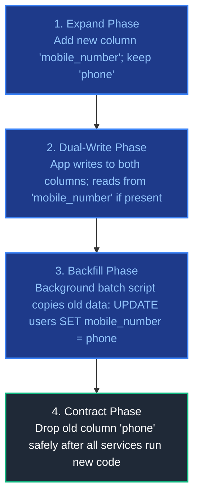
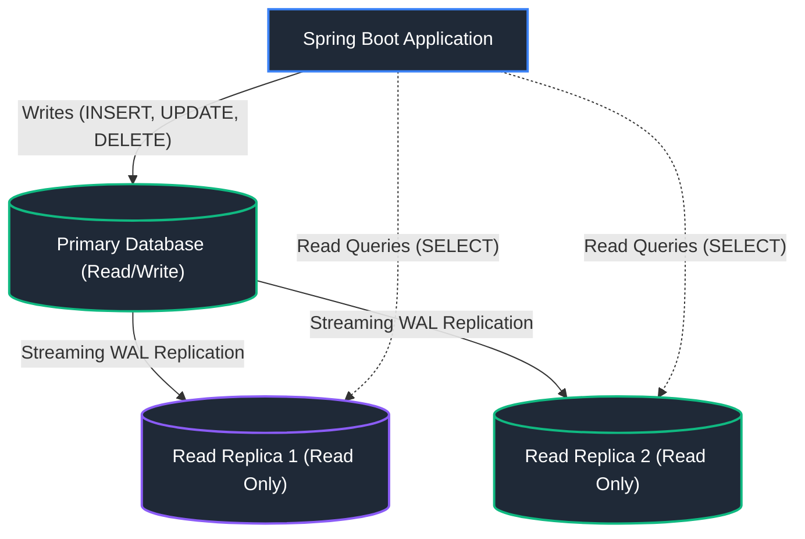

# 09. Database & Data Engineering

A comprehensive, production-grade guide covering relational database storage engine internals, advanced SQL engineering (Window functions, CTEs, Anti-joins), transaction isolation levels, Multi-Version Concurrency Control (MVCC), B-Tree and GIN indexing mechanics, query execution plan tuning (`EXPLAIN (ANALYZE, BUFFERS)`), HikariCP high-throughput connection pooling, zero-downtime schema migrations (Expand-Contract), and distributed database topologies (Replication, Partitioning, Sharding).

---

## Enterprise Database Engine & Storage Architecture



---

## Table of Contents
1. [Advanced SQL Engineering](#1-advanced-sql-engineering)
   - [1.1 Comprehensive JOIN Taxonomy & Anti-Joins](#11-comprehensive-join-taxonomy--anti-joins)
   - [1.2 Aggregation: `GROUP BY` vs `HAVING` & Filter Clauses](#12-aggregation-group-by-vs-having--filter-clauses)
   - [1.3 Subqueries: Correlated vs Non-Correlated Performance](#13-subqueries-correlated-vs-non-correlated-performance)
   - [1.4 Common Table Expressions (CTEs) & Recursive Hierarchical Queries](#14-common-table-expressions-ctes--recursive-hierarchical-queries)
   - [1.5 SQL Window Functions (`ROW_NUMBER`, `DENSE_RANK`, `LAG`, `LEAD`, Frame Specs)](#15-sql-window-functions-row_number-dense_rank-lag-lead-frame-specs)
2. [Relational Database Internals & Concurrency Control](#2-relational-database-internals--concurrency-control)
   - [2.1 ACID Transaction Foundations & Physical Implementation](#21-acid-transaction-foundations--physical-implementation)
   - [2.2 Transaction Isolation Levels & Concurrency Anomalies](#22-transaction-isolation-levels--concurrency-anomalies)
   - [2.3 Multi-Version Concurrency Control (MVCC) in PostgreSQL vs MySQL](#23-multi-version-concurrency-control-mvcc-in-postgresql-vs-mysql)
   - [2.4 Database Locking Hierarchy (Shared, Exclusive, Intent, Row, Deadlocks)](#24-database-locking-hierarchy-shared-exclusive-intent-row-deadlocks)
   - [2.5 Reproducing Concurrency Anomalies & Mitigation in Spring Boot](#25-reproducing-concurrency-anomalies--mitigation-in-spring-boot)
3. [Indexing Mechanics & Query Performance Tuning](#3-indexing-mechanics--query-performance-tuning)
   - [3.1 B-Tree Index Mechanics & Leftmost Prefix Rule](#31-b-tree-index-mechanics--leftmost-prefix-rule)
   - [3.2 Specialized Indexes: Hash, GIN (JSONB), GiST, and BRIN](#32-specialized-indexes-hash-gin-jsonb-gist-and-brin)
   - [3.3 Advanced Indexing: Covering (INCLUDE), Partial & Expression Indexes](#33-advanced-indexing-covering-include-partial--expression-indexes)
   - [3.4 Analyzing Execution Plans (`EXPLAIN (ANALYZE, BUFFERS)`)](#34-analyzing-execution-plans-explain-analyze-buffers)
   - [3.5 Table Scan Strategies (Seq Scan, Index Scan, Index Only Scan, Bitmap Scan)](#35-table-scan-strategies-seq-scan-index-scan-index-only-scan-bitmap-scan)
   - [3.6 Join Algorithms: Nested Loop vs Hash Join vs Merge Join](#36-join-algorithms-nested-loop-vs-hash-join-vs-merge-join)
4. [High-Throughput Connection Pooling (HikariCP)](#4-high-throughput-connection-pooling-hikaricp)
   - [4.1 HikariCP Architecture: FastList & ConcurrentBag](#41-hikaricp-architecture-fastlist--concurrentbag)
   - [4.2 Optimal Pool Sizing Formula & Starvation Prevention](#42-optimal-pool-sizing-formula--starvation-prevention)
   - [4.3 Connection Starvation, Leak Detection & Production Micrometer Metrics](#43-connection-starvation-leak-detection--micrometer-metrics)
5. [Database Infrastructure, Migrations & Scalability](#5-database-infrastructure-migrations--scalability)
   - [5.1 Production Database Migrations: Flyway Engineering & Failure Recovery](#51-production-database-migrations-flyway-engineering--failure-recovery)
   - [5.2 Liquibase Declarative Migrations & Rollback Blocks](#52-liquibase-declarative-migrations--rollback-blocks)
   - [5.3 Zero-Downtime Database Refactoring: The Expand-Contract Pattern](#53-zero-downtime-database-refactoring-the-expand-contract-pattern)
   - [5.4 Streaming Replication & Read/Write Splitting](#54-streaming-replication--readwrite-splitting)
   - [5.5 Table Partitioning (Range, List, Hash)](#55-table-partitioning-range-list-hash)
   - [5.6 Horizontal Database Sharding](#55-horizontal-database-sharding)
   - [5.7 Database Administration & Performance CLI Commands Cheatsheet](#57-database-administration--performance-cli-commands-cheatsheet)
6. [References & Further Reading](#6-references--further-reading)

---

# 1. Advanced SQL Engineering

---

### 1.1 Comprehensive JOIN Taxonomy & Anti-Joins



#### Production SQL Anti-Join Patterns (Finding Customers with Zero Orders)

```sql
-- Optimal Pattern: LEFT JOIN with NULL check (Cost-effective via Hash Anti-Join)
SELECT c.id, c.email
FROM customers c
LEFT JOIN orders o ON c.id = o.customer_id
WHERE o.customer_id IS NULL;

-- Alternative Pattern: NOT EXISTS (Safe against NULLs)
SELECT c.id, c.email
FROM customers c
WHERE NOT EXISTS (
    SELECT 1 FROM orders o WHERE o.customer_id = c.id
);
```

> [!WARNING]
> Avoid `WHERE c.id NOT IN (SELECT customer_id FROM orders)` if the subquery returns even a single `NULL` value; SQL three-valued logic (`TRUE`, `FALSE`, `UNKNOWN`) will cause the entire outer query to return zero rows!

---

### 1.2 Aggregation: `GROUP BY` vs `HAVING` & Filter Clauses

- **`WHERE`**: Filters physical table rows **before** aggregation calculations occur.
- **`HAVING`**: Filters grouped summary rows **after** aggregate calculations complete.
- **Modern `FILTER` Clause**: Aggregates subsets of rows within a single scan without subqueries:

```sql
SELECT
    department_id,
    COUNT(*) AS total_employees,
    COUNT(*) FILTER (WHERE salary > 100000) AS high_earners_count,
    AVG(salary) FILTER (WHERE gender = 'F') AS avg_female_salary
FROM employees
GROUP BY department_id
HAVING COUNT(*) >= 5;
```

---

### 1.3 Subqueries: Correlated vs Non-Correlated Performance

- **Non-Correlated**: Evaluates once globally; optimizer converts into a constant or hash table.
- **Correlated**: References columns from outer query; conceptually executes once per outer row ($O(N \times M)$). Rewrite as `JOIN` or Window Function whenever possible.

---

### 1.4 Common Table Expressions (CTEs) & Recursive Hierarchical Queries

CTEs improve readability and modularity. In PostgreSQL 12+, CTEs are automatically inlined unless declared `AS MATERIALIZED`.

#### Recursive CTE for Enterprise Hierarchies (Org Chart Traversal)

```sql
WITH RECURSIVE OrgHierarchy AS (
    -- 1. Anchor Member: Top-level CEO
    SELECT employee_id, name, manager_id, 1 AS depth, name::TEXT AS hierarchy_path
    FROM employees
    WHERE manager_id IS NULL

    UNION ALL

    -- 2. Recursive Member: Direct reports of the previous level
    SELECT e.employee_id, e.name, e.manager_id, o.depth + 1, (o.hierarchy_path || ' -> ' || e.name)
    FROM employees e
    INNER JOIN OrgHierarchy o ON e.manager_id = o.employee_id
)
SELECT * FROM OrgHierarchy ORDER BY depth, hierarchy_path;
```

---

### 1.5 SQL Window Functions (`ROW_NUMBER`, `DENSE_RANK`, `LAG`, `LEAD`, Frame Specs)

Window functions compute values across a partition of rows without collapsing rows like `GROUP BY`:

| Function | Calculation Mechanism | Tie Handling Behavior |
| :--- | :--- | :--- |
| **`ROW_NUMBER()`** | Sequential integer starting from 1 | Arbitrary assignment on duplicate values (1, 2, 3) |
| **`RANK()`** | Rank with gaps | Identical values get same rank; skips next rank (1, 2, 2, 4) |
| **`DENSE_RANK()`** | Rank without gaps | Identical values get same rank; immediate next integer (1, 2, 2, 3) |
| **`LAG(col, n)`** | Retrieves column value from $n$ rows prior | Accesses preceding period record |
| **`LEAD(col, n)`** | Retrieves column value from $n$ rows ahead | Accesses subsequent period record |

#### Complex Running Total & Period-over-Period SQL

```sql
SELECT
    order_date,
    customer_id,
    amount,
    -- Running total per customer
    SUM(amount) OVER (
        PARTITION BY customer_id
        ORDER BY order_date
        ROWS BETWEEN UNBOUNDED PRECEDING AND CURRENT ROW
    ) AS running_customer_spend,
    -- Prior order amount
    LAG(amount, 1) OVER (
        PARTITION BY customer_id
        ORDER BY order_date
    ) AS previous_order_amount,
    -- Top 3 orders per customer
    DENSE_RANK() OVER (
        PARTITION BY customer_id
        ORDER BY amount DESC
    ) AS spend_rank
FROM orders;
```

---

# 2. Relational Database Internals & Concurrency Control

---

### 2.1 ACID Transaction Foundations & Physical Implementation

- **Atomicity**: All changes commit or none do. *Implementation*: **Undo Logs** (MySQL InnoDB) or **MVCC Multi-Version Tuples** (PostgreSQL).
- **Consistency**: The database transitions from one valid schema state to another (enforcing foreign keys, unique constraints, check constraints).
- **Isolation**: Concurrent transactions execute without interfering with one another. *Implementation*: Locking protocols and MVCC snapshot isolation.
- **Durability**: Committed data survives power failure or OS crash. *Implementation*: **Write-Ahead Logging (WAL)** flushed synchronously to persistent storage before transaction completion is acknowledged.

---

### 2.2 Transaction Isolation Levels & Concurrency Anomalies



#### Concurrency Anomalies vs Isolation Levels Matrix

| Isolation Level | Dirty Read | Non-Repeatable Read | Phantom Read | Serialization Anomaly (Write Skew) |
| :--- | :---: | :---: | :---: | :---: |
| **Read Uncommitted** | **Yes** | **Yes** | **Yes** | **Yes** |
| **Read Committed** | No | **Yes** | **Yes** | **Yes** |
| **Repeatable Read** | No | No | No (Postgres MVCC) | **Yes** |
| **Serializable** | No | No | No | No |

- **Dirty Read**: Transaction A reads uncommitted modifications made by Transaction B (which may roll back).
- **Non-Repeatable Read**: Transaction A re-reads a row and finds that Transaction B updated and committed changes to it.
- **Phantom Read**: Transaction A re-executes a range query and finds new rows inserted and committed by Transaction B.
- **Write Skew**: Two concurrent transactions read overlapping data, verify constraints, and write non-overlapping changes that violate a global business invariant (e.g. at least one doctor must be on call; two doctors simultaneously take leave).

---

### 2.3 Multi-Version Concurrency Control (MVCC) in PostgreSQL vs MySQL

MVCC ensures that **readers never block writers, and writers never block readers**:
- **PostgreSQL MVCC**:
  - Every row version (tuple) holds header fields: `xmin` (creation transaction ID) and `xmax` (deletion/update transaction ID).
  - Updates create a brand-new tuple and mark the old tuple's `xmax`.
  - **Vacuuming**: Dead tuples remain on disk until cleaned up by the **VACUUM** background worker.
- **MySQL InnoDB MVCC**:
  - In-place modification of table data pages.
  - Historical row snapshots are reconstructed on-the-fly by reading backwards through rollback segments in the **Undo Log**.

---

### 2.4 Database Locking Hierarchy (Shared, Exclusive, Intent, Row, Deadlocks)

- **Shared Lock (S)**: Read lock. Multiple transactions can hold S locks concurrently.
- **Exclusive Lock (X)**: Write lock. Only one transaction can hold an X lock; blocks all other S and X locks.
- **Intent Locks (IS / IX)**: Table-level locks indicating that a transaction holds row-level locks, preventing table-wide lock conflicts.
- **Pessimistic vs Optimistic Locking**:
  - *Pessimistic*: `SELECT * FROM accounts WHERE id = 1 FOR UPDATE;` (Holds exclusive lock on row until commit).
  - *Optimistic*: Uses version numbers (`UPDATE accounts SET balance = 100, version = version + 1 WHERE id = 1 AND version = 5;`).

---

### 2.5 Reproducing Concurrency Anomalies & Mitigation in Spring Boot

In high-concurrency production systems, understanding how SQL isolation levels translate into Spring Data / JPA behavior is critical to preventing subtle financial and data corruption bugs.

#### 1. Dirty Read Anomaly (Under `READ_UNCOMMITTED`)
* **Scenario**: Transaction A transfers $100 from Account 1 to Account 2. Transaction B reads Account 2's balance before Transaction A commits. Transaction A rolls back due to an insufficient funds check on Account 1.
* **Result**: Transaction B observed money that never existed and proceeded to dispense cash or approve an order.
* **Java Mitigation**: Always enforce `Isolation.READ_COMMITTED` (the default in PostgreSQL and Oracle):
```java
@Transactional(isolation = Isolation.READ_COMMITTED)
public BigDecimal getAccountBalance(Long accountId) {
    return accountRepository.findBalanceById(accountId);
}
```

#### 2. Non-Repeatable Read Anomaly (Fuzzy Read)
* **Scenario**: In an invoice audit transaction, the application reads an account balance as \$1,000. While the invoice is generating, another transaction debits \$300 and commits. The audit transaction re-reads the account balance and now sees \$700.
* **Java Mitigation**: Enforce `Isolation.REPEATABLE_READ`. The database takes a transaction snapshot at the first query; subsequent reads within the transaction return identical data:
```java
@Transactional(isolation = Isolation.REPEATABLE_READ)
public InvoiceReport generateAuditInvoice(Long accountId) {
    BigDecimal initialBalance = accountRepository.findBalanceById(accountId);
    // Heavy report generation calculation...
    BigDecimal finalBalance = accountRepository.findBalanceById(accountId);
    // In REPEATABLE_READ: initialBalance.compareTo(finalBalance) == 0 is guaranteed!
    return new InvoiceReport(accountId, initialBalance);
}
```

#### 3. Write Skew Anomaly (The Doctor-On-Call Dilemma)
* **The Rule**: A hospital requires at least **one** doctor on call at all times.
* **The Conflict**: Currently, Doctor Alice and Doctor Bob are both on call (`count = 2`).
  - **Thread 1 (Alice)**: Checks `countOnCallDoctors()` $\rightarrow$ returns 2. Alice requests off: updates Alice `on_call = false`.
  - **Thread 2 (Bob)**: Concurrently checks `countOnCallDoctors()` $\rightarrow$ returns 2. Bob requests off: updates Bob `on_call = false`.
  - Both transactions commit successfully under `REPEATABLE_READ` because they updated two completely distinct rows (`alice_id` vs `bob_id`), avoiding row-level write conflicts!
* **Result**: `countOnCallDoctors()` is now **0**. System invariant violated!



#### Production Solutions for Write Skew:
1. **Explicit Pessimistic Locking with Mutex Table or Lock Mode**:
```java
public interface ShiftRepository extends JpaRepository<Shift, Long> {
    // Locks all active on-call rows exclusively, serializing concurrent checks
    @Lock(LockModeType.PESSIMISTIC_WRITE)
    @Query("SELECT s FROM Shift s WHERE s.active = true")
    List<Shift> findActiveShiftsForUpdate();
}

@Service
public class ShiftService {
    private final ShiftRepository shiftRepo;

    @Transactional
    public void requestLeave(Long doctorId) {
        List<Shift> activeShifts = shiftRepo.findActiveShiftsForUpdate();
        if (activeShifts.size() <= 1) {
            throw new IllegalStateException("Cannot take leave: at least one doctor must remain on call.");
        }
        Shift currentDoctorShift = activeShifts.stream()
            .filter(s -> s.getDoctorId().equals(doctorId))
            .findFirst()
            .orElseThrow();
        currentDoctorShift.setActive(false);
    }
}
```

2. **Serializable Snapshot Isolation (SSI)**:
Under `Isolation.SERIALIZABLE`, the database tracks the read-write dependency graph (siREAD locks). When Alice and Bob attempt to commit concurrently, PostgreSQL detects the dangerous cycle and immediately aborts the second transaction with:
`ERROR: could not serialize access due to read/write dependencies among transactions (SQLSTATE 40001)`.
```java
@Retryable(
    retryFor = { CannotAcquireLockException.class, ConcurrencyFailureException.class },
    maxAttempts = 3,
    backoff = @Backoff(delay = 100, multiplier = 2.0)
)
@Transactional(isolation = Isolation.SERIALIZABLE)
public void safeRequestLeave(Long doctorId) {
    // Will safely throw ConcurrencyFailureException on conflict and automatically retry
    long activeCount = shiftRepo.countByActiveTrue();
    if (activeCount <= 1) throw new IllegalStateException("At least one doctor required");
    shiftRepo.deactivateDoctor(doctorId);
}
```

---

# 3. Indexing Mechanics & Query Performance Tuning

---

### 3.1 B-Tree Index Mechanics & Leftmost Prefix Rule

The **B-Tree (Balanced Tree)** is a self-balancing search tree where all leaf nodes reside at identical depth. Leaf nodes are linked as a doubly linked list, enabling both $O(\log N)$ point lookups and efficient range scans:



#### The Leftmost Prefix Rule
Given a composite index `CREATE INDEX idx_user ON users (country, city, age)`:
- `WHERE country = 'US' AND city = 'NYC' AND age = 30` $\rightarrow$ **Full Index Scan**
- `WHERE country = 'US' AND city = 'NYC'` $\rightarrow$ **Index Scan**
- `WHERE country = 'US'` $\rightarrow$ **Index Scan**
- `WHERE city = 'NYC'` $\rightarrow$ **Index Unusable (Violates Leftmost Rule)**

---

### 3.2 Specialized Indexes: Hash, GIN (JSONB), GiST, and BRIN

| Index Type | Structure | Time Complexity | Best Production Use Case |
| :--- | :--- | :--- | :--- |
| **B-Tree** | Multi-way balanced search tree | $O(\log N)$ | Equality, range queries (`>`, `<`, `BETWEEN`), sorting (`ORDER BY`) |
| **Hash Index** | Hash table | $O(1)$ | Exact equality checks only (`col = val`); no range scans |
| **GIN (Generalized Inverted)**| Inverted index | $O(\log N)$ per token | JSONB semi-structured documents, full-text search, arrays |
| **GiST** | Generalized Search Tree | $O(\log N)$ | Geospatial data (PostGIS geometric coordinates), range types |
| **BRIN (Block Range)** | Summary min/max per 128 disk blocks | Near $O(1)$ disk size | Massive append-only time-series tables (IoT metrics, audit logs) |

---

### 3.3 Advanced Indexing: Covering (INCLUDE), Partial & Expression Indexes

Beyond standard single-column and composite B-Trees, modern high-throughput relational databases (PostgreSQL, MySQL 8+, SQL Server) offer specialized indexing constructs that yield massive latency reductions.

#### 1. Covering Indexes with `INCLUDE` (Index-Only Scans)
In a traditional B-Tree index scan, the engine finds matching row pointers (Tuple IDs / CTIDs) in the index leaf pages, then incurs a random I/O hop to read the table heap page to retrieve non-indexed columns. 
A **Covering Index** appends non-key payload columns directly into the leaf nodes without storing them in upper intermediate search nodes:

```sql
-- Search key is customer_id; order_date and total_amount stored strictly in leaf pages
CREATE INDEX idx_orders_customer_covering 
ON orders (customer_id) 
INCLUDE (order_date, total_amount);
```

```sql
-- Fully satisfied by Index Only Scan: ZERO table heap visits!
SELECT order_date, total_amount 
FROM orders 
WHERE customer_id = 42;
```

> [!TIP]
> **Why not just add columns to the composite index `(customer_id, order_date, total_amount)`?**
> Composite index keys increase the physical byte size of internal search nodes, shrinking B-Tree page capacity (fanout), increasing tree depth, and adding unnecessary B-Tree sorting overhead. `INCLUDE` keeps intermediate keys compact while enabling heap-free **Index-Only Scans**.

#### 2. Partial (Filtered) Indexes
Indexes are expensive to maintain on high-write tables. When queries target a tiny, high-activity slice of rows, a **Partial Index** indexes only rows satisfying a constant predicate:

```sql
-- Table has 50,000,000 processed orders and 2,000 pending orders
CREATE INDEX idx_orders_unprocessed 
ON orders (created_at) 
WHERE status = 'PENDING';
```
- **Disk Footprint**: A few kilobytes instead of hundreds of megabytes.
- **Write Amplification**: When an order transitions to `SHIPPED`, it is immediately evicted from this partial index, zero write overhead for subsequent updates.

#### 3. Expression / Functional Indexes
Standard B-Trees cannot be traversed if a column is modified by an expression or function in the `WHERE` clause (`WHERE LOWER(email) = ?` causes a full sequential scan!). An expression index indexes the computed result:

```sql
-- Functional index for case-insensitive lookup
CREATE INDEX idx_users_lower_email ON users (LOWER(email));

-- Functional index on JSONB field (PostgreSQL)
CREATE INDEX idx_users_metadata_tier 
ON users (((metadata->>'tier')::TEXT));
```

---

### 3.4 Analyzing Execution Plans (`EXPLAIN (ANALYZE, BUFFERS)`)

The single most critical query performance diagnostic tool is `EXPLAIN (ANALYZE, BUFFERS)`:

```sql
EXPLAIN (ANALYZE, BUFFERS, COSTS, VERBOSE)
SELECT customer_id, SUM(total_amount)
FROM orders
WHERE order_date >= '2026-01-01'
GROUP BY customer_id;
```

#### Key Metrics Explained
1. **`cost=0.42..850.30`**: Estimated startup cost (0.42) and total completion cost (850.30) measured in arbitrary disk page fetch units.
2. **`actual time=0.045..12.350 rows=1500 loops=1`**: Real execution duration in milliseconds.
3. **`Buffers: shared hit=420 read=15`**:
   - `hit=420`: 420 data blocks read directly from in-memory RAM (Buffer Pool).
   - `read=15`: 15 blocks read from physical NVMe disk (Disk I/O penalty).

---

### 3.5 Table Scan Strategies (Seq Scan, Index Scan, Index Only Scan, Bitmap Scan)

- **Sequential Scan (Seq Scan)**: Reads every page of the table from start to finish. Fast for small tables; catastrophic for 50M-row tables.
- **Index Scan**: Traverses B-Tree to find matching pointers, then visits the table heap to retrieve row columns.
- **Index-Only Scan (Covering Index)**: All requested query columns exist within the index itself. **Zero table heap visits required** (highest possible performance).
- **Bitmap Index Scan**: Scans index, builds in-memory bitmap of matching page numbers, sorts by physical disk block order, and visits disk in sequential batch order.

---

### 3.6 Join Algorithms: Nested Loop vs Hash Join vs Merge Join

- **Nested Loop Join**: For each row in outer table, scans matching rows in inner table. Optimal when one table is tiny and the other has an index.
- **Hash Join**: Ingests smaller table into in-memory hash table, then streams larger table probe rows through it. Optimal for large, unsorted, unindexed tables.
- **Merge Join**: Both inputs sorted by join key, then zipped together in a single sequential linear pass ($O(N + M)$).

---

# 4. High-Throughput Connection Pooling (HikariCP)

---

### 4.1 HikariCP Architecture: FastList & ConcurrentBag

HikariCP is the default, ultra-high-performance JDBC connection pool in Spring Boot:
- **`FastList`**: Eliminates `ArrayList` boundary checks and cleans up JDBC `Statement` instances in $O(1)$ LIFO order without synchronization.
- **`ConcurrentBag`**: Lock-free, thread-local connection pool queue using `ThreadLocal` caching to provide near-zero lock contention for connection acquisition.

---

### 4.2 Optimal Pool Sizing Formula & Starvation Prevention

More database connections do **not** equal higher performance. Beyond a certain threshold, extra connections introduce CPU context switching and disk spindle thrashing:

$$\text{Pool Size} = \left(\text{CPU Cores} \times 2\right) + \text{Effective Spindle Count}$$

For a 4-core database server with an NVMe SSD:
$$\text{Pool Size} = (4 \times 2) + 1 = \mathbf{9 \text{ to } 10 \text{ connections}}$$

#### Production Spring Boot HikariCP Configuration

```yaml
spring:
  datasource:
    hikari:
      maximum-pool-size: 15
      minimum-idle: 10
      idle-timeout: 300000       # 5 minutes
      connection-timeout: 20000  # 20 seconds
      max-lifetime: 1800000      # 30 minutes
      leak-detection-threshold: 5000 # Alert if thread holds connection > 5s
```

---

### 4.3 Connection Starvation, Leak Detection & Production Micrometer Metrics

In production Spring Boot services, connection pool exhaustion is among the most frequent causes of cascading service outages.

#### 1. Anatomy of Connection Pool Starvation
When all HikariCP connections are actively held and new worker threads request a connection from `ConcurrentBag`, they block up to `connection-timeout` (e.g. 20,000ms). If no connection is returned within that window, HikariCP throws:
```text
org.springframework.dao.DataAccessResourceFailureException: Unable to acquire JDBC Connection; 
nested exception is java.sql.SQLTransientConnectionException: HikariPool-1 - Connection is not available, 
request timed out after 20002ms (total=15, active=15, idle=0, waiting=142)
```

**Common Causes**:
1. **Third-Party REST/HTTP Calls inside `@Transactional`**: Holding an open database connection while waiting 2–5 seconds on a remote payment gateway or partner API response.
   - *Fix*: Complete all external HTTP calls *before* entering the transaction, or use a decoupled Saga / Outbox pattern.
2. **Open-Session-In-View (OSIV) enabled**: Hibernate Session and JDBC connection remain bound to the worker thread until HTTP response rendering completes.
   - *Fix*: `spring.jpa.open-in-view=false`.
3. **Slow Unindexed Queries**: Long-running sequential scans occupying pool slots.
4. **Unclosed Connections**: Direct JDBC or legacy code missing `try-with-resources`.

#### 2. HikariCP Connection Leak Detection
Configuring `leak-detection-threshold` causes HikariCP to launch a tracking thread. If a connection is not closed within the specified threshold, HikariCP prints an actionable stack trace pinpointing the exact method that checked out the connection without releasing it:

```properties
# Emits stack trace if connection checked out > 5000ms
spring.datasource.hikari.leak-detection-threshold=5000
```
Log output:
```text
WARN 1 --- [HikariPool-1 housekeeper] com.zaxxer.hikari.pool.ProxyLeakTask : 
Apparent connection leak detected on Thread[http-nio-8080-exec-8,5,main], 
connection com.zaxxer.hikari.pool.HikariProxyConnection@3a7d4a1 was acquired at:
    com.company.billing.service.InvoiceService.generateReport(InvoiceService.java:54)
```

#### 3. Essential HikariCP Micrometer / Prometheus Metrics
When `io.micrometer:micrometer-registry-prometheus` is on the classpath, HikariCP automatically registers metrics:

| Metric Name | Type | Production Significance | Alert Threshold |
| :--- | :--- | :--- | :--- |
| `hikaricp.connections.pending` | Gauge | Number of threads currently blocked waiting for a connection | **`> 0` for > 5s indicates starvation!** |
| `hikaricp.connections.active` | Gauge | Currently in-use checked-out connections | **`> 85%` of `maximum-pool-size`** |
| `hikaricp.connections.idle` | Gauge | Warm idle connections ready in pool | Healthy if fluctuating above 0 |
| `hikaricp.connections.acquire.seconds` | Timer | Latency distribution of acquiring a connection | $p99 > 200\text{ms}$ |
| `hikaricp.connections.usage.seconds` | Timer | Duration connections are held by worker threads | $p99 > 500\text{ms}$ indicates slow transactions |

---

# 5. Database Infrastructure, Migrations & Scalability

---

### 5.1 Production Database Migrations: Flyway Engineering & Failure Recovery

Flyway provides version-controlled, immutable database migrations managed directly alongside application code in `src/main/resources/db/migration`.

#### 1. Script Naming Taxonomy & Execution Order
```text
src/main/resources/db/migration/
├── V1_0__init_schema.sql             <-- Versioned: executed once, immutable
├── V1_1__add_customer_indices.sql     <-- Versioned: executed after V1.0
├── V2_0__repartition_orders.sql       <-- Major version increment
└── R__create_customer_spend_view.sql  <-- Repeatable: re-runs whenever checksum changes
```

- **`V` (Versioned Migration)**: Runs once. Identified by unique version (`1.0`, `1.1`). Any modification to an applied script alters its SHA-256 checksum and **crashes the application at boot**.
- **`U` (Undo Migration)**: Reverts changes from the corresponding versioned migration (Flyway Teams/Enterprise or manual).
- **`R` (Repeatable Migration)**: Does not have a version number. Executed after all versioned migrations have completed, and re-executed whenever its SQL script content changes. Ideal for Views, Stored Procedures, and Functions.

#### 2. The `flyway_schema_history` Metadata Table
Flyway tracks applied scripts in the database table `flyway_schema_history`:
```sql
SELECT installed_rank, version, description, type, script, checksum, installed_on, execution_time, success 
FROM flyway_schema_history 
ORDER BY installed_rank;
```

#### 3. Production Failure Scenarios & Recovery Runbook

##### Scenario A: Checksum Mismatch Error
```text
org.flywaydb.core.api.exception.FlywayValidateException: 
Validate failed: Migrations have failed validation
Migration checksum mismatch for migration version 1.1
-> Applied to database : 1489230571
-> Resolved locally    : -842091238
```
* **Root Cause**: A developer modified an existing SQL file (`V1_1__...sql`) after it was already executed in the environment.
* **Production Fix**: Never edit applied migrations! Create a new migration `V1_2__fix_index.sql`.
* **Dev/Staging Fix**: If changes were legitimate and safe, run Flyway Repair to align database checksum with the local file:
```bash
./mvnw flyway:repair
# Or via Spring Boot programmatically during startup
```

##### Scenario B: Migration Failure Halfway (Non-Transactional DDL)
In databases like MySQL or Oracle (where DDL statements auto-commit and cannot be rolled back in a transaction), a syntax error or constraint failure on line 10 leaves lines 1–9 committed, but Flyway records `success = false` in `flyway_schema_history`. Subsequent app boots fail with:
`FlywayException: Migration V1_3__failed.sql is in a failed state!`

* **Recovery Runbook**:
  1. Inspect the database to see which statements succeeded.
  2. Manually execute compensation SQL to undo partial changes.
  3. Execute `flyway repair` to remove or mark the failed entry in `flyway_schema_history`:
     ```sql
     DELETE FROM flyway_schema_history WHERE version = '1.3' AND success = false;
     ```
  4. Correct the SQL script and restart Spring Boot.

#### 4. Production Spring Boot Flyway Configuration
```yaml
spring:
  flyway:
    enabled: true
    baseline-on-migrate: true       # Baselines existing non-empty databases at 0
    baseline-version: "0"
    out-of-order: false             # Rejects backdated scripts in production
    clean-disabled: true            # CRITICAL: Prevents accidental schema drop in prod!
    connect-retries: 5              # Retries DB connection during rolling restarts
    locations:
      - classpath:db/migration
```

---

### 5.2 Liquibase Declarative Migrations & Rollback Blocks

Liquibase offers declarative, database-agnostic change sets with built-in rollback capabilities:

```yaml
# db/changelog/db.changelog-master.yaml
databaseChangeLog:
  - changeSet:
      id: 2026-03-add-user-status
      author: joydeep
      changes:
        - addColumn:
            tableName: users
            columns:
              - column:
                  name: status
                  type: VARCHAR(30)
                  defaultValue: "ACTIVE"
      rollback:
        - dropColumn:
            tableName: users
            columnName: status
```
- **Automatic Rollback**: Liquibase can automatically compute reverse DDL for operations like `addColumn` and `createTable`.
- **ChangeLog Table**: Tracks history in `DATABASECHANGELOG` and lock status in `DATABASECHANGELOGLOCK` (preventing concurrent migrations during multi-replica pod boots).

---

### 5.3 Zero-Downtime Database Refactoring: The Expand-Contract Pattern

Directly renaming a production column (`ALTER TABLE users RENAME COLUMN phone TO mobile_number;`) locks the table and breaks running microservices during a rolling deployment.



---

### 5.4 Streaming Replication & Read/Write Splitting



- **Replication Lag**: Asynchronous replication causes slight delays between primary commits and replica visibility.
- **Read-After-Write Consistency**: If a user updates their profile and immediately refreshes the page, routing the read to a lagging replica displays stale data. *Solution*: Route user-initiated reads to the Primary database for 5 seconds after a write.

> [!TIP]
> For the complete Spring Boot Java implementation of dynamic Read/Write splitting via `AbstractRoutingDataSource` and `@Transactional(readOnly = true)`, see [08. Spring Data, JDBC, JPA, Hibernate & Transactions - Section 7.4](file:///Users/joydeep/Downloads/Java%20Backend/10_spring_data_jdbc_jpa_hibernate_transactions.md#74-dynamic-readwrite-splitting-via-abstractroutingdatasource).

---

### 5.5 Table Partitioning (Range, List, Hash)

Splits a massive table into smaller physical backing tables while maintaining a single logical table interface:

```sql
-- Declarative Range Partitioning by Order Date
CREATE TABLE orders (
    order_id BIGINT,
    customer_id BIGINT,
    order_date DATE NOT NULL,
    amount NUMERIC(10, 2)
) PARTITION BY RANGE (order_date);

-- Sub-partition for 2026 Q1
CREATE TABLE orders_2026_q1 PARTITION OF orders
    FOR VALUES FROM ('2026-01-01') TO ('2026-04-01');

-- Sub-partition for 2026 Q2
CREATE TABLE orders_2026_q2 PARTITION OF orders
    FOR VALUES FROM ('2026-04-01') TO ('2026-07-01');
```

---

### 5.6 Horizontal Database Sharding

Distributes rows across independent physical database clusters using a **Shard Key**:
- **Consistent Hashing**: Minimizes data migration when adding new database shards.
- **Cross-Shard Queries**: Queries lacking the shard key must broadcast to every shard, severely limiting scalability. Always choose high-cardinality shard keys (`tenant_id`, `user_id`).

---

### 5.7 Database Administration & Performance CLI Commands Cheatsheet

| Command & Syntax | Key Flags Explained | What Does What | Practical Operational Scenario |
| :--- | :--- | :--- | :--- |
| `psql -U postgres -d enterprise_db` | `-U`: User<br>`-d`: Target database | Launches interactive PostgreSQL terminal | Connecting directly to database server |
| `SELECT * FROM pg_stat_activity WHERE state != 'idle';` | None | Displays all currently executing queries and client PIDs | Diagnosing long-running queries or connection spikes |
| `SELECT * FROM pg_stat_statements ORDER BY total_exec_time DESC LIMIT 10;` | None | Lists top 10 queries consuming the most total execution time | Pinpointing SQL statements needing index optimization |
| `VACUUM (VERBOSE, ANALYZE) users;` | `ANALYZE`: Update optimizer stats | Reclaims dead tuple space and updates table statistics | Fixing degraded query optimizer execution plans |
| `pg_dump -U postgres -Fc -f backup.dump enterprise_db` | `-Fc`: Custom compressed format | Creates a full database dump backup | Pre-deployment production disaster recovery snapshot |
| `pg_restore -U postgres -d enterprise_db backup.dump` | `-d`: Target DB | Restores compressed database dump | Restoring test database environment |

---

# 6. References & Further Reading

- [GeeksforGeeks - DBMS Architecture and ACID Properties](https://www.geeksforgeeks.org/dbms/)
- [GeeksforGeeks - Indexing in Databases (B-Tree, Hash, Inverted)](https://www.geeksforgeeks.org/indexing-in-databases-set-1/)
- [Baeldung - PostgreSQL B-Tree and GIN Indexing](https://www.baeldung.com/cs/postgresql-indexes)
- [Use The Index, Luke! A Guide to Database Performance](https://use-the-index-luke.com/)
- [HikariCP Official Wiki & High-Throughput Performance Tuning](https://github.com/brettwooldridge/HikariCP/wiki)
- [PostgreSQL Official Documentation - Concurrency Control & Query Tuning](https://www.postgresql.org/docs/current/indexes-types.html)
- [Flyway Official Documentation - Database Migrations](https://documentation.red-gate.com/fd)
