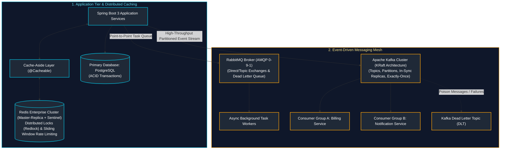
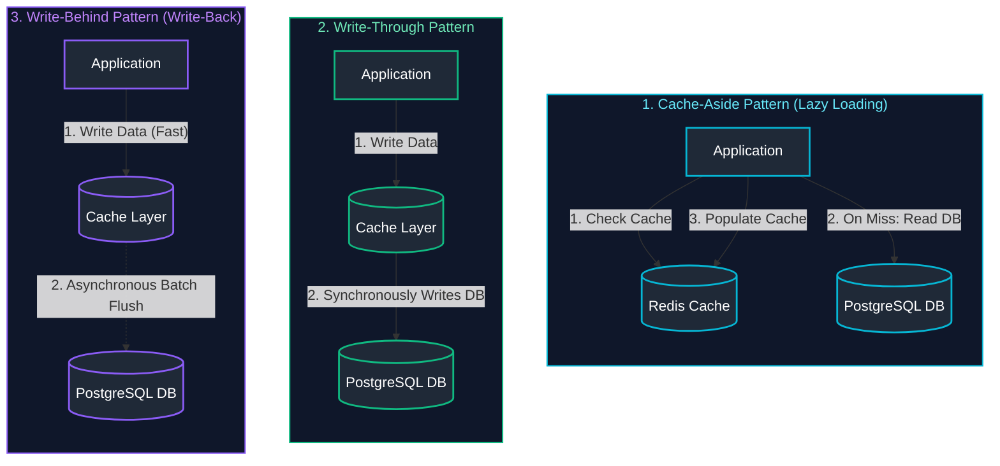
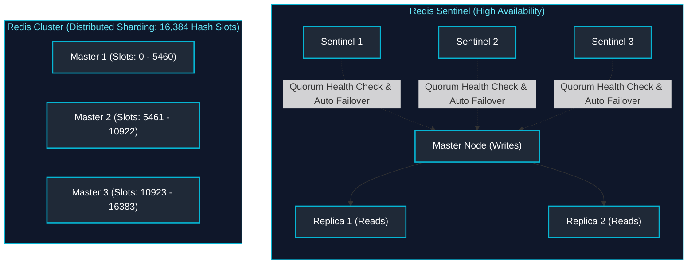
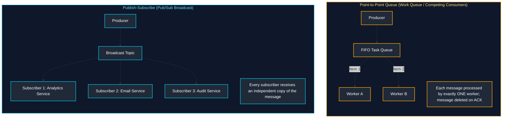
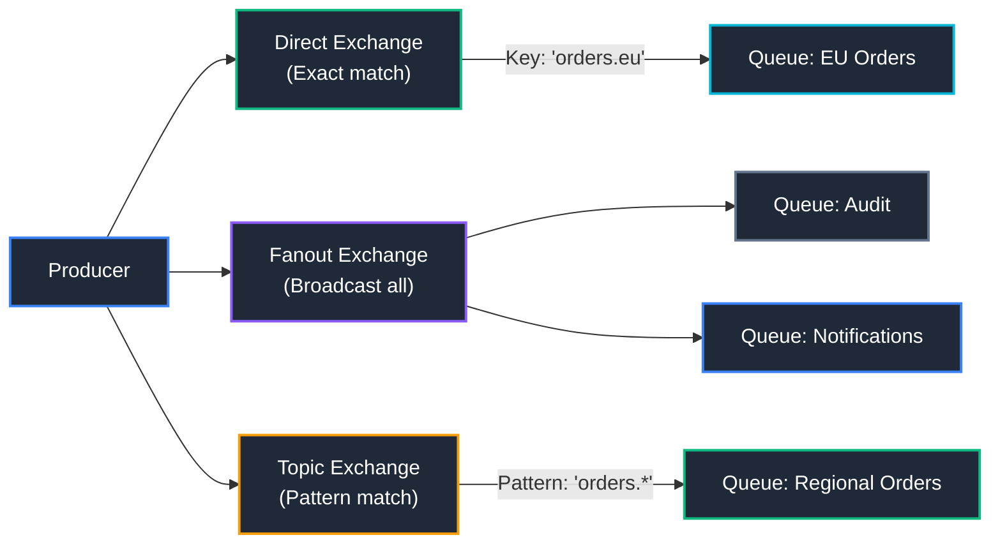
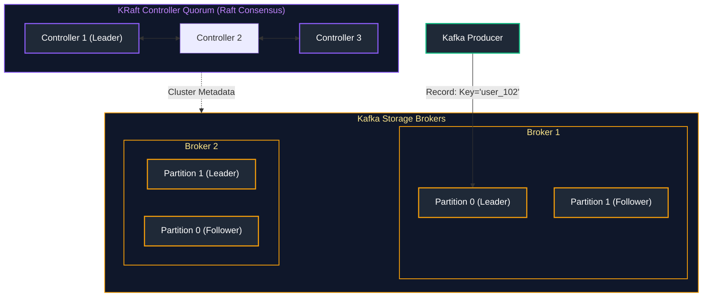

# 12. Distributed Caching, Redis, Messaging & Kafka Event-Driven Architecture

A comprehensive, production-grade guide covering enterprise distributed caching patterns, Redis cluster topologies, distributed locking (Redlock & Lua), Spring Cache abstractions, messaging reliability fundamentals (ACK/NACK, DLQ, Delivery Guarantees), RabbitMQ AMQP routing, and Apache Kafka event-driven architectures with KRaft, consumer rebalancing, and exactly-once processing semantics (EOS).

---

## Enterprise Caching, Messaging & Event Mesh Architecture



---

## Table of Contents
1. [Enterprise Distributed Caching Architecture](#1-enterprise-distributed-caching-architecture)
   - [1.1 Caching Patterns: Cache-Aside vs Read-Through vs Write-Through vs Write-Behind](#11-caching-patterns-cache-aside-vs-read-through-vs-write-through-vs-write-behind)
   - [1.2 Cache Invalidation, TTL Expirations & Eviction Policies (LRU, LFU, ARC)](#12-cache-invalidation-ttl-expirations--eviction-policies-lru-lfu-arc)
   - [1.3 Cache Hazards & Production Mitigations (Stampede, Penetration, Avalanche)](#13-cache-hazards--production-mitigations-stampede-penetration-avalanche)
2. [Redis Topologies, Distributed Locking & Spring Cache](#2-redis-topologies-distributed-locking--spring-cache)
   - [2.1 Redis High-Availability Topologies: Standalone vs Sentinel vs Clustered (16384 Hash Slots)](#21-redis-high-availability-topologies-standalone-vs-sentinel-vs-clustered-16384-hash-slots)
   - [2.2 Redis Core Data Structures & Time Complexities](#22-redis-core-data-structures--time-complexities)
   - [2.3 Distributed Locking via Redis (Redlock Algorithm & Atomic Lua Scripting)](#23-distributed-locking-via-redis-redlock-algorithm--atomic-lua-scripting)
   - [2.4 Spring Cache Abstraction (`@Cacheable`, `@CachePut`, `@CacheEvict`)](#24-spring-cache-abstraction-cacheable-cacheput-cacheevict)
   - [2.5 Redis CLI (`redis-cli`) Commands Cheatsheet & Operational Reference](#25-redis-cli-redis-cli-commands-cheatsheet--operational-reference)
3. [Messaging Reliability Fundamentals](#3-messaging-reliability-fundamentals)
   - [3.1 Point-to-Point Queues vs Publish-Subscribe (Pub/Sub)](#31-point-to-point-queues-vs-publish-subscribe-pubsub)
   - [3.2 Acknowledgements (ACK/NACK), DLQs & Poison Message Quarantine](#32-acknowledgements-acknack-dlqs--poison-message-quarantine)
   - [3.3 Delivery Guarantees: At-Most-Once vs At-Least-Once vs Exactly-Once](#33-delivery-guarantees-at-most-once-vs-at-least-once-vs-exactly-once)
   - [3.4 Messaging Technology Comparison: RabbitMQ vs Apache Kafka vs Azure Service Bus](#34-messaging-technology-comparison-rabbitmq-vs-apache-kafka-vs-azure-service-bus)
4. [RabbitMQ & AMQP 0-9-1 Architecture](#4-rabbitmq--amqp-0-9-1-architecture)
   - [4.1 AMQP Broker Model: Exchanges, Queues, and Bindings](#41-amqp-broker-model-exchanges-queues-and-bindings)
   - [4.2 Exchange Routing Types: Direct, Fanout, Topic, Headers](#42-exchange-routing-types-direct-fanout-topic-headers)
   - [4.3 Prefetch Counts, Consumer Backpressure & Dead Letter Exchanges (DLX)](#43-prefetch-counts-consumer-backpressure--dead-letter-exchanges-dlx)
5. [Apache Kafka & Event-Driven Systems](#5-apache-kafka--event-driven-systems)
   - [5.1 Kafka Cluster Architecture: KRaft Metadata, Brokers, Topics, Partitions, and Offsets](#51-kafka-cluster-architecture-kraft-metadata-brokers-topics-partitions-and-offsets)
   - [5.2 Consumer Groups & Partition Rebalancing (Eager vs Cooperative Sticky)](#52-consumer-groups--partition-rebalancing-eager-vs-cooperative-sticky)
   - [5.3 In-Sync Replicas (ISR), `acks=all`, and Exactly-Once Semantics (EOS)](#53-in-sync-replicas-isr-acksall-and-exactly-once-semantics-eos)
   - [5.4 Kafka Streams: Stateful Real-Time Stream Processing (`KStream`, `KTable`)](#54-kafka-streams-stateful-real-time-stream-processing-kstream-ktable)
   - [5.5 Apache Kafka CLI Commands Cheatsheet & Cluster Administration](#55-apache-kafka-cli-commands-cheatsheet--cluster-administration)
6. [References & Further Reading](#6-references--further-reading)

---

# 1. Enterprise Distributed Caching Architecture

---

### 1.1 Caching Patterns: Cache-Aside vs Read-Through vs Write-Through vs Write-Behind



#### Multi-Dimensional Comparison of Caching Topologies

| Dimension | Cache-Aside (Lazy) | Read-Through | Write-Through | Write-Behind (Write-Back) |
| :--- | :--- | :--- | :--- | :--- |
| **Data Flow** | App coordinates cache and DB | App queries cache; cache fetches DB | App writes to cache; cache writes to DB | App writes to cache; cache batches to DB async |
| **Write Latency** | Low (direct write to DB) | Not applicable | High (synchronous dual write to DB) | **Ultra-Low** (acknowledges immediately from cache) |
| **Consistency** | Eventual (requires explicit eviction) | Eventual | High (cache and DB in sync) | Weak (data loss risk if cache crashes before flush) |
| **Best Production Use Case**| Read-heavy REST APIs (Product Catalog) | Standard cache library integration | Financial systems requiring fresh cache | High-volume IoT logging, clickstream counting |

---

### 1.2 Cache Invalidation, TTL Expirations & Eviction Policies (LRU, LFU, ARC)

- **LRU (Least Recently Used)**: Discards the items that have not been accessed for the longest time. Ideal for general web traffic.
- **LFU (Least Frequently Used)**: Tracks access counts and discards the items accessed least often. Ideal for stable, long-term popularity distributions.
- **TTL (Time-To-Live)**: Hard expiration after which a cached key is invalidated automatically.

---

### 1.3 Cache Hazards & Production Mitigations (Stampede, Penetration, Avalanche)


#### Production Engineering Solutions
1. **Cache Stampede Solution**:
   - **Distributed Mutex Lock**: When a cache miss occurs, acquire a Redis lock. Only one thread queries the database and populates the cache; all other threads wait.
   - **XFetch / Probabilistic Early Refresh**: Background thread refreshes the cache *before* it officially expires based on read frequency.
2. **Cache Penetration Solution**:
   - **Bloom Filter**: In-memory probabilistic data structure that checks set membership. If the Bloom filter says the ID does not exist, reject immediately without querying cache or DB.
   - **Cache Null Values**: Store empty sentinel values (`value = null`, TTL = 60s) for non-existent IDs.
3. **Cache Avalanche Solution**:
   - **Jittered TTL**: Add random variance to the TTL ($TTL = Base + random(0, 300)$ seconds) to distribute cache expiration evenly over time.

---

# 2. Redis Topologies, Distributed Locking & Spring Cache

---

### 2.1 Redis High-Availability Topologies: Standalone vs Sentinel vs Clustered (16384 Hash Slots)



- **Redis Sentinel**: Provides high availability for a single master with multiple read replicas. Sentinels monitor nodes and execute automatic failover if the master dies. *Limitation*: Write throughput is bottlenecked by the single master node.
- **Redis Cluster**: Distributed sharding across multiple master nodes. The keyspace is divided into **16,384 Hash Slots**. Every key is mapped via $\text{CRC16}(key) \pmod{16384}$. Horizontally scales both read and write throughput across tens of nodes.

---

### 2.2 Redis Core Data Structures & Time Complexities

| Data Structure | Underlying Implementation | Typical Commands | Time Complexity | Best Use Case |
| :--- | :--- | :--- | :--- | :--- |
| **String** | Simple Dynamic String (SDS) | `SET`, `GET`, `INCR` | $O(1)$ | Session tokens, raw JSON cache, atomic counters |
| **Hash** | Listpack / Hash Table | `HSET`, `HGET`, `HGETALL` | $O(1)$ single field | Storing user profile objects without serializing JSON |
| **List** | Quicklist (Linked list of zip lists) | `LPUSH`, `RPOP`, `BRPOP` | $O(1)$ push/pop | Simple task queues, recent activity feeds |
| **Set** | Intset / Hash Table | `SADD`, `SMEMBERS`, `SISMEMBER` | $O(1)$ check/add | Unique visitor tracking, tagging systems |
| **Sorted Set (ZSet)**| SkipList + Hash Table | `ZADD`, `ZRANGE`, `ZREVRANK` | $O(\log N)$ | Leaderboards, sliding window rate limiters |
| **Bitmap** | String bitwise representation | `SETBIT`, `GETBIT`, `BITCOUNT` | $O(1)$ bit check | High-density daily active user (DAU) tracking |

---

### 2.3 Distributed Locking via Redis (Redlock Algorithm & Atomic Lua Scripting)

A simple `SETNX` lock is prone to race conditions if the lock is released after another thread acquired it due to timeout expiration.

#### Production Atomic Lock Release via Lua Script

```lua
-- KEYS[1]: Lock key name (e.g. "lock:order:102")
-- ARGV[1]: Unique client owner identifier (UUID)

if redis.call("GET", KEYS[1]) == ARGV[1] then
    return redis.call("DEL", KEYS[1]) -- Safely release lock
else
    return 0 -- Prevent releasing lock held by another thread
end
```

---

### 2.4 Spring Cache Abstraction (`@Cacheable`, `@CachePut`, `@CacheEvict`)

```java
package com.company.cache;

import org.springframework.cache.annotation.*;
import org.springframework.stereotype.Service;

@Service
@CacheConfig(cacheNames = "products")
public class ProductCacheService {

    private final ProductRepository productRepository;

    public ProductCacheService(ProductRepository productRepository) {
        this.productRepository = productRepository;
    }

    // 1. Check cache first; query DB on miss and cache result
    @Cacheable(key = "#id", unless = "#result == null")
    public Product getProductById(Long id) {
        return productRepository.findById(id).orElse(null);
    }

    // 2. Always execute method and update cache with new return value
    @CachePut(key = "#product.id")
    public Product updateProduct(Product product) {
        return productRepository.save(product);
    }

    // 3. Invalidate/delete key from cache when entity is deleted
    @CacheEvict(key = "#id")
    public void deleteProduct(Long id) {
        productRepository.deleteById(id);
    }

    // 4. Invalidate all keys in the cache
    @CacheEvict(allEntries = true)
    public void clearAllProductCache() {
        // Cache flushed
    }
}
```

---

### 2.5 Redis CLI (`redis-cli`) Commands Cheatsheet & Operational Reference

| Command & Syntax | Key Flags / Parameters | What Does What | Practical Operational Scenario |
| :--- | :--- | :--- | :--- |
| `redis-cli -h <host> -p 6379 -a <pass>` | `-h`: Hostname<br>`-a`: Authentication password | Connects interactive terminal to target Redis node | Diagnosing connection or executing operational commands |
| `SET key val EX 300 NX` | `EX 300`: Expire in 300s<br>`NX`: Set only if key does not exist | Atomically creates a key with TTL only if absent | Implementing basic distributed mutex locks |
| `SCAN 0 MATCH "user:*" COUNT 100` | `COUNT`: Hint for batch size | Iterates keyspace cursor without blocking the single-threaded engine | Safely searching keys in production without using `KEYS *` |
| `INFO memory` | `memory`: Section filter | Dumps memory fragmentation ratio, used memory, and peak usage | Diagnosing whether Redis is swapping or running out of RAM |
| `MONITOR` | None | Streams every single command processed by the Redis server live | Real-time debugging of live application queries (Dev only) |
| `CLUSTER NODES` | None | Displays cluster topology, shard ranges, and master-replica status | Verifying cluster health and detecting failing shards |

---

# 3. Messaging Reliability Fundamentals

---

### 3.1 Point-to-Point Queues vs Publish-Subscribe (Pub/Sub)



---

### 3.2 Acknowledgements (ACK/NACK), DLQs & Poison Message Quarantine

1. **`ACK` (Positive Acknowledgement)**: Consumer confirms successful processing; broker permanently removes message from queue.
2. **`NACK` (Negative Acknowledgement)**: Consumer signals processing failure; broker can requeue message at head of queue.
3. **Dead Letter Queue (DLQ)**: When a message fails repeatedly (e.g. 3 retry attempts), the broker routes it to a DLQ to prevent **Poison Messages** from blocking healthy traffic.

---

### 3.3 Delivery Guarantees: At-Most-Once vs At-Least-Once vs Exactly-Once

- **At-Most-Once**: Messages may be lost, never duplicated. (Auto-commit offset *before* processing).
- **At-Least-Once**: Messages never lost, may be duplicated. (Commit offset *after* processing; consumer **must be idempotent**).
- **Exactly-Once**: Delivered and processed effectively once across failures. (Requires atomic transactions linking broker offset commit with database writes).

---

### 3.4 Messaging Technology Comparison: RabbitMQ vs Apache Kafka vs Azure Service Bus

| Dimension | RabbitMQ | Apache Kafka | Azure Service Bus |
| :--- | :--- | :--- | :--- |
| **Architecture Model** | Smart Broker, Dumb Consumer (AMQP) | Dumb Broker, Smart Consumer (Commit Log) | Enterprise Managed Broker (AMQP 1.0) |
| **Consumption Paradigm** | Destructive read (deleted on ACK) | Append-only partitioned disk log (Offset based) | Destructive read with Session support |
| **Throughput Capacity** | 10,000 – 50,000 msgs/sec | **1,000,000+ msgs/sec** | 10,000 – 50,000 msgs/sec |
| **Message Ordering** | Strict FIFO per queue | Strict FIFO **only within partition** | Guaranteed per Message Session |
| **Routing Complexity** | High (Exchanges: Direct, Fanout, Topic, Headers)| Basic (Topic & Partition Key) | Moderate (Rules & Filters on Topics) |
| **Best Production Use Case**| Complex routing, asynchronous background jobs | Big data event streaming, audit logs, CDC | Enterprise financial transactions, workflows |

---

# 4. RabbitMQ & AMQP 0-9-1 Architecture

---

### 4.1 AMQP Broker Model: Exchanges, Queues, and Bindings

In RabbitMQ, producers **never publish directly to a queue**. Instead, messages are published to an **Exchange**, which evaluates **Bindings** and **Routing Keys** to route messages to one or more bound queues.

---

### 4.2 Exchange Routing Types: Direct, Fanout, Topic, Headers



- **Direct Exchange**: Routes messages to queues whose binding key matches the message routing key exactly.
- **Fanout Exchange**: Duplicates and routes messages to all bound queues unconditionally, completely ignoring routing keys.
- **Topic Exchange**: Performs wildcard routing:
  - `*` (star) matches exactly one word (`orders.*.processed`).
  - `#` (hash) matches zero or more words (`orders.#`).

---

### 4.3 Prefetch Counts, Consumer Backpressure & Dead Letter Exchanges (DLX)

- **`prefetch_count` (QoS)**: Configures the maximum number of unacknowledged messages the broker sends to a worker (`channel.basicQos(20)`). Prevents a single worker from hoarding tasks while other workers sit idle.
- **Dead Letter Exchange (DLX)**: A designated exchange configured with `x-dead-letter-exchange`. When a message is rejected (`requeue = false`) or expires due to TTL, RabbitMQ automatically re-routes it to the DLX.

---

# 5. Apache Kafka & Event-Driven Systems

---

### 5.1 Kafka Cluster Architecture: KRaft Metadata, Brokers, Topics, Partitions, and Offsets

Modern Apache Kafka clusters operate in **KRaft mode (Kafka Raft)**, completely eliminating ZooKeeper. Metadata and cluster consensus are managed directly by internal Kafka controller quorum brokers:



---

### 5.2 Consumer Groups & Partition Rebalancing (Eager vs Cooperative Sticky)

- **Consumer Groups**: Allow a collection of consumer instances to cooperate and divide the partitions of a topic among themselves. Each partition is assigned to **exactly one consumer** in the group.
- **Eager Rebalance**: All consumers stop consuming, revoke partitions, and rejoin the group (causes temporary cluster-wide pauses).
- **Cooperative Sticky Rebalance (Modern Default)**: Consumers continue reading unaffected partitions while reassigning only the specific partitions that need to migrate, eliminating consumer downtime.

---

### 5.3 In-Sync Replicas (ISR), `acks=all`, and Exactly-Once Semantics (EOS)

1. **`acks=all` (or `-1`)**: Producer waits for confirmation from the partition Leader **and** all In-Sync Replicas (ISR) before acknowledging success. Prevents data loss during leader crash.
2. **`min.insync.replicas=2`**: Rejects writes if fewer than 2 ISR brokers are online.
3. **Exactly-Once Semantics (EOS)**:
   - **Idempotent Producer (`enable.idempotence=true`)**: Assigns a Producer ID (PID) and sequence numbers to every message, eliminating duplicate writes caused by network retries.
   - **Transactional Producer/Consumer**: Wraps multiple topic writes and consumer offset commits in an atomic transaction.

---

### 5.4 Kafka Streams: Stateful Real-Time Stream Processing (`KStream`, `KTable`)

- **`KStream`**: Represents an unbounded append-only stream of changelog events.
- **`KTable`**: Represents the current snapshot state of the latest values per key (equivalent to a relational database table view).

---

### 5.5 Apache Kafka CLI Commands Cheatsheet & Cluster Administration

| Command & Script | Key Flags Explained | What Does What | Practical Operational Scenario |
| :--- | :--- | :--- | :--- |
| `kafka-topics.sh --bootstrap-server <url> --create --topic orders --partitions 6 --replication-factor 3` | `--partitions 6`: Parallelism<br>`--replication-factor 3`: HA copies | Creates a new distributed Kafka topic with specified partition and replica count | Provisioning new event streams in production |
| `kafka-topics.sh --bootstrap-server <url> --describe --topic orders` | `--describe`: Dump metadata | Displays partition leaders, ISR lists, and offline replicas | Diagnosing broker partition imbalances or under-replicated partitions |
| `kafka-consumer-groups.sh --bootstrap-server <url> --describe --group billing-group` | `--describe`: Show lag | Displays current log end offset, consumer offset, and **Consumer Lag** | Diagnosing whether consumer microservices are falling behind |
| `kafka-consumer-groups.sh --bootstrap-server <url> --group billing-group --reset-offsets --to-earliest --execute --topic orders` | `--to-earliest`: Rewind to start<br>`--execute`: Apply change | Rewinds consumer group offset to the beginning of the topic | Replaying historical events after fixing a production processing bug |
| `kafka-console-producer.sh --bootstrap-server <url> --topic orders --property "parse.key=true" --property "key.separator=:"` | `parse.key=true`: Enable keys | Launches interactive CLI to produce keyed messages directly | Manual test event publishing during integration debugging |

---

---

# 6. References & Further Reading

- [Redis Official Documentation & Data Types](https://redis.io/docs/)
- [RabbitMQ AMQP 0-9-1 Model & Tutorials](https://www.rabbitmq.com/tutorials)
- [Apache Kafka Official Documentation & KRaft Architecture](https://kafka.apache.org/documentation/)
- [Designing Data-Intensive Applications (Martin Kleppmann)](https://dataintensive.net/)
- [Enterprise Integration Patterns (Gregor Hohpe)](https://www.enterpriseintegrationpatterns.com/)
