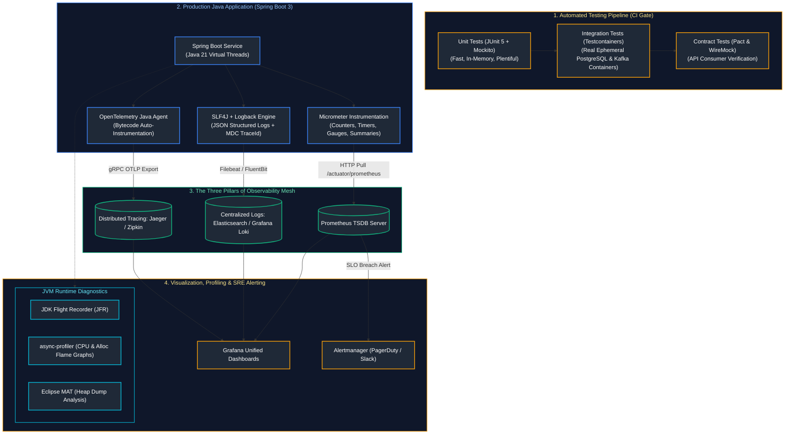
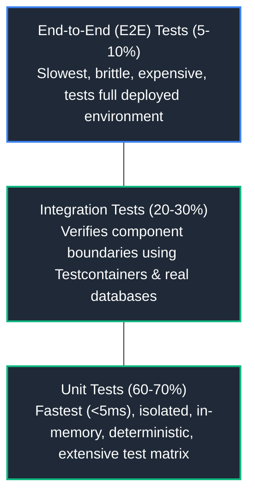
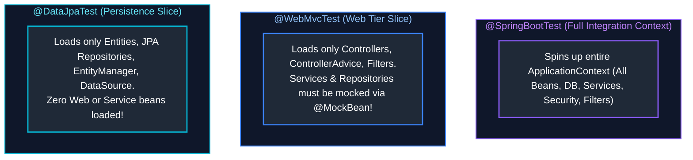
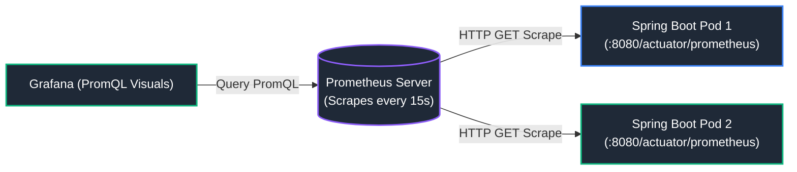
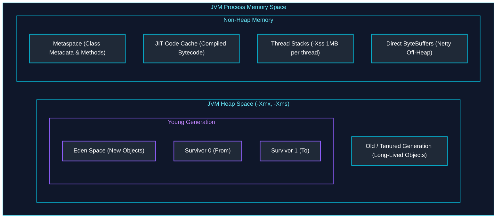

# 14. Testing, Observability, Performance & Production Engineering

A comprehensive, production-grade engineering guide covering the Testing Pyramid, JUnit 5, Mockito, Spring Boot test slices (`@WebMvcTest`, `@DataJpaTest`), Testcontainers integration testing, enterprise logging architectures (SLF4J, Logback, MDC correlation IDs), the Three Pillars of Observability (Metrics, Logs, Traces), Prometheus pull architecture, Grafana dashboards, JVM memory diagnostics, async-profiler, heap dump analysis, and high-concurrency load testing.

---

## Enterprise Testing, Observability & Performance Architecture



---

## Table of Contents
1. [Testing Pyramid & Unit Testing Mastery](#1-testing-pyramid--unit-testing-mastery)
   - [1.1 The Testing Pyramid Architecture](#11-the-testing-pyramid-architecture)
   - [1.2 JUnit 5 Architecture & Lifecycle](#12-junit-5-architecture--lifecycle)
   - [1.3 Parameterized Testing (`@CsvSource`, `@MethodSource`)](#13-parameterized-testing-csvsource-methodsource)
   - [1.4 Mockito: Dummy vs Stub vs Mock vs Spy & Argument Captors](#14-mockito-dummy-vs-stub-vs-mock-vs-spy--argument-captors)
   - [1.5 Fluent Assertions with AssertJ](#15-fluent-assertions-with-assertj)
2. [Spring Boot Test Slicing & Real Integration Testing](#2-spring-boot-test-slicing--real-integration-testing)
   - [2.1 Test Slicing Architecture (`@SpringBootTest` vs `@WebMvcTest` vs `@DataJpaTest`)](#21-test-slicing-architecture-springboottest-vs-webmvctest-vs-datajpatest)
   - [2.2 Controller Slice Testing with `MockMvc`](#22-controller-slice-testing-with-mockmvc)
   - [2.3 Real Integration Testing with Testcontainers & Spring Boot `@ServiceConnection`](#23-real-integration-testing-with-testcontainers--spring-boot-serviceconnection)
3. [Contract Testing, Mocking & Code Quality Gates](#3-contract-testing-mocking--code-quality-gates)
   - [3.1 WireMock for External HTTP API Mocking & Fault Injection](#31-wiremock-for-external-http-api-mocking--fault-injection)
   - [3.2 Consumer-Driven Contract Testing with Pact](#32-consumer-driven-contract-testing-with-pact)
   - [3.3 Code Coverage (JaCoCo) vs Mutation Testing (PITest)](#33-code-coverage-jacoco-vs-mutation-testing-pitest)
4. [Enterprise Logging, MDC & Distributed Diagnostics](#4-enterprise-logging-mdc--distributed-diagnostics)
   - [4.1 SLF4J Facade & Logback Production Configuration](#41-slf4j-facade--logback-production-configuration)
   - [4.2 Mapped Diagnostic Context (MDC) & Request Correlation IDs](#42-mapped-diagnostic-context-mdc--request-correlation-ids)
   - [4.3 Centralized Structured JSON Logging (ELK & Grafana Loki)](#43-centralized-structured-json-logging-elk--grafana-loki)
5. [The Three Pillars of Observability & APM](#5-the-three-pillars-of-observability--apm)
   - [5.1 The Three Pillars Multi-Dimensional Comparison](#51-the-three-pillars-multi-dimensional-comparison)
   - [5.2 Micrometer Instrumentation (Counters, Timers, Gauges, DistributionSummary)](#52-micrometer-instrumentation-counters-timers-gauges-distributionsummary)
   - [5.3 Prometheus Pull Architecture & Grafana Dashboards](#53-prometheus-pull-architecture--grafana-dashboards)
   - [5.4 Distributed Tracing with OpenTelemetry & W3C TraceContext](#54-distributed-tracing-with-opentelemetry--w3c-tracecontext)
6. [JVM Performance Diagnostics, Profiling & Load Testing](#6-jvm-performance-diagnostics-profiling--load-testing)
   - [6.1 JVM Memory Layout Internals (Eden, Survivor, Tenured, Metaspace, Off-Heap)](#61-jvm-memory-layout-internals-eden-survivor-tenured-metaspace-off-heap)
   - [6.2 CPU & Allocation Profiling with `async-profiler` Flame Graphs](#62-cpu--allocation-profiling-with-async-profiler-flame-graphs)
   - [6.3 Heap Dump Diagnostics & Leak Detection with Eclipse MAT](#63-heap-dump-diagnostics--leak-detection-with-eclipse-mat)
   - [6.4 Thread Dump Analysis & Deadlock Detection](#64-thread-dump-analysis--deadlock-detection)
   - [6.5 High-Concurrency Load Testing: JMeter vs Gatling](#65-high-concurrency-load-testing-jmeter-vs-gatling)
   - [6.6 JVM Diagnostics & SRE CLI Commands Cheatsheet](#66-jvm-diagnostics--sre-cli-commands-cheatsheet)
7. [References & Further Reading](#7-references--further-reading)

---

# 1. Testing Pyramid & Unit Testing Mastery

---

### 1.1 The Testing Pyramid Architecture

The Testing Pyramid enforces an efficient distribution of automated tests across a software project:



- **Unit Tests**: Test a single class or method in complete isolation. External collaborators are stubbed or mocked. Run hundreds per second.
- **Integration Tests**: Verify interactions across integrated components (e.g. Spring Data JPA repository executing real SQL against a containerized PostgreSQL instance).
- **End-to-End (E2E) Tests**: Verify complete user journeys across running microservices and user interfaces.

---

### 1.2 JUnit 5 Architecture & Lifecycle

JUnit 5 decomposes testing into three independent modules: **JUnit Platform** (runner engine), **JUnit Jupiter** (modern programming model and extension API), and **JUnit Vintage** (backward compatibility for JUnit 3/4).

```java
import org.junit.jupiter.api.*;
import static org.assertj.core.api.Assertions.*;

@DisplayName("Bank Account Unit Tests")
class BankAccountTest {

    private BankAccount account;

    @BeforeAll
    static void initGlobal() {
        // Runs once before all test methods in class
    }

    @BeforeEach
    void setUp() {
        // Runs before every individual test method
        account = new BankAccount("ACC-101", 100.0);
    }

    @Test
    @DisplayName("Deposit increases balance correctly")
    void testDeposit() {
        account.deposit(50.0);
        assertThat(account.getBalance()).isEqualTo(150.0);
    }

    @Test
    @DisplayName("Negative deposit throws IllegalArgumentException")
    void testNegativeDepositThrows() {
        assertThatThrownBy(() -> account.deposit(-10.0))
            .isInstanceOf(IllegalArgumentException.class)
            .hasMessageContaining("positive");
    }

    @AfterEach
    void tearDown() {
        // Runs after every individual test method
    }
}
```

---

### 1.3 Parameterized Testing (`@CsvSource`, `@MethodSource`)

```java
import org.junit.jupiter.params.ParameterizedTest;
import org.junit.jupiter.params.provider.CsvSource;
import static org.assertj.core.api.Assertions.assertThat;

class PricingEngineTest {

    @ParameterizedTest(name = "Tier {0} with base ${1} should discount to ${2}")
    @CsvSource({
        "STANDARD, 100.0, 100.0",
        "SILVER,   100.0,  90.0",
        "GOLD,     100.0,  80.0",
        "PLATINUM, 100.0,  70.0"
    })
    void testCalculateDiscountedPrice(String tier, double basePrice, double expectedPrice) {
        PricingEngine engine = new PricingEngine();
        assertThat(engine.calculate(tier, basePrice)).isEqualTo(expectedPrice);
    }
}
```

---

### 1.4 Mockito: Dummy vs Stub vs Mock vs Spy & Argument Captors

| Test Double | Definition & Behavior | Typical Mockito Syntax |
| :--- | :--- | :--- |
| **Dummy** | Passed to satisfy method parameters; never used or asserted | `new Object()` or dummy string |
| **Stub** | Returns canned, predefined responses to method invocations | `when(repo.findById(1L)).thenReturn(Optional.of(user))` |
| **Mock** | Pre-programmed with expectations; verifies interactions occurred | `verify(notificationService, times(1)).sendEmail(any())` |
| **Spy** | Wraps a real object instance; real methods run unless explicitly stubbed | `@Spy UserService realUserService;` |

#### Argument Captor Example
```java
@ExtendWith(MockitoExtension.class)
class OrderServiceTest {

    @Mock
    private PaymentClient paymentClient;

    @Captor
    private ArgumentCaptor<PaymentRequest> captor;

    @InjectMocks
    private OrderService orderService;

    @Test
    void testCapturesExactPaymentPayload() {
        orderService.checkout("ORD-1", 250.0);

        verify(paymentClient).executeCharge(captor.capture());
        PaymentRequest captured = captor.getValue();

        assertThat(captured.getOrderId()).isEqualTo("ORD-1");
        assertThat(captured.getAmount()).isEqualTo(250.0);
    }
}
```

---

### 1.5 Fluent Assertions with AssertJ

AssertJ provides readable, fluent assertions with detailed failure messages:

```java
assertThat(userList)
    .hasSize(3)
    .extracting(User::getRole)
    .contains("ADMIN", "CUSTOMER")
    .doesNotContain("GUEST");
```

---

# 2. Spring Boot Test Slicing & Real Integration Testing

---

### 2.1 Test Slicing Architecture (`@SpringBootTest` vs `@WebMvcTest` vs `@DataJpaTest`)



---

### 2.2 Controller Slice Testing with `MockMvc`

```java
package com.company.controller;

import org.junit.jupiter.api.Test;
import org.springframework.beans.factory.annotation.Autowired;
import org.springframework.boot.test.autoconfigure.web.servlet.WebMvcTest;
import org.springframework.boot.test.mock.mockito.MockBean;
import org.springframework.http.MediaType;
import org.springframework.test.web.servlet.MockMvc;

import static org.mockito.BDDMockito.*;
import static org.springframework.test.web.servlet.request.MockMvcRequestBuilders.*;
import static org.springframework.test.web.servlet.result.MockMvcResultMatchers.*;

@WebMvcTest(OrderController.class)
class OrderControllerTest {

    @Autowired
    private MockMvc mockMvc;

    @MockBean
    private OrderService orderService;

    @Test
    void testGetOrderByIdReturnsOk() throws Exception {
        given(orderService.getOrder("ORD-99"))
            .willReturn(new OrderResponse("ORD-99", 150.0));

        mockMvc.perform(get("/api/v1/orders/ORD-99")
                .accept(MediaType.APPLICATION_JSON))
            .andExpect(status().isOk())
            .andExpect(jsonPath("$.orderId").value("ORD-99"))
            .andExpect(jsonPath("$.amount").value(150.0));
    }
}
```

---

### 2.3 Real Integration Testing with Testcontainers & Spring Boot `@ServiceConnection`

Mocking databases or using in-memory H2 misses dialect incompatibilities, trigger failures, and JSONB queries. **Testcontainers** spins up real Docker containers during integration test runs:

```java
package com.company.integration;

import org.junit.jupiter.api.Test;
import org.springframework.beans.factory.annotation.Autowired;
import org.springframework.boot.test.context.SpringBootTest;
import org.springframework.boot.testcontainers.service.connection.ServiceConnection;
import org.testcontainers.containers.PostgreSQLContainer;
import org.testcontainers.containers.KafkaContainer;
import org.testcontainers.junit.jupiter.Container;
import org.testcontainers.junit.jupiter.Testcontainers;
import org.testcontainers.utility.DockerImageName;

import static org.assertj.core.api.Assertions.assertThat;

@SpringBootTest(webEnvironment = SpringBootTest.WebEnvironment.RANDOM_PORT)
@Testcontainers
class FullIntegrationTest {

    // 1. Automatically configures Spring Boot DataSource URL, user, and password
    @Container
    @ServiceConnection
    static PostgreSQLContainer<?> postgres = new PostgreSQLContainer<>("postgres:16-alpine");

    // 2. Automatically configures spring.kafka.bootstrap-servers
    @Container
    @ServiceConnection
    static KafkaContainer kafka = new KafkaContainer(DockerImageName.parse("confluentinc/cp-kafka:7.6.0"));

    @Autowired
    private OrderRepository orderRepository;

    @Test
    void testSaveAndRetrieveFromRealPostgres() {
        OrderEntity order = new OrderEntity("ORD-500", 299.99);
        orderRepository.save(order);

        OrderEntity retrieved = orderRepository.findById("ORD-500").orElseThrow();
        assertThat(retrieved.getAmount()).isEqualTo(299.99);
    }
}
```

---

# 3. Contract Testing, Mocking & Code Quality Gates

---

### 3.1 WireMock for External HTTP API Mocking & Fault Injection

WireMock creates a mock HTTP server to simulate third-party payment gateways, partner APIs, or slow network responses:

```java
@WireMockTest(httpPort = 8089)
class PaymentGatewayClientTest {

    @Test
    void testChargeWithTimeoutFault() {
        // Simulate a 5-second network delay to test Circuit Breaker timeout
        stubFor(post(urlEqualTo("/v1/charge"))
            .willReturn(aResponse()
                .withFixedDelay(5000)
                .withStatus(200)));

        assertThatThrownBy(() -> client.charge(100.0))
            .isInstanceOf(HttpTimeoutException.class);
    }
}
```

---

### 3.2 Consumer-Driven Contract Testing with Pact

In distributed microservices, contract testing verifies that independent services agree on API payloads without spinning up end-to-end environments:
1. **Consumer (Order Service)** writes a test defining requests and expected responses; Pact generates a `.json` contract.
2. The contract is published to the **Pact Broker**.
3. **Provider (Payment Service)** executes the contract against its real controllers in CI. If an endpoint payload changed, the build fails immediately.

---

### 3.3 Code Coverage (JaCoCo) vs Mutation Testing (PITest)

- **Line Coverage (JaCoCo)**: Measures lines executed by tests. High coverage can still mask missing assertions.
- **Mutation Testing (PITest)**: Changes code semantics (flips operators, deletes return statements). If tests pass despite mutation, the mutant survived, revealing gaps in test assertions.

---


---

### 3.4 Architecture & Boundary Testing with ArchUnit

In enterprise Spring Boot codebases, architectural layer violations (e.g., Controllers accessing Repositories directly, Domain classes importing Spring/Hibernate annotations) degrade maintainability over time. **ArchUnit** allows developers to assert architectural invariants as automated JUnit tests:

```java
import com.tngtech.archunit.junit.AnalyzeClasses;
import com.tngtech.archunit.junit.ArchTest;
import com.tngtech.archunit.lang.ArchRule;
import static com.tngtech.archunit.lang.syntax.ArchRuleDefinition.*;
import static com.tngtech.archunit.library.Architectures.layeredArchitecture;

@AnalyzeClasses(packages = "com.company.backend")
public class ArchitectureComplianceTest {

    // 1. Strict Layered Architecture Rule
    @ArchTest
    public static final ArchRule layeredArchitectureRule = layeredArchitecture()
        .consideringAllDependencies()
        .layer("Controller").definedBy("..controller..")
        .layer("Service").definedBy("..service..")
        .layer("Repository").definedBy("..repository..")
        .layer("Domain").definedBy("..domain..")
        
        .whereLayer("Controller").mayNotBeAccessedByAnyLayer()
        .whereLayer("Service").mayOnlyBeAccessedByLayers("Controller", "Service")
        .whereLayer("Repository").mayOnlyBeAccessedByLayers("Service")
        .whereLayer("Domain").mayOnlyBeAccessedByLayers("Service", "Repository", "Controller");

    // 2. Domain Model Independence: Domain classes must not depend on Spring or Jakarta EE
    @ArchTest
    public static final ArchRule domainMustNotDependOnFrameworks = noClasses()
        .that().resideInAPackage("..domain..")
        .should().dependOnClassesThat().resideInAnyPackage(
            "org.springframework..",
            "jakarta.persistence..",
            "org.hibernate.."
        );

    // 3. Naming Conventions & Annotations
    @ArchTest
    public static final ArchRule servicesMustBeAnnotatedWithService = classes()
        .that().haveSimpleNameEndingWith("ServiceImpl")
        .should().beAnnotatedWith(org.springframework.stereotype.Service.class);
}
```

# 4. Enterprise Logging, MDC & Distributed Diagnostics

---

### 4.1 SLF4J Facade & Logback Production Configuration

```xml
<configuration>
    <appender name="CONSOLE" class="ch.qos.logback.core.ConsoleAppender">
        <encoder class="net.logstash.logback.encoder.LogstashEncoder">
            <!-- Emits structured JSON directly to STDOUT for Docker / K8s collection -->
        </encoder>
    </appender>
    <root level="INFO">
        <appender-ref ref="CONSOLE" />
    </root>
</configuration>
```

---

### 4.2 Mapped Diagnostic Context (MDC) & Request Correlation IDs

```java
public class CorrelationFilter implements Filter {
    @Override
    public void doFilter(ServletRequest req, ServletResponse res, FilterChain chain) throws Exception {
        HttpServletRequest httpReq = (HttpServletRequest) req;
        String correlationId = Optional.ofNullable(httpReq.getHeader("X-Correlation-ID"))
                .orElse(UUID.randomUUID().toString());

        MDC.put("correlationId", correlationId);
        try {
            chain.doFilter(req, res);
        } finally {
            MDC.clear(); // Vital: Prevent thread-local leakage in thread pools
        }
    }
}
```

---

### 4.3 Centralized Structured JSON Logging (ELK & Grafana Loki)

Containers stream JSON logs to `STDOUT`. Log collectors (**FluentBit** / **Promtail**) scrape container logs, attach Kubernetes labels (pod name, namespace), and forward them to Elasticsearch or Grafana Loki.

---

# 5. The Three Pillars of Observability & APM

---

### 5.1 The Three Pillars Multi-Dimensional Comparison

| Dimension | Metrics | Logs | Traces |
| :--- | :--- | :--- | :--- |
| **Data Nature** | Numeric aggregated measurements over time | Discrete event records with timestamp | Directed acyclic graph of request execution paths |
| **Storage Cost** | Constant and low (independent of traffic spikes) | High (linear with user traffic volume) | High (requires sampling, e.g. 1% or 5%) |
| **Primary Question** | "Is the system healthy right now?" | "What happened at 14:02:01 during failure?"| "Where was the 800ms bottleneck in call chain?" |
| **Standard Tools** | Prometheus, Datadog, InfluxDB | Elasticsearch, Logstash, Grafana Loki | OpenTelemetry, Jaeger, Zipkin |

---

### 5.2 Micrometer Instrumentation (Counters, Timers, Gauges, DistributionSummary)

- **Counter**: Monotonically increasing counter (e.g. `orders.placed.total`).
- **Timer**: Measures both the duration and frequency of an event (e.g. `http.server.requests`).
- **Gauge**: Instantaneous value that fluctuates up and down (e.g. `jvm.memory.used`, `thread.pool.active`).
- **DistributionSummary**: Tracks distribution of values (e.g. payload byte sizes).

---

### 5.3 Prometheus Pull Architecture & Grafana Dashboards

Prometheus periodically polls (scrapes) HTTP endpoints (`/actuator/prometheus`) exposed by microservices:



---

### 5.4 Distributed Tracing with OpenTelemetry & W3C TraceContext

OpenTelemetry Java Agent attaches at JVM startup (`-javaagent:opentelemetry-javaagent.jar`), instrumenting JDBC queries, HTTP clients, and Kafka producers automatically, propagating W3C `traceparent` headers across threads and network boundaries.

---

# 6. JVM Performance Diagnostics, Profiling & Load Testing

---

### 6.1 JVM Memory Layout Internals (Eden, Survivor, Tenured, Metaspace, Off-Heap)



---

### 6.2 CPU & Allocation Profiling with `async-profiler` Flame Graphs

Standard JVM profilers suffer from **Safepoint Bias** (they can only sample threads when the JVM reaches a safepoint). `async-profiler` uses Linux `perf_events` and HotSpot `AsyncGetCallTrace` to sample code without safepoints:

```bash
# Profile CPU for 60 seconds and generate interactive SVG flame graph
./asprof -d 60 -f /tmp/cpu-flamegraph.html <pid>

# Profile heap memory allocations for 60 seconds
./asprof -d 60 -e alloc -f /tmp/alloc-flamegraph.html <pid>
```

---

### 6.3 Heap Dump Diagnostics & Leak Detection with Eclipse MAT

When a JVM crashes with `java.lang.OutOfMemoryError: Java heap space`:
1. JVM flag `-XX:+HeapDumpOnOutOfMemoryError -XX:HeapDumpPath=/dumps/` dumps heap to disk.
2. Open dump file in **Eclipse Memory Analyzer Tool (MAT)**.
3. Review **Dominator Tree** and **Leak Suspects Report** to identify the exact class instances retaining the largest retained heap.

---

### 6.4 Thread Dump Analysis & Deadlock Detection

Capture thread state to diagnose CPU spikes or thread pool freezes:

```bash
jcmd <pid> Thread.print > /tmp/thread-dump.tdump
```

Search for `Found one Java-level deadlock:` or threads in state `WAITING` or `BLOCKED` on synchronization monitors.

---

### 6.5 High-Concurrency Load Testing: JMeter vs Gatling

- **JMeter**: Thread-per-user model; high memory overhead when scaling to tens of thousands of concurrent users.
- **Gatling**: Non-blocking asynchronous event model (Akka/Netty); effortlessly simulates 50,000+ virtual users from a single test machine using readable Java/Scala DSL code.

---

### 6.6 JVM Diagnostics & SRE CLI Commands Cheatsheet

| Command & Syntax | Key Flags Explained | What Does What | Practical Operational Scenario |
| :--- | :--- | :--- | :--- |
| `jcmd <pid> VM.version` | `<pid>`: Process ID | Prints JVM version, flags, and system properties | Verifying active production JVM configuration |
| `jcmd <pid> GC.heap_dump /tmp/heap.hprof` | `<path>`: Output file path | Triggers live on-demand heap dump to disk | Capturing memory snapshot before restarting a leaking process |
| `jcmd <pid> Thread.print` | None | Emits full thread dump of all active threads and deadlocks | Diagnosing why application threads are hung or blocked |
| `jstat -gcutil <pid> 1000 10` | `1000`: Sample every 1000ms<br>`10`: Sample count | Displays real-time GC utilization (% Eden, Old, GC pause time) | Monitoring GC pressure during live high-traffic events |
| `jmap -histo:live <pid> \| head -20` | `-histo:live`: Force GC before counting | Prints top 20 class instances consuming the most heap memory | Rapid preliminary memory leak diagnosis |
| `asprof -d 30 -f /tmp/flame.html <pid>` | `-d 30`: Duration in seconds<br>`-f`: Output path | Generates CPU Flame Graph without safepoint bias | Finding specific CPU-intensive Java methods |
| `wrk -t12 -c400 -d30s http://localhost:8080/api` | `-t12`: Threads<br>`-c400`: Concurrency<br>`-d30s`: Duration | Benchmarks HTTP throughput and latency percentiles | Validating maximum QPS capacity and response latencies |

---

# 7. References & Further Reading

- [JUnit 5 User Guide](https://junit.org/junit5/docs/current/user-guide/)
- [Testcontainers Official Documentation](https://testcontainers.com/)
- [Micrometer: Metrics Collection for JVM](https://micrometer.io/)
- [Prometheus Monitoring System & Best Practices](https://prometheus.io/docs/)
- [async-profiler: Sampling CPU and Memory Profiler](https://github.com/async-profiler/async-profiler)
- [Eclipse Memory Analyzer (MAT)](https://eclipse.dev/mat/)
