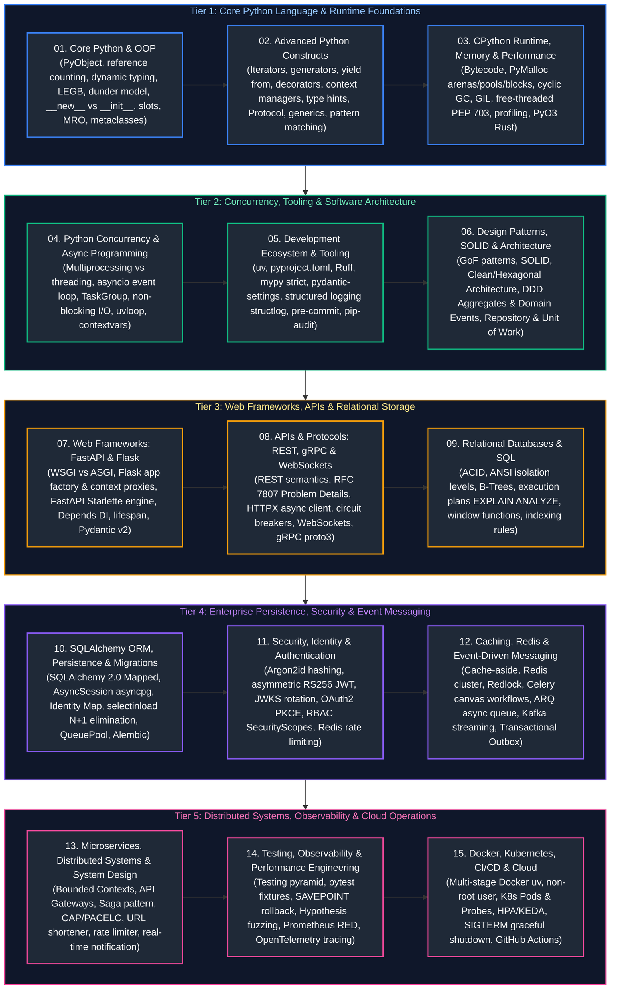

# Python Backend Engineering Master Curriculum & Comprehensive Study Guide

This master guide provides the definitive, production-grade learning roadmap, conceptual index, and chronological study order for modern Python Backend Engineering. Designed as both a fresh, from-the-ground-up learning resource for beginners and an exhaustive architectural reference for seasoned staff engineers and platform architects, this curriculum spans CPython runtime mechanics, object model and memory internals, advanced metaprogramming, high-concurrency AsyncIO and event loops, software architecture (Clean/Hexagonal & DDD), web framework internals (FastAPI & Flask), relational databases and SQL mastery, enterprise persistence with SQLAlchemy 2.0 (Core, ORM, asyncpg, and Alembic), resilient HTTP and RPC protocols (REST, gRPC, WebSockets), testing and quality engineering with pytest, cryptographic identity and API security (OAuth2, JWT, Argon2id), distributed caching and messaging (Redis, Celery, Kafka), microservices system design, and production operations (Docker, Kubernetes, OpenTelemetry, Prometheus, CI/CD, and Cloud).

Every module adheres to the repository's visual design system and technical writing standards, featuring clear conceptual definitions, intuitive real-world analogies, dark-mode Mermaid topological diagrams, memory/hardware mechanics, step-by-step beginner code examples, production implementations with detailed line-by-line commentary, edge-case mitigation, and production troubleshooting playbooks.

---

## Recommended Chronological Study Order

---

## Master Topic Guides & Curriculum Coverage Overview

| Study Order | Guide File | Conceptual Domain | Key Topics & Production Scenarios Covered |
| :---: | :--- | :--- | :--- |
| **01** | [`01_core_python_and_oop.md`](01_core_python_and_oop.md) | Core Python, Memory & Object-Oriented Programming | `PyObject` C-struct, reference counting, dynamic typing, mutable vs. immutable internals, `==` vs. `is`, copy semantics, collection internals, LEGB scoping, closures, mutable default argument traps, dunder data model, `__new__` vs. `__init__`, properties, descriptors, `__slots__` 85% memory savings, C3 MRO linearization, metaclasses vs. `__init_subclass__`, dataclasses, and ABCs. |
| **02** | [`02_advanced_python_programming_constructs.md`](02_advanced_python_programming_constructs.md) | Metaprogramming, Protocols & Static Type System | Iterators (`__iter__`, `__next__`), generators, `yield from`, pipeline processing, decorators (`@functools.wraps`), context managers (`__enter__`, `__exit__`, `ExitStack`), `typing.Protocol` structural typing, generics (`TypeVar`, `ParamSpec`), structural pattern matching (`match/case`), dynamic imports, and circular import triage. |
| **03** | [`03_cpython_runtime_memory_and_performance.md`](03_cpython_runtime_memory_and_performance.md) | CPython Engine, Memory Allocators & Performance | CPython compiler pipeline, bytecode disassembly (`dis`), reference counting, 3-generation cyclic garbage collector (`gc`), PyMalloc arenas/pools/blocks, Global Interpreter Lock (GIL) mechanics, PEP 703 free-threaded Python 3.13, profiling with `tracemalloc`, `memray`, `py-spy`, and Rust PyO3 extensions. |
| **04** | [`04_python_concurrency_and_async_programming.md`](04_python_concurrency_and_async_programming.md) | Multithreading, Multiprocessing & AsyncIO | Preemptive threading vs. multiprocessing vs. cooperative multitasking, `ThreadPoolExecutor`, `multiprocessing` start methods (`spawn` vs. `fork` deadlocks), `asyncio` event loop architecture, `TaskGroup` structured concurrency, non-blocking I/O, `uvloop`, and `contextvars`. |
| **05** | [`05_python_development_ecosystem_and_tooling.md`](05_python_development_ecosystem_and_tooling.md) | Modern Tooling, Packaging & CI Standards | Modern Python project layout, `uv` package resolver (10-100x faster), `pyproject.toml` (PEP 621), lockfiles, Ruff linter/formatter, mypy/Pyright CI gates, Pydantic-Settings, structured JSON logging with `structlog`, and dependency auditing (`pip-audit`). |
| **06** | [`06_design_patterns_solid_and_software_architecture.md`](06_design_patterns_solid_and_software_architecture.md) | Design Patterns, SOLID & Architecture | GoF Creational/Structural/Behavioral patterns in Python, SOLID principles, Clean/Hexagonal (Ports and Adapters) architecture, Domain-Driven Design (DDD) aggregates and domain events, Repository Pattern, Unit of Work Pattern, and RFC 7807 Problem Details. |
| **07** | [`07_web_frameworks_fastapi_and_flask.md`](07_web_frameworks_fastapi_and_flask.md) | Web Framework Internals & Data Modeling | WSGI vs. ASGI, Flask application factory & context proxies (`request`, `g`), session teardown, FastAPI Starlette engine, OpenAPI generation, dependency injection (`Depends`), yield dependencies, lifespan handlers, Pydantic v2 (`pydantic-core`), and PATCH `exclude_unset=True`. |
| **08** | [`08_apis_protocols_rest_grpc_websockets.md`](08_apis_protocols_rest_grpc_websockets.md) | API Protocols, Resilience & Real-Time Comms | REST semantics, HTTP error envelopes, HTTPX async client connection pooling (`httpx.Limits`), retries with full jitter (`tenacity`), circuit breakers (`pybreaker`), streaming responses, WebSockets with Redis Pub/Sub, gRPC with Protocol Buffers (`proto3`), and HMAC webhooks. |
| **09** | [`09_relational_databases_and_sql.md`](09_relational_databases_and_sql.md) | Relational Database Theory & Advanced SQL | ACID guarantees, transaction isolation levels (Read Committed, Repeatable Read, Serializable), concurrency anomalies (Dirty Reads, Phantom Reads, Write Skew), B-Tree indexes, clustered vs. non-clustered, execution plans (`EXPLAIN ANALYZE`), window functions, and PgBouncer. |
| **10** | [`10_sqlalchemy_orm_persistence_and_migrations.md`](10_sqlalchemy_orm_persistence_and_migrations.md) | Enterprise Persistence, ORM & Migrations | SQLAlchemy 2.0 declarative models (`Mapped[T]`), `AsyncSession` with `asyncpg`, Identity Map, Unit of Work, relationship loading strategies (`selectinload`, `joinedload`), N+1 query elimination, connection pooling (`QueuePool`), and Alembic migrations. |
| **11** | [`11_security_identity_and_authentication.md`](11_security_identity_and_authentication.md) | API Security, Cryptography & Identity | Cryptographic password hashing with Argon2id (RFC 9106), asymmetric JWT verification (RS256/EdDSA) with JWKS rotation, OAuth2 PKCE, RBAC `SecurityScopes`, Redis sliding-window rate limiting, CORS/CSRF protection, and OWASP API Top 10 BOLA/SSRF mitigation. |
| **12** | [`12_caching_redis_and_event_driven_messaging.md`](12_caching_redis_and_event_driven_messaging.md) | Distributed Caching & Message Queues | Cache-Aside and Write-Through patterns, cache stampede prevention (mutex locks, TTL jitter), Redis data structures and Redlock, Celery distributed tasks & canvas workflows, ARQ async queue, Kafka streaming (`aiokafka`), and Transactional Outbox Pattern. |
| **13** | [`13_microservices_distributed_systems_system_design.md`](13_microservices_distributed_systems_system_design.md) | Microservices, Distributed Systems & System Design | Bounded Contexts, API Gateway pattern, service discovery, distributed consensus (CAP/PACELC), distributed transactions (Saga Choreography vs. Orchestration), and High-Scale System Design (URL Shortener, Rate Limiter, Real-time Notification System). |
| **14** | [`14_testing_observability_and_performance_engineering.md`](14_testing_observability_and_performance_engineering.md) | Testing Pyramid, Observability & Profiling | Testing pyramid, pytest fixtures, parametrization, mock patching rules (patch where looked up), TestClient, SAVEPOINT database rollbacks, Hypothesis property testing, Prometheus metrics (RED method, `PROMETHEUS_MULTIPROC_DIR`), and OpenTelemetry distributed tracing. |
| **15** | [`15_docker_kubernetes_cicd_and_cloud.md`](15_docker_kubernetes_cicd_and_cloud.md) | Cloud Native, Kubernetes & DevOps | Multi-stage distroless/debian-slim Docker with `uv`, non-root user, Kubernetes Pods, Deployments, decoupled health probes (`startup`, `liveness`, `readiness`), HPA/KEDA autoscaling, SIGTERM graceful shutdown, GitHub Actions CI/CD, and AWS/GCP cloud deployment. |

---

## Production Problem-Solution Cross-Reference Index

The table below maps **50 canonical Python backend engineering production problems** to their architectural solutions and corresponding curriculum chapters.

| Problem | Canonical Solution | Module Reference |
| :--- | :--- | :--- |
| **Shared State Mutation Across Requests** | Replace mutable default arguments (`def f(x=[])`) with `None` sentinel pattern | [`01_core_python_and_oop.md`](01_core_python_and_oop.md#33-the-mutable-default-argument-pitfall) |
| **High Memory Overhead for Millions of DTOs** | Suppress instance `__dict__` dynamic namespace using `__slots__` descriptor arrays | [`01_core_python_and_oop.md`](01_core_python_and_oop.md#4-memory-optimization-with-__slots__) |
| **Diamond Inheritance Method Override Bugs** | Enforce C3 Linearization Method Resolution Order (MRO) with cooperative `super()` | [`01_core_python_and_oop.md`](01_core_python_and_oop.md#8-multiple-inheritance-method-resolution-order-c3-mro) |
| **Closure Late-Binding Loop Capture** | Bind variables into default arguments (`lambda x, i=i: ...`) at definition time | [`01_core_python_and_oop.md`](01_core_python_and_oop.md#32-closures-free-variables-and-the-late-binding-trap) |
| **Unhashable Types in Sets and Dict Keys** | Implement the Python Dunder Data Model hashing contract (`__hash__` and `__eq__`) | [`01_core_python_and_oop.md`](01_core_python_and_oop.md#53-the-hashing-contract-__eq__-and-__hash__) |
| **Metaclass Architecture Complexity & Conflicts** | Simplify class validation and registration using Python 3.6+ `__init_subclass__` | [`01_core_python_and_oop.md`](01_core_python_and_oop.md#94-the-modern-alternative-__init_subclass__) |
| **Memory Exhaustion on Large File Streaming** | Stream data lazily using generator pipelines and `yield` chunks | [`02_advanced_python_programming_constructs.md`](02_advanced_python_programming_constructs.md#2-generators-lazy-evaluation-cooperative-multitasking) |
| **Lost Metadata & Docstrings in Decorators** | Wrap decorator wrappers with `@functools.wraps(func)` to preserve `__name__` and `__doc__` | [`02_advanced_python_programming_constructs.md`](02_advanced_python_programming_constructs.md#3-decorators-functional-metaprogramming) |
| **Resource Leakage on Unexpected Exceptions** | Wrap resources in context managers (`with` / `@contextlib.contextmanager`) | [`02_advanced_python_programming_constructs.md`](02_advanced_python_programming_constructs.md#4-context-managers-resource-lifecycle-management) |
| **Circular Module Import `ImportError`** | Refactor shared types to domain leaf modules or defer imports inside callables | [`02_advanced_python_programming_constructs.md`](02_advanced_python_programming_constructs.md#7-module-initialization-imports-dynamic-architecture) |
| **Cyclic Reference Memory Leak in Workers** | Break reference cycles using `weakref` or tune cyclic collector passes (`gc.collect()`) | [`03_cpython_runtime_memory_and_performance.md`](03_cpython_runtime_memory_and_performance.md#2-reference-counting-cyclic-garbage-collection) |
| **Multi-Core Thread Starvation Under CPU Work** | Offload CPU-heavy computation to `ProcessPoolExecutor` or free-threaded Python 3.13 | [`03_cpython_runtime_memory_and_performance.md`](03_cpython_runtime_memory_and_performance.md#4-the-global-interpreter-lock-gil-free-threaded-python) |
| **Slow Python Numerical & String Transformations** | Write C-extensions, Cython, or Rust native extensions releasing the GIL via PyO3 | [`03_cpython_runtime_memory_and_performance.md`](03_cpython_runtime_memory_and_performance.md#7-high-performance-native-extensions-rust-pyo3-integration) |
| **High Worker Memory Fragmentation (PyMalloc)** | Periodically recycle long-running worker processes (`--max-requests` in Gunicorn) | [`03_cpython_runtime_memory_and_performance.md`](03_cpython_runtime_memory_and_performance.md#3-pymalloc-memory-allocator-arenas-pools-and-blocks) |
| **Event Loop Starvation from Blocking Synchronous I/O** | Delegate synchronous blocking calls to `asyncio.to_thread` or worker thread pools | [`04_python_concurrency_and_async_programming.md`](04_python_concurrency_and_async_programming.md#6-bridging-synchronous-and-asynchronous-boundaries) |
| **Orphaned Background Coroutines on Failure** | Enforce Python 3.11+ Structured Concurrency using `asyncio.TaskGroup` | [`04_python_concurrency_and_async_programming.md`](04_python_concurrency_and_async_programming.md#4-structured-concurrency-task-management) |
| **Async Context Loss Across Concurrency Spawns** | Propagate request-scoped state using `contextvars.ContextVar` | [`04_python_concurrency_and_async_programming.md`](04_python_concurrency_and_async_programming.md#7-task-local-storage-with-contextvars) |
| **Subprocess Deadlock via `fork` in Multithreaded Apps** | Set multiprocessing start method to `spawn` (`multiprocessing.set_start_method("spawn")`) | [`04_python_concurrency_and_async_programming.md`](04_python_concurrency_and_async_programming.md#2-multiprocessing-ipc-architectures) |
| **Slow CI/CD Dependency Resolution & Builds** | Migrate build infrastructure to ultra-fast Rust-based `uv` with reproducible lockfiles | [`05_python_development_ecosystem_and_tooling.md`](05_python_development_ecosystem_and_tooling.md#2-modern-dependency-management-with-uv-pyprojecttoml) |
| **Production Unstructured Log Ingestion Delays** | Standardize application logging on JSON structured logging with `structlog` | [`05_python_development_ecosystem_and_tooling.md`](05_python_development_ecosystem_and_tooling.md#5-enterprise-structured-logging-with-structlog) |
| **Silent Type Regressions in Production Deployments** | Enforce strict static type checking in CI pipelines using `mypy --strict` or `pyright` | [`05_python_development_ecosystem_and_tooling.md`](05_python_development_ecosystem_and_tooling.md#3-code-quality-automation-ruff-static-typing) |
| **Tight Coupling Between Framework & Business Logic** | Implement Clean/Hexagonal Architecture: decouple domain from frameworks via Ports | [`06_design_patterns_solid_and_software_architecture.md`](06_design_patterns_solid_and_software_architecture.md#3-hexagonal-ports-and-adapters-clean-architecture) |
| **Inconsistent Error JSON Structures** | Implement global exception translation to RFC 7807 Problem Details | [`06_design_patterns_solid_and_software_architecture.md`](06_design_patterns_solid_and_software_architecture.md#7-rfc-7807-problem-details-error-standardization) |
| **Thread-Safety Bugs in Flask Request Hooks** | Utilize `flask.g` scoped strictly to the current request context lifecycle | [`07_web_frameworks_fastapi_and_flask.md`](07_web_frameworks_fastapi_and_flask.md#2-flask-framework-internals-context-architecture) |
| **Database Session Leaks in FastAPI Endpoints** | Use yield-based dependency injection (`yield session`) inside `Depends()` | [`07_web_frameworks_fastapi_and_flask.md`](07_web_frameworks_fastapi_and_flask.md#4-advanced-dependency-injection-di-in-fastapi) |
| **Sync Route Starvation in FastAPI Event Loop** | Declare CPU/DB-bound routes without `async def` so FastAPI runs them in a worker pool | [`07_web_frameworks_fastapi_and_flask.md`](07_web_frameworks_fastapi_and_flask.md#6-synchronous-vs-asynchronous-route-execution-mechanics) |
| **Accidental Overwrite of Omitted Fields in HTTP PATCH** | Extract modified fields using `model.model_dump(exclude_unset=True)` | [`07_web_frameworks_fastapi_and_flask.md`](07_web_frameworks_fastapi_and_flask.md#7-pydantic-v2-data-modeling-the-rust-core-engine) |
| **Downstream Microservice Cascade Failure** | Protect outbound calls with circuit breakers (`pybreaker`) and exponential backoff (`tenacity`) | [`08_apis_protocols_rest_grpc_websockets.md`](08_apis_protocols_rest_grpc_websockets.md#3-client-resilience-engineering-retries-circuit-breakers) |
| **Spoofed Inbound Webhook Payloads** | Verify cryptographic signatures using constant-time HMAC SHA-256 (`hmac.compare_digest`) | [`08_apis_protocols_rest_grpc_websockets.md`](08_apis_protocols_rest_grpc_websockets.md#6-enterprise-webhook-architecture) |
| **Slow Database Full Table Scans** | Analyze queries using `EXPLAIN ANALYZE` and construct covering B-Tree indexes | [`09_relational_databases_and_sql.md`](09_relational_databases_and_sql.md#5-database-storage-engine-indexing-internals) |
| **Concurrent Lost Updates in Relational Tables** | Enforce Repeatable Read or use Pessimistic Row Locking (`SELECT ... FOR UPDATE`) | [`09_relational_databases_and_sql.md`](09_relational_databases_and_sql.md#4-transaction-isolation-levels-concurrency-anomalies) |
| **PostgreSQL Connection Pool Starvation** | Deploy PgBouncer in transaction pooling mode between API Pods and PostgreSQL | [`09_relational_databases_and_sql.md`](09_relational_databases_and_sql.md#8-database-connection-pooling-pgbouncer) |
| **SQLAlchemy 1.x Query Incompatibilities in 2.0** | Refactor legacy `session.query()` to 2.0 executable statement syntax `session.execute(select())` | [`10_sqlalchemy_orm_persistence_and_migrations.md`](10_sqlalchemy_orm_persistence_and_migrations.md#1-sqlalchemy-20-architecture-core-vs-orm) |
| **N+1 SQL Queries Degrading API Latency** | Configure relationship eager loading with `selectinload()` (async) or `joinedload()` | [`10_sqlalchemy_orm_persistence_and_migrations.md`](10_sqlalchemy_orm_persistence_and_migrations.md#5-relationship-mapping-the-n1-query-disaster) |
| **Missing Async PostgreSQL Support in SQLAlchemy** | Pair `create_async_engine` with `postgresql+asyncpg://` driver and `AsyncSession` | [`10_sqlalchemy_orm_persistence_and_migrations.md`](10_sqlalchemy_orm_persistence_and_migrations.md#3-asynchronous-database-operations-with-asyncpg) |
| **Alembic Multiple Heads Conflict in Git Merges** | Merge migration branches using `alembic merge heads -m "merge"` | [`10_sqlalchemy_orm_persistence_and_migrations.md`](10_sqlalchemy_orm_persistence_and_migrations.md#8-database-migrations-with-alembic) |
| **Weak Password Storage Vulnerable to GPU Attacks** | Enforce Argon2id cryptographic password hashing via `argon2-cffi` (RFC 9106) | [`11_security_identity_and_authentication.md`](11_security_identity_and_authentication.md#2-cryptographic-password-hashing-argon2id-vs-bcrypt) |
| **Compromised Stolen JWT Tokens Before Expiry** | Implement short-lived access tokens with refresh token rotation and Redis revocation lists | [`11_security_identity_and_authentication.md`](11_security_identity_and_authentication.md#4-token-lifecycle-management-refresh-token-rotation-blacklisting) |
| **API Denial-of-Service / Traffic Spikes** | Implement Redis sliding-window distributed rate limiting via Sorted Sets (ZSET) | [`11_security_identity_and_authentication.md`](11_security_identity_and_authentication.md#7-distributed-rate-limiting-with-redis-sliding-windows) |
| **Broken Object-Level Authorization (BOLA / IDOR)** | Enforce tenant/ownership checks directly inside service queries before data lookup | [`11_security_identity_and_authentication.md`](11_security_identity_and_authentication.md#8-defensive-engineering-for-the-owasp-api-security-top-10) |
| **Cache Stampede / Thundering Herd on Expiry** | Implement Cache-Aside with distributed locking (Redlock) or TTL random jitter | [`12_caching_redis_and_event_driven_messaging.md`](12_caching_redis_and_event_driven_messaging.md#3-cache-failure-modes-mitigations) |
| **Lost Database Updates in Celery Task Failures** | Implement the Transactional Outbox Pattern to guarantee at-least-once message delivery | [`12_caching_redis_and_event_driven_messaging.md`](12_caching_redis_and_event_driven_messaging.md#9-dual-write-consistency-the-transactional-outbox-pattern) |
| **Distributed Multi-Service Sagas Inconsistency** | Implement Saga Orchestration with explicit compensating rollback transactions | [`13_microservices_distributed_systems_system_design.md`](13_microservices_distributed_systems_system_design.md#5-distributed-transactions-the-saga-pattern) |
| **Slow, Non-Deterministic Database Test Runs** | Run tests against nested transactions with automatic rollback (`SAVEPOINT`) | [`14_testing_observability_and_performance_engineering.md`](14_testing_observability_and_performance_engineering.md#4-hermetic-database-testing-with-postgresql-savepoints) |
| **Mocking Internal Implementation Details** | Mock at outbound network boundaries using `respx` rather than mocking internal methods | [`14_testing_observability_and_performance_engineering.md`](14_testing_observability_and_performance_engineering.md#3-mocking-mastery-with-unittestmock-respx) |
| **Silent API Performance Degradation & Latency Skew** | Instrument FastAPI endpoints with OpenTelemetry distributed tracing and Jaeger exporter | [`14_testing_observability_and_performance_engineering.md`](14_testing_observability_and_performance_engineering.md#8-distributed-tracing-with-opentelemetry-otel) |
| **Container Image Bloat & Vulnerabilities** | Build minimal multi-stage distroless/debian-slim Docker images using `uv` | [`15_docker_kubernetes_cicd_and_cloud.md`](15_docker_kubernetes_cicd_and_cloud.md#2-production-multi-stage-docker-builds-with-uv) |
| **Dropped Requests on Kubernetes Pod Termination** | Handle `SIGTERM` gracefully, allowing in-flight requests 15–30s to complete | [`15_docker_kubernetes_cicd_and_cloud.md`](15_docker_kubernetes_cicd_and_cloud.md#5-process-lifecycle-signals-zero-downtime-deployments) |
| **Traffic Sent to Unready or Frozen Pods** | Decouple `startupProbe`, `readinessProbe` (pool health), and `livenessProbe` | [`15_docker_kubernetes_cicd_and_cloud.md`](15_docker_kubernetes_cicd_and_cloud.md#4-decoupling-health-probes-startup-liveness-and-readiness) |
| **Hardcoded Secrets in Source Control** | Inject secrets at runtime via Kubernetes Secrets / External Secrets Operator | [`15_docker_kubernetes_cicd_and_cloud.md`](15_docker_kubernetes_cicd_and_cloud.md#7-enterprise-secrets-configuration-management) |
