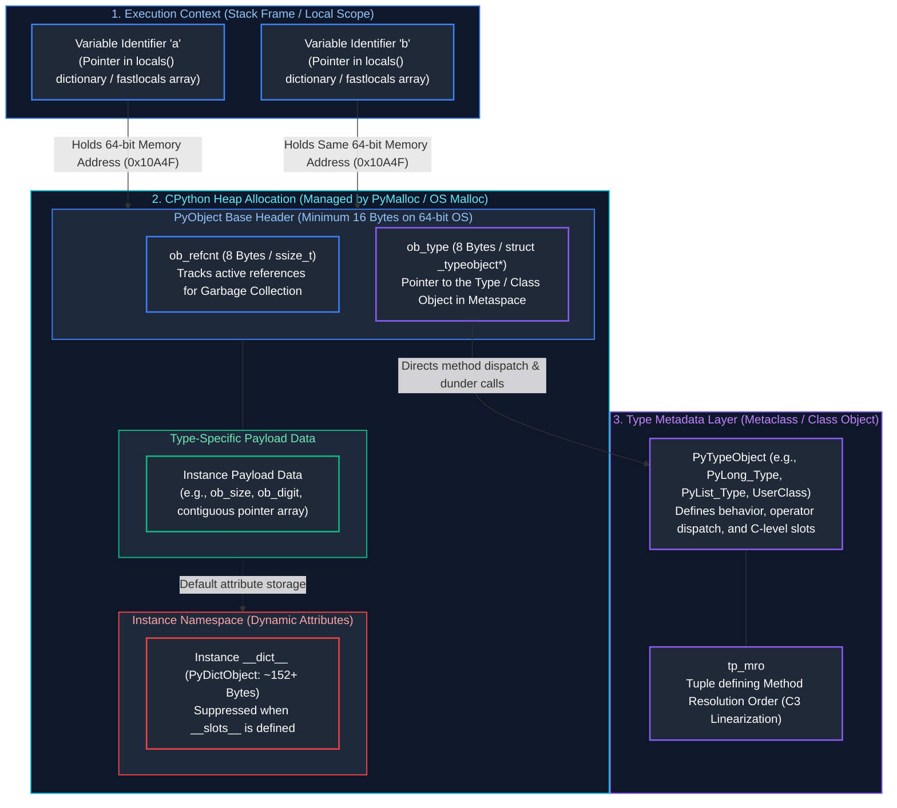
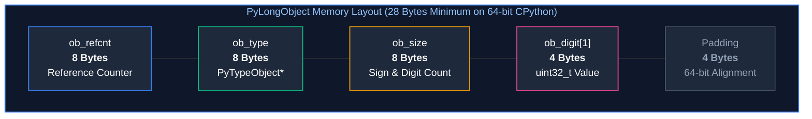
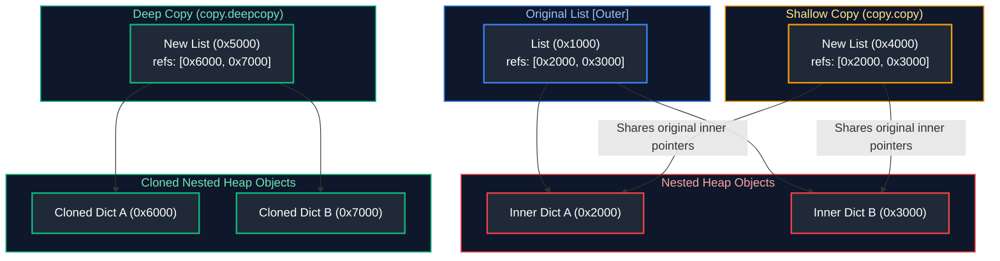
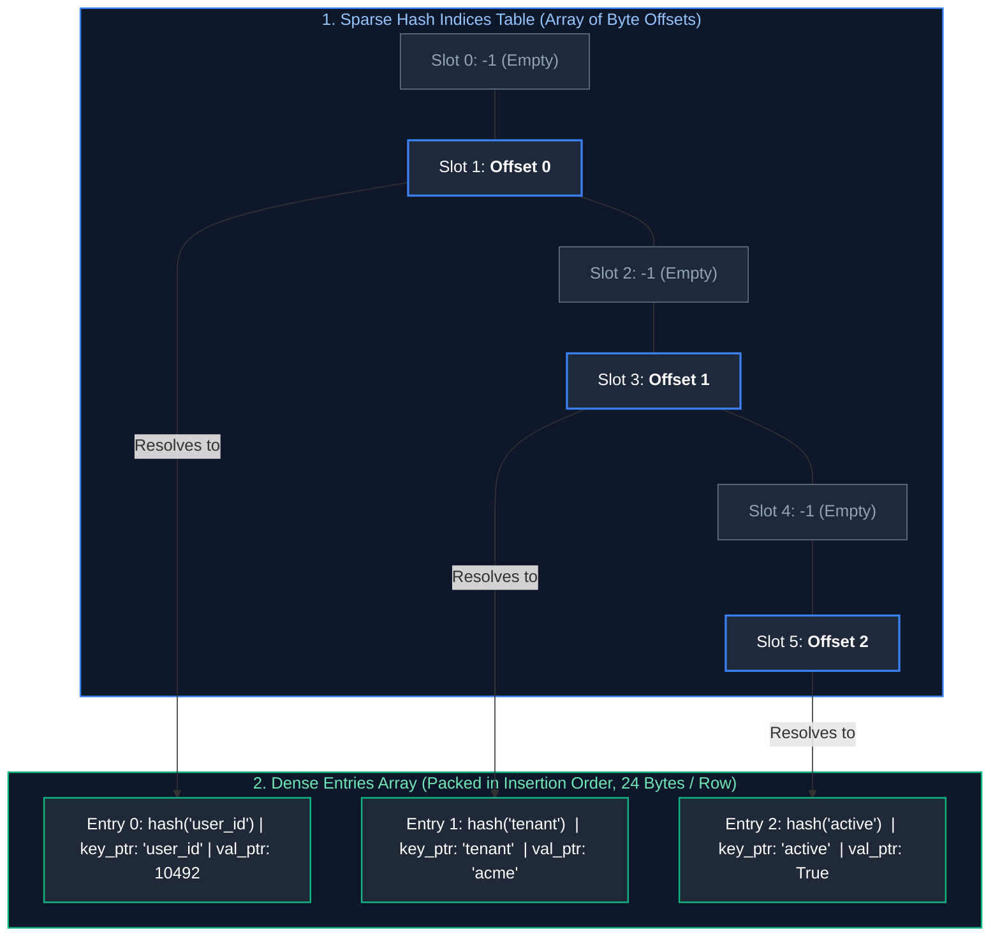
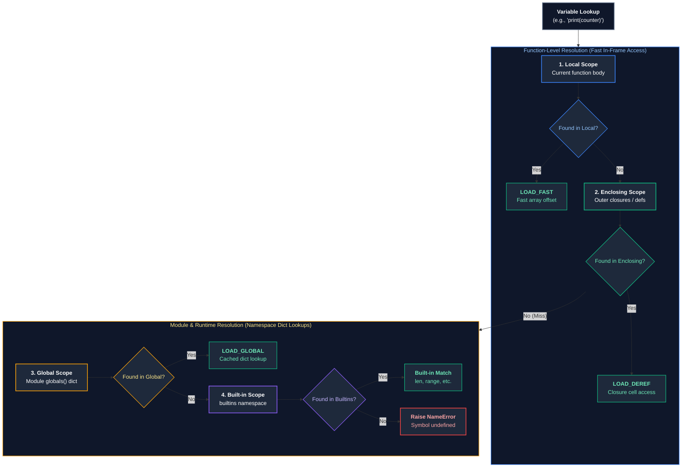
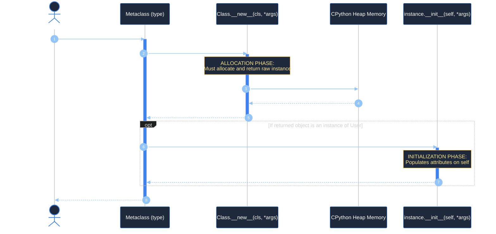
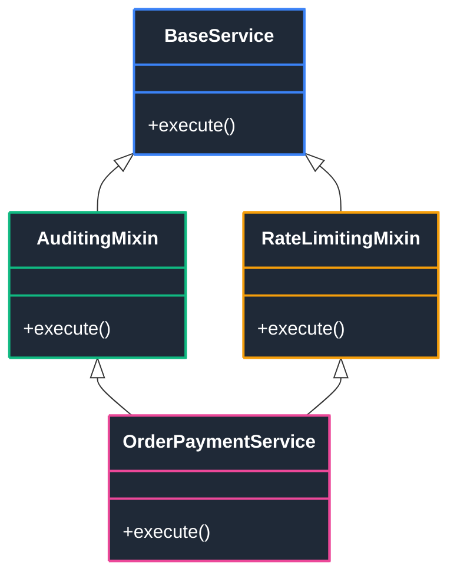
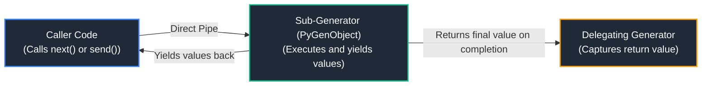
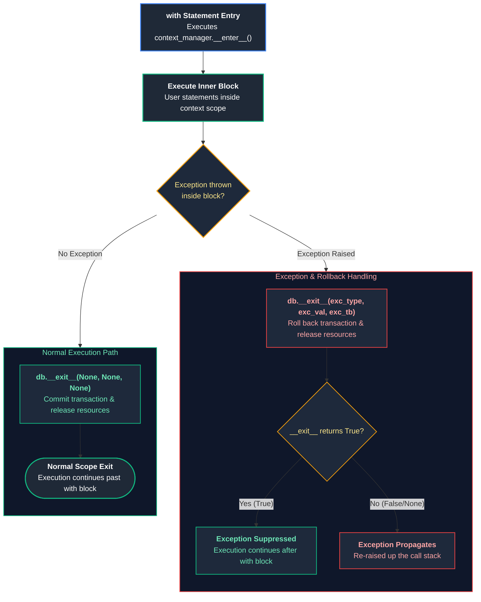
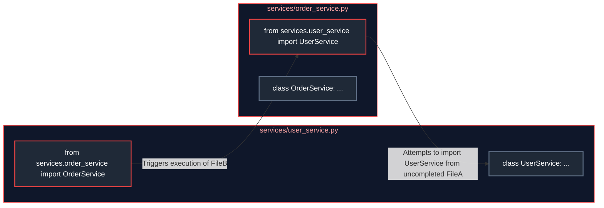

# 01. Core Python, OOP & Advanced Language Constructs: Master Guide

A comprehensive, production-grade guide to Python's object model (PyObject, type pointers, reference counts), OOP mechanics (MRO C3 linearization, slots, descriptors), iterator protocol, generator pipelines, coroutines, context managers, and advanced metaprogramming.

---

## Architectural Overview: CPython Object Memory & Type Dispatch System

In Python, **everything is an object allocated on the heap**—including numbers, strings, functions, modules, and classes themselves. Python variables never store raw data values directly; they are simply 64-bit pointer references holding memory addresses that point to object structures on the heap.



---

## Table of Contents
1. [Everything is an Object: The CPython Object Model](#1-everything-is-an-object-the-cpython-object-model)
   - [1.1 Conceptual Foundation: Sticky Notes vs. Boxes](#11-conceptual-foundation-sticky-notes-vs-boxes)
   - [1.2 C-Level Anatomy: `PyObject` and `PyVarObject`](#12-c-level-anatomy-pyobject-and-pyvarobject)
   - [1.3 Mutability vs. Immutability in Memory](#13-mutability-vs-immutability-in-memory)
   - [1.4 Equality (`==`) vs. Identity (`is`) and Caching Internals](#14-equality--vs-identity-is-and-caching-internals)
   - [1.5 Memory Copy Semantics: Shallow Copy vs. Deep Copy](#15-memory-copy-semantics-shallow-copy-vs-deep-copy)
2. [Built-in Collections Deep Dive: Lists, Tuples, Dicts & Sets](#2-built-in-collections-deep-dive-lists-tuples-dicts--sets)
   - [2.1 Lists: Dynamic Array Over-Allocation Mechanics](#21-lists-dynamic-array-over-allocation-mechanics)
   - [2.2 Tuples: Immutability, Struct Layout & Freelists](#22-tuples-immutability-struct-layout--freelists)
   - [2.3 Dictionaries: Compact Hash Table Architecture](#23-dictionaries-compact-hash-table-architecture)
   - [2.4 Sets: Open Addressing and Collision Resolution](#24-sets-open-addressing-and-collision-resolution)
3. [Scope Resolution (LEGB), Closures & Execution Context](#3-scope-resolution-legb-closures--execution-context)
   - [3.1 The LEGB Scoping Rule Explained Step-by-Step](#31-the-legb-scoping-rule-explained-step-by-step)
   - [3.2 Closures, Free Variables, and the Late-Binding Trap](#32-closures-free-variables-and-the-late-binding-trap)
   - [3.3 The Mutable Default Argument Pitfall](#33-the-mutable-default-argument-pitfall)
4. [Memory Optimization with `__slots__`](#4-memory-optimization-with-__slots__)
   - [4.1 Why Standard Classes Have High Memory Overhead (`__dict__`)](#41-why-standard-classes-have-high-memory-overhead-__dict__)
   - [4.2 How `__slots__` Replaces Dictionaries with Descriptor Arrays](#42-how-__slots__-replaces-dictionaries-with-descriptor-arrays)
   - [4.3 Practical Benchmarking: 80%+ Memory Reduction](#43-practical-benchmarking-80-memory-reduction)
5. [The Python Dunder Data Model](#5-the-python-dunder-data-model)
   - [5.1 Dunder Protocols: Mapping Syntax to Methods](#51-dunder-protocols-mapping-syntax-to-methods)
   - [5.2 String Representations: `__str__` vs. `__repr__`](#52-string-representations-__str__-vs-__repr__)
   - [5.3 The Hashing Contract: `__eq__` and `__hash__`](#53-the-hashing-contract-__eq__-and-__hash__)
6. [The Complete Object Lifecycle: `__new__` vs. `__init__`](#6-the-complete-object-lifecycle-__new__-vs-__init__)
   - [6.1 The Two-Phase Creation Process Explained](#61-the-two-phase-creation-process-explained)
   - [6.2 When and Why to Override `__new__` (Singletons & Immutables)](#62-when-and-why-to-override-__new__-singletons--immutables)
   - [6.3 Production Implementation: Thread-Safe Singleton & Value Normalization](#63-production-implementation-thread-safe-singleton--value-normalization)
7. [Attribute Management: Properties & Descriptors](#7-attribute-management-properties--descriptors)
   - [7.1 Encapsulating Invariants with `@property`](#71-encapsulating-invariants-with-property)
   - [7.2 The Descriptor Protocol: `__get__`, `__set__`, and `__delete__`](#72-the-descriptor-protocol-__get__-__set__-and-__delete__)
   - [7.3 The Complete Attribute Lookup Chain](#73-the-complete-attribute-lookup-chain)
8. [Multiple Inheritance & Method Resolution Order (C3 MRO)](#8-multiple-inheritance--method-resolution-order-c3-mro)
   - [8.1 The Diamond Problem](#81-the-diamond-problem)
   - [8.2 The C3 Linearization Algorithm Explained](#82-the-c3-linearization-algorithm-explained)
   - [8.3 Cooperative Multiple Inheritance with `super()`](#83-cooperative-multiple-inheritance-with-super)
9. [Metaprogramming: Classes as Objects, Metaclasses & `__init_subclass__`](#9-metaprogramming-classes-as-objects-metaclasses--__init_subclass__)
   - [9.1 Classes Are Objects Too: Dynamic Class Creation with `type()`](#91-classes-are-objects-too-dynamic-class-creation-with-type)
   - [9.2 What is a Metaclass? The Class of a Class](#92-what-is-a-metaclass-the-class-of-a-class)
   - [9.3 Metaclass Architecture & Lifecycle Hooks](#93-metaclass-architecture--lifecycle-hooks)
   - [9.4 The Modern Alternative: `__init_subclass__`](#94-the-modern-alternative-__init_subclass__)
10. [Modern Structural Constructs: Dataclasses, ABCs & Protocols](#10-modern-structural-constructs-dataclasses-abcs--protocols)
    - [10.1 Dataclasses (`slots=True`, `frozen=True`) vs. NamedTuples](#101-dataclasses-slotstrue-frozentrue-vs-namedtuples)
    - [10.2 Abstract Base Classes (`abc.ABC`) vs. Static Structural Protocols](#102-abstract-base-classes-abcabc-vs-static-structural-protocols)
11. [The Iterator Protocol: From First Principles](#11-the-iterator-protocol-from-first-principles)
    - [11.1 Conceptual Foundation: The Book vs. The Bookmark](#111-conceptual-foundation-the-book-vs-the-bookmark)
    - [11.2 Under the Hood: How `for` Loops Actually Execute in CPython](#112-under-the-hood-how-for-loops-actually-execute-in-cpython)
    - [11.3 Custom Iterators: Building Bounded & Infinite Stream Traversers](#113-custom-iterators-building-bounded--infinite-stream-traversers)
12. [Generators, Lazy Evaluation & Cooperative Multitasking](#12-generators-lazy-evaluation--cooperative-multitasking)
    - [12.1 The `yield` Statement & Heap Frame Mechanics (`f_lasti`, `f_locals`)](#121-the-yield-statement--heap-frame-mechanics-f_lasti-f_locals)
    - [12.2 Two-Way Communication via `send()`, `throw()`, and `close()`](#122-two-way-communication-via-send-throw-and-close)
    - [12.3 Sub-Generator Delegation with `yield from`](#123-sub-generator-delegation-with-yield-from)
    - [12.4 End-to-End Production Pipeline: Zero-Memory Multi-Gigabyte Stream Processing](#124-end-to-end-production-pipeline-zero-memory-multi-gigabyte-stream-processing)
13. [Decorators & Functional Metaprogramming](#13-decorators--functional-metaprogramming)
    - [13.1 First-Class Functions, Closures & The `@` Syntactic Sugar](#131-first-class-functions-closures--the--syntactic-sugar)
    - [13.2 The Metadata Loss Bug & `@functools.wraps`](#132-the-metadata-loss-bug--functoolswraps)
    - [13.3 Parameterized Decorator Factories & Class-Based Decorators](#133-parameterized-decorator-factories--class-based-decorators)
    - [13.4 Fully Typed Decorators with `ParamSpec` and `Concatenate`](#134-fully-typed-decorators-with-paramspec-and-concatenate)
    - [13.5 Production Implementation: Distributed Tracing & Resilience Decorator](#135-production-implementation-distributed-tracing--resilience-decorator)
    - [13.6 Type-Safe Asynchronous Decorators with `ParamSpec` and `Coroutine`](#136-type-safe-asynchronous-decorators-with-paramspec-and-coroutine)
14. [Context Managers & Resource Lifecycle Management](#14-context-managers--resource-lifecycle-management)
    - [14.1 Why `try/finally` is Flawed: Deterministic Cleanup with `with`](#141-why-tryfinally-is-flawed-deterministic-cleanup-with-with)
    - [14.2 The `__enter__` and `__exit__` Protocol Specification](#142-the-__enter__-and-__exit__-protocol-specification)
    - [14.3 Functional Context Managers with `@contextlib.contextmanager`](#143-functional-context-managers-with-contextlibcontextmanager)
    - [14.4 Managing Dynamic Multi-Resource Stacks with `contextlib.ExitStack`](#144-managing-dynamic-multi-resource-stacks-with-contextlibexitstack)
    - [14.5 Asynchronous Context Managers (`__aenter__`, `__aexit__`)](#145-asynchronous-context-managers-__aenter__-__aexit__)
    - [14.6 Reentrant vs. Non-Reentrant Context Managers & Deadlock Prevention](#146-reentrant-vs-non-reentrant-context-managers--deadlock-prevention)
15. [The Modern Python Type System & Static Verification](#15-the-modern-python-type-system--static-verification)
    - [15.1 Static Typing in Python (PEP 484, PEP 585, PEP 604)](#151-static-typing-in-python-pep-484-pep-585-pep-604)
    - [15.2 Structural Subtyping via `typing.Protocol` (Static Duck Typing)](#152-structural-subtyping-via-typingprotocol-static-duck-typing)
    - [15.3 Generics & Type Variance: Covariance (`T_co`) vs. Contravariance (`T_contra`)](#153-generics--type-variance-covariance-t_co-vs-contravariance-t_contra)
16. [Structural Pattern Matching (`match / case`)](#16-structural-pattern-matching-match--case)
    - [16.1 Pattern Matching vs. Traditional Switch / If-Else](#161-pattern-matching-vs-traditional-switch--if-else)
    - [16.2 Sequence, Mapping, Class Patterns & Guard Clauses](#162-sequence-mapping-class-patterns--guard-clauses)
    - [16.3 Production Dispatcher: Polymorphic Webhook Router](#163-production-dispatcher-polymorphic-webhook-router)
17. [Module Initialization, Imports & Dynamic Architecture](#17-module-initialization-imports--dynamic-architecture)
    - [17.1 CPython Import Engine: `sys.modules`, `sys.path`, Finders & Loaders](#171-cpython-import-engine-sysmodules-syspath-finders--loaders)
    - [17.2 The Circular Import Deadlock: Root Cause & 3 Production Fixes](#172-the-circular-import-deadlock-root-cause--3-production-fixes)
    - [17.3 Dynamic Module Loading with `importlib`](#173-dynamic-module-loading-with-importlib)
18. [Summary Comparison & Production Engineering Reference Matrix](#18-summary-comparison--production-engineering-reference-matrix)
19. [References & Further Reading](#19-references--further-reading)


---

# 1. Everything is an Object: The CPython Object Model

### 1.1 Conceptual Foundation: Sticky Notes vs. Boxes

In languages like C or C++, a variable is often imagined as a **labeled box**. If you declare `int x = 42;`, the compiler allocates a 4-byte box in memory and places the binary representation of `42` directly inside that box. Assigning `int y = x;` creates a second box and copies the bytes into it.

In Python, **variables are not boxes; they are sticky notes (pointers) attached to objects**.
* When you write `x = [1, 2, 3]`, Python creates a list object somewhere in heap memory.
* It then sticks the label `"x"` onto that heap object.
* When you write `y = x`, Python does **not** copy the list; it simply attaches a second sticky note `"y"` to the **exact same object in memory**.

```python
# Demonstrating reference pointer semantics
a = [10, 20, 30]
b = a  # 'b' now points to the same memory location as 'a'

print(f"Memory address of a: {hex(id(a))}")
print(f"Memory address of b: {hex(id(b))}")
print(f"Do a and b share identity? {a is b}")  # Output: True

# Mutating the object via label 'b' reflects immediately through label 'a'
b.append(40)
print(f"Contents of a: {a}")  # Output: [10, 20, 30, 40]
```

---

### 1.2 C-Level Anatomy: `PyObject` and `PyVarObject`

CPython is written in C. Under the hood, every single entity you interact with in Python is represented by a C struct called `PyObject` (defined in CPython's `Include/object.h`):

```c
// Base C struct present at the start of EVERY Python object
typedef struct _object {
    _PyObject_HEAD_EXTRA // Double-linked list pointers used in debug builds
    Py_ssize_t ob_refcnt; // 64-bit integer tracking the reference count
    struct _typeobject *ob_type; // 64-bit pointer referencing the object's type/class
} PyObject;

// Header for variable-length collections (strings, lists, tuples, dicts)
typedef struct {
    PyObject ob_base;     // Includes ob_refcnt and ob_type
    Py_ssize_t ob_size;   // Number of items in collection (8 bytes)
} PyVarObject;
```

#### Memory Cost of a Simple Integer
In C, a 32-bit integer takes **4 bytes**. In Python, an integer is a full `PyLongObject` struct allocated on the heap:


| Struct Field | Size on 64-bit OS | C Data Type | Architectural Purpose |
| :--- | :---: | :--- | :--- |
| **`ob_refcnt`** | 8 Bytes | `Py_ssize_t` | Reference counter for deterministic reference-counting GC |
| **`ob_type`** | 8 Bytes | `PyTypeObject*` | Pointer to `PyLong_Type` (determines method dispatch and dunders) |
| **`ob_size`** | 8 Bytes | `Py_ssize_t` | Encodes integer sign ($>0$ positive, $<0$ negative) and digit array length |
| **`ob_digit[1]`** | 4 Bytes | `uint32_t` | Dynamic array holding 30-bit integer chunks (arbitrary precision) |
| **Padding** | 4 Bytes | Memory Alignment | Aligns struct to 64-bit (8-byte) word boundary in CPU cache lines |
| **Total Minimum** | **28 Bytes** | Heap Allocation | Baseline heap footprint for even the number `0` or `1` |

You can inspect the exact memory size of any Python object using `sys.getsizeof()`:
```python
import sys

val = 0
print(f"Size of integer 0: {sys.getsizeof(val)} bytes")  # Output: 28 bytes
val_large = 2 ** 100
print(f"Size of 2^100: {sys.getsizeof(val_large)} bytes")  # Output: 44 bytes (arbitrary precision)
```

---

### 1.3 Mutability vs. Immutability in Memory

Objects in Python are divided into two fundamental categories:

1. **Immutable Objects**: Once allocated in memory, their contents can **never** be changed.
   * Examples: `int`, `float`, `bool`, `str`, `tuple`, `frozenset`, `bytes`.
   * When you "modify" an immutable object (e.g., `x = x + 1` or `s = s + "world"`), Python does **not** change the original object; it allocates a brand new object in memory with the new value and moves the variable label to point to the new object.
2. **Mutable Objects**: Their internal payload can be mutated in-place without changing their memory address (`id()`).
   * Examples: `list`, `dict`, `set`, `bytearray`, and user-defined class instances.

```python
# Demonstrating immutability: re-binding creates a new object
num = 100
initial_address = id(num)
num += 1  # Allocates a new integer object (101)
print(f"Did integer address change? {id(num) != initial_address}")  # Output: True

# Demonstrating mutability: in-place modification preserves object address
names = ["Alice", "Bob"]
initial_list_address = id(names)
names.append("Charlie")  # Modifies internal memory buffer in-place
print(f"Did list address remain identical? {id(names) == initial_list_address}")  # Output: True
```

---

### 1.4 Equality (`==`) vs. Identity (`is`) and Caching Internals

* **Value Equality (`==`)**: Checks whether two objects contain the same data value by calling `__eq__()`.
* **Identity (`is`)**: Checks whether two variable labels point to the **exact same physical memory address** by comparing pointer addresses (`id(a) == id(b)`).

```python
list1 = [1, 2, 3]
list2 = [1, 2, 3]

print(list1 == list2)  # True: Semantic contents are equivalent
print(list1 is list2)  # False: Distinct heap allocations at different addresses
```

#### The Small Integer Cache (`[-5, 256]`)
To optimize speed and prevent thrashing the memory allocator, CPython pre-allocates an array of singletons for integers ranging from **-5 to 256** when the interpreter starts up. Any integer within this range references the exact same global singleton:

```python
x = 250 + 6  # 256
y = 256
print(f"256 is cached: {x is y}")  # True: Same object reference

large_x = 1000 + 1  # 1001
large_y = 1001
print(f"1001 is cached: {large_x is large_y}")  # False: Distinct objects outside [-5, 256]
```

> [!IMPORTANT]
> **Always use `is` for singletons**: Always use `if val is None:` instead of `if val == None:`. `is` cannot be overridden by user classes, executes in a single CPU instruction (`cmpq`), and prevents bugs caused by malicious or broken `__eq__` implementations.

---

### 1.5 Memory Copy Semantics: Shallow Copy vs. Deep Copy

When copying compound objects (objects containing other objects, like lists of dicts):



* **Shallow Copy (`copy.copy()`, `list.copy()`, `[:]`)**: Allocates a new outer container, but copies **only the pointer references** to the child objects. Modifying an inner child through the shallow copy mutates the original object!
* **Deep Copy (`copy.deepcopy()`)**: Allocates a new outer container and recursively allocates fresh copies of every child object, maintaining an internal memo dictionary to prevent infinite loops in cyclic references.

```python
import copy

original = [{"role": "admin"}, {"role": "viewer"}]

# 2. Shallow Copy

shallow = copy.copy(original)
shallow[0]["role"] = "superadmin"  # Mutates the shared inner dictionary!
print(f"Original after shallow modification: {original[0]['role']}")  # 'superadmin' (Leaked!)

# 3. Deep Copy

pristine_original = [{"role": "admin"}, {"role": "viewer"}]
deep = copy.deepcopy(pristine_original)
deep[0]["role"] = "superadmin"
print(f"Original after deep modification: {pristine_original[0]['role']}")  # 'admin' (Isolated!)
```

---

# 2. Built-in Collections Deep Dive: Lists, Tuples, Dicts & Sets

### 2.1 Lists: Dynamic Array Over-Allocation Mechanics

A Python `list` is not a linked list; it is a **dynamic array of 64-bit object pointers**.
* To provide $O(1)$ amortized append operations, CPython **over-allocates** memory capacity whenever the array becomes full.
* The growth formula in CPython source (`Objects/listobject.c`) is roughly:
  $$\text{new\_allocated} = \text{newsize} + (\text{newsize} \gg 3) + (\text{newsize} < 9 \ ? \ 3 : 6)$$
* **Performance Profile**:
  * `list.append(x)`: $O(1)$ amortized.
  * `list.pop()`: $O(1)$.
  * `list.insert(0, x)` or `list.pop(0)`: **$O(N)$** because all $N$ pointers must be shifted right or left in memory. (For $O(1)$ FIFO queues, always use `collections.deque`).

---

### 2.2 Tuples: Immutability, Struct Layout & Freelists

* A `tuple` is a fixed-size contiguous array of object pointers. Because tuples cannot change size after allocation, they do not require over-allocation buffers.
* **CPython Small-Tuple Freelist**: When a tuple of size 1 to 20 is garbage-collected, CPython preserves the allocated struct in an internal freelist instead of releasing it to the OS. The next time a tuple of that size is allocated, it is instantly reused without a memory allocation call.

---

### 2.3 Dictionaries: Compact Hash Table Architecture

Since Python 3.6 (formally specified in 3.7), dictionaries maintain a **compact hash table layout** that preserves insertion order while reducing memory usage by 30–40%:



| Subsystem | Storage Structure | Memory Footprint | Architectural Role |
| :--- | :--- | :--- | :--- |
| **Hash Indices Table** | Sparse array of signed integer indices (`int8_t`, `int16_t`, `int32_t`) | 1 to 4 bytes per slot depending on table capacity | Direct hash modulo mapping; points to the row index in the entries table. Empty slots hold `-1`. |
| **Entries Table** | Dense contiguous array of `PyDictKeyEntry` structs | Exactly 24 bytes per active key-value pair on 64-bit OS | Holds `me_hash` (8B), `me_key` pointer (8B), and `me_value` pointer (8B). Preserves insertion order chronologically. |

* **Lookup Mechanics**:
  1. Computes `hash(key)`.
  2. Masks hash to locate slot in the sparse indices table.
  3. If occupied, fetches entry index and compares `hash` and key value via `==`.
  4. If a hash collision occurs, CPython uses **open addressing with pseudorandom perturbation**:
     $$j = ((5 \times j) + 1 + \text{perturb}) \pmod{\text{size}}$$

---

### 2.4 Sets: Open Addressing and Collision Resolution

A `set` is internally implemented identically to a `dict`, but without the value pointer array. Looking up, adding, or removing an element in a set is average-case **$O(1)$**, making sets ideal for membership testing (`if item in my_set:`).

---

# 3. Scope Resolution (LEGB), Closures & Execution Context

### 3.1 The LEGB Scoping Rule Explained Step-by-Step

Whenever Python resolves a variable name, it searches through four sequential scopes (**LEGB**):



* `global`: Tells Python to bind assignments directly to the module-level global namespace.
* `nonlocal`: Introduced in Python 3; tells Python to bind assignments to the nearest enclosing (outer function) scope, enabling stateful closures.

```python
def outer_service():
    request_count = 0  # Enclosing scope variable

    def handle_request():
        nonlocal request_count  # Enables mutating enclosing scope
        request_count += 1
        return f"Handled request #{request_count}"

    return handle_request

handler = outer_service()
print(handler())  # Handled request #1
print(handler())  # Handled request #2
```

---

### 3.2 Closures, Free Variables, and the Late-Binding Trap

A **closure** is a function that retains access to variables from its enclosing lexical scope, even after the outer function has completed execution and its stack frame has been destroyed. CPython preserves these variables inside special **cell objects** (`__closure__`).

#### The Famous Late-Binding Trap in Loops
A classic interview question and frequent production bug:

```python
# ❌ ANTI-PATTERN: Late-binding trap
# All 4 lambda functions point to the SAME variable 'i', which is evaluated at call time
handlers = [lambda x: x + i for i in range(4)]
print([h(10) for h in handlers])  # Output: [13, 13, 13, 13] (Because loop finished at i = 3!)

# PRODUCTION FIX 1: Default argument binding (evaluates eagerly at definition time)
handlers_fixed = [lambda x, current_i=i: x + current_i for i in range(4)]
print([h(10) for h in handlers_fixed])  # Output: [10, 11, 12, 13] (Correct!)

# PRODUCTION FIX 2: Factory function creates a fresh closure scope per iteration
def make_handler(offset: int):
    return lambda x: x + offset

handlers_factory = [make_handler(i) for i in range(4)]
print([h(10) for h in handlers_factory])  # Output: [10, 11, 12, 13]
```

---

### 3.3 The Mutable Default Argument Pitfall

> [!CAUTION]
> In Python, default arguments in function definitions are **evaluated exactly once when the module is imported/loaded**, NOT each time the function is called! If you use a mutable object (like a list or dict) as a default argument, all callers share the exact same object instance.

```python
# ❌ DANGEROUS ANTI-PATTERN: Shared mutable state across all callers
def append_audit_event(event_name: str, log_list: list = []) -> list:
    log_list.append(event_name)
    return log_list

# In a web server, user 2 sees user 1's audit logs!
print(append_audit_event("Login"))       # Output: ['Login']
print(append_audit_event("ViewProfile")) # Output: ['Login', 'ViewProfile'] (Bug!)

# PRODUCTION STANDARD: The Sentinel Pattern with None
from typing import Any

def append_audit_event_safe(event_name: str, log_list: list[str] | None = None) -> list[str]:
    """Fresh list allocated per call when argument is omitted."""
    actual_list = [] if log_list is None else log_list
    actual_list.append(event_name)
    return actual_list
```

---

# 4. Memory Optimization with `__slots__`

### 4.1 Why Standard Classes Have High Memory Overhead (`__dict__`)

By default, every user-defined class instance in Python maintains an internal dictionary called `__dict__`. This dictionary allows you to dynamically attach arbitrary new attributes at runtime (e.g., `user.custom_field = 123`).

However, this flexibility comes at a severe memory cost:
* A `PyDictObject` takes a minimum of **152 to 280 bytes** of memory per object instance!
* If you have an API service that caches 1,000,000 data transfer objects (DTOs) in memory, storing empty or small `__dict__` structures wastes over **150 to 250 MB of RAM** purely on dictionary overhead.

---

### 4.2 How `__slots__` Replaces Dictionaries with Descriptor Arrays

By defining `__slots__`, you explicitly tell Python: *"This class only has these specific attributes. Do NOT create an instance `__dict__`."*
* Attributes are mapped directly to fixed C-level array descriptor slots.
* Memory drops from $\sim 312\text{ bytes}$ down to **$\sim 48\text{--}64\text{ bytes}$ per instance** (an **80–85% reduction**).

---

### 4.3 Practical Benchmarking: 80%+ Memory Reduction

```python
import sys

class StandardTelemetryPoint:
    def __init__(self, device_id: str, timestamp: float, reading: float) -> None:
        self.device_id = device_id
        self.timestamp = timestamp
        self.reading = reading

class SlottedTelemetryPoint:
    # Explicitly suppresses __dict__ and reserves fixed descriptor pointers
    __slots__ = ("device_id", "timestamp", "reading")

    def __init__(self, device_id: str, timestamp: float, reading: float) -> None:
        self.device_id = device_id
        self.timestamp = timestamp
        self.reading = reading

std_obj = StandardTelemetryPoint("DEV-01", 1729000000.0, 98.6)
slot_obj = SlottedTelemetryPoint("DEV-01", 1729000000.0, 98.6)

# Standard object has an instance __dict__ overhead
std_total_mem = sys.getsizeof(std_obj) + sys.getsizeof(std_obj.__dict__)
slot_total_mem = sys.getsizeof(slot_obj)

print(f"Standard Instance + __dict__: {std_total_mem} bytes")
print(f"Slotted Instance Memory:      {slot_total_mem} bytes")
print(f"Memory Savings:               {(1 - slot_total_mem / std_total_mem) * 100:.1f}%")
print(f"Does Slotted have __dict__?   {hasattr(slot_obj, '__dict__')}")  # False
```

---

# 5. The Python Dunder Data Model

### 5.1 Dunder Protocols: Mapping Syntax to Methods

Python uses double-underscore ("dunder") methods to hook into language primitives:

| Python Syntax | Dispatched Dunder Method | Purpose |
| :--- | :--- | :--- |
| `str(x)` / `print(x)` | `x.__str__()` | User-friendly, human-readable string representation. |
| `repr(x)` / Debugger | `x.__repr__()` | Unambiguous developer representation (`eval(repr(x)) == x`). |
| `len(x)` | `x.__len__()` | Returns non-negative collection length. |
| `x == y` | `x.__eq__(y)` | Equality comparison. |
| `hash(x)` / Set / Dict | `x.__hash__()` | Returns 64-bit integer hash for hash table lookups. |
| `x[key]` | `x.__getitem__(key)` | Index or key lookup. |
| `x[key] = val` | `x.__setitem__(key, val)` | Index or key assignment. |
| `with x:` | `x.__enter__()`, `x.__exit__()` | Context manager lifecycle. |
| `x()` | `x.__call__(*args, **kwargs)`| Makes instance callable like a standard function. |

---

### 5.2 String Representations: `__str__` vs. `__repr__`

* **`__repr__`**: Designed for developers and debugging. Should be unambiguous and, if possible, look like valid Python code that could recreate the object.
* **`__str__`**: Designed for end-users, logging, and user interfaces.

```python
class AccountID:
    def __init__(self, prefix: str, number: int) -> None:
        self.prefix = prefix
        self.number = number

    def __repr__(self) -> str:
        # Developer representation: looks like constructor call
        return f"AccountID(prefix={self.prefix!r}, number={self.number!r})"

    def __str__(self) -> str:
        # User representation: human-friendly formatted ID
        return f"{self.prefix}-{self.number:06d}"

acc = AccountID("CORP", 42)
print(repr(acc))  # Output: AccountID(prefix='CORP', number=42)
print(str(acc))   # Output: CORP-000042
```

---

### 5.3 The Hashing Contract: `__eq__` and `__hash__`

> [!IMPORTANT]
> **The Fundamental Hashing Contract**:
> If two objects are equal according to `__eq__`, they **MUST** produce the exact same integer hash from `__hash__`:
> $$a == b \implies \text{hash}(a) == \text{hash}(b)$$
> If you override `__eq__` in a class without defining `__hash__`, Python automatically sets `__hash__ = None`, making instances **unhashable** (they will raise `TypeError: unhashable type` if placed in a `set` or used as a `dict` key).

```python
class TenantKey:
    """Immutable, hashable value object safe for dictionary keys and sets."""
    __slots__ = ("_tenant_id", "_region", "_cached_hash")

    def __init__(self, tenant_id: str, region: str) -> None:
        self._tenant_id = tenant_id
        self._region = region
        self._cached_hash = hash((self._tenant_id, self._region))

    def __eq__(self, other: object) -> bool:
        if not isinstance(other, TenantKey):
            return NotImplemented
        return self._tenant_id == other._tenant_id and self._region == other._region

    def __hash__(self) -> int:
        return self._cached_hash

# Validated in hash table lookups
cache = {TenantKey("org_100", "us-east-1"): "Active"}
print(TenantKey("org_100", "us-east-1") in cache)  # Output: True
```

---

# 6. The Complete Object Lifecycle: `__new__` vs. `__init__`

### 6.1 The Two-Phase Creation Process Explained

Most programmers mistakenly think `__init__` is the "constructor" of a class. It is **not**. In Python, object creation is a **two-phase process**:



1. **Phase 1: Memory Allocation (`__new__`)**:
   * A static method (takes `cls` as its first parameter).
   * Responsible for **allocating memory on the heap** and returning the brand new, empty object instance.
2. **Phase 2: Attribute Initialization (`__init__`)**:
   * An instance method (takes `self` as its first parameter).
   * Receives the instance returned by `__new__` and initializes attributes. It **must return `None`**.

---

### 6.2 When and Why to Override `__new__` (Singletons & Immutables)

You almost never need to override `__new__` for standard business classes. You only override `__new__` for:
1. **Subclassing Immutable Built-in Types**: Built-ins like `int`, `str`, or `tuple` cannot be modified after creation. In `__init__`, the object is already created and immutable. Therefore, customizations must happen in `__new__` before allocation.
2. **Implementing Singletons**: Intercepting creation to return an existing instance rather than allocating a new one.
3. **Object Caching / Factory Pooling**: Reusing instances from a cache.

---

### 6.3 Production Implementation: Thread-Safe Singleton & Value Normalization

#### Example 1: Subclassing an Immutable Built-in (`str`)
```python
class UpperString(str):
    """Subclassing immutable str: must transform value in __new__!"""
    def __new__(cls, value: str) -> "UpperString":
        # Transform value BEFORE allocating the immutable string
        transformed = str(value).upper()
        # Allocate and return instance using base str.__new__
        return super().__new__(cls, transformed)

s = UpperString("hello world")
print(f"UpperString value: {s!r}")  # Output: 'HELLO WORLD'
```

#### Example 2: Thread-Safe Singleton Pattern
```python
import threading

class DatabaseConnectionPool:
    """Thread-safe Singleton using __new__."""
    _instance: "DatabaseConnectionPool | None" = None
    _lock: threading.Lock = threading.Lock()

    def __new__(cls, *args, **kwargs) -> "DatabaseConnectionPool":
        if cls._instance is None:
            with cls._lock:
                # Double-checked locking pattern
                if cls._instance is None:
                    print("[Singleton] Allocating new DatabaseConnectionPool instance...")
                    cls._instance = super().__new__(cls)
                    cls._instance._initialized = False
        return cls._instance

    def __init__(self, dsn: str = "postgresql://localhost:5432/db") -> None:
        if getattr(self, "_initialized", False):
            return  # Prevent re-initializing singleton on subsequent calls
        self.dsn = dsn
        self._initialized = True
        print(f"[Singleton] Initialized pool with DSN: {self.dsn}")

pool1 = DatabaseConnectionPool()
pool2 = DatabaseConnectionPool()
print(f"Are pool1 and pool2 identical? {pool1 is pool2}")  # Output: True
```

---

# 7. Attribute Management: Properties & Descriptors

### 7.1 Encapsulating Invariants with `@property`

The `@property` decorator allows getters, setters, and deleters to look like standard attribute access while maintaining full invariant protection:

```python
class BankAccount:
    def __init__(self, owner: str, initial_balance: float) -> None:
        self.owner = owner
        self._balance = 0.0
        self.balance = initial_balance  # Triggers setter validation

    @property
    def balance(self) -> float:
        """The balance property getter."""
        return self._balance

    @balance.setter
    def balance(self, value: float) -> None:
        """Enforces domain invariant: balance cannot be negative."""
        if not isinstance(value, (int, float)) or value < 0:
            raise ValueError(f"Balance must be a non-negative number; got {value}")
        self._balance = float(value)

account = BankAccount("Alice", 100.0)
account.balance = 250.0  # Calls setter
# account.balance = -50  # Raises ValueError: Balance must be a non-negative number
```

---

### 7.2 The Descriptor Protocol: `__get__`, `__set__`, and `__delete__`

While `@property` works for a single class, what if you have 20 different classes that all need positive float validation? Copy-pasting properties across 20 classes creates massive code duplication.

A **Descriptor** is an object attribute whose access is overridden by implementing the descriptor protocol:
* `__get__(self, instance, owner=None)`
* `__set__(self, instance, value)`
* `__delete__(self, instance)`
* `__set_name__(self, owner, name)` (Introduced in Python 3.6 to automatically capture the attribute name).

```python
class PositiveNumber:
    """Reusable Data Descriptor enforcing positive numeric validation across any class."""
    def __set_name__(self, owner: type, name: str) -> None:
        # Automatically captures attribute name (e.g., 'price' -> '_price')
        self.private_name = f"_{name}"

    def __get__(self, instance: object, owner: type) -> float:
        if instance is None:
            return self  # Accessed on class level (e.g., Product.price)
        return getattr(instance, self.private_name)

    def __set__(self, instance: object, value: float) -> None:
        if not isinstance(value, (int, float)) or value <= 0:
            raise ValueError(f"Attribute {self.private_name} must be positive; got {value}")
        setattr(instance, self.private_name, float(value))

class Product:
    # Reusable descriptor validation instances
    price = PositiveNumber()
    tax = PositiveNumber()
    weight = PositiveNumber()

    def __init__(self, name: str, price: float, tax: float, weight: float) -> None:
        self.name = name
        self.price = price      # Dispatches to PositiveNumber.__set__
        self.tax = tax          # Dispatches to PositiveNumber.__set__
        self.weight = weight    # Dispatches to PositiveNumber.__set__

item = Product("Laptop", 1299.99, 120.0, 2.1)
print(f"Product: {item.name}, Price: ${item.price}")
# item.price = -10  # Raises ValueError: Attribute _price must be positive
```

---

### 7.3 The Complete Attribute Lookup Chain

When Python evaluates `obj.attr`, it executes this deterministic 5-step search chain:
1. **Data Descriptors**: Looks in the class hierarchy for a descriptor implementing `__set__` or `__delete__`. If found, calls its `__get__`.
2. **Instance `__dict__`**: Looks in `obj.__dict__['attr']`. (This is where standard instance variables live).
3. **Non-Data Descriptors**: Looks in the class hierarchy for a descriptor implementing only `__get__` (e.g., regular methods, `@classmethod`, `@staticmethod`). Calls its `__get__`.
4. **Class Attributes**: Looks in the class and base classes' `__dict__` for standard attributes.
5. **Fallback (`__getattr__`)**: If all above fail, calls `obj.__getattr__('attr')` if defined. Otherwise, raises `AttributeError`.

---

# 8. Multiple Inheritance & Method Resolution Order (C3 MRO)

### 8.1 The Diamond Problem

In languages that support multiple inheritance, the **Diamond Problem** occurs when a class $D$ inherits from classes $B$ and $C$, which both inherit from a common base class $A$:



If both `B` and `C` override a method from `A`, which one does `D` call? In naive systems, `A`'s method might be called twice or in the wrong order.

---

### 8.2 The C3 Linearization Algorithm Explained

Python resolves this using the mathematically rigorous **C3 Linearization Algorithm** (PEP 275). It guarantees three invariant rules:
1. **Children precede parents**: Subclasses are checked before base classes.
2. **Order of declaration is preserved**: In `class D(B, C):`, `B` is checked before `C`.
3. **Monotonicity**: If $B$ precedes $C$ in the MRO of any parent class, $B$ must precede $C$ in all derived classes.

You can inspect any class's calculated MRO via `Class.__mro__`:
```python
for idx, cls in enumerate(OrderPaymentService.__mro__):
    print(f"Order {idx}: {cls.__name__}")
```

---

### 8.3 Cooperative Multiple Inheritance with `super()`

> [!IMPORTANT]
> In Python, `super()` does **not** simply call the immediate parent class. **`super()` calls the NEXT class in the runtime MRO tuple!**
> For cooperative inheritance to work, every method in the chain must call `super()` with matching arguments.

```python
class BaseService:
    def execute(self, payload: dict) -> None:
        print("[BaseService] Writing payload to database...")

class AuditingMixin(BaseService):
    def execute(self, payload: dict) -> None:
        print("[Auditing] Logged transaction start")
        super().execute(payload)  # Delegates to NEXT in MRO
        print("[Auditing] Logged transaction completion")

class RateLimitingMixin(BaseService):
    def execute(self, payload: dict) -> None:
        print("[RateLimiter] Token bucket capacity verified")
        super().execute(payload)  # Delegates to NEXT in MRO

class OrderPaymentService(AuditingMixin, RateLimitingMixin):
    def execute(self, payload: dict) -> None:
        print("[OrderPaymentService] Validating payment data...")
        super().execute(payload)

service = OrderPaymentService()
service.execute({"order_id": 101})
```

#### Execution Output Trace:
```text
[OrderPaymentService] Validating payment data...
[Auditing] Logged transaction start
[RateLimiter] Token bucket capacity verified
[BaseService] Writing payload to database...
[Auditing] Logged transaction completion
```

---

# 9. Metaprogramming: Classes as Objects, Metaclasses & `__init_subclass__`

### 9.1 Classes Are Objects Too: Dynamic Class Creation with `type()`

In Python, classes are **not** static compiler declarations. **Classes are runtime objects!**
* When Python encounters a `class User: ...` block, it executes the block and creates an object representing the class.
* What is the type of a class? A metaclass! By default, the metaclass is **`type`**.

You can create a complete, working class dynamically at runtime using `type(name, bases, dict)`:

```python
def speak_method(self) -> str:
    return f"Hello, I am {self.name}"

# Dynamically constructing a class at runtime without 'class' keyword:
DynamicUser = type(
    "DynamicUser",           # Class Name
    (object,),               # Base Classes (Tuple)
    {"species": "Homo sapiens", "speak": speak_method}  # Attributes & Methods
)

u = DynamicUser()
u.name = "Alice"
print(f"Dynamic class name: {DynamicUser.__name__}")  # DynamicUser
print(f"Invoking dynamic method: {u.speak()}")          # Hello, I am Alice
```

---

### 9.2 What is a Metaclass? The Class of a Class

* An **object** is an instance of a **class**:
  $$x = \text{User}() \implies \text{type}(x) \text{ is } \text{User}$$
* A **class** is an instance of a **metaclass**:
  $$\text{type}(\text{User}) \text{ is } \text{type}$$
* A **metaclass** is the blueprint used to construct classes. Metaclasses allow you to intercept class creation, validate class attributes, register plugins, or auto-generate methods at the moment the class is defined (module import time).

---

### 9.3 Metaclass Architecture & Lifecycle Hooks

When a class using a custom metaclass is defined:
1. `Metaclass.__prepare__(name, bases)`: Returns the dictionary (namespace) used to execute the class body.
2. The class body code executes within that namespace.
3. `Metaclass.__new__(mcls, name, bases, namespace)`: Allocates and returns the new Class object.
4. `Metaclass.__init__(cls, name, bases, namespace)`: Initializes the newly created Class object.

#### Practical Example: Metaclass Enforcing API Documentation Contracts
```python
class APIRouteMeta(type):
    """Metaclass that verifies all service methods have docstrings at import time."""
    def __new__(mcls, name: str, bases: tuple, namespace: dict):
        # Scan methods in the class definition
        for attr_name, attr_val in namespace.items():
            if callable(attr_val) and not attr_name.startswith("_"):
                if not getattr(attr_val, "__doc__", None):
                    raise TypeError(
                        f"Architecture Violation: Method '{name}.{attr_name}' "
                        f"must have a docstring for API documentation!"
                    )
        print(f"[Metaclass] Class '{name}' successfully validated and constructed.")
        return super().__new__(mcls, name, bases, namespace)

# Testing validation:
class BillingService(metaclass=APIRouteMeta):
    def process_invoice(self, invoice_id: str) -> bool:
        """Process recurring customer invoice."""
        return True

# If you uncomment this, Python raises TypeError IMMEDIATELY on module import!
# class NonCompliantService(metaclass=APIRouteMeta):
#     def delete_account(self, user_id: str):
#         pass # Missing docstring!
```

---

### 9.4 The Modern Alternative: `__init_subclass__`

In Python 3.6+, PEP 487 introduced `__init_subclass__`. It provides 90% of metaclass capabilities with clean, readable syntax and **zero metaclass conflict hazards**:

```python
from typing import Callable, ClassVar

class BasePlugin:
    """Plugin framework base registering all subclasses automatically."""
    registry: ClassVar[dict[str, type["BasePlugin"]]] = {}

    def __init_subclass__(cls, plugin_name: str, **kwargs) -> None:
        super().__init_subclass__(**kwargs)
        cls.registry[plugin_name] = cls
        print(f"[Plugin Registry] Registered '{plugin_name}' -> {cls.__name__}")

# Subclasses register automatically via class definition arguments
class StripePaymentPlugin(BasePlugin, plugin_name="stripe"):
    pass

class PayPalPaymentPlugin(BasePlugin, plugin_name="paypal"):
    pass

print(f"Active plugins: {list(BasePlugin.registry.keys())}")
# Output: ['stripe', 'paypal']
```

---

# 10. Modern Structural Constructs: Dataclasses, ABCs & Protocols

### 10.1 Dataclasses (`slots=True`, `frozen=True`) vs. NamedTuples

Introduced in Python 3.7 (and enhanced with `slots=True`, `kw_only=True` in 3.10), `@dataclass` auto-generates boilerplate `__init__`, `__repr__`, `__eq__`, and `__hash__` methods:

```python
from dataclasses import dataclass, field
from datetime import datetime, timezone
import uuid

@dataclass(frozen=True, slots=True, kw_only=True)
class TenantConfig:
    tenant_id: uuid.UUID = field(default_factory=uuid.uuid4)
    name: str
    max_connections: int = field(default=50)
    created_at: datetime = field(default_factory=lambda: datetime.now(timezone.utc))

    def __post_init__(self) -> None:
        if self.max_connections <= 0:
            raise ValueError("max_connections must be positive")

config = TenantConfig(name="Acme Corp", max_connections=100)
print(config)
# config.name = "New Name"  # FrozenInstanceError: cannot assign to field 'name'
```

---

### 10.2 Abstract Base Classes (`abc.ABC`) vs. Static Structural Protocols

* **Nominal Subtyping (`abc.ABC`)**: Requires explicit class inheritance (`class MyService(BaseService):`). Checked via `isinstance()`.
* **Structural Subtyping (`typing.Protocol`)**: Evaluates type compatibility purely on object shape (methods and attributes) without requiring inheritance (**Static Duck Typing** via mypy):

```python
from typing import Protocol, runtime_checkable
from abc import ABC, abstractmethod

# 13. Nominal Abstraction (Requires explicit inheritance)

class StorageEngine(ABC):
    @abstractmethod
    def persist(self, key: str, data: bytes) -> None:
        """Save data to persistent storage."""

# 14. Structural Subtyping (No inheritance needed)

@runtime_checkable
class CacheClient(Protocol):
    def get(self, key: str) -> bytes | None: ...
    def set(self, key: str, value: bytes) -> None: ...

# Standalone adapter satisfying CacheClient without inheriting from it!
class InMemoryCache:
    def __init__(self) -> None:
        self._data: dict[str, bytes] = {}

    def get(self, key: str) -> bytes | None:
        return self._data.get(key)

    def set(self, key: str, value: bytes) -> None:
        self._data[key] = value

cache = InMemoryCache()
print(f"Satisfies CacheClient Protocol? {isinstance(cache, CacheClient)}")  # True
```

---

# 11. The Iterator Protocol: From First Principles

### 11.1 Conceptual Foundation: The Book vs. The Bookmark

To understand iteration in Python, consider this everyday analogy:
* **The Iterable (The Book)**: A physical printed book contains a collection of pages. The book itself does not remember which page you are currently reading. Anyone can open the book, and multiple people could read different copies or parts of it.
* **The Iterator (The Bookmark)**: A bookmark is an active, stateful pointer. It marks a single location within the book. Every time you turn the page, the bookmark advances forward. When you reach the back cover, there are no more pages left to read.

In Python:
* An **Iterable** is any object that can produce an iterator. It implements the `__iter__()` method (or legacy `__getitem__()`).
* An **Iterator** is the object that produces the sequence of values. It implements `__next__()` (which returns the next element or raises `StopIteration`) AND `__iter__()` (which returns `self`).

```python
# A list is an Iterable, NOT an iterator
book = ["Page 1", "Page 2", "Page 3"]

# Calling iter() on the iterable produces a stateful Iterator (the bookmark)
bookmark = iter(book)
print(f"Type of bookmark: {type(bookmark)}")  # <class 'list_iterator'>

# Advancing the iterator step-by-step
print(next(bookmark))  # Output: Page 1
print(next(bookmark))  # Output: Page 2
print(next(bookmark))  # Output: Page 3

# When exhausted, next() raises StopIteration
try:
    next(bookmark)
except StopIteration:
    print("Reached the end of the book! StopIteration raised.")
```

---

### 11.2 Under the Hood: How `for` Loops Actually Execute in CPython

When you write a simple `for` loop in Python:

```python
for item in [10, 20, 30]:
    print(item)
```

The Python Virtual Machine translates that high-level statement into an explicit `while` loop that interacts directly with the Iterator Protocol:

```python
# What CPython bytecode actually executes:
_iterable = [10, 20, 30]
_iterator = iter(_iterable)  # Step 1: Obtains iterator via __iter__()

while True:
    try:
        item = next(_iterator)  # Step 2: Advances cursor via __next__()
    except StopIteration:
        break                   # Step 3: Catches StopIteration and exits cleanly
    
    # Step 4: Executes loop body
    print(item)
```

---

### 11.3 Custom Iterators: Building Bounded & Infinite Stream Traversers

Building a custom iterator requires implementing both `__iter__` and `__next__`:

```python
from collections.abc import Iterator
from typing import TypeVar

T = TypeVar("T")

class ChunkedStreamIterator(Iterator[list[T]]):
    """
    Production-grade stream chunker that consumes items from an arbitrary
    source iterator and yields fixed-size batches to bound memory usage.
    """
    def __init__(self, source_stream: Iterator[T], chunk_size: int) -> None:
        if chunk_size <= 0:
            raise ValueError(f"chunk_size must be positive; got {chunk_size}")
        self._source = source_stream
        self._chunk_size = chunk_size
        self._is_exhausted = False

    def __iter__(self) -> Iterator[list[T]]:
        # The iterator protocol requires an iterator's __iter__ to return self
        return self

    def __next__(self) -> list[T]:
        if self._is_exhausted:
            raise StopIteration

        batch: list[T] = []
        try:
            for _ in range(self._chunk_size):
                batch.append(next(self._source))
        except StopIteration:
            # Source stream ran out of items
            self._is_exhausted = True
            if not batch:
                raise StopIteration  # Nothing was accumulated in this batch

        return batch

# Demonstrating chunked consumption:
raw_numbers = iter(range(1, 11))  # Numbers 1 through 10
chunker = ChunkedStreamIterator(raw_numbers, chunk_size=3)

for batch in chunker:
    print(f"Processed batch: {batch}")
# Output:
# Processed batch: [1, 2, 3]
# Processed batch: [4, 5, 6]
# Processed batch: [7, 8, 9]
# Processed batch: [10]
```

---

# 12. Generators, Lazy Evaluation & Cooperative Multitasking

### 12.1 The `yield` Statement & Heap Frame Mechanics (`f_lasti`, `f_locals`)

A regular Python function has a single entry point and exit point: it starts at line 1, executes until it reaches `return`, and its local stack frame is destroyed.

A **Generator Function** is defined like a normal function, but contains one or more `yield` statements:
1. When called, **none of the function code runs**. CPython immediately returns a `PyGenObject` (Generator Object) allocated on the heap.
2. When the caller calls `next(gen)`, execution begins and proceeds until it reaches a `yield <value>` statement.
3. CPython pops the emitted value, sends it to the caller, and **freezes the execution frame on the heap**:
   * `f_locals`: All local variable values remain intact in memory.
   * `f_lasti`: The instruction pointer offset records the exact bytecode location.
4. When `next(gen)` is called again, CPython unfreezes the frame and resumes execution *immediately after the `yield` statement*.

---

### 12.2 Two-Way Communication via `send()`, `throw()`, and `close()`

Generators are not just one-way data producers; they are **bidirectional coroutines** capable of receiving data back from the caller via `.send(value)`:

```python
from collections.abc import Generator

def rolling_average_calculator() -> Generator[float, float, float]:
    """
    Coroutine calculating a continuous rolling average from data streamed
    in by the caller via .send().
    """
    total = 0.0
    count = 0
    current_average = 0.0
    print("[Calculator] Initialized. Awaiting numbers...")

    try:
        while True:

# 17. Yield current average to caller and PAUSE

# 18. When caller calls .send(val), incoming value is assigned to new_sample

new_sample = yield current_average
            
            if new_sample is not None:
                total += new_sample
                count += 1
                current_average = total / count
    except GeneratorExit:
        # Triggered when caller invokes gen.close()
        print(f"[Calculator] Closed. Final samples processed: {count}, Average: {current_average:.2f}")
        return current_average

# Initializing and priming the coroutine
calc = rolling_average_calculator()
# Step 1: Prime the generator (must advance to first yield with next() or send(None))
initial = next(calc)
print(f"Initial Average: {initial}")  # Output: 0.0

# Step 2: Send data into the generator
print(f"Average after 10.0: {calc.send(10.0)}")  # Output: 10.0
print(f"Average after 20.0: {calc.send(20.0)}")  # Output: 15.0
print(f"Average after 30.0: {calc.send(30.0)}")  # Output: 20.0

# Step 3: Clean up
calc.close()
```

---

### 12.3 Sub-Generator Delegation with `yield from`

Introduced in PEP 380, `yield from <subgenerator>` establishes a transparent, bidirectional conduit between the outermost caller and a nested sub-generator:



* All values yielded by the sub-generator are passed directly to the caller.
* All values sent via `send()` or exceptions injected via `throw()` pass directly to the sub-generator.
* When the sub-generator completes, its `return <value>` is captured directly as the evaluation result of the `yield from` expression!

```python
def validate_sensor_subgroup(group_id: str, readings: list[float]) -> Generator[float, None, int]:
    valid_count = 0
    for val in readings:
        if 0.0 <= val <= 100.0:
            yield val
            valid_count += 1
        else:
            print(f"[Sensor {group_id}] Rejected out-of-bounds reading: {val}")
    return valid_count  # Return value captured by yield from!

def telemetry_pipeline(sensors: dict[str, list[float]]) -> Generator[float, None, None]:
    for sensor_id, readings in sensors.items():
        # yield from pipes all valid items directly to caller and captures the return count
        valid_total = yield from validate_sensor_subgroup(sensor_id, readings)
        print(f"[Pipeline] Sensor {sensor_id} contributed {valid_total} valid readings.")

data = {
    "S-01": [12.4, 98.2, 105.0],
    "S-02": [45.1, -2.0, 55.8]
}

for reading in telemetry_pipeline(data):
    print(f"--> Clean Reading: {reading}")
```

---

### 12.4 End-to-End Production Pipeline: Zero-Memory Multi-Gigabyte Stream Processing

```python
"""
Real-world scenario: Processing a 50 GB access log file on a server with only 2 GB of RAM.
Using generator pipelines, memory consumption remains flat at ~500 KB regardless of file size!
"""
from collections.abc import Generator, Iterable
import io

def stream_log_lines(file_obj: io.StringIO) -> Generator[str, None, None]:
    """Stage 1: Lazily reads lines from file stream without reading all into RAM."""
    for line in file_obj:
        yield line.rstrip("\n")

def filter_telemetry_lines(lines: Iterable[str]) -> Generator[str, None, None]:
    """Stage 2: Filters out empty lines and comments."""
    for line in lines:
        if line and not line.startswith("#"):
            yield line

def parse_access_log(lines: Iterable[str]) -> Generator[dict[str, str], None, None]:
    """Stage 3: Parses pipe-delimited log records into structured dictionaries."""
    for line in lines:
        parts = line.split("|")
        if len(parts) == 3:
            yield {"timestamp": parts[0], "status": parts[1], "endpoint": parts[2]}

def filter_error_responses(records: Iterable[dict[str, str]]) -> Generator[dict[str, str], None, None]:
    """Stage 4: Extracts only 5xx server errors for alerting."""
    for rec in records:
        if rec["status"].startswith("5"):
            yield rec

# Simulated log file
simulated_log = io.StringIO(
    "2026-10-15T12:00:00|200|/api/v1/health\n"
    "# Healthcheck comment\n"
    "2026-10-15T12:00:01|500|/api/v1/checkout\n"
    "2026-10-15T12:00:02|200|/api/v1/users\n"
    "2026-10-15T12:00:03|503|/api/v1/payment\n"
)

# Compose the pipeline: Nothing executes until we iterate!
raw_lines = stream_log_lines(simulated_log)
clean_lines = filter_telemetry_lines(raw_lines)
parsed_records = parse_access_log(clean_lines)
critical_alerts = filter_error_responses(parsed_records)

# Execution driven by the consumer:
print("Critical Alerts Detected:")
for alert in critical_alerts:
    print(f"ALERT: {alert['endpoint']} failed with HTTP {alert['status']}")
```

---

# 13. Decorators & Functional Metaprogramming

### 13.1 First-Class Functions, Closures & The `@` Syntactic Sugar

In Python, **functions are first-class citizens**: they can be assigned to variables, passed as arguments to other functions, defined inside other functions, and returned from functions.

A **Decorator** is a higher-order function that takes a function as input, extends its behavior without modifying its source code, and returns a new callable.

```python
# The syntactic sugar:
# @audit_log
# def execute_payment(amount): ...

# Is identical to:
# execute_payment = audit_log(execute_payment)
```

---

### 13.2 The Metadata Loss Bug & `@functools.wraps`

When you wrap a function, the outer function replaces the original. Without intervention, Python replaces the original function's `__name__`, `__doc__`, and `__annotations__` with those of the wrapper:

```python
import functools
from typing import Callable, Any

def naive_decorator(func: Callable) -> Callable:
    def wrapper(*args, **kwargs):
        return func(*args, **kwargs)
    return wrapper

@naive_decorator
def calculate_tax(subtotal: float) -> float:
    """Calculates state tax for retail order."""
    return subtotal * 0.08

# Without functools.wraps, introspection breaks!
print(calculate_tax.__name__)  # Output: 'wrapper' (Bug!)
print(calculate_tax.__doc__)   # Output: None (Lost docstring!)
```

#### The Production Standard: `@functools.wraps`
`@functools.wraps(func)` copies the original function's `__name__`, `__doc__`, `__module__`, `__annotations__`, and sets `__wrapped__` to reference the original unwrapped callable.

---

### 13.3 Parameterized Decorator Factories & Class-Based Decorators

What if a decorator needs configuration parameters (e.g., `@retry(max_attempts=3, backoff=0.5)`)?
A parameterized decorator is a **3-tier function factory**:
1. Outer function receives decorator arguments.
2. Middle function receives the target function.
3. Inner function executes the wrapped call.

```python
import functools
import time
from typing import Callable, Any

def retry_with_backoff(max_attempts: int = 3, backoff_seconds: float = 0.1):
    """Production parameterized decorator factory."""
    if max_attempts <= 0:
        raise ValueError("max_attempts must be >= 1")

    def decorator(func: Callable[..., Any]) -> Callable[..., Any]:
        @functools.wraps(func)
        def wrapper(*args: Any, **kwargs: Any) -> Any:
            attempts = 0
            while attempts < max_attempts:
                try:
                    return func(*args, **kwargs)
                except Exception as err:
                    attempts += 1
                    if attempts >= max_attempts:
                        print(f"[RETRY] {func.__name__} failed {max_attempts} times. Re-raising.")
                        raise
                    print(f"[RETRY] Attempt {attempts} failed: {err}. Retrying in {backoff_seconds}s...")
                    time.sleep(backoff_seconds)
        return wrapper
    return decorator

@retry_with_backoff(max_attempts=3, backoff_seconds=0.01)
def unstable_external_api() -> str:
    raise ConnectionResetError("Connection dropped by remote server")
```

---

### 13.4 Fully Typed Decorators with `ParamSpec` and `Concatenate`

Historically in Python, typing decorators required `Callable[..., Any]`, which erased all argument type hints and IDE autocomplete. Python 3.10 introduced `typing.ParamSpec` (PEP 612):

```python
from collections.abc import Callable
from typing import ParamSpec, TypeVar
import functools

P = ParamSpec("P")
R = TypeVar("R")

def logged_execution(func: Callable[P, R]) -> Callable[P, R]:
    """Fully type-safe decorator preserving parameter signatures and return types."""
    @functools.wraps(func)
    def wrapper(*args: P.args, **kwargs: P.kwargs) -> R:
        print(f"[LOG] Calling {func.__name__}")
        result = func(*args, **kwargs)
        print(f"[LOG] {func.__name__} completed successfully.")
        return result
    return wrapper

@logged_execution
def format_user_label(user_id: int, username: str, is_active: bool = True) -> str:
    return f"ID:{user_id} - {username} (Active: {is_active})"

# Type checker (mypy) knows EXACTLY that format_user_label requires (int, str, bool) -> str!
label: str = format_user_label(101, "alice_ops", is_active=True)
```

---

### 13.5 Production Implementation: Distributed Tracing & Resilience Decorator

```python
import functools
import time
from typing import Callable, Any

def audit_and_monitor(service_name: str):
    """
    Enterprise telemetry decorator that records latency, intercepts errors,
    and enriches logs with service context.
    """
    def decorator(func: Callable[..., Any]) -> Callable[..., Any]:
        @functools.wraps(func)
        def wrapper(*args: Any, **kwargs: Any) -> Any:
            start_wall = time.perf_counter()
            error_occurred = False
            try:
                return func(*args, **kwargs)
            except Exception as exc:
                error_occurred = True
                print(f"[CRITICAL][{service_name}] Error in {func.__name__}: {exc}")
                raise
            finally:
                duration_ms = (time.perf_counter() - start_wall) * 1000
                status_label = "FAILURE" if error_occurred else "SUCCESS"
                print(f"[METRIC][{service_name}] {func.__name__} | Status: {status_label} | Duration: {duration_ms:.2f}ms")
        return wrapper
    return decorator

@audit_and_monitor(service_name="payment_processor")
def settle_invoice(invoice_id: str, amount: float) -> str:
    time.sleep(0.02)  # Simulating processing
    return f"SETTLED_{invoice_id}"

settle_invoice("INV-9942", 249.99)
```

---

### 13.6 Type-Safe Asynchronous Decorators with `ParamSpec` and `Coroutine`

In modern FastAPI and AsyncIO architectures, decorating asynchronous coroutines requires preserving both parameter signatures and return types across the coroutine boundary:

```python
import functools
import time
import asyncio
from typing import Callable, Coroutine, Any, ParamSpec, TypeVar

P = ParamSpec("P")
R = TypeVar("R")

def async_timed_execution(
    label: str,
) -> Callable[[Callable[P, Coroutine[Any, Any, R]]], Callable[P, Coroutine[Any, Any, R]]]:
    """
    Type-preserving async decorator factory:
    Mypy statically knows the wrapped function returns an awaitable of type R
    and accepts exact arguments P!
    """
    def decorator(
        func: Callable[P, Coroutine[Any, Any, R]],
    ) -> Callable[P, Coroutine[Any, Any, R]]:
        @functools.wraps(func)
        async def wrapper(*args: P.args, **kwargs: P.kwargs) -> R:
            start_wall = time.perf_counter()
            try:
                result = await func(*args, **kwargs)
                return result
            finally:
                duration_ms = (time.perf_counter() - start_wall) * 1000
                print(f"[ASYNC TELEMETRY] {label} | Function: {func.__name__} | Latency: {duration_ms:.2f}ms")
        return wrapper
    return decorator

# Example usage:
@async_timed_execution(label="DATABASE_READ")
async def fetch_customer_orders(customer_id: int, status: str = "COMPLETED") -> list[dict]:
    await asyncio.sleep(0.05)
    return [{"order_id": 101, "status": status}]
```

---

# 14. Context Managers & Resource Lifecycle Management

### 14.1 Why `try/finally` is Flawed: Deterministic Cleanup with `with`

When managing operating system resources (file descriptors, database connections, socket handles, thread locks):
* Failing to close resources leads to **resource exhaustion** (e.g., `OSError: [Errno 24] Too many open files`).
* Using raw `try ... finally` requires 6–8 lines of boilerplate per resource and becomes completely unmaintainable when multiple resources must be coordinated.

---

### 14.2 The `__enter__` and `__exit__` Protocol Specification



#### Production Class-Based Context Manager:
```python
import sqlite3
from typing import Any

class ManagedDatabaseTransaction:
    """Manages an isolated SQLite transaction with guaranteed commit or rollback."""
    def __init__(self, db_path: str) -> None:
        self.db_path = db_path
        self.conn: sqlite3.Connection | None = None

    def __enter__(self) -> sqlite3.Cursor:
        print("[DB Context] Opening connection and beginning transaction...")
        self.conn = sqlite3.connect(self.db_path)
        return self.conn.cursor()

    def __exit__(
        self,
        exc_type: type[BaseException] | None,
        exc_val: BaseException | None,
        exc_tb: Any
    ) -> bool:
        if self.conn is None:
            return False

        if exc_type is not None:
            # An error occurred inside the with block: ROLLBACK
            print(f"[DB Context] Error detected ({exc_val}); rolling back transaction!")
            self.conn.rollback()
            self.conn.close()
            return False  # Do NOT suppress the exception; let caller handle it!

        # Normal execution: COMMIT
        print("[DB Context] Committing transaction and closing connection.")
        self.conn.commit()
        self.conn.close()
        return False
```

---

### 14.3 Functional Context Managers with `@contextlib.contextmanager`

Writing an entire class with `__enter__` and `__exit__` is often overkill. Using `@contextlib.contextmanager`, you can write a simple generator:
* Everything **before** `yield` runs on `__enter__`.
* The `yield` emits the target variable.
* Everything **after** `yield` (inside a `finally` block) runs on `__exit__`.

```python
import contextlib
import time
from collections.abc import Generator

@contextlib.contextmanager
def execution_timer(operation_label: str) -> Generator[dict[str, float], None, None]:
    """Lightweight context manager tracking elapsed wall-clock execution time."""
    telemetry = {"elapsed_seconds": 0.0}
    start_time = time.perf_counter()
    try:
        # Code before yield executes on __enter__
        yield telemetry
    finally:
        # Code in finally block is GUARANTEED to execute on __exit__
        telemetry["elapsed_seconds"] = time.perf_counter() - start_time
        print(f"[{operation_label}] Finished in {telemetry['elapsed_seconds']:.4f}s")

# Usage
with execution_timer("Matrix Inversion") as timer:
    total = sum(i ** 2 for i in range(1_000_000))

print(f"Recorded latency: {timer['elapsed_seconds']:.4f} seconds")
```

---

### 14.4 Managing Dynamic Multi-Resource Stacks with `contextlib.ExitStack`

What if the number of files, sockets, or locks to acquire is determined at runtime (e.g., merging 15 user-selected files)? Nesting 15 `with` statements is impossible.

`contextlib.ExitStack` dynamically maintains a LIFO (Last-In-First-Out) stack of context managers and arbitrary cleanup callbacks:

```python
import contextlib
import tempfile
import os

def merge_dynamic_files(file_paths: list[str], output_destination: str) -> int:
    """
    Dynamically opens an arbitrary number of files safely.
    If an error occurs while opening file #12, all previous 11 files are
    guaranteed to be closed automatically in reverse order!
    """
    total_lines = 0
    with contextlib.ExitStack() as stack:
        # Dynamically push file context managers into the LIFO stack
        open_handles = [
            stack.enter_context(open(path, "r", encoding="utf-8"))
            for path in file_paths
        ]
        out_handle = stack.enter_context(open(output_destination, "w", encoding="utf-8"))
        
        # Register a custom cleanup callback
        stack.callback(print, f"[ExitStack] Cleaned up all {len(open_handles) + 1} file descriptors.")

        for handle in open_handles:
            for line in handle:
                out_handle.write(line)
                total_lines += 1

    return total_lines
```

---

### 14.5 Asynchronous Context Managers (`__aenter__`, `__aexit__`)

```python
import asyncio

class AsyncDatabaseLock:
    """Asynchronous distributed lock context manager using asyncio primitives."""
    def __init__(self, resource_id: str) -> None:
        self.resource_id = resource_id
        self._lock = asyncio.Lock()

    async def __aenter__(self) -> "AsyncDatabaseLock":
        print(f"[AsyncLock] Acquiring lock for {self.resource_id}...")
        await self._lock.acquire()
        print(f"[AsyncLock] Lock acquired for {self.resource_id}")
        return self

    async def __aexit__(self, exc_type, exc_val, exc_tb) -> bool:
        self._lock.release()
        print(f"[AsyncLock] Lock released for {self.resource_id}")
        return False  # Do not suppress exceptions
```

---

### 14.6 Reentrant vs. Non-Reentrant Context Managers & Deadlock Prevention

A critical concurrency pitfall in Python is attempting to re-enter a non-reentrant lock or context manager from the same thread:

```python
import threading

# Standard Lock (Non-Reentrant)
lock = threading.Lock()

def outer_task():
    with lock:
        inner_task()  # DEADLOCK! outer_task holds the lock, inner_task blocks forever waiting for it!

def inner_task():
    with lock:
        print("Inner task work")

# PRODUCTION REMEDIATION: Reentrant Lock (RLock)
# RLock tracks which thread owns the lock and maintains an internal recursion counter.
# The same thread can enter the lock multiple times without deadlocking!
rlock = threading.RLock()

def safe_outer_task():
    with rlock:
        safe_inner_task()  # Succeeds cleanly!

def safe_inner_task():
    with rlock:
        print("Safe reentrant execution!")
```

---

# 15. The Modern Python Type System & Static Verification

### 15.1 Static Typing in Python (PEP 484, PEP 585, PEP 604)

Python remains dynamic at runtime, but modern Python (3.10+) eliminates legacy `typing.Union`, `typing.List`, and `typing.Dict` in favor of clean native syntax:

```python
# Modern Python 3.10+ / 3.12+ syntax

# 22. PEP 604: Union operator | (replaces Union[int, str, None])

def parse_record_id(raw_id: int | str | None) -> int:
    if raw_id is None:
        return 0
    return int(raw_id)

# 23. PEP 585: Standard built-in collections as generics (replaces List, Dict, Set)

def aggregate_metrics(metrics: dict[str, list[float]]) -> dict[str, float]:
    return {key: sum(values) / len(values) for key, values in metrics.items() if values}
```

---

### 15.2 Structural Subtyping via `typing.Protocol` (Static Duck Typing)

* **Nominal Subtyping (`abc.ABC`)**: An object is only valid if it explicitly subclasses the base class (`class S3Storage(BaseStorage)`).
* **Structural Subtyping (`typing.Protocol` - PEP 544)**: An object is valid if it has the required methods and attributes, **regardless of its class hierarchy** (identical to Go interfaces or TypeScript types):

```python
from typing import Protocol, runtime_checkable

@runtime_checkable
class MessagePublisher(Protocol):
    """Structural interface: Any class implementing publish() satisfies this contract!"""
    async def publish(self, topic: str, payload: bytes) -> bool: ...

# Adapter 1: Kafka Publisher (Does NOT inherit from MessagePublisher)
class KafkaPublisherAdapter:
    async def publish(self, topic: str, payload: bytes) -> bool:
        print(f"[Kafka] Published {len(payload)} bytes to {topic}")
        return True

# Adapter 2: RabbitMQ Publisher (Does NOT inherit from MessagePublisher)
class RabbitMQPublisherAdapter:
    async def publish(self, topic: str, payload: bytes) -> bool:
        print(f"[RabbitMQ] Routed {len(payload)} bytes to {topic}")
        return True

# Both conform to the Protocol statically and at runtime:
kafka = KafkaPublisherAdapter()
print(f"Kafka satisfies MessagePublisher: {isinstance(kafka, MessagePublisher)}")  # True
```

---

### 15.3 Generics & Type Variance: Covariance (`T_co`) vs. Contravariance (`T_contra`)

Understanding type variance is critical when building reusable repositories, collections, and serializers:
* **Invariant (Default `TypeVar('T')`)**: `Container[Cat]` is NOT compatible with `Container[Animal]`, even if `Cat` is a subclass of `Animal`.
* **Covariant (`TypeVar('T_co', covariant=True)`)**: Read-only producers. If `Cat` is a subtype of `Animal`, then `ReadOnlyRepo[Cat]` is a subtype of `ReadOnlyRepo[Animal]`.
* **Contravariant (`TypeVar('T_contra', contravariant=True)`)**: Consumers/writers. If `Cat` is a subtype of `Animal`, then `Consumer[Animal]` can accept a `Cat`.

```python
from typing import TypeVar, Generic

T_co = TypeVar("T_co", covariant=True)

class ReadOnlyRepository(Generic[T_co]):
    """Covariant generic container: Read-only access guarantees type safety."""
    def __init__(self, items: list[T_co]) -> None:
        self._items = items

    def get_by_index(self, index: int) -> T_co:
        return self._items[index]
```

---

# 16. Structural Pattern Matching (`match / case`)

### 16.1 Pattern Matching vs. Traditional Switch / If-Else

Introduced in Python 3.10 (PEP 634), structural pattern matching is **not** a simple `switch` statement that tests scalar values. It is a powerful structural destructuring engine that matches:
* Literal values
* Sequence structures (lists, tuples)
* Mapping structures (dictionaries)
* Class instance attributes
* Conditional guard expressions (`if`)

---

### 16.2 Sequence, Mapping, Class Patterns & Guard Clauses

```python
from dataclasses import dataclass

@dataclass
class APIRequest:
    method: str
    path: str
    headers: dict[str, str]
    body: dict[str, str]

def route_api_request(request: APIRequest) -> str:
    match request:
        # Match exact literals
        case APIRequest(method="GET", path="/health"):
            return "200 OK - Health Healthy"

        # Match specific path prefix with guard clause
        case APIRequest(method="GET", path=path) if path.startswith("/static/"):
            return f"200 OK - Serving Static Asset: {path}"

        # Match mapping keys and extract values
        case APIRequest(method="POST", path="/auth/token", body={"grant_type": "refresh", "token": refresh_token}):
            return f"200 OK - Refreshing token: {refresh_token}"

        # Sequence pattern matching
        case APIRequest(method="POST", body={"items": [first_item, *rest]}):
            return f"200 OK - Batch processing: first item is {first_item}, {len(rest)} remaining"

        # Wildcard default
        case _:
            return "404 Not Found"
```

---

### 16.3 Production Dispatcher: Polymorphic Webhook Router

```python
def process_stripe_webhook(event: dict) -> str:
    """Dispatches webhook payloads using mapping patterns with type guards."""
    match event:
        case {"type": "payment_intent.succeeded", "data": {"object": {"id": charge_id, "amount": amount}}}:
            return f"Processed payment {charge_id} for ${amount / 100:.2f}"

        case {"type": "customer.subscription.deleted", "data": {"object": {"customer": customer_id}}}:
            return f"Cancelled subscription for customer {customer_id}"

        case {"type": event_type}:
            return f"Acknowledged unhandled event type: {event_type}"

        case _:
            raise ValueError("Malformed webhook event payload")
```

---

# 17. Module Initialization, Imports & Dynamic Architecture

### 17.1 CPython Import Engine: `sys.modules`, `sys.path`, Finders & Loaders

When Python executes `import service.billing`:
1. **Cache Inspection**: Looks in `sys.modules`. If `'service.billing'` exists, returns the cached module immediately ($O(1)$).
2. **Finder Search**: If missing, iterates through `sys.meta_path` finders (`PathFinder`, `BuiltinImporter`, `FrozenImporter`).
3. **Spec Creation**: Generates a `ModuleSpec` detailing the loader and origin file location.
4. **Execution & Caching**: Instantiates `types.ModuleType`, registers it in `sys.modules`, and executes the module's bytecode in its top-level namespace dictionary.

---

### 17.2 The Circular Import Deadlock: Root Cause & 3 Production Fixes



#### Why it deadlocks:
When Python executes `user_service.py`, it hits line 1 (`import OrderService`) and pauses `user_service.py` to compile `order_service.py`. When `order_service.py` hits line 1 (`import UserService`), Python checks `sys.modules`, sees `user_service` is currently half-compiled (has not reached `class UserService`), and raises `ImportError: cannot import name 'UserService' from partially initialized module`!

#### The 3 Production Fixes:
1. **Leaf Module Extraction**: Move shared types, models, or schemas into a separate leaf module (e.g., `models/types.py`) imported by both.
2. **Method-Scoped Deferred Import**: Move the import inside the specific function or method that needs it.
3. **Type-Checking Guard with Deferred Annotations**:
   ```python
   from __future__ import annotations  # Defers evaluation of annotations to strings
   from typing import TYPE_CHECKING

   if TYPE_CHECKING:
       # Imported ONLY by static type checkers (mypy/Pyright), NEVER at runtime!
       from services.order_service import OrderService

   class UserService:
       def process_order(self, order: OrderService) -> None:
           pass
   ```

---

### 17.3 Dynamic Module Loading with `importlib`

For plugin architectures where modules are discovered and loaded at runtime from string paths:

```python
import importlib
from typing import Any

def load_payment_driver(driver_name: str) -> Any:
    """Dynamically loads and instantiates payment driver plugin."""
    module_path = f"infrastructure.drivers.{driver_name}"
    try:
        module = importlib.import_module(module_path)
        driver_cls = getattr(module, f"{driver_name.capitalize()}Driver")
        return driver_cls()
    except (ImportError, AttributeError) as err:
        raise RuntimeError(f"Failed to load driver '{driver_name}': {err}")
```

---

# 18. Summary Comparison & Production Engineering Reference Matrix

| Feature / Primitive | Underlying Mechanism | Memory Footprint | Primary Production Fit | Key Trade-off / Gotcha |
| :--- | :--- | :---: | :--- | :--- |
| **Standard Class** | `PyObject` + `__dict__` hash table | High ($\approx 312\text{B}+$) | General domain entities with dynamic attributes | High memory overhead; unconstrained attribute addition. |
| **`__slots__` Class** | Fixed array of C descriptors | Low ($\approx 48\text{--}64\text{B}$) | High-throughput DTOs, cached models, telemetry points | Cannot add dynamic attributes unless `'__dict__'` is in slots. |
| **`@dataclass(slots=True)`** | Auto-generated dunders + slotted descriptors | Low | API request/response models, domain value objects | Inheritance with non-default arguments requires careful ordering. |
| **`NamedTuple`** | `tuple` subclass contiguous pointer array | Ultra-low ($\approx 48\text{B}$) | Lightweight read-only records, database tuples | Immutable; tuple unpacking can cause subtle bugs if fields reordered. |
| **Descriptor** | Binding behavior (`__get__`/`__set__`) | Negligible | Reusable cross-field validation, ORM column mappings | Must be declared at class level, not inside `__init__`. |
| **Metaclass** | Subclass of `type` | Negligible | Deep framework hooks, schema generators, strict validators | High cognitive complexity; easily leads to metaclass conflict errors. |
| **`__init_subclass__`** | Class creation hook (PEP 487) | Zero overhead | Plugin registries, route registration, lightweight validation | Simpler, safer, and cleaner replacement for 90% of metaclass use cases. |
| **`typing.Protocol`** | Structural subtyping (PEP 544) | Zero runtime cost | Interface decoupling, Repository/Service ports | Evaluated statically by mypy/Pyright; requires `@runtime_checkable` for `isinstance`. |

---

| Feature / Primitive | Underlying Mechanism | Memory Overhead | Performance Profile | Production Recommended Use Case |
| :--- | :--- | :---: | :---: | :--- |
| **Iterator (`Iterator[T]`)** | Stateful object (`__next__`) | $O(1)$ memory per frame | Fast pointer bump | Custom collection iterators, chunking streams. |
| **Generator (`yield`)** | Paused heap frame (`PyGenObject`) | Amortized zero allocation | Microsecond resumption | Multi-gigabyte log parsers, streaming ETL pipelines. |
| **`yield from`** | Bidirectional delegation channel | Zero overhead | Direct caller pipe | Composing sub-generators and extracting return values. |
| **`@functools.wraps`** | Function attribute copy | Negligible | Zero runtime overhead | Every decorator in the codebase to preserve introspection. |
| **`contextmanager`** | Generator-backed cleanup | 1 generator frame | Safe `try/finally` dispatch | DB transactions, file handles, lock acquisition. |
| **`ExitStack`** | LIFO cleanup stack | Proportional to resources | $O(1)$ cleanup dispatch | Dynamic multi-file operations, multi-lock acquisition. |
| **`typing.Protocol`** | Structural subtyping (PEP 544) | Zero runtime cost | Evaluated statically by CI | Dependency inversion, repository and service port abstractions. |
| **`match / case`** | Bytecode jump table | Low | Optimized branch dispatch | Webhook routing, AST parsers, state machine transitions. |

---

# 19. References & Further Reading

1. **Python Data Model Documentation**: [https://docs.python.org/3/reference/datamodel.html](https://docs.python.org/3/reference/datamodel.html)
2. **CPython Source Code (`Include/object.h`)**: [https://github.com/python/cpython/blob/main/Include/object.h](https://github.com/python/cpython/blob/main/Include/object.h)
3. **PEP 487 – Simpler customization of class creation (`__init_subclass__`)**: [https://peps.python.org/pep-0487/](https://peps.python.org/pep-0487/)
4. **PEP 544 – Protocols: Structural Subtyping (Static Duck Typing)**: [https://peps.python.org/pep-0544/](https://peps.python.org/pep-0544/)
5. **Python C3 Linearization Algorithm (MRO)**: [https://www.python.org/download/releases/2.3/mro/](https://www.python.org/download/releases/2.3/mro/)
6. **Related Guides**:
   - See [02. Advanced Python Programming Constructs](01_core_python_and_oop.md) for iterators, generators, and decorators.
   - See [03. CPython Runtime, Memory, and Performance](02_cpython_runtime_and_memory.md) for PyMalloc, GC, and GIL internals.
   - See [06. Design Patterns, SOLID, and Software Architecture](04_design_patterns_and_architecture.md) for GoF patterns and Clean Architecture.

1. **PEP 380 – Syntax for Delegating to a Subgenerator (`yield from`)**: [https://peps.python.org/pep-0380/](https://peps.python.org/pep-0380/)
2. **PEP 612 – Parameter Specification Variables (`ParamSpec`)**: [https://peps.python.org/pep-0612/](https://peps.python.org/pep-0612/)
3. **PEP 634 – Structural Pattern Matching**: [https://peps.python.org/pep-0634/](https://peps.python.org/pep-0634/)
4. **Python Standard Library: `contextlib`**: [https://docs.python.org/3/library/contextlib.html](https://docs.python.org/3/library/contextlib.html)
5. **Related Guides**:
   - See [01. Core Python and OOP](01_core_python_and_oop.md) for object headers, memory, and dunder protocols.
   - See [04. Python Concurrency and Async Programming](03_python_concurrency_and_asyncio.md) for async generators and event loops.
   - See [06. Design Patterns, SOLID, and Software Architecture](04_design_patterns_and_architecture.md) for Ports & Adapters using `typing.Protocol`.