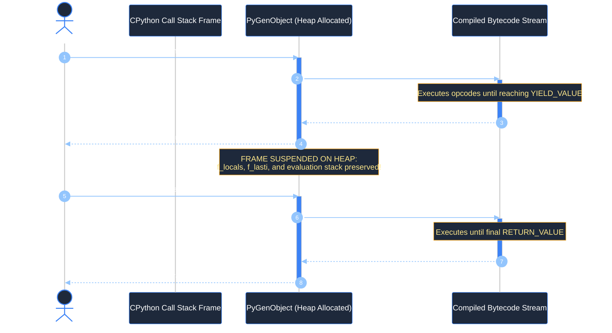
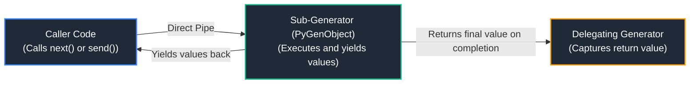
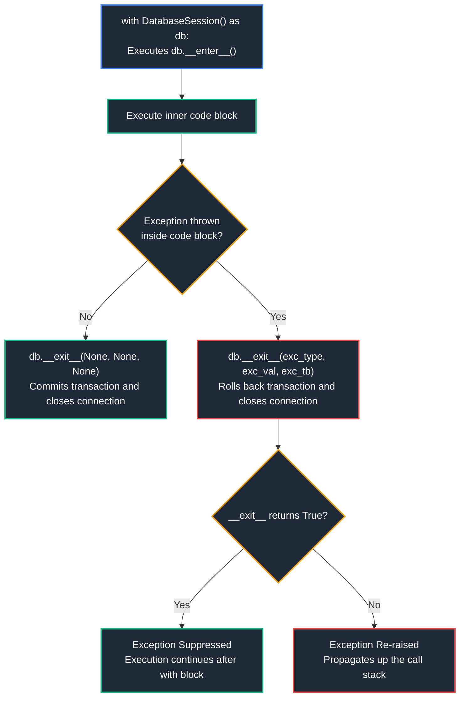
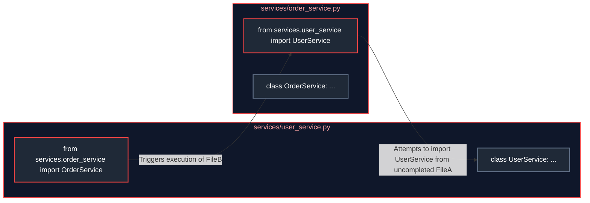

# 02. Advanced Python Programming Constructs

A comprehensive, production-grade guide to advanced Python programming constructs, iterator and generator internals, coroutine communication, decorator metaprogramming (`@functools.wraps`, `ParamSpec`), resource lifecycle management with context managers (`ExitStack`), the modern static typing system (`typing.Protocol`, Generics, covariance/contravariance), structural pattern matching (`match/case`), and module import machinery. Designed to provide intuitive, step-by-step explanations for beginners while delivering deep architectural mechanics for senior engineers.

---

## Architectural Overview: Generator Execution Frame Suspension & Resumption

Unlike standard functions that execute from start to finish and destroy their local stack frame upon returning, a Python **Generator** is an interruptible, stateful state machine allocated on the heap. It can pause execution, yield intermediate values to the caller, preserve its complete local execution context, and resume on demand.



---

## Table of Contents
1. [The Iterator Protocol: From First Principles](#1-the-iterator-protocol-from-first-principles)
   - [1.1 Conceptual Foundation: The Book vs. The Bookmark](#11-conceptual-foundation-the-book-vs-the-bookmark)
   - [1.2 Under the Hood: How `for` Loops Actually Execute in CPython](#12-under-the-hood-how-for-loops-actually-execute-in-cpython)
   - [1.3 Custom Iterators: Building Bounded & Infinite Stream Traversers](#13-custom-iterators-building-bounded--infinite-stream-traversers)
2. [Generators, Lazy Evaluation & Cooperative Multitasking](#2-generators-lazy-evaluation--cooperative-multitasking)
   - [2.1 The `yield` Statement & Heap Frame Mechanics (`f_lasti`, `f_locals`)](#21-the-yield-statement--heap-frame-mechanics-f_lasti-f_locals)
   - [2.2 Two-Way Communication via `send()`, `throw()`, and `close()`](#22-two-way-communication-via-send-throw-and-close)
   - [2.3 Sub-Generator Delegation with `yield from`](#23-sub-generator-delegation-with-yield-from)
   - [2.4 End-to-End Production Pipeline: Zero-Memory Multi-Gigabyte Stream Processing](#24-end-to-end-production-pipeline-zero-memory-multi-gigabyte-stream-processing)
3. [Decorators & Functional Metaprogramming](#3-decorators--functional-metaprogramming)
   - [3.1 First-Class Functions, Closures & The `@` Syntactic Sugar](#31-first-class-functions-closures--the--syntactic-sugar)
   - [3.2 The Metadata Loss Bug & `@functools.wraps`](#32-the-metadata-loss-bug--functoolswraps)
   - [3.3 Parameterized Decorator Factories & Class-Based Decorators](#33-parameterized-decorator-factories--class-based-decorators)
   - [3.4 Fully Typed Decorators with `ParamSpec` and `Concatenate`](#34-fully-typed-decorators-with-paramspec-and-concatenate)
   - [3.5 Production Implementation: Distributed Tracing & Resilience Decorator](#35-production-implementation-distributed-tracing--resilience-decorator)
   - [3.6 Type-Safe Asynchronous Decorators with `ParamSpec` and `Coroutine`](#36-type-safe-asynchronous-decorators-with-paramspec-and-coroutine)
4. [Context Managers & Resource Lifecycle Management](#4-context-managers--resource-lifecycle-management)
   - [4.1 Why `try/finally` is Flawed: Deterministic Cleanup with `with`](#41-why-tryfinally-is-flawed-deterministic-cleanup-with-with)
   - [4.2 The `__enter__` and `__exit__` Protocol Specification](#42-the-__enter__-and-__exit__-protocol-specification)
   - [4.3 Functional Context Managers with `@contextlib.contextmanager`](#43-functional-context-managers-with-contextlibcontextmanager)
   - [4.4 Managing Dynamic Multi-Resource Stacks with `contextlib.ExitStack`](#44-managing-dynamic-multi-resource-stacks-with-contextlibexitstack)
   - [4.5 Asynchronous Context Managers (`__aenter__`, `__aexit__`)](#45-asynchronous-context-managers-__aenter__-__aexit__)
   - [4.6 Reentrant vs. Non-Reentrant Context Managers & Deadlock Prevention](#46-reentrant-vs-non-reentrant-context-managers--deadlock-prevention)
5. [The Modern Python Type System & Static Verification](#5-the-modern-python-type-system--static-verification)
   - [5.1 Static Typing in Python (PEP 484, PEP 585, PEP 604)](#51-static-typing-in-python-pep-484-pep-585-pep-604)
   - [5.2 Structural Subtyping via `typing.Protocol` (Static Duck Typing)](#52-structural-subtyping-via-typingprotocol-static-duck-typing)
   - [5.3 Generics & Type Variance: Covariance (`T_co`) vs. Contravariance (`T_contra`)](#53-generics--type-variance-covariance-t_co-vs-contravariance-t_contra)
6. [Structural Pattern Matching (`match / case`)](#6-structural-pattern-matching-match--case)
   - [6.1 Pattern Matching vs. Traditional Switch / If-Else](#61-pattern-matching-vs-traditional-switch--if-else)
   - [6.2 Sequence, Mapping, Class Patterns & Guard Clauses](#62-sequence-mapping-class-patterns--guard-clauses)
   - [6.3 Production Dispatcher: Polymorphic Webhook Router](#63-production-dispatcher-polymorphic-webhook-router)
7. [Module Initialization, Imports & Dynamic Architecture](#7-module-initialization-imports--dynamic-architecture)
   - [7.1 CPython Import Engine: `sys.modules`, `sys.path`, Finders & Loaders](#71-cpython-import-engine-sysmodules-syspath-finders--loaders)
   - [7.2 The Circular Import Deadlock: Root Cause & 3 Production Fixes](#72-the-circular-import-deadlock-root-cause--3-production-fixes)
   - [7.3 Dynamic Module Loading with `importlib`](#73-dynamic-module-loading-with-importlib)
8. [Summary Comparison & Engineering Reference Matrix](#8-summary-comparison--engineering-reference-matrix)
9. [References & Further Reading](#9-references--further-reading)

---

# 1. The Iterator Protocol: From First Principles

### 1.1 Conceptual Foundation: The Book vs. The Bookmark

To understand iteration in Python, consider this everyday analogy:
* **The Iterable (The Book)**: A physical printed book contains a collection of pages. The book itself does not remember which page you are currently reading. Anyone can open the book, and multiple people could read different copies or parts of it.
* **The Iterator (The Bookmark)**: A bookmark is an active, stateful pointer. It marks a single location within the book. Every time you turn the page, the bookmark advances forward. When you reach the back cover, there are no more pages left to read.

In Python:
* An **Iterable** is any object that can produce an iterator. It implements the `__iter__()` method (or legacy `__getitem__()`).
* An **Iterator** is the object that produces the sequence of values. It implements `__next__()` (which returns the next element or raises `StopIteration`) AND `__iter__()` (which returns `self`).

```python
# A list is an Iterable, NOT an iterator
book = ["Page 1", "Page 2", "Page 3"]

# Calling iter() on the iterable produces a stateful Iterator (the bookmark)
bookmark = iter(book)
print(f"Type of bookmark: {type(bookmark)}")  # <class 'list_iterator'>

# Advancing the iterator step-by-step
print(next(bookmark))  # Output: Page 1
print(next(bookmark))  # Output: Page 2
print(next(bookmark))  # Output: Page 3

# When exhausted, next() raises StopIteration
try:
    next(bookmark)
except StopIteration:
    print("Reached the end of the book! StopIteration raised.")
```

---

### 1.2 Under the Hood: How `for` Loops Actually Execute in CPython

When you write a simple `for` loop in Python:

```python
for item in [10, 20, 30]:
    print(item)
```

The Python Virtual Machine translates that high-level statement into an explicit `while` loop that interacts directly with the Iterator Protocol:

```python
# What CPython bytecode actually executes:
_iterable = [10, 20, 30]
_iterator = iter(_iterable)  # Step 1: Obtains iterator via __iter__()

while True:
    try:
        item = next(_iterator)  # Step 2: Advances cursor via __next__()
    except StopIteration:
        break                   # Step 3: Catches StopIteration and exits cleanly
    
    # Step 4: Executes loop body
    print(item)
```

---

### 1.3 Custom Iterators: Building Bounded & Infinite Stream Traversers

Building a custom iterator requires implementing both `__iter__` and `__next__`:

```python
from collections.abc import Iterator
from typing import TypeVar

T = TypeVar("T")

class ChunkedStreamIterator(Iterator[list[T]]):
    """
    Production-grade stream chunker that consumes items from an arbitrary
    source iterator and yields fixed-size batches to bound memory usage.
    """
    def __init__(self, source_stream: Iterator[T], chunk_size: int) -> None:
        if chunk_size <= 0:
            raise ValueError(f"chunk_size must be positive; got {chunk_size}")
        self._source = source_stream
        self._chunk_size = chunk_size
        self._is_exhausted = False

    def __iter__(self) -> Iterator[list[T]]:
        # The iterator protocol requires an iterator's __iter__ to return self
        return self

    def __next__(self) -> list[T]:
        if self._is_exhausted:
            raise StopIteration

        batch: list[T] = []
        try:
            for _ in range(self._chunk_size):
                batch.append(next(self._source))
        except StopIteration:
            # Source stream ran out of items
            self._is_exhausted = True
            if not batch:
                raise StopIteration  # Nothing was accumulated in this batch

        return batch

# Demonstrating chunked consumption:
raw_numbers = iter(range(1, 11))  # Numbers 1 through 10
chunker = ChunkedStreamIterator(raw_numbers, chunk_size=3)

for batch in chunker:
    print(f"Processed batch: {batch}")
# Output:
# Processed batch: [1, 2, 3]
# Processed batch: [4, 5, 6]
# Processed batch: [7, 8, 9]
# Processed batch: [10]
```

---

# 2. Generators, Lazy Evaluation & Cooperative Multitasking

### 2.1 The `yield` Statement & Heap Frame Mechanics (`f_lasti`, `f_locals`)

A regular Python function has a single entry point and exit point: it starts at line 1, executes until it reaches `return`, and its local stack frame is destroyed.

A **Generator Function** is defined like a normal function, but contains one or more `yield` statements:
1. When called, **none of the function code runs**. CPython immediately returns a `PyGenObject` (Generator Object) allocated on the heap.
2. When the caller calls `next(gen)`, execution begins and proceeds until it reaches a `yield <value>` statement.
3. CPython pops the emitted value, sends it to the caller, and **freezes the execution frame on the heap**:
   * `f_locals`: All local variable values remain intact in memory.
   * `f_lasti`: The instruction pointer offset records the exact bytecode location.
4. When `next(gen)` is called again, CPython unfreezes the frame and resumes execution *immediately after the `yield` statement*.

---

### 2.2 Two-Way Communication via `send()`, `throw()`, and `close()`

Generators are not just one-way data producers; they are **bidirectional coroutines** capable of receiving data back from the caller via `.send(value)`:

```python
from collections.abc import Generator

def rolling_average_calculator() -> Generator[float, float, float]:
    """
    Coroutine calculating a continuous rolling average from data streamed
    in by the caller via .send().
    """
    total = 0.0
    count = 0
    current_average = 0.0
    print("[Calculator] Initialized. Awaiting numbers...")

    try:
        while True:
            # 1. Yield current average to caller and PAUSE
            # 2. When caller calls .send(val), incoming value is assigned to new_sample
            new_sample = yield current_average
            
            if new_sample is not None:
                total += new_sample
                count += 1
                current_average = total / count
    except GeneratorExit:
        # Triggered when caller invokes gen.close()
        print(f"[Calculator] Closed. Final samples processed: {count}, Average: {current_average:.2f}")
        return current_average

# Initializing and priming the coroutine
calc = rolling_average_calculator()
# Step 1: Prime the generator (must advance to first yield with next() or send(None))
initial = next(calc)
print(f"Initial Average: {initial}")  # Output: 0.0

# Step 2: Send data into the generator
print(f"Average after 10.0: {calc.send(10.0)}")  # Output: 10.0
print(f"Average after 20.0: {calc.send(20.0)}")  # Output: 15.0
print(f"Average after 30.0: {calc.send(30.0)}")  # Output: 20.0

# Step 3: Clean up
calc.close()
```

---

### 2.3 Sub-Generator Delegation with `yield from`

Introduced in PEP 380, `yield from <subgenerator>` establishes a transparent, bidirectional conduit between the outermost caller and a nested sub-generator:



* All values yielded by the sub-generator are passed directly to the caller.
* All values sent via `send()` or exceptions injected via `throw()` pass directly to the sub-generator.
* When the sub-generator completes, its `return <value>` is captured directly as the evaluation result of the `yield from` expression!

```python
def validate_sensor_subgroup(group_id: str, readings: list[float]) -> Generator[float, None, int]:
    valid_count = 0
    for val in readings:
        if 0.0 <= val <= 100.0:
            yield val
            valid_count += 1
        else:
            print(f"[Sensor {group_id}] Rejected out-of-bounds reading: {val}")
    return valid_count  # Return value captured by yield from!

def telemetry_pipeline(sensors: dict[str, list[float]]) -> Generator[float, None, None]:
    for sensor_id, readings in sensors.items():
        # yield from pipes all valid items directly to caller and captures the return count
        valid_total = yield from validate_sensor_subgroup(sensor_id, readings)
        print(f"[Pipeline] Sensor {sensor_id} contributed {valid_total} valid readings.")

data = {
    "S-01": [12.4, 98.2, 105.0],
    "S-02": [45.1, -2.0, 55.8]
}

for reading in telemetry_pipeline(data):
    print(f"--> Clean Reading: {reading}")
```

---

### 2.4 End-to-End Production Pipeline: Zero-Memory Multi-Gigabyte Stream Processing

```python
"""
Real-world scenario: Processing a 50 GB access log file on a server with only 2 GB of RAM.
Using generator pipelines, memory consumption remains flat at ~500 KB regardless of file size!
"""
from collections.abc import Generator, Iterable
import io

def stream_log_lines(file_obj: io.StringIO) -> Generator[str, None, None]:
    """Stage 1: Lazily reads lines from file stream without reading all into RAM."""
    for line in file_obj:
        yield line.rstrip("\n")

def filter_telemetry_lines(lines: Iterable[str]) -> Generator[str, None, None]:
    """Stage 2: Filters out empty lines and comments."""
    for line in lines:
        if line and not line.startswith("#"):
            yield line

def parse_access_log(lines: Iterable[str]) -> Generator[dict[str, str], None, None]:
    """Stage 3: Parses pipe-delimited log records into structured dictionaries."""
    for line in lines:
        parts = line.split("|")
        if len(parts) == 3:
            yield {"timestamp": parts[0], "status": parts[1], "endpoint": parts[2]}

def filter_error_responses(records: Iterable[dict[str, str]]) -> Generator[dict[str, str], None, None]:
    """Stage 4: Extracts only 5xx server errors for alerting."""
    for rec in records:
        if rec["status"].startswith("5"):
            yield rec

# Simulated log file
simulated_log = io.StringIO(
    "2026-10-15T12:00:00|200|/api/v1/health\n"
    "# Healthcheck comment\n"
    "2026-10-15T12:00:01|500|/api/v1/checkout\n"
    "2026-10-15T12:00:02|200|/api/v1/users\n"
    "2026-10-15T12:00:03|503|/api/v1/payment\n"
)

# Compose the pipeline: Nothing executes until we iterate!
raw_lines = stream_log_lines(simulated_log)
clean_lines = filter_telemetry_lines(raw_lines)
parsed_records = parse_access_log(clean_lines)
critical_alerts = filter_error_responses(parsed_records)

# Execution driven by the consumer:
print("Critical Alerts Detected:")
for alert in critical_alerts:
    print(f"ALERT: {alert['endpoint']} failed with HTTP {alert['status']}")
```

---

# 3. Decorators & Functional Metaprogramming

### 3.1 First-Class Functions, Closures & The `@` Syntactic Sugar

In Python, **functions are first-class citizens**: they can be assigned to variables, passed as arguments to other functions, defined inside other functions, and returned from functions.

A **Decorator** is a higher-order function that takes a function as input, extends its behavior without modifying its source code, and returns a new callable.

```python
# The syntactic sugar:
# @audit_log
# def execute_payment(amount): ...

# Is identical to:
# execute_payment = audit_log(execute_payment)
```

---

### 3.2 The Metadata Loss Bug & `@functools.wraps`

When you wrap a function, the outer function replaces the original. Without intervention, Python replaces the original function's `__name__`, `__doc__`, and `__annotations__` with those of the wrapper:

```python
import functools
from typing import Callable, Any

def naive_decorator(func: Callable) -> Callable:
    def wrapper(*args, **kwargs):
        return func(*args, **kwargs)
    return wrapper

@naive_decorator
def calculate_tax(subtotal: float) -> float:
    """Calculates state tax for retail order."""
    return subtotal * 0.08

# Without functools.wraps, introspection breaks!
print(calculate_tax.__name__)  # Output: 'wrapper' (Bug!)
print(calculate_tax.__doc__)   # Output: None (Lost docstring!)
```

#### The Production Standard: `@functools.wraps`
`@functools.wraps(func)` copies the original function's `__name__`, `__doc__`, `__module__`, `__annotations__`, and sets `__wrapped__` to reference the original unwrapped callable.

---

### 3.3 Parameterized Decorator Factories & Class-Based Decorators

What if a decorator needs configuration parameters (e.g., `@retry(max_attempts=3, backoff=0.5)`)?
A parameterized decorator is a **3-tier function factory**:
1. Outer function receives decorator arguments.
2. Middle function receives the target function.
3. Inner function executes the wrapped call.

```python
import functools
import time
from typing import Callable, Any

def retry_with_backoff(max_attempts: int = 3, backoff_seconds: float = 0.1):
    """Production parameterized decorator factory."""
    if max_attempts <= 0:
        raise ValueError("max_attempts must be >= 1")

    def decorator(func: Callable[..., Any]) -> Callable[..., Any]:
        @functools.wraps(func)
        def wrapper(*args: Any, **kwargs: Any) -> Any:
            attempts = 0
            while attempts < max_attempts:
                try:
                    return func(*args, **kwargs)
                except Exception as err:
                    attempts += 1
                    if attempts >= max_attempts:
                        print(f"[RETRY] {func.__name__} failed {max_attempts} times. Re-raising.")
                        raise
                    print(f"[RETRY] Attempt {attempts} failed: {err}. Retrying in {backoff_seconds}s...")
                    time.sleep(backoff_seconds)
        return wrapper
    return decorator

@retry_with_backoff(max_attempts=3, backoff_seconds=0.01)
def unstable_external_api() -> str:
    raise ConnectionResetError("Connection dropped by remote server")
```

---

### 3.4 Fully Typed Decorators with `ParamSpec` and `Concatenate`

Historically in Python, typing decorators required `Callable[..., Any]`, which erased all argument type hints and IDE autocomplete. Python 3.10 introduced `typing.ParamSpec` (PEP 612):

```python
from collections.abc import Callable
from typing import ParamSpec, TypeVar
import functools

P = ParamSpec("P")
R = TypeVar("R")

def logged_execution(func: Callable[P, R]) -> Callable[P, R]:
    """Fully type-safe decorator preserving parameter signatures and return types."""
    @functools.wraps(func)
    def wrapper(*args: P.args, **kwargs: P.kwargs) -> R:
        print(f"[LOG] Calling {func.__name__}")
        result = func(*args, **kwargs)
        print(f"[LOG] {func.__name__} completed successfully.")
        return result
    return wrapper

@logged_execution
def format_user_label(user_id: int, username: str, is_active: bool = True) -> str:
    return f"ID:{user_id} - {username} (Active: {is_active})"

# Type checker (mypy) knows EXACTLY that format_user_label requires (int, str, bool) -> str!
label: str = format_user_label(101, "alice_ops", is_active=True)
```

---

### 3.5 Production Implementation: Distributed Tracing & Resilience Decorator

```python
import functools
import time
from typing import Callable, Any

def audit_and_monitor(service_name: str):
    """
    Enterprise telemetry decorator that records latency, intercepts errors,
    and enriches logs with service context.
    """
    def decorator(func: Callable[..., Any]) -> Callable[..., Any]:
        @functools.wraps(func)
        def wrapper(*args: Any, **kwargs: Any) -> Any:
            start_wall = time.perf_counter()
            error_occurred = False
            try:
                return func(*args, **kwargs)
            except Exception as exc:
                error_occurred = True
                print(f"[CRITICAL][{service_name}] Error in {func.__name__}: {exc}")
                raise
            finally:
                duration_ms = (time.perf_counter() - start_wall) * 1000
                status_label = "FAILURE" if error_occurred else "SUCCESS"
                print(f"[METRIC][{service_name}] {func.__name__} | Status: {status_label} | Duration: {duration_ms:.2f}ms")
        return wrapper
    return decorator

@audit_and_monitor(service_name="payment_processor")
def settle_invoice(invoice_id: str, amount: float) -> str:
    time.sleep(0.02)  # Simulating processing
    return f"SETTLED_{invoice_id}"

settle_invoice("INV-9942", 249.99)
```

---

### 3.6 Type-Safe Asynchronous Decorators with `ParamSpec` and `Coroutine`

In modern FastAPI and AsyncIO architectures, decorating asynchronous coroutines requires preserving both parameter signatures and return types across the coroutine boundary:

```python
import functools
import time
import asyncio
from typing import Callable, Coroutine, Any, ParamSpec, TypeVar

P = ParamSpec("P")
R = TypeVar("R")

def async_timed_execution(
    label: str,
) -> Callable[[Callable[P, Coroutine[Any, Any, R]]], Callable[P, Coroutine[Any, Any, R]]]:
    """
    Type-preserving async decorator factory:
    Mypy statically knows the wrapped function returns an awaitable of type R
    and accepts exact arguments P!
    """
    def decorator(
        func: Callable[P, Coroutine[Any, Any, R]],
    ) -> Callable[P, Coroutine[Any, Any, R]]:
        @functools.wraps(func)
        async def wrapper(*args: P.args, **kwargs: P.kwargs) -> R:
            start_wall = time.perf_counter()
            try:
                result = await func(*args, **kwargs)
                return result
            finally:
                duration_ms = (time.perf_counter() - start_wall) * 1000
                print(f"[ASYNC TELEMETRY] {label} | Function: {func.__name__} | Latency: {duration_ms:.2f}ms")
        return wrapper
    return decorator

# Example usage:
@async_timed_execution(label="DATABASE_READ")
async def fetch_customer_orders(customer_id: int, status: str = "COMPLETED") -> list[dict]:
    await asyncio.sleep(0.05)
    return [{"order_id": 101, "status": status}]
```

---

# 4. Context Managers & Resource Lifecycle Management

### 4.1 Why `try/finally` is Flawed: Deterministic Cleanup with `with`

When managing operating system resources (file descriptors, database connections, socket handles, thread locks):
* Failing to close resources leads to **resource exhaustion** (e.g., `OSError: [Errno 24] Too many open files`).
* Using raw `try ... finally` requires 6–8 lines of boilerplate per resource and becomes completely unmaintainable when multiple resources must be coordinated.

---

### 4.2 The `__enter__` and `__exit__` Protocol Specification



#### Production Class-Based Context Manager:
```python
import sqlite3
from typing import Any

class ManagedDatabaseTransaction:
    """Manages an isolated SQLite transaction with guaranteed commit or rollback."""
    def __init__(self, db_path: str) -> None:
        self.db_path = db_path
        self.conn: sqlite3.Connection | None = None

    def __enter__(self) -> sqlite3.Cursor:
        print("[DB Context] Opening connection and beginning transaction...")
        self.conn = sqlite3.connect(self.db_path)
        return self.conn.cursor()

    def __exit__(
        self,
        exc_type: type[BaseException] | None,
        exc_val: BaseException | None,
        exc_tb: Any
    ) -> bool:
        if self.conn is None:
            return False

        if exc_type is not None:
            # An error occurred inside the with block: ROLLBACK
            print(f"[DB Context] Error detected ({exc_val}); rolling back transaction!")
            self.conn.rollback()
            self.conn.close()
            return False  # Do NOT suppress the exception; let caller handle it!

        # Normal execution: COMMIT
        print("[DB Context] Committing transaction and closing connection.")
        self.conn.commit()
        self.conn.close()
        return False
```

---

### 4.3 Functional Context Managers with `@contextlib.contextmanager`

Writing an entire class with `__enter__` and `__exit__` is often overkill. Using `@contextlib.contextmanager`, you can write a simple generator:
* Everything **before** `yield` runs on `__enter__`.
* The `yield` emits the target variable.
* Everything **after** `yield` (inside a `finally` block) runs on `__exit__`.

```python
import contextlib
import time
from collections.abc import Generator

@contextlib.contextmanager
def execution_timer(operation_label: str) -> Generator[dict[str, float], None, None]:
    """Lightweight context manager tracking elapsed wall-clock execution time."""
    telemetry = {"elapsed_seconds": 0.0}
    start_time = time.perf_counter()
    try:
        # Code before yield executes on __enter__
        yield telemetry
    finally:
        # Code in finally block is GUARANTEED to execute on __exit__
        telemetry["elapsed_seconds"] = time.perf_counter() - start_time
        print(f"[{operation_label}] Finished in {telemetry['elapsed_seconds']:.4f}s")

# Usage
with execution_timer("Matrix Inversion") as timer:
    total = sum(i ** 2 for i in range(1_000_000))

print(f"Recorded latency: {timer['elapsed_seconds']:.4f} seconds")
```

---

### 4.4 Managing Dynamic Multi-Resource Stacks with `contextlib.ExitStack`

What if the number of files, sockets, or locks to acquire is determined at runtime (e.g., merging 15 user-selected files)? Nesting 15 `with` statements is impossible.

`contextlib.ExitStack` dynamically maintains a LIFO (Last-In-First-Out) stack of context managers and arbitrary cleanup callbacks:

```python
import contextlib
import tempfile
import os

def merge_dynamic_files(file_paths: list[str], output_destination: str) -> int:
    """
    Dynamically opens an arbitrary number of files safely.
    If an error occurs while opening file #12, all previous 11 files are
    guaranteed to be closed automatically in reverse order!
    """
    total_lines = 0
    with contextlib.ExitStack() as stack:
        # Dynamically push file context managers into the LIFO stack
        open_handles = [
            stack.enter_context(open(path, "r", encoding="utf-8"))
            for path in file_paths
        ]
        out_handle = stack.enter_context(open(output_destination, "w", encoding="utf-8"))
        
        # Register a custom cleanup callback
        stack.callback(print, f"[ExitStack] Cleaned up all {len(open_handles) + 1} file descriptors.")

        for handle in open_handles:
            for line in handle:
                out_handle.write(line)
                total_lines += 1

    return total_lines
```

---

### 4.5 Asynchronous Context Managers (`__aenter__`, `__aexit__`)

```python
import asyncio

class AsyncDatabaseLock:
    """Asynchronous distributed lock context manager using asyncio primitives."""
    def __init__(self, resource_id: str) -> None:
        self.resource_id = resource_id
        self._lock = asyncio.Lock()

    async def __aenter__(self) -> "AsyncDatabaseLock":
        print(f"[AsyncLock] Acquiring lock for {self.resource_id}...")
        await self._lock.acquire()
        print(f"[AsyncLock] Lock acquired for {self.resource_id}")
        return self

    async def __aexit__(self, exc_type, exc_val, exc_tb) -> bool:
        self._lock.release()
        print(f"[AsyncLock] Lock released for {self.resource_id}")
        return False  # Do not suppress exceptions
```

---

### 4.6 Reentrant vs. Non-Reentrant Context Managers & Deadlock Prevention

A critical concurrency pitfall in Python is attempting to re-enter a non-reentrant lock or context manager from the same thread:

```python
import threading

# Standard Lock (Non-Reentrant)
lock = threading.Lock()

def outer_task():
    with lock:
        inner_task()  # DEADLOCK! outer_task holds the lock, inner_task blocks forever waiting for it!

def inner_task():
    with lock:
        print("Inner task work")

# PRODUCTION REMEDIATION: Reentrant Lock (RLock)
# RLock tracks which thread owns the lock and maintains an internal recursion counter.
# The same thread can enter the lock multiple times without deadlocking!
rlock = threading.RLock()

def safe_outer_task():
    with rlock:
        safe_inner_task()  # Succeeds cleanly!

def safe_inner_task():
    with rlock:
        print("Safe reentrant execution!")
```

---

# 5. The Modern Python Type System & Static Verification

### 5.1 Static Typing in Python (PEP 484, PEP 585, PEP 604)

Python remains dynamic at runtime, but modern Python (3.10+) eliminates legacy `typing.Union`, `typing.List`, and `typing.Dict` in favor of clean native syntax:

```python
# Modern Python 3.10+ / 3.12+ syntax
# 1. PEP 604: Union operator | (replaces Union[int, str, None])
def parse_record_id(raw_id: int | str | None) -> int:
    if raw_id is None:
        return 0
    return int(raw_id)

# 2. PEP 585: Standard built-in collections as generics (replaces List, Dict, Set)
def aggregate_metrics(metrics: dict[str, list[float]]) -> dict[str, float]:
    return {key: sum(values) / len(values) for key, values in metrics.items() if values}
```

---

### 5.2 Structural Subtyping via `typing.Protocol` (Static Duck Typing)

* **Nominal Subtyping (`abc.ABC`)**: An object is only valid if it explicitly subclasses the base class (`class S3Storage(BaseStorage)`).
* **Structural Subtyping (`typing.Protocol` - PEP 544)**: An object is valid if it has the required methods and attributes, **regardless of its class hierarchy** (identical to Go interfaces or TypeScript types):

```python
from typing import Protocol, runtime_checkable

@runtime_checkable
class MessagePublisher(Protocol):
    """Structural interface: Any class implementing publish() satisfies this contract!"""
    async def publish(self, topic: str, payload: bytes) -> bool: ...

# Adapter 1: Kafka Publisher (Does NOT inherit from MessagePublisher)
class KafkaPublisherAdapter:
    async def publish(self, topic: str, payload: bytes) -> bool:
        print(f"[Kafka] Published {len(payload)} bytes to {topic}")
        return True

# Adapter 2: RabbitMQ Publisher (Does NOT inherit from MessagePublisher)
class RabbitMQPublisherAdapter:
    async def publish(self, topic: str, payload: bytes) -> bool:
        print(f"[RabbitMQ] Routed {len(payload)} bytes to {topic}")
        return True

# Both conform to the Protocol statically and at runtime:
kafka = KafkaPublisherAdapter()
print(f"Kafka satisfies MessagePublisher: {isinstance(kafka, MessagePublisher)}")  # True
```

---

### 5.3 Generics & Type Variance: Covariance (`T_co`) vs. Contravariance (`T_contra`)

Understanding type variance is critical when building reusable repositories, collections, and serializers:
* **Invariant (Default `TypeVar('T')`)**: `Container[Cat]` is NOT compatible with `Container[Animal]`, even if `Cat` is a subclass of `Animal`.
* **Covariant (`TypeVar('T_co', covariant=True)`)**: Read-only producers. If `Cat` is a subtype of `Animal`, then `ReadOnlyRepo[Cat]` is a subtype of `ReadOnlyRepo[Animal]`.
* **Contravariant (`TypeVar('T_contra', contravariant=True)`)**: Consumers/writers. If `Cat` is a subtype of `Animal`, then `Consumer[Animal]` can accept a `Cat`.

```python
from typing import TypeVar, Generic

T_co = TypeVar("T_co", covariant=True)

class ReadOnlyRepository(Generic[T_co]):
    """Covariant generic container: Read-only access guarantees type safety."""
    def __init__(self, items: list[T_co]) -> None:
        self._items = items

    def get_by_index(self, index: int) -> T_co:
        return self._items[index]
```

---

# 6. Structural Pattern Matching (`match / case`)

### 6.1 Pattern Matching vs. Traditional Switch / If-Else

Introduced in Python 3.10 (PEP 634), structural pattern matching is **not** a simple `switch` statement that tests scalar values. It is a powerful structural destructuring engine that matches:
* Literal values
* Sequence structures (lists, tuples)
* Mapping structures (dictionaries)
* Class instance attributes
* Conditional guard expressions (`if`)

---

### 6.2 Sequence, Mapping, Class Patterns & Guard Clauses

```python
from dataclasses import dataclass

@dataclass
class APIRequest:
    method: str
    path: str
    headers: dict[str, str]
    body: dict[str, str]

def route_api_request(request: APIRequest) -> str:
    match request:
        # Match exact literals
        case APIRequest(method="GET", path="/health"):
            return "200 OK - Health Healthy"

        # Match specific path prefix with guard clause
        case APIRequest(method="GET", path=path) if path.startswith("/static/"):
            return f"200 OK - Serving Static Asset: {path}"

        # Match mapping keys and extract values
        case APIRequest(method="POST", path="/auth/token", body={"grant_type": "refresh", "token": refresh_token}):
            return f"200 OK - Refreshing token: {refresh_token}"

        # Sequence pattern matching
        case APIRequest(method="POST", body={"items": [first_item, *rest]}):
            return f"200 OK - Batch processing: first item is {first_item}, {len(rest)} remaining"

        # Wildcard default
        case _:
            return "404 Not Found"
```

---

### 6.3 Production Dispatcher: Polymorphic Webhook Router

```python
def process_stripe_webhook(event: dict) -> str:
    """Dispatches webhook payloads using mapping patterns with type guards."""
    match event:
        case {"type": "payment_intent.succeeded", "data": {"object": {"id": charge_id, "amount": amount}}}:
            return f"Processed payment {charge_id} for ${amount / 100:.2f}"

        case {"type": "customer.subscription.deleted", "data": {"object": {"customer": customer_id}}}:
            return f"Cancelled subscription for customer {customer_id}"

        case {"type": event_type}:
            return f"Acknowledged unhandled event type: {event_type}"

        case _:
            raise ValueError("Malformed webhook event payload")
```

---

# 7. Module Initialization, Imports & Dynamic Architecture

### 7.1 CPython Import Engine: `sys.modules`, `sys.path`, Finders & Loaders

When Python executes `import service.billing`:
1. **Cache Inspection**: Looks in `sys.modules`. If `'service.billing'` exists, returns the cached module immediately ($O(1)$).
2. **Finder Search**: If missing, iterates through `sys.meta_path` finders (`PathFinder`, `BuiltinImporter`, `FrozenImporter`).
3. **Spec Creation**: Generates a `ModuleSpec` detailing the loader and origin file location.
4. **Execution & Caching**: Instantiates `types.ModuleType`, registers it in `sys.modules`, and executes the module's bytecode in its top-level namespace dictionary.

---

### 7.2 The Circular Import Deadlock: Root Cause & 3 Production Fixes



#### Why it deadlocks:
When Python executes `user_service.py`, it hits line 1 (`import OrderService`) and pauses `user_service.py` to compile `order_service.py`. When `order_service.py` hits line 1 (`import UserService`), Python checks `sys.modules`, sees `user_service` is currently half-compiled (has not reached `class UserService`), and raises `ImportError: cannot import name 'UserService' from partially initialized module`!

#### The 3 Production Fixes:
1. **Leaf Module Extraction**: Move shared types, models, or schemas into a separate leaf module (e.g., `models/types.py`) imported by both.
2. **Method-Scoped Deferred Import**: Move the import inside the specific function or method that needs it.
3. **Type-Checking Guard with Deferred Annotations**:
   ```python
   from __future__ import annotations  # Defers evaluation of annotations to strings
   from typing import TYPE_CHECKING

   if TYPE_CHECKING:
       # Imported ONLY by static type checkers (mypy/Pyright), NEVER at runtime!
       from services.order_service import OrderService

   class UserService:
       def process_order(self, order: OrderService) -> None:
           pass
   ```

---

### 7.3 Dynamic Module Loading with `importlib`

For plugin architectures where modules are discovered and loaded at runtime from string paths:

```python
import importlib
from typing import Any

def load_payment_driver(driver_name: str) -> Any:
    """Dynamically loads and instantiates payment driver plugin."""
    module_path = f"infrastructure.drivers.{driver_name}"
    try:
        module = importlib.import_module(module_path)
        driver_cls = getattr(module, f"{driver_name.capitalize()}Driver")
        return driver_cls()
    except (ImportError, AttributeError) as err:
        raise RuntimeError(f"Failed to load driver '{driver_name}': {err}")
```

---

# 8. Summary Comparison & Engineering Reference Matrix

| Feature / Primitive | Underlying Mechanism | Memory Overhead | Performance Profile | Production Recommended Use Case |
| :--- | :--- | :---: | :---: | :--- |
| **Iterator (`Iterator[T]`)** | Stateful object (`__next__`) | $O(1)$ memory per frame | Fast pointer bump | Custom collection iterators, chunking streams. |
| **Generator (`yield`)** | Paused heap frame (`PyGenObject`) | Amortized zero allocation | Microsecond resumption | Multi-gigabyte log parsers, streaming ETL pipelines. |
| **`yield from`** | Bidirectional delegation channel | Zero overhead | Direct caller pipe | Composing sub-generators and extracting return values. |
| **`@functools.wraps`** | Function attribute copy | Negligible | Zero runtime overhead | Every decorator in the codebase to preserve introspection. |
| **`contextmanager`** | Generator-backed cleanup | 1 generator frame | Safe `try/finally` dispatch | DB transactions, file handles, lock acquisition. |
| **`ExitStack`** | LIFO cleanup stack | Proportional to resources | $O(1)$ cleanup dispatch | Dynamic multi-file operations, multi-lock acquisition. |
| **`typing.Protocol`** | Structural subtyping (PEP 544) | Zero runtime cost | Evaluated statically by CI | Dependency inversion, repository and service port abstractions. |
| **`match / case`** | Bytecode jump table | Low | Optimized branch dispatch | Webhook routing, AST parsers, state machine transitions. |

---

# 9. References & Further Reading

1. **PEP 380 – Syntax for Delegating to a Subgenerator (`yield from`)**: [https://peps.python.org/pep-0380/](https://peps.python.org/pep-0380/)
2. **PEP 612 – Parameter Specification Variables (`ParamSpec`)**: [https://peps.python.org/pep-0612/](https://peps.python.org/pep-0612/)
3. **PEP 634 – Structural Pattern Matching**: [https://peps.python.org/pep-0634/](https://peps.python.org/pep-0634/)
4. **Python Standard Library: `contextlib`**: [https://docs.python.org/3/library/contextlib.html](https://docs.python.org/3/library/contextlib.html)
5. **Related Guides**:
   - See [01. Core Python and OOP](01_core_python_and_oop.md) for object headers, memory, and dunder protocols.
   - See [04. Python Concurrency and Async Programming](04_python_concurrency_and_async_programming.md) for async generators and event loops.
   - See [06. Design Patterns, SOLID, and Software Architecture](06_design_patterns_solid_and_software_architecture.md) for Ports & Adapters using `typing.Protocol`.
