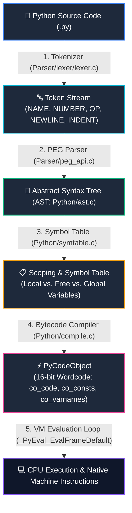
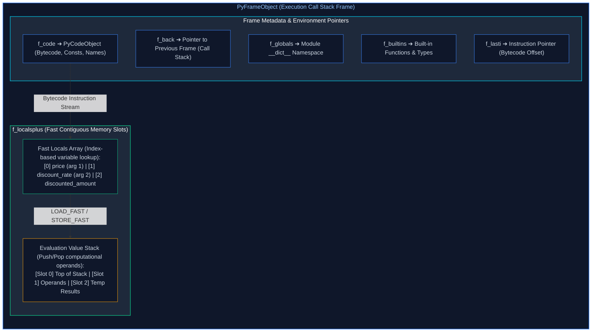
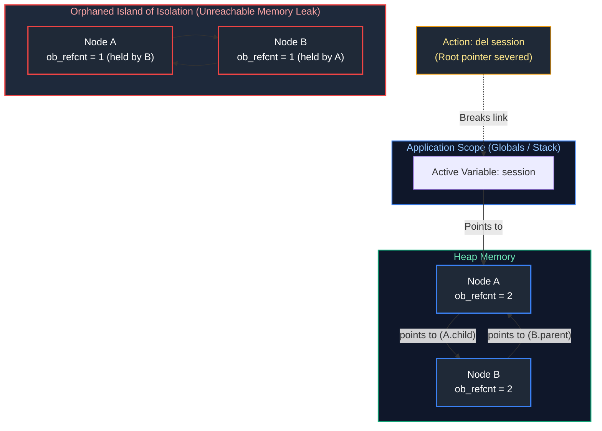
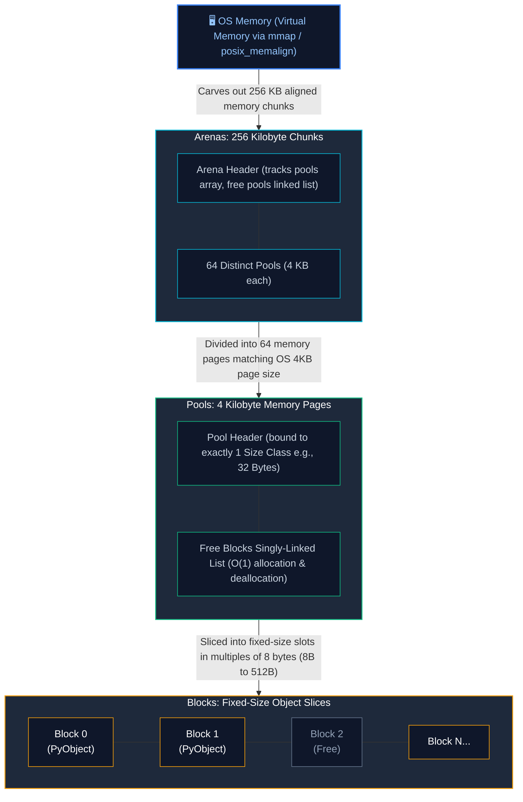
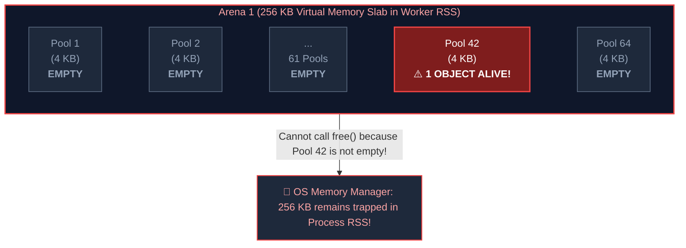
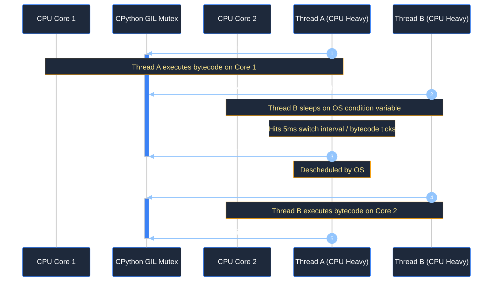
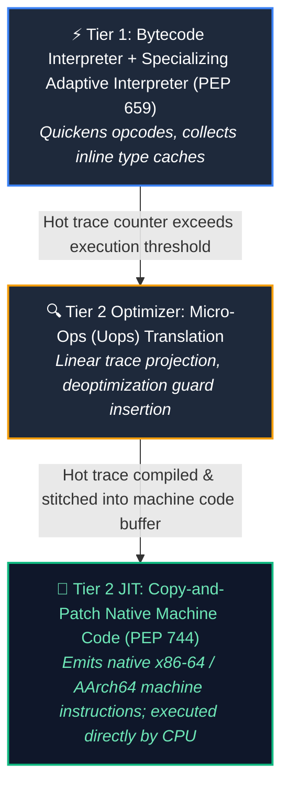
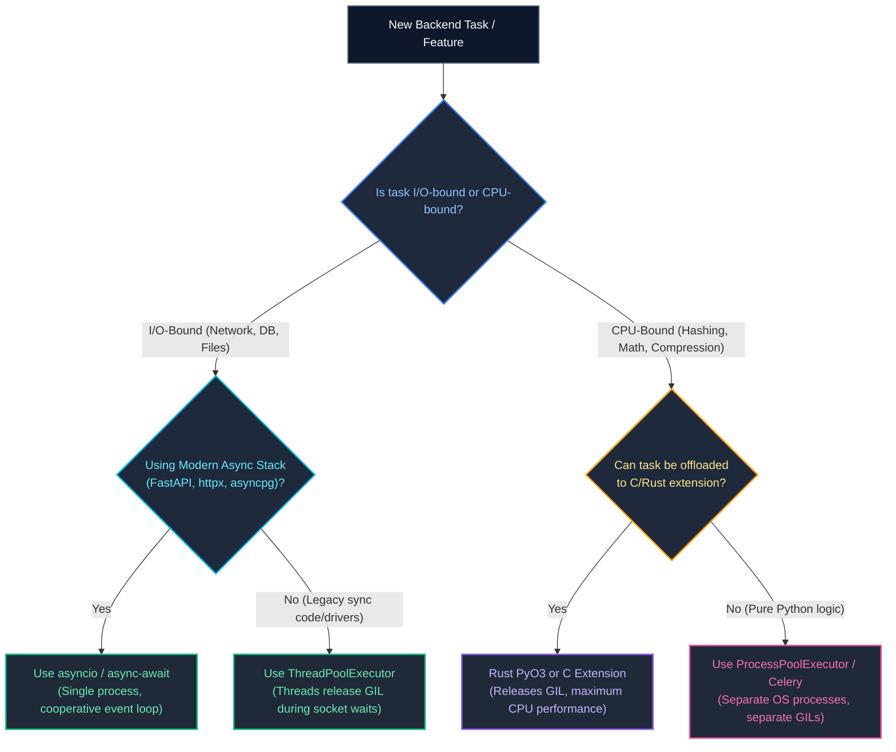

# 03. CPython Runtime, Memory, and Performance

A comprehensive, production-grade guide to CPython execution internals, bytecode evaluation, the PyMalloc memory allocation hierarchy, cyclic garbage collection mechanics, Global Interpreter Lock (GIL) operations, Python 3.13 free-threaded execution, memory profiling with `tracemalloc`/`memray`, and native Rust acceleration via PyO3 for Senior Engineers and Platform Architects.

---

## Architectural Overview: CPython Runtime Memory & PyMalloc Allocation Hierarchy

```mermaid
flowchart TD
    subgraph OS_Memory ["Operating System Virtual Address Space"]
        SysMalloc["System malloc / mmap / posix_memalign<br/>(Allocations >= 512 Bytes: Large objects, buffers, bytearrays)"]
    end

    subgraph PyMalloc_Engine ["CPython PyMalloc Allocator (Small Objects <= 512 Bytes)"]
        direction TB
        subgraph Arenas ["Arenas (256 KB Contiguous Chunks aligned on 256KB boundary)"]
            Arena1["Arena 1 (256 KB)<br/>Holds up to 64 Pools"]
            Arena2["Arena 2 (256 KB)<br/>Holds up to 64 Pools"]
        end

        subgraph Pools ["Pools (4 KB OS Memory Pages within Arenas)"]
            Pool1["Pool A (4 KB)<br/>Size Class 3: 32 Bytes<br/>Holds up to 128 Blocks"]
            Pool2["Pool B (4 KB)<br/>Size Class 7: 64 Bytes<br/>Holds up to 64 Blocks"]
        end

        subgraph Blocks ["Blocks (Individual Memory Slots for PyObject Structs)"]
            Block1["Block (32B): PyLongObject (int)"]
            Block2["Block (32B): PyFloatObject (float)"]
            Block3["Block (64B): PyTupleObject (small tuple)"]
        end
    end

    subgraph Cyclic_GC ["Cyclic Garbage Collector (gc module)"]
        direction TB
        Gen0["Generation 0: Young Objects<br/>Threshold: 700 net allocations<br/>Inspected on every collection pass"]
        Gen1["Generation 1: Intermediate Objects<br/>Threshold: 10 Gen 0 passes"]
        Gen2["Generation 2: Tenured / Long-lived Objects<br/>Threshold: 10 Gen 1 passes"]
        Gen0 -->|"Survives GC"| Gen1
        Gen1 -->|"Survives GC"| Gen2
    end

    OS_Memory -->|"mmap / malloc 256KB chunks"| Arenas
    Arenas -->|"Subdivided into 64 x 4KB pages"| Pools
    Pools -->|"Carved into uniform size slots"| Blocks
    Blocks -.->|"Tracked container objects (list, dict, set, class)"| Gen0

    style OS_Memory fill:#0f172a,stroke:#64748b,stroke-width:1.5px,color:#f8fafc
    style PyMalloc_Engine fill:#0f172a,stroke:#3b82f6,stroke-width:1.5px,color:#93c5fd
    style Arenas fill:#1e293b,stroke:#3b82f6,stroke-width:1.5px,color:#93c5fd
    style Pools fill:#1e293b,stroke:#06b6d4,stroke-width:1.5px,color:#67e8f9
    style Blocks fill:#1e293b,stroke:#10b981,stroke-width:1.5px,color:#6ee7b7
    style Cyclic_GC fill:#0f172a,stroke:#f59e0b,stroke-width:1.5px,color:#fde68a
    style Arena1 fill:#1f2937,stroke:#3b82f6,stroke-width:2px,color:#fff
    style Arena2 fill:#1f2937,stroke:#3b82f6,stroke-width:2px,color:#fff
    style Pool1 fill:#1f2937,stroke:#06b6d4,stroke-width:2px,color:#fff
    style Pool2 fill:#1f2937,stroke:#06b6d4,stroke-width:2px,color:#fff
    style Block1 fill:#1f2937,stroke:#10b981,stroke-width:2px,color:#fff
    style Block2 fill:#1f2937,stroke:#10b981,stroke-width:2px,color:#fff
    style Block3 fill:#1f2937,stroke:#10b981,stroke-width:2px,color:#fff
    style Gen0 fill:#1f2937,stroke:#f59e0b,stroke-width:2px,color:#fff
    style Gen1 fill:#1f2937,stroke:#f59e0b,stroke-width:2px,color:#fff
    style Gen2 fill:#1f2937,stroke:#f59e0b,stroke-width:2px,color:#fff
```



---

## Table of Contents
1. [CPython Execution Pipeline & Bytecode Internals](#1-cpython-execution-pipeline--bytecode-internals)
   - [1.1 From Source to Machine Code: Lexing, Parsing, AST & Symbol Tables](#11-from-source-to-machine-code-lexing-parsing-ast--symbol-tables)
   - [1.2 Bytecode Disassembly & The Evaluation Loop (`ceval.c`)](#12-bytecode-disassembly--the-evaluation-loop-cevalc)
   - [1.3 Python Execution Frames, The Value Stack & Scope Lookups](#13-python-execution-frames-the-value-stack--scope-lookups)
   - [1.4 Python 3.11+ Faster CPython & Specialized Adaptive Interpreter (PEP 659)](#14-python-311-faster-cpython--specialized-adaptive-interpreter-pep-659)
2. [Reference Counting & Cyclic Garbage Collection](#2-reference-counting--cyclic-garbage-collection)
   - [2.1 Deterministic Reference Counting Mechanics & `PyObject` Layout](#21-deterministic-reference-counting-mechanics--pyobject-layout)
   - [2.2 Why Reference Counting Fails: Cyclic Isolation Islands](#22-why-reference-counting-fails-cyclic-isolation-islands)
   - [2.3 The Cyclic Garbage Collector: Trial Deletion in Generations 0, 1, and 2](#23-the-cyclic-garbage-collector-trial-deletion-in-generations-0-1-and-2)
   - [2.4 Object Finalization: Destructors (`__del__`), PEP 442, and Resurrection](#24-object-finalization-destructors-__del__-pep-442-and-resurrection)
   - [2.5 Resolving Object Reference Cycles with `weakref`](#25-resolving-object-reference-cycles-with-weakref)
   - [2.6 Real-World Case Study: Instagram Disabling GC for Multi-Process Preforking](#26-real-world-case-study-instagram-disabling-gc-for-multi-process-preforking)
3. [PyMalloc Memory Allocator: Arenas, Pools, and Blocks](#3-pymalloc-memory-allocator-arenas-pools-and-blocks)
   - [3.1 Small Object Allocation (< 512 Bytes) Architecture & Size Classes](#31-small-object-allocation--512-bytes-architecture--size-classes)
   - [3.2 Pool and Block States: Full, Used, Empty, and Free-Lists](#32-pool-and-block-states-full-used-empty-and-free-lists)
   - [3.3 The Memory Fragmentation Trap & Worker RSS Bloat Triage](#33-the-memory-fragmentation-trap--worker-rss-bloat-triage)
   - [3.4 Production Workarounds: Worker Recycling and Alternative Allocators (`jemalloc`/`mimalloc`)](#34-production-workarounds-worker-recycling-and-alternative-allocators-jemallocmimalloc)
4. [The Global Interpreter Lock (GIL) & Free-Threaded Python](#4-the-global-interpreter-lock-gil--free-threaded-python)
   - [4.1 Why the GIL Exists & Why Multithreading Stalls on CPU Workloads](#41-why-the-gil-exists--why-multithreading-stalls-on-cpu-workloads)
   - [4.2 Under the Hood: `take_gil()`, `drop_gil()`, and Switch Intervals](#42-under-the-hood-take_gil-drop_gil-and-switch-intervals)
   - [4.3 When the GIL is Released: Blocking I/O & Native Extensions](#43-when-the-gil-is-released-blocking-io--native-extensions)
   - [4.4 Free-Threaded CPython (PEP 703 / Python 3.13 No-GIL)](#44-free-threaded-cpython-pep-703--python-313-no-gil)
   - [4.5 Python 3.13 Experimental Tier 2 JIT Compiler (PEP 744)](#45-python-313-experimental-tier-2-jit-compiler-pep-744)
5. [CPU-Bound vs. I/O-Bound Optimization Strategies](#5-cpu-bound-vs-io-bound-optimization-strategies)
   - [5.1 Workload Classification & Bottleneck Diagnosis](#51-workload-classification--bottleneck-diagnosis)
   - [5.2 Parallelism Selection Decision Matrix: Thread vs Process vs Async vs Native](#52-parallelism-selection-decision-matrix-thread-vs-process-vs-async-vs-native)
   - [5.3 High-Performance IPC: Zero-Copy Shared Memory (`multiprocessing.shared_memory`)](#53-high-performance-ipc-zero-copy-shared-memory-multiprocessingshared_memory)
6. [Profiling Tools & Production Memory Diagnosis](#6-profiling-tools--production-memory-diagnosis)
   - [6.1 CPU Profiling: `cProfile`, `pstats`, and Python 3.12+ `sys.monitoring`](#61-cpu-profiling-cprofile-pstats-and-python-312-sysmonitoring)
   - [6.2 Line-Level Memory Attribution: `tracemalloc` Snapshots & Diff Tracking](#62-line-level-memory-attribution-tracemalloc-snapshots--diff-tracking)
   - [6.3 Production Heap Profiling with Bloomberg `memray`](#63-production-heap-profiling-with-bloomberg-memray)
   - [6.4 Zero-Overhead Live Sampling with `py-spy` & Flame Graphs](#64-zero-overhead-live-sampling-with-py-spy--flame-graphs)
7. [High-Performance Native Extensions: Rust PyO3 Integration](#7-high-performance-native-extensions-rust-pyo3-integration)
   - [7.1 Accelerating Hot Computational Paths with Rust & PyO3](#71-accelerating-hot-computational-paths-with-rust--pyo3)
   - [7.2 Releasing the GIL in Native Code for True Multi-Core Scaling](#72-releasing-the-gil-in-native-code-for-true-multi-core-scaling)
   - [7.3 Zero-Copy Buffer Sharing between Python and Rust](#73-zero-copy-buffer-sharing-between-python-and-rust)
8. [Summary Comparison & Engineering Reference Matrix](#8-summary-comparison--engineering-reference-matrix)
9. [References & Further Reading](#9-references--further-reading)

---

# 1. CPython Execution Pipeline & Bytecode Internals

### 1.1 From Source to Machine Code: Lexing, Parsing, AST & Symbol Tables

#### Intuitive Analogy: The Theatrical Production Pipeline
Think of writing Python code like writing a stage play. Your Python source file (`.py`) is the raw script typed on a typewriter. The computer's CPU does not understand theatrical scripts—it only understands physical stage actions. 
1. The **Tokenizer** scans the text and turns words into theatrical cues (Actor enters, Speaks line, Actor exits).
2. The **Parser** validates grammar to ensure lines make grammatical sense, producing a hierarchical story outline (an **Abstract Syntax Tree**).
3. The **Symbol Table** audits which props and characters belong to the local scene versus the global stage.
4. The **Compiler** translates that outline into a sequential cue sheet (**Bytecode**).
5. Finally, the **Evaluation Loop (`ceval.c`)** is the stage director calling out each cue in sequence, driving the physical actors (the CPU).



#### Step-by-Step Compilation Stages in CPython:
1. **Lexical Analysis (Tokenizing)**: The source string is consumed character-by-character by `Parser/lexer/lexer.c`. It categorizes characters into discrete tokens (`NAME`, `NUMBER`, `STRING`, `OP`, `INDENT`, `DEDENT`).
2. **Parsing (PEG Parser)**: Introduced in Python 3.9 (PEP 617) replacing the legacy LL(1) parser, CPython's Parsing Expression Grammar (PEG) parser processes ambiguous grammar without token lookahead limitations, constructing an **Abstract Syntax Tree (AST)**.
3. **Symbol Table Generation (`symtable.c`)**: CPython scans the AST to establish identifier scopes before emitting code. It determines whether a name is local, global, or a free variable (enclosing closure), allowing local variables to be stored in an array indexed by integers rather than requiring dictionary lookups.
4. **Bytecode Compilation (`compile.c`)**: The compiler flattens the AST into a linear sequence of 2-byte bytecode instructions (`16-bit wordcode`: 1 byte opcode, 1 byte argument) bundled into an immutable `PyCodeObject`.
5. **Execution Loop (`ceval.c`)**: The central evaluation loop of the CPython interpreter reads bytecode instructions one by one and manipulates an internal evaluation stack.

#### Inspecting the AST Programmatically:
```python
import ast

source_code = """
def calculate_tax(subtotal: float, tax_rate: float = 0.08) -> float:
    total = subtotal * (1.0 + tax_rate)
    return round(total, 2)
"""

# Parse the source code into an AST node hierarchy
tree = ast.parse(source_code)

# Dump the structured AST representation
print(ast.dump(tree, indent=2))
```

*Key Insight*: Notice that type hints (`float`) and default arguments (`0.08`) exist as distinct syntax nodes in the AST. The compiler uses type hints for metadata (stashed in `__annotations__`), but completely strips them out during bytecode generation—Python's runtime VM operates without any static type enforcement.

---

### 1.2 Bytecode Disassembly & The Evaluation Loop (`ceval.c`)

CPython is a **stack-based virtual machine**. Unlike register-based virtual machines (like LuaJIT or Dalvik/Android) which store intermediate values in numbered registers, CPython executes operations by pushing and popping pointers to `PyObject` structs onto a LIFO **Value Stack**.

Let us disassemble our function using Python’s standard `dis` module:

```python
import dis

def calculate_discount(price: float, discount_rate: float) -> float:
    discounted_amount = price * discount_rate
    return round(price - discounted_amount, 2)

# Disassemble bytecode to inspect virtual machine instructions
dis.dis(calculate_discount)
```

#### Bytecode Trace Output & Instruction Walkthrough:
```text
  2           0 RESUME                   0
              2 LOAD_FAST                0 (price)
              4 LOAD_FAST                1 (discount_rate)
              6 BINARY_OP                5 (*)
             10 STORE_FAST               2 (discounted_amount)

  3          12 LOAD_GLOBAL              1 (round + NULL)
             22 LOAD_FAST                0 (price)
             24 LOAD_FAST                2 (discounted_amount)
             26 BINARY_OP               10 (-)
             30 LOAD_CONST               1 (2)
             32 CALL                     2
             40 RETURN_VALUE
```

#### Detailed Breakdown of Opcodes:
* **`RESUME` (Opcode 151)**: Introduced in Python 3.11. Performs internal interpreter bookkeeping, checking for asynchronous tasks, generator resumption, and tracing events.
* **`LOAD_FAST <index>`**: Pushes a pointer to the local variable stored at `frame->f_localsplus[index]` directly onto the top of the evaluation stack. Because local variables reside in a contiguous C array, this is an $O(1)$ pointer copy—vastly faster than global dictionary lookups.
* **`BINARY_OP <op_code>`**: Pops the two topmost items from the stack (`discount_rate` then `price`), calls the corresponding C-level slot (`tp_as_number->nb_multiply`), and pushes the newly created result `PyObject*` back onto the stack.
* **`STORE_FAST <index>`**: Pops the topmost value from the stack and writes its pointer directly into index 2 of `f_localsplus` (binding `discounted_amount`).
* **`LOAD_GLOBAL <index>`**: Searches the module's `__dict__`, and if not found, falls back to the `builtins.__dict__`. In Python 3.11+, this uses inline caching to avoid hash table lookups after warmup.
* **`CALL <arg_count>`**: Resolves the callable object on the stack, sets up a new evaluation frame, transfers arguments, and switches execution.
* **`RETURN_VALUE`**: Pops the topmost stack value and returns it to the caller frame, triggering cleanup of the current stack frame.

---

### 1.3 Python Execution Frames, The Value Stack & Scope Lookups

Every function call in Python allocates a heap-allocated **Frame Object** (`PyFrameObject` in C, exposed as `types.FrameType`).

#### The Anatomy of a Frame:


| Frame Field | Data Type | Operational Function in Execution |
| :--- | :--- | :--- |
| **`f_back`** | `PyFrameObject*` | Doubly linked list pointer to caller frame; forms Python traceback on error |
| **`f_code`** | `PyCodeObject*` | Immutable compiled bytecode instructions, constants, and variable names |
| **`f_globals`** | `PyDictObject*` | Reference to module-level global variables |
| **`f_builtins`** | `PyDictObject*` | Reference to built-in types and functions (`len`, `range`, `Exception`) |
| **`f_lasti`** | `int` | Bytecode offset index of the most recently executed instruction |
| **`f_localsplus`** | `PyObject*[]` | Contiguous array holding local variables and evaluation stack operands |


#### Inspecting Live Execution Frames:
```python
import sys

def level_three():
    # Introspect the current call stack frame
    frame = sys._getframe(0)
    print(f"[Level 3] Function Name: {frame.f_code.co_name}")
    print(f"[Level 3] Local Variables: {frame.f_locals}")
    print(f"[Level 3] Instruction Pointer (f_lasti): {frame.f_lasti}")
    
    # Climb up to the caller's frame (Level 2)
    caller = frame.f_back
    if caller:
        print(f"[Level 2 Caller] Function Name: {caller.f_code.co_name}")
        print(f"[Level 2 Caller] Arguments: {caller.f_locals}")

def level_two(user_id: int):
    status = "active"
    level_three()

def level_one():
    level_two(user_id=1042)

level_one()
```

#### Performance Implication: Why `LOAD_FAST` Trumps `LOAD_GLOBAL`
In a performance-critical tight loop, accessing global functions requires looking up keys in global hash tables. Binding a global function to a local variable converts expensive `LOAD_GLOBAL` instructions into lightning-fast `LOAD_FAST` array indexing:

```python
import math
import time

def slow_hypot(points: list[tuple[float, float]]) -> list[float]:
    # Each iteration issues LOAD_GLOBAL for math and LOAD_ATTR for sqrt
    result = []
    for x, y in points:
        result.append(math.sqrt(x * x + y * y))
    return result

def fast_hypot(points: list[tuple[float, float]]) -> list[float]:
    # Local variable optimization: sqrt and append are cached into f_localsplus
    result = []
    sqrt = math.sqrt
    append = result.append
    for x, y in points:
        append(sqrt(x * x + y * y))
    return result
```

---

### 1.4 Python 3.11+ Faster CPython & Specialized Adaptive Interpreter (PEP 659)

Starting in Python 3.11 (guided by Mark Shannon and Guido van Rossum under the "Faster CPython" project), CPython introduced the **Specialized Adaptive Interpreter** (PEP 659).

#### How Inline Specialization Works:
1. **Generic Instructions**: When code begins executing, instructions start in a generic state (e.g., `BINARY_OP`, `LOAD_ATTR`, `CALL`).
2. **Warmup & Profiling**: Instructions are executed repeatedly. If an instruction is executed 8 times with stable types, it is deemed "warm".
3. **Specialization (Quickening)**: The interpreter replaces the generic opcode with a specialized opcode tailored precisely to the observed data types:
   - `LOAD_ATTR` $\rightarrow$ `LOAD_ATTR_MODULE` (skips dictionary lookup for imported modules)
   - `LOAD_ATTR` $\rightarrow$ `LOAD_ATTR_INSTANCE_VALUE` (loads an attribute from a fixed offset in the instance `__dict__`)
   - `BINARY_OP` $\rightarrow$ `BINARY_OP_ADD_INT` (bypasses generic type dispatch and invokes C integer addition directly)
4. **De-optimization**: If an unexpected type appears (e.g., passing a float to a specialized integer addition), the instruction de-optimizes back to generic bytecode.

```python
import dis

class Point:
    def __init__(self, x: int, y: int) -> None:
        self.x = x
        self.y = y

def extract_x(p: Point) -> int:
    return p.x

p = Point(10, 20)

# 1. Inspect unspecialized bytecode
print("--- Bytecode before warmup ---")
dis.dis(extract_x)

# 2. Warm up the instruction by executing it > 50 times with the same type
for _ in range(100):
    extract_x(p)

# 3. Inspect specialized bytecode (Python 3.11+)
print("\n--- Bytecode after warmup (Specialized) ---")
dis.dis(extract_x, adaptive=True)
```
*Note*: Running `dis.dis(..., adaptive=True)` in Python 3.11+ reveals specialized instructions such as `LOAD_ATTR_INSTANCE_VALUE`, which read the instance attribute directly using an inline cached integer offset, completely eliminating hash computation.

---

# 2. Reference Counting & Cyclic Garbage Collection

### 2.1 Deterministic Reference Counting Mechanics & `PyObject` Layout

In CPython, **every object is a pointer to a C struct** that begins with the `PyObject` header (defined in `Include/object.h`):

```c
// CPython Internal C Structure for PyObject
struct _object {
    _PyObject_HEAD_EXTRA // Double-linked list pointers for debug builds
    Py_ssize_t ob_refcnt; // 64-bit integer tracking active references
    struct _typeobject *ob_type; // Pointer to the object's type descriptor
};
```

#### Deterministic Reclamation:
* When an object is created, its `ob_refcnt` is initialized to 1.
* Whenever a pointer to that object is copied or passed to a function, `Py_INCREF(op)` increments `ob_refcnt`.
* Whenever a variable goes out of scope, is reassigned, or is explicitly deleted via `del`, `Py_DECREF(op)` decrements `ob_refcnt`.
* **The Instant `ob_refcnt == 0`**: The memory is freed **immediately and synchronously**. There is no "stop-the-world" pause required for linearly allocated objects.

```python
import sys

# 1. Create an object
data = ["worker-payload-101", 99.9]
# Notice: sys.getrefcount() temporarily creates a reference when passing 'data' as argument
print(f"Initial refcount: {sys.getrefcount(data)}") # Outputs 2 (1 for 'data', 1 for getrefcount arg)

# 2. Create another reference
alias = data
print(f"After aliasing: {sys.getrefcount(data)}")  # Outputs 3

# 3. Drop reference
del alias
print(f"After dropping alias: {sys.getrefcount(data)}") # Outputs 2
```

---

### 2.2 Why Reference Counting Fails: Cyclic Isolation Islands

Reference counting has one fatal mathematical limitation: **Reference Cycles**.

If Object $A$ points to Object $B$, and Object $B$ points back to Object $A$, both objects will forever maintain `ob_refcnt >= 1`, even if the entire graph is severed from the application's root scope (stack frames and globals).



If CPython relied solely on reference counting, every orphaned cycle would persist in memory indefinitely until process termination, causing fatal memory bloat in backend servers.

---

### 2.3 The Cyclic Garbage Collector: Trial Deletion in Generations 0, 1, and 2

To solve reference cycles, CPython layers a secondary **Cyclic Garbage Collector** (`gc` module) on top of reference counting.

#### What Objects Does the Cyclic GC Track?
The GC **only** tracks container objects that can hold references to other objects:
* Tracked: `list`, `dict`, `set`, `tuple` (if it contains mutable objects), user-defined classes, generator frames.
* Not Tracked: `int`, `float`, `str`, `bytes`, atomic immutable objects (they cannot form cycles!).

#### The "Trial Deletion" Algorithm:
1. **Double Linked List of Tracked Objects**: Every tracked object is wrapped with a `PyGC_Head` struct containing pointers linking all objects in a generation.
2. **Copying Reference Counts**: For every object in the generation, the GC copies `ob_refcnt` to an internal field called `gc_refs`.
3. **Subtracting Internal Pointers**: The GC iterates through each object, inspects all other objects it points to (`tp_traverse`), and decrements the target object's `gc_refs` by 1.
4. **Isolating Reachable vs. Unreachable**:
   - If an object’s `gc_refs` drops to **0**, it is only referenced from within the cycle itself.
   - If an object’s `gc_refs` remains **$> 0$**, it has an external reference pointing to it from outside the cycle. The GC flags this object as reachable, and recursively marks all objects reachable from it.
5. **Sweeping**: All objects whose `gc_refs == 0` and are not transitively reachable from outside are confirmed to be orphaned cycles and are swept from memory.

#### Generational Mechanics & Thresholds:
CPython uses three generations based on the empirical observation that **most objects die young**:
* **Generation 0**: Newly allocated container objects. Scanned whenever `(allocations - deallocations) > threshold_0` (default: 700).
* **Generation 1**: Objects surviving a Gen 0 scan. Scanned when Gen 0 has been collected `threshold_1` times (default: 10).
* **Generation 2**: Long-lived objects (module globals, singletons, caches). Scanned when Gen 1 has been collected `threshold_2` times (default: 10).

```python
import gc

# Inspecting current GC thresholds
gen0_thresh, gen1_thresh, gen2_thresh = gc.get_threshold()
print(f"Default GC Thresholds: Gen0={gen0_thresh}, Gen1={gen1_thresh}, Gen2={gen2_thresh}")

# Inspecting object count across generations
print(f"Objects per generation: {gc.get_count()}")

# Triggering manual collection across all generations
unreachable_objects = gc.collect()
print(f"Explicitly collected cyclic objects: {unreachable_objects}")
```

---

### 2.4 Object Finalization: Destructors (`__del__`), PEP 442, and Resurrection

Historically (pre-Python 3.4), cyclic objects with custom `__del__` methods could **not** be collected by the cyclic GC and were dumped into `gc.garbage`, causing unfixable memory leaks.

#### PEP 442 (Safe Object Finalization in Python 3.4+):
PEP 442 fixed this fundamental flaw:
1. Cyclic objects with `__del__` can now be safely broken and collected.
2. The GC first calls `__del__` on all objects in the cycle.
3. Then, the GC re-verifies that no object "resurrected" itself by stashing a reference into a global variable during `__del__`.
4. If no resurrection occurred, the memory blocks are deallocated.

#### The Dangers of Object Resurrection:
```python
import gc

resurrected_storage: list = []

class DangerousResource:
    def __init__(self, name: str) -> None:
        self.name = name

    def __del__(self) -> None:
        # ANTI-PATTERN: Resurrecting an object during finalization
        print(f"Finalizing {self.name}... Resurrecting reference into global storage!")
        resurrected_storage.append(self)

# Create and sever reference
obj = DangerousResource("DatabaseSocket-01")
del obj # Refcount drops to 0, triggering __del__

# The object was resurrected!
print(f"Resurrected object alive in global list: {resurrected_storage[0].name}")
```
> [!WARNING]
> **Avoid `__del__` in Production Code**:
> Relying on `__del__` for resource cleanup (closing sockets, releasing locks, terminating subprocesses) is fraught with hazards:
> 1. In Python, the timing of `__del__` execution is non-deterministic if cyclic references are present.
> 2. If the interpreter shuts down, `__del__` methods might execute when module globals have already been set to `None`, raising `AttributeError` silently.
> 3. **Always use Context Managers (`with` blocks / `async with`)** for explicit, deterministic resource reclamation.

---

### 2.5 Resolving Object Reference Cycles with `weakref`

When architecting bidirectional data structures (trees, parent-child graphs, or event subscriber lists), prevent reference cycles by using **weak references** (`weakref` module).

A weak reference provides access to an object without incrementing its `ob_refcnt`. When the target object’s strong references drop to 0, it is deallocated immediately without requiring a cyclic GC sweep.

```python
import weakref

class ClusterNode:
    def __init__(self, node_id: str) -> None:
        self.node_id = node_id
        self._parent: weakref.ReferenceType["ClusterNode"] | None = None
        self.children: list["ClusterNode"] = []

    def set_parent(self, parent: "ClusterNode") -> None:
        # Store parent as a weak reference
        self._parent = weakref.ref(parent)

    @property
    def parent(self) -> "ClusterNode | None":
        # Resolve weak reference: returns the object or None if deallocated
        return self._parent() if self._parent is not None else None

    def add_child(self, child: "ClusterNode") -> None:
        child.set_parent(self)
        self.children.append(child)

# Usage demonstration
leader = ClusterNode("leader-01")
worker = ClusterNode("worker-01")
leader.add_child(worker)

print(f"Worker parent node: {worker.parent.node_id}")

# Drop the strong reference to leader
del leader
# The worker's weak reference automatically collapses to None!
print(f"Worker parent after leader deletion: {worker.parent}")
```

---

### 2.6 Real-World Case Study: Instagram Disabling GC for Multi-Process Preforking

In 2017, the Instagram engineering team published a famous architectural optimization: **they completely disabled Python’s Cyclic Garbage Collector on their Django production web servers** (`gc.disable()`).

#### The Problem: Linux Copy-on-Write (CoW) Invalidation
1. Instagram ran Django using a pre-forking model: a master Python process loaded all application code, warmed up module singletons, and then used Linux `fork()` to spawn worker processes.
2. The Linux OS employs **Copy-on-Write (CoW)**: child processes share the same physical RAM pages as the parent process until one of them writes to a page.
3. Every time CPython's Cyclic GC runs, it executes the trial deletion algorithm: it modifies the internal double-linked list pointers and `gc_refs` counters inside the `PyGC_Head` header of *every single tracked container object*.
4. Even though the application code only *read* the data, the GC's internal pointer updates dirtied thousands of physical memory pages, destroying CoW sharing and causing workers' private RSS memory to balloon by gigabytes!

#### The Engineering Solution:
1. Instagram disabled GC during worker runtime: `gc.disable()`.
2. Because 95%+ of web request objects are short-lived and non-cyclic, they are deallocated deterministically by **Reference Counting** without the cyclic GC.
3. Memory consumption dropped by 10% across their fleet, and CPU performance improved by eliminating periodic GC collection pauses!

```python
import gc

def configure_production_prefork_worker():
    """
    Freeze shared objects into permanent generation before forking (Python 3.7+),
    preventing GC from dirtying Copy-on-Write memory pages.
    """
    # 1. Force a full collection to clean any startup debris
    gc.collect()
    
    # 2. Freeze all currently allocated objects (moves them to a permanent, uncollected pool)
    gc.freeze()
    
    # 3. Disable GC in workers or tune thresholds drastically higher
    # gc.disable()  # Or set threshold to extreme high: gc.set_threshold(50000, 50, 50)
```

---

# 3. PyMalloc Memory Allocator: Arenas, Pools, and Blocks

### 3.1 Small Object Allocation (< 512 Bytes) Architecture & Size Classes

When a backend service allocates millions of small objects (such as integers, strings, timestamps, or dictionaries), delegating every single allocation to the OS `malloc()` causes severe CPU overhead and catastrophic memory fragmentation.

To solve this, CPython implements a custom memory allocator called **PyMalloc** for all allocations $\le 512$ bytes:



#### The 64 PyMalloc Size Classes:
PyMalloc divides allocations into 64 distinct size classes in steps of 8 bytes:

| Class Index | Requested Size | Allocated Block Size | Max Blocks per 4KB Pool |
| :--- | :--- | :--- | :--- |
| **0** | $1 \dots 8$ bytes | 8 bytes | 512 blocks |
| **1** | $9 \dots 16$ bytes | 16 bytes | 256 blocks |
| **2** | $17 \dots 24$ bytes | 24 bytes | 170 blocks |
| **3** | $25 \dots 32$ bytes | 32 bytes | 128 blocks |
| $\dots$ | $\dots$ | $\dots$ | $\dots$ |
| **63** | $505 \dots 512$ bytes | 512 bytes | 8 blocks |

*Any allocation $> 512$ bytes immediately bypasses PyMalloc and is forwarded directly to the standard system `malloc()`!*

---

### 3.2 Pool and Block States: Full, Used, Empty, and Free-Lists

Each 4 KB pool maintains its available blocks using an ultra-fast **Singly Linked Free-List**:

```c
// CPython internal pool header structure (Objects/obmalloc.c)
struct pool_header {
    union { block *_padding;
            uint count; } ref;          // Number of currently allocated blocks
    block *freeblock;                   // Pointer to first free block in pool
    struct pool_header *nextpool;       // Next pool in the size-class doubly linked list
    struct pool_header *prevpool;       // Previous pool in the size-class doubly linked list
    uint arenaindex;                    // Index of the arena containing this pool
    uint szidx;                         // Size class index (0 to 63)
    uint nextoffset;                    // High-water mark offset for uninitialized blocks
    uint maxnextoffset;                 // Ceiling offset of pool
};
```

#### Pool Lifecycle States:
1. **Empty**: The pool has zero allocated blocks. It can be reassigned to any size class or returned to the arena.
2. **Used**: The pool has some blocks allocated and some blocks free. CPython maintains a doubly linked list of used pools for each size class, allowing $O(1)$ block allocation.
3. **Full**: Every block in the pool is allocated. The pool is unlinked from the active used pools list.

When a block is deallocated via `PyObject_Free`, its address is pushed onto the pool's `freeblock` singly-linked list in $O(1)$ time without zeroing out memory.

---

### 3.3 The Memory Fragmentation Trap & Worker RSS Bloat Triage

> [!CAUTION]
> ### The PyMalloc Memory Retention Trap
> An Arena (256 KB) is **only returned to the operating system via `free()` if every single one of its 64 pools is completely empty**.
> If an application allocates 1,000,000 temporary objects, and a single 32-byte integer object survives inside an arena, the entire 256 KB arena remains locked in the process’s Resident Set Size (RSS)!

#### Visualizing Arena Memory Pinning:


This is the primary root cause behind **Python Web Worker Memory Bloat**: Gunicorn or Celery workers handling thousands of API requests gradually see their RSS climb from 80 MB to 1.5 GB, even though active application data only consumes 50 MB!

---

### 3.4 Production Workarounds: Worker Recycling and Alternative Allocators (`jemalloc`/`mimalloc`)

#### Strategy 1: Bounded Worker Recycling (Gunicorn / Celery)
The standard production remediation is to configure process supervisors to recycle worker processes after a bounded number of requests, with a random jitter to prevent all workers from restarting simultaneously:

```bash
# Gunicorn production configuration:
gunicorn app.main:app \
  --workers 4 \
  --worker-class uvicorn.workers.UvicornWorker \
  --max-requests 10000 \
  --max-requests-jitter 1000 \
  --timeout 30
```

#### Strategy 2: Preloading Modern Memory Allocators (`jemalloc` / `mimalloc`)
Standard Linux `glibc malloc` exhibits poor fragmentation characteristics under multi-threaded allocation churn. Substituting `glibc` with **`jemalloc`** or Microsoft's **`mimalloc`** via `LD_PRELOAD` drastically improves page reclamation and reduces RSS bloat by 25–40%:

```bash
# Running a Python backend service with jemalloc injection
LD_PRELOAD=/usr/lib/x86_64-linux-gnu/libjemalloc.so.2 python -m uvicorn app.main:app
```

---

# 4. The Global Interpreter Lock (GIL) & Free-Threaded Python

### 4.1 Why the GIL Exists & Why Multithreading Stalls on CPU Workloads

The **Global Interpreter Lock (GIL)** is a mutual exclusion lock (mutex) implemented at the core of the CPython runtime. It dictates that **only one native operating system thread can execute Python bytecode at any given moment**.

#### Why was the GIL implemented?
1. **Thread-Safety for Reference Counting**: Every operation in Python (creating an object, reading an attribute, accessing a list) modifies `ob_refcnt`. Without a lock, concurrent threads would produce race conditions, causing memory corruption or premature deallocations.
2. **Speed in Single-Threaded Code**: Implementing fine-grained locks around every individual object would introduce devastating lock acquisition overhead for single-threaded programs. The GIL provides zero-overhead thread safety for single-threaded execution.
3. **C Extension Integration**: The GIL made it extraordinarily easy to wrap existing C libraries (like BLAS, LAPACK, POSIX APIs) into Python modules without worrying about complex cross-language concurrency.

#### Why Multi-Threaded CPU Workloads Run *Slower* with the GIL:
If you create 4 Python threads to compute mathematical operations across 4 CPU cores, the performance is typically **worse** than running a single thread!



#### The Convoy Effect & Cache Thrashing:
* Threads spend extensive CPU cycles contending for the lock, context-switching between OS thread queues, and invalidating CPU L1/L2 hardware caches as threads ping-pong across CPU cores.

---

### 4.2 Under the Hood: `take_gil()`, `drop_gil()`, and Switch Intervals

In CPython (`Python/ceval_gil.h`), the GIL is governed by a condition variable and a time-based switch interval (default: **5 milliseconds**):

```python
import sys

# Inspect the GIL switch interval (seconds)
current_interval = sys.getswitchinterval()
print(f"Current GIL switch interval: {current_interval} seconds ({current_interval * 1000} ms)")

# You can adjust it programmatically (e.g., to reduce context switching in CPU tasks)
sys.setswitchinterval(0.010) # 10 ms
```

#### How Thread Switching is Forced:
1. Thread $A$ executes bytecode.
2. An internal evaluation counter ticks.
3. If Thread $A$ runs continuously for $> 5\text{ ms}$, the interpreter requests Thread $A$ to yield the lock (`eval_breaker = 1`).
4. Thread $A$ calls `drop_gil()`, releases the mutex, and signals waiting threads via a POSIX condition variable.
5. Thread $B$ calls `take_gil()`, acquires the lock, and resumes execution.

---

### 4.3 When the GIL is Released: Blocking I/O & Native Extensions

The GIL does **not** impede multi-threading when threads are executing **Blocking I/O** or **Native C/Rust code**!

#### GIL Release Points:
1. **Network Sockets**: During `socket.recv()`, `socket.send()`, `select()`, `epoll()`.
2. **File System I/O**: Reading or writing files to disk (`read()`, `write()`).
3. **Operating System Sleep**: `time.sleep()`.
4. **Native Scientific Computations**: NumPy matrix multiplications (`numpy.dot`), OpenCV image filters, cryptographic hashing (`hashlib.sha256`).

In C extensions, releasing the GIL is explicitly wrapped around non-Python code blocks:
```c
// C Extension Pattern for Releasing the GIL
Py_BEGIN_ALLOW_THREADS
// Native C execution: Other Python threads can run concurrently on other CPU cores!
perform_heavy_c_matrix_multiplication(matrix_a, matrix_b);
Py_END_ALLOW_THREADS
```

---

### 4.4 Free-Threaded CPython (PEP 703 / Python 3.13 No-GIL)

Python 3.13 marks the biggest architectural evolution in Python's history: **PEP 703 (Making the Global Interpreter Lock Optional in CPython)**.

#### Core Architectural Changes in Free-Threaded Builds:
1. **Mimalloc Memory Allocator**: PyMalloc is replaced by Microsoft's thread-safe, lock-free `mimalloc` allocator.
2. **Biased Reference Counting**:
   - The thread that allocates an object uses standard fast non-atomic reference counting.
   - External threads accessing the object communicate through atomic instructions or shared thread queues.
3. **Deferred Reference Counting (Immortal Objects)**: Singletons like `None`, `True`, `False`, small integers, and module attributes have reference counting disabled entirely (immortalized).
4. **Per-Object Locking**: Mutexes are placed at the container level (e.g., locking an individual dictionary during concurrent modification) rather than a single interpreter-wide lock.

#### Verifying Free-Threaded Execution in Python 3.13:
```python
import sys

# Check if the current Python binary supports free-threading
is_gil_enabled = getattr(sys, "_is_gil_enabled", None)
if is_gil_enabled is not None:
    print(f"Free-threaded build detected. Is GIL currently active? {is_gil_enabled()}")
else:
    print("Standard CPython build (GIL permanently active).")
```

---

### 4.5 Python 3.13 Experimental Tier 2 JIT Compiler (PEP 744)

Alongside free-threading, Python 3.13 introduces an experimental **Copy-and-Patch JIT Compiler** (PEP 744):

#### Execution Tier Hierarchy:


---

# 5. CPU-Bound vs. I/O-Bound Optimization Strategies

### 5.1 Workload Classification & Bottleneck Diagnosis

| Workload Category | Typical Backend Operations | Primary Bottleneck | Optimal Python Strategy |
| :--- | :--- | :--- | :--- |
| **I/O-Bound** | HTTP calls, DB queries, Redis cache reads, file uploads | Network latency / socket wait | `asyncio` or `ThreadPoolExecutor` |
| **CPU-Bound** | Password hashing (Argon2), image resizing, PDF generation | CPU clock cycles | `ProcessPoolExecutor` or Rust PyO3 |
| **Data-Bound** | Large Pandas transformations, DataFrame filtering | Memory bandwidth / CPU | PyArrow, Polars, or DuckDB |

#### Benchmarking Multi-Threading vs Multi-Processing:
```python
import time
from concurrent.futures import ThreadPoolExecutor, ProcessPoolExecutor

def cpu_heavy_computation(n: int) -> int:
    """Simulates a CPU-bound mathematical workload."""
    count = 0
    for i in range(n):
        count += (i * i) % 7
    return count

if __name__ == "__main__":
    workload = [15_000_000] * 4

    print("--- 1. Single-Threaded Baseline ---")
    start = time.perf_counter()
    results_sync = [cpu_heavy_computation(x) for x in workload]
    print(f"Single-Threaded Duration: {time.perf_counter() - start:.2f}s")

    print("\n--- 2. ThreadPoolExecutor (4 Threads - Bottlenecked by GIL) ---")
    start = time.perf_counter()
    with ThreadPoolExecutor(max_workers=4) as executor:
        results_threads = list(executor.map(cpu_heavy_computation, workload))
    print(f"ThreadPoolExecutor Duration: {time.perf_counter() - start:.2f}s (No speedup due to GIL!)")

    print("\n--- 3. ProcessPoolExecutor (4 Processes - Bypasses GIL across 4 Cores) ---")
    start = time.perf_counter()
    with ProcessPoolExecutor(max_workers=4) as executor:
        results_processes = list(executor.map(cpu_heavy_computation, workload))
    print(f"ProcessPoolExecutor Duration: {time.perf_counter() - start:.2f}s (True parallel multi-core scaling!)")
```

---

### 5.2 Parallelism Selection Decision Matrix: Thread vs Process vs Async vs Native



---

### 5.3 High-Performance IPC: Zero-Copy Shared Memory (`multiprocessing.shared_memory`)

The primary drawback of multi-processing in Python is **IPC Serialization Overhead**: passing large objects (like NumPy arrays or Pandas DataFrames) between processes via `multiprocessing.Queue` requires serializing the object via `pickle`, passing it over a UNIX domain socket, and deserializing it in the child process.

Python 3.8+ introduced `multiprocessing.shared_memory`, enabling **zero-copy shared memory blocks** mapped into the virtual address space of multiple independent OS processes:

```python
import numpy as np
from multiprocessing import shared_memory, Process

def worker_process(shm_name: str, shape: tuple[int, ...], dtype: np.dtype):
    # Attach to existing shared memory block
    existing_shm = shared_memory.SharedMemory(name=shm_name)
    # Wrap memory in a NumPy array without copying a single byte!
    shared_array = np.ndarray(shape, dtype=dtype, buffer=existing_shm.buf)
    
    # Perform in-place mutation
    shared_array += 10
    existing_shm.close()

if __name__ == "__main__":
    shape = (1000, 1000)
    dtype = np.float64
    bytes_size = int(np.prod(shape)) * np.dtype(dtype).itemsize

    # 1. Allocate shared memory in parent process
    shm = shared_memory.SharedMemory(create=True, size=bytes_size)
    master_array = np.ndarray(shape, dtype=dtype, buffer=shm.buf)
    master_array[:] = 5.0

    print(f"Initial value before worker: {master_array[0, 0]}")

    # 2. Spawn child process and pass shared memory block name
    p = Process(target=worker_process, args=(shm.name, shape, dtype))
    p.start()
    p.join()

    print(f"Value after zero-copy worker execution: {master_array[0, 0]}")

    # 3. Clean up
    shm.close()
    shm.unlink()
```

---

# 6. Profiling Tools & Production Memory Diagnosis

### 6.1 CPU Profiling: `cProfile`, `pstats`, and Python 3.12+ `sys.monitoring`

`cProfile` is CPython's built-in deterministic CPU profiler. It hooks into function call and return events to measure exact execution counts and cumulative durations.

```python
import cProfile
import pstats
import io

def compute_squares(n: int) -> list[int]:
    return [i ** 2 for i in range(n)]

def orchestrate_task():
    total = 0
    for _ in range(5):
        data = compute_squares(100_000)
        total += sum(data)
    return total

# Run profiler
profiler = cProfile.Profile()
profiler.enable()

orchestrate_task()

profiler.disable()

# Format and sort stats by cumulative execution time
stream = io.StringIO()
stats = pstats.Stats(profiler, stream=stream).sort_stats(pstats.SortKey.CUMULATIVE)
stats.print_stats(10)
print(stream.getvalue())
```

#### Understanding Profiler Metric Columns:
* **`ncalls`**: Number of times the function was called.
* **`tottime`**: Total time spent *inside* this specific function (excluding time spent in sub-functions called by it).
* **`percall`**: `tottime` divided by `ncalls`.
* **`cumtime`**: Cumulative time spent in this function *including* all sub-functions. This is the most crucial metric for locating high-level bottlenecks!

---

### 6.2 Line-Level Memory Attribution: `tracemalloc` Snapshots & Diff Tracking

`tracemalloc` tracks every memory block allocated by Python, tracing the exact file and line number where the allocation occurred:

```python
import tracemalloc

def simulate_memory_leak() -> list[bytes]:
    # Simulates an unbounded buffer accumulation
    return [b"x" * (1024 * 100) for _ in range(500)]

# Start tracking memory allocations
tracemalloc.start(25) # Store 25 stack frames per allocation trace

snapshot_baseline = tracemalloc.take_snapshot()

# Execute suspect code
leaked_data = simulate_memory_leak()

snapshot_after = tracemalloc.take_snapshot()

# Compare snapshots to identify line-by-line delta
diff_stats = snapshot_after.compare_to(snapshot_baseline, key_type="lineno")

print("--- Top 3 Memory Allocation Deltas by Line ---")
for stat in diff_stats[:3]:
    print(stat)

# Trace detailed traceback of the top allocation
top_stat = diff_stats[0]
print("\n--- Detailed Allocation Traceback ---")
for line in top_stat.traceback.format():
    print(line)

tracemalloc.stop()
```

---

### 6.3 Production Heap Profiling with Bloomberg `memray`

While `tracemalloc` is pure Python, it misses memory allocated by native C extensions (such as NumPy, PyTorch, or DuckDB). Bloomberg’s **`memray`** is the gold standard for production heap profiling in Python, tracking both Python and native C allocations with negligible overhead:

```bash
# 1. Run application under memray heap tracker
memray run -o memory_dump.bin -m uvicorn app.main:app

# 2. Generate an interactive HTML Flame Graph of memory usage
memray flamegraph -o memory_flamegraph.html memory_dump.bin

# 3. Generate a line-by-line memory attribution report
memray summary memory_dump.bin
```

---

### 6.4 Zero-Overhead Live Sampling with `py-spy` & Flame Graphs

`py-spy` is an out-of-process sampling profiler written in Rust. It does **not** modify code, load libraries, or pause the running Python process. It inspects CPython memory structures via OS system calls (`process_vm_readv` on Linux):

```bash
# 1. Inspect live running threads in a production worker (like 'top' for Python functions)
py-spy top --pid 4512

# 2. Record a 60-second sampling session and emit an interactive SVG flame graph
py-spy record --pid 4512 --duration 60 --rate 100 --output production_flamegraph.svg

# 3. Dump the current stack traces of all active threads to diagnose a live deadlock
py-spy dump --pid 4512
```

---

# 7. High-Performance Native Extensions: Rust PyO3 Integration

### 7.1 Accelerating Hot Computational Paths with Rust & PyO3

When an algorithm cannot be optimized further in pure Python, rewriting the hot loop in **Rust** using **PyO3** delivers native C/C++ execution speed, fearless concurrency, and rock-solid memory safety.

#### Step 1: Rust Implementation (`src/lib.rs`):
```rust
use pyo3::prelude::*;

/// Computes polynomial hash across a large array of values.
#[pyfunction]
fn compute_heavy_hash(data: Vec<u64>, seed: u64) -> u64 {
    let mut hash = seed;
    for val in data {
        hash = hash.wrapping_mul(31).wrapping_add(val);
    }
    hash
}

/// Registers the Python module
#[pymodule]
fn fast_compute_rs(m: &Bound<'_, PyModule>) -> PyResult<()> {
    m.add_function(wrap_pyfunction!(compute_heavy_hash, m)?)?;
    Ok(())
}
```

#### Step 2: `Cargo.toml` Configuration:
```toml
[package]
name = "fast_compute_rs"
version = "0.1.0"
edition = "2021"

[lib]
name = "fast_compute_rs"
crate-type = ["cdylib"]

[dependencies]
pyo3 = { version = "0.22", features = ["extension-module"] }
```

---

### 7.2 Releasing the GIL in Native Code for True Multi-Core Scaling

By invoking `py.allow_threads(...)`, PyO3 drops the Global Interpreter Lock, allowing the Rust code to run across all CPU cores concurrently via Rayon:

```rust
use pyo3::prelude::*;
use rayon::prelude::*;

#[pyfunction]
fn parallel_sum_of_squares(py: Python<'_>, numbers: Vec<f64>) -> PyResult<f64> {
    // Release the Python GIL! Other Python threads can now execute.
    py.allow_threads(|| {
        let total: f64 = numbers.par_iter()
            .map(|&x| x * x)
            .sum();
        Ok(total)
    })
}
```

---

### 7.3 Zero-Copy Buffer Sharing between Python and Rust

Avoid memory copying overhead when passing large binary buffers between Python and Rust using the Python Buffer Protocol (`PyBuffer`):

```rust
use pyo3::prelude::*;
use pyo3::buffer::PyBuffer;

#[pyfunction]
fn process_image_buffer(py: Python<'_>, buffer: PyBuffer<u8>) -> PyResult<usize> {
    if !buffer.is_c_contiguous() {
        return Err(pyo3::exceptions::PyValueError::new_err("Buffer must be contiguous"));
    }
    
    let slice: &[u8] = unsafe {
        std::slice::from_raw_parts(buffer.buf_ptr() as *const u8, buffer.len_bytes())
    };
    
    // Process slice directly in memory without copying!
    let checksum = slice.iter().fold(0usize, |acc, &b| acc.wrapping_add(b as usize));
    Ok(checksum)
}
```

---

# 8. Summary Comparison & Engineering Reference Matrix

| Runtime Layer / Component | Memory Boundary / Chunk Size | Time Complexity / Latency | Primary Engineering Tradeoff | Production Failure Mode & Mitigation |
| :--- | :--- | :--- | :--- | :--- |
| **Bytecode Interpreter (`ceval.c`)** | 16-bit wordcode (2 bytes per instruction) | Nanoseconds per instruction | Dynamic flexibility vs raw CPU instruction throughput | Unoptimized global lookups. *Mitigation: Local variable aliasing (`LOAD_FAST`).* |
| **Inline Specialization (PEP 659)** | Inline Cache metadata per call site | Sub-nanosecond dispatch after warmup | Execution warmup required vs steady-state performance | De-optimization thrashing on polymorphic arguments. *Mitigation: Stable types.* |
| **Reference Counting** | 8 bytes (`ob_refcnt`) per `PyObject` | $O(1)$ immediate deallocation | Deterministic reclamation vs cycle blindness | Cyclic memory leaks. *Mitigation: Use `weakref` for parent/child links.* |
| **Cyclic Garbage Collector** | Linked list headers (`PyGC_Head`: 16B) | Millisecond STW pauses during Gen 2 sweep | Cleans isolated cycles vs stop-the-world latency spikes | CoW invalidation in preforked workers. *Mitigation: `gc.freeze()` before fork.* |
| **PyMalloc Allocator** | Arenas (256 KB), Pools (4 KB), Blocks ($\le 512$B) | $O(1)$ free-list allocation | Eliminates OS malloc overhead vs virtual memory fragmentation | Worker RSS bloat. *Mitigation: Recycle workers (`--max-requests`) or `LD_PRELOAD=jemalloc`.* |
| **Global Interpreter Lock (GIL)** | Process-wide mutual exclusion lock | 5 ms default switch interval | Thread-safety & fast single-core vs multi-core CPU bottleneck | CPU thread contention. *Mitigation: `ProcessPoolExecutor`, native Rust PyO3.* |
| **Free-Threaded CPython (PEP 703)** | Per-object locks & mimalloc allocator | Thread-safe atomic access overhead | True multi-core parallelism vs C-API extension compatibility | Third-party extension crashes if not audited for No-GIL builds. |
| **Shared Memory (`multiprocessing`)** | POSIX shared memory (`/dev/shm`) | Zero-copy $O(1)$ pointer sharing | Bypasses GIL & IPC vs manual synchronization | Memory leaks if `unlink()` is omitted. *Mitigation: Explicit cleanup handlers.* |

---

# 9. References & Further Reading

1. **CPython Source Code (`Objects/obmalloc.c`)**: Official PyMalloc memory allocator implementation details: [https://github.com/python/cpython/blob/main/Objects/obmalloc.c](https://github.com/python/cpython/blob/main/Objects/obmalloc.c)
2. **PEP 703 – Making the Global Interpreter Lock Optional in CPython**: [https://peps.python.org/pep-0703/](https://peps.python.org/pep-0703/)
3. **PEP 659 – Specializing Adaptive Interpreter**: [https://peps.python.org/pep-0659/](https://peps.python.org/pep-0659/)
4. **PEP 744 – JIT Compilation in Python 3.13**: [https://peps.python.org/pep-0744/](https://peps.python.org/pep-0744/)
5. **Bloomberg Memray Profiler**: High-performance Python and native memory profiling documentation: [https://bloomberg.github.io/memray/](https://bloomberg.github.io/memray/)
6. **PyO3 User Guide**: Rust bindings for CPython with safe multi-threading: [https://pyo3.rs/](https://pyo3.rs/)
7. **Instagram Engineering**: *Dismissing Python Garbage Collection at Scale*: [https://instagram-engineering.com/dismissing-python-garbage-collection-at-scale-d6f7bf494a5f](https://instagram-engineering.com/dismissing-python-garbage-collection-at-scale-d6f7bf494a5f)
8. **Related Guides**:
   - See [04. Python Concurrency and Async Programming](04_python_concurrency_and_async_programming.md) for event loops, `uvloop`, and structured concurrency.
   - See [14. Testing, Observability, and Performance Engineering](14_testing_observability_and_performance_engineering.md) for distributed tracing and performance metrics.
