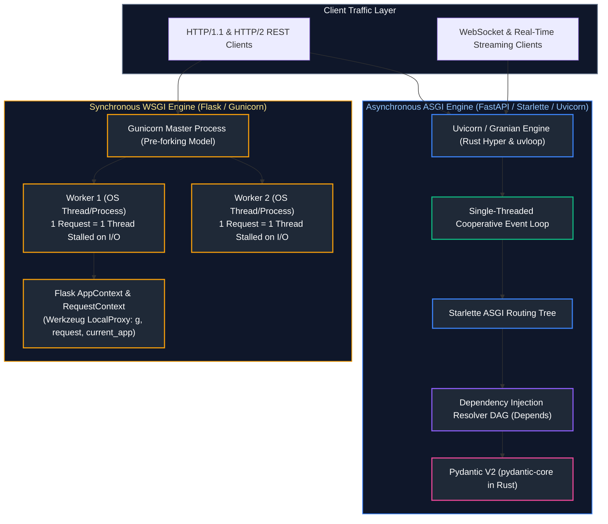
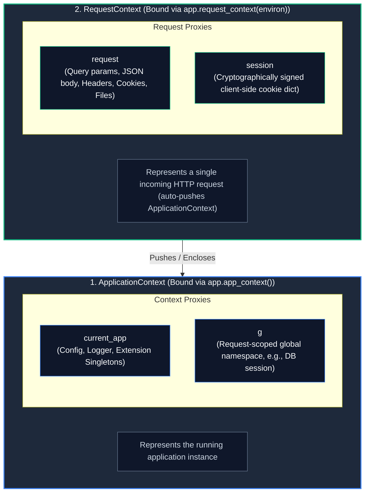
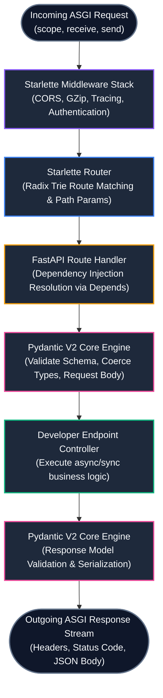
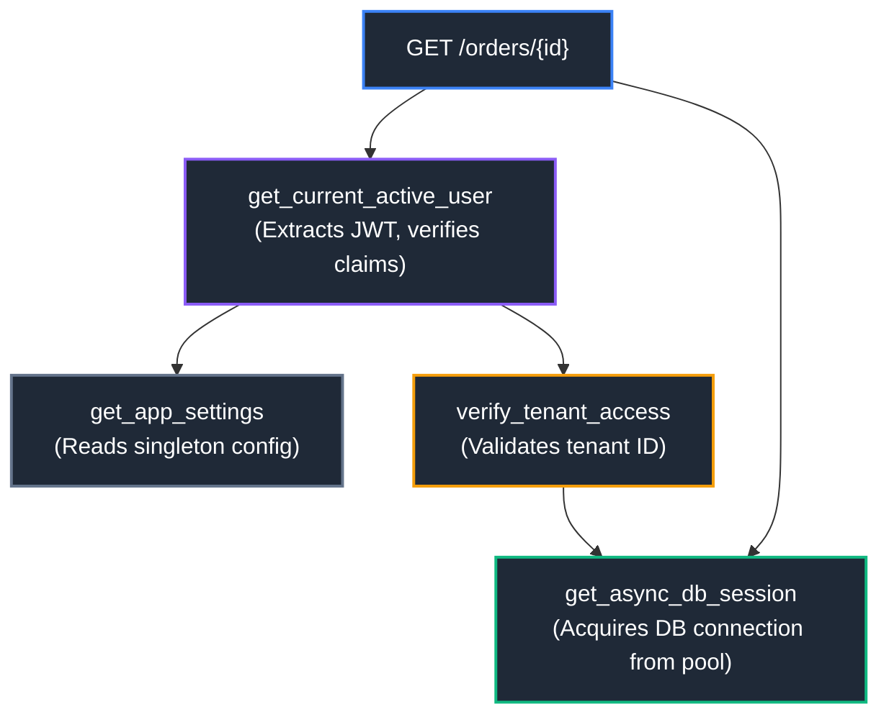
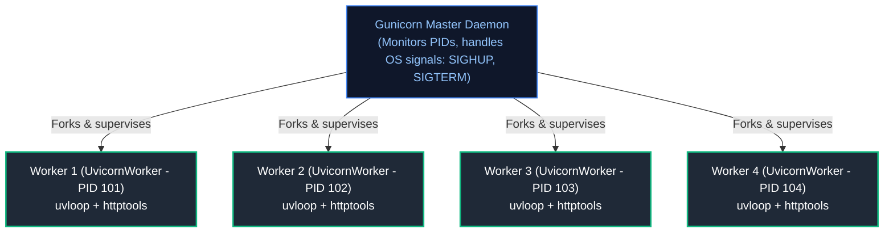

# 07. Web Frameworks: FastAPI and Flask Internals

A comprehensive, production-grade guide to Python web architectures, the WSGI (PEP 3333) vs. ASGI specifications, Flask internal context proxies (`LocalProxy`), FastAPI's Starlette engine and Dependency Injection (DI) DAG, modern application lifespans, synchronous vs. asynchronous route execution mechanics, Pydantic v2 Rust engine validation, HTTP PATCH partial update semantics, and production serving with Uvicorn, Gunicorn, and Granian for Senior Backend Engineers and Enterprise Architects.

---

## Architectural Overview: WSGI vs. ASGI Runtime Engines



---

## Table of Contents
1. [WSGI vs. ASGI Specifications: Architectural Evolution](#1-wsgi-vs-asgi-specifications-architectural-evolution)
   - [1.1 PEP 3333 (WSGI): Synchronous Request-Response Callables](#11-pep-3333-wsgi-synchronous-request-response-callables)
   - [1.2 The ASGI Specification: Asynchronous Streaming & Sockets](#12-the-asgi-specification-asynchronous-streaming--sockets)
   - [1.3 Anatomy of an ASGI Callable: `scope`, `receive`, and `send`](#13-anatomy-of-an-asgi-callable-scope-receive-and-send)
2. [Flask Framework Internals & Context Architecture](#2-flask-framework-internals--context-architecture)
   - [2.1 The Application Factory Pattern (`create_app`)](#21-the-application-factory-pattern-create_app)
   - [2.2 Context Mechanics: `ApplicationContext` vs. `RequestContext`](#22-context-mechanics-applicationcontext-vs-requestcontext)
   - [2.3 Under the Hood: Werkzeug `LocalProxy` and Thread-Local Storage](#23-under-the-hood-werkzeug-localproxy-and-thread-local-storage)
   - [2.4 Teardown Callbacks and Resource Cleanup](#24-teardown-callbacks-and-resource-cleanup)
   - [2.5 Modular Route Organization with Blueprints](#25-modular-route-organization-with-blueprints)
3. [FastAPI Framework Internals & The Starlette Engine](#3-fastapi-framework-internals--the-starlette-engine)
   - [3.1 The Starlette ASGI Foundation and Routing Trees](#31-the-starlette-asgi-foundation-and-routing-trees)
   - [3.2 Automatic OpenAPI 3.1 & JSON Schema Generation](#32-automatic-openapi-31--json-schema-generation)
   - [3.3 Comprehensive Parameter Declarations: Path, Query, Header, Cookie, Body, and Form](#33-comprehensive-parameter-declarations-path-query-header-cookie-body-and-form)
4. [Advanced Dependency Injection (DI) in FastAPI](#4-advanced-dependency-injection-di-in-fastapi)
   - [4.1 The Dependency Graph (DAG) and Resolution Order](#41-the-dependency-graph-dag-and-resolution-order)
   - [4.2 Request-Scoped Caching (`use_cache=True`)](#42-request-scoped-caching-use_cachetrue)
   - [4.3 Yield Dependencies for Resource Acquisition and Teardown](#43-yield-dependencies-for-resource-acquisition-and-teardown)
   - [4.4 Hermetic Testing with Dependency Overrides (`app.dependency_overrides`)](#44-hermetic-testing-with-dependency-overrides-appdependency_overrides)
5. [Application Lifespan Handlers (`@asynccontextmanager`)](#5-application-lifespan-handlers-asynccontextmanager)
   - [5.1 Modern Lifespans vs. Deprecated `@app.on_event`](#51-modern-lifespans-vs-deprecated-appon_event)
   - [5.2 Connection Pool Warming, HTTP Client Reuse, and Graceful Draining](#52-connection-pool-warming-http-client-reuse-and-graceful-draining)
6. [Synchronous vs. Asynchronous Route Execution Mechanics](#6-synchronous-vs-asynchronous-route-execution-mechanics)
   - [6.1 The ThreadPool Offloading Trap: Why `def` Runs in Worker Threads](#61-the-threadpool-offloading-trap-why-def-runs-in-worker-threads)
   - [6.2 The Event Loop Starvation Disaster: Blocking Calls in `async def`](#62-the-event-loop-starvation-disaster-blocking-calls-in-async-def)
   - [6.3 Decision Matrix: When to Use `def` vs. `async def`](#63-decision-matrix-when-to-use-def-vs-async-def)
7. [Pydantic v2 Data Modeling & The Rust Core Engine](#7-pydantic-v2-data-modeling--the-rust-core-engine)
   - [7.1 Architecture of `pydantic-core` in Rust](#71-architecture-of-pydantic-core-in-rust)
   - [7.2 Validation Lifecycle: `@field_validator` and `@model_validator`](#72-validation-lifecycle-field_validator-and-model_validator)
   - [7.3 Polymorphic Data Structures: Discriminated Unions](#73-polymorphic-data-structures-discriminated-unions)
   - [7.4 Serialization Optimization: `model_dump()` vs. `model_dump_json()`](#74-serialization-optimization-model_dump-vs-model_dump_json)
   - [7.5 HTTP PATCH Semantics: `exclude_unset=True` vs. Explicit Nulls](#75-http-patch-semantics-exclude_unsettrue-vs-explicit-nulls)
8. [Serving WSGI & ASGI in Production](#8-serving-wsgi--asgi-in-production)
   - [8.1 Worker Architectures: Gunicorn Pre-Forking vs. Uvicorn](#81-worker-architectures-gunicorn-pre-forking-vs-uvicorn)
   - [8.2 Next-Gen Rust Web Servers: Granian](#82-next-gen-rust-web-servers-granian)
   - [8.3 Enterprise Production Deployment Flags & Tuning](#83-enterprise-production-deployment-flags--tuning)
9. [Summary Comparison & Engineering Reference Matrix](#9-summary-comparison--engineering-reference-matrix)
10. [References & Further Reading](#10-references--further-reading)

---

# 1. WSGI vs. ASGI Specifications: Architectural Evolution

### 1.1 PEP 3333 (WSGI): Synchronous Request-Response Callables

#### Intuitive Analogy: The Single-Lane Toll Booth
Think of the **Web Server Gateway Interface (WSGI)** like a single-lane toll booth for an office park. A car arrives (HTTP request), hands the attendant cash, receives a receipt (HTTP response), and drives through.
If the driver needs to stop to look for a map (the application performs a 5-second database query), the entire lane freezes. No other car can enter or leave until that single transaction is 100% complete.

Defined in **PEP 3333** (2010), WSGI specifies a standardized synchronous interface between Python web applications and web servers (like Apache `mod_wsgi` or Gunicorn):

```python
# The Pure WSGI Application Callable (PEP 3333)
def simple_wsgi_app(environ: dict, start_response) -> list[bytes]:
    """
    environ: Dictionary containing CGI-style environment variables, headers, and request body.
    start_response: Callback function used to send HTTP status and headers.
    """
    status = "200 OK"
    response_headers = [
        ("Content-Type", "application/json"),
        ("Content-Length", "18"),
    ]
    start_response(status, response_headers)
    return [b'{"status": "alive"}']
```

#### The Fatal Flaws of WSGI:
1. **Synchronous & Blocking**: The entire request is processed synchronously inside a single thread. If your application handles 1,000 concurrent clients waiting for database queries, you must spawn 1,000 OS processes or threads, exhausting system RAM and kernel thread tables!
2. **Cannot Support Long-Lived Connections**: WSGI cannot natively handle **WebSockets**, **Server-Sent Events (SSE)**, or HTTP/2 bi-directional multiplexing without grotesque monkey-patching (e.g., Gevent greenlets).

---

### 1.2 The ASGI Specification: Asynchronous Streaming & Sockets

The **Asynchronous Server Gateway Interface (ASGI)** is the modern successor to WSGI. It provides a standardized asynchronous interface capable of handling:
* Standard asynchronous HTTP/1.1 and HTTP/2 request-response cycles.
* Bidirectional, persistent **WebSockets**.
* Long-lived background streaming and Server-Sent Events (SSE).

Instead of a synchronous function returning an iterable of bytes, an ASGI application is an **asynchronous coroutine callable**.

---

### 1.3 Anatomy of an ASGI Callable: `scope`, `receive`, and `send`

Every ASGI application (including FastAPI and Starlette) implements this exact 3-argument signature:

```python
async def asgi_application(scope: dict, receive, send) -> None:
    """
    scope: Dictionary describing the connection (type: 'http' or 'websocket', path, headers, client IP).
    receive: Async callable to receive incoming event dictionaries from the server.
    send: Async callable to send outgoing event dictionaries to the client.
    """
```

#### Writing a Pure ASGI Application from Scratch:
```python
import json

async def pure_asgi_app(scope: dict, receive, send) -> None:
    # 1. Inspect the connection scope
    if scope["type"] == "http":
        # Wait for the incoming request body event
        request_event = await receive()
        body = request_event.get("body", b"")

        response_payload = json.dumps({
            "message": "Processed via raw ASGI",
            "path": scope["path"],
            "method": scope["method"],
            "received_bytes": len(body),
        }).encode("utf-8")

        # 2. Send HTTP Response Start (Status code and Headers)
        await send({
            "type": "http.response.start",
            "status": 200,
            "headers": [
                [b"content-type", b"application/json"],
                [b"content-length", str(len(response_payload)).encode("utf-8")],
            ],
        })

        # 3. Send HTTP Response Body
        await send({
            "type": "http.response.body",
            "body": response_payload,
            "more_body": False,
        })

    elif scope["type"] == "websocket":
        # Handle WebSocket handshake
        while True:
            event = await receive()
            if event["type"] == "websocket.connect":
                await send({"type": "websocket.accept"})
            elif event["type"] == "websocket.receive":
                text = event.get("text", "")
                await send({"type": "websocket.send", "text": f"Echo: {text}"})
            elif event["type"] == "websocket.disconnect":
                break
```
*Key Architectural Insight*: Because `receive` and `send` are asynchronous coroutines, the server can stream 10 gigabytes of data or maintain 100,000 idle WebSocket connections on a single OS thread without blocking other requests!

---

# 2. Flask Framework Internals & Context Architecture

### 2.1 The Application Factory Pattern (`create_app`)

In enterprise Flask applications, **never** instantiate a global `app = Flask(__name__)` at the module level.
Always utilize the **Application Factory Pattern**:

```python
import os
from flask import Flask
from typing import Mapping, Any

def create_app(config_override: Mapping[str, Any] | None = None) -> Flask:
    """
    Application Factory: Instantiates and configures a clean Flask instance.
    Enables isolated unit testing with distinct database environments.
    """
    app = Flask(__name__, instance_relative_config=True)

    # 1. Load default baseline configuration
    app.config.from_mapping(
        SECRET_KEY=os.environ.get("SECRET_KEY", "dev-insecure-key"),
        SQLALCHEMY_DATABASE_URI=os.environ.get("DATABASE_URL", "sqlite:///dev.db"),
        SQLALCHEMY_TRACK_MODIFICATIONS=False,
    )

    # 2. Apply test or runtime overrides
    if config_override:
        app.config.from_mapping(config_override)

    # 3. Initialize extensions (deferred binding)
    # db.init_app(app)
    # migrate.init_app(app, db)

    # 4. Register modular blueprints
    from .routes.users import users_bp
    from .routes.health import health_bp
    app.register_blueprint(users_bp, url_prefix="/api/v1/users")
    app.register_blueprint(health_bp, url_prefix="/health")

    return app
```

---

### 2.2 Context Mechanics: `ApplicationContext` vs. `RequestContext`

Flask relies on two distinct stacked context layers:



| Context Layer | Activation Scope | Lifecycle / Binding | Global Proxies Exposed |
| :--- | :--- | :--- | :--- |
| **`ApplicationContext`** | App-level config, extensions, database engine pools, CLI tasks | `with app.app_context():` or pushed automatically by `RequestContext` | `current_app`, `g` |
| **`RequestContext`** | Isolated to a single incoming WSGI HTTP request | `with app.request_context(environ):` per client request thread | `request`, `session` |

---

### 2.3 Under the Hood: Werkzeug `LocalProxy` and Thread-Local Storage

How can you write `from flask import request` at the module level, when `request` contains unique data for every concurrent HTTP request?

Flask achieves this via Werkzeug's **`LocalProxy`**:
1. At import time, `request` is **not** an HTTP request object. It is a pointer (`LocalProxy`) that delegates all attribute lookups dynamically.
2. In multi-threaded WSGI servers, Werkzeug historically stored active contexts in `threading.local()` (and in modern versions, `contextvars.ContextVar`).
3. When you access `request.method`, the `LocalProxy` calls:
   ```python
   # Conceptual implementation of Werkzeug LocalProxy lookup
   def __getattr__(self, name):
       # 1. Resolve current thread's active context from ContextVar
       active_req_context = _cv_request.get()
       if active_req_context is None:
           raise RuntimeError("Working outside of request context.")
       # 2. Forward attribute lookup to real Request object
       return getattr(active_req_context.request, name)
   ```

---

### 2.4 Teardown Callbacks and Resource Cleanup

To prevent database connection leaks in Flask, register teardown handlers that execute **regardless of whether an uncaught exception occurred**:

```python
from flask import Flask, g
import sqlite3

app = Flask(__name__)

def get_db():
    if "db" not in g:
        g.db = sqlite3.connect("app.db")
        g.db.row_factory = sqlite3.Row
    return g.db

@app.teardown_appcontext
def teardown_db(exception: BaseException | None) -> None:
    """Invoked automatically when the ApplicationContext pops."""
    db = g.pop("db", None)
    if db is not None:
        db.close()
```

---

### 2.5 Modular Route Organization with Blueprints

```python
from flask import Blueprint, jsonify, request, abort

users_bp = Blueprint("users", __name__)

@users_bp.route("/<int:user_id>", methods=["GET"])
def get_user_profile(user_id: int):
    if user_id <= 0:
        abort(400, description="Invalid user identifier")
    return jsonify({"user_id": user_id, "username": f"user_{user_id}"})
```

---

# 3. FastAPI Framework Internals & The Starlette Engine

### 3.1 The Starlette ASGI Foundation and Routing Trees

FastAPI is **not** a web framework built from scratch. It is an architectural orchestration layer built directly on top of:
1. **Starlette**: High-performance ASGI toolkit providing routing, middleware, WebSockets, background tasks, and CORS.
2. **Pydantic**: High-performance validation and serialization engine.



---

### 3.2 Automatic OpenAPI 3.1 & JSON Schema Generation

FastAPI inspects function type annotations, docstrings, and Pydantic models at application startup to construct a complete, standards-compliant **OpenAPI 3.1.0** JSON specification.
* `/docs`: Interactive Swagger UI interface.
* `/redoc`: Clean ReDoc documentation interface.
* `/openapi.json`: Raw machine-readable schema for automated client code generation (e.g., OpenAPI Generator for TypeScript or Go).

---

### 3.3 Comprehensive Parameter Declarations: Path, Query, Header, Cookie, Body, and Form

FastAPI uses explicit metadata markers to differentiate where parameters originate in the HTTP request:

```python
from fastapi import FastAPI, Path, Query, Header, Cookie, Body, Form, File, UploadFile
from pydantic import BaseModel, EmailStr
from typing import Annotated

app = FastAPI(title="Enterprise API")

class AccountUpdatePayload(BaseModel):
    display_name: str
    email: EmailStr

@app.put("/accounts/{account_id}")
async def update_account_profile(
    # Path parameter with integer boundary constraints
    account_id: Annotated[int, Path(ge=1, le=10_000_000, description="Primary Account ID")],
    # Query parameter with regex validation and default
    region: Annotated[str, Query(regex="^[a-z]{2}-[a-z]+-[0-9]$")] = "us-east-1",
    # Mandatory HTTP Request Header
    x_correlation_id: Annotated[str, Header(description="W3C Request Trace ID")] = ...,
    # Optional Cookie
    session_token: Annotated[str | None, Cookie()] = None,
    # Validated JSON Body payload
    payload: Annotated[AccountUpdatePayload, Body()] = ...,
):
    return {
        "account_id": account_id,
        "region": region,
        "trace_id": x_correlation_id,
        "updated_email": payload.email,
    }
```

---

### 3.4 Starlette Middleware Architecture: Pure ASGI vs. `BaseHTTPMiddleware`

Engineers frequently encounter performance bottlenecks by misusing middleware in FastAPI:

#### The `BaseHTTPMiddleware` Pitfall:
Starlette provides `starlette.middleware.base.BaseHTTPMiddleware` allowing a convenient `dispatch(request, call_next)` interface. However:
1. **ContextVar Propagation Issues**: Earlier versions struggled with `contextvars` isolation across concurrent requests.
2. **Streaming Response Buffering**: `BaseHTTPMiddleware` converts streaming responses into buffered responses, consuming massive memory on large file downloads.
3. **Breaks WebSockets**: HTTP middleware wraps the HTTP lifecycle and cannot handle WebSocket connection upgrades.

#### Production Solution: Pure ASGI Middleware
A pure ASGI middleware intercepts the raw `(scope, receive, send)` triplets with zero memory copying or buffering overhead:

```python
import time
from typing import Callable, Any

class HighPerformanceTimingMiddleware:
    """
    Pure ASGI Middleware:
    Zero-overhead request timing and custom header injection.
    Works seamlessly with streaming responses and WebSockets!
    """
    def __init__(self, app: Callable[[dict, Any, Any], Any]) -> None:
        self.app = app

    async def __call__(self, scope: dict, receive: Callable, send: Callable) -> None:
        if scope["type"] != "http":
            # Pass WebSocket or Lifespan scopes straight through without interference
            await self.app(scope, receive, send)
            return

        start_time = time.perf_counter()

        async def send_wrapper(message: dict) -> None:
            if message["type"] == "http.response.start":
                process_time = time.perf_counter() - start_time
                # Convert existing headers list to mutable list of byte tuples
                headers = list(message.get("headers", []))
                headers.append((b"x-process-time", f"{process_time:.6f}".encode("latin-1")))
                message["headers"] = headers
            await send(message)

        await self.app(scope, receive, send_wrapper)

# Registration on FastAPI instance:
# app.add_middleware(HighPerformanceTimingMiddleware)
```

---

### 3.5 Real-Time Bidirectional WebSockets with Heartbeat Ping/Pong

FastAPI provides first-class support for stateful, persistent WebSocket connections. Here is the enterprise pattern for managing active client connections, broadcasting messages, and preventing ghost connections:

```python
from fastapi import FastAPI, WebSocket, WebSocketDisconnect, status
from typing import dict

app = FastAPI()

class ConnectionManager:
    """Manages active WebSocket client sockets and room broadcasts."""
    def __init__(self) -> None:
        # Maps user_id -> active WebSocket socket
        self.active_connections: dict[str, WebSocket] = {}

    async def connect(self, user_id: str, websocket: WebSocket) -> None:
        await websocket.accept()
        self.active_connections[user_id] = websocket

    def disconnect(self, user_id: str) -> None:
        self.active_connections.pop(user_id, None)

    async def send_personal_message(self, message: dict, user_id: str) -> None:
        if websocket := self.active_connections.get(user_id):
            await websocket.send_json(message)

    async def broadcast(self, message: dict) -> None:
        for websocket in list(self.active_connections.values()):
            try:
                await websocket.send_json(message)
            except Exception:
                pass

manager = ConnectionManager()

@app.websocket("/ws/notifications/{user_id}")
async def websocket_notifications_endpoint(websocket: WebSocket, user_id: str):
    await manager.connect(user_id, websocket)
    try:
        while True:
            # Await incoming client ping/messages (prevents socket timeout)
            data = await websocket.receive_text()
            if data == "ping":
                await websocket.send_text("pong")
            else:
                # Handle client event
                await manager.send_personal_message({"echo": data}, user_id)
    except WebSocketDisconnect:
        manager.disconnect(user_id)
        await manager.broadcast({"event": "user_disconnected", "user_id": user_id})
```

---

# 4. Advanced Dependency Injection (DI) in FastAPI

### 4.1 The Dependency Graph (DAG) and Resolution Order

FastAPI features one of the most sophisticated **Dependency Injection (DI)** engines in the Python ecosystem (`fastapi.Depends`).
When an endpoint is invoked, FastAPI builds a **Directed Acyclic Graph (DAG)** of all dependencies, sub-dependencies, and security scopes:



---

### 4.2 Request-Scoped Caching (`use_cache=True`)

Notice that both `Route` and `PermDep` depend on `get_async_db_session`.
By default, **`Depends(..., use_cache=True)` caches the resolved value for the lifetime of that single HTTP request**.
FastAPI calls `get_async_db_session` **exactly once**, sharing the identical database session across all dependencies in the graph!

---

### 4.3 Yield Dependencies for Resource Acquisition and Teardown

To manage transactional database sessions or client lifespans, use Python's generator `yield` syntax:

```python
from collections.abc import AsyncGenerator
from fastapi import FastAPI, Depends, HTTPException, status
import asyncpg

app = FastAPI()

# Simulated database connection pool
async def get_db_pool() -> asyncpg.Pool:
    # In real applications, this pool is stored on app.state
    return app.state.db_pool

async def get_db_connection(
    pool: asyncpg.Pool = Depends(get_db_pool)
) -> AsyncGenerator[asyncpg.Connection, None]:
    """
    Yield Dependency:
    1. Executes BEFORE the route handler (acquires resource).
    2. Yields resource to route.
    3. Executes AFTER the route handler (releases resource, even on uncaught errors!).
    """
    conn = await pool.acquire()
    try:
        yield conn
    finally:
        # Guarantees connection return to pool!
        await pool.release(conn)

@app.get("/items/{item_id}")
async def read_item(
    item_id: int,
    conn: asyncpg.Connection = Depends(get_db_connection)
):
    row = await conn.fetchrow("SELECT * FROM items WHERE id = $1", item_id)
    if not row:
        raise HTTPException(status_code=404, detail="Item not found")
    return dict(row)
```

---

### 4.4 Hermetic Testing with Dependency Overrides (`app.dependency_overrides`)

FastAPI's dependency injection system makes unit and integration testing effortless by allowing you to override any dependency without monkey-patching:

```python
from fastapi.testclient import TestClient
import pytest

# Fake test repository
class FakeDbSession:
    async def fetchrow(self, query: str, *args):
        return {"id": 1, "name": "Mocked Test Item"}

async def override_get_db_connection():
    yield FakeDbSession()

def test_read_item_hermetic():
    # 1. Override the production dependency
    app.dependency_overrides[get_db_connection] = override_get_db_connection

    # 2. Execute test with zero database infrastructure required!
    with TestClient(app) as client:
        response = client.get("/items/1")
        assert response.status_code == 200
        assert response.json()["name"] == "Mocked Test Item"

    # 3. Clean up overrides
    app.dependency_overrides.clear()
```

---

# 5. Application Lifespan Handlers (`@asynccontextmanager`)

### 5.1 Modern Lifespans vs. Deprecated `@app.on_event`

> [!WARNING]
> **Deprecated Pattern**:
> `@app.on_event("startup")` and `@app.on_event("shutdown")` are **deprecated** in Starlette and FastAPI.
> They lack robust error handling and cannot share state cleanly across the startup and shutdown boundary.
---

### 5.2 Connection Pool Warming, HTTP Client Reuse, and Graceful Draining

#### Modern Lifespan Architecture (Python 3.10+):
```python
from contextlib import asynccontextmanager
from fastapi import FastAPI
import httpx
import redis.asyncio as aioredis

@asynccontextmanager
async def application_lifespan(app: FastAPI):
    # ==================== STARTUP PHASE ====================
    print("[Startup] Initializing outbound HTTP connection pool...")
    app.state.http_client = httpx.AsyncClient(timeout=httpx.Timeout(10.0))
    
    print("[Startup] Establishing Redis cluster connection...")
    app.state.redis = aioredis.from_url("redis://localhost:6379/0", decode_responses=True)
    await app.state.redis.ping()
    
    yield  # Application handles incoming HTTP/WebSocket traffic here!

    # ==================== SHUTDOWN PHASE ====================
    print("[Shutdown] Closing HTTP client pool...")
    await app.state.http_client.aclose()
    
    print("[Shutdown] Draining and terminating Redis connections...")
    await app.state.redis.close()

# Pass lifespan directly to FastAPI constructor
app = FastAPI(lifespan=application_lifespan)
```

---

# 6. Synchronous vs. Asynchronous Route Execution Mechanics

### 6.1 The ThreadPool Offloading Trap: Why `def` Runs in Worker Threads

One of the most profound internal architectural features of FastAPI is how it executes **`def` (synchronous)** routes versus **`async def` (asynchronous)** routes:

```python
# Route A: Declared with 'def' (SYNCHRONOUS)
@app.get("/sync-endpoint")
def sync_route():
    # FastAPI does NOT run this directly on the event loop!
    # It offloads execution to an external thread pool: anyio.to_thread.run_sync()
    time.sleep(1.0)
    return {"status": "success"}

# Route B: Declared with 'async def' (ASYNCHRONOUS)
@app.get("/async-endpoint")
async def async_route():
    # FastAPI executes this DIRECTLY on the main event loop thread!
    await asyncio.sleep(1.0)
    return {"status": "success"}
```

---

### 6.2 The Event Loop Starvation Disaster: Blocking Calls in `async def`

> [!CAUTION]
> ### The Single Biggest Production Outage in FastAPI
> If you declare an endpoint with `async def`, and inside that endpoint you execute a **blocking synchronous function** (such as `time.sleep()`, synchronous `requests.get()`, or legacy synchronous ORM queries), **you freeze the entire event loop**!
> 
> Because `async def` runs on the main thread, the entire server stops accepting new connections, fails health checks, and drops active client connections!

```python
# PRODUCTION DISASTER: Freezes all concurrent traffic across the server!
@app.get("/lethal-endpoint")
async def lethal_route():
    # NEVER DO THIS INSIDE async def! Freezes all other requests!
    time.sleep(5.0) 
    return {"status": "doomed"}
```

---

### 6.3 Decision Matrix: When to Use `def` vs. `async def`

| Endpoint Implementation | Declaration | Execution Mechanism | Performance Characteristic |
| :--- | :--- | :--- | :--- |
| **Pure Async I/O** (asyncpg, httpx, motor) | `async def` | Runs directly on event loop | **Maximum throughput** (10K+ req/sec). |
| **Legacy Synchronous I/O** (psycopg2, requests) | `def` | Offloaded to `anyio.to_thread` pool | Bounded by thread pool size (default 40). Safe from loop freeze. |
| **Heavy CPU Math** (NumPy, cryptography) | `def` | Offloaded to thread pool (or `ProcessPool`) | Keeps event loop responsive. |

---

# 7. Pydantic v2 Data Modeling & The Rust Core Engine

### 7.1 Architecture of `pydantic-core` in Rust

In Pydantic v1, validation was written in pure Python. Validating 100,000 JSON payloads per second was computationally impossible due to Python interpreter overhead.
**Pydantic v2** completely rewrote the internal validation and serialization engine in **Rust (`pydantic-core`)**:
* Parses and validates raw JSON bytes directly in compiled Rust machine code.
* Delivers a **$5\times$ to $20\times$ speedup** over Pydantic v1.

---

### 7.2 Validation Lifecycle: `@field_validator` and `@model_validator`

```python
from pydantic import BaseModel, Field, field_validator, model_validator
from decimal import Decimal

class CreatePaymentRequest(BaseModel):
    amount: Decimal = Field(..., gt=0, decimal_places=2)
    currency: str = Field(..., min_length=3, max_length=3)
    card_number: str

    @field_validator("currency", mode="after")
    @classmethod
    def validate_currency_uppercase(cls, v: str) -> str:
        """Field validator running AFTER default type coercion."""
        return v.upper()

    @field_validator("card_number", mode="before")
    @classmethod
    def strip_card_whitespace(cls, v: str) -> str:
        """Field validator running BEFORE type coercion (cleans raw string)."""
        if isinstance(v, str):
            return v.replace(" ", "").replace("-", "")
        return v

    @model_validator(mode="after")
    def validate_cross_field_rules(self) -> "CreatePaymentRequest":
        """Model validator running after all individual fields are verified."""
        if self.currency == "JPY" and self.amount % 1 != 0:
            raise ValueError("Japanese Yen cannot contain decimal fractional amounts")
        return self
```

---

### 7.3 Polymorphic Data Structures: Discriminated Unions

When an API endpoint must accept or return polymorphic schemas (e.g., different payment method configurations):

```python
from pydantic import BaseModel, Field
from typing import Annotated, Literal, Union

class CreditCardPayment(BaseModel):
    method_type: Literal["credit_card"] = "credit_card"
    card_token: str
    cvv: str

class BankTransferPayment(BaseModel):
    method_type: Literal["bank_transfer"] = "bank_transfer"
    iban: str
    bic: str

# Discriminated Union: Validates in O(1) time using the 'method_type' tag
PaymentPayload = Annotated[
    Union[CreditCardPayment, BankTransferPayment],
    Field(discriminator="method_type")
]

class CheckoutRequest(BaseModel):
    order_id: str
    payment: PaymentPayload
```

---

### 7.4 Serialization Optimization: `model_dump()` vs. `model_dump_json()`

* **`model.model_dump()`**: Serializes the model into native Python dictionaries and lists.
* **`model.model_dump_json()`**: Serializes directly from Rust internal structs into a raw UTF-8 JSON byte string, **bypassing Python dictionary creation entirely**!

```python
# Ultra-fast raw JSON response:
from fastapi import Response

@app.get("/orders/{id}/fast")
async def get_fast_order(id: str):
    order = fetch_order(id)
    # Bypasses Python dict allocations and standard json.dumps!
    return Response(content=order.model_dump_json(), media_type="application/json")
```

---

### 7.5 HTTP PATCH Semantics: `exclude_unset=True` vs. Explicit Nulls

In RESTful APIs, **`PATCH` represents a partial update**. You must distinguish between:
1. A field omitted by the client (do **not** update database).
2. A field explicitly set to `null` / `None` by the client (update database column to `NULL`).

```python
from pydantic import BaseModel
from typing import Optional

class UserPatchRequest(BaseModel):
    username: Optional[str] = None
    bio: Optional[str] = None
    avatar_url: Optional[str] = None

# Case 1: Client sends {"bio": "New Bio"}
payload = UserPatchRequest(bio="New Bio")

# Anti-pattern: model_dump() includes all defaults!
# payload.model_dump() -> {"username": None, "bio": "New Bio", "avatar_url": None}
# This would erroneously wipe out the user's username and avatar in the DB!

# PRODUCTION STANDARD: exclude_unset=True
update_data = payload.model_dump(exclude_unset=True)
print(update_data) # Outputs: {"bio": "New Bio"}

# Only update database columns that were explicitly sent in the request!
```

---

# 8. Serving WSGI & ASGI in Production

### 8.1 Worker Architectures: Gunicorn Pre-Forking vs. Uvicorn

In enterprise deployments, you run **Gunicorn as the master process supervisor** managing multiple **Uvicorn worker processes**:



---

### 8.2 Next-Gen Rust Web Servers: Granian

**Granian** is a modern HTTP server for Python applications written in **Rust** on top of the **Hyper** engine:
* Outperforms Gunicorn + Uvicorn by $20\text{--}40\%$ in raw throughput.
* Handles HTTP/1, HTTP/2, and WebSockets natively in Rust.
* Supports both ASGI and WSGI applications seamlessly.

```bash
# Running FastAPI with Granian
granian --interface asgi --workers 4 --threads 2 app.main:app
```

---

### 8.3 Enterprise Production Deployment Flags & Tuning

```bash
# Production Gunicorn + Uvicorn command
gunicorn app.main:app \
  --workers 4 \
  --worker-class uvicorn.workers.UvicornWorker \
  --bind 0.0.0.0:8000 \
  --timeout 30 \
  --graceful-timeout 30 \
  --keep-alive 5 \
  --max-requests 10000 \
  --max-requests-jitter 1000 \
  --access-logfile - \
  --error-logfile -
```

#### Key Production Flags Explained:
* `--workers`: Typically set to $(2 \times \text{CPU cores}) + 1$ for I/O-bound services, or $1 \times \text{CPU cores}$ in containerized Kubernetes pods.
* `--graceful-timeout 30`: Gives active requests 30 seconds to finish after receiving `SIGTERM` before force-killing with `SIGKILL`.
* `--max-requests 10000 --max-requests-jitter 1000`: Automatically recycles worker processes to combat CPython PyMalloc memory fragmentation and RSS bloat!

---

# 9. Summary Comparison & Engineering Reference Matrix

| Feature / Dimension | Flask (WSGI) | FastAPI (ASGI) |
| :--- | :--- | :--- |
| **Specification** | PEP 3333 (Synchronous WSGI) | Asynchronous Server Gateway Interface (ASGI) |
| **Concurrency Paradigm** | 1 OS Thread / Process per request | Cooperative AsyncIO Event Loop |
| **WebSockets / SSE Support** | Non-native (requires Gevent/eventlet hacks) | **First-class native async streaming** |
| **Request Validation** | Manual / Marshmallow (high overhead) | **Pydantic V2 Rust Engine (`pydantic-core`)** |
| **Dependency Injection** | Implicit globals (`g`, `LocalProxy`) | **Explicit DAG with `Depends(..., use_cache=True)`** |
| **OpenAPI Documentation** | Flasgger / Manual extensions | **Automated OpenAPI 3.1 & Swagger UI** |
| **Partial Updates (PATCH)** | Manual inspection of `request.json` | **`model_dump(exclude_unset=True)`** |
| **Async Route Trap** | N/A (Standard sync execution) | **Calling blocking sync code in `async def` freezes loop** |
| **Best Production Use Case** | Legacy monolithic web apps, server-rendered HTML | **High-throughput microservices, REST APIs, real-time streaming** |

---

# 10. References & Further Reading

1. **PEP 3333 – Python Web Server Gateway Interface v1.0.1**: [https://peps.python.org/pep-3333/](https://peps.python.org/pep-3333/)
2. **ASGI Specification Documentation**: [https://asgi.readthedocs.io/en/latest/](https://asgi.readthedocs.io/en/latest/)
3. **FastAPI Documentation**: High-performance async web framework: [https://fastapi.tiangolo.com/](https://fastapi.tiangolo.com/)
4. **Starlette ASGI Toolkit**: [https://www.starlette.io/](https://www.starlette.io/)
5. **Pydantic V2 Documentation**: High-speed data validation in Rust: [https://docs.pydantic.dev/latest/](https://docs.pydantic.dev/latest/)
6. **Granian: High-performance Python HTTP server in Rust**: [https://github.com/emmett-framework/granian](https://github.com/emmett-framework/granian)
7. **Related Guides**:
   - See [04. Python Concurrency and Async Programming](04_python_concurrency_and_async_programming.md) for event loop mechanics and `uvloop`.
   - See [08. APIs and Protocols: REST, gRPC, and WebSockets](08_apis_protocols_rest_grpc_websockets.md) for streaming responses and protocol details.
   - See [11. Security, Identity, and Authentication](11_security_identity_and_authentication.md) for JWT and RBAC security scopes.
