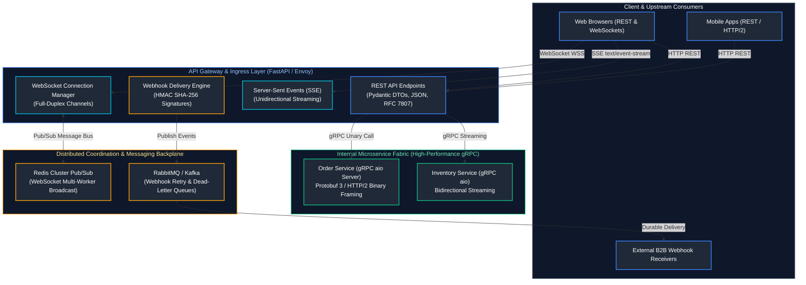
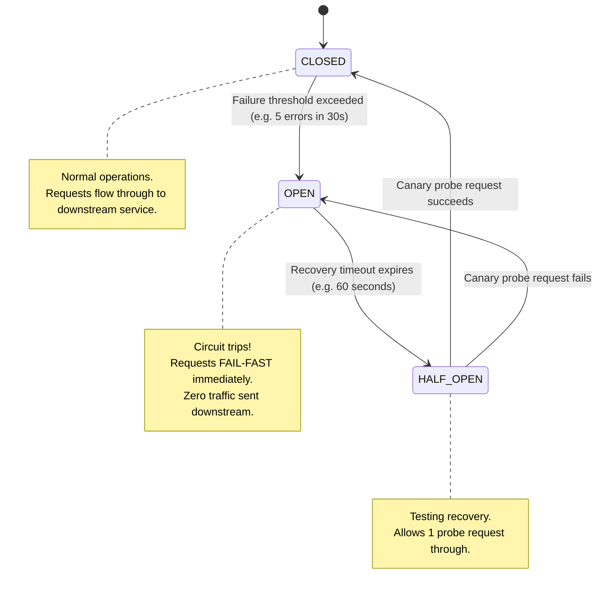
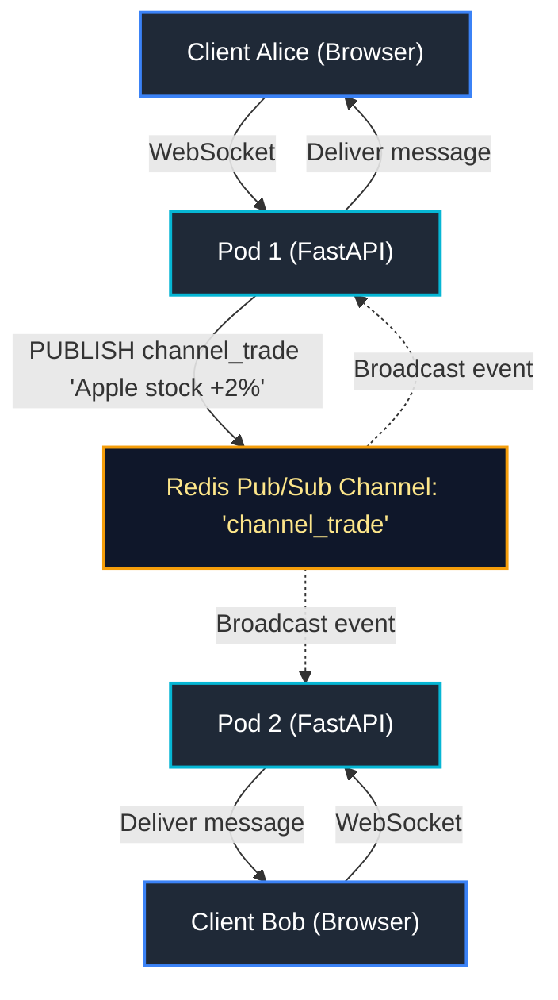

# 08. APIs and Protocols: REST, gRPC, and WebSockets

A comprehensive, production-grade guide to enterprise API communication protocols in Python, RESTful API design standards, RFC 7807 error envelopes, high-throughput asynchronous HTTP clients with HTTPX, resilience engineering with exponential backoff and circuit breakers, real-time WebSockets with distributed Redis backplanes, Server-Sent Events (SSE), binary microservices with gRPC and Protocol Buffers (proto3), and cryptographically secure webhook architectures for Senior Backend Engineers and Enterprise Architects.

---

## Architectural Overview: Multi-Protocol Ingress & Microservice Communication



---

## Table of Contents
1. [RESTful API Design & HTTP Semantics](#1-restful-api-design--http-semantics)
   - [1.1 Core REST Principles: Resources, Statelessness, and URIs](#11-core-rest-principles-resources-statelessness-and-uris)
   - [1.2 HTTP Method Semantics: Safe vs. Idempotent Operations](#12-http-method-semantics-safe-vs-idempotent-operations)
   - [1.3 Pagination Engineering: Offset vs. Keyset (Cursor-Based) Pagination](#13-pagination-engineering-offset-vs-keyset-cursor-based-pagination)
   - [1.4 Standardized Error Contracts with RFC 7807 Problem Details](#14-standardized-error-contracts-with-rfc-7807-problem-details)
2. [High-Performance Asynchronous HTTP with HTTPX](#2-high-performance-asynchronous-http-with-httpx)
   - [2.1 Architecture: `Client` vs. `AsyncClient`](#21-architecture-client-vs-asyncclient)
   - [2.2 Connection Pooling & Socket Limits (`httpx.Limits`)](#22-connection-pooling--socket-limits-httpxlimits)
   - [2.3 Granular Socket Timeouts: Connect, Read, Write, and Pool](#23-granular-socket-timeouts-connect-read-write-and-pool)
   - [2.4 HTTP/2 Transport Multiplexing](#24-http2-transport-multiplexing)
3. [Client Resilience Engineering: Retries & Circuit Breakers](#3-client-resilience-engineering-retries--circuit-breakers)
   - [3.1 Transient Failures & Exponential Backoff with Full Jitter (`tenacity`)](#31-transient-failures--exponential-backoff-with-full-jitter-tenacity)
   - [3.2 The Circuit Breaker Pattern with `pybreaker`: State Machines & Fail-Fast](#32-the-circuit-breaker-pattern-with-pybreaker-state-machines--fail-fast)
4. [Real-Time Communication: WebSockets & Server-Sent Events (SSE)](#4-real-time-communication-websockets--server-sent-events-sse)
   - [4.1 WebSockets Protocol Upgrade Mechanics (RFC 6455)](#41-websockets-protocol-upgrade-mechanics-rfc-6455)
   - [4.2 FastAPI WebSocket Lifecycle & Heartbeat Pings](#42-fastapi-websocket-lifecycle--heartbeat-pings)
   - [4.3 Multi-Worker WebSocket Broadcast via Redis Pub/Sub Backplane](#43-multi-worker-websocket-broadcast-via-redis-pubsub-backplane)
   - [4.4 Server-Sent Events (SSE) with `StreamingResponse`](#44-server-sent-events-sse-with-streamingresponse)
5. [High-Performance Microservices: gRPC & Protocol Buffers (proto3)](#5-high-performance-microservices-grpc--protocol-buffers-proto3)
   - [5.1 Why gRPC Outperforms REST: HTTP/2 Binary Framing & Protobuf Packing](#51-why-grpc-outperforms-rest-http2-binary-framing--protobuf-packing)
   - [5.2 Defining Schemas & Compiling with `grpc_tools.protoc`](#52-defining-schemas--compiling-with-grpc_toolsprotoc)
   - [5.3 Asynchronous gRPC Server & Client with `grpc.aio`](#53-asynchronous-grpc-server--client-with-grpcaio)
   - [5.4 The Four gRPC Communication Patterns: Unary, Client/Server Streaming, and Duplex](#54-the-four-grpc-communication-patterns-unary-clientserver-streaming-and-duplex)
6. [Enterprise Webhook Architecture](#6-enterprise-webhook-architecture)
   - [6.1 Cryptographic Signature Generation & Verification (HMAC SHA-256)](#61-cryptographic-signature-generation--verification-hmac-sha-256)
   - [6.2 Timing Attack Mitigation with Constant-Time Comparison (`compare_digest`)](#62-timing-attack-mitigation-with-constant-time-comparison-compare_digest)
   - [6.3 Replay Attack Prevention with Timestamps & Nonce Caching](#63-replay-attack-prevention-with-timestamps--nonce-caching)
   - [6.4 Idempotency Keys in Payment & Mutation Webhooks](#64-idempotency-keys-in-payment--mutation-webhooks)
7. [Summary Comparison & Engineering Reference Matrix](#7-summary-comparison--engineering-reference-matrix)
8. [References & Further Reading](#8-references--further-reading)

---

# 1. RESTful API Design & HTTP Semantics

### 1.1 Core REST Principles: Resources, Statelessness, and URIs

Representational State Transfer (REST) is an architectural style governing distributed hypermedia systems. In modern backend engineering:
* **Resources are Plural Nouns**: Model APIs around nouns representing business entities (`/v1/orders`, `/v1/accounts/acc_123/invoices`), **never** verbs (`/v1/getOrders`, `/v1/cancel_order`).
* **Statelessness**: Every request must encapsulate all authentication credentials and state parameters necessary for execution. The server stores zero client session state in memory.
* **Hierarchical Nesting Ceiling**: Limit sub-resource nesting to a maximum depth of two levels:
  - Good: `/v1/users/{user_id}/orders`
  - Anti-Pattern: `/v1/users/{user_id}/orders/{order_id}/items/{item_id}/taxes/{tax_id}` (use `/v1/order-items/{id}` directly instead).

---

### 1.2 HTTP Method Semantics: Safe vs. Idempotent Operations

Understanding HTTP method semantics is vital for distributed system correctness, caching, and automatic retry policies:

| HTTP Method | RFC 9110 Semantics | Safe? (Read-only) | Idempotent? ($N$ calls = $1$ call) | Cacheable? | Typical Status Codes |
| :--- | :--- | :---: | :---: | :---: | :--- |
| **`GET`** | Retrieve resource representation | **Yes** | **Yes** | **Yes** | 200 OK, 304 Not Modified |
| **`HEAD`** | Retrieve resource headers only | **Yes** | **Yes** | **Yes** | 200 OK |
| **`OPTIONS`**| Query supported capabilities / CORS | **Yes** | **Yes** | No | 204 No Content |
| **`POST`** | Process entity / Create sub-resource | No | **No** | Conditional | 201 Created, 202 Accepted |
| **`PUT`** | Completely replace target resource | No | **Yes** | No | 200 OK, 204 No Content |
| **`PATCH`** | Apply partial modifications | No | **No** (by default) | No | 200 OK, 204 No Content |
| **`DELETE`**| Remove resource | No | **Yes** | No | 200 OK, 204 No Content, 404 |

> [!IMPORTANT]
> **Safe Methods** do not alter server state. They can be pre-fetched, cached, or repeated infinitely without danger.
> **Idempotent Methods** guarantee that executing the identical request multiple times produces the exact same end state on the server. If a network blip occurs during a `PUT` or `DELETE`, the client can safely retry without fear of duplicate billing or orphaned entries!

---

### 1.3 Pagination Engineering: Offset vs. Keyset (Cursor-Based) Pagination

#### The Offset Pagination Pitfall:
```sql
-- Offset Pagination: Degrades to O(N) full-table scans at large offsets!
SELECT id, title, created_at FROM articles ORDER BY created_at DESC LIMIT 50 OFFSET 1000000;
```
*Why this fails*: The database storage engine must read and discard 1,000,000 index entries before returning 50 rows. Furthermore, if a new article is inserted while a user navigates between pages, records drift, causing duplicates or skipped rows.

#### Production Solution: Keyset (Cursor-Based) Pagination
Keyset pagination filters on indexed columns using a strict inequality, executing in constant $O(1)$ B-Tree index lookup time:

```python
from pydantic import BaseModel, Field
from typing import Generic, TypeVar
import base64
import json

T = TypeVar("T")

class CursorPaginationParams(BaseModel):
    limit: int = Field(default=20, ge=1, le=100)
    cursor: str | None = Field(default=None, description="Opaque base64 cursor string")

class PaginatedEnvelope(BaseModel, Generic[T]):
    items: list[T]
    next_cursor: str | None
    has_more: bool

def decode_cursor(cursor: str) -> tuple[int, str]:
    """Decodes opaque cursor into (created_at_epoch, item_id)."""
    raw_bytes = base64.urlsafe_b64decode(cursor.encode("utf-8"))
    payload = json.loads(raw_bytes.decode("utf-8"))
    return payload["t"], payload["id"]

def encode_cursor(created_at_epoch: int, item_id: str) -> str:
    """Encodes (created_at_epoch, item_id) into opaque URL-safe cursor."""
    payload = json.dumps({"t": created_at_epoch, "id": item_id})
    return base64.urlsafe_b64encode(payload.encode("utf-8")).decode("utf-8")
```

---

### 1.4 Standardized Error Contracts with RFC 7807 Problem Details

[RFC 7807](https://datatracker.ietf.org/doc/html/rfc7807) establishes a uniform, machine-readable standard for HTTP API errors:

```json
{
  "type": "https://api.enterprise.com/errors/resource-not-found",
  "title": "Resource Not Found",
  "status": 404,
  "detail": "Customer with ID 'cust_99214' does not exist in tenant 'us-east'.",
  "instance": "/v1/customers/cust_99214",
  "code": "CUSTOMER_NOT_FOUND",
  "timestamp": "2026-10-15T22:45:00Z"
}
```

---

# 2. High-Performance Asynchronous HTTP with HTTPX

### 2.1 Architecture: `Client` vs. `AsyncClient`

When a Python backend communicates with downstream microservices or third-party APIs (Stripe, Twilio, AWS), using the legacy synchronous `requests` library blocks the Python thread during socket waits.
**HTTPX** is the modern standard, offering identical APIs for both synchronous (`httpx.Client`) and asynchronous (`httpx.AsyncClient`) operations, with native support for HTTP/1.1 and HTTP/2.

---

### 2.2 Connection Pooling & Socket Limits (`httpx.Limits`)

Creating a new TCP connection requires a 3-way TCP handshake, and for HTTPS, an additional TLS 1.3 handshake (costing 50 to 150 ms of round-trip latency).
Reusing persistent TCP connections across requests via **Connection Pooling** is critical for low latency:

```python
import httpx

# Enterprise Connection Pool Tuning
connection_limits = httpx.Limits(
    max_connections=100,         # Maximum concurrent sockets open across all hosts
    max_keepalive_connections=20, # Maximum idle persistent sockets kept warm
    keepalive_expiry=30.0,        # Time (seconds) an idle socket remains open
)
```

---

### 2.3 Granular Socket Timeouts: Connect, Read, Write, and Pool

> [!CAUTION]
> **The Indefinite Hang Trap**:
> Omitting socket timeouts will eventually crash your service. If an upstream service freezes, socket buffers fill, worker threads hang indefinitely, and connection pools become exhausted.

HTTPX allows you to configure granular timeouts for every phase of the network lifecycle:

```python
# Granular Socket Timeout Configuration
socket_timeouts = httpx.Timeout(
    timeout=10.0,   # Global fallback timeout
    connect=2.0,    # Maximum time allowed to complete TCP/TLS handshake
    read=5.0,       # Maximum time allowed waiting for server bytes after request sent
    write=3.0,      # Maximum time allowed sending payload bytes to server
    pool=1.0,       # Maximum time allowed waiting to acquire a socket from internal pool
)

# Instantiate long-lived singleton client in application lifespan
client = httpx.AsyncClient(
    limits=connection_limits,
    timeout=socket_timeouts,
    http2=True,     # Enable HTTP/2 multiplexing
)
```

---

### 2.4 HTTP/2 Transport Multiplexing

In HTTP/1.1, each TCP connection handles only one request at a time (head-of-line blocking).
With **HTTP/2**, multiple concurrent requests and responses are multiplexed over a **single TCP socket** via binary frames, reducing latency and socket exhaustion:

```python
import httpx
import asyncio

async def fetch_parallel_metrics(base_url: str):
    # Enable HTTP/2 multiplexing via h2 library
    async with httpx.AsyncClient(http2=True) as client:
        # Multiple concurrent requests share the exact same underlying TCP connection!
        tasks = [client.get(f"{base_url}/metrics/{i}") for i in range(10)]
        responses = await asyncio.gather(*tasks)
        print(f"Multiplexed {len(responses)} requests over HTTP/2")
```

---

# 3. Client Resilience Engineering: Retries & Circuit Breakers

### 3.1 Transient Failures & Exponential Backoff with Full Jitter (`tenacity`)

When a downstream service returns a transient failure (HTTP 429 Too Many Requests, HTTP 502 Bad Gateway, HTTP 503 Service Unavailable, or socket timeouts), clients should retry using **Exponential Backoff with Full Jitter**.

#### Why Full Jitter Matters:
If 10,000 mobile clients fail simultaneously due to a temporary network blip, and they all retry with standard exponential backoff ($2\text{s}, 4\text{s}, 8\text{s}$), they will hit the recovering server in massive, synchronized waves (the **Thundering Herd Problem**).
**Randomized Jitter** spreads the retries across a uniform random window, flattening the traffic spike:

$$\text{Sleep Time} = \text{UniformRandom}(0, \min(\text{max\_wait}, \text{base} \times 2^{\text{attempt}}))$$

```python
import httpx
from tenacity import (
    retry,
    stop_after_attempt,
    wait_random_exponential,
    retry_if_exception_type,
    before_sleep_log,
)
import logging

logger = logging.getLogger("resilience.retry")

# Define retry conditions: Retry only on transient network failures and HTTP 5xx
class TransientServiceError(Exception): pass

def is_retryable_response(exc: BaseException) -> bool:
    if isinstance(exc, (httpx.ConnectError, httpx.ConnectTimeout, httpx.ReadTimeout)):
        return True
    if isinstance(exc, httpx.HTTPStatusError):
        # Retry on HTTP 429, 502, 503, 504
        return exc.response.status_code in (429, 502, 503, 504)
    return False

@retry(
    stop=stop_after_attempt(4),                               # Maximum 4 attempts
    wait=wait_random_exponential(multiplier=0.5, max=10.0),   # Full Jitter backoff
    retry=retry_if_exception_type((httpx.RequestError, httpx.HTTPStatusError)),
    before_sleep=before_sleep_log(logger, logging.WARNING),
    reraise=True,
)
async def resilient_get_partner_data(client: httpx.AsyncClient, url: str) -> dict:
    response = await client.get(url)
    response.raise_for_status()
    return response.json()
```

---

### 3.2 The Circuit Breaker Pattern with `pybreaker`: State Machines & Fail-Fast

When a downstream microservice is suffering a major outage, continuously hammering it with retries will worsen the outage and waste local resources.
The **Circuit Breaker** pattern protects both the caller and the callee by failing fast when an upstream dependency is unhealthy.



#### Implementing Circuit Breakers in Python:
```python
import pybreaker
import httpx
import logging

logger = logging.getLogger("circuit.breaker")

class CircuitBreakerListener(pybreaker.CircuitBreakerListener):
    def state_change(self, cb, old_state, new_state):
        logger.error(f"[CIRCUIT BREAKER STATE CHANGE] '{cb.name}' transitioned from {old_state} -> {new_state}!")

# Configure Circuit Breaker instance
payment_breaker = pybreaker.CircuitBreaker(
    fail_max=5,                 # Trip circuit after 5 consecutive failures
    reset_timeout=30,           # Stay OPEN for 30 seconds before probing (HALF-OPEN)
    listeners=[CircuitBreakerListener()],
    name="PaymentGatewayBreaker",
)

async def call_payment_gateway(client: httpx.AsyncClient, payload: dict) -> dict:
    # Verify circuit state before executing network call
    if not payment_breaker.can_execute():
        # Fail fast: Return cached fallback or degraded error response immediately!
        raise RuntimeError("Payment Gateway Circuit Breaker is OPEN. Downstream service unavailable.")

    try:
        response = await client.post("https://payment.partner.com/charge", json=payload)
        response.raise_for_status()
        payment_breaker.success()
        return response.json()
    except Exception as exc:
        payment_breaker.failure()
        raise exc
```

---

# 4. Real-Time Communication: WebSockets & Server-Sent Events (SSE)

### 4.1 WebSockets Protocol Upgrade Mechanics (RFC 6455)

The **WebSocket protocol** provides full-duplex, bidirectional, low-latency communication over a single TCP connection.
The connection begins as a standard HTTP/1.1 request that negotiates an **Upgrade**:

```http
GET /v1/chat HTTP/1.1
Host: api.enterprise.com
Upgrade: websocket
Connection: Upgrade
Sec-WebSocket-Key: dGhlIHNhbXBsZSBub25jZQ==
Sec-WebSocket-Version: 13
```

The server verifies the key and returns **`101 Switching Protocols`**:
```http
HTTP/1.1 101 Switching Protocols
Upgrade: websocket
Connection: Upgrade
Sec-WebSocket-Accept: s3pPLMBiTxaQ9kYGzzhZRbK+xOo=
```
Once upgraded, the socket transitions from HTTP text headers to compact **binary framing** with minimal per-frame overhead (2 to 14 bytes per frame).

---

### 4.2 FastAPI WebSocket Lifecycle & Heartbeat Pings

```python
from fastapi import FastAPI, WebSocket, WebSocketDisconnect
from typing import Any
import asyncio
import json

app = FastAPI()

class ConnectionManager:
    """Manages active WebSocket connections for a local worker."""
    def __init__(self) -> None:
        self.active_connections: list[WebSocket] = []

    async def connect(self, websocket: WebSocket) -> None:
        # Complete HTTP upgrade handshake
        await websocket.accept()
        self.active_connections.append(websocket)

    def disconnect(self, websocket: WebSocket) -> None:
        if websocket in self.active_connections:
            self.active_connections.remove(websocket)

    async def broadcast_json(self, message: dict[str, Any]) -> None:
        # Broadcast message to all locally connected clients
        for connection in list(self.active_connections):
            try:
                await connection.send_json(message)
            except Exception:
                self.disconnect(connection)

manager = ConnectionManager()

@app.websocket("/ws/market-feed/{ticker}")
async def market_data_feed(websocket: WebSocket, ticker: str):
    await manager.connect(websocket)
    try:
        # Bidirectional loop: receive client pings and stream ticks
        while True:
            # Wait for incoming messages from client (e.g., client heartbeat ping)
            data = await websocket.receive_text()
            payload = json.loads(data)
            
            # Echo or process client command
            if payload.get("action") == "ping":
                await websocket.send_json({"action": "pong", "ticker": ticker})
    except WebSocketDisconnect:
        manager.disconnect(websocket)
```

---

### 4.3 Multi-Worker WebSocket Broadcast via Redis Pub/Sub Backplane

#### The Multi-Worker Dilemma:
In production, your backend runs across 4 Gunicorn worker processes or 20 Kubernetes pods behind a load balancer. Client Alice is connected to Pod 1, while Client Bob is connected to Pod 2.
If Alice sends a chat message, **Pod 1 cannot directly communicate with Pod 2**!

#### Production Solution: Distributed Redis Pub/Sub Backplane
Every worker process subscribes to a centralized Redis channel. When a message arrives at any worker, it publishes to Redis, and all workers broadcast to their respective local WebSocket clients:



```python
import redis.asyncio as aioredis
import asyncio

async def redis_websocket_bridge(redis_url: str, manager: ConnectionManager, channel_name: str):
    """Background task that bridges Redis Pub/Sub events into local WebSocket clients."""
    redis = aioredis.from_url(redis_url, decode_responses=True)
    pubsub = redis.pubsub()
    await pubsub.subscribe(channel_name)

    try:
        async for message in pubsub.listen():
            if message["type"] == "message":
                event_data = json.loads(message["data"])
                # Broadcast across all clients attached to this worker!
                await manager.broadcast_json(event_data)
    finally:
        await pubsub.unsubscribe(channel_name)
        await redis.close()
```

---

### 4.4 Server-Sent Events (SSE) with `StreamingResponse`

When communication is **strictly unidirectional (server to client)**—such as LLM token generation (OpenAI/ChatGPT style), build logs, or stock tickers—**Server-Sent Events (SSE)** are far simpler than WebSockets:
* Runs over standard HTTP/1.1 and HTTP/2 (no custom protocol upgrade required).
* Built-in browser reconnection mechanisms via the `EventSource` web API.
* Seamlessly traverses corporate firewalls and standard HTTP reverse proxies.

```python
from fastapi import FastAPI
from fastapi.responses import StreamingResponse
from collections.abc import AsyncGenerator
import asyncio
import json

app = FastAPI()

async def server_event_generator(job_id: str) -> AsyncGenerator[str, None]:
    for step in range(1, 6):
        await asyncio.sleep(0.5)
        payload = json.dumps({"job_id": job_id, "step": step, "progress": step * 20})
        # SSE Wire Format: "event: <name>\ndata: <json>\n\n"
        yield f"event: job_progress\ndata: {payload}\n\n"

    yield "event: job_complete\ndata: {}\n\n"

@app.get("/jobs/{job_id}/events")
async def stream_job_events(job_id: str):
    return StreamingResponse(
        server_event_generator(job_id),
        media_type="text/event-stream",
        headers={
            "Cache-Control": "no-cache",
            "Connection": "keep-alive",
            "X-Accel-Buffering": "no", # Disables Nginx reverse proxy buffering!
        },
    )
```

---

# 5. High-Performance Microservices: gRPC & Protocol Buffers (proto3)

### 5.1 Why gRPC Outperforms REST: HTTP/2 Binary Framing & Protobuf Packing

In enterprise microservice architectures, using REST/JSON for inter-service communication introduces massive overhead:
1. **JSON String Serialization**: Parsing text JSON consumes extensive CPU cycles.
2. **Verbose Payloads**: Repeating dictionary keys (`"transaction_id"`, `"timestamp"`) wastes network bandwidth.
3. **No Strict Interface Contracts**: Schema changes easily introduce runtime breaking bugs.

**gRPC** solves these challenges using **Protocol Buffers (Protobuf)**:
* Compiles strict `.proto` schemas into native binary encoders.
* Encodes integers with **Varints** and fields with integer tags rather than strings.
* Runs on top of **HTTP/2**, providing multiplexed bidirectional streaming.
* **$5\times$ to $10\times$ faster serialization** and up to **$70\%$ smaller payload sizes** compared to JSON!

---

### 5.2 Defining Schemas & Compiling with `grpc_tools.protoc`

#### Schema Definition (`protos/payment.proto`):
```protobuf
syntax = "proto3";

package payment.v1;

service PaymentService {
  // 1. Unary RPC
  rpc ProcessPayment (PaymentRequest) returns (PaymentResponse);
  
  // 2. Server Streaming RPC
  rpc StreamTransactions (TransactionFilter) returns (stream TransactionRecord);
  
  // 3. Client Streaming RPC
  rpc IngestTelemetry (stream TelemetryPoint) returns (IngestSummary);
  
  // 4. Bidirectional Streaming RPC
  rpc ChatSession (stream ChatMessage) returns (stream ChatMessage);
}

message PaymentRequest {
  string order_id = 1;
  int64 amount_in_cents = 2;
  string currency = 3;
}

message PaymentResponse {
  string transaction_id = 1;
  bool is_successful = 2;
  string authorization_code = 3;
}

message TransactionFilter {
  string customer_id = 1;
  int64 start_epoch = 2;
}

message TransactionRecord {
  string transaction_id = 1;
  int64 amount_in_cents = 2;
  int64 timestamp = 3;
}

message TelemetryPoint {
  string node_id = 1;
  double cpu_load = 2;
}

message IngestSummary {
  int32 total_points_received = 1;
}

message ChatMessage {
  string sender = 1;
  string message = 2;
}
```

#### Compiling Proto Files to Python Code:
```bash
python -m grpc_tools.protoc \
  -I=./protos \
  --python_out=./src/generated \
  --grpc_python_out=./src/generated \
  --pyi_out=./src/generated \
  ./protos/payment.proto
```
*Outputs: `payment_pb2.py` (message classes), `payment_pb2_grpc.py` (service stubs), and `payment_pb2.pyi` (type annotations).*

---

### 5.3 Asynchronous gRPC Server & Client with `grpc.aio`

#### Async gRPC Server Implementation:
```python
import grpc
from concurrent import futures
import asyncio

# Import generated classes
from generated import payment_pb2, payment_pb2_grpc

class PaymentServiceServicer(payment_pb2_grpc.PaymentServiceServicer):
    async def ProcessPayment(
        self, request: payment_pb2.PaymentRequest, context: grpc.aio.ServicerContext
    ) -> payment_pb2.PaymentResponse:
        # Validate request
        if request.amount_in_cents <= 0:
            await context.abort(grpc.StatusCode.INVALID_ARGUMENT, "Amount must be positive")

        print(f"[gRPC Server] Processing Order: {request.order_id} for {request.amount_in_cents} cents")
        
        return payment_pb2.PaymentResponse(
            transaction_id=f"tx_{request.order_id}",
            is_successful=True,
            authorization_code="AUTH_88421",
        )

async def serve_grpc_server(port: int = 50051):
    server = grpc.aio.server()
    payment_pb2_grpc.add_PaymentServiceServicer_to_server(PaymentServiceServicer(), server)
    server.add_insecure_port(f"[::]:{port}")
    print(f"gRPC async server listening on port {port}...")
    await server.start()
    await server.wait_for_termination()

# asyncio.run(serve_grpc_server())
```

#### Async gRPC Client Implementation:
```python
import grpc
from generated import payment_pb2, payment_pb2_grpc

async def execute_grpc_call():
    # Establish async channel
    async with grpc.aio.insecure_channel("localhost:50051") as channel:
        stub = payment_pb2_grpc.PaymentServiceStub(channel)
        
        request = payment_pb2.PaymentRequest(
            order_id="ord_1009",
            amount_in_cents=2500,
            currency="USD",
        )
        
        # Invoke RPC with 2.0s deadline timeout
        response: payment_pb2.PaymentResponse = await stub.ProcessPayment(request, timeout=2.0)
        print(f"[gRPC Client] Transaction ID: {response.transaction_id} | Success: {response.is_successful}")

# asyncio.run(execute_grpc_call())
```

---

### 5.4 The Four gRPC Communication Patterns: Unary, Client/Server Streaming, and Duplex

```python
# Server Streaming RPC Handler (Yielding chunks to client)
async def StreamTransactions(
    self, request: payment_pb2.TransactionFilter, context: grpc.aio.ServicerContext
):
    for i in range(5):
        await asyncio.sleep(0.1)
        yield payment_pb2.TransactionRecord(
            transaction_id=f"tx_stream_{i}",
            amount_in_cents=(i + 1) * 1000,
            timestamp=1700000000 + i,
        )

# Bidirectional Streaming RPC Handler (Full-duplex stream)
async def ChatSession(self, request_iterator, context: grpc.aio.ServicerContext):
    async for message in request_iterator:
        print(f"Received message from {message.sender}: {message.message}")
        yield payment_pb2.ChatMessage(
            sender="ServerBot",
            message=f"Echo: {message.message}",
        )
```

---

### 5.4 Production gRPC Interceptors: Authentication & Distributed Tracing

In enterprise systems, business logic inside Servicers must remain decoupled from cross-cutting concerns (authentication, request logging, and distributed tracing).
In `grpc.aio`, you implement **`ServerInterceptor`**:

```python
import grpc
from typing import Callable, Any

class AsyncAuthLoggingInterceptor(grpc.aio.ServerInterceptor):
    """
    gRPC Server Interceptor:
    1. Inspects incoming gRPC metadata for Bearer API token.
    2. Measures RPC execution duration and logs call status.
    """
    def __init__(self, expected_api_token: str) -> None:
        self.expected_token = expected_api_token

    async def intercept_service(
        self,
        continuation: Callable[[grpc.HandlerCallDetails], Any],
        handler_call_details: grpc.HandlerCallDetails,
    ) -> grpc.RpcMethodHandler:
        # Extract metadata headers (transmitted as list of key-value tuples)
        metadata = dict(handler_call_details.invocation_metadata)
        token = metadata.get("authorization")

        # 1. Authentication Gate
        if token != f"Bearer {self.expected_token}":
            async def abort_handler(request, context: grpc.aio.ServicerContext):
                await context.abort(
                    grpc.StatusCode.UNAUTHENTICATED, 
                    "Invalid or missing gRPC authorization token"
                )
            return grpc.unary_unary_rpc_method_handler(abort_handler)

        # 2. Proceed to real RPC handler
        handler = await continuation(handler_call_details)
        if handler is None:
            return None

        # Wrap unary handler with telemetry/logging
        if handler.unary_unary:
            original_fn = handler.unary_unary

            async def timed_handler(request, context):
                method_name = handler_call_details.method
                print(f"[gRPC Request] Inbound RPC: {method_name}")
                try:
                    response = await original_fn(request, context)
                    return response
                except Exception as exc:
                    print(f"[gRPC Error] RPC {method_name} failed with: {exc}")
                    raise

            return grpc.unary_unary_rpc_method_handler(
                timed_handler,
                request_deserializer=handler.request_deserializer,
                response_serializer=handler.response_serializer,
            )

        return handler

# Attach to server at initialization:
# server = grpc.aio.server(interceptors=[AsyncAuthLoggingInterceptor("secret-token-123")])
```

---

# 6. Enterprise Webhook Architecture

### 6.1 Cryptographic Signature Generation & Verification (HMAC SHA-256)

When exposing webhooks to receive external event notifications (e.g., Stripe payment confirmations or GitHub pushes), or when emitting webhooks to enterprise customers:
* The sender signs the raw HTTP request body with a shared secret using **HMAC SHA-256**.
* The signature is transmitted in an HTTP header (e.g., `X-Signature-SHA256`).

---

### 6.2 Timing Attack Mitigation with Constant-Time Comparison (`compare_digest`)

> [!CAUTION]
> **The Timing Attack Vulnerability**:
> Never compare cryptographic signatures using standard equality (`sig_a == sig_b`).
> Standard string comparison terminates early on the first mismatched byte. An attacker can measure nanosecond response latency differences to guess the secret signature byte-by-byte!
> **Always use `hmac.compare_digest`**, which compares strings in constant time.

```python
import hmac
import hashlib
import time
from fastapi import FastAPI, Request, Header, HTTPException, status

app = FastAPI()

WEBHOOK_SIGNING_SECRET = "whsec_live_99214a8b7c6d5e4f3a2b1c"

def verify_webhook_signature(payload_bytes: bytes, signature_header: str, secret: str) -> bool:
    """Verifies HMAC SHA-256 signature against raw bytes."""
    expected_hmac = hmac.new(
        secret.encode("utf-8"),
        payload_bytes,
        hashlib.sha256
    ).hexdigest()
    
    # Constant-time comparison prevents timing attacks!
    return hmac.compare_digest(expected_hmac, signature_header)

@app.post("/v1/webhooks/payments")
async def receive_payment_webhook(
    request: Request,
    x_signature: str = Header(..., description="HMAC SHA-256 Hex Signature"),
):
    # 1. Read raw binary body (before any JSON parsing!)
    raw_body: bytes = await request.body()

    # 2. Verify signature
    if not verify_webhook_signature(raw_body, x_signature, WEBHOOK_SIGNING_SECRET):
        raise HTTPException(
            status_code=status.HTTP_401_UNAUTHORIZED,
            detail="Invalid cryptographic webhook signature",
        )

    # 3. Process payload safely
    payload = await request.json()
    print(f"Processed verified webhook event: {payload.get('event_type')}")
    return {"status": "accepted"}
```

---

### 6.3 Replay Attack Prevention with Timestamps & Nonce Caching

If an attacker intercepts a valid signed webhook payload, they could re-send that exact packet 1,000 times to credit an account repeatedly (a **Replay Attack**).
To mitigate this:
1. **Timestamp Header (`X-Webhook-Timestamp`)**: Reject any webhook whose timestamp differs from current server time by more than 5 minutes ($300\text{ seconds}$).
2. **Unique Nonce (`X-Webhook-ID`)**: Cache incoming webhook IDs in Redis with a 24-hour TTL. If an ID has already been seen, reject it as a duplicate!

```python
import redis.asyncio as aioredis
import time

async def check_replay_and_nonce(redis: aioredis.Redis, webhook_id: str, timestamp_epoch: int) -> bool:
    current_time = int(time.time())
    
    # 1. Timestamp tolerance window check (5 minutes)
    if abs(current_time - timestamp_epoch) > 300:
        return False
        
    # 2. Atomic SETNX in Redis to guarantee single execution
    # Returns True if key was set (first time seen), False if key already exists (replay!)
    is_unique = await redis.set(
        f"webhook_nonce:{webhook_id}", "processed", ex=86400, nx=True
    )
    return bool(is_unique)
```

---

### 6.4 Idempotency Keys in Payment & Mutation Webhooks

For mission-critical mutating endpoints, support the **`Idempotency-Key`** header (RFC draft).
When a client sends an `Idempotency-Key: <UUID>`, the server caches the resulting HTTP response code and body in Redis. If the network drops and the client retries, the server returns the cached response **without re-executing the transaction**:

```python
from fastapi import Header, HTTPException
import redis.asyncio as aioredis
import json

async def handle_idempotent_mutation(
    redis: aioredis.Redis, idempotency_key: str | None, execute_fn
) -> dict:
    if not idempotency_key:
        return await execute_fn()

    cache_key = f"idempotency:{idempotency_key}"
    
    # Check if this exact operation was already executed
    cached_response = await redis.get(cache_key)
    if cached_response:
        print(f"[Idempotency Hit] Returning cached result for key: {idempotency_key}")
        return json.loads(cached_response)

    # Execute business operation
    result = await execute_fn()

    # Cache result for 24 hours
    await redis.set(cache_key, json.dumps(result), ex=86400)
    return result
```

---

# 7. Summary Comparison & Engineering Reference Matrix

| Dimension / Protocol | REST (HTTP/1.1 & HTTP/2) | WebSockets (RFC 6455) | Server-Sent Events (SSE) | gRPC (HTTP/2 + Protobuf) |
| :--- | :--- | :--- | :--- | :--- |
| **Directionality** | Unidirectional Request-Response | **Full-Duplex Bidirectional** | **Unidirectional Server-to-Client** | **Both Unary & Full-Duplex** |
| **Serialization Format** | JSON (Text) / XML | JSON / Binary (Arbitrary) | Text (`text/event-stream`) | **Protocol Buffers (Binary)** |
| **Transport Layer** | HTTP/1.1 or HTTP/2 | TCP (Upgraded from HTTP) | HTTP/1.1 or HTTP/2 | **HTTP/2 Binary Streams** |
| **Connection Lifespan**| Short-lived / Keep-Alive | **Persistent Long-Lived** | **Persistent Long-Lived** | Persistent Multiplexed |
| **Per-Message Overhead**| Heavy ($200\text{--}800$ bytes headers)| Minimal ($2\text{--}14$ bytes frame) | Light (`data: ...\n\n`) | Minimal ($5$ bytes frame header) |
| **Browser Compatibility**| 100% Native | 100% Native (`WebSocket` API) | 100% Native (`EventSource` API) | Requires `grpc-web` proxy |
| **Multi-Worker Scaling**| Natural (Stateless Load Balancer)| **Requires Redis Pub/Sub Backplane** | Natural (Stateless Load Balancer)| Natural (gRPC Load Balancer) |
| **Primary Production Use**| Public B2B APIs, CRUD Microservices | Real-time chat, trading, games | LLM token streaming, live progress | **High-speed Internal Microservices**|

---

# 8. References & Further Reading

1. **RFC 9110 – HTTP Semantics**: [https://datatracker.ietf.org/doc/html/rfc9110](https://datatracker.ietf.org/doc/html/rfc9110)
2. **RFC 6455 – The WebSocket Protocol**: [https://datatracker.ietf.org/doc/html/rfc6455](https://datatracker.ietf.org/doc/html/rfc6455)
3. **RFC 7807 – Problem Details for HTTP APIs**: [https://datatracker.ietf.org/doc/html/rfc7807](https://datatracker.ietf.org/doc/html/rfc7807)
4. **HTTPX Documentation**: Next-generation HTTP client for Python: [https://www.python-httpx.org/](https://www.python-httpx.org/)
5. **Tenacity: Retrying library for Python**: [https://tenacity.readthedocs.io/](https://tenacity.readthedocs.io/)
6. **gRPC Python Documentation**: High-performance RPC framework: [https://grpc.io/docs/languages/python/](https://grpc.io/docs/languages/python/)
7. **Protocol Buffers Language Guide (proto3)**: [https://protobuf.dev/programming-guides/proto3/](https://protobuf.dev/programming-guides/proto3/)
8. **Related Guides**:
   - See [07. Web Frameworks: FastAPI and Flask](07_web_frameworks_fastapi_and_flask.md) for routing, dependency injection, and lifespans.
   - See [11. Security, Identity, and Authentication](11_security_identity_and_authentication.md) for HMAC, OAuth2, and rate limiting.
   - See [13. Microservices, Distributed Systems, and System Design](13_microservices_distributed_systems_system_design.md) for Saga patterns and API gateways.
