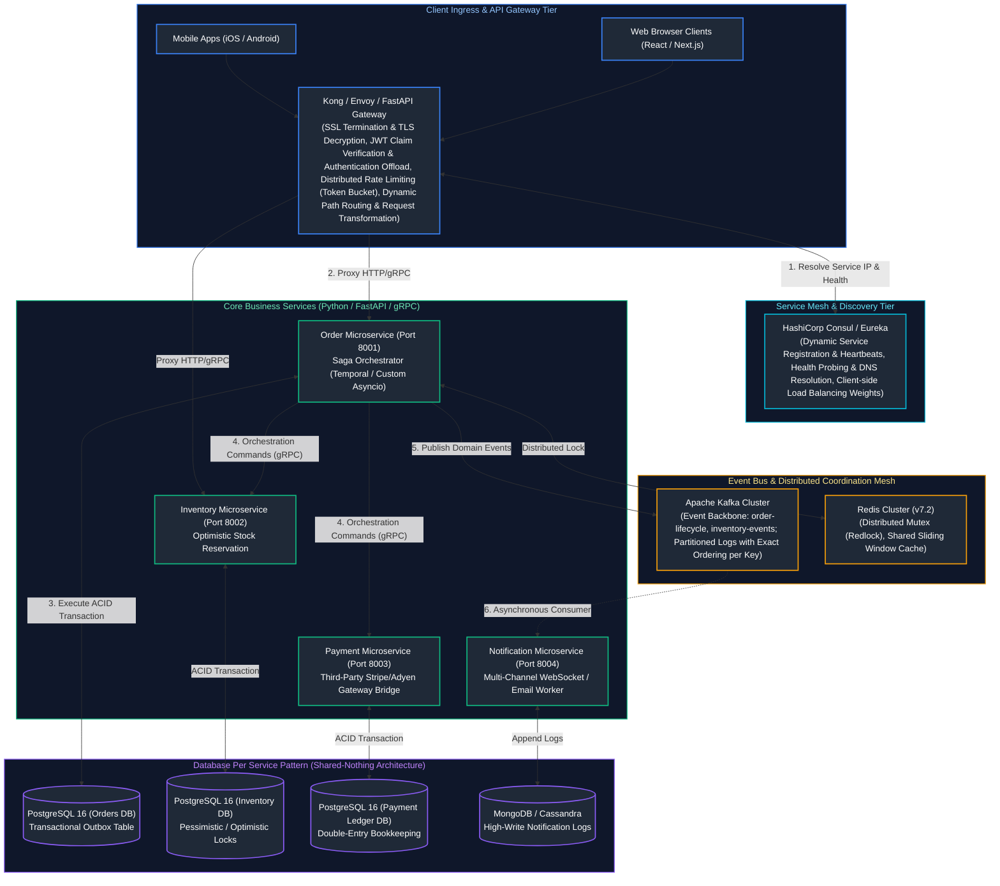
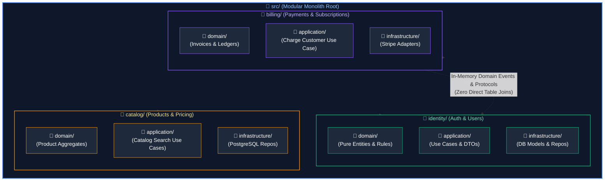
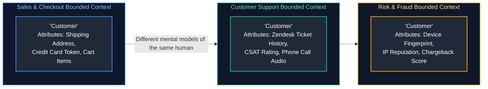
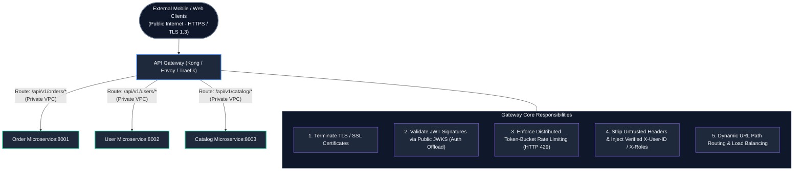
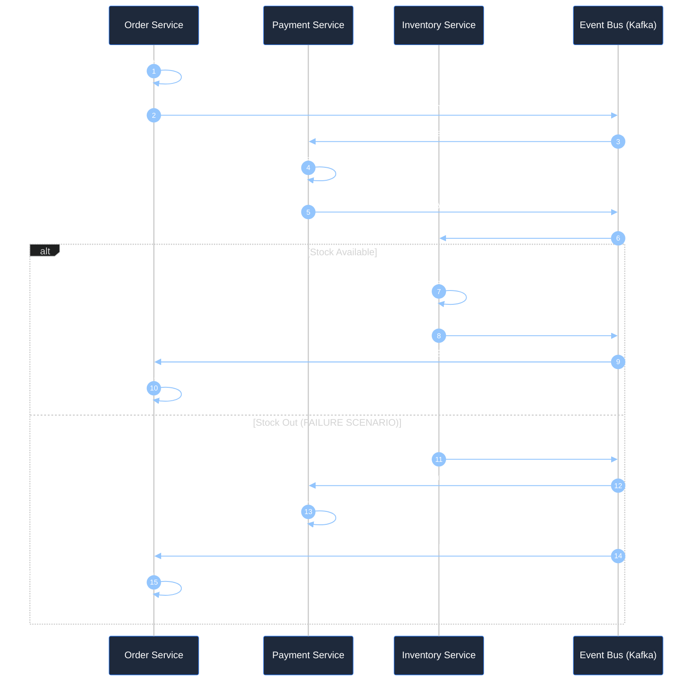
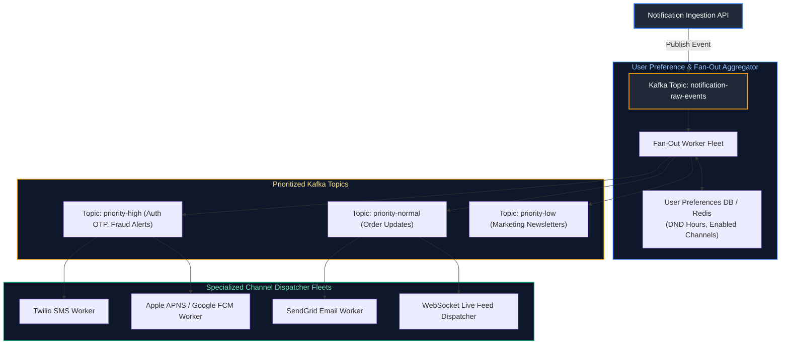

# 09. Microservices, Distributed Systems & System Design: Master Guide

A comprehensive, production-grade guide to microservices architecture in Python, modular monoliths vs. distributed services, Conway's Law, Domain-Driven Design (DDD) Bounded Contexts, service discovery, API Gateways, distributed data consistency (CAP and PACELC theorems), the Saga Pattern (Choreography vs. Orchestration) with compensating transactions, and four complete high-scale system design blueprints (URL Shortener, Distributed Rate Limiter, Real-Time Notification System, and E-Commerce Distributed Checkout) for Senior Backend Engineers and Principal Systems Architects.

---

## Architectural Overview: Distributed Microservices Fabric & Saga Orchestration



---

## Table of Contents
1. [Decomposition Paradigms: Monolith vs. Modular Monolith vs. Microservices](#1-decomposition-paradigms-monolith-vs-modular-monolith-vs-microservices)
   - [1.1 Conceptual Foundations: The Microservices Tax](#11-conceptual-foundations-the-microservices-tax)
   - [1.2 Conway's Law and Team Cognitive Load](#12-conways-law-and-team-cognitive-load)
   - [1.3 The Modular Monolith Alternative in Python](#13-the-modular-monolith-alternative-in-python)
   - [1.4 The Database-Per-Service Rule and Shared-Nothing Architecture](#14-the-database-per-service-rule-and-shared-nothing-architecture)
2. [Domain-Driven Design (DDD) for Distributed Boundaries](#2-domain-driven-design-ddd-for-distributed-boundaries)
   - [2.1 Bounded Contexts & Subdomain Classification](#21-bounded-contexts--subdomain-classification)
   - [2.2 Context Mapping Strategies: Shared Kernel, Customer/Supplier, Anti-Corruption Layer (ACL)](#22-context-mapping-strategies-shared-kernel-customersupplier-anti-corruption-layer-acl)
   - [2.3 Domain Event Contracts and Schema Evolution](#23-domain-event-contracts-and-schema-evolution)
3. [Service Discovery, Ingress & The API Gateway Pattern](#3-service-discovery-ingress--the-api-gateway-pattern)
   - [3.1 Client-Side vs. Server-Side Service Discovery (Consul, Eureka)](#31-client-side-vs-server-side-service-discovery-consul-eureka)
   - [3.2 API Gateway Responsibilities: SSL, Rate Limiting, Authentication Offloading](#32-api-gateway-responsibilities-ssl-rate-limiting-authentication-offloading)
   - [3.3 Backends-for-Frontends (BFF) Pattern](#33-backends-for-frontends-bff-pattern)
4. [Distributed Consistency: CAP & PACELC Theorems](#4-distributed-consistency-cap--pacelc-theorems)
   - [4.1 Deconstructing the CAP Theorem: Consistency, Availability, Partition Tolerance](#41-deconstructing-the-cap-theorem-consistency-availability-partition-tolerance)
   - [4.2 The PACELC Theorem: Latency vs. Consistency in Normal Operations](#42-the-pacelc-theorem-latency-vs-consistency-in-normal-operations)
   - [4.3 Strong Consistency vs. Eventual Consistency](#43-strong-consistency-vs-eventual-consistency)
5. [Distributed Transactions: The Saga Pattern](#5-distributed-transactions-the-saga-pattern)
   - [5.1 Why Two-Phase Commit (2PC / XA) Fails in Microservices](#51-why-two-phase-commit-2pc--xa-fails-in-microservices)
   - [5.2 Saga Choreography (Event-Driven Decentralization)](#52-saga-choreography-event-driven-decentralization)
   - [5.3 Saga Orchestration (Centralized State Machine)](#53-saga-orchestration-centralized-state-machine)
   - [5.4 Compensating Transactions & Semantic Rollbacks](#54-compensating-transactions--semantic-rollbacks)
   - [5.5 Production Python Implementation of a Saga Orchestrator](#55-production-python-implementation-of-a-saga-orchestrator)
6. [System Design Blueprint 1: Distributed URL Shortener (TinyURL)](#6-system-design-blueprint-1-distributed-url-shortener-tinyurl)
   - [6.1 Requirements, Back-of-the-Envelope Capacity Planning & Math](#61-requirements-back-of-the-envelope-capacity-planning--math)
   - [6.2 Base62 Encoding vs. MD5/Murmur3 Hash Truncation](#62-base62-encoding-vs-md5murmur3-hash-truncation)
   - [6.3 Key Generation Service (KGS) Pre-Allocation Architecture](#63-key-generation-service-kgs-pre-allocation-architecture)
   - [6.4 End-to-End Python Implementation with FastAPI and Redis](#64-end-to-end-python-implementation-with-fastapi-and-redis)
7. [System Design Blueprint 2: High-Throughput Distributed Rate Limiter](#12-system-design-blueprint-2-high-throughput-distributed-rate-limiter)
   - [12.1 Requirements & Mathematical Latency Budgets](#121-requirements--mathematical-latency-budgets)
   - [12.2 Token Bucket vs. Sliding Window Log vs. Sliding Window Counter](#122-token-bucket-vs-sliding-window-log-vs-sliding-window-counter)
   - [12.3 Atomic Lua Script Implementation in Distributed Redis Cluster](#123-atomic-lua-script-implementation-in-distributed-redis-cluster)
   - [12.4 Client Header Standards (X-RateLimit-Limit, Remaining, Reset)](#124-client-header-standards-x-ratelimit-limit-remaining-reset)
8. [System Design Blueprint 3: Real-Time Multi-Channel Notification Engine](#13-system-design-blueprint-3-real-time-multi-channel-notification-engine)
   - [13.1 Requirements, Fan-Out Topologies & Channel Dispatchers](#131-requirements-fan-out-topologies--channel-dispatchers)
   - [13.2 Priority Queuing, Backpressure & User Preference Aggregation](#132-priority-queuing-backpressure--user-preference-aggregation)
   - [13.3 End-to-End Python Implementation with Kafka and AsyncIO Workers](#133-end-to-end-python-implementation-with-kafka-and-asyncio-workers)
9. [System Design Blueprint 4: E-Commerce Distributed Checkout & Inventory Reservation](#14-system-design-blueprint-4-e-commerce-distributed-checkout--inventory-reservation)
   - [14.1 The Overselling Problem: Flash Sales & Hot Keys](#141-the-overselling-problem-flash-sales--hot-keys)
   - [14.2 Two-Phase Inventory Reservation with TTL Expiration](#142-two-phase-inventory-reservation-with-ttl-expiration)
   - [14.3 Complete End-to-End Orchestrated Checkout Saga Implementation](#143-complete-end-to-end-orchestrated-checkout-saga-implementation)
10. [Summary Comparison & Production Engineering Reference Matrix](#15-summary-comparison--production-engineering-reference-matrix)
11. [References & Further Reading](#16-references--further-reading)
---

# 1. Decomposition Paradigms: Monolith vs. Modular Monolith vs. Microservices

### 1.1 Conceptual Foundations: The Microservices Tax

#### Intuitive Analogy: The Single Workshop vs. The Global Assembly Line
* **The Monolith (The Artisan Workshop)**: Ten craftsmen work under one roof. When the carpenter finishes a wooden chair, he turns around and hands it directly to the painter. Communication is instant ($0\text{ ms}$ latency via memory pointers). If the roof leaks, everyone is affected, but there are zero shipping vans, no logistics managers, and no customs checkpoints.
* **Microservices (The Global Assembly Line)**: The carpenter is in Germany, the painter is in Vietnam, and the packaging team is in Mexico. Every handoff requires packaging the chair into a shipping crate (JSON serialization), driving it to the airport, clearing customs (network security, TLS handshakes, firewalls), and tracking package delivery (distributed tracing). If a shipping container gets lost at sea (network partition), the Mexican team halts indefinitely.

> [!WARNING]
> ### The Microservices Tax
> Moving to microservices introduces immense operational complexity:
> 1. **Network Latency & Failure**: Function calls that took $50\text{ nanoseconds}$ in memory now take $5\text{ to }25\text{ milliseconds}$ over TCP/IP sockets and can fail due to network blips.
> 2. **Distributed Data Inconsistency**: You lose ACID transactions across business boundaries. You cannot execute `BEGIN TRANSACTION ... COMMIT` across two separate microservices.
> 3. **Observability Nightmare**: Diagnosing a single failed user request requires correlating distributed logs across 15 different servers using trace IDs.
> **Rule of Thumb**: Do not adopt microservices to solve code quality issues. Adopt microservices only when **organizational scaling bottlenecks** (Conway's Law) prevent multiple teams from deploying independently!

---

### 1.2 Conway's Law and Team Cognitive Load

> **Conway's Law (1967)**:
> *"Organizations which design systems are constrained to produce designs which are copies of the communication structures of these organizations."*

When an engineering department grows beyond 50–100 engineers, a monolithic codebase becomes an organizational bottleneck:
* Merge conflicts escalate exponentially on shared repositories.
* A single failing test written by Team B blocks Team A from deploying to production.
* Deployments require massive cross-departmental coordination meetings.

Microservices solve this by establishing **autonomous two-pizza teams** (Amazon model: 5 to 8 engineers) owning a single service from design to deployment and on-call operations.

---

### 1.3 The Modular Monolith Alternative in Python

Before incurring the distributed systems tax of microservices, high-growth startups should default to a **Modular Monolith**:
* A single deployable codebase (`git` repository) and a single PostgreSQL database.
* Strict in-code boundaries enforced via Python packages and `import-linter`.
* Cross-module communication occurs via in-process domain events and public Protocol interfaces, **never** via direct cross-module database table joins!


*Benefit*: If a specific module (e.g., Video Transcoding or Machine Learning Inference) eventually outgrows the monolith, its strict boundary allows you to extract it into a standalone microservice in days rather than months!

---

### 1.4 The Database-Per-Service Rule and Shared-Nothing Architecture

> [!CAUTION]
> ### The Shared Database Anti-Pattern (The Distributed Monolith)
> If Service A and Service B connect directly to the exact same PostgreSQL database and read/write each other's tables, **you do not have microservices. You have a distributed monolith with all of the disadvantages of microservices and none of the benefits!**
> 
> If Team A alters a column in the `users` table, Service B immediately crashes in production.

#### The Golden Rule: Database-per-Service
Every microservice **must own its persistent storage exclusively**:
* No other service may connect to Service A's database.
* If Service B needs data owned by Service A, it **must request it through Service A's public API (REST/gRPC)** or consume domain events emitted by Service A over Kafka!

---

# 2. Domain-Driven Design (DDD) for Distributed Boundaries

### 2.1 Bounded Contexts & Subdomain Classification

Domain-Driven Design (Eric Evans) dictates how complex business domains are sliced into microservice boundaries.
A **Bounded Context** is an explicit boundary within which a domain model applies uniquely:



*Crucial Insight*: Attempting to create a single "Universal Customer Model" with 150 database columns shared across the entire enterprise is an anti-pattern. Each Bounded Context defines its own lean, purpose-built entity model.

---

### 2.2 Context Mapping Strategies: Shared Kernel, Customer/Supplier, Anti-Corruption Layer (ACL)

When two independent Bounded Contexts must communicate:
1. **Shared Kernel**: A small shared library (e.g. `company-common-types`) containing immutable value objects (like `Money`, `Currency`, `UserID`). Must be kept tiny to avoid tight coupling.
2. **Customer / Supplier (Upstream / Downstream)**: The upstream service (Supplier) dictates release schedules, but provides a formal contract SLA to the downstream service (Customer).
3. **Anti-Corruption Layer (ACL)**: When integrating your clean modern microservice with a legacy SOAP/XML mainframe or messy third-party API, implement an ACL adapter that translates legacy structures into your clean domain language, preventing legacy concepts from polluting your domain core!

---

### 2.3 Domain Event Contracts and Schema Evolution

When services communicate asynchronously via events, event schemas represent public APIs:
* **JSON Schema / Apache Avro / Protobuf**: Enforce strict schema validation.
* **Backward Compatibility**: Never delete a field or change a type. Only add optional fields. If breaking changes are mandatory, publish to a new topic (e.g., `orders.v2`).

```python
from pydantic import BaseModel, Field
from datetime import datetime, timezone
import uuid

class DomainEventEnvelope(BaseModel):
    event_id: uuid.UUID = Field(default_factory=uuid.uuid4)
    event_type: str
    aggregate_id: str
    occurred_at: datetime = Field(default_factory=lambda: datetime.now(timezone.utc))
    schema_version: int = 1
    payload: dict

# Concrete Domain Event
class OrderPlacedEvent(BaseModel):
    order_id: str
    customer_id: str
    total_amount_cents: int
    currency: str
```

---

# 3. Service Discovery, Ingress & The API Gateway Pattern

### 3.1 Client-Side vs. Server-Side Service Discovery (Consul, Eureka)

In containerized environments (Kubernetes, AWS ECS), service instances are ephemeral: IP addresses change continuously as pods autoscale, crash, and restart.

#### 1. Client-Side Service Discovery:
The client application queries a service registry (e.g., HashiCorp Consul) to obtain a list of healthy IP addresses, and the client executes its own load-balancing algorithm (e.g., round-robin or least connections).
* *Advantage*: Eliminates intermediate network hops.
* *Drawback*: Requires language-specific client libraries.

#### 2. Server-Side Service Discovery (Standard Kubernetes DNS):
The client calls a stable virtual hostname (`http://order-service.default.svc.cluster.local`). The DNS resolves to a stable ClusterIP, and the Linux kernel (via `kube-proxy` iptables / IPVS) routes the packet to a healthy pod.

---

### 3.2 API Gateway Responsibilities: SSL, Rate Limiting, Authentication Offloading

The **API Gateway** acts as the single point of entry for all external client traffic:



| Gateway Responsibility | Description & Mechanism | Downstream Benefit |
| :--- | :--- | :--- |
| **TLS / SSL Termination** | Offloads RSA / ECDSA cryptographic decryption at ingress | Internal microservices run lightweight unencrypted HTTP/2 or gRPC |
| **Authentication Offloading** | Validates JWT signatures against IdP JWKS public keys; rejects invalid tokens | Prevents unauthenticated requests from consuming backend microservice CPU |
| **Distributed Rate Limiting** | Evaluates token-bucket / leaky-bucket algorithm via Redis cluster | Prevents DoS attacks and runaway client scripts from overloading backend |
| **Context Header Injection** | Strips incoming `X-User-*` spoofing attempts; injects verified claims | Downstream services consume authenticated user identity without re-parsing JWTs |

---

### 3.3 Backends-for-Frontends (BFF) Pattern

Different client form factors require drastically different API responses:
* **Mobile iOS App**: Operating on cellular networks; requires a tiny, stripped JSON payload with aggregated data to minimize battery drain and round-trip requests.
* **Desktop Web App**: High-bandwidth fiber connection; displays complex dashboards with rich table structures.
* **Third-Party B2B API**: Requires strict versioning and granular pagination.

The **BFF Pattern** deploys distinct, lightweight API gateways tailored specifically to each frontend:
`mobile-bff`, `web-bff`, and `partner-bff`.

---

# 4. Distributed Consistency: CAP & PACELC Theorems

### 4.1 Deconstructing the CAP Theorem: Consistency, Availability, Partition Tolerance

Formulated by Eric Brewer in 2000, the **CAP Theorem** states that a distributed data store can guarantee at most **two out of three** properties simultaneously:

1. **Consistency (Linearizability)**: Every read receives the most recent write or an error. All nodes see the exact same data at the exact same instant.
2. **Availability**: Every non-failing node returns a non-error response for every request (without guarantee that it contains the most recent write).
3. **Partition Tolerance**: The system continues to operate despite an arbitrary number of messages being dropped or delayed by the network between nodes.

```mermaid
flowchart TD
    Client["Client Write Request: write(key='balance', val=100)"]

    subgraph DC_East ["Datacenter East (Majority Partition)"]
        Node1["Node A (Primary / Leader)<br/>New State: val=100"]
    end

    PartitionBarrier["⚡ Physical Network Partition Barrier (Inter-DC Link Cut) ⚡"]

    subgraph DC_West ["Datacenter West (Minority Partition)"]
        Node2["Node B (Replica)<br/>Old State: val=50 (Stale)"]
    end

    Client -->|"Write Request"| Node1
    Node1 -.x|"Replication Blocked by Partition"| PartitionBarrier
    PartitionBarrier -.x|"Cannot Reach Replica"| Node2

    subgraph ArchitecturalTriage ["Distributed CAP Resolution Strategy"]
        direction LR
        CP_Path["CP Mode (Consistency Priority):<br/>Node A Rejects Write or Times Out (HTTP 503)<br/>Guarantees Zero Split-Brain Inconsistency"]
        AP_Path["AP Mode (Availability Priority):<br/>Node A Accepts Write Locally (HTTP 200)<br/>Risk of Divergence; Resolved Later via LWW/CRDTs"]
    end

    Node1 -->|"If Configured as CP"| CP_Path
    Node1 -->|"If Configured as AP"| AP_Path

    style DC_East fill:#0f172a,stroke:#3b82f6,stroke-width:1.5px,color:#93c5fd
    style DC_West fill:#0f172a,stroke:#3b82f6,stroke-width:1.5px,color:#93c5fd
    style PartitionBarrier fill:#7f1d1d,stroke:#ef4444,stroke-width:2px,color:#fecaca
    style ArchitecturalTriage fill:#1e293b,stroke:#8b5cf6,stroke-width:1.5px,color:#c4b5fd
    style Client fill:#1f2937,stroke:#3b82f6,stroke-width:2px,color:#fff
    style Node1 fill:#1f2937,stroke:#10b981,stroke-width:2px,color:#fff
    style Node2 fill:#1f2937,stroke:#ef4444,stroke-width:2px,color:#fff
    style CP_Path fill:#1f2937,stroke:#3b82f6,stroke-width:1.5px,color:#fff
    style AP_Path fill:#1f2937,stroke:#10b981,stroke-width:1.5px,color:#fff
```

#### Distributed CAP & PACELC Trade-Off Matrix

| System Class | PACELC Classification | Behavior During Network Partition ($P$) | Normal Operating Latency ($E$) | Canonical Distributed Systems | Production Workloads |
| :--- | :--- | :--- | :--- | :--- | :--- |
| **CP (Consistent)** | **PC/EC** | **Rejects writes or returns 503** if quorum cannot be acknowledged; guarantees zero data divergence. | High commit latency; requires synchronous consensus rounds across replicas before returning 200. | Google Cloud Spanner, CockroachDB, etcd, ZooKeeper, Raft. | Financial transaction ledgers, inventory reservation, distributed locks. |
| **AP (Available)** | **PA/EL** | **Accepts local writes and serves reads**; partitions diverge and accumulate state drift. | Extremely low latency ($< 5\text{ms}$); writes acknowledge to memory/commit log immediately. | Apache Cassandra, Amazon DynamoDB, Couchbase, ScyllaDB. | High-throughput IoT telemetry, user shopping carts, social feeds, metrics ingestion. |

> [!IMPORTANT]
> ### The Reality of CAP
> In real-world physical networks (AWS, GCP, on-premise data centers), **Network Partitions ($P$) are a physical inevitability** (routers fail, optic cables are cut, switches reboot).
> Therefore, you **cannot** choose "CA". You must choose how your system behaves when a partition ($P$) occurs:
> * **Choose CP**: Sacrifice availability. Return HTTP 500 errors to maintain absolute mathematical correctness (e.g., financial ledger balances).
> * **Choose AP**: Sacrifice consistency. Accept writes and serve stale reads, reconciling conflicts asynchronously via vector clocks or Last-Write-Wins (e.g., social media likes, shopping cart views).

---

### 4.2 The PACELC Theorem: Latency vs. Consistency in Normal Operations

The CAP theorem only describes behavior *during a network partition*. But what happens during the $99.99\%$ of the time when the network is healthy?
The **PACELC Theorem** (Daniel Abadi) extends CAP:

$$\mathbf{If\ Partition\ (P):}\ \text{Choose between Availability (A) and Consistency (C)}$$
$$\mathbf{Else\ (E):}\ \text{Choose between Latency (L) and Consistency (C)}$$

* **PC/EC (e.g., Spanner, Google Megastore)**: In a partition, guarantees Consistency; in normal operations, chooses Consistency over Latency (waits for synchronous cross-datacenter commits).
* **PA/EL (e.g., DynamoDB, Cassandra with Eventual Consistency)**: In a partition, chooses Availability; in normal operations, chooses ultra-low Latency (returns write response after local node writes, replicating to other nodes asynchronously).
---

### 4.3 Strong Consistency vs. Eventual Consistency

In distributed microservices architectures, data consistency models fall across a spectrum:

| Consistency Model | Write Behavior | Read Guarantee | Enterprise Trade-off | Typical Backends |
| :--- | :--- | :--- | :--- | :--- |
| **Linearizable / Strong Consistency** | Synchronous consensus across quorum ($W + R > N$) | Client always reads the most recent committed write | Highest write latency; degraded availability under partitions | PostgreSQL (Sync Replication), Google Cloud Spanner, etcd |
| **Sequential Consistency** | Operations take effect in some sequential order agreed by all nodes | Program order preserved; reads might lag real-time clock | Reduced latency vs. linearizability | Apache ZooKeeper |
| **Causal Consistency** | Causal dependencies preserved ($A \to B$) | Dependent reads always see antecedent writes | Concurrent independent writes may diverge temporarily | MongoDB (Causal Sessions) |
| **Eventual Consistency** | Asynchronous replication; local write acknowledgment | Reads may return stale data until replication converges | Ultra-low write latency ($<2\text{ms}$); maximum horizontal scale | Amazon DynamoDB, Apache Cassandra, Kafka consumers |

#### Production Guideline:
- Use **Strong Consistency** for financial ledgers, inventory deductions, and authentication credentials where stale reads cause business fraud or overselling.
- Use **Eventual Consistency** for metrics, user activity streams, notifications, search indexes, and cache invalidation where sub-second latency and uninterrupted availability outweigh instant synchronization.

---

# 5. Distributed Transactions: The Saga Pattern

### 5.1 Why Two-Phase Commit (2PC / XA) Fails in Microservices

Historically, distributed transactions relied on **Two-Phase Commit (2PC)**:
1. **Prepare Phase**: The coordinator asks all databases: "Can you commit?" All databases acquire exclusive row locks and write to transaction logs.
2. **Commit Phase**: If all agree, the coordinator issues "Commit".

#### Why 2PC is Banned in Cloud Microservices:
* **The Coordinator Single Point of Failure**: If the coordinator crashes between Phase 1 and Phase 2, all database rows across all microservices **remain permanently locked**, freezing database connections!
* **Devastating Latency**: The transaction speed is bound to the *slowest network round trip* across all services, cutting throughput to tens of requests per second.

---

### 5.2 Saga Choreography (Event-Driven Decentralization)

A **Saga** is a sequence of local transactions. Each local transaction updates the service's database and publishes an event. Subsequent services listen to the event and execute their local transaction.



* **Choreography Tradeoff**: Ideal for simple sagas (2 to 4 steps). In complex sagas (10+ steps), it creates "Spaghetti Event Architecture" where no single developer understands the global state machine flow.

---

### 5.3 Saga Orchestration (Centralized State Machine)

In **Saga Orchestration**, an explicit **Orchestrator Service** executes a central state machine, sending point-to-point commands to participant services and monitoring progress:

```mermaid
%%{init: {'theme': 'dark', 'themeVariables': { 'actorBkg': '#1e293b', 'actorBorder': '#3b82f6', 'actorTextColor': '#ffffff', 'signalColor': '#93c5fd', 'signalTextColor': '#ffffff', 'noteBkgColor': '#1e293b', 'noteBorderColor': '#f59e0b', 'noteTextColor': '#fde68a', 'activationBkgColor': '#3b82f6', 'sequenceNumberColor': '#ffffff' }}}%%
sequenceDiagram
    autonumber
    participant Orch as Order Saga Orchestrator
    participant Inv as Inventory Service
    participant Pay as Payment Service

    Orch->>Inv: 1. ReserveInventoryCommand (Items: [X, Y])
    Inv-->>Orch: Returns Success (Stock Reserved)
    
    Orch->>Pay: 2. ChargePaymentCommand (Amount: $120.00)
    Note over Pay: Payment Gateway declines card (Card Expired)
    Pay-->>Orch: Returns Failure (Card Expired Error)
    
    Note over Orch: Trigger Semantic Compensation Workflow!
    Orch->>Inv: 3. CancelInventoryReservationCommand (Compensating Step)
    Inv-->>Orch: Returns Success (Stock Restored to Pool)
    Note over Orch: Saga Aborted Cleanly; emits OrderFailedEvent
```

---

### 5.4 Compensating Transactions & Semantic Rollbacks

In ACID transactions, rolling back an aborted transaction discards changes automatically.
In a Saga, because earlier local transactions have **already committed to disk**, they cannot be "un-committed".
You must execute an explicit **Compensating Transaction**:
* Action: Charge Customer Card $\rightarrow$ Compensation: **Refund Customer Card**.
* Action: Deduct Warehouse Stock $\rightarrow$ Compensation: **Add Restock Batch**.
* Action: Send Order Confirmation Email $\rightarrow$ Compensation: **Send Cancellation / Apology Email**.

---

### 5.5 Production Python Implementation of a Saga Orchestrator

Here is a resilient, production-grade Saga Orchestrator implemented in Python using asynchronous steps and structured rollback semantics:

```python
import asyncio
from dataclasses import dataclass, field
from enum import Enum
from typing import Callable, Coroutine, Any
import logging

logger = logging.getLogger("saga.orchestrator")

class StepStatus(str, Enum):
    PENDING = "PENDING"
    SUCCEEDED = "SUCCEEDED"
    FAILED = "FAILED"
    COMPENSATED = "COMPENSATED"

@dataclass
class SagaStep:
    name: str
    action: Callable[[], Coroutine[Any, Any, Any]]
    compensate: Callable[[], Coroutine[Any, Any, Any]]
    status: StepStatus = StepStatus.PENDING

class SagaOrchestrator:
    def __init__(self, saga_name: str) -> None:
        self.saga_name = saga_name
        self.steps: list[SagaStep] = []

    def add_step(
        self,
        name: str,
        action: Callable[[], Coroutine[Any, Any, Any]],
        compensate: Callable[[], Coroutine[Any, Any, Any]],
    ) -> "SagaOrchestrator":
        self.steps.append(SagaStep(name=name, action=action, compensate=compensate))
        return self

    async def execute(self) -> bool:
        logger.info(f"--- Starting Saga: {self.saga_name} ---")
        executed_steps: list[SagaStep] = []

        for step in self.steps:
            try:
                logger.info(f"[Executing Step] {step.name}...")
                await step.action()
                step.status = StepStatus.SUCCEEDED
                executed_steps.append(step)
            except Exception as exc:
                logger.error(f"[Step Failed] {step.name} failed with error: {exc}! Initiating Rollback...")
                step.status = StepStatus.FAILED
                await self._rollback(executed_steps)
                return False

        logger.info(f"--- Saga {self.saga_name} COMPLETED SUCCESSFULLY ---")
        return True

    async def _rollback(self, executed_steps: list[SagaStep]) -> None:
        # Roll back executed steps in REVERSE chronological order
        for step in reversed(executed_steps):
            try:
                logger.warning(f"[Compensating Step] Rolling back {step.name}...")
                await step.compensate()
                step.status = StepStatus.COMPENSATED
            except Exception as comp_exc:
                # Critical production alert: Compensating transaction failure requires human intervention!
                logger.critical(
                    f"FATAL: Compensating step {step.name} failed: {comp_exc}! Human intervention required!"
                )

# ==================== PRODUCTION USAGE DEMO ====================

async def demo_checkout_saga():
    # Mock service actions
    async def reserve_inventory(): print("  -> Inventory reserved.")
    async def cancel_inventory(): print("  -> [Compensate] Inventory unreserved.")

    async def charge_payment(): 
        print("  -> Attempting credit card charge...")
        raise ValueError("Card declined: Insufficient funds!")
        
    async def refund_payment(): print("  -> [Compensate] Payment refunded.")

    saga = (
        SagaOrchestrator("OrderCheckoutSaga")
        .add_step("ReserveInventory", reserve_inventory, cancel_inventory)
        .add_step("ChargePayment", charge_payment, refund_payment)
    )

    success = await saga.execute()
    print(f"Saga overall outcome: {'SUCCESS' if success else 'ABORTED AND ROLLED BACK'}")

# asyncio.run(demo_checkout_saga())
```

---

# 6. System Design Blueprint 1: Distributed URL Shortener (TinyURL)

### 6.1 Requirements, Back-of-the-Envelope Capacity Planning & Math

#### Functional Requirements:
1. Given a long URL, generate a shorter, unique alias (e.g. `https://tiny.co/x7K9pQ`).
2. Accessing the short URL redirects the user via HTTP 301/302 to the original long URL.
3. High availability with sub-10ms redirection latency.

#### Back-of-the-Envelope Capacity Estimation:
* **Write Traffic**: 100 million new URLs generated per month.
  $$\text{Write QPS} = \frac{100,000,000}{30 \times 86400} \approx 40 \text{ writes/second}$$
* **Read Traffic**: 100:1 Read-to-Write ratio (10 billion redirects/month).
  $$\text{Read QPS} = 40 \times 100 \approx 4,000 \text{ reads/second (Peak: 8,000 QPS)}$$
* **Storage Estimation (5 Years)**:
  $$\text{Total URLs} = 100\text{M} \times 12 \text{ months} \times 5 \text{ years} = 6 \text{ Billion records}$$
  Average long URL size: $500\text{ bytes}$.
  $$\text{Total Disk Storage} = 6,000,000,000 \times 500\text{ bytes} \approx 3 \text{ Terabytes}$$
* **RAM Cache Estimation (80/20 Pareto Rule)**:
  Cache the top $20\%$ of daily read traffic:
  $$\text{Daily Reads} = \frac{10,000,000,000}{30} \approx 330\text{M requests/day}$$
  $$\text{Daily Volume} = 330\text{M} \times 500\text{ bytes} = 165 \text{ GB}$$
  $$\text{RAM Needed (20\%)} = 165 \text{ GB} \times 0.20 \approx 33 \text{ GB of Redis RAM}$$

---

### 6.2 Base62 Encoding vs. MD5/Murmur3 Hash Truncation

* **Character Space**: Base62 consists of `[0-9]`, `[a-z]`, and `[A-Z]` ($10 + 26 + 26 = 62$ characters).
* **Length Capacity**:
  - A 7-character Base62 string supports:
    $$62^7 = 3,521,614,606,208 \approx 3.5 \text{ Trillion unique URLs!}$$
  This comfortably covers our 6 billion URL requirement for decades.

#### Hash Truncation Pitfall:
Computing `MD5(long_url)` yields a 128-bit hash. Truncating the first 7 characters causes massive collision rates, requiring expensive retry loops against the database.
**Production Solution**: Generate a unique 64-bit auto-incrementing integer ID and encode that integer into **Base62**.

---

### 6.3 Key Generation Service (KGS) Pre-Allocation Architecture

To avoid a single database auto-increment counter becoming a write bottleneck, use a **Key Generation Service (KGS)** powered by Apache ZooKeeper or Redis:
* A centralized token server allocates non-overlapping integer ranges to API worker nodes:
  - Worker 1 is allocated range `1,000,000 to 1,999,999`.
  - Worker 2 is allocated range `2,000,000 to 2,999,999`.
* Each worker dispenses IDs locally from in-memory counters in nanoseconds with **zero database locking**!

```python
# Base62 Encoder Implementation
BASE62_ALPHABET = "0123456789abcdefghijklmnopqrstuvwxyzABCDEFGHIJKLMNOPQRSTUVWXYZ"

def encode_base62(num: int) -> str:
    """Encodes a positive integer into a Base62 string."""
    if num == 0:
        return BASE62_ALPHABET[0]
    digits = []
    base = len(BASE62_ALPHABET)
    while num > 0:
        num, rem = divmod(num, base)
        digits.append(BASE62_ALPHABET[rem])
    digits.reverse()
    return "".join(digits)

def decode_base62(s: str) -> int:
    """Decodes a Base62 string back into an integer."""
    base = len(BASE62_ALPHABET)
    num = 0
    for char in s:
        num = num * base + BASE62_ALPHABET.index(char)
    return num
```

---

### 6.4 End-to-End Python Implementation with FastAPI and Redis

```python
from fastapi import FastAPI, HTTPException, status
from fastapi.responses import RedirectResponse
from pydantic import BaseModel, HttpUrl
import redis.asyncio as aioredis

app = FastAPI(title="Distributed TinyURL Service")
redis = aioredis.from_url("redis://localhost:6379/0", decode_responses=True)

class ShortenRequest(BaseModel):
    long_url: HttpUrl

class ShortenResponse(BaseModel):
    short_url: str
    short_code: str

@app.post("/v1/urls", response_model=ShortenResponse, status_code=status.HTTP_201_CREATED)
async def create_short_url(payload: ShortenRequest):

# 7. Acquire unique global sequence ID from Redis atomic INCR

seq_id = await redis.incr("global_url_counter")

# 8. Convert integer to 7-character Base62 string

short_code = encode_base62(seq_id)

# 9. Store mapping in Redis cache & PostgreSQL

# URL cache with 30-day TTL
    await redis.set(f"url:{short_code}", str(payload.long_url), ex=30 * 86400)

    return ShortenResponse(
        short_url=f"https://tiny.co/{short_code}",
        short_code=short_code,
    )

@app.get("/{short_code}")
async def redirect_short_url(short_code: str):

# 10. Query Redis Cache (Sub-2ms response)

long_url = await redis.get(f"url:{short_code}")
    
    if not long_url:
        # Fallback: Query primary PostgreSQL database on cache miss...
        raise HTTPException(status_code=404, detail="Short URL not found")

# 11. Return HTTP 301 (Permanent Redirect - browsers cache redirect locally)

# or HTTP 302 (Temporary Redirect - allows server to track click analytics on every visit)
    return RedirectResponse(url=long_url, status_code=status.HTTP_302_FOUND)
```

---

# 12. System Design Blueprint 2: High-Throughput Distributed Rate Limiter

### 12.1 Requirements & Mathematical Latency Budgets

* **Throughput**: 100,000 incoming requests per second across 50 API nodes.
* **Latency Overhead**: Must add less than $2\text{ ms}$ of latency to the request path.
* **Accuracy**: Strictly enforce quota (e.g. 100 requests per 60 seconds per API key) without boundary race conditions.

---

### 12.2 Token Bucket vs. Sliding Window Log vs. Sliding Window Counter

* **Token Bucket**: Requires storing two fields: `tokens` and `last_updated_timestamp`. When requests arrive, tokens are replenished based on elapsed time. Highly efficient, but requires locks or Lua scripts to prevent lost increments under concurrency.
* **Sliding Window Counter**: Hybrid algorithm combining past window count and current window count:
  $$\text{Estimated Requests} = (\text{Previous Window Count} \times (1 - \text{Time Elapsed Pct})) + \text{Current Window Count}$$
  Consumes only **8 bytes of RAM per client**, providing $99.9\%$ accuracy without storing individual request timestamps!

---

### 12.3 Atomic Lua Script Implementation in Distributed Redis Cluster

```lua
-- Redis Sliding Window Counter Implementation (Atomic Lua)
local key = KEYS[1]
local current_time = tonumber(ARGV[1])
local limit = tonumber(ARGV[2])
local window = 60 -- 60-second window

local current_window_bucket = math.floor(current_time / window)
local prev_window_bucket = current_window_bucket - 1

local current_key = key .. ':' .. current_window_bucket
local prev_key = key .. ':' .. prev_window_bucket

local current_count = tonumber(redis.call('GET', current_key) or '0')
local prev_count = tonumber(redis.call('GET', prev_key) or '0')

local time_elapsed_in_current_window = current_time % window
local weight = (window - time_elapsed_in_current_window) / window
local estimated_count = math.floor(prev_count * weight + current_count)

if estimated_count < limit then
    redis.call('INCR', current_key)
    redis.call('EXPIRE', current_key, window * 2)
    return {1, limit - estimated_count - 1} -- Allowed, Remaining quota
else
    return {0, 0} -- Blocked (HTTP 429)
end
```

---

### 12.4 Client Header Standards (X-RateLimit-Limit, Remaining, Reset)

Standardized response headers must be returned on every request to prevent client confusion:
* `X-RateLimit-Limit`: Maximum quota allowed in the window (e.g., `100`).
* `X-RateLimit-Remaining`: Remaining quota available before blocking (e.g., `42`).
* `X-RateLimit-Reset`: Unix timestamp when the current window expires.
* `Retry-After`: Returned on HTTP 429 indicating seconds to wait before retrying.

---

# 13. System Design Blueprint 3: Real-Time Multi-Channel Notification Engine

### 13.1 Requirements, Fan-Out Topologies & Channel Dispatchers

* **Requirement**: Ingest 50,000 events/sec (e.g. "Order Shipped", "Breaking News") and deliver notifications across **Email (SendGrid)**, **SMS (Twilio)**, **Push (FCM/APNS)**, and **WebSockets**.
* **Fan-Out Dilemma**: A single influencer posting an update can trigger notifications to 10,000,000 followers.



---

### 13.2 Priority Queuing, Backpressure & User Preference Aggregation

1. **Strict Channel Segregation**: Never mix transactional OTP SMS messages with marketing emails in the same queue! A burst of marketing emails will delay two-factor authentication codes, resulting in failed logins.
2. **Do-Not-Disturb (DND) Filtering**: Check user timezone and DND preferences. If a non-urgent notification falls between 10 PM and 7 AM, schedule it into a delay queue.

---

### 13.3 End-to-End Python Implementation with Kafka and AsyncIO Workers

```python
import asyncio
import json
from aiokafka import AIOKafkaConsumer, AIOKafkaProducer

async def push_notification_dispatcher():
    consumer = AIOKafkaConsumer(
        "notification-push-high",
        bootstrap_servers="localhost:9092",
        group_id="apns_fcm_dispatch_fleet",
        enable_auto_commit=False,
    )
    await consumer.start()
    try:
        async for msg in consumer:
            payload = json.loads(msg.value.decode("utf-8"))
            user_device_token = payload["device_token"]
            alert_text = payload["message"]

            # Dispatch to Apple APNS / Google FCM using HTTP/2 client
            print(f"[FCM Push] Delivering alert to device {user_device_token[:8]}...: {alert_text}")
            
            # Commit offset only after successful gateway response
            await consumer.commit()
    finally:
        await consumer.stop()
```

---

# 14. System Design Blueprint 4: E-Commerce Distributed Checkout & Inventory Reservation

### 14.1 The Overselling Problem: Flash Sales & Hot Keys

During a flash sale (e.g. 500 units of a limited-edition sneaker with 200,000 customers clicking "Buy Now" at 10:00 AM):
* Standard SQL `SELECT stock FROM inventory WHERE id = 1` followed by `UPDATE inventory SET stock = stock - 1` results in **severe overselling** (selling 1,500 units when only 500 exist!).
* Using `SELECT ... FOR UPDATE` causes catastrophic row-level lock contention on PostgreSQL, degrading throughput to zero.

---

### 14.2 Two-Phase Inventory Reservation with TTL Expiration

**Production Solution**: Move hot inventory counters to **Redis memory with Lua script decrement and atomic expiration**:

```lua
-- Redis Atomic Inventory Reservation Script
local stock_key = KEYS[1]
local reservation_set = KEYS[2]
local user_id = ARGV[1]
local quantity = tonumber(ARGV[2])

local current_stock = tonumber(redis.call('GET', stock_key) or '0')

if current_stock >= quantity then
    -- 1. Deduct stock atomically
    redis.call('DECRBY', stock_key, quantity)
    -- 2. Record reservation with 15-minute expiration
    redis.call('HSET', reservation_set, user_id, quantity)
    return 1 -- Reservation SUCCESS
else
    return 0 -- Sold out!
end
```

---

### 14.3 Complete End-to-End Orchestrated Checkout Saga Implementation

```python
import asyncio
from dataclasses import dataclass
import uuid

@dataclass
class CheckoutContext:
    order_id: str
    user_id: str
    item_id: str
    quantity: int
    amount_cents: int
    inventory_reserved: bool = False
    payment_processed: bool = False

class CheckoutSagaEngine:
    def __init__(self, context: CheckoutContext):
        self.ctx = context

    async def step_1_reserve_inventory(self) -> bool:
        print(f"[Inventory] Reserving {self.ctx.quantity} units of {self.ctx.item_id} in Redis...")
        await asyncio.sleep(0.05)
        self.ctx.inventory_reserved = True
        return True

    async def compensate_1_release_inventory(self):
        print(f"[Compensate] Restoring {self.ctx.quantity} units of {self.ctx.item_id} to Redis stock...")
        await asyncio.sleep(0.05)
        self.ctx.inventory_reserved = False

    async def step_2_charge_payment(self) -> bool:
        print(f"[Payment] Charging ${self.ctx.amount_cents / 100:.2f} via Stripe...")
        await asyncio.sleep(0.1)
        # Simulate failure condition (e.g. card declined)
        # raise RuntimeError("Stripe error: Card declined")
        self.ctx.payment_processed = True
        return True

    async def compensate_2_refund_payment(self):
        print(f"[Compensate] Refunding ${self.ctx.amount_cents / 100:.2f} via Stripe API...")
        await asyncio.sleep(0.05)

    async def execute_checkout(self) -> bool:
        # Step 1: Inventory
        if not await self.step_1_reserve_inventory():
            return False

        # Step 2: Payment
        try:
            await self.step_2_charge_payment()
        except Exception as exc:
            print(f"[Checkout Failed]: {exc}. Commencing compensation rollbacks!")
            # Trigger compensating transaction
            await self.compensate_1_release_inventory()
            return False

        print(f"Order #{self.ctx.order_id} successfully confirmed and paid!")
        return True
```

---

# 15. Summary Comparison & Production Engineering Reference Matrix

| Architectural Pattern | Primary Purpose | Consistency Model | Recovery / Resilience Mechanism |
| :--- | :--- | :--- | :--- |
| **Modular Monolith** | Fast development, zero network overhead | **ACID (Strong Consistency)** | Single DB rollback |
| **Microservices** | Independent team velocity, autonomous deploys | **Eventual Consistency** | Distributed tracing, circuit breakers |
| **API Gateway** | Traffic ingress, rate limits, auth offload | Stateless | Multi-region active-passive failover |
| **Saga Choreography** | Decentralized event-driven multi-service flows | Eventual Consistency | Reverse compensating event fanout |
| **Saga Orchestration** | Central state-machine coordinator for workflows | Eventual Consistency | Explicit step-by-step compensating calls |
| **KGS (URL Shortener)** | Non-blocking unique ID generation | Strong within range | Pre-allocated distributed integer blocks |
| **Sliding Window Rate Limiter** | Traffic protection against spikes/DoS | Strong in Redis | Atomic Lua scripts in Redis cluster |
| **Transactional Outbox** | Safe dual-write between DB and Kafka | At-least-once delivery | Background relay with `SKIP LOCKED` |

---

# 16. References & Further Reading

1. **Designing Data-Intensive Applications** (Martin Kleppmann): The gold standard for distributed systems foundations.
2. **Building Microservices: Designing Fine-Grained Systems** (Sam Newman): [https://samnewman.io/books/building_microservices_2nd_edition/](https://samnewman.io/books/building_microservices_2nd_edition/)
3. **Microservice Patterns** (Chris Richardson): [https://microservices.io/](https://microservices.io/)
4. **The CAP Theorem** (Seth Gilbert and Nancy Lynch, MIT): [https://groups.csail.mit.edu/tds/papers/Lynch/sigact-podc-column-2002.pdf](https://groups.csail.mit.edu/tds/papers/Lynch/sigact-podc-column-2002.pdf)
5. **Consistency Tradeoffs in Modern Distributed Database System Design (PACELC)** (Daniel Abadi): [https://www.cs.umd.edu/~abadi/papers/abadi-pacelc.pdf](https://www.cs.umd.edu/~abadi/papers/abadi-pacelc.pdf)
6. **Related Guides**:
   - See [08. APIs and Protocols: REST, gRPC, and WebSockets](05_web_frameworks_and_api_protocols.md) for gRPC microservices and circuit breakers.
   - See [12. Caching, Redis, and Event-Driven Messaging](08_caching_redis_and_kafka.md) for Kafka partitioning and Celery workflows.
   - See [14. Testing, Observability, and Performance Engineering](10_testing_docker_and_devops.md) for OpenTelemetry distributed tracing across microservices.