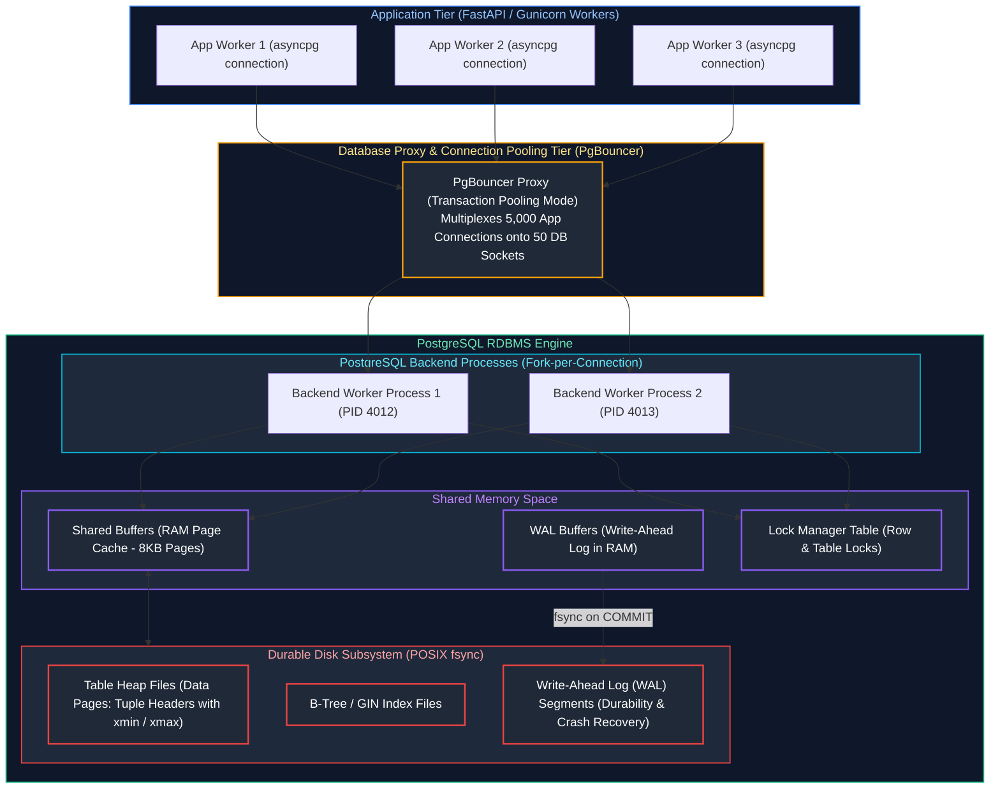
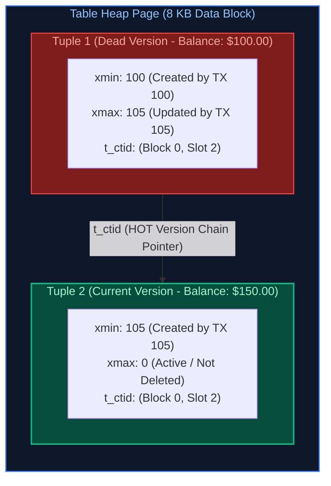
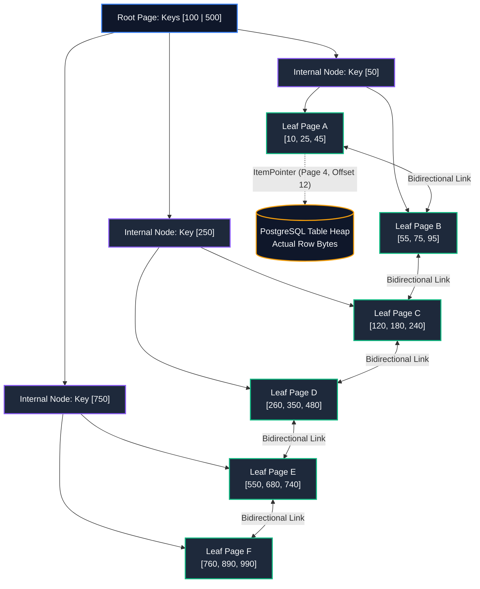
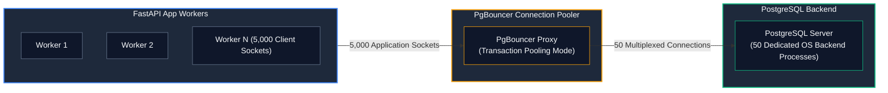

# 09. Relational Databases and SQL

A comprehensive, production-grade guide to relational database engineering, ACID transactional guarantees, MVCC internals, advanced SQL querying (CTEs, recursive queries), analytical window functions, transaction isolation levels, concurrency anomalies (Dirty Reads, Non-repeatable Reads, Phantom Reads, Write Skew), B-Tree/GIN/BRIN indexing internals, `EXPLAIN ANALYZE` query optimization, schema normalization vs. denormalization, and PgBouncer connection pooling for Senior Backend Engineers and Database Architects.

---

## Architectural Overview: PostgreSQL Storage Engine, MVCC & Connection Pooling



---

## Table of Contents
1. [Relational Database Foundations & ACID Guarantees](#1-relational-database-foundations--acid-guarantees)
   - [1.1 Relational Algebra & The Mathematical Foundation](#11-relational-algebra--the-mathematical-foundation)
   - [1.2 Atomicity & Durability: Write-Ahead Logging (WAL) and Checkpointing](#12-atomicity--durability-write-ahead-logging-wal-and-checkpointing)
   - [1.3 Consistency: Declarative Invariants, Foreign Keys & Constraints](#13-consistency-declarative-invariants-foreign-keys--constraints)
   - [1.4 Isolation & MVCC Internals: `xmin`, `xmax`, and Tuple Visibility](#14-isolation--mvcc-internals-xmin-xmax-and-tuple-visibility)
2. [Advanced SQL Query Engineering & CTEs](#2-advanced-sql-query-engineering--ctes)
   - [2.1 Join Algorithms: Nested Loop, Hash Join, and Merge Join](#21-join-algorithms-nested-loop-hash-join-and-merge-join)
   - [2.2 Common Table Expressions (CTEs): Materialized vs. Inlined](#22-common-table-expressions-ctes-materialized-vs-inlined)
   - [2.3 Recursive CTEs for Hierarchical Graphs and Trees](#23-recursive-ctes-for-hierarchical-graphs-and-trees)
   - [2.4 Analytical Aggregations: `GROUPING SETS`, `ROLLUP`, and `CUBE`](#24-analytical-aggregations-grouping-sets-rollup-and-cube)
3. [Analytical Window Functions](#3-analytical-window-functions)
   - [3.1 The Windowing Syntax: `OVER (PARTITION BY ... ORDER BY ... ROWS BETWEEN ...)`](#31-the-windowing-syntax-over-partition-by--order-by--rows-between)
   - [3.2 Ranking Functions: `ROW_NUMBER()`, `RANK()`, `DENSE_RANK()`, and `NTILE()`](#32-ranking-functions-row_number-rank-dense_rank-and-ntile)
   - [3.3 Navigation & Offset Functions: `LAG()`, `LEAD()`, and `FIRST_VALUE()`](#33-navigation--offset-functions-lag-lead-and-first_value)
   - [3.4 Real-World Analytical Pipelines: Running Totals and Month-over-Month Growth](#34-real-world-analytical-pipelines-running-totals-and-month-over-month-growth)
4. [Transaction Isolation Levels & Concurrency Anomalies](#4-transaction-isolation-levels--concurrency-anomalies)
   - [4.1 ANSI SQL-92 Isolation Levels vs. Modern Reality](#41-ansi-sql-92-isolation-levels-vs-modern-reality)
   - [4.2 Concurrency Anomalies: Dirty Reads, Non-repeatable Reads, and Phantom Reads](#42-concurrency-anomalies-dirty-reads-non-repeatable-reads-and-phantom-reads)
   - [4.3 The Serialization Anomaly: Write Skew and Serializable Snapshot Isolation (SSI)](#43-the-serialization-anomaly-write-skew-and-serializable-snapshot-isolation-ssi)
5. [Database Storage Engine & Indexing Internals](#5-database-storage-engine--indexing-internals)
   - [5.1 B-Tree Index Architecture: Balanced Multi-Way Trees and Leaf Pages](#51-b-tree-index-architecture-balanced-multi-way-trees-and-leaf-pages)
   - [5.2 Specialized Index Types: Hash, GIN (JSONB), GiST, and BRIN (Time Series)](#52-specialized-index-types-hash-gin-jsonb-gist-and-brin-time-series)
   - [5.3 Composite Indexes & The Leftmost Prefix Rule](#53-composite-indexes--the-leftmost-prefix-rule)
   - [5.4 Covering Indexes (`INCLUDE`) and Index-Only Scans](#54-covering-indexes-include-and-index-only-scans)
6. [Query Execution Plan Mastery (`EXPLAIN ANALYZE`)](#6-query-execution-plan-mastery-explain-analyze)
   - [6.1 Deconstructing Scan Types: Seq Scan, Index Scan, Bitmap Scan](#61-deconstructing-scan-types-seq-scan-index-scan-bitmap-scan)
   - [6.2 Analyzing Costs, Buffer Hits, and Memory Spills (`work_mem`)](#62-analyzing-costs-buffer-hits-and-memory-spills-work_mem)
   - [6.3 Remediation Checklist for Slow Queries](#63-remediation-checklist-for-slow-queries)
7. [Schema Normalization vs. Practical Denormalization](#7-schema-normalization-vs-practical-denormalization)
   - [7.1 Normal Forms (1NF, 2NF, 3NF, BCNF) and Functional Dependencies](#71-normal-forms-1nf-2nf-3nf-bcnf-and-functional-dependencies)
   - [7.2 Strategic Denormalization: JSONB Columns & Materialized Views](#72-strategic-denormalization-jsonb-columns--materialized-views)
8. [Database Connection Pooling & PgBouncer](#8-database-connection-pooling--pgbouncer)
   - [8.1 Why Direct PostgreSQL Connections Exhaust Server Memory](#81-why-direct-postgresql-connections-exhaust-server-memory)
   - [8.2 PgBouncer Pooling Modes: Session vs. Transaction vs. Statement](#82-pgbouncer-pooling-modes-session-vs-transaction-vs-statement)
   - [8.3 Transaction Pooling Hazards: Prepared Statements & Session State](#83-transaction-pooling-hazards-prepared-statements--session-state)
9. [Summary Comparison & Engineering Reference Matrix](#9-summary-comparison--engineering-reference-matrix)
10. [References & Further Reading](#10-references--further-reading)

---

# 1. Relational Database Foundations & ACID Guarantees

> [!NOTE]
> **Domain Framing: Backend Relational Persistence vs. Data Engineering Analytics:**
> In backend engineering, relational databases serve as high-concurrency **OLTP (Online Transaction Processing)** systems. The focus is on row-level ACID guarantees, concurrency control (MVCC, pessimistic/optimistic locking), transaction isolation levels, connection pooling (PgBouncer, SQLAlchemy Engine), and sub-10ms point queries.
>
> For large-scale **OLAP (Online Analytical Processing)** architectures, petabyte-scale distributed joins (Broadcast Hash Join, Sort-Merge Join), dimensional star/snowflake schemas, and columnar execution plans, refer to the companion Data Engineering track:
> - [Data Engineering: 01. SQL Fundamentals](../Data%20Engineering/01_sql_fundamentals.md)
> - [Data Engineering: 02. Advanced SQL](../Data%20Engineering/02_advanced_sql.md)
> - [Data Engineering: 04. Database Internals & Performance](../Data%20Engineering/04_database_internals_and_performance.md)


### 1.1 Relational Algebra & The Mathematical Foundation

Invented by Edgar F. Codd in 1970, the relational model structures data into **Relations** (tables), which consist of **Tuples** (rows) and **Attributes** (columns). 
SQL is a declarative language based on **First-Order Predicate Logic**: you describe *what* data you need, and the database query planner determines *how* to retrieve it algorithmically.

---

### 1.2 Atomicity & Durability: Write-Ahead Logging (WAL) and Checkpointing

#### Intuitive Analogy: The Accountant's Journal Before the Ledger
Imagine an accountant handling transactions. If they modify accounts in the master ledger directly, and a fire starts halfway through, the ledger is permanently corrupted—money vanished from Account A but never reached Account B.
Instead, the accountant first jots down the planned change in an indestructible, fireproof **Write-Ahead Journal** (WAL). Only after the journal entry is safely stamped does the accountant modify the master ledger pages in memory. If a fire breaks out, they can simply replay the journal.

#### The Mechanics of Write-Ahead Logging (WAL):
In PostgreSQL:
1. **Never write dirty data directly to disk during transactions**: Modifying random pages in a multi-gigabyte table creates slow, random disk I/O.
2. **Sequential Append to WAL**: When an `INSERT`, `UPDATE`, or `DELETE` executes, changes are applied to 8KB pages in **Shared Buffers (RAM)**. Simultaneously, an append-only log record is written to the **WAL Buffers**.
3. **Commit Durability (`fsync`)**: When a client issues `COMMIT`, PostgreSQL executes an OS `fsync()` on the WAL buffer, flushing log records to physical storage. Once the WAL entry is durable on disk, the commit is acknowledged to the client!
4. **Checkpointing**: In the background, the Checkpointer process periodically flushes dirty 8KB memory pages from Shared Buffers to table heap files on disk, ensuring the WAL log does not grow infinitely.

---

### 1.3 Consistency: Declarative Invariants, Foreign Keys & Constraints

Consistency in ACID guarantees that a transaction can only transition the database from one valid state to another, maintaining all declared invariants:
* **`PRIMARY KEY` / `UNIQUE`**: Enforced via unique B-Tree index scans.
* **`FOREIGN KEY` (Referential Integrity)**: Enforces that child records point to existing parents. Always add explicit indexes to foreign key columns to prevent full-table locks during parent deletions (`ON DELETE CASCADE`)!
* **`CHECK` Constraints**: Enforces business validation at the storage layer (e.g., `CHECK (balance >= 0.00)`).
* **Deferred Constraints**: `DEFERRABLE INITIALLY DEFERRED` allows constraints to be validated at the end of the transaction (`COMMIT`), enabling circular references or temporary intermediate invalid states during complex batch operations.

---

### 1.4 Isolation & MVCC Internals: `xmin`, `xmax`, and Tuple Visibility

PostgreSQL uses **Multi-Version Concurrency Control (MVCC)** to ensure that **readers never block writers, and writers never block readers**.

#### How MVCC Works Under the Hood:
When you update a row in PostgreSQL, the database **does not overwrite the existing data**. It creates a brand-new copy (tuple) of the row!
Every table row on disk contains hidden 4-byte header fields:
* **`xmin`**: The 32-bit transaction ID (XID) that inserted/created this row version.
* **`xmax`**: The transaction ID that updated or deleted this row version (0 if currently alive).



| Header Field | Type | Description | Visibility Rule |
| :--- | :--- | :--- | :--- |
| **`xmin`** | 32-bit Integer (`TransactionId`) | Transaction ID that created / inserted this row version | Visible only to transactions whose snapshot shows `xmin` committed before snapshot creation |
| **`xmax`** | 32-bit Integer (`TransactionId`) | Transaction ID that updated or deleted this row version ($0$ if active) | Visible only if `xmax == 0` or if `xmax` has not yet committed in current snapshot |

When Transaction 105 updates Balance from \$100 to \$150:
1. It writes `xmax = 105` onto Tuple 1.
2. It inserts Tuple 2 with `xmin = 105` and `xmax = 0`.
3. Concurrent Transaction 104 reading the table sees `xmin <= 104` and `xmax > 104`, so it continues reading Tuple 1 (\$100.00) without locking or waiting!

#### The Need for `VACUUM`:
Because dead tuples accumulate on disk (table bloat), PostgreSQL runs **`autovacuum`** in the background to reclaim dead tuple slots for reuse and prevent **Transaction ID Wraparound** (when the 32-bit XID counter reaches $2^{31}-1$).

---

# 2. Advanced SQL Query Engineering & CTEs

### 2.1 Join Algorithms: Nested Loop, Hash Join, and Merge Join

The PostgreSQL cost-based optimizer selects between three fundamental join algorithms based on table statistics:

| Join Algorithm | Mechanism | Optimal Use Case | Disk Spill Hazard |
| :--- | :--- | :--- | :--- |
| **Nested Loop Join** | For each row in outer table, scan inner table (often using an index). | Tiny outer table + indexed inner table (e.g. 1 user joining 5 orders). | None |
| **Hash Join** | Reads entire inner table into an in-memory hash table, then streams outer table probing hashes. | Joining medium/large unsorted tables on equality (`=`). | Spills to temporary disk files if hash table exceeds `work_mem`! |
| **Merge Join** | Both tables must be sorted on join keys. Simultaneously walks both sorted lists like a zipper. | Very large tables where both inputs are already sorted by B-Tree indexes. | Minimal |

---

### 2.2 Common Table Expressions (CTEs): Materialized vs. Inlined

CTEs (`WITH` queries) break complex queries into readable, modular logical blocks:

```sql
WITH customer_order_aggregates AS (
    -- Pre-calculate order metrics per customer
    SELECT
        customer_id,
        COUNT(id) AS total_orders,
        SUM(total_amount) AS lifetime_value
    FROM orders
    WHERE status = 'COMPLETED'
    GROUP BY customer_id
)
SELECT
    c.id,
    c.email,
    COALESCE(coa.lifetime_value, 0.00) AS total_spend
FROM customers c
LEFT JOIN customer_order_aggregates coa ON c.id = coa.customer_id
WHERE c.is_active = TRUE;
```

> [!NOTE]
> **PostgreSQL 12+ Inlining Optimization**:
> Prior to PostgreSQL 12, CTEs acted as optimization fences (always materialized into temporary memory buffers). In modern PostgreSQL, CTEs without side effects are **automatically inlined** into the outer query by default, allowing the optimizer to push down `WHERE` clauses into the CTE! You can explicitly force materialization using `WITH coa AS MATERIALIZED (...)`.

---

### 2.3 Recursive CTEs for Hierarchical Graphs and Trees

When modeling organizational hierarchies, category taxonomies, or graph bill-of-materials, standard joins cannot handle arbitrary depth. **Recursive CTEs** execute iterative traversals:

```sql
-- Recursive query to traverse an organizational management hierarchy
WITH RECURSIVE org_chart AS (
    -- 1. Anchor Member: Select top-level executive (root node)
    SELECT
        id,
        name,
        manager_id,
        1 AS depth,
        ARRAY[id] AS lineage_path
    FROM employees
    WHERE manager_id IS NULL

    UNION ALL

    -- 2. Recursive Member: Join employees to their managers in org_chart
    SELECT
        e.id,
        e.name,
        e.manager_id,
        oc.depth + 1,
        oc.lineage_path || e.id
    FROM employees e
    INNER JOIN org_chart oc ON e.manager_id = oc.id
    WHERE NOT (e.id = ANY(oc.lineage_path)) -- Cycle prevention guard!
)
SELECT
    depth,
    REPEAT('  ', depth - 1) || name AS organizational_hierarchy,
    lineage_path
FROM org_chart
ORDER BY lineage_path;
```

---

### 2.4 Analytical Aggregations: `GROUPING SETS`, `ROLLUP`, and `CUBE`

Instead of running 4 separate queries with `UNION ALL` to compute multi-level sub-totals and grand totals, use `ROLLUP`:

```sql
-- Generates regional subtotals, quarterly subtotals, and grand total in 1 pass!
SELECT
    region,
    EXTRACT(YEAR FROM created_at) AS order_year,
    SUM(total_amount) AS gross_sales
FROM orders
GROUP BY ROLLUP (region, EXTRACT(YEAR FROM created_at))
ORDER BY region NULLS LAST, order_year NULLS LAST;
```

---

# 3. Analytical Window Functions

### 3.1 The Windowing Syntax: `OVER (PARTITION BY ... ORDER BY ... ROWS BETWEEN ...)`

Unlike standard `GROUP BY` aggregations which collapse rows, **Window Functions perform calculations across a set of table rows while retaining the individual identity of each row**.

```sql
FUNCTION(...) OVER (
    PARTITION BY department_id                -- 1. Divides dataset into independent groups
    ORDER BY salary DESC                      -- 2. Establishes calculation order inside group
    ROWS BETWEEN 2 PRECEDING AND CURRENT ROW  -- 3. Defines explicit sliding evaluation frame
)
```

| Window Clause | Architectural Role | Execution Semantics |
| :--- | :--- | :--- |
| **`FUNCTION(...)`** | Value Calculator | Ranking (`ROW_NUMBER`, `DENSE_RANK`), Navigation (`LAG`, `LEAD`), or Aggregate (`SUM`, `AVG`) |
| **`OVER (...)`** | Window Scope Marker | Instructs PostgreSQL planner to compute over window partitions without collapsing result rows |
| **`PARTITION BY`** | Data Slicer | Segregates the result set into distinct partitions; calculation resets on each partition boundary |
| **`ORDER BY`** | Partition Sorter | Defines monotonic sequence for window evaluation within each partition |
| **`ROWS / RANGE BETWEEN`** | Sliding Frame Bounding | Sets the physical (`ROWS`) or logical (`RANGE`) boundary of rows included relative to current row |

---

### 3.2 Ranking Functions: `ROW_NUMBER()`, `RANK()`, `DENSE_RANK()`, and `NTILE()`

```sql
SELECT
    employee_id,
    department_id,
    salary,
    -- Unique sequential integer (1, 2, 3, 4) - ties resolved arbitrarily
    ROW_NUMBER() OVER (PARTITION BY department_id ORDER BY salary DESC) AS row_num,
    -- Ties get same rank; skips ranks (1, 2, 2, 4)
    RANK() OVER (PARTITION BY department_id ORDER BY salary DESC) AS standard_rank,
    -- Ties get same rank; never skips ranks (1, 2, 2, 3)
    DENSE_RANK() OVER (PARTITION BY department_id ORDER BY salary DESC) AS dense_rank,
    -- Divides department into 4 equal quartiles (1, 2, 3, 4)
    NTILE(4) OVER (PARTITION BY department_id ORDER BY salary DESC) AS salary_quartile
FROM employees;
```

#### Production Use Case: Selecting Top-N Records Per Group
```sql
-- Retrieve the top 3 most expensive orders for every customer
WITH ranked_orders AS (
    SELECT
        id,
        customer_id,
        total_amount,
        ROW_NUMBER() OVER (PARTITION BY customer_id ORDER BY total_amount DESC) AS rank
    FROM orders
)
SELECT customer_id, id AS order_id, total_amount
FROM ranked_orders
WHERE rank <= 3;
```

---

### 3.3 Navigation & Offset Functions: `LAG()`, `LEAD()`, and `FIRST_VALUE()`

* **`LAG(column, offset, default)`**: Accesses data from a preceding row in the window.
* **`LEAD(column, offset, default)`**: Accesses data from a subsequent row in the window.

```sql
SELECT
    date,
    daily_revenue,
    -- Fetch yesterday's revenue
    LAG(daily_revenue, 1) OVER (ORDER BY date) AS previous_day_revenue,
    -- Calculate Day-over-Day percentage change
    ROUND(
        (daily_revenue - LAG(daily_revenue, 1) OVER (ORDER BY date)) 
        / LAG(daily_revenue, 1) OVER (ORDER BY date) * 100, 2
    ) AS dod_growth_percentage
FROM daily_financials;
```

---

### 3.4 Real-World Analytical Pipelines: Running Totals and Month-over-Month Growth

```sql
SELECT
    customer_id,
    order_date,
    total_amount,
    -- Unbounded running cumulative total per customer
    SUM(total_amount) OVER (
        PARTITION BY customer_id
        ORDER BY order_date
        ROWS BETWEEN UNBOUNDED PRECEDING AND CURRENT ROW
    ) AS customer_lifetime_cumulative_spend,
    -- 7-Day Moving Average of order amount
    AVG(total_amount) OVER (
        PARTITION BY customer_id
        ORDER BY order_date
        ROWS BETWEEN 6 PRECEDING AND CURRENT ROW
    ) AS seven_day_moving_average
FROM orders;
```

---

# 4. Transaction Isolation Levels & Concurrency Anomalies

### 4.1 ANSI SQL-92 Isolation Levels vs. Modern Reality

When multiple concurrent database transactions execute simultaneously, isolation levels govern the degree to which transactions are protected from one another.

| Isolation Level | Dirty Read | Non-Repeatable Read | Phantom Read | Serialization Anomaly (Write Skew) |
| :--- | :---: | :---: | :---: | :---: |
| **Read Uncommitted** | Possible | Possible | Possible | Possible |
| **Read Committed** (Postgres Default) | **Prevented** | Possible | Possible | Possible |
| **Repeatable Read** | **Prevented** | **Prevented** | **Prevented** (in Postgres) | Possible |
| **Serializable** | **Prevented** | **Prevented** | **Prevented** | **Prevented** |

> [!NOTE]
> **PostgreSQL Implementation Distinction**:
> In PostgreSQL, **Read Uncommitted behaves identically to Read Committed** (dirty reads are physically impossible due to MVCC tuple visibility rules).
> Furthermore, in PostgreSQL, **Repeatable Read also prevents Phantom Reads**!

---

### 4.2 Concurrency Anomalies: Dirty Reads, Non-repeatable Reads, and Phantom Reads

#### 1. Dirty Read:
Transaction A reads uncommitted modifications made by Transaction B. If Transaction B rolls back, Transaction A acted on phantom data that never existed. *(Prevented in Read Committed)*.

#### 2. Non-Repeatable Read (Fuzzy Read):
Transaction A reads a row (e.g. Account balance = \$100). Transaction B updates that row to \$150 and commits. Transaction A re-reads the exact same row and sees \$150. A single transaction witnessed two different states for the same entity. *(Prevented in Repeatable Read)*.

#### 3. Phantom Read:
Transaction A queries `WHERE department = 'Sales'` and gets 10 rows. Transaction B inserts an 11th sales employee and commits. Transaction A repeats the query and receives 11 rows. *(Prevented in PostgreSQL Repeatable Read)*.

---

### 4.3 The Serialization Anomaly: Write Skew and Serializable Snapshot Isolation (SSI)

#### Why Repeatable Read Fails: The Doctor On-Call Problem
Consider a hospital where at least one doctor must be on-call at all times.
Doctors Alice and Bob are currently on call. Both try to leave simultaneously:

```sql
-- Initial State: Alice on_call = true, Bob on_call = true. (Total: 2 on call)

-- Transaction A (Alice requests leave):
SELECT COUNT(*) FROM doctors WHERE on_call = TRUE; -- Sees 2. Safe to leave!
UPDATE doctors SET on_call = FALSE WHERE name = 'Alice';
COMMIT;

-- Transaction B (Bob requests leave - running concurrently under Repeatable Read):
SELECT COUNT(*) FROM doctors WHERE on_call = TRUE; -- Sees 2! (Snapshot Isolation)
UPDATE doctors SET on_call = FALSE WHERE name = 'Bob';
COMMIT;
```
*Result Under Repeatable Read*: Both transactions commit cleanly! The hospital now has **zero doctors on call**, violating the business invariant!
This is **Write Skew**: two transactions read overlapping datasets, make disjoint updates based on the read data, and produce a state that could never occur in any serial execution.

#### The Solution: `SERIALIZABLE` Isolation (SSI)
In PostgreSQL, `SET TRANSACTION ISOLATION LEVEL SERIALIZABLE` tracks read/write dependencies in a lock-free lock graph (SIREAD locks).
When it detects a cycle, it immediately aborts one of the transactions with:
`ERROR: could not serialize access due to read/write dependencies among transactions (SQLSTATE 40001)`.
*Application Fix*: When using `SERIALIZABLE`, the client application **must implement automatic retry loops** for SQLSTATE 40001!

---

### 4.4 Production Concurrency Engineering in Python: SSI Retries and `FOR UPDATE SKIP LOCKED`

Here is how enterprise backend systems handle high-concurrency database workloads safely using Python and `asyncpg`:

#### 1. Automatic Serialization Failure & Deadlock Retry Engine
When running under `SERIALIZABLE` or experiencing transient row deadlocks (SQLSTATE `40P01`), your application must never crash. It must execute deterministic retries with exponential backoff and jitter:

```python
import asyncio
import asyncpg
from typing import TypeVar, Callable, Any
from tenacity import retry, retry_if_exception, stop_after_attempt, wait_exponential_jitter

T = TypeVar("T")

def is_retryable_database_error(exc: BaseException) -> bool:
    """Detects PostgreSQL Serialization Failure (40001) or Deadlock Detected (40P01)."""
    if isinstance(exc, asyncpg.SerializationFailureError):
        return True  # SQLSTATE 40001
    if isinstance(exc, asyncpg.DeadlockDetectedError):
        return True  # SQLSTATE 40P01
    return False

@retry(
    retry=retry_if_exception(is_retryable_database_error),
    stop=stop_after_attempt(5),
    wait=wait_exponential_jitter(initial=0.05, max=1.0),
    reraise=True,
)
async def execute_serializable_transaction(
    pool: asyncpg.Pool, 
    operation: Callable[[asyncpg.Connection], Any]
) -> Any:
    """Executes a database transaction under strict SERIALIZABLE isolation with auto-retry."""
    async with pool.acquire() as conn:
        async with conn.transaction(isolation="serializable"):
            return await operation(conn)
```

#### 2. High-Throughput Queue Processing: `SELECT ... FOR UPDATE SKIP LOCKED`
When multiple background worker processes consume tasks from a database table (e.g., `outbox_events` or `job_queue`), standard `SELECT ... FOR UPDATE` causes massive lock contention: Worker 2 blocks waiting for Worker 1 to finish.
**`SKIP LOCKED`** tells PostgreSQL to simply skip any rows that are currently locked by other concurrent transactions, achieving lock-free parallel throughput across hundreds of workers:

```python
async def claim_next_pending_job(conn: asyncpg.Connection, worker_id: str) -> dict | None:
    """
    Atomically claims the highest priority pending job without blocking other workers!
    """
    query = """
    WITH next_job AS (
        SELECT id
        FROM job_queue
        WHERE status = 'PENDING'
        ORDER BY priority DESC, created_at ASC
        LIMIT 1
        FOR UPDATE SKIP LOCKED  -- Skips rows currently being processed by peers!
    )
    UPDATE job_queue
    SET 
        status = 'PROCESSING',
        locked_by = $1,
        locked_at = NOW()
    WHERE id = (SELECT id FROM next_job)
    RETURNING id, payload, retry_count;
    """
    record = await conn.fetchrow(query, worker_id)
    return dict(record) if record else None
```

---

### 4.5 Distributed Coordination with PostgreSQL Advisory Locks

When your application requires a cluster-wide distributed mutex (e.g. guaranteeing that only one instance of a scheduled cron job or billing reconciliation runs across 50 Kubernetes pods), you do not need ZooKeeper or Redis. PostgreSQL provides native, ultra-reliable **Advisory Locks**:

* **Session-Level Advisory Locks**: Persist until explicitly released or until the client connection disconnects.
* **Transaction-Level Advisory Locks (`pg_try_advisory_xact_lock`)**: Acquired instantly, automatically released upon `COMMIT` or `ROLLBACK`!

```python
async def run_cluster_singleton_cron(pool: asyncpg.Pool, job_key: int) -> bool:
    """
    Attempts to acquire a non-blocking distributed lock.
    Returns True if this instance successfully executed the task,
    or False if another pod is already running it!
    """
    async with pool.acquire() as conn:
        async with conn.transaction():
            # Try to acquire transaction-level lock (non-blocking)
            acquired = await conn.fetchval(
                "SELECT pg_try_advisory_xact_lock($1);", 
                job_key
            )
            if not acquired:
                print(f"[Pod] Lock {job_key} already held by another pod. Skipping.")
                return False

            print(f"[Pod] Acquired distributed lock {job_key}. Executing cron reconciliation...")
            # Perform reconciliation...
            await asyncio.sleep(1.0)
            return True
            # Lock is automatically released here on transaction commit!
```

---

# 5. Database Storage Engine & Indexing Internals

### 5.1 B-Tree Index Architecture: Balanced Multi-Way Trees and Leaf Pages

The standard PostgreSQL index is a **$B^+$-Tree** (balanced search tree):



* **Self-Balancing**: All leaf nodes reside at the exact same depth ($O(\log N)$ search, insertion, and deletion complexity).
* **Doubly-Linked Leaf Nodes**: Leaf nodes store sorted keys paired with table heap row pointers (`ItemPointer: page_id, offset`). Leaf pages are linked bidirectionally, enabling lightning-fast range scans (`WHERE age BETWEEN 20 AND 30`).

---

### 5.2 Specialized Index Types: Hash, GIN (JSONB), GiST, and BRIN (Time Series)

| Index Type | Internal Data Structure | Best Use Case | Unsupported Operations |
| :--- | :--- | :--- | :--- |
| **B-Tree** | Balanced multi-way tree | Equality (`=`), Range (`<, <=, >, >=`), `ORDER BY` | Full-text search, array containment |
| **Hash** | Bucket-based hash table | Fast single-column exact equality (`=`) | Range queries, sorting |
| **GIN** (Generalized Inverted Index) | Inverted index mapping elements to lists of row IDs | `JSONB` path queries (`@>`), arrays (`&&`), full-text search (`tsvector`) | Slow on high-frequency write churn |
| **GiST** (Generalized Search Tree) | Balanced hierarchical tree | Geographic geospatial points (PostGIS), polygon bounding boxes, ranges | High write overhead |
| **BRIN** (Block Range Index) | Stores min/max values for 128 disk pages ($1\text{ MB}$) | Multi-billion row append-only time series (IoT, logs, timestamps) | Unsorted random data |

#### BRIN Index Efficiency:
For a 500 million row audit table sorted by `created_at`:
* A standard B-Tree index consumes **11 GB** of disk and RAM.
* A BRIN index consumes only **64 KB** while providing near-identical range scan performance!

---

### 5.3 Composite Indexes & The Leftmost Prefix Rule

When indexing multiple columns (`CREATE INDEX idx_users_org_role ON users (org_id, role, created_at)`):
1. The index is sorted first by `org_id`, then by `role` within each `org_id`, and finally by `created_at`.
2. **The Leftmost Prefix Rule**:
   - `WHERE org_id = 5`: Uses index effectively.
   - `WHERE org_id = 5 AND role = 'ADMIN'`: Uses index effectively.
   - `WHERE role = 'ADMIN'`: **Cannot use index!** The query planner falls back to a full table scan.

---

### 5.4 Covering Indexes (`INCLUDE`) and Index-Only Scans

When a query only references columns present in the index, PostgreSQL can satisfy the query entirely from the index without reading the table heap pages (an **Index-Only Scan**):

```sql
-- Covering Index: Index key is email; created_at is stored in leaf page payloads
CREATE INDEX idx_users_email_covering ON users (email) INCLUDE (created_at);

-- This query executes purely inside RAM index pages:
SELECT email, created_at FROM users WHERE email = 'architect@enterprise.com';
```

---

# 6. Query Execution Plan Mastery (`EXPLAIN ANALYZE`)

### 6.1 Deconstructing Scan Types: Seq Scan, Index Scan, Bitmap Scan

To diagnose slow queries, prefix the SQL statement with `EXPLAIN (ANALYZE, BUFFERS)`:

```sql
EXPLAIN (ANALYZE, BUFFERS)
SELECT id, total_amount FROM orders WHERE customer_id = 'cust_1001' AND status = 'COMPLETED';
```

#### Understanding Plan Output:
1. **`Seq Scan on orders`**: Sequential table scan. Reads every page of the table from disk. Acceptable for tiny tables (< 500 rows), disastrous on 10,000,000 rows.
2. **`Index Scan using idx_orders_customer`**: Walks the B-Tree index and immediately reads the matching heap page from disk for each key. Optimal when retrieving a few rows.
3. **`Bitmap Index Scan` + `Bitmap Heap Scan`**:
   - When retrieving hundreds or thousands of rows, reading heap pages randomly thrashes disk heads.
   - `Bitmap Index Scan` constructs an in-memory 1-bit bitmap of all candidate disk pages.
   - `Bitmap Heap Scan` visits physical disk pages in strictly sorted physical disk order, converting random I/O into sequential I/O!
4. **`Index Only Scan`**: Returns data directly from index leaf pages without visiting the table heap.

---

### 6.2 Analyzing Costs, Buffer Hits, and Memory Spills (`work_mem`)

Look for these critical metrics in the plan trace:

```text
Sort (cost=12500.50..12800.00 rows=50000 width=32) (actual time=42.105..48.310 rows=50000 loops=1)
  Sort Key: created_at DESC
  Sort Method: external merge  Disk: 4210kB  <--- DANGER: Spilled to disk!
  Buffers: shared hit=421 read=1500, temp read=526 written=526
```

* **`Disk: 4210kB` (External Merge)**: The sort exceeded the per-query memory allocation (`work_mem`). PostgreSQL was forced to write intermediate sort chunks to temporary disk files, adding massive I/O latency!
* **Remediation**: Increase `work_mem` for the query: `SET work_mem = '32MB';`.
* **`Buffers: shared hit=421 read=1500`**: 421 pages were found warm in RAM cache; 1,500 pages had to be fetched physically from disk storage.

---

### 6.3 Remediation Checklist for Slow Queries

1. **Verify Index Usage**: Are index columns wrapped in functions? (`WHERE LOWER(email) = '...'` invalidates `CREATE INDEX ON (email)`! Use an expression index: `CREATE INDEX ON (LOWER(email))`).
2. **Stale Statistics**: Run `ANALYZE table_name;` to update the query planner’s histogram statistics.
3. **Table Bloat**: Inspect dead tuple percentage. Run `VACUUM ANALYZE` to reclaim dead space.

---

### 6.4 Production Python Query Performance Profiler (`EXPLAIN (ANALYZE, BUFFERS, FORMAT JSON)`)

Instead of manually guessing why an API endpoint is slow, enterprise services implement automated query plan profiling during integration testing and slow query tracing:

```python
import json
import asyncpg
from typing import TypedDict

class QueryProfileResult(TypedDict):
    execution_time_ms: float
    planning_time_ms: float
    shared_hit_blocks: int
    shared_read_blocks: int
    cache_hit_ratio_percent: float
    scan_types: list[str]

async def profile_query_execution(
    conn: asyncpg.Connection, 
    sql: str, 
    *args
) -> QueryProfileResult:
    """
    Executes EXPLAIN (ANALYZE, BUFFERS, FORMAT JSON) to extract exact disk I/O
    and memory cache hit ratios without modifying data (wrapped in rollback).
    """
    explain_sql = f"EXPLAIN (ANALYZE, BUFFERS, FORMAT JSON) {sql}"
    
    # Run in transaction and rollback to ensure EXPLAIN ANALYZE mutations are reverted!
    async with conn.transaction():
        raw_result = await conn.fetchval(explain_sql, *args)
        plan_data = json.loads(raw_result)[0]
        
        plan_node = plan_data["Plan"]
        exec_time = plan_data["Execution Time"]
        plan_time = plan_data["Planning Time"]
        
        # Buffer metrics: Shared Buffers (RAM) vs Physical Disk Reads
        shared_hit = plan_node.get("Shared Hit Blocks", 0)
        shared_read = plan_node.get("Shared Read Blocks", 0)
        total_blocks = shared_hit + shared_read
        
        hit_ratio = (shared_hit / total_blocks * 100) if total_blocks > 0 else 100.0

        # Traverse plan tree to extract scan types
        scan_types = []
        def extract_scans(node: dict):
            scan_types.append(node.get("Node Type", "Unknown"))
            for subplan in node.get("Plans", []):
                extract_scans(subplan)
        extract_scans(plan_node)

        return QueryProfileResult(
            execution_time_ms=exec_time,
            planning_time_ms=plan_time,
            shared_hit_blocks=shared_hit,
            shared_read_blocks=shared_read,
            cache_hit_ratio_percent=round(hit_ratio, 2),
            scan_types=scan_types,
        )

# Example usage in CI performance regression gate:
# stats = await profile_query_execution(conn, "SELECT * FROM orders WHERE customer_id = $1", "cust_100")
# assert stats["cache_hit_ratio_percent"] >= 95.0, "Cache hit ratio dropped below 95% SLA!"
# assert "Seq Scan" not in stats["scan_types"], "Unindexed full table scan detected in orders query!"
```

---

# 7. Schema Normalization vs. Practical Denormalization

### 7.1 Normal Forms (1NF, 2NF, 3NF, BCNF) and Functional Dependencies

* **1NF (First Normal Form)**: Atomic values; no repeating groups or arrays stored as comma-separated strings.
* **2NF (Second Normal Form)**: In 1NF, and every non-key column is fully functionally dependent on the entire primary key (eliminates partial key dependencies in composite keys).
* **3NF (Third Normal Form)**: In 2NF, and no non-key column depends transitively on another non-key column (e.g., storing `zip_code`, `city`, and `state` in the `orders` table violates 3NF).
* **BCNF (Boyce-Codd Normal Form)**: Every determinant is a candidate key.

---

### 7.2 Strategic Denormalization: JSONB Columns & Materialized Views

In high-throughput microservices, pure 3NF creates massive 8-table joins that bottleneck under load. Strategic denormalization balances integrity and read performance:

1. **Materialized Views**: Pre-compute expensive joins and aggregations into a physical table that can be indexed:
   ```sql
   CREATE MATERIALIZED VIEW mv_customer_monthly_stats AS
   SELECT customer_id, DATE_TRUNC('month', created_at) AS month, SUM(total_amount) AS revenue
   FROM orders GROUP BY customer_id, DATE_TRUNC('month', created_at);

   -- Fast non-blocking concurrent refresh:
   CREATE UNIQUE INDEX idx_mv_cust_month ON mv_customer_monthly_stats (customer_id, month);
   REFRESH MATERIALIZED VIEW CONCURRENTLY mv_customer_monthly_stats;
   ```
2. **JSONB Columns for Polymorphic Attributes**: Store schema-variable payload metadata (e.g. dynamic audit trails or webhook event bodies) in a `JSONB` column indexed with GIN.

---

# 8. Database Connection Pooling & PgBouncer

### 8.1 Why Direct PostgreSQL Connections Exhaust Server Memory

PostgreSQL employs a **Process-per-Connection architecture** (forking a native OS backend process for every connected client).
* Every backend connection consumes **$5\text{--}15\text{ MB}$ of RAM** just for internal process memory (`work_mem`, stack, buffers).
* If 1,000 FastAPI workers open direct database connections, **$10\text{ GB}$ of RAM** is consumed before executing a single query!
* Operating system CPU context switching degrades drastically when hundreds of OS processes contend for CPU cores.

---

### 8.2 PgBouncer Pooling Modes: Session vs. Transaction vs. Statement

**PgBouncer** is a lightweight connection pooler that sits between application workers and PostgreSQL:



| Pooling Mode | Connection Release Timing | Concurrency Scale | Hazard / Restrictions |
| :--- | :--- | :---: | :--- |
| **Session Pooling** | Socket closed by application | $500\text{--}1,000$ | Inefficient; idle clients hold server sockets |
| **Transaction Pooling** | Immediately upon `COMMIT` or `ROLLBACK` | **$10,000+$** | **Cannot use session-level features** (advisory locks, prepared statements without tuning) |
| **Statement Pooling** | Immediately after every individual SQL statement | $50,000+$ | Transactions (`BEGIN ... COMMIT`) are impossible! |

---

### 8.3 Transaction Pooling Hazards: Prepared Statements & Session State

> [!CAUTION]
> ### The Transaction Pooling Prepared Statement Crash
> In **Transaction Pooling Mode**, Transaction 1 executes on Backend A. Transaction 2 from the same client executes on Backend B.
> If your client library (like standard `asyncpg`) creates a server-side Prepared Statement (`PREPARE stmt_1`), Backend B will not have that statement prepared, throwing:
> `ERROR: prepared statement "stmt_1" does not exist`!
> 
> **Production Fix**:
> 1. In `asyncpg`, set `statement_cache_size=0` when connecting through PgBouncer in transaction mode.
> 2. Or, use modern PgBouncer 1.21+ with `max_prepared_statements` support enabled.

---

# 9. Summary Comparison & Engineering Reference Matrix

| Database Mechanism | Underlying Data Structure | Primary Advantage | Primary Engineering Tradeoff |
| :--- | :--- | :--- | :--- |
| **Write-Ahead Log (WAL)** | Append-only byte stream | Sequential disk I/O, crash durability | Disk write volume on heavy mutations |
| **MVCC (xmin/xmax)** | Multi-version heap tuples | Readers never block writers | Table bloat; requires background autovacuum |
| **B-Tree Index** | Balanced $N$-way tree | $O(\log N)$ point and range lookups | Write amplification on every INSERT/UPDATE |
| **GIN Index** | Inverted element map | Rapid JSONB and array lookups | Slower updates; larger memory footprint |
| **BRIN Index** | Page range min/max metadata | Tiny index size on sorted time-series | Ineffective on random / unordered inserts |
| **CTE (WITH)** | Inline expression or temp buffer | Code readability and recursive traversal | Can act as optimization fence if materialized |
| **Window Functions** | Sliding frame over partition | Analytical metrics without collapsing rows | Requires in-memory sorting of window partitions |
| **PgBouncer** | Non-blocking epoll multiplexer | Scale to 10,000+ app workers | Restrictions on session state in transaction mode |

---

# 10. References & Further Reading

1. **PostgreSQL Official Documentation – MVCC Internals**: [https://www.postgresql.org/docs/current/mvcc-intro.html](https://www.postgresql.org/docs/current/mvcc-intro.html)
2. **The Internals of PostgreSQL (Hironobu Suzuki)**: [https://www.interdb.jp/pg/](https://www.interdb.jp/pg/)
3. **PostgreSQL Index Types Guide**: [https://www.postgresql.org/docs/current/indexes-types.html](https://www.postgresql.org/docs/current/indexes-types.html)
4. **Use The Index, Luke! (Markus Winand)**: A Guide to Database Performance: [https://use-the-index-luke.com/](https://use-the-index-luke.com/)
5. **PgBouncer Architectural Guide**: [https://www.pgbouncer.org/features.html](https://www.pgbouncer.org/features.html)
6. **Related Guides**:
   - See [10. SQLAlchemy ORM, Persistence, and Migrations](10_sqlalchemy_orm_persistence_and_migrations.md) for async sessions, N+1 query elimination, and Alembic.
   - See [12. Caching, Redis, and Event-Driven Messaging](12_caching_redis_and_event_driven_messaging.md) for Cache-Aside patterns and the Transactional Outbox.
