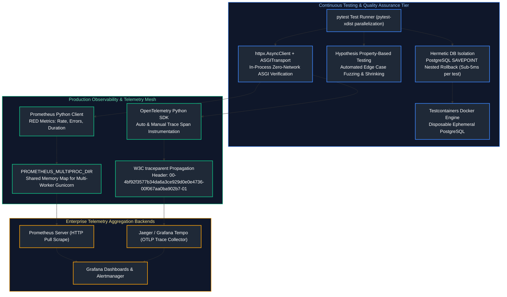
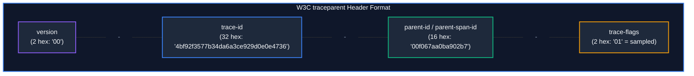
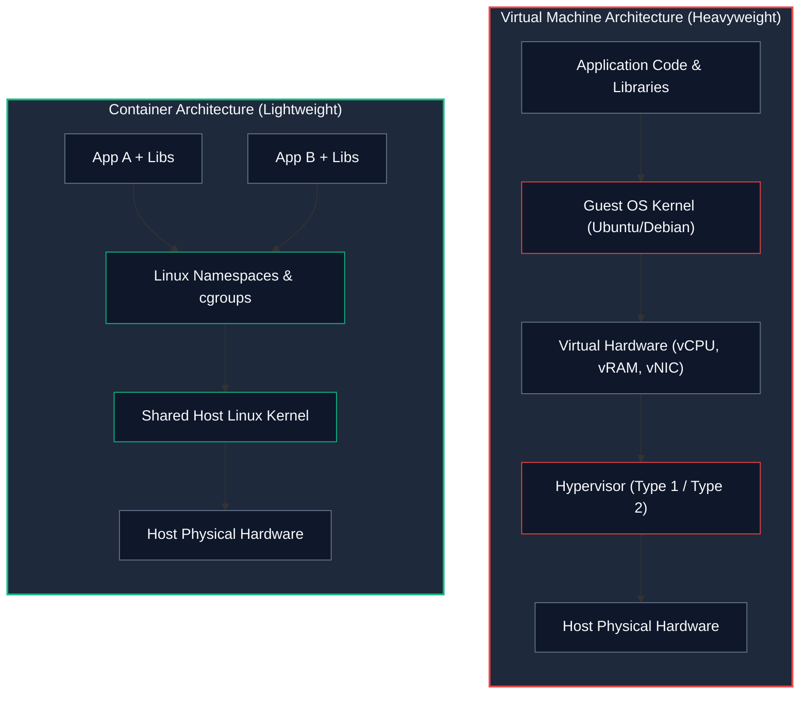
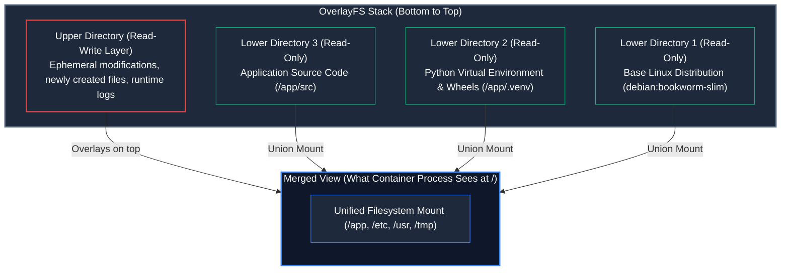
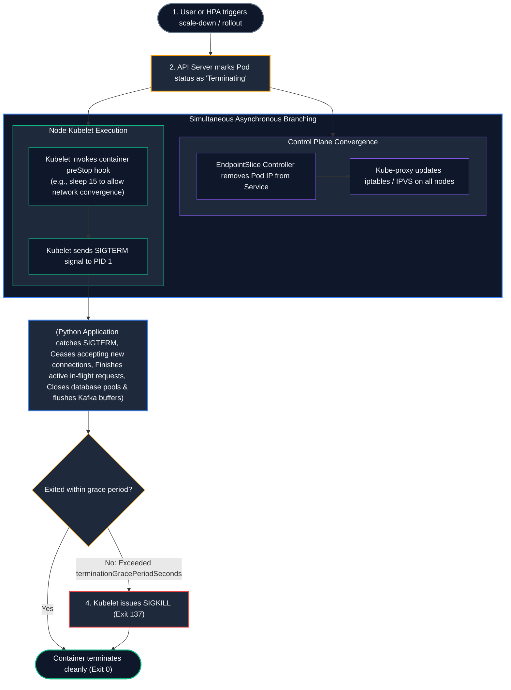
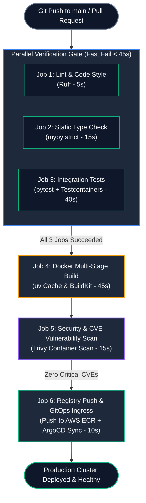

# 10. Testing, Observability, Docker Containerization & Cloud DevOps

A comprehensive, production-grade guide to enterprise testing with pytest, Testcontainers, OpenTelemetry distributed tracing, Prometheus golden signals, production multi-stage distroless Docker builds, Kubernetes manifests, and GitHub Actions CI/CD automation.

---

## Architectural Overview: Continuous Verification, Tracing & Metrics Pipeline



---

## Table of Contents
1. [The Modern Enterprise Testing Pyramid](#1-the-modern-enterprise-testing-pyramid)
   - [1.1 Unit (70%) vs. Integration (20%) vs. End-to-End (10%)](#11-unit-70-vs-integration-20-vs-end-to-end-10)
   - [1.2 Fast Feedback Loops & Eradicating Test Flakiness](#12-fast-feedback-loops--eradicating-test-flakiness)
2. [Pytest Advanced Mechanics & Fixture Lifecycles](#2-pytest-advanced-mechanics--fixture-lifecycles)
   - [2.1 Assertion Rewriting Internals under the Hood](#21-assertion-rewriting-internals-under-the-hood)
   - [2.2 Fixture Scopes: Function, Class, Module, and Session](#22-fixture-scopes-function-class-module-and-session)
   - [2.3 Yield Fixtures & Clean Resource Teardown](#23-yield-fixtures--clean-resource-teardown)
   - [2.4 Dynamic Parametrization with `@pytest.mark.parametrize`](#24-dynamic-parametrization-with-pytestmarkparametrize)
3. [Mocking Mastery with `unittest.mock` & `respx`](#3-mocking-mastery-with-unittestmock--respx)
   - [3.1 `Mock` vs. `MagicMock` vs. `AsyncMock`](#31-mock-vs-magicmock-vs-asyncmock)
   - [3.2 The Golden Rule of Mocking: Patch Where Looked Up, Not Where Defined](#32-the-golden-rule-of-mocking-patch-where-looked-up-not-where-defined)
   - [3.3 Auto-Specing (`autospec=True`) to Prevent Stale Mock Drift](#33-auto-specing-autospectrue-to-prevent-stale-mock-drift)
   - [3.4 Transport-Layer HTTP Mocking with `respx`](#34-transport-layer-http-mocking-with-respx)
4. [Hermetic Database Testing with PostgreSQL SAVEPOINTs](#7-hermetic-database-testing-with-postgresql-savepoints)
   - [7.1 Why Mocking Database Queries is a Catastrophic Anti-Pattern](#71-why-mocking-database-queries-is-a-catastrophic-anti-pattern)
   - [7.2 Disposable Ephemeral Databases with Testcontainers](#72-disposable-ephemeral-databases-with-testcontainers)
   - [7.3 Sub-5ms Test Isolation: Nested Transactions (`SAVEPOINT`) with Automatic Rollback](#73-sub-5ms-test-isolation-nested-transactions-savepoint-with-automatic-rollback)
5. [Asynchronous Testing for FastAPI Applications](#8-asynchronous-testing-for-fastapi-applications)
   - [8.1 Zero-Network In-Process ASGI Testing with `httpx.AsyncClient`](#81-zero-network-in-process-asgi-testing-with-httpxasyncclient)
   - [8.2 Fast Dependency Overrides (`app.dependency_overrides`)](#82-fast-dependency-overrides-appdependency_overrides)
   - [8.3 Testing Concurrent Requests & Race Conditions](#83-testing-concurrent-requests--race-conditions)
6. [Property-Based Fuzz Testing with Hypothesis](#9-property-based-fuzz-testing-with-hypothesis)
   - [9.1 The Fallacy of Example-Based Testing](#91-the-fallacy-of-example-based-testing)
   - [9.2 Hypothesis Strategies & Invariant Verification](#92-hypothesis-strategies--invariant-verification)
   - [9.3 The Shrinking Engine: Isolating Minimal Reproducible Boundary Bugs](#93-the-shrinking-engine-isolating-minimal-reproducible-boundary-bugs)
   - [9.4 Stateful Model Fuzzing with `RuleBasedStateMachine`](#94-stateful-model-fuzzing-with-rulebasedstatemachine)
7. [Application Metrics with Prometheus & The RED Method](#10-application-metrics-with-prometheus--the-red-method)
   - [10.1 The RED Architecture: Rate, Errors, and Duration](#101-the-red-architecture-rate-errors-and-duration)
   - [10.2 Metric Primitives: Counters, Gauges, Histograms, and Summaries](#102-metric-primitives-counters-gauges-histograms-and-summaries)
   - [10.3 The Multi-Worker Gunicorn Dilemma: `PROMETHEUS_MULTIPROC_DIR`](#103-the-multi-worker-gunicorn-dilemma-prometheus_multiproc_dir)
   - [10.4 Prometheus Middleware for FastAPI](#104-prometheus-middleware-for-fastapi)
   - [13.5 PromQL Golden Signals & Alertmanager Production Rules](#135-promql-golden-signals--alertmanager-production-rules)
8. [Distributed Tracing with OpenTelemetry (OTel)](#16-distributed-tracing-with-opentelemetry-otel)
   - [16.1 Core Concepts: Tracers, Spans, Span Context, and Baggage](#161-core-concepts-tracers-spans-span-context-and-baggage)
   - [16.2 W3C `traceparent` Context Propagation Across Microservices](#162-w3c-traceparent-context-propagation-across-microservices)
   - [16.3 Automated & Manual Instrumentations (FastAPI, HTTPX, SQLAlchemy)](#163-automated--manual-instrumentations-fastapi-httpx-sqlalchemy)
   - [19.4 Exporting Traces to Jaeger / Tempo via OTLP](#194-exporting-traces-to-jaeger--tempo-via-otlp)
   - [19.5 Trace Baggage Propagation & Sampling Strategies](#195-trace-baggage-propagation--sampling-strategies)
9. [Production Performance Profiling & Memory Diagnostics](#20-production-performance-profiling--memory-diagnostics)
   - [20.1 Sampling CPU Profiling with `py-spy` and Flame Graphs](#201-sampling-cpu-profiling-with-py-spy-and-flame-graphs)
   - [23.2 Memory Leak Diagnosis with `tracemalloc` and `objgraph`](#232-memory-leak-diagnosis-with-tracemalloc-and-objgraph)
   - [23.3 Deterministic Profiling with `cProfile` and `pstats`](#233-deterministic-profiling-with-cprofile-and-pstats)
10. [Containerization Fundamentals & Linux Kernel Mechanics](#24-containerization-fundamentals--linux-kernel-mechanics)
   - [24.1 Why Containers Are Not Virtual Machines](#241-why-containers-are-not-virtual-machines)
   - [24.2 Linux Namespaces: Isolating the Process View](#242-linux-namespaces-isolating-the-process-view)
   - [24.3 Control Groups (cgroups v2): Resource Caps and OOM Scenarios](#243-control-groups-cgroups-v2-resource-caps-and-oom-scenarios)
   - [24.4 Layered Union Filesystems: OverlayFS Internals](#244-layered-union-filesystems-overlayfs-internals)
11. [Production Multi-Stage Docker Builds with `uv`](#25-production-multi-stage-docker-builds-with-uv)
   - [25.1 The Bloat Problem: Why Naive Python Containers Reach 1.5 GB](#251-the-bloat-problem-why-naive-python-containers-reach-15-gb)
   - [25.2 Two-Stage Build Architecture with `uv`: Compilers vs. Runtime](#252-two-stage-build-architecture-with-uv-compilers-vs-runtime)
   - [25.3 Container Security Hardening: The Non-Root User Mandate](#253-container-security-hardening-the-non-root-user-mandate)
   - [25.4 Vulnerability Scanning & SBOM Generation with Trivy](#254-vulnerability-scanning--sbom-generation-with-trivy)
12. [Kubernetes Core Architecture & Abstractions](#29-kubernetes-core-architecture--abstractions)
   - [29.1 Pods, Deployments, and ReplicaSets](#291-pods-deployments-and-replicasets)
   - [29.2 Service Networking: ClusterIP, NodePort, and Ingress Controllers](#292-service-networking-clusterip-nodeport-and-ingress-controllers)
   - [29.3 Declarative Production Deployment Manifest Blueprint](#293-declarative-production-deployment-manifest-blueprint)
13. [Decoupling Health Probes: Startup, Liveness, and Readiness](#33-decoupling-health-probes-startup-liveness-and-readiness)
   - [33.1 The Cascading Failure Disaster: Conflating Liveness with Readiness](#331-the-cascading-failure-disaster-conflating-liveness-with-readiness)
   - [33.2 `startupProbe`: Protecting Slow Application Warmups](#332-startupprobe-protecting-slow-application-warmups)
   - [33.3 `livenessProbe`: Deadlock Detection and Process Restarts](#333-livenessprobe-deadlock-detection-and-process-restarts)
   - [33.4 `readinessProbe`: Traffic Routing and Dependency Health](#334-readinessprobe-traffic-routing-and-dependency-health)
14. [Process Lifecycle, Signals & Zero-Downtime Deployments](#34-process-lifecycle-signals--zero-downtime-deployments)
   - [34.1 The Kubernetes Pod Termination Sequence](#341-the-kubernetes-pod-termination-sequence)
   - [34.2 The PreStop Hook: Allowing `kube-proxy` Network Convergence](#342-the-prestop-hook-allowing-kube-proxy-network-convergence)
   - [34.3 Catching `SIGTERM` in Python & Draining In-Flight Requests](#343-catching-sigterm-in-python--draining-in-flight-requests)
   - [34.4 Zero-Downtime Rolling Updates (`maxUnavailable: 0`)](#344-zero-downtime-rolling-updates-maxunavailable-0)
15. [Autoscaling Strategies: HPA & KEDA](#35-autoscaling-strategies-hpa--keda)
   - [35.1 Horizontal Pod Autoscaler (HPA) for CPU/Memory Bottlenecks](#351-horizontal-pod-autoscaler-hpa-for-cpumemory-bottlenecks)
   - [35.2 The Worker Scaling Dilemma: Why HPA Fails for Background Queues](#352-the-worker-scaling-dilemma-why-hpa-fails-for-background-queues)
   - [35.3 Event-Driven Autoscaling with KEDA (Kafka Lag & RabbitMQ Depth)](#353-event-driven-autoscaling-with-keda-kafka-lag--rabbitmq-depth)
16. [Enterprise Secrets & Configuration Management](#36-enterprise-secrets--configuration-management)
   - [36.1 ConfigMaps vs. Kubernetes Secrets](#361-configmaps-vs-kubernetes-secrets)
   - [36.2 External Secrets Operator (ESO) Syncing with AWS Secrets Manager](#362-external-secrets-operator-eso-syncing-with-aws-secrets-manager)
17. [End-to-End CI/CD Pipeline with GitHub Actions](#37-end-to-end-cicd-pipeline-with-github-actions)
   - [37.1 High-Velocity Pipeline Architecture](#371-high-velocity-pipeline-architecture)
   - [37.2 Complete Production `.github/workflows/ci-cd.yaml` Manifest](#372-complete-production-githubworkflowsci-cdyaml-manifest)
18. [Cloud Deployment Topologies: AWS vs. GCP](#38-cloud-deployment-topologies-aws-vs-gcp)
   - [38.1 AWS Architecture: ECS Fargate vs. EKS vs. Aurora vs. ElastiCache](#381-aws-architecture-ecs-fargate-vs-eks-vs-aurora-vs-elasticache)
   - [38.2 GCP Architecture: Cloud Run vs. GKE vs. Cloud SQL](#382-gcp-architecture-cloud-run-vs-gke-vs-cloud-sql)
   - [38.3 Cloud Identity Federation: AWS IRSA vs. GCP Workload Identity](#383-cloud-identity-federation-aws-irsa-vs-gcp-workload-identity)
   - [38.4 Infrastructure as Code: Turnkey Terraform for Production Microservices](#384-infrastructure-as-code-turnkey-terraform-for-production-microservices)
19. [Summary Comparison & Production Engineering Reference Matrix](#39-summary-comparison--production-engineering-reference-matrix)
20. [References & Further Reading](#40-references--further-reading)

---

# 1. The Modern Enterprise Testing Pyramid

### 1.1 Unit (70%) vs. Integration (20%) vs. End-to-End (10%)

#### Intuitive Analogy: The Automotive Safety Testing Hierarchy
* **Unit Tests (70% - Component Level)**: You test a single brake pad in a laboratory hydraulic clamp. You measure friction coefficients and heat dissipation in milliseconds. You can run 50,000 tests an hour for almost zero cost.
* **Integration Tests (20% - Subsystem Level)**: You bolt the brake caliper, hydraulic lines, fluid reservoir, and brake pedal together on a test chassis. You verify that pushing the physical pedal creates hydraulic pressure that clamps the rotor.
* **End-to-End Tests (10% - Full Vehicle Track Test)**: You assemble the entire finished car, put a crash-test dummy in the driver's seat, drive it down an asphalt track at 100 km/h, and hit the brakes. This test is slow, expensive, and fragile—a flat tire or rainstorm invalidates the test run.

```
       / \
      / E2E \       10% - Slow, brittle, expensive, full staging environment
     /-------\
    / Integr. \     20% - Real DB with SAVEPOINT rollbacks, real Redis, HTTPX ASGI
   /-----------\
  /    Unit     \   70% - Pure domain logic, fast in-memory execution, sub-second
 /---------------\
```

---

### 1.2 Fast Feedback Loops & Eradicating Test Flakiness

A test suite that takes 45 minutes to run is a suite that engineers will skip running locally.
* **Target Execution Velocity**:
  - Full Unit Test Suite: **$< 10\text{ seconds}$**.
  - Integration Test Suite: **$< 60\text{ seconds}$**.
* **Eradicating Flakiness**:
  - **No `time.sleep()`**: Use deterministic polling (`tenacity` or `pytest-asyncio` condition waiting).
  - **Zero Shared Mutable State**: Tests must execute in any arbitrary order without depending on preceding tests.
  - **Parallel Execution**: Leverage `pytest -n auto` (via `pytest-xdist`) to run tests across all available CPU cores.

---

# 2. Pytest Advanced Mechanics & Fixture Lifecycles

### 2.1 Assertion Rewriting Internals under the Hood

In Python, the built-in `assert a == b` statement normally raises an uninformative `AssertionError` without showing intermediate values.
When `pytest` imports your test files, it intercepts the CPython compilation pipeline using a custom **PEP 302 import hook**:
1. Pytest parses the test code's Abstract Syntax Tree (AST).
2. It detects `ast.Assert` nodes.
3. It rewrites the AST bytecodes before compilation, injecting inspection hooks that capture the left-hand operand, right-hand operand, and operator.
4. When an assertion fails, pytest displays a rich, colorized diff showing the exact mismatched keys, array indexes, or sub-strings!

---

### 2.2 Fixture Scopes: Function, Class, Module, and Session

Fixtures are dependency injection providers for tests:

| Fixture Scope | Creation & Teardown Boundary | Production Best Fit |
| :--- | :--- | :--- |
| **`function`** (Default) | Executed once per test function | Transactional database rollbacks, fresh entity states |
| **`class`** | Executed once per test class | Grouped tests sharing identical setup |
| **`module`** | Executed once per `.py` test file | Read-only database fixtures, shared file parsers |
| **`session`** | Executed once for the entire test run | Docker container spinning via Testcontainers, connection pool creation |

---

### 2.3 Yield Fixtures & Clean Resource Teardown

A fixture utilizing `yield` cleanly demarcates **Setup** (code before `yield`) from **Teardown** (code after `yield`):

```python
import pytest
import tempfile
import os
from collections.abc import Generator

@pytest.fixture(scope="function")
def temporary_upload_dir() -> Generator[str, None, None]:
    # ==================== SETUP ====================
    temp_dir = tempfile.mkdtemp(prefix="test_uploads_")
    print(f"\n[Fixture Setup] Created temporary directory: {temp_dir}")
    
    yield temp_dir  # Test receives this value as argument!

    # ==================== TEARDOWN ====================
    # Guarantees execution even if the test raises an unhandled AssertionError!
    import shutil
    shutil.rmtree(temp_dir)
    print(f"[Fixture Teardown] Cleaned up directory: {temp_dir}")
```

---

### 2.4 Dynamic Parametrization with `@pytest.mark.parametrize`

Instead of copy-pasting the same test logic with different inputs, use `@pytest.mark.parametrize`:

```python
import pytest
from decimal import Decimal

def calculate_discount(price: Decimal, coupon_code: str) -> Decimal:
    discounts = {"SUMMER20": Decimal("0.20"), "VIP50": Decimal("0.50")}
    rate = discounts.get(coupon_code.upper(), Decimal("0.00"))
    return price * (Decimal("1.00") - rate)

@pytest.mark.parametrize(
    "price,coupon,expected",
    [
        (Decimal("100.00"), "SUMMER20", Decimal("80.00")),
        (Decimal("200.00"), "VIP50", Decimal("100.00")),
        (Decimal("50.00"), "INVALID_CODE", Decimal("50.00")),
        (Decimal("0.00"), "SUMMER20", Decimal("0.00")),
    ],
    ids=["20% discount", "50% VIP discount", "invalid coupon no-op", "zero price boundary"],
)
def test_calculate_discount_matrix(price: Decimal, coupon: str, expected: Decimal):
    assert calculate_discount(price, coupon) == expected
```

---

# 3. Mocking Mastery with `unittest.mock` & `respx`

### 3.1 `Mock` vs. `MagicMock` vs. `AsyncMock`

* **`Mock`**: Base mock object. Intercepts attribute lookups and method calls. Does not support Python dunder magic methods.
* **`MagicMock`**: Subclass of `Mock` that implements default implementations for Python dunders (`__iter__`, `__getitem__`, `__enter__`, `__len__`).
* **`AsyncMock`**: Introduced in Python 3.8. Supports asynchronous coroutines (`await mock()`), async context managers (`async with mock:`), and async iterators (`async for x in mock:`).

---

### 3.2 The Golden Rule of Mocking: Patch Where Looked Up, Not Where Defined

> [!CAUTION]
> ### The #1 Most Common Mocking Bug in Python
> Consider this file structure:
> * `app/services/email.py` defines `send_email()`.
> * `app/routes/users.py` imports it: `from app.services.email import send_email`.
> 
> If your test executes:
> `patch("app.services.email.send_email")`
> **THE MOCK WILL SILENTLY FAIL!**
> 
> Because `app/routes/users.py` has already imported and bound a direct reference to `send_email` in its local module namespace, patching `app.services.email` modifies the origin module, but the route continues executing the un-mocked original function!

#### The Rule:
**Patch where the object is LOOKED UP, not where it is defined!**
```python
# CORRECT: Patch the reference inside the consumer module!
@patch("app.routes.users.send_email")
def test_user_registration(mock_send):
    ...
```

---

### 3.3 Auto-Specing (`autospec=True`) to Prevent Stale Mock Drift

A standard mock accepts any method call, even if the real underlying class deleted that method 6 months ago!
Using `autospec=True` inspects the real production class and ensures the mock raises `AttributeError` if a test calls non-existent methods or invalid argument counts:

```python
from unittest.mock import patch

# autospec=True verifies real method signatures at test runtime!
@patch("app.infrastructure.email_client.SendGridClient", autospec=True)
def test_email_dispatch(mock_client_class):
    client = mock_client_class.return_value
    # If SendGridClient doesn't have a method named 'send_fancy_mail', this throws TypeError immediately!
    client.send_mail(to="user@corp.com", subject="Hello")
```

---

### 3.4 Transport-Layer HTTP Mocking with `respx`

Instead of mocking individual Python functions, mock outbound HTTP network calls directly at the **transport layer** using **`respx`** (designed for HTTPX):

```python
import pytest
import httpx
import respx

@respx.mock
@pytest.mark.asyncio
async def test_outbound_payment_gateway_mock():

# 4. Intercept HTTPX network calls to external payment gateway URL

route = respx.post("https://api.stripe.com/v1/charges").mock(
        return_value=httpx.Response(200, json={"id": "ch_99214", "status": "succeeded"})
    )

# 5. Execute application code that uses real httpx.AsyncClient

async with httpx.AsyncClient() as client:
        response = await client.post("https://api.stripe.com/v1/charges", data={"amount": 1000})

# 6. Assert HTTP status and verify call assertions

assert response.status_code == 200
    assert response.json()["id"] == "ch_99214"
    assert route.called
    assert route.call_count == 1
```

---

# 7. Hermetic Database Testing with PostgreSQL SAVEPOINTs

### 7.1 Why Mocking Database Queries is a Catastrophic Anti-Pattern

Mocking database sessions with `mock_session.execute.return_value = ...` gives developers a false sense of security:
* Mocks cannot detect SQL syntax errors.
* Mocks cannot detect missing `NOT NULL` or `FOREIGN KEY` constraint violations.
* Mocks cannot test database triggers, generated columns, or unique constraint violations.
* Tests break whenever a developer rewrites an internal SQL query, even if the external behavior is identical!

**Enterprise Production Standard**: **Always test against a real PostgreSQL database!**

---

### 7.2 Disposable Ephemeral Databases with Testcontainers

Using **Testcontainers**, pytest automatically spins up a clean, isolated PostgreSQL Docker container on test session startup, runs all Alembic migrations, and tears it down on completion:

```python
import pytest
from testcontainers.postgres import PostgresContainer
from sqlalchemy.ext.asyncio import create_async_engine, AsyncSession, async_sessionmaker

@pytest.fixture(scope="session")
def postgres_container():
    """Spins up a real PostgreSQL 16 Docker container for the test session."""
    with PostgresContainer("postgres:16-alpine") as postgres:
        yield postgres

@pytest.fixture(scope="session")
def async_db_engine(postgres_container):
    # Construct asyncpg connection URI
    db_url = postgres_container.get_connection_url().replace("psycopg2", "asyncpg")
    engine = create_async_engine(db_url, echo=False)
    yield engine
    engine.sync_engine.dispose()
```

---

### 7.3 Sub-5ms Test Isolation: Nested Transactions (`SAVEPOINT`) with Automatic Rollback

Recreating tables or truncating rows between tests is painfully slow (taking 500ms per test).
The high-performance industry pattern is to **wrap every test in an outer transaction and an inner `SAVEPOINT`**, rolling back the transaction at the end of the test.
* Execution time: **Sub-5 milliseconds per test**!
* 1,000 database integration tests execute in under 5 seconds!

```python
import pytest
import pytest_asyncio
from sqlalchemy.ext.asyncio import AsyncSession
from enterprise_service.infrastructure.db.models import Base

@pytest_asyncio.fixture(scope="session", autouse=True)
async def setup_database_schema(async_db_engine):
    """Run migrations once for the entire test session."""
    async with async_db_engine.begin() as conn:
        await conn.run_sync(Base.metadata.create_all)
    yield
    async with async_db_engine.begin() as conn:
        await conn.run_sync(Base.metadata.drop_all)

@pytest_asyncio.fixture(scope="function")
async def db_session(async_db_engine) -> AsyncSession:
    """
    Transactional Test Isolation Fixture:
    1. Opens an outer connection.
    2. Begins an outer transaction.
    3. Yields session to test.
    4. ROLLS BACK outer transaction upon completion, reverting all mutations instantly!
    """
    connection = await async_db_engine.connect()
    transaction = await connection.begin()

    session = AsyncSession(bind=connection, expire_on_commit=False)

    yield session

    await session.close()
    # Roll back everything executed during the test!
    await transaction.rollback()
    await connection.close()
```

---

# 8. Asynchronous Testing for FastAPI Applications

### 8.1 Zero-Network In-Process ASGI Testing with `httpx.AsyncClient`

Never spin up a physical HTTP server on `localhost:8000` to test FastAPI APIs!
Use HTTPX's **`ASGITransport`** to pass requests directly to the application's ASGI callable in memory:
* Eliminates TCP socket creation, OS port binding, and firewall permission prompts.
* Execution is $10\times$ faster!

```python
import pytest
from httpx import AsyncClient, ASGITransport
from enterprise_service.main import app

@pytest.mark.asyncio
async def test_create_order_endpoint(db_session):
    # Pass app directly into ASGITransport (In-memory execution)
    transport = ASGITransport(app=app)
    
    async with AsyncClient(transport=transport, base_url="http://testserver") as client:
        response = await client.post(
            "/v1/orders",
            json={"customer_id": "cust_101", "amount": 150.00, "currency": "USD"},
            headers={"Authorization": "Bearer mock-token-admin"},
        )

    assert response.status_code == 201
    payload = response.json()
    assert payload["status"] == "CONFIRMED"
    assert "order_id" in payload
```

---

### 8.2 Fast Dependency Overrides (`app.dependency_overrides`)

```python
from enterprise_service.presentation.api.dependencies import get_current_user

@pytest.fixture(autouse=True)
def override_auth_dependency():
    """Bypasses real JWT verification in tests by returning a mock authenticated user."""
    app.dependency_overrides[get_current_user] = lambda: {"user_id": "usr_test", "role": "admin"}
    yield
    app.dependency_overrides.clear()
```

---

### 8.3 Testing Concurrent Requests & Race Conditions

To verify that your database row locking (`SELECT FOR UPDATE`) or Redis locks prevent overselling in flash sales, launch concurrent async requests using `asyncio.gather()`:

```python
@pytest.mark.asyncio
async def test_flash_sale_concurrency_race_condition(async_client):
    # Simulate 20 concurrent customers attempting to purchase the last available stock item
    tasks = [
        async_client.post("/v1/checkout", json={"sku": "SNEAKER_LIMITED_1", "qty": 1})
        for _ in range(20)
    ]
    responses = await asyncio.gather(*tasks)

    # Count successful purchases vs sold-out rejections
    success_count = sum(1 for r in responses if r.status_code == 201)
    sold_out_count = sum(1 for r in responses if r.status_code == 409)

    # Exactly 1 customer should succeed; 19 should be rejected!
    assert success_count == 1
    assert sold_out_count == 19
```

---

# 9. Property-Based Fuzz Testing with Hypothesis

### 9.1 The Fallacy of Example-Based Testing

When engineers write unit tests, they write tests for the happy path and a few obvious edge cases (`0`, `""`, `None`).
We inherently test what we *expect* to happen. We miss subtle boundary bugs:
* Unicode normalization errors (e.g., Turkish lowercase `i`).
* Extreme floating-point rounding errors (`0.1 + 0.2 != 0.3`).
* Large integer overflows.

---

### 9.2 Hypothesis Strategies & Invariant Verification

**Hypothesis** generates hundreds of randomized, adversarial test inputs against mathematical properties (invariants) that must *always* hold true:

```python
from hypothesis import given, strategies as st
from decimal import Decimal

# Function under test
def apply_compound_interest(principal: Decimal, rate: Decimal, years: int) -> Decimal:
    if principal < 0 or rate < 0 or years < 0:
        raise ValueError("Inputs must be non-negative")
    return principal * ((Decimal("1.0") + rate) ** years)

# Invariant: If rate > 0 and principal > 0 and years > 0, future value MUST exceed principal!
@given(
    principal=st.decimals(min_value=1, max_value=1_000_000, places=2),
    rate=st.decimals(min_value=Decimal("0.01"), max_value=Decimal("0.50"), places=4),
    years=st.integers(min_value=1, max_value=50),
)
def test_compound_interest_invariant(principal: Decimal, rate: Decimal, years: int):
    future_value = apply_compound_interest(principal, rate, years)
    assert future_value > principal
```

---

### 9.3 The Shrinking Engine: Isolating Minimal Reproducible Boundary Bugs

When Hypothesis finds a failing input (e.g. `principal = 98124.12, rate = 0.4124, years = 37`), it does not simply dump the complex input on you.
Its **Shrinking Engine** iteratively reduces the test case until it finds the **absolute simplest, minimal failing input** (e.g., `principal = 1, rate = 0.01, years = 1`), making root cause debugging instantaneous!

---

### 9.4 Stateful Model Fuzzing with `RuleBasedStateMachine`

Real production systems are not stateless pure functions. They maintain internal state (shopping carts, user sessions, ledger accounts) that can transition through complex sequences of operations.
Hypothesis provides **`RuleBasedStateMachine`** to automatically generate, interleave, and shrink random sequences of state mutations to discover race conditions and invariant violations:

```python
from decimal import Decimal
from hypothesis.stateful import RuleBasedStateMachine, rule, invariant, Bundle
from hypothesis import strategies as st

class BankAccount:
    """System Under Test."""
    def __init__(self, initial_balance: Decimal) -> None:
        self.balance = initial_balance
        self.is_frozen = False

    def deposit(self, amount: Decimal) -> None:
        if self.is_frozen:
            raise RuntimeError("Account is frozen")
        if amount <= 0:
            raise ValueError("Deposit must be positive")
        self.balance += amount

    def withdraw(self, amount: Decimal) -> bool:
        if self.is_frozen:
            raise RuntimeError("Account is frozen")
        if 0 < amount <= self.balance:
            self.balance -= amount
            return True
        return False

    def freeze(self) -> None:
        self.is_frozen = True

class BankAccountStateMachine(RuleBasedStateMachine):
    """
    Hypothesis executes hundreds of randomized combinations of deposit,
    withdraw, and freeze calls in arbitrary order!
    """
    def __init__(self) -> None:
        super().__init__()
        self.account = BankAccount(Decimal("100.00"))
        self.model_balance = Decimal("100.00")
        self.model_frozen = False

    @rule(amount=st.decimals(min_value=Decimal("0.01"), max_value=Decimal("500.00"), places=2))
    def deposit(self, amount: Decimal) -> None:
        if self.model_frozen:
            return
        self.account.deposit(amount)
        self.model_balance += amount

    @rule(amount=st.decimals(min_value=Decimal("0.01"), max_value=Decimal("500.00"), places=2))
    def withdraw(self, amount: Decimal) -> None:
        if self.model_frozen:
            return
        success = self.account.withdraw(amount)
        if success:
            self.model_balance -= amount

    @rule()
    def freeze(self) -> None:
        self.account.freeze()
        self.model_frozen = True

    @invariant()
    def balance_must_match_and_be_non_negative(self) -> None:
        """Invariant: Real balance must strictly match model and never drop below zero!"""
        assert self.account.balance == self.model_balance
        assert self.account.balance >= Decimal("0.00")

# Run stateful test harness in pytest:
TestBankAccount = BankAccountStateMachine.TestCase
```

---

# 10. Application Metrics with Prometheus & The RED Method

### 10.1 The RED Architecture: Rate, Errors, and Duration

Popularized by Tom Wilkie, the **RED Method** defines the three essential metrics for monitoring request-driven microservices:

1. **Rate**: The number of requests your service is serving per second.
2. **Errors**: The number of requests that are failing (HTTP 5xx status codes).
3. **Duration**: The amount of time requests take (P50, P90, P95, P99 latency percentiles).

---

### 10.2 Metric Primitives: Counters, Gauges, Histograms, and Summaries

* **`Counter`**: Monotonically increasing number. Never decreases (resets only on process restart). Used for total requests served, exceptions thrown.
* **`Gauge`**: Value that can go up and down. Used for active concurrent connections, current memory usage, thread count.
* **`Histogram`**: Samples observations into configurable latency buckets. Essential for computing P95 and P99 latency SLAs!
* **`Summary`**: Computes client-side quantiles. (Avoid in multi-node setups; use Histograms instead).

---

### 10.3 The Multi-Worker Gunicorn Dilemma: `PROMETHEUS_MULTIPROC_DIR`

> [!CAUTION]
> ### The Multi-Process Prometheus Metric Corruption Trap
> When Prometheus scrapes your API at `/metrics`, the request hits Worker 1. Next scrape hits Worker 2.
> If each Gunicorn worker maintains its own in-memory counters, **your metrics graphs will violently oscillate up and down**, rendering rate calculations and alerts useless!
> 
> **Production Fix**:
> Configure the Prometheus client in **multi-process mode** using a memory-mapped directory on `tmpfs`:

```bash
# In Docker startup script:
export PROMETHEUS_MULTIPROC_DIR=/tmp/prometheus_multiproc
mkdir -p /tmp/prometheus_multiproc
rm -rf /tmp/prometheus_multiproc/*
```

---

### 10.4 Prometheus Middleware for FastAPI

```python
import time
from fastapi import FastAPI, Request
from prometheus_client import Counter, Histogram, generate_latest, CONTENT_TYPE_LATEST
from starlette.responses import Response

app = FastAPI()

# 11. Define Prometheus RED Metrics

HTTP_REQUESTS_TOTAL = Counter(
    "http_requests_total",
    "Total HTTP requests processed by endpoint and status code",
    ["method", "endpoint", "status_code"],
)

HTTP_REQUEST_DURATION_SECONDS = Histogram(
    "http_request_duration_seconds",
    "HTTP request execution latency distribution in seconds",
    ["method", "endpoint"],
    buckets=(0.005, 0.01, 0.025, 0.05, 0.075, 0.1, 0.25, 0.5, 0.75, 1.0, 2.5, 5.0),
)

# 12. Measure latency and record metrics via Middleware

@app.middleware("http")
async def prometheus_metrics_middleware(request: Request, call_next):
    start_time = time.perf_counter()
    method = request.method
    path = request.url.path

    try:
        response = await call_next(request)
        status_code = str(response.status_code)
    except Exception:
        status_code = "500"
        raise
    finally:
        latency = time.perf_counter() - start_time
        # Record observations
        HTTP_REQUESTS_TOTAL.labels(method=method, endpoint=path, status_code=status_code).inc()
        HTTP_REQUEST_DURATION_SECONDS.labels(method=method, endpoint=path).observe(latency)

    return response

# 13. Expose scrape endpoint for Prometheus server

@app.get("/metrics")
def metrics():
    return Response(content=generate_latest(), media_type=CONTENT_TYPE_LATEST)
```

---

### 13.5 PromQL Golden Signals & Alertmanager Production Rules

Collecting metrics is useless without actionable alerting. Here are the standardized **PromQL queries and Alertmanager YAML rules** implementing Google SRE Golden Signals for your Python services:

```yaml
# /etc/prometheus/alert_rules.yml
groups:
  - name: enterprise_backend_alerts
    rules:

# 14. Error Rate Alert: Triggers if 5xx errors exceed 2% of total traffic over a 5m window

- alert: HighHttpErrorRate
        expr: |
          (
            sum(rate(http_requests_total{status_code=~"5.."}[5m]))
            /
            sum(rate(http_requests_total[5m]))
          ) * 100 > 2.0
        for: 2m
        labels:
          severity: critical
          tier: api_gateway
        annotations:
          summary: "High HTTP 5xx error rate on {{ $labels.instance }}"
          description: "Service HTTP 5xx error rate is {{ $value | printf \"%.2f\" }}% (> 2% threshold)."

# 15. P99 Latency SLA Violation Alert: Triggers if P99 latency exceeds 750ms

- alert: HighP99Latency
        expr: |
          histogram_quantile(
            0.99,
            sum(rate(http_request_duration_seconds_bucket[5m])) by (le, endpoint)
          ) > 0.75
        for: 3m
        labels:
          severity: warning
          tier: backend
        annotations:
          summary: "P99 Latency SLA violation on {{ $labels.endpoint }}"
          description: "Endpoint {{ $labels.endpoint }} P99 response time is {{ $value | printf \"%.3f\" }}s (> 750ms SLA)."
```

---

# 16. Distributed Tracing with OpenTelemetry (OTel)

### 16.1 Core Concepts: Tracers, Spans, Span Context, and Baggage

In microservices, a single client click can trigger 15 internal RPC calls across 6 services.
**OpenTelemetry (OTel)** tracks the end-to-end journey of that request through a directed acyclic graph of **Spans**:

* **Trace**: The end-to-end journey of a request across all services, sharing a single unique 128-bit `TraceID`.
* **Span**: A single contiguous unit of work within a service (e.g., executing a database query or making an HTTP call). Has a `SpanID`, start time, end time, attributes, and events.
* **Span Context**: The metadata containing `TraceID`, `SpanID`, and trace flags passed across network boundaries.

---

### 16.2 W3C `traceparent` Context Propagation Across Microservices

To correlate spans across microservices, OpenTelemetry injects the standardized **W3C `traceparent`** HTTP header:

```http
traceparent: 00-4bf92f3577b34da6a3ce929d0e0e4736-00f067aa0ba902b7-01
```



| Field Segment | Size & Format | Value in Example | Specification & Purpose |
| :--- | :--- | :--- | :--- |
| **`version`** | 2 Hex characters | `00` | Current W3C Trace Context recommendation version |
| **`trace-id`** | 32 Hex characters (16 bytes) | `4bf92f3577b34da6a3ce929d0e0e4736` | Globally unique ID for the entire distributed transaction across all hops |
| **`parent-id`** | 16 Hex characters (8 bytes) | `00f067aa0ba902b7` | Span ID of the caller/parent span initiating the outbound network call |
| **`trace-flags`** | 2 Hex characters (8-bit bitmap) | `01` | Sampling decisions: `01` = recorded/sampled for collector storage, `00` = unsampled |

---

### 16.3 Automated & Manual Instrumentations (FastAPI, HTTPX, SQLAlchemy)

```python
from opentelemetry import trace
from opentelemetry.sdk.trace import TracerProvider
from opentelemetry.sdk.trace.export import BatchSpanProcessor
from opentelemetry.exporter.otlp.proto.grpc.trace_exporter import OTLPSpanExporter
from opentelemetry.sdk.resources import Resource
from opentelemetry.instrumentation.fastapi import FastAPIInstrumentor
from opentelemetry.instrumentation.httpx import HTTPXClientInstrumentor
from opentelemetry.instrumentation.sqlalchemy import SQLAlchemyInstrumentor

def setup_opentelemetry(app, service_name: str = "order-service"):

# 17. Define Service Resource

resource = Resource.create({"service.name": service_name, "service.version": "1.0.0"})
    provider = TracerProvider(resource=resource)

# 18. Configure OTLP gRPC Exporter pointing to Jaeger / Tempo collector

otlp_exporter = OTLPSpanExporter(endpoint="http://otel-collector:4317", insecure=True)
    provider.add_span_processor(BatchSpanProcessor(otlp_exporter))
    trace.set_tracer_provider(provider)

# 19. Auto-instrument Libraries

FastAPIInstrumentor.instrument_app(app)
    HTTPXClientInstrumentor().instrument()
    SQLAlchemyInstrumentor().instrument()

# Manual Span Instrumentation for Custom Business Logic:
tracer = trace.get_tracer("order.service")

async def process_fraud_analysis(order_id: str):
    with tracer.start_as_current_span("fraud_check") as span:
        # Attach custom business attributes to span
        span.set_attribute("order.id", order_id)
        span.set_attribute("fraud.model_version", "v2.4")
        
        # Perform computation...
        span.set_attribute("fraud.score", 0.02)
```

---

### 19.4 Exporting Traces to Jaeger / Tempo via OTLP

Traces captured by `BatchSpanProcessor` are serialized using Protocol Buffers over gRPC and batched asynchronously to the central OpenTelemetry Collector (or directly into Jaeger / Grafana Tempo), guaranteeing that tracing never introduces latency to application worker threads.

---

### 19.5 Trace Baggage Propagation & Sampling Strategies

#### 1. OpenTelemetry Baggage: Cross-Service Business Context
While Span Attributes are local to a single span, **Baggage** propagates contextual key-value pairs across network boundaries (e.g., forwarding `tenant_id` or `user_tier` across 10 downstream microservices):

```python
from opentelemetry import baggage, context

# Ingress Service: Inject Baggage into context
ctx = baggage.set_baggage("tenant.id", "enterprise_acme_corp")
token = context.attach(ctx)

try:
    # Downstream calls automatically carry baggage in W3C 'baggage' HTTP header!
    pass
finally:
    context.detach(token)

# Downstream Service: Retrieve baggage anywhere in call chain
tenant_id = baggage.get_baggage("tenant.id")
```

#### 2. Head-Based vs. Tail-Based Sampling:
* **Head-Based Sampling (SDK Level)**: Decides whether to record a trace at the start of the request (e.g. sample 5% of all traffic). Inexpensive, but misses rare 500 errors if that specific request was not sampled!
* **Tail-Based Sampling (Collector Level)**: Collects 100% of spans in-memory at the OpenTelemetry Collector cluster. If any span within a trace throws an HTTP 500 or exceeds 2.0s latency, the collector retains that entire trace for investigation!

---

# 20. Production Performance Profiling & Memory Diagnostics

### 20.1 Sampling CPU Profiling with `py-spy` and Flame Graphs

In live production environments, you cannot attach deterministic profilers like `cProfile` because they slow down application execution by 2x to 5x.
**`py-spy`** is a sampling profiler written in **Rust** that inspects the memory space of a running CPython process from outside using OS kernel system calls (`process_vm_readv` on Linux, `mach_vm_read` on macOS):
* Zero performance degradation ($< 1\%$ CPU impact).
* Requires **no code modifications** and no application restart!
* Can profile through the C-stack (C-extensions and Rust extensions).

```bash

# 21. Live top-like interactive view of CPU hotspots by PID:

py-spy top --pid 4102

# 22. Record a 60-second SVG Flame Graph of a live production pod:

py-spy record --pid 4102 --duration 60 --rate 100 --output profile_flamegraph.svg

# 23. Dump active threads and stack traces of a hung / deadlocked Python process:

py-spy dump --pid 4102
```

---

### 23.2 Memory Leak Diagnosis with `tracemalloc` and `objgraph`

CPython memory leaks typically occur when objects remain referenced by global registries, unbounded caches, or cyclic references with custom `__del__` methods.

#### 1. `tracemalloc` Differential Snapshots:
Track exact lines of Python code allocating memory:

```python
import tracemalloc

# Start tracking memory allocations
tracemalloc.start(25)  # Store 25 stack frames

snapshot1 = tracemalloc.take_snapshot()

# ... Execute 10,000 requests or batch operations ...

snapshot2 = tracemalloc.take_snapshot()

# Compare memory diff between snapshots:
top_stats = snapshot2.compare_to(snapshot1, "lineno")

print("[Memory Leak Report - Top 5 Allocation Hotspots]")
for stat in top_stats[:5]:
    print(stat)
```

#### 2. Finding Reference Cycles with `objgraph`:
```python
import objgraph

# Count most common live objects in heap
objgraph.show_most_common_types(limit=10)

# Generate a visual graph (.dot / .png) showing what is holding references to leaking Order objects:
leaking_orders = objgraph.by_type("Order")
if leaking_orders:
    objgraph.show_backrefs(leaking_orders[:1], max_depth=5, filename="leak_chain.png")
```

---

### 23.3 Deterministic Profiling with `cProfile` and `pstats`

For local optimization and algorithmic benchmarking, use `cProfile`:

```python
import cProfile
import pstats
import io

def benchmark_critical_path(fn, *args, **kwargs):
    profiler = cProfile.Profile()
    profiler.enable()
    
    result = fn(*args, **kwargs)
    
    profiler.disable()
    s = io.StringIO()
    # Sort by cumulative time spent inside function and its sub-calls
    ps = pstats.Stats(profiler, stream=s).sort_stats(pstats.SortKey.CUMULATIVE)
    ps.print_stats(15)  # Print top 15 bottlenecks
    print(s.getvalue())
    return result
```

---

# 24. Containerization Fundamentals & Linux Kernel Mechanics

> [!NOTE]
> **Domain Framing: Application Packaging vs. Enterprise Cloud Platform Architecture:**
> This guide covers application-level packaging: building minimal multi-stage Python containers with `uv`, ASGI process worker tuning in containers, and authoring Kubernetes manifests for microservices.
>
> For deep cloud infrastructure architecture, control plane internals, CNI networking, ingress controllers, and GitOps release engineering, see:
> - [Cloud Engineering: 08. Containers, Kubernetes & GitOps](../Cloud%20Engineering/06_containers_kubernetes_and_gitops.md)
> - [Cloud Engineering: 07. CI/CD & Release Engineering](../Cloud%20Engineering/05_cicd_and_release_engineering.md)

### 24.1 Why Containers Are Not Virtual Machines

#### Intuitive Analogy: An Apartment Building vs. A Suburb of Houses
* **Virtual Machine (A Suburb of Detached Houses)**: Each house has its own private plumbing, electrical generator, foundation, roof, and front lawn (Hypervisor, Guest OS Kernel, virtual BIOS, virtual device drivers). It takes 15 minutes to turn on the utilities, and you must maintain 10 separate houses.
* **Container (An Apartment in a High-Rise)**: The high-rise building shares a single centralized master boiler, plumbing stack, and foundation (the **Host Linux Kernel**). Each apartment has its own front door with a unique lock (Namespaces) and an electric meter enforcing a maximum wattage draw (cgroups). Moving in takes 100 milliseconds!



| Dimension | Virtual Machine (VM) | Container |
| :--- | :--- | :--- |
| **Isolation Level** | Hardware-level virtualization (hypervisor simulates discrete hardware) | OS-level virtualization (shared kernel isolated via namespaces & cgroups) |
| **Guest OS Kernel** | Complete guest kernel per VM instance ($1\text{--}4\text{ GB}$ base RAM) | None; direct syscalls into host kernel ($10\text{--}50\text{ MB}$ memory footprint) |
| **Startup Latency** | $30\text{--}90$ seconds (BIOS, bootloader, kernel init, systemd) | $50\text{--}200$ milliseconds (standard Linux fork/exec with namespace unshare) |
| **Density & Portability** | Low density; $10\text{--}50$ VMs per server | High density; hundreds of containers per physical host node |

---

### 24.2 Linux Namespaces: Isolating the Process View

A container is not a tangible physical boundary; it is simply a **standard Linux host process** running with restricted visibility via **Namespaces**:

1. **`pid` (Process ID)**: Inside the container, your Python app sees itself as `PID 1`. On the host server, it might be `PID 14209`.
2. **`net` (Network)**: The container receives its own virtual network interface (`eth0`), private IP address, and isolated routing table.
3. **`mnt` (Mount)**: Isolates filesystem mount points, so the container only sees its own root directory (`/`).
4. **`ipc` (Inter-Process Communication)**: Isolates System V IPC and POSIX message queues.
5. **`uts` (UNIX Timesharing System)**: Allows the container to have its own hostname.
6. **`user` (User Mapping)**: Maps `root` (UID 0) inside the container to an unprivileged user (UID 10001) on the host!

---

### 24.3 Control Groups (cgroups v2): Resource Caps and OOM Scenarios

While namespaces govern *what a process can see*, **Control Groups (cgroups)** govern *how much resources a process can consume*:

* **CPU Limits (`cpu.max`)**: Enforced via the Completely Fair Scheduler (CFS). If a container is assigned `cpu: "2"`, CFS allocates 200,000 microseconds of CPU runtime every 100,000-microsecond period. If the app exceeds this, the kernel throttles execution without killing the process!
* **Memory Limits (`memory.max`)**: When your Python process allocates more memory than its limit:
  1. The kernel attempts to reclaim page cache memory.
  2. If memory cannot be reclaimed, the kernel triggers the **Linux Out-Of-Memory (OOM) Killer**.
  3. The kernel sends `SIGKILL` (Exit Code 137). In Kubernetes, this appears as **`OOMKilled`**!

---

### 24.4 Layered Union Filesystems: OverlayFS Internals

Docker images are composed of immutable, read-only layers stacked via **OverlayFS**:


* **Copy-on-Write (CoW)**: If the Python application modifies a file from Lower Dir 1, OverlayFS copies that file up into the Read-Write Upper Dir before modifying it, leaving the underlying base image pristine and shared across 50 running containers!

---

# 25. Production Multi-Stage Docker Builds with `uv`

### 25.1 The Bloat Problem: Why Naive Python Containers Reach 1.5 GB

A naive Dockerfile typically:
1. Uses `FROM python:3.12` (based on full Debian, including GCC, build headers, and audio drivers).
2. Runs `pip install -r requirements.txt` (downloads raw `.whl` files into `~/.cache/pip`, bloating the layer).
3. Leaves build compilers (`gcc`, `g++`, `libpq-dev`) inside the production image.
*Result*: An enormous **1.5 GB container image** that takes 4 minutes to pull during an autoscaling spike, full of security CVE vulnerabilities!

---

### 25.2 Two-Stage Build Architecture with `uv`: Compilers vs. Runtime

Using **Astral `uv`** inside a **Multi-Stage Dockerfile**:
1. **Builder Stage**: Installs C compilers and compiles dependencies into a clean `.venv` using `uv sync --frozen --no-dev`.
2. **Final Runtime Stage**: Uses a clean, minimal `debian:bookworm-slim` base image. Copies **only** the compiled `.venv` and source code.
*Result*: A lean, secure **85 MB container image** that boots in 100 milliseconds!

```dockerfile
# ==============================================================================
# STAGE 1: Builder (Contains compilers and uv package manager)
# ==============================================================================
FROM ghcr.io/astral-sh/uv:0.4.15-python3.12-bookworm-slim AS builder

WORKDIR /app

# Enable bytecode compilation for faster application boot
ENV UV_COMPILE_BYTECODE=1 \
    UV_LINK_MODE=copy

# Install dependencies using cache mount to speed up CI rebuilds
RUN --mount=type=cache,target=/root/.cache/uv \
    --mount=type=bind,source=uv.lock,target=uv.lock \
    --mount=type=bind,source=pyproject.toml,target=pyproject.toml \
    uv sync --frozen --no-install-project --no-dev

# Copy source code and build the application project
COPY . /app
RUN --mount=type=cache,target=/root/.cache/uv \
    uv sync --frozen --no-dev

# ==============================================================================
# STAGE 2: Minimal Final Runtime Image (No compilers, minimal CVE attack surface)
# ==============================================================================
FROM python:3.12-slim-bookworm AS runtime

WORKDIR /app

# Python runtime hardening flags:
# - PYTHONDONTWRITEBYTECODE: Prevents writing .pyc files into container layer
# - PYTHONUNBUFFERED: Flushes stdout/stderr immediately to Docker log driver
ENV PYTHONDONTWRITEBYTECODE=1 \
    PYTHONUNBUFFERED=1 \
    PATH="/app/.venv/bin:$PATH"

# Create unprivileged non-root user and group (Security Best Practice)
RUN groupadd -g 10001 appgroup && \
    useradd -u 10001 -g appgroup -s /sbin/nologin -M appuser

# Copy ONLY the virtual environment and application code from builder
COPY --from=builder --chown=appuser:appgroup /app/.venv /app/.venv
COPY --from=builder --chown=appuser:appgroup /app/src /app/src

# Drop all root privileges!
USER 10001:10001

EXPOSE 8000

# Exec form of ENTRYPOINT guarantees Gunicorn receives SIGTERM signals from Kubernetes!
ENTRYPOINT ["gunicorn", "src.main:app", "-w", "4", "-k", "uvicorn.workers.UvicornWorker", "-b", "0.0.0.0:8000", "--graceful-timeout", "30"]
```

---

### 25.3 Container Security Hardening: The Non-Root User Mandate

> [!CAUTION]
> ### The Root Container Exploit Hazard
> By default, Docker executes processes as `root` (UID 0).
> If an attacker exploits a remote code execution vulnerability (e.g., via an unsafe YAML deserializer or image parsing library), and the container process is running as root, **a container breakout gives the attacker root access over the host Linux kernel**!
> **Mandatory Rule**: Always add an unprivileged non-root user (`USER 10001:10001`)!

---

### 25.4 Vulnerability Scanning & SBOM Generation with Trivy

Incorporate **Trivy** into your build pipeline to reject images containing High or Critical CVEs:

```bash

# 26. Build Docker image

docker build -t enterprise-payment-api:1.0.0 .

# 27. Scan image for CVE vulnerabilities

trivy image --severity HIGH,CRITICAL --exit-code 1 enterprise-payment-api:1.0.0

# 28. Generate CycloneDX Software Bill of Materials (SBOM)

trivy image --format cyclonedx --output sbom.json enterprise-payment-api:1.0.0
```

---

# 29. Kubernetes Core Architecture & Abstractions

### 29.1 Pods, Deployments, and ReplicaSets

* **Pod**: The smallest deployable unit in Kubernetes. Represents a group of one or more co-located containers sharing the exact same Network Namespace (IP address and port space) and storage volumes.
* **ReplicaSet**: Guarantees that a specified number of identical pod replicas are running at any given moment.
* **Deployment**: Higher-level controller that manages declarative declarative rolling updates of ReplicaSets.

---

### 29.2 Service Networking: ClusterIP, NodePort, and Ingress Controllers

* **ClusterIP (Default)**: Assigns an internal, stable virtual IP address accessible only from within the Kubernetes cluster.
* **NodePort**: Exposes the service on a static high port ($30000\text{--}32767$) across every Kubernetes node.
* **Ingress Controller (NGINX / Envoy / AWS ALB)**: Layer 7 application routing gateway that inspects incoming HTTP Host headers and URL paths, routing requests to internal ClusterIP services while terminating TLS certificates.

---

### 29.3 Declarative Production Deployment Manifest Blueprint

Here is the standardized, production-hardened Kubernetes manifest for an enterprise Python microservice:

```yaml
# deployment.yaml
apiVersion: apps/v1
kind: Deployment
metadata:
  name: payment-service-deployment
  namespace: production
  labels:
    app.kubernetes.io/name: payment-service
spec:
  replicas: 4
  revisionHistoryLimit: 5
  strategy:
    type: RollingUpdate
    rollingUpdate:
      maxSurge: 25%        # Spin up 1 extra pod before killing old ones
      maxUnavailable: 0     # ZERO DOWNTIME: Never allow available pods to drop below 4!
  selector:
    matchLabels:
      app: payment-service
  template:
    metadata:
      labels:
        app: payment-service
    spec:
      # Pod Termination Grace Period: Allows in-flight requests to complete
      terminationGracePeriodSeconds: 45
      securityContext:
        runAsNonRoot: true
        runAsUser: 10001
        runAsGroup: 10001
        fsGroup: 10001
      containers:
        - name: payment-api
          image: 123456789012.dkr.ecr.us-east-1.amazonaws.com/payment-service:v1.2.4
          imagePullPolicy: IfNotPresent
          ports:
            - containerPort: 8000
              name: http-api
          # Strict Resource Guarantees (Guaranteed QoS Class)
          resources:
            requests:
              cpu: "500m"      # 0.5 CPU core guaranteed
              memory: "512Mi"  # 512 MB RAM guaranteed
            limits:
              cpu: "1000m"     # Cap at 1 full CPU core
              memory: "1024Mi" # OOMKill if application exceeds 1 GB RAM
          
          # Environment Variables from ConfigMap and Secrets
          env:
            - name: ENVIRONMENT
              value: "production"
            - name: DATABASE__URL
              valueFrom:
                secretKeyRef:
                  name: payment-secrets
                  key: database-url

          # ==================== DECOUPLED HEALTH PROBES ====================

# 30. Startup Probe: Allows up to 60s for slow DB connection warmups

startupProbe:
            httpGet:
              path: /health/startup
              port: 8000
            failureThreshold: 30
            periodSeconds: 2

# 31. Liveness Probe: Detects event loop deadlocks (Triggers Pod Restart)

livenessProbe:
            httpGet:
              path: /health/liveness
              port: 8000
            initialDelaySeconds: 5
            periodSeconds: 10
            timeoutSeconds: 2
            failureThreshold: 3

# 32. Readiness Probe: Checks DB/Redis reachability (Controls Traffic Ingress)

readinessProbe:
            httpGet:
              path: /health/readiness
              port: 8000
            initialDelaySeconds: 5
            periodSeconds: 5
            timeoutSeconds: 2
            failureThreshold: 2

          # ==================== ZERO-DOWNTIME PRESTOP HOOK ====================
          lifecycle:
            preStop:
              exec:
                # Sleep 10s to give kube-proxy and AWS ALB time to withdraw pod IP from endpoints!
                command: ["/bin/sh", "-c", "sleep 10"]
---
apiVersion: v1
kind: Service
metadata:
  name: payment-service
  namespace: production
spec:
  type: ClusterIP
  selector:
    app: payment-service
  ports:
    - name: http
      port: 80
      targetPort: 8000
```

---

# 33. Decoupling Health Probes: Startup, Liveness, and Readiness

### 33.1 The Cascading Failure Disaster: Conflating Liveness with Readiness

> [!CAUTION]
> ### The Most Common Kubernetes Outage Pattern
> A developer configures a single `/health` endpoint that checks:
> 1. Is the web server alive?
> 2. Is the PostgreSQL database reachable?
> And binds this single endpoint to both the **`livenessProbe`** and the **`readinessProbe`**.
> 
> **What Happens During a Minor Database Hiccup**:
> The database connection pool experiences a temporary 10-second spike.
> The liveness probe fails on all 50 pods simultaneously.
> **Kubernetes immediately kills and restarts all 50 pods at the exact same instant!**
> The sudden stampede of 50 booting pods attempting to re-connect to the recovering database completely takes down the database, permanently destroying the service!

---

### 33.2 `startupProbe`: Protecting Slow Application Warmups

When Python microservices load large PyTorch models or compile Cython modules on startup, boot times can take 20 to 60 seconds.
Without a `startupProbe`, a standard `livenessProbe` with a 10-second timeout will kill the pod repeatedly in an infinite **`CrashLoopBackOff`**!
The `startupProbe` disables liveness and readiness checks until the startup check succeeds once.

---

### 33.3 `livenessProbe`: Deadlock Detection and Process Restarts

* **Purpose**: Verifies that the internal Python runtime is alive and responsive.
* **Implementation**: A simple, fast endpoint that does **not** check external databases or Redis:
  ```python
  @app.get("/health/liveness")
  def liveness_check():
      # If the event loop is completely frozen or threads are deadlocked, this will time out!
      return {"status": "alive"}
  ```
* **Failure Action**: Kubernetes kills the container and starts a fresh one.

---

### 33.4 `readinessProbe`: Traffic Routing and Dependency Health

* **Purpose**: Verifies whether the pod is currently capable of serving user traffic.
* **Implementation**: Checks local connection pool capacity and primary dependency availability:
  ```python
  @app.get("/health/readiness")
  async def readiness_check(db_session = Depends(get_db_session)):
      # Verify database connection pool health
      await db_session.execute(text("SELECT 1"))
      return {"status": "ready"}
  ```
* **Failure Action**: Kubernetes **does not kill the pod**. It simply removes the pod's IP address from the Service endpoint load balancer until the probe passes again!

---

# 34. Process Lifecycle, Signals & Zero-Downtime Deployments

### 34.1 The Kubernetes Pod Termination Sequence

When Kubernetes terminates a pod during a rolling update or autoscaling scale-down:



---

### 34.2 The PreStop Hook: Allowing `kube-proxy` Network Convergence

Notice that Step 2 (removing pod IP from load balancers) and Step 3 (stopping container) happen **asynchronously and in parallel**.
If your application stops immediately upon receiving the termination signal, **there is a 2 to 5 second window where the AWS Load Balancer or kube-proxy still forwards new requests to the dying pod**, causing HTTP 502 Bad Gateway errors for active users!
Adding a `preStop: exec: command: ["sleep", "10"]` pauses shutdown just long enough for network routing tables across the cluster to drop the pod IP!

---

### 34.3 Catching `SIGTERM` in Python & Draining In-Flight Requests

When using Uvicorn or Gunicorn with `--graceful-timeout 30`, the server natively intercepts `SIGTERM`, stops listening on the socket, and gives active requests 30 seconds to finish:

```python
import signal
import sys
import asyncio
import logging

logger = logging.getLogger("lifecycle")

def register_graceful_shutdown_handlers(app):
    loop = asyncio.get_running_loop()

    def handle_sigterm():
        logger.warning("[SIGTERM Received] Commencing graceful drain of in-flight requests...")
        # Trigger cleanup logic here
        
    for sig in (signal.SIGTERM, signal.SIGINT):
        loop.add_signal_handler(sig, handle_sigterm)
```

---

### 34.4 Zero-Downtime Rolling Updates (`maxUnavailable: 0`)

By configuring `maxUnavailable: 0` and `maxSurge: 25%` in your Deployment manifest:
* Kubernetes will **never** terminate an existing pod until the replacement pod has passed both its `startupProbe` and `readinessProbe`!
* Deployments achieve true **100% Zero-Downtime**.

---

# 35. Autoscaling Strategies: HPA & KEDA

### 35.1 Horizontal Pod Autoscaler (HPA) for CPU/Memory Bottlenecks

The **Horizontal Pod Autoscaler (HPA)** scales the number of pods based on observed CPU and memory metrics collected by the Kubernetes Metrics Server:

```yaml
# hpa.yaml
apiVersion: autoscaling/v2
kind: HorizontalPodAutoscaler
metadata:
  name: payment-api-hpa
  namespace: production
spec:
  scaleTargetRef:
    apiVersion: apps/v1
    kind: Deployment
    name: payment-service-deployment
  minReplicas: 4
  maxReplicas: 30
  metrics:
    - type: Resource
      resource:
        name: cpu
        target:
          type: Utilization
          averageUtilization: 70 # Scale up when average CPU exceeds 70%
```

---

### 35.2 The Worker Scaling Dilemma: Why HPA Fails for Background Queues

> [!CAUTION]
> ### Why HPA Fails on Celery and Kafka Workers
> An asynchronous background worker waiting for tasks spends $98\%$ of its time sleeping on I/O.
> If 50,000 tasks arrive in RabbitMQ or Kafka, the workers' CPU might only sit at $25\%$.
> **The standard HPA will see 25% CPU and REFUSE TO SCALE UP**, leaving 50,000 tasks sitting in the queue for hours!

---

### 35.3 Event-Driven Autoscaling with KEDA (Kafka Lag & RabbitMQ Depth)

**KEDA (Kubernetes Event-driven Autoscaling)** scales pods based on external message queue metrics:

```yaml
# keda-scaledobject.yaml
apiVersion: keda.sh/v1alpha1
kind: ScaledObject
metadata:
  name: kafka-order-worker-scaler
  namespace: production
spec:
  scaleTargetRef:
    name: order-worker-deployment
  minReplicaCount: 2
  maxReplicaCount: 50
  triggers:
    - type: apache-kafka
      metadata:
        bootstrapServers: kafka:9092
        topic: order-events
        consumerGroup: inventory_group
        # Add 1 worker pod for every 100 messages of unconsumed consumer lag!
        lagThreshold: "100"
```

---

# 36. Enterprise Secrets & Configuration Management

### 36.1 ConfigMaps vs. Kubernetes Secrets

* **ConfigMap**: Plaintext key-value pairs for non-sensitive configurations (log levels, external service endpoints).
* **Kubernetes Secret**: Base64-encoded strings stored in `etcd`. (Note: Base64 is **not encryption**; ensure `etcd` encryption-at-rest is enabled on the cluster!).

---

### 36.2 External Secrets Operator (ESO) Syncing with AWS Secrets Manager

Hardcoding secrets in Git or manually creating Kubernetes secrets via `kubectl create secret` violates SOC 2 compliance.
The **External Secrets Operator (ESO)** automatically synchronizes secrets directly from AWS Secrets Manager or HashiCorp Vault into Kubernetes secrets:

```yaml
# external-secret.yaml
apiVersion: external-secrets.io/v1beta1
kind: ExternalSecret
metadata:
  name: payment-secrets-sync
  namespace: production
spec:
  refreshInterval: 1h # Automatically rotate secrets every hour
  secretStoreRef:
    name: aws-secrets-manager
    kind: ClusterSecretStore
  target:
    name: payment-secrets # Emits standard K8s Secret
  data:
    - secretKey: database-url
      remoteRef:
        key: production/payment-service
        property: DATABASE_URL
```

---

# 37. End-to-End CI/CD Pipeline with GitHub Actions

### 37.1 High-Velocity Pipeline Architecture

An enterprise CI/CD pipeline must execute within **$< 3\text{ minutes}$**, using aggressive caching and parallel job execution:



---

### 37.2 Complete Production `.github/workflows/ci-cd.yaml` Manifest

```yaml
name: Production CI/CD Pipeline

on:
  push:
    branches: [main]
  pull_request:
    branches: [main]

concurrency:
  group: ${{ github.workflow }}-${{ github.ref }}
  cancel-in-progress: true

jobs:
  # ============================================================================
  # QUALITY GATES: Linting, Formatting & Type Checking
  # ============================================================================
  quality-gates:
    runs-on: ubuntu-latest
    steps:
      - uses: actions/checkout@v4

      - name: Install uv package manager
        uses: astral-sh/setup-uv@v3
        with:
          version: "0.4.15"
          enable-cache: true

      - name: Set up Python
        uses: actions/setup-python@v5
        with:
          python-version: "3.12"

      - name: Run Ruff Lint & Format Checks
        run: |
          uv run ruff check .
          uv run ruff format --check .

      - name: Run mypy Static Type Analysis
        run: |
          uv run mypy src tests

  # ============================================================================
  # INTEGRATION TESTING: Real PostgreSQL via Testcontainers
  # ============================================================================
  test-suite:
    needs: quality-gates
    runs-on: ubuntu-latest
    steps:
      - uses: actions/checkout@v4

      - name: Install uv
        uses: astral-sh/setup-uv@v3
        with:
          version: "0.4.15"
          enable-cache: true

      - name: Set up Python
        uses: actions/setup-python@v5
        with:
          python-version: "3.12"

      - name: Execute Pytest Suite with Coverage
        run: |
          uv run pytest --cov=src --cov-report=xml --cov-fail-under=85 -n auto

  # ============================================================================
  # BUILD, SCAN & PUSH DOCKER CONTAINER
  # ============================================================================
  build-and-publish:
    needs: test-suite
    if: github.ref == 'refs/heads/main' && github.event_name == 'push'
    runs-on: ubuntu-latest
    permissions:
      id-token: write
      contents: read
    steps:
      - uses: actions/checkout@v4

      - name: Set up Docker Buildx
        uses: docker/setup-buildx-action@v3

      - name: Build Local Container Image for Scanning
        uses: docker/build-push-action@v5
        with:
          context: .
          load: true
          tags: payment-service:${{ github.sha }}
          cache-from: type=gha
          cache-to: type=gha,mode=max

      - name: Run Trivy Security Vulnerability Scan
        uses: aquasecurity/trivy-action@master
        with:
          image-ref: payment-service:${{ github.sha }}
          format: table
          exit-code: "1"
          ignore-unfixed: true
          severity: "CRITICAL,HIGH"

      - name: Configure AWS Credentials via OIDC (Zero Hardcoded Keys!)
        uses: aws-actions/configure-aws-credentials@v4
        with:
          role-to-assume: arn:aws:iam::123456789012:role/GitHubActionsECRPushRole
          aws-region: us-east-1

      - name: Log in to Amazon ECR
        id: login-ecr
        uses: aws-actions/amazon-ecr-login@v2

      - name: Tag and Push Image to ECR
        run: |
          ECR_REGISTRY=${{ steps.login-ecr.outputs.registry }}
          docker tag payment-service:${{ github.sha }} $ECR_REGISTRY/payment-service:${{ github.sha }}
          docker tag payment-service:${{ github.sha }} $ECR_REGISTRY/payment-service:latest
          docker push $ECR_REGISTRY/payment-service:${{ github.sha }}
          docker push $ECR_REGISTRY/payment-service:latest
```

---

# 38. Cloud Deployment Topologies: AWS vs. GCP

### 38.1 AWS Architecture: ECS Fargate vs. EKS vs. Aurora vs. ElastiCache

| AWS Component | Best Production Fit | Tradeoffs / Operational Overhead |
| :--- | :--- | :--- |
| **AWS ECS Fargate** | Small to mid-size APIs ($< 15$ microservices) | **Zero cluster maintenance**; cannot run DaemonSets or custom mesh |
| **AWS EKS (Kubernetes)**| Large enterprise microservice meshes | Maximum flexibility, full GitOps ecosystem, higher cluster cost |
| **Amazon Aurora PostgreSQL**| Primary transactional database | Multi-AZ auto-failover in 30s, storage autoscaling to 128 TB |
| **Amazon ElastiCache Redis** | Caching, session store, rate limiting | Managed Redis cluster with automatic primary-replica failover |

---

### 38.2 GCP Architecture: Cloud Run vs. GKE vs. Cloud SQL

| GCP Component | Best Production Fit | Tradeoffs / Operational Overhead |
| :--- | :--- | :--- |
| **GCP Cloud Run** | Serverless HTTP microservices | **Scales to zero**, automatic HTTPS, fast scaling; request timeout limits |
| **Google Kubernetes Engine (GKE)** | Large microservice fleets | Industry-leading managed Kubernetes with Autopilot node management |
| **GCP Cloud SQL PostgreSQL** | Primary relational database | Fully managed automated backups, cross-region replication |
| **GCP Memorystore Redis** | In-memory distributed caching | Managed Redis instances with VPC peering |

---

### 38.3 Cloud Identity Federation: AWS IRSA vs. GCP Workload Identity

In legacy architectures, developers injected long-lived cloud credentials (`AWS_ACCESS_KEY_ID` or GCP service account `.json` key files) into Kubernetes Secrets. If a container was compromised, attackers extracted the private keys and pivoted to the entire cloud infrastructure!

#### Modern Zero-Trust Standard: Cryptographic Workload Identity Federation
Kubernetes Pods authenticate to cloud provider APIs without any static credentials:
1. When a Pod starts, the Kubernetes API issues a signed **OIDC JSON Web Token (JWT)** to the pod filesystem projected at `/var/run/secrets/tokens/vault-token`.
2. The AWS/GCP SDK reads this token automatically.
3. The SDK calls AWS STS (`sts:AssumeRoleWithWebIdentity`) or GCP Security Token Service.
4. AWS/GCP verifies the cryptographic signature against the Kubernetes cluster's public OIDC discovery endpoint.
5. AWS/GCP issues an ephemeral, auto-expiring 1-hour IAM STS session token directly to the pod!

```yaml
# Kubernetes ServiceAccount annotated for AWS IRSA:
apiVersion: v1
kind: ServiceAccount
metadata:
  name: payment-service-sa
  namespace: production
  annotations:
    eks.amazonaws.com/role-arn: arn:aws:iam::123456789012:role/ProductionPaymentS3AccessRole
```

---

### 38.4 Infrastructure as Code: Turnkey Terraform for Production Microservices

Here is the declarative Terraform HCL provisioning an AWS ECS Fargate cluster with an Application Load Balancer and secure networking:

```hcl
# AWS ECS Fargate Service Definition
resource "aws_ecs_cluster" "production" {
  name = "production-microservices-cluster"
  
  setting {
    name  = "containerInsights"
    value = "enabled"
  }
}

resource "aws_ecs_task_definition" "payment_service" {
  family                   = "payment-service"
  network_mode             = "awsvpc"
  requires_compatibilities = ["FARGATE"]
  cpu                      = "1024" # 1 vCPU
  memory                   = "2048" # 2 GB RAM
  execution_role_arn       = aws_iam_role.ecs_execution_role.arn
  task_role_arn            = aws_iam_role.ecs_task_role.arn

  container_definitions = jsonencode([
    {
      name      = "payment-service"
      image     = "${aws_ecr_repository.payment_service.repository_url}:latest"
      essential = true
      
      portMappings = [
        {
          containerPort = 8000
          hostPort      = 8000
          protocol      = "tcp"
        }
      ]

      environment = [
        { name = "ENVIRONMENT", value = "production" },
        { name = "PROMETHEUS_MULTIPROC_DIR", value = "/tmp/prometheus" }
      ]

      secrets = [
        {
          name      = "DATABASE_URL"
          valueFrom = "${aws_secretsmanager_secret.db_secret.arn}:database_url::"
        }
      ]

      logConfiguration = {
        logDriver = "awslogs"
        options = {
          "awslogs-group"         = "/ecs/payment-service"
          "awslogs-region"        = "us-east-1"
          "awslogs-stream-prefix" = "ecs"
        }
      }
    }
  ])
}

resource "aws_ecs_service" "payment_service" {
  name            = "payment-service"
  cluster         = aws_ecs_cluster.production.id
  task_definition = aws_ecs_task_definition.payment_service.arn
  desired_count   = 3
  launch_type     = "FARGATE"

  network_configuration {
    subnets         = aws_subnet.private[*].id
    security_groups = [aws_security_group.ecs_tasks.id]
  }

  load_balancer {
    target_group_arn = aws_lb_target_group.payment_service.arn
    container_name   = "payment-service"
    container_port   = 8000
  }
}
```

---

# 39. Summary Comparison & Production Engineering Reference Matrix

| Tool / Framework | Primary Purpose | Layer / Scope | Overhead / Impact | Enterprise Best Practice |
| :--- | :--- | :--- | :--- | :--- |
| **`pytest` + `xdist`** | Automated testing | Local Dev / CI | Sub-second with parallelization | Never use `time.sleep()`; force strict isolation |
| **`unittest.mock`** | Unit test doubles | Unit tier only | Zero | Patch where looked up; use `autospec=True` |
| **`respx`** | HTTP transport mocking | Integration tier | Zero | Intercept outbound HTTPX calls at the transport level |
| **Postgres `SAVEPOINT`** | Database test isolation | Integration tier | Sub-5ms per test | Avoid mocking databases; test against real PostgreSQL |
| **Hypothesis** | Property fuzz testing | Unit / Domain tier | Generates 100 iterations | Find mathematical boundary & edge-case bugs |
| **Prometheus** | Metric alerting & trends | System / Application | Negligible ($< 1\%$ CPU) | Use RED method; enable multi-process mode on Gunicorn |
| **OpenTelemetry** | Distributed tracing | Cross-Microservice | Minimal ($< 2\text{ ms}$ OTLP batch) | W3C `traceparent` propagation across HTTP/gRPC boundaries |

---

| Deployment Layer | Primitive / Tool | Enterprise Best Practice | Catastrophic Anti-Pattern |
| :--- | :--- | :--- | :--- |
| **Base Image** | `debian:bookworm-slim` | Multi-stage build with `uv` copying only `.venv` | Single-stage full Debian image containing GCC and tests |
| **Container User** | Non-root `USER 10001` | Drop all root privileges | Running container as default root (UID 0) |
| **Health Probing** | Decoupled Probes | Separate startup, liveness, and readiness endpoints | Binding DB query to liveness probe (causes cascading reboot) |
| **Pod Termination** | `preStop` hook + `SIGTERM` | Sleep 10s before shutdown to allow router drain | Immediate process termination causing HTTP 502 errors |
| **Autoscaling** | HPA + KEDA | Scale API on CPU; scale workers on queue depth | Scaling Celery background workers using CPU utilization |
| **Secrets** | External Secrets Operator | Sync dynamically from AWS Secrets Manager / Vault | Hardcoding `.env` files or committing secrets to Git |
| **CI/CD** | GitHub Actions + OIDC | Ephemeral AWS IAM OIDC roles with Trivy scans | Permanent AWS Access Keys stored in repository secrets |

---

# 40. References & Further Reading

1. **Pytest Official Documentation**: [https://docs.pytest.org/en/stable/](https://docs.pytest.org/en/stable/)
2. **Hypothesis: Property-Based Testing for Python**: [https://hypothesis.readthedocs.io/](https://hypothesis.readthedocs.io/)
3. **OpenTelemetry Python Documentation**: [https://opentelemetry.io/docs/languages/python/](https://opentelemetry.io/docs/languages/python/)
4. **Prometheus Python Client**: [https://github.com/prometheus/client_python](https://github.com/prometheus/client_python)
5. **The Practical Test Pyramid (Ham Vocke, Martin Fowler)**: [https://martinfowler.com/articles/practical-test-pyramid.html](https://martinfowler.com/articles/practical-test-pyramid.html)
6. **Related Guides**:
   - See [07. Web Frameworks: FastAPI and Flask](05_web_frameworks_and_api_protocols.md) for ASGI testing and dependency overrides.
   - See [09. Relational Databases and SQL](06_databases_and_sqlalchemy_orm.md) for nested transactions and savepoints.
   - See [09. Microservices, Distributed Systems, and System Design](09_microservices_and_system_design.md) for distributed tracing across Saga orchestrators.

1. **Docker Best Practices for Python Applications**: [https://docs.docker.com/language/python/](https://docs.docker.com/language/python/)
2. **Kubernetes Documentation – Pod Lifecycle**: [https://kubernetes.io/docs/concepts/workloads/pods/pod-lifecycle/](https://kubernetes.io/docs/concepts/workloads/pods/pod-lifecycle/)
3. **KEDA (Kubernetes Event-driven Autoscaling)**: [https://keda.sh/](https://keda.sh/)
4. **External Secrets Operator**: [https://external-secrets.io/latest/](https://external-secrets.io/latest/)
5. **Aqua Security Trivy Scanner**: [https://github.com/aquasecurity/trivy](https://github.com/aquasecurity/trivy)
6. **Related Guides**:
   - See [05. Python Development Ecosystem and Tooling](02_cpython_runtime_and_memory.md) for `uv` and `pyproject.toml`.
   - See [09. Microservices, Distributed Systems, and System Design](09_microservices_and_system_design.md) for microservice architecture and Saga patterns.
   - See [14. Testing, Observability, and Performance Engineering](10_testing_docker_and_devops.md) for Prometheus metrics and OpenTelemetry.