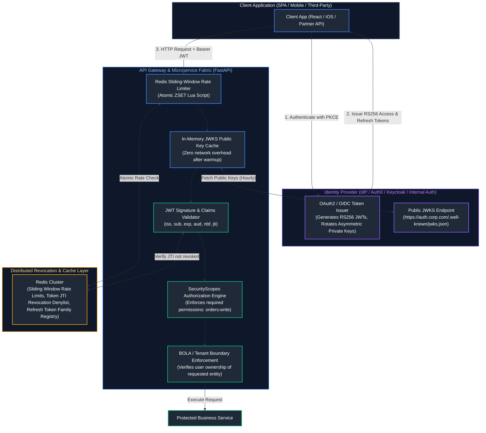
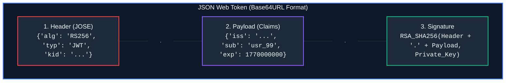
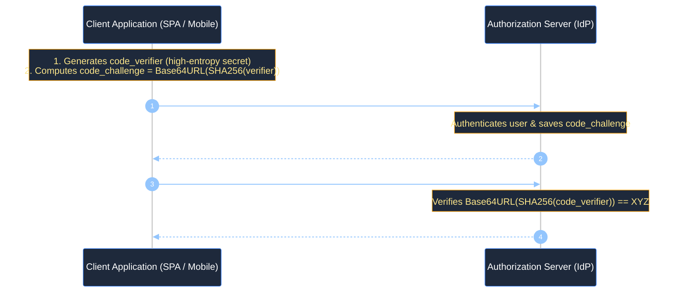

# 11. Security, Identity, and Authentication

A comprehensive, production-grade guide to backend application security, cryptographic authentication, Argon2id password hashing, asymmetric RS256 JWTs with JSON Web Key Set (JWKS) key rotation, refresh token family rotation with breach detection, OAuth2 Authorization Code Flow with PKCE, granular RBAC with FastAPI `SecurityScopes`, atomic Redis sliding-window rate limiting, and defensive code patterns mitigating the OWASP API Security Top 10 for Senior Backend Engineers and Application Security Architects.

---

## Architectural Overview: Asymmetric OAuth2/OIDC, RBAC & Zero-Trust Token Flow



---

## Table of Contents
1. [Authentication Paradigms: Sessions vs. JWT vs. API Keys](#1-authentication-paradigms-sessions-vs-jwt-vs-api-keys)
   - [1.1 Conceptual Foundations: Authentication vs. Authorization](#11-conceptual-foundations-authentication-vs-authorization)
   - [1.2 State Comparison: Stateful Sessions vs. Stateless Claims](#12-state-comparison-stateful-sessions-vs-stateless-claims)
   - [1.3 OWASP Security Decision Matrix](#13-owasp-security-decision-matrix)
2. [Cryptographic Password Hashing: Argon2id vs. BCrypt](#2-cryptographic-password-hashing-argon2id-vs-bcrypt)
   - [2.1 Why General-Purpose Hashes (SHA-256) Fail for Passwords](#21-why-general-purpose-hashes-sha-256-fail-for-passwords)
   - [2.2 Argon2id Internals: Memory-Hard, CPU-Hard, and GPU-Resistant](#22-argon2id-internals-memory-hard-cpu-hard-and-gpu-resistant)
   - [2.3 Production Implementation with `argon2-cffi`](#23-production-implementation-with-argon2-cffi)
3. [JWT Architecture & Asymmetric RS256/JWKS Implementation](#3-jwt-architecture--asymmetric-rs256jwks-implementation)
   - [3.1 Anatomy of a JSON Web Token: Header, Payload, Signature](#31-anatomy-of-a-json-web-token-header-payload-signature)
   - [3.2 Standard RFC 7519 Claims: `iss`, `sub`, `aud`, `exp`, `nbf`, `iat`, `jti`](#32-standard-rfc-7519-claims-iss-sub-aud-exp-nbf-iat-jti)
   - [3.3 Symmetric (HS256) vs. Asymmetric (RS256 / EdDSA) Cryptography](#33-symmetric-hs256-vs-asymmetric-rs256--eddsa-cryptography)
   - [3.4 JSON Web Key Sets (JWKS) & Zero-Downtime Public Key Rotation](#34-json-web-key-sets-jwks--zero-downtime-public-key-rotation)
   - [3.5 Minting RS256 Tokens and Generating JWKS in Python](#35-minting-rs256-tokens-and-generating-jwks-in-python)
4. [Token Lifecycle Management: Refresh Token Rotation & Blacklisting](#4-token-lifecycle-management-refresh-token-rotation--blacklisting)
   - [4.1 Short-Lived Access Tokens vs. Long-Lived Refresh Tokens](#41-short-lived-access-tokens-vs-long-lived-refresh-tokens)
   - [4.2 Refresh Token Rotation (RTR) & Token Family Revocation](#42-refresh-token-rotation-rtr--token-family-revocation)
   - [4.3 High-Performance Token Blacklisting with Redis JTI Sets](#43-high-performance-token-blacklisting-with-redis-jti-sets)
5. [OAuth2 & OpenID Connect (OIDC) Protocols](#5-oauth2--openid-connect-oidc-protocols)
   - [5.1 Authorization Code Flow with PKCE (RFC 7636)](#51-authorization-code-flow-with-pkce-rfc-7636)
   - [5.2 Complete Python Implementation of PKCE Verifier and Challenge](#52-complete-python-implementation-of-pkce-verifier-and-challenge)
   - [5.3 Machine-to-Machine (M2M) Client Credentials Flow](#53-machine-to-machine-m2m-client-credentials-flow)
6. [Authorization Frameworks: RBAC & ABAC with FastAPI `SecurityScopes`](#6-authorization-frameworks-rbac--abac-with-fastapi-securityscopes)
   - [6.1 Role-Based Access Control (RBAC) vs. Attribute-Based Access Control (ABAC)](#61-role-based-access-control-rbac-vs-attribute-based-access-control-abac)
   - [6.2 Implementing Granular Scopes with FastAPI `SecurityScopes`](#62-implementing-granular-scopes-with-fastapi-securityscopes)
7. [Distributed Rate Limiting with Redis Sliding Windows](#7-distributed-rate-limiting-with-redis-sliding-windows)
   - [7.1 Algorithmic Comparison: Fixed Window vs. Token Bucket vs. Sliding Window](#71-algorithmic-comparison-fixed-window-vs-token-bucket-vs-sliding-window)
   - [7.2 Atomic Redis Sorted Set (ZSET) Sliding-Window Implementation in Lua](#72-atomic-redis-sorted-set-zset-sliding-window-implementation-in-lua)
8. [Defensive Engineering for the OWASP API Security Top 10](#8-defensive-engineering-for-the-owasp-api-security-top-10)
   - [8.1 Broken Object Level Authorization (BOLA/IDOR)](#81-broken-object-level-authorization-bolaidor)
   - [8.2 Broken Authentication & Password Reset Race Conditions](#82-broken-authentication--password-reset-race-conditions)
   - [8.3 Broken Object Property Level Authorization (Mass Assignment)](#83-broken-object-property-level-authorization-mass-assignment)
   - [8.4 Unrestricted Resource Consumption & ReDoS Protection](#84-unrestricted-resource-consumption--redos-protection)
   - [8.5 Server-Side Request Forgery (SSRF) Defense & Private IP Filtering](#85-server-side-request-forgery-ssrf-defense--private-ip-filtering)
   - [8.6 Cross-Origin Resource Sharing (CORS) Security Configurations](#86-cross-origin-resource-sharing-cors-security-configurations)
   - [8.7 Secure File Uploads: Magic Bytes Inspection & Path Traversal Guards](#87-secure-file-uploads-magic-bytes-inspection--path-traversal-guards)
9. [Summary Comparison & Engineering Reference Matrix](#9-summary-comparison--engineering-reference-matrix)
10. [References & Further Reading](#10-references--further-reading)

---

# 1. Authentication Paradigms: Sessions vs. JWT vs. API Keys

### 1.1 Conceptual Foundations: Authentication vs. Authorization

#### Intuitive Analogy: The Airport Security Checkpoint vs. The VIP Lounge
To understand security engineering, you must strictly decouple two distinct phases:
1. **Authentication (AuthN - "Who are you?")**: You present your physical passport at the airport border control. The border guard verifies your passport photograph, checks the embedded biometric chip, and validates that the passport was issued by an authentic government authority. Once verified, your identity is proven.
2. **Authorization (AuthZ - "What are you permitted to do?")**: Once through security, you walk toward the First-Class VIP Lounge. The lounge attendant does not care about your citizenship or your government passport—they inspect your **boarding pass** to check if you purchased a First-Class ticket. If you have an Economy ticket, you are denied entry (HTTP 403 Forbidden), despite being fully authenticated!

---

### 1.2 State Comparison: Stateful Sessions vs. Stateless Claims

| Dimension | Stateful Server Sessions (Cookies) | Stateless Token (JWT) | Pre-Shared API Keys |
| :--- | :--- | :--- | :--- |
| **Storage Location** | Server RAM / Redis / DB table | Client Memory / Encrypted Cookie | Client Environment / Secret Vault |
| **Verification Overhead** | High ($O(1)$ DB / Redis lookup on *every single request*) | **Zero database lookups** (Verified via CPU math) | $O(1)$ Hash lookup in cache/DB |
| **Immediate Revocation** | **Trivial** (Delete session key in Redis) | Difficult (Requires denylist or short TTL) | Immediate (Disable key in DB) |
| **Horizontal Scalability** | Requires centralized Redis cluster | **Massive** (Zero cross-service state) | Requires caching tier |
| **Best Production Fit** | Server-rendered web apps, bank portals | **Distributed microservices, mobile apps, SPAs** | B2B developer APIs, automation bots |
---

### 1.3 OWASP Security Decision Matrix

When selecting an authentication architecture for enterprise systems, adhere to the OWASP security decision rubric:
1. **Choose Stateful Sessions** when building monolithic, server-rendered applications (Django, Flask + Jinja2) where instant session revocation on password reset or account freeze is mandatory.
2. **Choose Asymmetric JWTs (RS256 / EdDSA)** when building distributed microservices, single-page applications (React / Vue), or mobile apps where edge API Gateways verify signatures without central database bottlenecks.
3. **Choose Hashed API Keys (SHA-256 with constant-time lookup)** for machine-to-machine (M2M) automated pipelines, webhook endpoints, and external customer developer integrations.

---

# 2. Cryptographic Password Hashing: Argon2id vs. BCrypt

### 2.1 Why General-Purpose Hashes (SHA-256) Fail for Passwords

> [!CAUTION]
> **The Cryptographic Hash Trap**:
> Never use SHA-256, SHA-512, or MD5 for password storage, even with custom salts!
> General-purpose cryptographic hashes were explicitly designed for **speed** (to checksum gigabytes of data in seconds).
> Modern GPUs and ASIC mining rigs compute **billions of SHA-256 hashes per second**. A password hashed with SHA-256 can be brute-forced across the entire 8-character alphanumeric keyspace in minutes!

---

### 2.2 Argon2id Internals: Memory-Hard, CPU-Hard, and GPU-Resistant

**Argon2** is the winner of the Password Hashing Competition (PHC) and is the **OWASP top recommendation** (RFC 9106):
* **Argon2d**: Data-dependent memory access (resists GPU attacks, but vulnerable to CPU side-channel cache-timing attacks).
* **Argon2i**: Data-independent memory access (immune to side-channel timing attacks).
* **Argon2id**: **Hybrid algorithm**. Uses Argon2i passes over initial memory to defeat side-channel attacks, followed by Argon2d passes to maximize resistance against GPU and ASIC brute-forcing.

---

### 2.3 Production Implementation with `argon2-cffi`

```python
from argon2 import PasswordHasher
from argon2.exceptions import VerifyMismatchError

# OWASP Recommended Production Parameters:
# - time_cost = 3 (iterations)
# - memory_cost = 65536 KiB (64 MB of RAM allocation per hash!)
# - parallelism = 4 (threads)
# - hash_len = 32 bytes
ph = PasswordHasher(
    time_cost=3,
    memory_cost=65536,
    parallelism=4,
    hash_len=32,
    salt_len=16,
)

def hash_user_password(plain_password: str) -> str:
    """Computes a cryptographically secure Argon2id hash with random 16-byte salt."""
    return ph.hash(plain_password)

def verify_and_rehash(plain_password: str, hashed_password: str) -> tuple[bool, str | None]:
    """
    Verifies password and checks if the hash needs upgrading to newer cost parameters.
    """
    try:
        ph.verify(hashed_password, plain_password)
    except VerifyMismatchError:
        return False, None

    # Check if parameters have evolved and rehash if necessary
    new_hash = None
    if ph.check_needs_rehash(hashed_password):
        new_hash = ph.hash(plain_password)

    return True, new_hash

# Demonstration
secure_hash = hash_user_password("super-secret-password-123!")
print(f"Argon2id Output: {secure_hash}")
# Output format: $argon2id$v=19$m=65536,t=3,p=4$...
```

---

# 3. JWT Architecture & Asymmetric RS256/JWKS Implementation

### 3.1 Anatomy of a JSON Web Token: Header, Payload, Signature

A JWT (RFC 7519) consists of three Base64URL-encoded JSON segments separated by dots (`.`):



| JWT Segment | Encoding | Content / Schema | Purpose |
| :--- | :--- | :--- | :--- |
| **Header** | Base64URL | JSON object specifying cryptographic algorithm (`alg`) and token type (`typ`) | Directs the cryptographic verifier on which key (`kid`) and algorithm to use |
| **Payload** | Base64URL | JSON claims set (`iss`, `sub`, `exp`, roles, custom metadata) | Carries authenticated identity and permission data (readable by anyone, not encrypted) |
| **Signature** | Base64URL | Cryptographic digest over `Header.Payload` signed by the IdP private key | Guarantees tamper-evidence and authenticity; invalidates token if any claim is modified |

---

### 3.2 Standard RFC 7519 Claims: `iss`, `sub`, `aud`, `exp`, `nbf`, `iat`, `jti`

* **`iss` (Issuer)**: URL of the identity provider issuing the token (`https://auth.enterprise.com`).
* **`sub` (Subject)**: Unique identifier of the authenticated user/entity (`usr_40219`).
* **`aud` (Audience)**: Target recipient API identifier (`https://api.enterprise.com/v1`).
* **`exp` (Expiration Time)**: Unix timestamp when token becomes invalid.
* **`nbf` (Not Before)**: Unix timestamp before which token must not be accepted.
* **`iat` (Issued At)**: Unix timestamp when token was created.
* **`jti` (JWT ID)**: Globally unique identifier for this specific token (used for revocation).

---

### 3.3 Symmetric (HS256) vs. Asymmetric (RS256 / EdDSA) Cryptography

* **HS256 (HMAC with SHA-256)**: Symmetric encryption. The **exact same secret key** is used to both sign and verify the token. 
  - *Catastrophic Risk*: If you share the key with 10 downstream microservices so they can verify tokens, any compromised microservice can forge valid tokens for any user in the entire company!
* **RS256 (RSA Signature with SHA-256)**: Asymmetric encryption. 
  - The Auth Server signs tokens using a **Private Key** (never leaves the auth server).
  - All microservices verify tokens using a **Public Key** (safe to publish to the world).
  - Even if a microservice is hacked, the attacker cannot forge tokens!

---

### 3.4 JSON Web Key Sets (JWKS) & Zero-Downtime Public Key Rotation

Downstream microservices fetch public keys from the Auth Server’s **JWKS endpoint** (`/.well-known/jwks.json`):

```python
import jwt
from jwt import PyJWKClient
from fastapi import HTTPException, status

JWKS_URL = "https://auth.enterprise.com/.well-known/jwks.json"

# In-memory cached JWKS client: automatically caches keys and rotates on unknown 'kid'
jwks_client = PyJWKClient(JWKS_URL, cache_keys=True, max_cached_keys=16)

def decode_and_verify_jwt(token: str) -> dict:
    try:
        # 1. Extract 'kid' (Key ID) from JWT header and fetch matching public key
        signing_key = jwks_client.get_signing_key_from_jwt(token)

        # 2. Cryptographically verify signature and standard claims
        payload = jwt.decode(
            token,
            signing_key.key,
            algorithms=["RS256"],
            audience="https://api.enterprise.com",
            issuer="https://auth.enterprise.com",
            options={"require": ["exp", "iss", "sub", "aud", "jti"]},
        )
        return payload
    except jwt.ExpiredSignatureError:
        raise HTTPException(status_code=status.HTTP_401_UNAUTHORIZED, detail="Token has expired")
    except jwt.InvalidTokenError as exc:
        raise HTTPException(status_code=status.HTTP_401_UNAUTHORIZED, detail=f"Invalid token: {exc}")
```

---

### 3.5 Minting RS256 Tokens and Generating JWKS in Python

Here is the complete implementation for generating RSA key pairs, publishing public JWKS JSON, and minting RS256 JWTs using Python's `cryptography` and `PyJWT`:

```python
from cryptography.hazmat.primitives.asymmetric import rsa
from cryptography.hazmat.primitives import serialization
import jwt
import time
import base64
import json

# 1. Generate 2048-bit RSA Private Key
private_key = rsa.generate_private_key(
    public_exponent=65537,
    key_size=2048,
)

public_key = private_key.public_key()
KID = "auth-rsa-key-2026-v1"

# 2. Export Public Key into JSON Web Key (JWK) Format
public_numbers = public_key.public_numbers()

def int_to_base64url(val: int) -> str:
    byte_length = (val.bit_length() + 7) // 8
    val_bytes = val.to_bytes(byte_length, byteorder="big")
    return base64.urlsafe_b64encode(val_bytes).decode("utf-8").rstrip("=")

jwk_representation = {
    "kty": "RSA",
    "use": "sig",
    "alg": "RS256",
    "kid": KID,
    "n": int_to_base64url(public_numbers.n),
    "e": int_to_base64url(public_numbers.e),
}

# The public JWKS endpoint returns this JSON:
jwks_document = {"keys": [jwk_representation]}

# 3. Mint Signed RS256 Token
def mint_access_token(user_id: str, scopes: list[str]) -> str:
    now = int(time.time())
    payload = {
        "iss": "https://auth.enterprise.com",
        "sub": user_id,
        "aud": "https://api.enterprise.com",
        "exp": now + 900,  # 15 minute lifespan
        "iat": now,
        "nbf": now,
        "jti": f"jti_{time.time_ns()}",
        "scope": " ".join(scopes),
    }
    
    # Serialize private key to PEM for PyJWT
    pem_private = private_key.private_bytes(
        encoding=serialization.Encoding.PEM,
        format=serialization.PrivateFormat.PKCS8,
        encryption_algorithm=serialization.NoEncryption(),
    )

    token = jwt.encode(payload, pem_private, algorithm="RS256", headers={"kid": KID})
    return token
```

---

# 4. Token Lifecycle Management: Refresh Token Rotation & Blacklisting

### 4.1 Short-Lived Access Tokens vs. Long-Lived Refresh Tokens

* **Access Token**: Short lifespan (**15 minutes**). Transmitted in the `Authorization: Bearer <token>` header with every API call.
* **Refresh Token**: Long lifespan (**7 to 30 days**). Stored in a `Secure`, `HttpOnly`, `SameSite=Strict` cookie. Used only at `/v1/auth/refresh` to mint new access tokens.

---

### 4.2 Refresh Token Rotation (RTR) & Token Family Revocation

> [!IMPORTANT]
> **Refresh Token Rotation (RFC 6749 Section 10.4)**:
> Every time a refresh token is used to issue a new access token, **the refresh token itself is invalidated and replaced with a brand new refresh token**!
> 
> **Token Reuse Detection (The Family Revocation Trap)**:
> If an attacker steals a refresh token and uses it, and the legitimate user later attempts to use the same token, the server detects that an already-used token was submitted.
> The server immediately treats this as an active breach and **revokes the entire token family**, forcing the attacker and user to re-authenticate from scratch!

```python
import uuid
import time
import redis.asyncio as aioredis

async def rotate_refresh_token(
    redis: aioredis.Redis, user_id: str, submitted_token: str, token_family_id: str
) -> tuple[str, str]:
    family_key = f"token_family:{token_family_id}"
    
    # 1. Fetch the currently active refresh token for this family
    current_active_token = await redis.get(family_key)
    
    if current_active_token is None:
        raise ValueError("Invalid or expired session. Please log in again.")

    # 2. Detect Replay Attack: If submitted token != current active token, a theft occurred!
    if submitted_token != current_active_token:
        # BREACH DETECTED: Revoke entire token family immediately!
        await redis.delete(family_key)
        raise SecurityError("CRITICAL: Stolen refresh token replay detected! Session terminated.")

    # 3. Mint fresh token pair
    new_refresh_token = f"rt_{uuid.uuid4().hex}"
    new_access_token = f"at_{uuid.uuid4().hex}"

    # 4. Atomically update active token in family with 7-day TTL
    await redis.set(family_key, new_refresh_token, ex=7 * 86400)
    
    return new_access_token, new_refresh_token
```

---

### 4.3 High-Performance Token Blacklisting with Redis JTI Sets

When a user clicks "Log Out" or changes their password, you must revoke their active 15-minute access token immediately without waiting for `exp` to lapse.
Store the token’s unique `jti` in Redis with a TTL matching the token's remaining lifespan:

```python
async def revoke_access_token(redis: aioredis.Redis, jti: str, exp_timestamp: int) -> None:
    ttl = int(exp_timestamp - time.time())
    if ttl > 0:
        # Cache revoked JTI until its original expiration timestamp
        await redis.set(f"token_blacklist:{jti}", "revoked", ex=ttl)

async def is_token_revoked(redis: aioredis.Redis, jti: str) -> bool:
    return bool(await redis.exists(f"token_blacklist:{jti}"))
```

---

# 5. OAuth2 & OpenID Connect (OIDC) Protocols

### 5.1 Authorization Code Flow with PKCE (RFC 7636)

For Single Page Applications (React/Vue) and Mobile Apps, storing a `client_secret` in client code is impossible (users can inspect the JavaScript bundle or decompile the APK).
The **Authorization Code Flow with Proof Key for Code Exchange (PKCE)** protects against authorization code interception attacks:



---

### 5.2 Complete Python Implementation of PKCE Verifier and Challenge

```python
import secrets
import hashlib
import base64

def generate_pkce_pair() -> tuple[str, str]:
    """
    Generates a cryptographically random code_verifier and its derived
    Base64URL SHA-256 code_challenge per RFC 7636.
    """
    # 1. Generate high-entropy code_verifier (43 to 128 characters)
    code_verifier = secrets.token_urlsafe(64)

    # 2. Calculate SHA-256 hash of verifier
    digest = hashlib.sha256(code_verifier.encode("ascii")).digest()

    # 3. Base64URL encode without padding
    code_challenge = base64.urlsafe_b64encode(digest).decode("ascii").rstrip("=")

    return code_verifier, code_challenge

def verify_pkce_challenge(code_verifier: str, stored_challenge: str) -> bool:
    """Server-side verification of submitted verifier against original challenge."""
    digest = hashlib.sha256(code_verifier.encode("ascii")).digest()
    recomputed_challenge = base64.urlsafe_b64encode(digest).decode("ascii").rstrip("=")
    return secrets.compare_digest(recomputed_challenge, stored_challenge)
```

---

### 5.3 Machine-to-Machine (M2M) Client Credentials Flow

When two backend microservices communicate directly without user interaction:
```python
import httpx

async def fetch_m2m_token(auth_url: str, client_id: str, client_secret: str) -> str:
    async with httpx.AsyncClient() as client:
        response = await client.post(
            f"{auth_url}/oauth/token",
            data={
                "grant_type": "client_credentials",
                "client_id": client_id,
                "client_secret": client_secret,
                "audience": "https://api.enterprise.com",
            },
        )
        response.raise_for_status()
        return response.json()["access_token"]
```

---

# 6. Authorization Frameworks: RBAC & ABAC with FastAPI `SecurityScopes`

### 6.1 Role-Based Access Control (RBAC) vs. Attribute-Based Access Control (ABAC)

* **RBAC**: Permissions assigned to static roles (`ADMIN`, `OPERATOR`, `VIEWER`). Simple to audit, but inflexible for fine-grained rules.
* **ABAC**: Decisions evaluated dynamically based on attributes (e.g. `user.department == resource.department AND request.time < 18:00 AND request.ip IN office_network`).

---

### 6.2 Implementing Granular Scopes with FastAPI `SecurityScopes`

FastAPI provides first-class support for OAuth2 scopes via `SecurityScopes`:

```python
from fastapi import FastAPI, Depends, HTTPException, Security, status
from fastapi.security import OAuth2PasswordBearer, SecurityScopes
from pydantic import BaseModel

app = FastAPI()

oauth2_scheme = OAuth2PasswordBearer(
    tokenUrl="/v1/auth/token",
    scopes={
        "orders:read": "Read access to customer order history",
        "orders:write": "Permission to place or cancel orders",
        "admin:all": "Full administrative override privileges",
    },
)

class AuthenticatedUser(BaseModel):
    user_id: str
    scopes: list[str]

async def get_current_user(
    security_scopes: SecurityScopes, token: str = Depends(oauth2_scheme)
) -> AuthenticatedUser:
    # 1. Decode token and extract user scopes
    payload = decode_and_verify_jwt(token)
    user_scopes: list[str] = payload.get("scope", "").split()
    user = AuthenticatedUser(user_id=payload["sub"], scopes=user_scopes)

    # 2. Verify that user possesses all required endpoint scopes
    for required_scope in security_scopes.scopes:
        if required_scope not in user.scopes and "admin:all" not in user.scopes:
            raise HTTPException(
                status_code=status.HTTP_403_FORBIDDEN,
                detail=f"Insufficient permissions: Missing scope '{required_scope}'",
            )
    return user

@app.post("/v1/orders")
async def create_order(
    # Endpoint requires 'orders:write' scope
    current_user: AuthenticatedUser = Security(get_current_user, scopes=["orders:write"]),
):
    return {"message": "Order created successfully", "user": current_user.user_id}
```

---

# 7. Distributed Rate Limiting with Redis Sliding Windows

### 7.1 Algorithmic Comparison: Fixed Window vs. Token Bucket vs. Sliding Window

* **Fixed Window (Counter)**: Resets every hour.
  - *Vulnerability*: A client sends 100 requests at 11:59 and 100 requests at 12:01, bursting 200 requests within 2 minutes!
* **Token Bucket**: Smooths bursts, but complex to implement across distributed multi-master nodes.
* **Sliding Window Log (Redis ZSET)**: Tracks exact millisecond timestamps of every request in a sorted set. Completely eliminates boundary burst vulnerabilities!

---

### 7.2 Atomic Redis Sorted Set (ZSET) Sliding-Window Implementation in Lua

Using an **atomic Lua script** guarantees that all operations execute in a single round-trip without race conditions:

```lua
-- Redis Lua Script for Atomic Sliding-Window Rate Limiter
local key = KEYS[1]
local now = tonumber(ARGV[1])
local window = tonumber(ARGV[2])
local limit = tonumber(ARGV[3])
local clear_before = now - window

-- 1. Remove all requests older than the sliding window boundary
redis.call('ZREMRANGEBYSCORE', key, 0, clear_before)

-- 2. Count current requests inside the active window
local current_requests = redis.call('ZCARD', key)

-- 3. Check threshold
if current_requests < limit then
    -- Record current request timestamp as both score and member
    redis.call('ZADD', key, now, now .. '-' .. math.random(1000, 9999))
    redis.call('EXPIRE', key, math.ceil(window / 1000))
    return 1 -- Allowed
else
    return 0 -- Rate limited (HTTP 429)
end
```

#### Python FastAPI Rate Limiting Middleware:
```python
import redis.asyncio as aioredis
import time
from fastapi import Request, HTTPException, status

SLIDING_WINDOW_LUA = """... (Lua script above) ..."""

class SlidingWindowRateLimiter:
    def __init__(self, redis: aioredis.Redis, limit: int = 100, window_seconds: int = 60):
        self.redis = redis
        self.limit = limit
        self.window_ms = window_seconds * 1000
        self.script = self.redis.register_script(SLIDING_WINDOW_LUA)

    async def check_rate_limit(self, identifier: str) -> None:
        key = f"ratelimit:{identifier}"
        now_ms = int(time.time() * 1000)
        
        is_allowed = await self.script(keys=[key], args=[now_ms, self.window_ms, self.limit])
        if not is_allowed:
            raise HTTPException(
                status_code=status.HTTP_429_TOO_MANY_REQUESTS,
                detail="Rate limit exceeded. Please retry later.",
                headers={"Retry-After": "60"},
            )
```

---

# 8. Defensive Engineering for the OWASP API Security Top 10

### 8.1 Broken Object Level Authorization (BOLA/IDOR)

> [!CAUTION]
> **OWASP API #1 Vulnerability: BOLA / IDOR**:
> Occurs when an API endpoint takes an object ID (`/v1/orders/1042`) and retrieves the order without verifying that the requesting user owns that order!

#### Production Remediation:
Always enforce tenant/ownership filters at the SQL query level:

```python
# VULNERABLE:
# order = await session.get(Order, order_id)

# SECURE: Always append current_user.id to the WHERE clause!
stmt = (
    select(Order)
    .where(Order.id == order_id)
    .where(Order.customer_id == current_user.user_id) # BOLA protection!
)
order = (await session.scalars(stmt)).first()
if not order:
    raise HTTPException(status_code=404, detail="Order not found")
```

---

### 8.2 Broken Authentication & Password Reset Race Conditions

In password reset or multi-factor authentication (MFA) validation flows, an attacker can launch 100 concurrent requests guessing a 6-digit OTP code before the rate limiter triggers.
**Remediation**: Use atomic distributed counters in Redis that decrement remaining attempts *before* checking the code:

```python
async def verify_otp_atomic(redis: aioredis.Redis, user_id: str, submitted_otp: str) -> bool:
    attempts_key = f"otp_attempts:{user_id}"
    code_key = f"otp_code:{user_id}"

    # Atomic decrement of remaining attempts
    remaining = await redis.decr(attempts_key)
    if remaining < 0:
        await redis.delete(code_key) # Invalidate code immediately!
        raise HTTPException(status_code=429, detail="Maximum verification attempts exceeded")

    real_otp = await redis.get(code_key)
    if real_otp and secrets.compare_digest(submitted_otp, real_otp):
        await redis.delete(code_key)
        return True
    return False
```

---

### 8.3 Broken Object Property Level Authorization (Mass Assignment)

When updating user profiles, directly updating database rows from unrestricted client JSON allows attackers to inject `{ "is_admin": true, "account_balance": 1000000 }`.
**Remediation**: Use strict Pydantic V2 schemas with `extra="forbid"`:

```python
from pydantic import BaseModel, Field, ConfigDict

class UserProfileUpdateRequest(BaseModel):
    model_config = ConfigDict(extra="forbid") # Rejects unexpected properties!

    display_name: str = Field(..., max_length=50)
    bio: str | None = Field(default=None, max_length=250)
    # Notice: is_admin, role, and balance are impossible to inject here!
```

---

### 8.4 Unrestricted Resource Consumption & ReDoS Protection

Malicious regular expressions with catastrophic backtracking (ReDoS) freeze the Python GIL and event loop:
* Avoid nested quantifiers: `^(a+)+$` evaluated against `aaaaaaaaaaaaaaaaaaaaaaaa!`.
* Use linear-time regular expression engines like **Google's `re2`** (`google-re2` Python bindings) for untrusted user inputs.

---

### 8.5 Server-Side Request Forgery (SSRF) Defense & Private IP Filtering

When your application fetches user-supplied URLs (e.g., webhook testing, profile image import), an attacker can supply internal infrastructure URLs (`http://169.254.169.254/latest/meta-data/` to steal AWS IAM credentials, or `http://localhost:6379` to access Redis).

```python
import ipaddress
import socket
from urllib.parse import urlparse

def validate_public_url(url: str) -> None:
    parsed = urlparse(url)
    if parsed.scheme not in ("http", "https"):
        raise ValueError("Invalid URL scheme")

    # Resolve hostname to IP address
    ip_str = socket.gethostbyname(parsed.hostname)
    ip_obj = ipaddress.ip_address(ip_str)

    # BLOCK Private, Loopback, Link-Local, and Cloud Metadata Addresses!
    if ip_obj.is_private or ip_obj.is_loopback or ip_obj.is_link_local:
        raise PermissionError(f"Access to private network IP {ip_str} is forbidden (SSRF protection).")

    # AWS/GCP Metadata IP check
    if ip_str == "169.254.169.254":
        raise PermissionError("Access to Cloud Metadata service is forbidden.")
```

---

### 8.6 Cross-Origin Resource Sharing (CORS) Security Configurations

```python
from fastapi.middleware.cors import CORSMiddleware

# SECURE CORS CONFIGURATION
app.add_middleware(
    CORSMiddleware,
    # NEVER use allow_origins=["*"] if allow_credentials=True!
    allow_origins=[
        "https://app.enterprise.com",
        "https://admin.enterprise.com",
    ],
    allow_credentials=True,
    allow_methods=["GET", "POST", "PUT", "PATCH", "DELETE", "OPTIONS"],
    allow_headers=["Authorization", "Content-Type", "X-Correlation-ID"],
    max_age=86400, # Cache preflight OPTIONS for 24 hours
)
```

---

### 8.7 Secure File Uploads: Magic Bytes Inspection & Path Traversal Guards

```python
from fastapi import UploadFile, HTTPException
import magic # python-magic
import uuid

ALLOWED_MIME_TYPES = {"image/jpeg", "image/png", "application/pdf"}

async def process_secure_upload(file: UploadFile) -> str:
    # 1. Read first 2048 bytes to inspect magic signature bytes
    header_bytes = await file.read(2048)
    detected_mime = magic.from_buffer(header_bytes, mime=True)
    await file.seek(0) # Reset stream pointer

    if detected_mime not in ALLOWED_MIME_TYPES:
        raise HTTPException(status_code=400, detail=f"Disallowed file type: {detected_mime}")

    # 2. Prevent Path Traversal attacks (e.g. filename = '../../etc/passwd')
    # Generate an unguessable UUID filename and discard user-supplied name
    ext = ".jpg" if detected_mime == "image/jpeg" else ".png"
    safe_filename = f"{uuid.uuid4().hex}{ext}"
    
    return safe_filename
```

---

### 8.8 Cross-Site Request Forgery (CSRF) Defense: Double Submit Cookie Pattern

While mobile applications and pure API clients using `Authorization: Bearer <token>` are inherently immune to CSRF, web applications using cookies for authentication are vulnerable.
In the **Double Submit Cookie Pattern**, the server sets a cryptographically random token in a cookie (`XSRF-TOKEN`), and the frontend must read this cookie and inject it into a custom HTTP request header (`X-XSRF-TOKEN`) on mutating requests (`POST`, `PUT`, `DELETE`):

```python
import secrets
from fastapi import FastAPI, Request, HTTPException, status
from starlette.middleware.base import BaseHTTPMiddleware

class CSRFProtectionMiddleware(BaseHTTPMiddleware):
    """
    Enforces the Double Submit Cookie pattern on mutating HTTP requests.
    Validates that the 'X-XSRF-TOKEN' header matches the 'xsrf_token' cookie.
    """
    SAFE_METHODS = {"GET", "HEAD", "OPTIONS", "TRACE"}

    async def dispatch(self, request: Request, call_next):
        if request.method not in self.SAFE_METHODS:
            cookie_token = request.cookies.get("xsrf_token")
            header_token = request.headers.get("x-xsrf-token")

            if not cookie_token or not header_token:
                raise HTTPException(
                    status_code=status.HTTP_403_FORBIDDEN, 
                    detail="CSRF token missing from cookie or request header"
                )

            # Constant-time comparison to prevent timing attacks
            if not secrets.compare_digest(cookie_token, header_token):
                raise HTTPException(
                    status_code=status.HTTP_403_FORBIDDEN, 
                    detail="CSRF token validation failed"
                )

        response = await call_next(request)

        # Set fresh CSRF cookie if not present
        if "xsrf_token" not in request.cookies:
            new_token = secrets.token_urlsafe(32)
            response.set_cookie(
                key="xsrf_token",
                value=new_token,
                httponly=False,  # JavaScript must be able to read this cookie to set the header!
                samesite="lax",
                secure=True,     # HTTPS only in production
            )
        return response
```

---

### 8.9 Multi-Factor Authentication (MFA): Pure Python TOTP (RFC 6238) Engine

Instead of relying on heavy third-party black-box libraries, senior backend engineers must understand the mathematical mechanics of **Time-Based One-Time Passwords (TOTP - RFC 6238)** used by Google Authenticator, 1Password, and Authy:

```python
import base64
import hashlib
import hmac
import struct
import time

class EnterpriseTOTPEngine:
    """
    Turnkey RFC 6238 TOTP Engine:
    Uses HMAC-SHA1 over 30-second time-step windows to generate 6-digit codes.
    """
    TIME_STEP = 30
    DIGITS = 6

    @classmethod
    def generate_secret(cls) -> str:
        """Generates a cryptographically secure 160-bit Base32 secret seed."""
        raw_bytes = secrets.token_bytes(20)
        return base64.b32encode(raw_bytes).decode("utf-8").replace("=", "")

    @classmethod
    def compute_totp(cls, secret_base32: str, timestamp: int | None = None) -> str:
        """Computes the current 6-digit TOTP code for the given secret."""
        if timestamp is None:
            timestamp = int(time.time())

        # 1. Calculate time step counter T = floor((CurrentUnixTime - T0) / X)
        time_counter = timestamp // cls.TIME_STEP

        # 2. Pack counter into big-endian 8-byte integer (RFC 4226)
        counter_bytes = struct.pack(">Q", time_counter)

        # 3. Decode base32 secret
        # Pad secret with '=' if missing
        padding = (8 - (len(secret_base32) % 8)) % 8
        padded_secret = secret_base32 + ("=" * padding)
        key_bytes = base64.b32decode(padded_secret, casefold=True)

        # 4. Compute HMAC-SHA1 hash
        hmac_hash = hmac.new(key_bytes, counter_bytes, hashlib.sha1).digest()

        # 5. Dynamic Truncation: Use lowest 4 bits of the last byte as offset
        offset = hmac_hash[-1] & 0x0F

        # 6. Extract 4 bytes from offset and mask high bit to prevent sign confusion
        code_int = struct.unpack(">I", hmac_hash[offset : offset + 4])[0] & 0x7FFFFFFF

        # 7. Modulo 10^DIGITS to extract final 6-digit integer
        code = code_int % (10**cls.DIGITS)
        return f"{code:0{cls.DIGITS}d}"

    @classmethod
    def verify_totp(cls, secret_base32: str, submitted_code: str, window: int = 1) -> bool:
        """
        Verifies submitted code with a +/- window tolerance for slight client clock drift.
        window=1 checks [t-30s, t, t+30s].
        """
        current_time = int(time.time())
        for delta in range(-window, window + 1):
            check_time = current_time + (delta * cls.TIME_STEP)
            expected_code = cls.compute_totp(secret_base32, check_time)
            if secrets.compare_digest(submitted_code, expected_code):
                return True
        return False

# Example usage:
# secret = EnterpriseTOTPEngine.generate_secret()
# current_code = EnterpriseTOTPEngine.compute_totp(secret)
# assert EnterpriseTOTPEngine.verify_totp(secret, current_code) is True
```

---

# 9. Summary Comparison & Engineering Reference Matrix

| Security Mechanism | Primary Vulnerability Mitigated | Performance Overhead | Implementation Stack |
| :--- | :--- | :--- | :--- |
| **Argon2id Hashing** | Password brute-forcing, GPU cracking | High ($64\text{ MB RAM}, \approx 50\text{ ms CPU}$) | `argon2-cffi` |
| **Asymmetric RS256 JWT** | Key theft, token forgery across services | Negligible (Cached public key verification) | `PyJWT`, `cryptography` |
| **Refresh Token Rotation** | Replay of stolen refresh tokens | Low ($O(1)$ Redis check during token refresh) | Redis Atomic Lua |
| **FastAPI `SecurityScopes`**| Broken Function Level Authorization | Sub-millisecond (In-memory claim check) | `fastapi.SecurityScopes` |
| **Redis ZSET Sliding Window** | DoS, brute-force attacks, resource exhaustion | Low ($O(\log N)$ ZSET insertion in Redis) | Redis Lua Script |
| **Tenant SQL Filters** | Broken Object Level Authorization (BOLA/IDOR) | Zero (Optimized by database index) | SQLAlchemy `where()` |
| **Private IP Validation** | Server-Side Request Forgery (SSRF) | Minimal (Single DNS resolution check) | `ipaddress`, `socket` |
| **Magic Bytes Inspection** | Executable file upload disguised as JPEG | Minimal ($2\text{ KB}$ header read) | `python-magic` |

---

# 10. References & Further Reading

1. **RFC 9106 – Argon2 Password-Hashing Function**: [https://datatracker.ietf.org/doc/html/rfc9106](https://datatracker.ietf.org/doc/html/rfc9106)
2. **RFC 7519 – JSON Web Token (JWT)**: [https://datatracker.ietf.org/doc/html/rfc7519](https://datatracker.ietf.org/doc/html/rfc7519)
3. **RFC 7636 – Proof Key for Code Exchange by OAuth Public Clients (PKCE)**: [https://datatracker.ietf.org/doc/html/rfc7636](https://datatracker.ietf.org/doc/html/rfc7636)
4. **OWASP API Security Top 10 (2023 Edition)**: [https://owasp.org/API-Security/editions/2023/en/0x11-t10/](https://owasp.org/API-Security/editions/2023/en/0x11-t10/)
5. **OWASP Password Storage Cheat Sheet**: [https://cheatsheetseries.owasp.org/cheatsheets/Password_Storage_Cheat_Sheet.html](https://cheatsheetseries.owasp.org/cheatsheets/Password_Storage_Cheat_Sheet.html)
6. **Related Guides**:
   - See [07. Web Frameworks: FastAPI and Flask](07_web_frameworks_fastapi_and_flask.md) for dependency injection and lifespan architecture.
   - See [12. Caching, Redis, and Event-Driven Messaging](12_caching_redis_and_event_driven_messaging.md) for Redis clustering and token caching.
