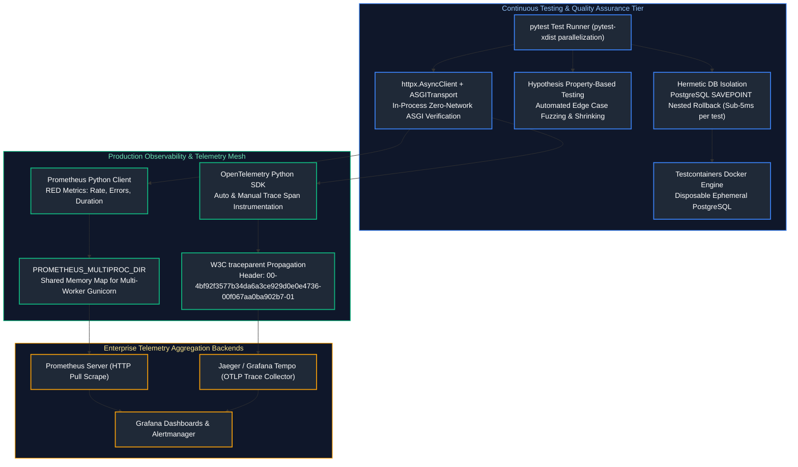
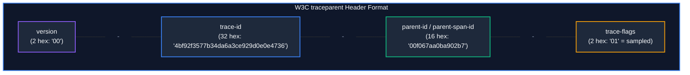

# 14. Testing, Observability, and Performance Engineering

A comprehensive, production-grade guide to enterprise software quality assurance, the Testing Pyramid, advanced `pytest` fixtures, mocking mechanics with `unittest.mock` and `respx`, hermetic database testing with PostgreSQL `SAVEPOINT` nested rollbacks and Testcontainers, property-based fuzz testing with Hypothesis, Prometheus application metrics under the RED method, multi-process Gunicorn metrics aggregation, OpenTelemetry (OTel) distributed tracing with W3C `traceparent` context propagation, and production performance profiling for Senior Backend Engineers and Platform Reliability Architects.

---

## Architectural Overview: Continuous Verification, Tracing & Metrics Pipeline



---

## Table of Contents
1. [The Modern Enterprise Testing Pyramid](#1-the-modern-enterprise-testing-pyramid)
   - [1.1 Unit (70%) vs. Integration (20%) vs. End-to-End (10%)](#11-unit-70-vs-integration-20-vs-end-to-end-10)
   - [1.2 Fast Feedback Loops & Eradicating Test Flakiness](#12-fast-feedback-loops--eradicating-test-flakiness)
2. [Pytest Advanced Mechanics & Fixture Lifecycles](#2-pytest-advanced-mechanics--fixture-lifecycles)
   - [2.1 Assertion Rewriting Internals under the Hood](#21-assertion-rewriting-internals-under-the-hood)
   - [2.2 Fixture Scopes: Function, Class, Module, and Session](#22-fixture-scopes-function-class-module-and-session)
   - [2.3 Yield Fixtures & Clean Resource Teardown](#23-yield-fixtures--clean-resource-teardown)
   - [2.4 Dynamic Parametrization with `@pytest.mark.parametrize`](#24-dynamic-parametrization-with-pytestmarkparametrize)
3. [Mocking Mastery with `unittest.mock` & `respx`](#3-mocking-mastery-with-unittestmock--respx)
   - [3.1 `Mock` vs. `MagicMock` vs. `AsyncMock`](#31-mock-vs-magicmock-vs-asyncmock)
   - [3.2 The Golden Rule of Mocking: Patch Where Looked Up, Not Where Defined](#32-the-golden-rule-of-mocking-patch-where-looked-up-not-where-defined)
   - [3.3 Auto-Specing (`autospec=True`) to Prevent Stale Mock Drift](#33-auto-specing-autospectrue-to-prevent-stale-mock-drift)
   - [3.4 Transport-Layer HTTP Mocking with `respx`](#34-transport-layer-http-mocking-with-respx)
4. [Hermetic Database Testing with PostgreSQL SAVEPOINTs](#4-hermetic-database-testing-with-postgresql-savepoints)
   - [4.1 Why Mocking Database Queries is a Catastrophic Anti-Pattern](#41-why-mocking-database-queries-is-a-catastrophic-anti-pattern)
   - [4.2 Disposable Ephemeral Databases with Testcontainers](#42-disposable-ephemeral-databases-with-testcontainers)
   - [4.3 Sub-5ms Test Isolation: Nested Transactions (`SAVEPOINT`) with Automatic Rollback](#43-sub-5ms-test-isolation-nested-transactions-savepoint-with-automatic-rollback)
5. [Asynchronous Testing for FastAPI Applications](#5-asynchronous-testing-for-fastapi-applications)
   - [5.1 Zero-Network In-Process ASGI Testing with `httpx.AsyncClient`](#51-zero-network-in-process-asgi-testing-with-httpxasyncclient)
   - [5.2 Fast Dependency Overrides (`app.dependency_overrides`)](#52-fast-dependency-overrides-appdependency_overrides)
   - [5.3 Testing Concurrent Requests & Race Conditions](#53-testing-concurrent-requests--race-conditions)
6. [Property-Based Fuzz Testing with Hypothesis](#6-property-based-fuzz-testing-with-hypothesis)
   - [6.1 The Fallacy of Example-Based Testing](#61-the-fallacy-of-example-based-testing)
   - [6.2 Hypothesis Strategies & Invariant Verification](#62-hypothesis-strategies--invariant-verification)
   - [6.3 The Shrinking Engine: Isolating Minimal Reproducible Boundary Bugs](#63-the-shrinking-engine-isolating-minimal-reproducible-boundary-bugs)
   - [6.4 Stateful Model Fuzzing with `RuleBasedStateMachine`](#64-stateful-model-fuzzing-with-rulebasedstatemachine)
7. [Application Metrics with Prometheus & The RED Method](#7-application-metrics-with-prometheus--the-red-method)
   - [7.1 The RED Architecture: Rate, Errors, and Duration](#71-the-red-architecture-rate-errors-and-duration)
   - [7.2 Metric Primitives: Counters, Gauges, Histograms, and Summaries](#72-metric-primitives-counters-gauges-histograms-and-summaries)
   - [7.3 The Multi-Worker Gunicorn Dilemma: `PROMETHEUS_MULTIPROC_DIR`](#73-the-multi-worker-gunicorn-dilemma-prometheus_multiproc_dir)
   - [7.4 Prometheus Middleware for FastAPI](#74-prometheus-middleware-for-fastapi)
   - [7.5 PromQL Golden Signals & Alertmanager Production Rules](#75-promql-golden-signals--alertmanager-production-rules)
8. [Distributed Tracing with OpenTelemetry (OTel)](#8-distributed-tracing-with-opentelemetry-otel)
   - [8.1 Core Concepts: Tracers, Spans, Span Context, and Baggage](#81-core-concepts-tracers-spans-span-context-and-baggage)
   - [8.2 W3C `traceparent` Context Propagation Across Microservices](#82-w3c-traceparent-context-propagation-across-microservices)
   - [8.3 Automated & Manual Instrumentations (FastAPI, HTTPX, SQLAlchemy)](#83-automated--manual-instrumentations-fastapi-httpx-sqlalchemy)
   - [8.4 Exporting Traces to Jaeger / Tempo via OTLP](#84-exporting-traces-to-jaeger--tempo-via-otlp)
   - [8.5 Trace Baggage Propagation & Sampling Strategies](#85-trace-baggage-propagation--sampling-strategies)
9. [Production Performance Profiling & Memory Diagnostics](#9-production-performance-profiling--memory-diagnostics)
   - [9.1 Sampling CPU Profiling with `py-spy` and Flame Graphs](#91-sampling-cpu-profiling-with-py-spy-and-flame-graphs)
   - [9.2 Memory Leak Diagnosis with `tracemalloc` and `objgraph`](#92-memory-leak-diagnosis-with-tracemalloc-and-objgraph)
   - [9.3 Deterministic Profiling with `cProfile` and `pstats`](#93-deterministic-profiling-with-cprofile-and-pstats)
10. [Summary Comparison & Engineering Reference Matrix](#10-summary-comparison--engineering-reference-matrix)
11. [References & Further Reading](#11-references--further-reading)

---

# 1. The Modern Enterprise Testing Pyramid

### 1.1 Unit (70%) vs. Integration (20%) vs. End-to-End (10%)

#### Intuitive Analogy: The Automotive Safety Testing Hierarchy
* **Unit Tests (70% - Component Level)**: You test a single brake pad in a laboratory hydraulic clamp. You measure friction coefficients and heat dissipation in milliseconds. You can run 50,000 tests an hour for almost zero cost.
* **Integration Tests (20% - Subsystem Level)**: You bolt the brake caliper, hydraulic lines, fluid reservoir, and brake pedal together on a test chassis. You verify that pushing the physical pedal creates hydraulic pressure that clamps the rotor.
* **End-to-End Tests (10% - Full Vehicle Track Test)**: You assemble the entire finished car, put a crash-test dummy in the driver's seat, drive it down an asphalt track at 100 km/h, and hit the brakes. This test is slow, expensive, and fragile—a flat tire or rainstorm invalidates the test run.

```
       / \
      / E2E \       10% - Slow, brittle, expensive, full staging environment
     /-------\
    / Integr. \     20% - Real DB with SAVEPOINT rollbacks, real Redis, HTTPX ASGI
   /-----------\
  /    Unit     \   70% - Pure domain logic, fast in-memory execution, sub-second
 /---------------\
```

---

### 1.2 Fast Feedback Loops & Eradicating Test Flakiness

A test suite that takes 45 minutes to run is a suite that engineers will skip running locally.
* **Target Execution Velocity**:
  - Full Unit Test Suite: **$< 10\text{ seconds}$**.
  - Integration Test Suite: **$< 60\text{ seconds}$**.
* **Eradicating Flakiness**:
  - **No `time.sleep()`**: Use deterministic polling (`tenacity` or `pytest-asyncio` condition waiting).
  - **Zero Shared Mutable State**: Tests must execute in any arbitrary order without depending on preceding tests.
  - **Parallel Execution**: Leverage `pytest -n auto` (via `pytest-xdist`) to run tests across all available CPU cores.

---

# 2. Pytest Advanced Mechanics & Fixture Lifecycles

### 2.1 Assertion Rewriting Internals under the Hood

In Python, the built-in `assert a == b` statement normally raises an uninformative `AssertionError` without showing intermediate values.
When `pytest` imports your test files, it intercepts the CPython compilation pipeline using a custom **PEP 302 import hook**:
1. Pytest parses the test code's Abstract Syntax Tree (AST).
2. It detects `ast.Assert` nodes.
3. It rewrites the AST bytecodes before compilation, injecting inspection hooks that capture the left-hand operand, right-hand operand, and operator.
4. When an assertion fails, pytest displays a rich, colorized diff showing the exact mismatched keys, array indexes, or sub-strings!

---

### 2.2 Fixture Scopes: Function, Class, Module, and Session

Fixtures are dependency injection providers for tests:

| Fixture Scope | Creation & Teardown Boundary | Production Best Fit |
| :--- | :--- | :--- |
| **`function`** (Default) | Executed once per test function | Transactional database rollbacks, fresh entity states |
| **`class`** | Executed once per test class | Grouped tests sharing identical setup |
| **`module`** | Executed once per `.py` test file | Read-only database fixtures, shared file parsers |
| **`session`** | Executed once for the entire test run | Docker container spinning via Testcontainers, connection pool creation |

---

### 2.3 Yield Fixtures & Clean Resource Teardown

A fixture utilizing `yield` cleanly demarcates **Setup** (code before `yield`) from **Teardown** (code after `yield`):

```python
import pytest
import tempfile
import os
from collections.abc import Generator

@pytest.fixture(scope="function")
def temporary_upload_dir() -> Generator[str, None, None]:
    # ==================== SETUP ====================
    temp_dir = tempfile.mkdtemp(prefix="test_uploads_")
    print(f"\n[Fixture Setup] Created temporary directory: {temp_dir}")
    
    yield temp_dir  # Test receives this value as argument!

    # ==================== TEARDOWN ====================
    # Guarantees execution even if the test raises an unhandled AssertionError!
    import shutil
    shutil.rmtree(temp_dir)
    print(f"[Fixture Teardown] Cleaned up directory: {temp_dir}")
```

---

### 2.4 Dynamic Parametrization with `@pytest.mark.parametrize`

Instead of copy-pasting the same test logic with different inputs, use `@pytest.mark.parametrize`:

```python
import pytest
from decimal import Decimal

def calculate_discount(price: Decimal, coupon_code: str) -> Decimal:
    discounts = {"SUMMER20": Decimal("0.20"), "VIP50": Decimal("0.50")}
    rate = discounts.get(coupon_code.upper(), Decimal("0.00"))
    return price * (Decimal("1.00") - rate)

@pytest.mark.parametrize(
    "price,coupon,expected",
    [
        (Decimal("100.00"), "SUMMER20", Decimal("80.00")),
        (Decimal("200.00"), "VIP50", Decimal("100.00")),
        (Decimal("50.00"), "INVALID_CODE", Decimal("50.00")),
        (Decimal("0.00"), "SUMMER20", Decimal("0.00")),
    ],
    ids=["20% discount", "50% VIP discount", "invalid coupon no-op", "zero price boundary"],
)
def test_calculate_discount_matrix(price: Decimal, coupon: str, expected: Decimal):
    assert calculate_discount(price, coupon) == expected
```

---

# 3. Mocking Mastery with `unittest.mock` & `respx`

### 3.1 `Mock` vs. `MagicMock` vs. `AsyncMock`

* **`Mock`**: Base mock object. Intercepts attribute lookups and method calls. Does not support Python dunder magic methods.
* **`MagicMock`**: Subclass of `Mock` that implements default implementations for Python dunders (`__iter__`, `__getitem__`, `__enter__`, `__len__`).
* **`AsyncMock`**: Introduced in Python 3.8. Supports asynchronous coroutines (`await mock()`), async context managers (`async with mock:`), and async iterators (`async for x in mock:`).

---

### 3.2 The Golden Rule of Mocking: Patch Where Looked Up, Not Where Defined

> [!CAUTION]
> ### The #1 Most Common Mocking Bug in Python
> Consider this file structure:
> * `app/services/email.py` defines `send_email()`.
> * `app/routes/users.py` imports it: `from app.services.email import send_email`.
> 
> If your test executes:
> `patch("app.services.email.send_email")`
> **THE MOCK WILL SILENTLY FAIL!**
> 
> Because `app/routes/users.py` has already imported and bound a direct reference to `send_email` in its local module namespace, patching `app.services.email` modifies the origin module, but the route continues executing the un-mocked original function!

#### The Rule:
**Patch where the object is LOOKED UP, not where it is defined!**
```python
# CORRECT: Patch the reference inside the consumer module!
@patch("app.routes.users.send_email")
def test_user_registration(mock_send):
    ...
```

---

### 3.3 Auto-Specing (`autospec=True`) to Prevent Stale Mock Drift

A standard mock accepts any method call, even if the real underlying class deleted that method 6 months ago!
Using `autospec=True` inspects the real production class and ensures the mock raises `AttributeError` if a test calls non-existent methods or invalid argument counts:

```python
from unittest.mock import patch

# autospec=True verifies real method signatures at test runtime!
@patch("app.infrastructure.email_client.SendGridClient", autospec=True)
def test_email_dispatch(mock_client_class):
    client = mock_client_class.return_value
    # If SendGridClient doesn't have a method named 'send_fancy_mail', this throws TypeError immediately!
    client.send_mail(to="user@corp.com", subject="Hello")
```

---

### 3.4 Transport-Layer HTTP Mocking with `respx`

Instead of mocking individual Python functions, mock outbound HTTP network calls directly at the **transport layer** using **`respx`** (designed for HTTPX):

```python
import pytest
import httpx
import respx

@respx.mock
@pytest.mark.asyncio
async def test_outbound_payment_gateway_mock():
    # 1. Intercept HTTPX network calls to external payment gateway URL
    route = respx.post("https://api.stripe.com/v1/charges").mock(
        return_value=httpx.Response(200, json={"id": "ch_99214", "status": "succeeded"})
    )

    # 2. Execute application code that uses real httpx.AsyncClient
    async with httpx.AsyncClient() as client:
        response = await client.post("https://api.stripe.com/v1/charges", data={"amount": 1000})

    # 3. Assert HTTP status and verify call assertions
    assert response.status_code == 200
    assert response.json()["id"] == "ch_99214"
    assert route.called
    assert route.call_count == 1
```

---

# 4. Hermetic Database Testing with PostgreSQL SAVEPOINTs

### 4.1 Why Mocking Database Queries is a Catastrophic Anti-Pattern

Mocking database sessions with `mock_session.execute.return_value = ...` gives developers a false sense of security:
* Mocks cannot detect SQL syntax errors.
* Mocks cannot detect missing `NOT NULL` or `FOREIGN KEY` constraint violations.
* Mocks cannot test database triggers, generated columns, or unique constraint violations.
* Tests break whenever a developer rewrites an internal SQL query, even if the external behavior is identical!

**Enterprise Production Standard**: **Always test against a real PostgreSQL database!**

---

### 4.2 Disposable Ephemeral Databases with Testcontainers

Using **Testcontainers**, pytest automatically spins up a clean, isolated PostgreSQL Docker container on test session startup, runs all Alembic migrations, and tears it down on completion:

```python
import pytest
from testcontainers.postgres import PostgresContainer
from sqlalchemy.ext.asyncio import create_async_engine, AsyncSession, async_sessionmaker

@pytest.fixture(scope="session")
def postgres_container():
    """Spins up a real PostgreSQL 16 Docker container for the test session."""
    with PostgresContainer("postgres:16-alpine") as postgres:
        yield postgres

@pytest.fixture(scope="session")
def async_db_engine(postgres_container):
    # Construct asyncpg connection URI
    db_url = postgres_container.get_connection_url().replace("psycopg2", "asyncpg")
    engine = create_async_engine(db_url, echo=False)
    yield engine
    engine.sync_engine.dispose()
```

---

### 4.3 Sub-5ms Test Isolation: Nested Transactions (`SAVEPOINT`) with Automatic Rollback

Recreating tables or truncating rows between tests is painfully slow (taking 500ms per test).
The high-performance industry pattern is to **wrap every test in an outer transaction and an inner `SAVEPOINT`**, rolling back the transaction at the end of the test.
* Execution time: **Sub-5 milliseconds per test**!
* 1,000 database integration tests execute in under 5 seconds!

```python
import pytest
import pytest_asyncio
from sqlalchemy.ext.asyncio import AsyncSession
from enterprise_service.infrastructure.db.models import Base

@pytest_asyncio.fixture(scope="session", autouse=True)
async def setup_database_schema(async_db_engine):
    """Run migrations once for the entire test session."""
    async with async_db_engine.begin() as conn:
        await conn.run_sync(Base.metadata.create_all)
    yield
    async with async_db_engine.begin() as conn:
        await conn.run_sync(Base.metadata.drop_all)

@pytest_asyncio.fixture(scope="function")
async def db_session(async_db_engine) -> AsyncSession:
    """
    Transactional Test Isolation Fixture:
    1. Opens an outer connection.
    2. Begins an outer transaction.
    3. Yields session to test.
    4. ROLLS BACK outer transaction upon completion, reverting all mutations instantly!
    """
    connection = await async_db_engine.connect()
    transaction = await connection.begin()

    session = AsyncSession(bind=connection, expire_on_commit=False)

    yield session

    await session.close()
    # Roll back everything executed during the test!
    await transaction.rollback()
    await connection.close()
```

---

# 5. Asynchronous Testing for FastAPI Applications

### 5.1 Zero-Network In-Process ASGI Testing with `httpx.AsyncClient`

Never spin up a physical HTTP server on `localhost:8000` to test FastAPI APIs!
Use HTTPX's **`ASGITransport`** to pass requests directly to the application's ASGI callable in memory:
* Eliminates TCP socket creation, OS port binding, and firewall permission prompts.
* Execution is $10\times$ faster!

```python
import pytest
from httpx import AsyncClient, ASGITransport
from enterprise_service.main import app

@pytest.mark.asyncio
async def test_create_order_endpoint(db_session):
    # Pass app directly into ASGITransport (In-memory execution)
    transport = ASGITransport(app=app)
    
    async with AsyncClient(transport=transport, base_url="http://testserver") as client:
        response = await client.post(
            "/v1/orders",
            json={"customer_id": "cust_101", "amount": 150.00, "currency": "USD"},
            headers={"Authorization": "Bearer mock-token-admin"},
        )

    assert response.status_code == 201
    payload = response.json()
    assert payload["status"] == "CONFIRMED"
    assert "order_id" in payload
```

---

### 5.2 Fast Dependency Overrides (`app.dependency_overrides`)

```python
from enterprise_service.presentation.api.dependencies import get_current_user

@pytest.fixture(autouse=True)
def override_auth_dependency():
    """Bypasses real JWT verification in tests by returning a mock authenticated user."""
    app.dependency_overrides[get_current_user] = lambda: {"user_id": "usr_test", "role": "admin"}
    yield
    app.dependency_overrides.clear()
```

---

### 5.3 Testing Concurrent Requests & Race Conditions

To verify that your database row locking (`SELECT FOR UPDATE`) or Redis locks prevent overselling in flash sales, launch concurrent async requests using `asyncio.gather()`:

```python
@pytest.mark.asyncio
async def test_flash_sale_concurrency_race_condition(async_client):
    # Simulate 20 concurrent customers attempting to purchase the last available stock item
    tasks = [
        async_client.post("/v1/checkout", json={"sku": "SNEAKER_LIMITED_1", "qty": 1})
        for _ in range(20)
    ]
    responses = await asyncio.gather(*tasks)

    # Count successful purchases vs sold-out rejections
    success_count = sum(1 for r in responses if r.status_code == 201)
    sold_out_count = sum(1 for r in responses if r.status_code == 409)

    # Exactly 1 customer should succeed; 19 should be rejected!
    assert success_count == 1
    assert sold_out_count == 19
```

---

# 6. Property-Based Fuzz Testing with Hypothesis

### 6.1 The Fallacy of Example-Based Testing

When engineers write unit tests, they write tests for the happy path and a few obvious edge cases (`0`, `""`, `None`).
We inherently test what we *expect* to happen. We miss subtle boundary bugs:
* Unicode normalization errors (e.g., Turkish lowercase `i`).
* Extreme floating-point rounding errors (`0.1 + 0.2 != 0.3`).
* Large integer overflows.

---

### 6.2 Hypothesis Strategies & Invariant Verification

**Hypothesis** generates hundreds of randomized, adversarial test inputs against mathematical properties (invariants) that must *always* hold true:

```python
from hypothesis import given, strategies as st
from decimal import Decimal

# Function under test
def apply_compound_interest(principal: Decimal, rate: Decimal, years: int) -> Decimal:
    if principal < 0 or rate < 0 or years < 0:
        raise ValueError("Inputs must be non-negative")
    return principal * ((Decimal("1.0") + rate) ** years)

# Invariant: If rate > 0 and principal > 0 and years > 0, future value MUST exceed principal!
@given(
    principal=st.decimals(min_value=1, max_value=1_000_000, places=2),
    rate=st.decimals(min_value=Decimal("0.01"), max_value=Decimal("0.50"), places=4),
    years=st.integers(min_value=1, max_value=50),
)
def test_compound_interest_invariant(principal: Decimal, rate: Decimal, years: int):
    future_value = apply_compound_interest(principal, rate, years)
    assert future_value > principal
```

---

### 6.3 The Shrinking Engine: Isolating Minimal Reproducible Boundary Bugs

When Hypothesis finds a failing input (e.g. `principal = 98124.12, rate = 0.4124, years = 37`), it does not simply dump the complex input on you.
Its **Shrinking Engine** iteratively reduces the test case until it finds the **absolute simplest, minimal failing input** (e.g., `principal = 1, rate = 0.01, years = 1`), making root cause debugging instantaneous!

---

### 6.4 Stateful Model Fuzzing with `RuleBasedStateMachine`

Real production systems are not stateless pure functions. They maintain internal state (shopping carts, user sessions, ledger accounts) that can transition through complex sequences of operations.
Hypothesis provides **`RuleBasedStateMachine`** to automatically generate, interleave, and shrink random sequences of state mutations to discover race conditions and invariant violations:

```python
from decimal import Decimal
from hypothesis.stateful import RuleBasedStateMachine, rule, invariant, Bundle
from hypothesis import strategies as st

class BankAccount:
    """System Under Test."""
    def __init__(self, initial_balance: Decimal) -> None:
        self.balance = initial_balance
        self.is_frozen = False

    def deposit(self, amount: Decimal) -> None:
        if self.is_frozen:
            raise RuntimeError("Account is frozen")
        if amount <= 0:
            raise ValueError("Deposit must be positive")
        self.balance += amount

    def withdraw(self, amount: Decimal) -> bool:
        if self.is_frozen:
            raise RuntimeError("Account is frozen")
        if 0 < amount <= self.balance:
            self.balance -= amount
            return True
        return False

    def freeze(self) -> None:
        self.is_frozen = True

class BankAccountStateMachine(RuleBasedStateMachine):
    """
    Hypothesis executes hundreds of randomized combinations of deposit,
    withdraw, and freeze calls in arbitrary order!
    """
    def __init__(self) -> None:
        super().__init__()
        self.account = BankAccount(Decimal("100.00"))
        self.model_balance = Decimal("100.00")
        self.model_frozen = False

    @rule(amount=st.decimals(min_value=Decimal("0.01"), max_value=Decimal("500.00"), places=2))
    def deposit(self, amount: Decimal) -> None:
        if self.model_frozen:
            return
        self.account.deposit(amount)
        self.model_balance += amount

    @rule(amount=st.decimals(min_value=Decimal("0.01"), max_value=Decimal("500.00"), places=2))
    def withdraw(self, amount: Decimal) -> None:
        if self.model_frozen:
            return
        success = self.account.withdraw(amount)
        if success:
            self.model_balance -= amount

    @rule()
    def freeze(self) -> None:
        self.account.freeze()
        self.model_frozen = True

    @invariant()
    def balance_must_match_and_be_non_negative(self) -> None:
        """Invariant: Real balance must strictly match model and never drop below zero!"""
        assert self.account.balance == self.model_balance
        assert self.account.balance >= Decimal("0.00")

# Run stateful test harness in pytest:
TestBankAccount = BankAccountStateMachine.TestCase
```

---

# 7. Application Metrics with Prometheus & The RED Method

### 7.1 The RED Architecture: Rate, Errors, and Duration

Popularized by Tom Wilkie, the **RED Method** defines the three essential metrics for monitoring request-driven microservices:

1. **Rate**: The number of requests your service is serving per second.
2. **Errors**: The number of requests that are failing (HTTP 5xx status codes).
3. **Duration**: The amount of time requests take (P50, P90, P95, P99 latency percentiles).

---

### 7.2 Metric Primitives: Counters, Gauges, Histograms, and Summaries

* **`Counter`**: Monotonically increasing number. Never decreases (resets only on process restart). Used for total requests served, exceptions thrown.
* **`Gauge`**: Value that can go up and down. Used for active concurrent connections, current memory usage, thread count.
* **`Histogram`**: Samples observations into configurable latency buckets. Essential for computing P95 and P99 latency SLAs!
* **`Summary`**: Computes client-side quantiles. (Avoid in multi-node setups; use Histograms instead).

---

### 7.3 The Multi-Worker Gunicorn Dilemma: `PROMETHEUS_MULTIPROC_DIR`

> [!CAUTION]
> ### The Multi-Process Prometheus Metric Corruption Trap
> When Prometheus scrapes your API at `/metrics`, the request hits Worker 1. Next scrape hits Worker 2.
> If each Gunicorn worker maintains its own in-memory counters, **your metrics graphs will violently oscillate up and down**, rendering rate calculations and alerts useless!
> 
> **Production Fix**:
> Configure the Prometheus client in **multi-process mode** using a memory-mapped directory on `tmpfs`:

```bash
# In Docker startup script:
export PROMETHEUS_MULTIPROC_DIR=/tmp/prometheus_multiproc
mkdir -p /tmp/prometheus_multiproc
rm -rf /tmp/prometheus_multiproc/*
```

---

### 7.4 Prometheus Middleware for FastAPI

```python
import time
from fastapi import FastAPI, Request
from prometheus_client import Counter, Histogram, generate_latest, CONTENT_TYPE_LATEST
from starlette.responses import Response

app = FastAPI()

# 1. Define Prometheus RED Metrics
HTTP_REQUESTS_TOTAL = Counter(
    "http_requests_total",
    "Total HTTP requests processed by endpoint and status code",
    ["method", "endpoint", "status_code"],
)

HTTP_REQUEST_DURATION_SECONDS = Histogram(
    "http_request_duration_seconds",
    "HTTP request execution latency distribution in seconds",
    ["method", "endpoint"],
    buckets=(0.005, 0.01, 0.025, 0.05, 0.075, 0.1, 0.25, 0.5, 0.75, 1.0, 2.5, 5.0),
)

# 2. Measure latency and record metrics via Middleware
@app.middleware("http")
async def prometheus_metrics_middleware(request: Request, call_next):
    start_time = time.perf_counter()
    method = request.method
    path = request.url.path

    try:
        response = await call_next(request)
        status_code = str(response.status_code)
    except Exception:
        status_code = "500"
        raise
    finally:
        latency = time.perf_counter() - start_time
        # Record observations
        HTTP_REQUESTS_TOTAL.labels(method=method, endpoint=path, status_code=status_code).inc()
        HTTP_REQUEST_DURATION_SECONDS.labels(method=method, endpoint=path).observe(latency)

    return response

# 3. Expose scrape endpoint for Prometheus server
@app.get("/metrics")
def metrics():
    return Response(content=generate_latest(), media_type=CONTENT_TYPE_LATEST)
```

---

### 7.5 PromQL Golden Signals & Alertmanager Production Rules

Collecting metrics is useless without actionable alerting. Here are the standardized **PromQL queries and Alertmanager YAML rules** implementing Google SRE Golden Signals for your Python services:

```yaml
# /etc/prometheus/alert_rules.yml
groups:
  - name: enterprise_backend_alerts
    rules:
      # 1. Error Rate Alert: Triggers if 5xx errors exceed 2% of total traffic over a 5m window
      - alert: HighHttpErrorRate
        expr: |
          (
            sum(rate(http_requests_total{status_code=~"5.."}[5m]))
            /
            sum(rate(http_requests_total[5m]))
          ) * 100 > 2.0
        for: 2m
        labels:
          severity: critical
          tier: api_gateway
        annotations:
          summary: "High HTTP 5xx error rate on {{ $labels.instance }}"
          description: "Service HTTP 5xx error rate is {{ $value | printf \"%.2f\" }}% (> 2% threshold)."

      # 2. P99 Latency SLA Violation Alert: Triggers if P99 latency exceeds 750ms
      - alert: HighP99Latency
        expr: |
          histogram_quantile(
            0.99,
            sum(rate(http_request_duration_seconds_bucket[5m])) by (le, endpoint)
          ) > 0.75
        for: 3m
        labels:
          severity: warning
          tier: backend
        annotations:
          summary: "P99 Latency SLA violation on {{ $labels.endpoint }}"
          description: "Endpoint {{ $labels.endpoint }} P99 response time is {{ $value | printf \"%.3f\" }}s (> 750ms SLA)."
```

---

# 8. Distributed Tracing with OpenTelemetry (OTel)

### 8.1 Core Concepts: Tracers, Spans, Span Context, and Baggage

In microservices, a single client click can trigger 15 internal RPC calls across 6 services.
**OpenTelemetry (OTel)** tracks the end-to-end journey of that request through a directed acyclic graph of **Spans**:

* **Trace**: The end-to-end journey of a request across all services, sharing a single unique 128-bit `TraceID`.
* **Span**: A single contiguous unit of work within a service (e.g., executing a database query or making an HTTP call). Has a `SpanID`, start time, end time, attributes, and events.
* **Span Context**: The metadata containing `TraceID`, `SpanID`, and trace flags passed across network boundaries.

---

### 8.2 W3C `traceparent` Context Propagation Across Microservices

To correlate spans across microservices, OpenTelemetry injects the standardized **W3C `traceparent`** HTTP header:

```http
traceparent: 00-4bf92f3577b34da6a3ce929d0e0e4736-00f067aa0ba902b7-01
```



| Field Segment | Size & Format | Value in Example | Specification & Purpose |
| :--- | :--- | :--- | :--- |
| **`version`** | 2 Hex characters | `00` | Current W3C Trace Context recommendation version |
| **`trace-id`** | 32 Hex characters (16 bytes) | `4bf92f3577b34da6a3ce929d0e0e4736` | Globally unique ID for the entire distributed transaction across all hops |
| **`parent-id`** | 16 Hex characters (8 bytes) | `00f067aa0ba902b7` | Span ID of the caller/parent span initiating the outbound network call |
| **`trace-flags`** | 2 Hex characters (8-bit bitmap) | `01` | Sampling decisions: `01` = recorded/sampled for collector storage, `00` = unsampled |

---

### 8.3 Automated & Manual Instrumentations (FastAPI, HTTPX, SQLAlchemy)

```python
from opentelemetry import trace
from opentelemetry.sdk.trace import TracerProvider
from opentelemetry.sdk.trace.export import BatchSpanProcessor
from opentelemetry.exporter.otlp.proto.grpc.trace_exporter import OTLPSpanExporter
from opentelemetry.sdk.resources import Resource
from opentelemetry.instrumentation.fastapi import FastAPIInstrumentor
from opentelemetry.instrumentation.httpx import HTTPXClientInstrumentor
from opentelemetry.instrumentation.sqlalchemy import SQLAlchemyInstrumentor

def setup_opentelemetry(app, service_name: str = "order-service"):
    # 1. Define Service Resource
    resource = Resource.create({"service.name": service_name, "service.version": "1.0.0"})
    provider = TracerProvider(resource=resource)

    # 2. Configure OTLP gRPC Exporter pointing to Jaeger / Tempo collector
    otlp_exporter = OTLPSpanExporter(endpoint="http://otel-collector:4317", insecure=True)
    provider.add_span_processor(BatchSpanProcessor(otlp_exporter))
    trace.set_tracer_provider(provider)

    # 3. Auto-instrument Libraries
    FastAPIInstrumentor.instrument_app(app)
    HTTPXClientInstrumentor().instrument()
    SQLAlchemyInstrumentor().instrument()

# Manual Span Instrumentation for Custom Business Logic:
tracer = trace.get_tracer("order.service")

async def process_fraud_analysis(order_id: str):
    with tracer.start_as_current_span("fraud_check") as span:
        # Attach custom business attributes to span
        span.set_attribute("order.id", order_id)
        span.set_attribute("fraud.model_version", "v2.4")
        
        # Perform computation...
        span.set_attribute("fraud.score", 0.02)
```

---

### 8.4 Exporting Traces to Jaeger / Tempo via OTLP

Traces captured by `BatchSpanProcessor` are serialized using Protocol Buffers over gRPC and batched asynchronously to the central OpenTelemetry Collector (or directly into Jaeger / Grafana Tempo), guaranteeing that tracing never introduces latency to application worker threads.

---

### 8.5 Trace Baggage Propagation & Sampling Strategies

#### 1. OpenTelemetry Baggage: Cross-Service Business Context
While Span Attributes are local to a single span, **Baggage** propagates contextual key-value pairs across network boundaries (e.g., forwarding `tenant_id` or `user_tier` across 10 downstream microservices):

```python
from opentelemetry import baggage, context

# Ingress Service: Inject Baggage into context
ctx = baggage.set_baggage("tenant.id", "enterprise_acme_corp")
token = context.attach(ctx)

try:
    # Downstream calls automatically carry baggage in W3C 'baggage' HTTP header!
    pass
finally:
    context.detach(token)

# Downstream Service: Retrieve baggage anywhere in call chain
tenant_id = baggage.get_baggage("tenant.id")
```

#### 2. Head-Based vs. Tail-Based Sampling:
* **Head-Based Sampling (SDK Level)**: Decides whether to record a trace at the start of the request (e.g. sample 5% of all traffic). Inexpensive, but misses rare 500 errors if that specific request was not sampled!
* **Tail-Based Sampling (Collector Level)**: Collects 100% of spans in-memory at the OpenTelemetry Collector cluster. If any span within a trace throws an HTTP 500 or exceeds 2.0s latency, the collector retains that entire trace for investigation!

---

# 9. Production Performance Profiling & Memory Diagnostics

### 9.1 Sampling CPU Profiling with `py-spy` and Flame Graphs

In live production environments, you cannot attach deterministic profilers like `cProfile` because they slow down application execution by 2x to 5x.
**`py-spy`** is a sampling profiler written in **Rust** that inspects the memory space of a running CPython process from outside using OS kernel system calls (`process_vm_readv` on Linux, `mach_vm_read` on macOS):
* Zero performance degradation ($< 1\%$ CPU impact).
* Requires **no code modifications** and no application restart!
* Can profile through the C-stack (C-extensions and Rust extensions).

```bash
# 1. Live top-like interactive view of CPU hotspots by PID:
py-spy top --pid 4102

# 2. Record a 60-second SVG Flame Graph of a live production pod:
py-spy record --pid 4102 --duration 60 --rate 100 --output profile_flamegraph.svg

# 3. Dump active threads and stack traces of a hung / deadlocked Python process:
py-spy dump --pid 4102
```

---

### 9.2 Memory Leak Diagnosis with `tracemalloc` and `objgraph`

CPython memory leaks typically occur when objects remain referenced by global registries, unbounded caches, or cyclic references with custom `__del__` methods.

#### 1. `tracemalloc` Differential Snapshots:
Track exact lines of Python code allocating memory:

```python
import tracemalloc

# Start tracking memory allocations
tracemalloc.start(25)  # Store 25 stack frames

snapshot1 = tracemalloc.take_snapshot()

# ... Execute 10,000 requests or batch operations ...

snapshot2 = tracemalloc.take_snapshot()

# Compare memory diff between snapshots:
top_stats = snapshot2.compare_to(snapshot1, "lineno")

print("[Memory Leak Report - Top 5 Allocation Hotspots]")
for stat in top_stats[:5]:
    print(stat)
```

#### 2. Finding Reference Cycles with `objgraph`:
```python
import objgraph

# Count most common live objects in heap
objgraph.show_most_common_types(limit=10)

# Generate a visual graph (.dot / .png) showing what is holding references to leaking Order objects:
leaking_orders = objgraph.by_type("Order")
if leaking_orders:
    objgraph.show_backrefs(leaking_orders[:1], max_depth=5, filename="leak_chain.png")
```

---

### 9.3 Deterministic Profiling with `cProfile` and `pstats`

For local optimization and algorithmic benchmarking, use `cProfile`:

```python
import cProfile
import pstats
import io

def benchmark_critical_path(fn, *args, **kwargs):
    profiler = cProfile.Profile()
    profiler.enable()
    
    result = fn(*args, **kwargs)
    
    profiler.disable()
    s = io.StringIO()
    # Sort by cumulative time spent inside function and its sub-calls
    ps = pstats.Stats(profiler, stream=s).sort_stats(pstats.SortKey.CUMULATIVE)
    ps.print_stats(15)  # Print top 15 bottlenecks
    print(s.getvalue())
    return result
```

---

# 10. Summary Comparison & Engineering Reference Matrix

| Tool / Framework | Primary Purpose | Layer / Scope | Overhead / Impact | Enterprise Best Practice |
| :--- | :--- | :--- | :--- | :--- |
| **`pytest` + `xdist`** | Automated testing | Local Dev / CI | Sub-second with parallelization | Never use `time.sleep()`; force strict isolation |
| **`unittest.mock`** | Unit test doubles | Unit tier only | Zero | Patch where looked up; use `autospec=True` |
| **`respx`** | HTTP transport mocking | Integration tier | Zero | Intercept outbound HTTPX calls at the transport level |
| **Postgres `SAVEPOINT`** | Database test isolation | Integration tier | Sub-5ms per test | Avoid mocking databases; test against real PostgreSQL |
| **Hypothesis** | Property fuzz testing | Unit / Domain tier | Generates 100 iterations | Find mathematical boundary & edge-case bugs |
| **Prometheus** | Metric alerting & trends | System / Application | Negligible ($< 1\%$ CPU) | Use RED method; enable multi-process mode on Gunicorn |
| **OpenTelemetry** | Distributed tracing | Cross-Microservice | Minimal ($< 2\text{ ms}$ OTLP batch) | W3C `traceparent` propagation across HTTP/gRPC boundaries |

---

# 11. References & Further Reading

1. **Pytest Official Documentation**: [https://docs.pytest.org/en/stable/](https://docs.pytest.org/en/stable/)
2. **Hypothesis: Property-Based Testing for Python**: [https://hypothesis.readthedocs.io/](https://hypothesis.readthedocs.io/)
3. **OpenTelemetry Python Documentation**: [https://opentelemetry.io/docs/languages/python/](https://opentelemetry.io/docs/languages/python/)
4. **Prometheus Python Client**: [https://github.com/prometheus/client_python](https://github.com/prometheus/client_python)
5. **The Practical Test Pyramid (Ham Vocke, Martin Fowler)**: [https://martinfowler.com/articles/practical-test-pyramid.html](https://martinfowler.com/articles/practical-test-pyramid.html)
6. **Related Guides**:
   - See [07. Web Frameworks: FastAPI and Flask](07_web_frameworks_fastapi_and_flask.md) for ASGI testing and dependency overrides.
   - See [09. Relational Databases and SQL](09_relational_databases_and_sql.md) for nested transactions and savepoints.
   - See [13. Microservices, Distributed Systems, and System Design](13_microservices_distributed_systems_system_design.md) for distributed tracing across Saga orchestrators.
