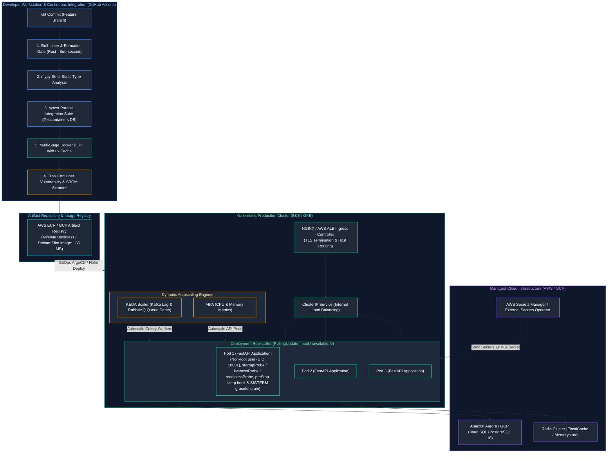
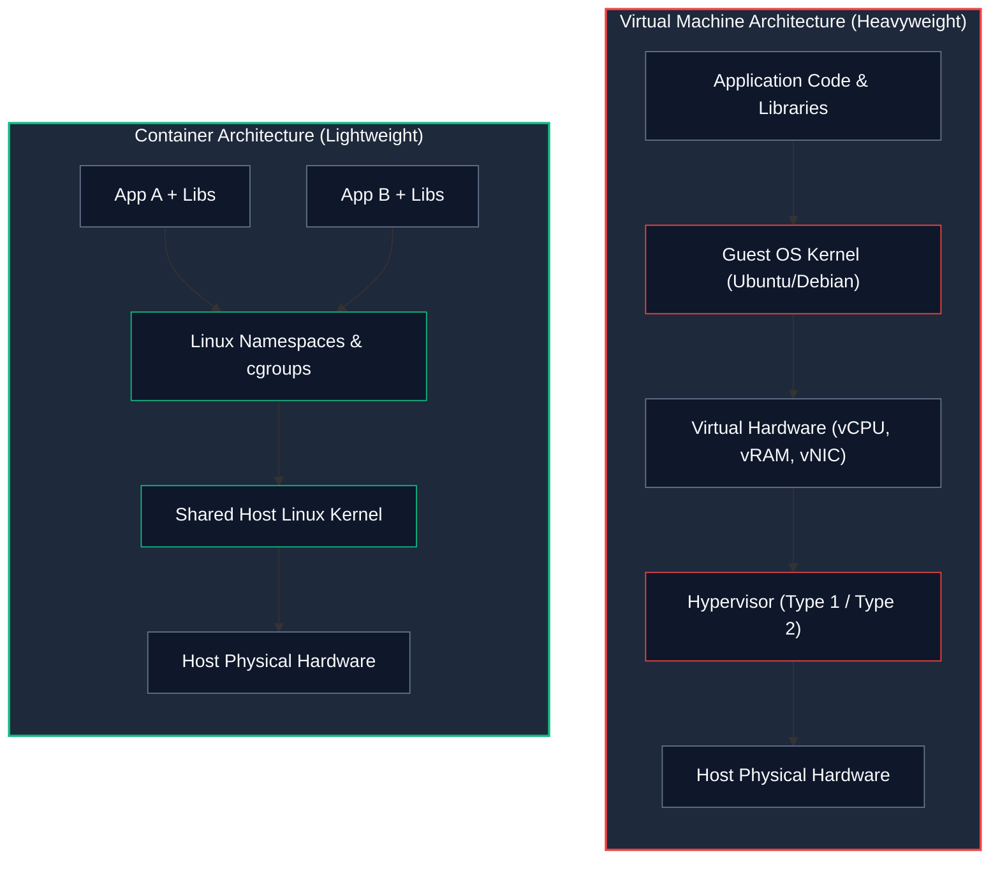
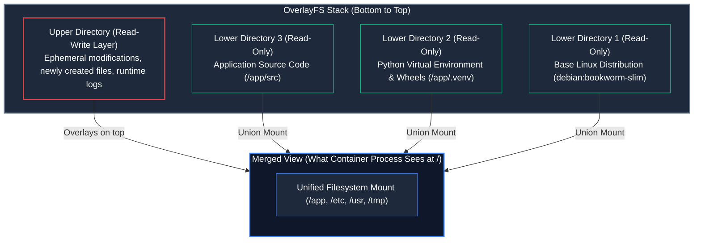
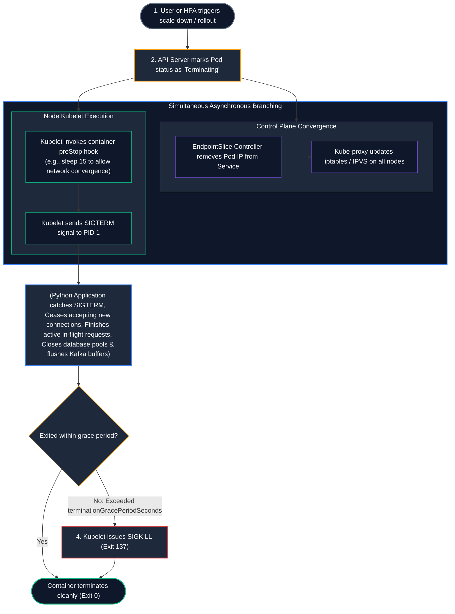
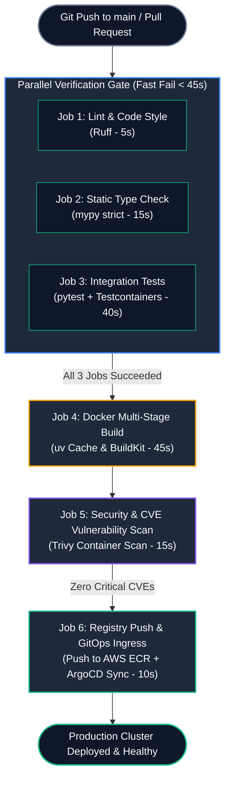

# 15. Docker, Kubernetes, CI/CD, and Cloud Deployment

A comprehensive, production-grade guide to containerization fundamentals, Linux kernel mechanics (namespaces, cgroups, OverlayFS), multi-stage Docker builds with `uv`, non-root security hardening, Kubernetes orchestration (Deployments, Services, Ingress), decoupling startup/liveness/readiness health probes, zero-downtime graceful shutdown with `SIGTERM` and `preStop` hooks, autoscaling with HPA and KEDA, enterprise CI/CD with GitHub Actions, and cloud deployment architectures on AWS and GCP for Senior Backend Engineers and Principal Platform Architects.

---

## Architectural Overview: Continuous Delivery & Cloud Kubernetes Infrastructure



---

## Table of Contents
1. [Containerization Fundamentals & Linux Kernel Mechanics](#1-containerization-fundamentals--linux-kernel-mechanics)
   - [1.1 Why Containers Are Not Virtual Machines](#11-why-containers-are-not-virtual-machines)
   - [1.2 Linux Namespaces: Isolating the Process View](#12-linux-namespaces-isolating-the-process-view)
   - [1.3 Control Groups (cgroups v2): Resource Caps and OOM Scenarios](#13-control-groups-cgroups-v2-resource-caps-and-oom-scenarios)
   - [1.4 Layered Union Filesystems: OverlayFS Internals](#14-layered-union-filesystems-overlayfs-internals)
2. [Production Multi-Stage Docker Builds with `uv`](#2-production-multi-stage-docker-builds-with-uv)
   - [2.1 The Bloat Problem: Why Naive Python Containers Reach 1.5 GB](#21-the-bloat-problem-why-naive-python-containers-reach-15-gb)
   - [2.2 Two-Stage Build Architecture with `uv`: Compilers vs. Runtime](#22-two-stage-build-architecture-with-uv-compilers-vs-runtime)
   - [2.3 Container Security Hardening: The Non-Root User Mandate](#23-container-security-hardening-the-non-root-user-mandate)
   - [2.4 Vulnerability Scanning & SBOM Generation with Trivy](#24-vulnerability-scanning--sbom-generation-with-trivy)
3. [Kubernetes Core Architecture & Abstractions](#3-kubernetes-core-architecture--abstractions)
   - [3.1 Pods, Deployments, and ReplicaSets](#31-pods-deployments-and-replicasets)
   - [3.2 Service Networking: ClusterIP, NodePort, and Ingress Controllers](#32-service-networking-clusterip-nodeport-and-ingress-controllers)
   - [3.3 Declarative Production Deployment Manifest Blueprint](#33-declarative-production-deployment-manifest-blueprint)
4. [Decoupling Health Probes: Startup, Liveness, and Readiness](#4-decoupling-health-probes-startup-liveness-and-readiness)
   - [4.1 The Cascading Failure Disaster: Conflating Liveness with Readiness](#41-the-cascading-failure-disaster-conflating-liveness-with-readiness)
   - [4.2 `startupProbe`: Protecting Slow Application Warmups](#42-startupprobe-protecting-slow-application-warmups)
   - [4.3 `livenessProbe`: Deadlock Detection and Process Restarts](#43-livenessprobe-deadlock-detection-and-process-restarts)
   - [4.4 `readinessProbe`: Traffic Routing and Dependency Health](#44-readinessprobe-traffic-routing-and-dependency-health)
5. [Process Lifecycle, Signals & Zero-Downtime Deployments](#5-process-lifecycle-signals--zero-downtime-deployments)
   - [5.1 The Kubernetes Pod Termination Sequence](#51-the-kubernetes-pod-termination-sequence)
   - [5.2 The PreStop Hook: Allowing `kube-proxy` Network Convergence](#52-the-prestop-hook-allowing-kube-proxy-network-convergence)
   - [5.3 Catching `SIGTERM` in Python & Draining In-Flight Requests](#53-catching-sigterm-in-python--draining-in-flight-requests)
   - [5.4 Zero-Downtime Rolling Updates (`maxUnavailable: 0`)](#54-zero-downtime-rolling-updates-maxunavailable-0)
6. [Autoscaling Strategies: HPA & KEDA](#6-autoscaling-strategies-hpa--keda)
   - [6.1 Horizontal Pod Autoscaler (HPA) for CPU/Memory Bottlenecks](#61-horizontal-pod-autoscaler-hpa-for-cpumemory-bottlenecks)
   - [6.2 The Worker Scaling Dilemma: Why HPA Fails for Background Queues](#62-the-worker-scaling-dilemma-why-hpa-fails-for-background-queues)
   - [6.3 Event-Driven Autoscaling with KEDA (Kafka Lag & RabbitMQ Depth)](#63-event-driven-autoscaling-with-keda-kafka-lag--rabbitmq-depth)
7. [Enterprise Secrets & Configuration Management](#7-enterprise-secrets--configuration-management)
   - [7.1 ConfigMaps vs. Kubernetes Secrets](#71-configmaps-vs-kubernetes-secrets)
   - [7.2 External Secrets Operator (ESO) Syncing with AWS Secrets Manager](#72-external-secrets-operator-eso-syncing-with-aws-secrets-manager)
8. [End-to-End CI/CD Pipeline with GitHub Actions](#8-end-to-end-cicd-pipeline-with-github-actions)
   - [8.1 High-Velocity Pipeline Architecture](#81-high-velocity-pipeline-architecture)
   - [8.2 Complete Production `.github/workflows/ci-cd.yaml` Manifest](#82-complete-production-githubworkflowsci-cdyaml-manifest)
9. [Cloud Deployment Topologies: AWS vs. GCP](#9-cloud-deployment-topologies-aws-vs-gcp)
   - [9.1 AWS Architecture: ECS Fargate vs. EKS vs. Aurora vs. ElastiCache](#91-aws-architecture-ecs-fargate-vs-eks-vs-aurora-vs-elasticache)
   - [9.2 GCP Architecture: Cloud Run vs. GKE vs. Cloud SQL](#92-gcp-architecture-cloud-run-vs-gke-vs-cloud-sql)
10. [Summary Comparison & Engineering Reference Matrix](#10-summary-comparison--engineering-reference-matrix)
11. [References & Further Reading](#11-references--further-reading)

---

# 1. Containerization Fundamentals & Linux Kernel Mechanics

> [!NOTE]
> **Domain Framing: Application Packaging vs. Enterprise Cloud Platform Architecture:**
> This guide covers application-level packaging: building minimal multi-stage Python containers with `uv`, ASGI process worker tuning in containers, and authoring Kubernetes manifests for microservices.
>
> For deep cloud infrastructure architecture, control plane internals, CNI networking, ingress controllers, and GitOps release engineering, see:
> - [Cloud Engineering: 08. Containers, Kubernetes & GitOps](../Cloud%20Engineering/08_containers_kubernetes_and_gitops.md)
> - [Cloud Engineering: 07. CI/CD & Release Engineering](../Cloud%20Engineering/07_cicd_and_release_engineering.md)


### 1.1 Why Containers Are Not Virtual Machines

#### Intuitive Analogy: An Apartment Building vs. A Suburb of Houses
* **Virtual Machine (A Suburb of Detached Houses)**: Each house has its own private plumbing, electrical generator, foundation, roof, and front lawn (Hypervisor, Guest OS Kernel, virtual BIOS, virtual device drivers). It takes 15 minutes to turn on the utilities, and you must maintain 10 separate houses.
* **Container (An Apartment in a High-Rise)**: The high-rise building shares a single centralized master boiler, plumbing stack, and foundation (the **Host Linux Kernel**). Each apartment has its own front door with a unique lock (Namespaces) and an electric meter enforcing a maximum wattage draw (cgroups). Moving in takes 100 milliseconds!



| Dimension | Virtual Machine (VM) | Container |
| :--- | :--- | :--- |
| **Isolation Level** | Hardware-level virtualization (hypervisor simulates discrete hardware) | OS-level virtualization (shared kernel isolated via namespaces & cgroups) |
| **Guest OS Kernel** | Complete guest kernel per VM instance ($1\text{--}4\text{ GB}$ base RAM) | None; direct syscalls into host kernel ($10\text{--}50\text{ MB}$ memory footprint) |
| **Startup Latency** | $30\text{--}90$ seconds (BIOS, bootloader, kernel init, systemd) | $50\text{--}200$ milliseconds (standard Linux fork/exec with namespace unshare) |
| **Density & Portability** | Low density; $10\text{--}50$ VMs per server | High density; hundreds of containers per physical host node |

---

### 1.2 Linux Namespaces: Isolating the Process View

A container is not a tangible physical boundary; it is simply a **standard Linux host process** running with restricted visibility via **Namespaces**:

1. **`pid` (Process ID)**: Inside the container, your Python app sees itself as `PID 1`. On the host server, it might be `PID 14209`.
2. **`net` (Network)**: The container receives its own virtual network interface (`eth0`), private IP address, and isolated routing table.
3. **`mnt` (Mount)**: Isolates filesystem mount points, so the container only sees its own root directory (`/`).
4. **`ipc` (Inter-Process Communication)**: Isolates System V IPC and POSIX message queues.
5. **`uts` (UNIX Timesharing System)**: Allows the container to have its own hostname.
6. **`user` (User Mapping)**: Maps `root` (UID 0) inside the container to an unprivileged user (UID 10001) on the host!

---

### 1.3 Control Groups (cgroups v2): Resource Caps and OOM Scenarios

While namespaces govern *what a process can see*, **Control Groups (cgroups)** govern *how much resources a process can consume*:

* **CPU Limits (`cpu.max`)**: Enforced via the Completely Fair Scheduler (CFS). If a container is assigned `cpu: "2"`, CFS allocates 200,000 microseconds of CPU runtime every 100,000-microsecond period. If the app exceeds this, the kernel throttles execution without killing the process!
* **Memory Limits (`memory.max`)**: When your Python process allocates more memory than its limit:
  1. The kernel attempts to reclaim page cache memory.
  2. If memory cannot be reclaimed, the kernel triggers the **Linux Out-Of-Memory (OOM) Killer**.
  3. The kernel sends `SIGKILL` (Exit Code 137). In Kubernetes, this appears as **`OOMKilled`**!

---

### 1.4 Layered Union Filesystems: OverlayFS Internals

Docker images are composed of immutable, read-only layers stacked via **OverlayFS**:


* **Copy-on-Write (CoW)**: If the Python application modifies a file from Lower Dir 1, OverlayFS copies that file up into the Read-Write Upper Dir before modifying it, leaving the underlying base image pristine and shared across 50 running containers!

---

# 2. Production Multi-Stage Docker Builds with `uv`

### 2.1 The Bloat Problem: Why Naive Python Containers Reach 1.5 GB

A naive Dockerfile typically:
1. Uses `FROM python:3.12` (based on full Debian, including GCC, build headers, and audio drivers).
2. Runs `pip install -r requirements.txt` (downloads raw `.whl` files into `~/.cache/pip`, bloating the layer).
3. Leaves build compilers (`gcc`, `g++`, `libpq-dev`) inside the production image.
*Result*: An enormous **1.5 GB container image** that takes 4 minutes to pull during an autoscaling spike, full of security CVE vulnerabilities!

---

### 2.2 Two-Stage Build Architecture with `uv`: Compilers vs. Runtime

Using **Astral `uv`** inside a **Multi-Stage Dockerfile**:
1. **Builder Stage**: Installs C compilers and compiles dependencies into a clean `.venv` using `uv sync --frozen --no-dev`.
2. **Final Runtime Stage**: Uses a clean, minimal `debian:bookworm-slim` base image. Copies **only** the compiled `.venv` and source code.
*Result*: A lean, secure **85 MB container image** that boots in 100 milliseconds!

```dockerfile
# ==============================================================================
# STAGE 1: Builder (Contains compilers and uv package manager)
# ==============================================================================
FROM ghcr.io/astral-sh/uv:0.4.15-python3.12-bookworm-slim AS builder

WORKDIR /app

# Enable bytecode compilation for faster application boot
ENV UV_COMPILE_BYTECODE=1 \
    UV_LINK_MODE=copy

# Install dependencies using cache mount to speed up CI rebuilds
RUN --mount=type=cache,target=/root/.cache/uv \
    --mount=type=bind,source=uv.lock,target=uv.lock \
    --mount=type=bind,source=pyproject.toml,target=pyproject.toml \
    uv sync --frozen --no-install-project --no-dev

# Copy source code and build the application project
COPY . /app
RUN --mount=type=cache,target=/root/.cache/uv \
    uv sync --frozen --no-dev

# ==============================================================================
# STAGE 2: Minimal Final Runtime Image (No compilers, minimal CVE attack surface)
# ==============================================================================
FROM python:3.12-slim-bookworm AS runtime

WORKDIR /app

# Python runtime hardening flags:
# - PYTHONDONTWRITEBYTECODE: Prevents writing .pyc files into container layer
# - PYTHONUNBUFFERED: Flushes stdout/stderr immediately to Docker log driver
ENV PYTHONDONTWRITEBYTECODE=1 \
    PYTHONUNBUFFERED=1 \
    PATH="/app/.venv/bin:$PATH"

# Create unprivileged non-root user and group (Security Best Practice)
RUN groupadd -g 10001 appgroup && \
    useradd -u 10001 -g appgroup -s /sbin/nologin -M appuser

# Copy ONLY the virtual environment and application code from builder
COPY --from=builder --chown=appuser:appgroup /app/.venv /app/.venv
COPY --from=builder --chown=appuser:appgroup /app/src /app/src

# Drop all root privileges!
USER 10001:10001

EXPOSE 8000

# Exec form of ENTRYPOINT guarantees Gunicorn receives SIGTERM signals from Kubernetes!
ENTRYPOINT ["gunicorn", "src.main:app", "-w", "4", "-k", "uvicorn.workers.UvicornWorker", "-b", "0.0.0.0:8000", "--graceful-timeout", "30"]
```

---

### 2.3 Container Security Hardening: The Non-Root User Mandate

> [!CAUTION]
> ### The Root Container Exploit Hazard
> By default, Docker executes processes as `root` (UID 0).
> If an attacker exploits a remote code execution vulnerability (e.g., via an unsafe YAML deserializer or image parsing library), and the container process is running as root, **a container breakout gives the attacker root access over the host Linux kernel**!
> **Mandatory Rule**: Always add an unprivileged non-root user (`USER 10001:10001`)!

---

### 2.4 Vulnerability Scanning & SBOM Generation with Trivy

Incorporate **Trivy** into your build pipeline to reject images containing High or Critical CVEs:

```bash
# 1. Build Docker image
docker build -t enterprise-payment-api:1.0.0 .

# 2. Scan image for CVE vulnerabilities
trivy image --severity HIGH,CRITICAL --exit-code 1 enterprise-payment-api:1.0.0

# 3. Generate CycloneDX Software Bill of Materials (SBOM)
trivy image --format cyclonedx --output sbom.json enterprise-payment-api:1.0.0
```

---

# 3. Kubernetes Core Architecture & Abstractions

### 3.1 Pods, Deployments, and ReplicaSets

* **Pod**: The smallest deployable unit in Kubernetes. Represents a group of one or more co-located containers sharing the exact same Network Namespace (IP address and port space) and storage volumes.
* **ReplicaSet**: Guarantees that a specified number of identical pod replicas are running at any given moment.
* **Deployment**: Higher-level controller that manages declarative declarative rolling updates of ReplicaSets.

---

### 3.2 Service Networking: ClusterIP, NodePort, and Ingress Controllers

* **ClusterIP (Default)**: Assigns an internal, stable virtual IP address accessible only from within the Kubernetes cluster.
* **NodePort**: Exposes the service on a static high port ($30000\text{--}32767$) across every Kubernetes node.
* **Ingress Controller (NGINX / Envoy / AWS ALB)**: Layer 7 application routing gateway that inspects incoming HTTP Host headers and URL paths, routing requests to internal ClusterIP services while terminating TLS certificates.

---

### 3.3 Declarative Production Deployment Manifest Blueprint

Here is the standardized, production-hardened Kubernetes manifest for an enterprise Python microservice:

```yaml
# deployment.yaml
apiVersion: apps/v1
kind: Deployment
metadata:
  name: payment-service-deployment
  namespace: production
  labels:
    app.kubernetes.io/name: payment-service
spec:
  replicas: 4
  revisionHistoryLimit: 5
  strategy:
    type: RollingUpdate
    rollingUpdate:
      maxSurge: 25%        # Spin up 1 extra pod before killing old ones
      maxUnavailable: 0     # ZERO DOWNTIME: Never allow available pods to drop below 4!
  selector:
    matchLabels:
      app: payment-service
  template:
    metadata:
      labels:
        app: payment-service
    spec:
      # Pod Termination Grace Period: Allows in-flight requests to complete
      terminationGracePeriodSeconds: 45
      securityContext:
        runAsNonRoot: true
        runAsUser: 10001
        runAsGroup: 10001
        fsGroup: 10001
      containers:
        - name: payment-api
          image: 123456789012.dkr.ecr.us-east-1.amazonaws.com/payment-service:v1.2.4
          imagePullPolicy: IfNotPresent
          ports:
            - containerPort: 8000
              name: http-api
          # Strict Resource Guarantees (Guaranteed QoS Class)
          resources:
            requests:
              cpu: "500m"      # 0.5 CPU core guaranteed
              memory: "512Mi"  # 512 MB RAM guaranteed
            limits:
              cpu: "1000m"     # Cap at 1 full CPU core
              memory: "1024Mi" # OOMKill if application exceeds 1 GB RAM
          
          # Environment Variables from ConfigMap and Secrets
          env:
            - name: ENVIRONMENT
              value: "production"
            - name: DATABASE__URL
              valueFrom:
                secretKeyRef:
                  name: payment-secrets
                  key: database-url

          # ==================== DECOUPLED HEALTH PROBES ====================
          # 1. Startup Probe: Allows up to 60s for slow DB connection warmups
          startupProbe:
            httpGet:
              path: /health/startup
              port: 8000
            failureThreshold: 30
            periodSeconds: 2

          # 2. Liveness Probe: Detects event loop deadlocks (Triggers Pod Restart)
          livenessProbe:
            httpGet:
              path: /health/liveness
              port: 8000
            initialDelaySeconds: 5
            periodSeconds: 10
            timeoutSeconds: 2
            failureThreshold: 3

          # 3. Readiness Probe: Checks DB/Redis reachability (Controls Traffic Ingress)
          readinessProbe:
            httpGet:
              path: /health/readiness
              port: 8000
            initialDelaySeconds: 5
            periodSeconds: 5
            timeoutSeconds: 2
            failureThreshold: 2

          # ==================== ZERO-DOWNTIME PRESTOP HOOK ====================
          lifecycle:
            preStop:
              exec:
                # Sleep 10s to give kube-proxy and AWS ALB time to withdraw pod IP from endpoints!
                command: ["/bin/sh", "-c", "sleep 10"]
---
apiVersion: v1
kind: Service
metadata:
  name: payment-service
  namespace: production
spec:
  type: ClusterIP
  selector:
    app: payment-service
  ports:
    - name: http
      port: 80
      targetPort: 8000
```

---

# 4. Decoupling Health Probes: Startup, Liveness, and Readiness

### 4.1 The Cascading Failure Disaster: Conflating Liveness with Readiness

> [!CAUTION]
> ### The Most Common Kubernetes Outage Pattern
> A developer configures a single `/health` endpoint that checks:
> 1. Is the web server alive?
> 2. Is the PostgreSQL database reachable?
> And binds this single endpoint to both the **`livenessProbe`** and the **`readinessProbe`**.
> 
> **What Happens During a Minor Database Hiccup**:
> The database connection pool experiences a temporary 10-second spike.
> The liveness probe fails on all 50 pods simultaneously.
> **Kubernetes immediately kills and restarts all 50 pods at the exact same instant!**
> The sudden stampede of 50 booting pods attempting to re-connect to the recovering database completely takes down the database, permanently destroying the service!

---

### 4.2 `startupProbe`: Protecting Slow Application Warmups

When Python microservices load large PyTorch models or compile Cython modules on startup, boot times can take 20 to 60 seconds.
Without a `startupProbe`, a standard `livenessProbe` with a 10-second timeout will kill the pod repeatedly in an infinite **`CrashLoopBackOff`**!
The `startupProbe` disables liveness and readiness checks until the startup check succeeds once.

---

### 4.3 `livenessProbe`: Deadlock Detection and Process Restarts

* **Purpose**: Verifies that the internal Python runtime is alive and responsive.
* **Implementation**: A simple, fast endpoint that does **not** check external databases or Redis:
  ```python
  @app.get("/health/liveness")
  def liveness_check():
      # If the event loop is completely frozen or threads are deadlocked, this will time out!
      return {"status": "alive"}
  ```
* **Failure Action**: Kubernetes kills the container and starts a fresh one.

---

### 4.4 `readinessProbe`: Traffic Routing and Dependency Health

* **Purpose**: Verifies whether the pod is currently capable of serving user traffic.
* **Implementation**: Checks local connection pool capacity and primary dependency availability:
  ```python
  @app.get("/health/readiness")
  async def readiness_check(db_session = Depends(get_db_session)):
      # Verify database connection pool health
      await db_session.execute(text("SELECT 1"))
      return {"status": "ready"}
  ```
* **Failure Action**: Kubernetes **does not kill the pod**. It simply removes the pod's IP address from the Service endpoint load balancer until the probe passes again!

---

# 5. Process Lifecycle, Signals & Zero-Downtime Deployments

### 5.1 The Kubernetes Pod Termination Sequence

When Kubernetes terminates a pod during a rolling update or autoscaling scale-down:



---

### 5.2 The PreStop Hook: Allowing `kube-proxy` Network Convergence

Notice that Step 2 (removing pod IP from load balancers) and Step 3 (stopping container) happen **asynchronously and in parallel**.
If your application stops immediately upon receiving the termination signal, **there is a 2 to 5 second window where the AWS Load Balancer or kube-proxy still forwards new requests to the dying pod**, causing HTTP 502 Bad Gateway errors for active users!
Adding a `preStop: exec: command: ["sleep", "10"]` pauses shutdown just long enough for network routing tables across the cluster to drop the pod IP!

---

### 5.3 Catching `SIGTERM` in Python & Draining In-Flight Requests

When using Uvicorn or Gunicorn with `--graceful-timeout 30`, the server natively intercepts `SIGTERM`, stops listening on the socket, and gives active requests 30 seconds to finish:

```python
import signal
import sys
import asyncio
import logging

logger = logging.getLogger("lifecycle")

def register_graceful_shutdown_handlers(app):
    loop = asyncio.get_running_loop()

    def handle_sigterm():
        logger.warning("[SIGTERM Received] Commencing graceful drain of in-flight requests...")
        # Trigger cleanup logic here
        
    for sig in (signal.SIGTERM, signal.SIGINT):
        loop.add_signal_handler(sig, handle_sigterm)
```

---

### 5.4 Zero-Downtime Rolling Updates (`maxUnavailable: 0`)

By configuring `maxUnavailable: 0` and `maxSurge: 25%` in your Deployment manifest:
* Kubernetes will **never** terminate an existing pod until the replacement pod has passed both its `startupProbe` and `readinessProbe`!
* Deployments achieve true **100% Zero-Downtime**.

---

# 6. Autoscaling Strategies: HPA & KEDA

### 6.1 Horizontal Pod Autoscaler (HPA) for CPU/Memory Bottlenecks

The **Horizontal Pod Autoscaler (HPA)** scales the number of pods based on observed CPU and memory metrics collected by the Kubernetes Metrics Server:

```yaml
# hpa.yaml
apiVersion: autoscaling/v2
kind: HorizontalPodAutoscaler
metadata:
  name: payment-api-hpa
  namespace: production
spec:
  scaleTargetRef:
    apiVersion: apps/v1
    kind: Deployment
    name: payment-service-deployment
  minReplicas: 4
  maxReplicas: 30
  metrics:
    - type: Resource
      resource:
        name: cpu
        target:
          type: Utilization
          averageUtilization: 70 # Scale up when average CPU exceeds 70%
```

---

### 6.2 The Worker Scaling Dilemma: Why HPA Fails for Background Queues

> [!CAUTION]
> ### Why HPA Fails on Celery and Kafka Workers
> An asynchronous background worker waiting for tasks spends $98\%$ of its time sleeping on I/O.
> If 50,000 tasks arrive in RabbitMQ or Kafka, the workers' CPU might only sit at $25\%$.
> **The standard HPA will see 25% CPU and REFUSE TO SCALE UP**, leaving 50,000 tasks sitting in the queue for hours!

---

### 6.3 Event-Driven Autoscaling with KEDA (Kafka Lag & RabbitMQ Depth)

**KEDA (Kubernetes Event-driven Autoscaling)** scales pods based on external message queue metrics:

```yaml
# keda-scaledobject.yaml
apiVersion: keda.sh/v1alpha1
kind: ScaledObject
metadata:
  name: kafka-order-worker-scaler
  namespace: production
spec:
  scaleTargetRef:
    name: order-worker-deployment
  minReplicaCount: 2
  maxReplicaCount: 50
  triggers:
    - type: apache-kafka
      metadata:
        bootstrapServers: kafka:9092
        topic: order-events
        consumerGroup: inventory_group
        # Add 1 worker pod for every 100 messages of unconsumed consumer lag!
        lagThreshold: "100"
```

---

# 7. Enterprise Secrets & Configuration Management

### 7.1 ConfigMaps vs. Kubernetes Secrets

* **ConfigMap**: Plaintext key-value pairs for non-sensitive configurations (log levels, external service endpoints).
* **Kubernetes Secret**: Base64-encoded strings stored in `etcd`. (Note: Base64 is **not encryption**; ensure `etcd` encryption-at-rest is enabled on the cluster!).

---

### 7.2 External Secrets Operator (ESO) Syncing with AWS Secrets Manager

Hardcoding secrets in Git or manually creating Kubernetes secrets via `kubectl create secret` violates SOC 2 compliance.
The **External Secrets Operator (ESO)** automatically synchronizes secrets directly from AWS Secrets Manager or HashiCorp Vault into Kubernetes secrets:

```yaml
# external-secret.yaml
apiVersion: external-secrets.io/v1beta1
kind: ExternalSecret
metadata:
  name: payment-secrets-sync
  namespace: production
spec:
  refreshInterval: 1h # Automatically rotate secrets every hour
  secretStoreRef:
    name: aws-secrets-manager
    kind: ClusterSecretStore
  target:
    name: payment-secrets # Emits standard K8s Secret
  data:
    - secretKey: database-url
      remoteRef:
        key: production/payment-service
        property: DATABASE_URL
```

---

# 8. End-to-End CI/CD Pipeline with GitHub Actions

### 8.1 High-Velocity Pipeline Architecture

An enterprise CI/CD pipeline must execute within **$< 3\text{ minutes}$**, using aggressive caching and parallel job execution:



---

### 8.2 Complete Production `.github/workflows/ci-cd.yaml` Manifest

```yaml
name: Production CI/CD Pipeline

on:
  push:
    branches: [main]
  pull_request:
    branches: [main]

concurrency:
  group: ${{ github.workflow }}-${{ github.ref }}
  cancel-in-progress: true

jobs:
  # ============================================================================
  # QUALITY GATES: Linting, Formatting & Type Checking
  # ============================================================================
  quality-gates:
    runs-on: ubuntu-latest
    steps:
      - uses: actions/checkout@v4

      - name: Install uv package manager
        uses: astral-sh/setup-uv@v3
        with:
          version: "0.4.15"
          enable-cache: true

      - name: Set up Python
        uses: actions/setup-python@v5
        with:
          python-version: "3.12"

      - name: Run Ruff Lint & Format Checks
        run: |
          uv run ruff check .
          uv run ruff format --check .

      - name: Run mypy Static Type Analysis
        run: |
          uv run mypy src tests

  # ============================================================================
  # INTEGRATION TESTING: Real PostgreSQL via Testcontainers
  # ============================================================================
  test-suite:
    needs: quality-gates
    runs-on: ubuntu-latest
    steps:
      - uses: actions/checkout@v4

      - name: Install uv
        uses: astral-sh/setup-uv@v3
        with:
          version: "0.4.15"
          enable-cache: true

      - name: Set up Python
        uses: actions/setup-python@v5
        with:
          python-version: "3.12"

      - name: Execute Pytest Suite with Coverage
        run: |
          uv run pytest --cov=src --cov-report=xml --cov-fail-under=85 -n auto

  # ============================================================================
  # BUILD, SCAN & PUSH DOCKER CONTAINER
  # ============================================================================
  build-and-publish:
    needs: test-suite
    if: github.ref == 'refs/heads/main' && github.event_name == 'push'
    runs-on: ubuntu-latest
    permissions:
      id-token: write
      contents: read
    steps:
      - uses: actions/checkout@v4

      - name: Set up Docker Buildx
        uses: docker/setup-buildx-action@v3

      - name: Build Local Container Image for Scanning
        uses: docker/build-push-action@v5
        with:
          context: .
          load: true
          tags: payment-service:${{ github.sha }}
          cache-from: type=gha
          cache-to: type=gha,mode=max

      - name: Run Trivy Security Vulnerability Scan
        uses: aquasecurity/trivy-action@master
        with:
          image-ref: payment-service:${{ github.sha }}
          format: table
          exit-code: "1"
          ignore-unfixed: true
          severity: "CRITICAL,HIGH"

      - name: Configure AWS Credentials via OIDC (Zero Hardcoded Keys!)
        uses: aws-actions/configure-aws-credentials@v4
        with:
          role-to-assume: arn:aws:iam::123456789012:role/GitHubActionsECRPushRole
          aws-region: us-east-1

      - name: Log in to Amazon ECR
        id: login-ecr
        uses: aws-actions/amazon-ecr-login@v2

      - name: Tag and Push Image to ECR
        run: |
          ECR_REGISTRY=${{ steps.login-ecr.outputs.registry }}
          docker tag payment-service:${{ github.sha }} $ECR_REGISTRY/payment-service:${{ github.sha }}
          docker tag payment-service:${{ github.sha }} $ECR_REGISTRY/payment-service:latest
          docker push $ECR_REGISTRY/payment-service:${{ github.sha }}
          docker push $ECR_REGISTRY/payment-service:latest
```

---

# 9. Cloud Deployment Topologies: AWS vs. GCP

### 9.1 AWS Architecture: ECS Fargate vs. EKS vs. Aurora vs. ElastiCache

| AWS Component | Best Production Fit | Tradeoffs / Operational Overhead |
| :--- | :--- | :--- |
| **AWS ECS Fargate** | Small to mid-size APIs ($< 15$ microservices) | **Zero cluster maintenance**; cannot run DaemonSets or custom mesh |
| **AWS EKS (Kubernetes)**| Large enterprise microservice meshes | Maximum flexibility, full GitOps ecosystem, higher cluster cost |
| **Amazon Aurora PostgreSQL**| Primary transactional database | Multi-AZ auto-failover in 30s, storage autoscaling to 128 TB |
| **Amazon ElastiCache Redis** | Caching, session store, rate limiting | Managed Redis cluster with automatic primary-replica failover |

---

### 9.2 GCP Architecture: Cloud Run vs. GKE vs. Cloud SQL

| GCP Component | Best Production Fit | Tradeoffs / Operational Overhead |
| :--- | :--- | :--- |
| **GCP Cloud Run** | Serverless HTTP microservices | **Scales to zero**, automatic HTTPS, fast scaling; request timeout limits |
| **Google Kubernetes Engine (GKE)** | Large microservice fleets | Industry-leading managed Kubernetes with Autopilot node management |
| **GCP Cloud SQL PostgreSQL** | Primary relational database | Fully managed automated backups, cross-region replication |
| **GCP Memorystore Redis** | In-memory distributed caching | Managed Redis instances with VPC peering |

---

### 9.3 Cloud Identity Federation: AWS IRSA vs. GCP Workload Identity

In legacy architectures, developers injected long-lived cloud credentials (`AWS_ACCESS_KEY_ID` or GCP service account `.json` key files) into Kubernetes Secrets. If a container was compromised, attackers extracted the private keys and pivoted to the entire cloud infrastructure!

#### Modern Zero-Trust Standard: Cryptographic Workload Identity Federation
Kubernetes Pods authenticate to cloud provider APIs without any static credentials:
1. When a Pod starts, the Kubernetes API issues a signed **OIDC JSON Web Token (JWT)** to the pod filesystem projected at `/var/run/secrets/tokens/vault-token`.
2. The AWS/GCP SDK reads this token automatically.
3. The SDK calls AWS STS (`sts:AssumeRoleWithWebIdentity`) or GCP Security Token Service.
4. AWS/GCP verifies the cryptographic signature against the Kubernetes cluster's public OIDC discovery endpoint.
5. AWS/GCP issues an ephemeral, auto-expiring 1-hour IAM STS session token directly to the pod!

```yaml
# Kubernetes ServiceAccount annotated for AWS IRSA:
apiVersion: v1
kind: ServiceAccount
metadata:
  name: payment-service-sa
  namespace: production
  annotations:
    eks.amazonaws.com/role-arn: arn:aws:iam::123456789012:role/ProductionPaymentS3AccessRole
```

---

### 9.4 Infrastructure as Code: Turnkey Terraform for Production Microservices

Here is the declarative Terraform HCL provisioning an AWS ECS Fargate cluster with an Application Load Balancer and secure networking:

```hcl
# AWS ECS Fargate Service Definition
resource "aws_ecs_cluster" "production" {
  name = "production-microservices-cluster"
  
  setting {
    name  = "containerInsights"
    value = "enabled"
  }
}

resource "aws_ecs_task_definition" "payment_service" {
  family                   = "payment-service"
  network_mode             = "awsvpc"
  requires_compatibilities = ["FARGATE"]
  cpu                      = "1024" # 1 vCPU
  memory                   = "2048" # 2 GB RAM
  execution_role_arn       = aws_iam_role.ecs_execution_role.arn
  task_role_arn            = aws_iam_role.ecs_task_role.arn

  container_definitions = jsonencode([
    {
      name      = "payment-service"
      image     = "${aws_ecr_repository.payment_service.repository_url}:latest"
      essential = true
      
      portMappings = [
        {
          containerPort = 8000
          hostPort      = 8000
          protocol      = "tcp"
        }
      ]

      environment = [
        { name = "ENVIRONMENT", value = "production" },
        { name = "PROMETHEUS_MULTIPROC_DIR", value = "/tmp/prometheus" }
      ]

      secrets = [
        {
          name      = "DATABASE_URL"
          valueFrom = "${aws_secretsmanager_secret.db_secret.arn}:database_url::"
        }
      ]

      logConfiguration = {
        logDriver = "awslogs"
        options = {
          "awslogs-group"         = "/ecs/payment-service"
          "awslogs-region"        = "us-east-1"
          "awslogs-stream-prefix" = "ecs"
        }
      }
    }
  ])
}

resource "aws_ecs_service" "payment_service" {
  name            = "payment-service"
  cluster         = aws_ecs_cluster.production.id
  task_definition = aws_ecs_task_definition.payment_service.arn
  desired_count   = 3
  launch_type     = "FARGATE"

  network_configuration {
    subnets         = aws_subnet.private[*].id
    security_groups = [aws_security_group.ecs_tasks.id]
  }

  load_balancer {
    target_group_arn = aws_lb_target_group.payment_service.arn
    container_name   = "payment-service"
    container_port   = 8000
  }
}
```

---

# 10. Summary Comparison & Engineering Reference Matrix

| Deployment Layer | Primitive / Tool | Enterprise Best Practice | Catastrophic Anti-Pattern |
| :--- | :--- | :--- | :--- |
| **Base Image** | `debian:bookworm-slim` | Multi-stage build with `uv` copying only `.venv` | Single-stage full Debian image containing GCC and tests |
| **Container User** | Non-root `USER 10001` | Drop all root privileges | Running container as default root (UID 0) |
| **Health Probing** | Decoupled Probes | Separate startup, liveness, and readiness endpoints | Binding DB query to liveness probe (causes cascading reboot) |
| **Pod Termination** | `preStop` hook + `SIGTERM` | Sleep 10s before shutdown to allow router drain | Immediate process termination causing HTTP 502 errors |
| **Autoscaling** | HPA + KEDA | Scale API on CPU; scale workers on queue depth | Scaling Celery background workers using CPU utilization |
| **Secrets** | External Secrets Operator | Sync dynamically from AWS Secrets Manager / Vault | Hardcoding `.env` files or committing secrets to Git |
| **CI/CD** | GitHub Actions + OIDC | Ephemeral AWS IAM OIDC roles with Trivy scans | Permanent AWS Access Keys stored in repository secrets |

---

# 11. References & Further Reading

1. **Docker Best Practices for Python Applications**: [https://docs.docker.com/language/python/](https://docs.docker.com/language/python/)
2. **Kubernetes Documentation – Pod Lifecycle**: [https://kubernetes.io/docs/concepts/workloads/pods/pod-lifecycle/](https://kubernetes.io/docs/concepts/workloads/pods/pod-lifecycle/)
3. **KEDA (Kubernetes Event-driven Autoscaling)**: [https://keda.sh/](https://keda.sh/)
4. **External Secrets Operator**: [https://external-secrets.io/latest/](https://external-secrets.io/latest/)
5. **Aqua Security Trivy Scanner**: [https://github.com/aquasecurity/trivy](https://github.com/aquasecurity/trivy)
6. **Related Guides**:
   - See [05. Python Development Ecosystem and Tooling](05_python_development_ecosystem_and_tooling.md) for `uv` and `pyproject.toml`.
   - See [13. Microservices, Distributed Systems, and System Design](13_microservices_distributed_systems_system_design.md) for microservice architecture and Saga patterns.
   - See [14. Testing, Observability, and Performance Engineering](14_testing_observability_and_performance_engineering.md) for Prometheus metrics and OpenTelemetry.
