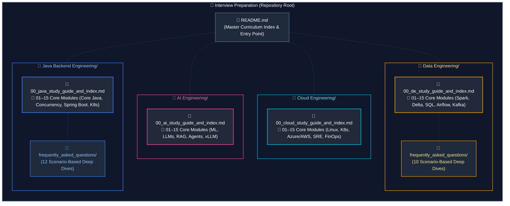

# Interview Preparation & Engineering Knowledge Base

A structured collection of production-grade study guides, architectural deep dives, and real-world interview solutions across four core engineering disciplines: **AI Engineering**, **Cloud Engineering**, **Data Engineering**, and **Java Backend Engineering**.

---

## Tracks Overview

### 1. [AI Engineering](AI%20Engineering/00_ai_study_guide_and_index.md)
Comprehensive guides covering applied machine learning, generative AI, vector retrieval, autonomous agent architectures, and LLM serving infrastructure.

- **Core Curriculum ([Study Guide & Index](AI%20Engineering/00_ai_study_guide_and_index.md))**:
  - Foundations & Neural Architectures: [Machine Learning](AI%20Engineering/01_machine_learning_fundamentals.md) | [Deep Learning & Transformers](AI%20Engineering/02_deep_learning_and_neural_architectures.md) | [LLM Foundations](AI%20Engineering/03_llm_foundations_and_mechanics.md)
  - Application & Retrieval Engineering: [LLM App Engineering](AI%20Engineering/04_llm_application_engineering.md) | [Vector DBs & Embeddings](AI%20Engineering/05_embeddings_vector_databases_and_search.md) | [Advanced RAG](AI%20Engineering/06_advanced_rag_and_retrieval_systems.md)
  - Cognitive Agents & Evaluation: [AI Agents & Workflows](AI%20Engineering/07_ai_agents_and_workflow_orchestration.md) | [Multi-Agent Systems](AI%20Engineering/08_multi_agent_systems_and_collaboration.md) | [LLM Evaluation & Benchmarking](AI%20Engineering/09_llm_evaluation_testing_and_benchmarking.md)
  - Operations & Serving Infrastructure: [Production MLOps](AI%20Engineering/10_production_mlops_and_feature_stores.md) | [LLMOps & Gateways](AI%20Engineering/11_llmops_gateways_and_production_operations.md) | [AI Infrastructure & vLLM](AI%20Engineering/12_ai_infrastructure_and_inference_serving.md)
  - Security, Specialization & System Design: [AI Security & Governance](AI%20Engineering/13_ai_security_guardrails_and_governance.md) | [Fine-Tuning & Multimodal](AI%20Engineering/14_model_finetuning_multimodal_and_specialized_ai.md) | [Enterprise AI System Design](AI%20Engineering/15_enterprise_ai_system_design.md)

---

### 2. [Cloud Engineering](Cloud%20Engineering/00_cloud_study_guide_and_index.md)
Concept-first, production-grade curriculum spanning Linux OS internals, software-defined networking, core cloud infrastructure paradigms (grounded in Microsoft Azure with equivalent AWS counterparts), Infrastructure as Code (Terraform & Bicep), release engineering, Kubernetes & GitOps, DevSecOps, observability, Site Reliability Engineering, distributed databases, serverless architectures, and FinOps.

- **Core Curriculum ([Study Guide & Index](Cloud%20Engineering/00_cloud_study_guide_and_index.md))**:
  - Foundations & Networking: [Linux & OS](Cloud%20Engineering/01_linux_operating_systems_and_scripting.md) | [Networking Fundamentals](Cloud%20Engineering/02_networking_fundamentals.md) | [Cloud Fundamentals](Cloud%20Engineering/03_cloud_fundamentals_and_architecture.md)
  - Core Infrastructure, Networks & IaC: [Cloud Infrastructure Concepts](Cloud%20Engineering/04_azure_core_services_and_aws_equivalents.md) | [Cloud Networking Design](Cloud%20Engineering/05_cloud_networking_and_infrastructure_design.md) | [IaC & Config Management](Cloud%20Engineering/06_infrastructure_as_code_and_configuration_management.md)
  - Release, Kubernetes & Security: [CI/CD & Release](Cloud%20Engineering/07_cicd_and_release_engineering.md) | [Containers, K8s & GitOps](Cloud%20Engineering/08_containers_kubernetes_and_gitops.md) | [Cloud Security & IAM](Cloud%20Engineering/09_cloud_security_iam_and_devsecops.md)
  - Observability, SRE & Data: [Observability & Monitoring](Cloud%20Engineering/10_observability_monitoring_and_logging.md) | [Site Reliability Engineering](Cloud%20Engineering/11_site_reliability_engineering.md) | [Databases & Distributed Systems](Cloud%20Engineering/12_databases_storage_and_distributed_systems.md)
  - Cloud-Native, Platforms & FinOps: [Serverless Architecture](Cloud%20Engineering/13_serverless_and_cloud_native_architecture.md) | [Platform Engineering & IDP](Cloud%20Engineering/14_platform_engineering_and_developer_experience.md) | [FinOps & Governance](Cloud%20Engineering/15_finops_governance_and_enterprise_operations.md)

---

### 3. [Data Engineering](Data%20Engineering/00_de_study_guide_and_index.md)
In-depth coverage of distributed data platforms, database internals, batch and stream processing, Lakehouse ACID engines, orchestration, and enterprise system design.

- **Core Curriculum ([Study Guide & Index](Data%20Engineering/00_de_study_guide_and_index.md))**:
  - Relational & analytical query mastery: [SQL Fundamentals](Data%20Engineering/01_sql_fundamentals.md) | [Advanced SQL](Data%20Engineering/02_advanced_sql.md)
  - Systems & storage engines: [Python for Data Engineering](Data%20Engineering/03_python_for_data_engineering.md) | [Database Internals](Data%20Engineering/04_database_internals_and_performance.md) | [Distributed Systems & APIs](Data%20Engineering/05_distributed_systems_and_apis.md)
  - Architecture & Lakehouse: [Data Modeling](Data%20Engineering/06_data_architecture_and_modeling.md) | [File Formats & Storage](Data%20Engineering/07_file_formats_and_storage.md) | [Apache Spark & PySpark](Data%20Engineering/08_apache_spark_pyspark.md) | [Databricks & Delta Lake](Data%20Engineering/09_databricks_and_delta_lake.md)
  - Ingestion, streaming & operations: [Pipeline Design](Data%20Engineering/10_data_pipeline_design_and_ingestion.md) | [Kafka & Streaming](Data%20Engineering/11_streaming_and_kafka_event_streaming.md) | [Airflow & dbt](Data%20Engineering/12_orchestration_airflow_and_dbt.md) | [Azure & DevOps](Data%20Engineering/13_azure_data_engineering_and_devops.md) | [Governance & Security](Data%20Engineering/14_data_governance_security_and_observability.md) | [System Design](Data%20Engineering/15_system_design_for_data_engineering.md)
- **[Interview FAQs & Scenarios](Data%20Engineering/frequently_asked_questions/00_de_faq_study_guide_and_index.md)**: 10 dedicated scenario guides covering real-world SQL puzzles, Spark performance tuning, Delta Lake internals, streaming watermarks, and pipeline troubleshooting.

---

### 4. [Java Backend Engineering](Java%20Backend%20Engineering/00_java_study_guide_and_index.md)
Deep architectural exploration of JVM mechanics, core Java, modern functional features (Java 8–21), high concurrency, Spring Boot internals, microservices, and cloud operations.

- **Core Curriculum ([Study Guide & Index](Java%20Backend%20Engineering/00_java_study_guide_and_index.md))**:
  - Language & runtime foundations: [Core Java & OOP](Java%20Backend%20Engineering/01_core_java_and_oop.md) | [Collections & Generics](Java%20Backend%20Engineering/02_java_collections_generics_data_handling.md) | [Modern Java (Records & Streams)](Java%20Backend%20Engineering/03_modern_java_records_sealed_streams_functional.md) | [Concurrency & Multithreading](Java%20Backend%20Engineering/04_java_concurrency_multithreading.md) | [JVM Memory & Runtime](Java%20Backend%20Engineering/05_jvm_memory_io_reflection_runtime.md)
  - Architecture & Spring platform: [Design Patterns & SOLID](Java%20Backend%20Engineering/06_design_patterns_solid_software_architecture.md) | [Spring Boot Platform](Java%20Backend%20Engineering/07_spring_framework_spring_boot.md) | [Spring Web & REST APIs](Java%20Backend%20Engineering/08_spring_web_rest_apis.md) | [Spring Security & OAuth2](Java%20Backend%20Engineering/11_security_identity_certificate_management.md)
  - Persistence, messaging & infrastructure: [Databases & SQL](Java%20Backend%20Engineering/09_relational_databases_and_sql.md) | [JPA & Hibernate](Java%20Backend%20Engineering/10_spring_data_jdbc_jpa_hibernate_transactions.md) | [Caching & Kafka](Java%20Backend%20Engineering/12_caching_redis_messaging_kafka_event_driven.md) | [Microservices & System Design](Java%20Backend%20Engineering/13_microservices_distributed_systems_system_design.md) | [Testing & Observability](Java%20Backend%20Engineering/14_testing_observability_performance_production_engineering.md) | [Docker, K8s & Cloud](Java%20Backend%20Engineering/15_docker_kubernetes_cicd_cloud.md)
- **[Interview FAQs & Scenarios](Java%20Backend%20Engineering/frequently_asked_questions/00_java_faq_study_guide_and_index.md)**: 12 dedicated scenario guides covering HashMap internals, multithreading puzzles, Spring bean lifecycle, JPA N+1 optimization, Kafka consumer lag, and thread dump triage.

---

## Directory Structure

---

## How to Use This Repository

1. **Pick Your Focus Track**: Jump directly into the track corresponding to your specialization ([AI](AI%20Engineering/00_ai_study_guide_and_index.md), [Cloud](Cloud%20Engineering/00_cloud_study_guide_and_index.md), [Data](Data%20Engineering/00_de_study_guide_and_index.md), or [Java Backend Engineering](Java%20Backend%20Engineering/00_java_study_guide_and_index.md)).
2. **Follow the Numbered Progression**: Each folder contains numbered modules (`01_...` to `15_...`) designed to be read in logical study order.
3. **Practice with Real Interview Questions**: Use the `frequently_asked_questions/` directories within the Data Engineering and Java Backend Engineering folders for scenario-based practice questions with end-to-end solutions.
