# Interview Preparation & Engineering Knowledge Base

A structured collection of production-grade study guides, architectural deep dives, and real-world interview solutions focused on **Data Engineering** and **Java Backend Engineering**, with dedicated resources for **Supplemental Resources** (Universal Interview Prep & Additional Engineering Tracks).

Each track provides a strict 10-module linear curriculum, accompanied by scenario-based interview question deep dives in 1:1 mapped companion guides.

---

## Core Engineering Tracks

### 1. [Data Engineering](Data%20Engineering/00_de_study_guide_and_index.md)
In-depth coverage of distributed data platforms, database internals, batch and stream processing, Lakehouse ACID engines, orchestration, and enterprise system design.

- **Core Curriculum ([Study Guide & Index](Data%20Engineering/00_de_study_guide_and_index.md))**:
  - Relational Mastery & Programming: [`01. SQL Fundamentals & Advanced Querying`](Data%20Engineering/01_sql_and_advanced_querying.md) | [`02. Python for Data Engineering`](Data%20Engineering/02_python_for_data_engineering.md)
  - Architecture & Distributed Storage: [`03. Data Modeling & Warehousing`](Data%20Engineering/03_data_modeling_and_warehousing.md) | [`04. Database Internals & Distributed Systems`](Data%20Engineering/04_database_internals_and_distributed_systems.md)
  - Compute Engines & Lakehouse: [`05. Apache Spark & PySpark`](Data%20Engineering/05_apache_spark_and_pyspark.md) | [`06. Databricks & Delta Lake`](Data%20Engineering/06_databricks_and_delta_lake.md)
  - Governance, Streaming & Pipelines: [`07. Unity Catalog & Governance`](Data%20Engineering/07_unity_catalog_and_governance.md) | [`08. Streaming, Kafka & Auto Loader`](Data%20Engineering/08_streaming_kafka_and_auto_loader.md) | [`09. ETL Pipelines, Orchestration & DevOps`](Data%20Engineering/09_etl_pipelines_and_orchestration.md)
  - High-Scale System Design: [`10. System Design for Data Engineering`](Data%20Engineering/10_system_design_for_data_engineering.md)
- **[Interview FAQs & Scenarios](Data%20Engineering/frequently_asked_questions/00_de_faq_study_guide_and_index.md)**: 10 dedicated scenario guides covering real-world SQL puzzles, Spark performance tuning, Delta Lake internals, streaming watermarks, and pipeline troubleshooting.

---

### 2. [Java Backend Engineering](Java%20Backend%20Engineering/00_java_study_guide_and_index.md)
Deep architectural exploration of JVM mechanics, core Java, modern functional features (Java 8–21), high concurrency, Spring Boot internals, microservices, and cloud operations.

- **Core Curriculum ([Study Guide & Index](Java%20Backend%20Engineering/00_java_study_guide_and_index.md))**:
  - Language Foundations & Data Handling: [`01. Core Java & OOP`](Java%20Backend%20Engineering/01_core_java_and_oop.md) | [`02. Collections Framework & Generics`](Java%20Backend%20Engineering/02_java_collections_and_generics.md)
  - Modern Java & Concurrency: [`03. Modern Java, Records & Streams`](Java%20Backend%20Engineering/03_modern_java_streams_and_records.md) | [`04. Concurrency & Multithreading`](Java%20Backend%20Engineering/04_java_concurrency_and_multithreading.md)
  - Enterprise Frameworks & Security: [`05. Spring Boot & REST APIs`](Java%20Backend%20Engineering/05_spring_boot_and_rest_apis.md) | [`06. Security & Cryptography`](Java%20Backend%20Engineering/06_security_and_cryptography.md)
  - Persistence & Messaging: [`07. Databases, JPA & Hibernate`](Java%20Backend%20Engineering/07_databases_jpa_and_hibernate.md) | [`08. Caching, Redis & Messaging`](Java%20Backend%20Engineering/08_caching_redis_and_kafka.md)
  - Architecture & Cloud Operations: [`09. Microservices & System Design`](Java%20Backend%20Engineering/09_microservices_and_system_design.md) | [`10. Cloud Native, DevOps & Troubleshooting`](Java%20Backend%20Engineering/10_cloud_devops_and_observability.md)
- **[Interview FAQs & Scenarios](Java%20Backend%20Engineering/frequently_asked_questions/00_java_faq_study_guide_and_index.md)**: 10 dedicated scenario guides covering HashMap internals, multithreading puzzles, Spring bean lifecycle, JPA N+1 optimization, Kafka consumer lag, and thread dump triage.

---

## Supplemental Resources & Additional Tracks

For universal interview preparation and additional engineering disciplines, see the **[Supplemental Resources](Supplemental%20Resources/README.md)** directory:

### Pillar 1: Universal Interview Foundations
- **[Data Structures & Algorithms (DSA)](Supplemental%20Resources/README.md#pillar-1-universal-interview-foundations-roadmap--specifications)** — Core algorithmic patterns, asymptotic complexity, graph algorithms, and dynamic programming.
- **[System Design (HLD & LLD)](Supplemental%20Resources/README.md#pillar-1-universal-interview-foundations-roadmap--specifications)** — Distributed systems architecture, scalability patterns, consensus, low-level object-oriented design, and design patterns.
- **[Behavioral & Leadership](Supplemental%20Resources/README.md#pillar-1-universal-interview-foundations-roadmap--specifications)** — STAR-framework response strategies, technical leadership principles, incident post-mortems, and stakeholder triage.

### Pillar 2: Additional Engineering Tracks
- **[AI Engineering](Supplemental%20Resources/README.md#1-ai-engineering)** — Applied machine learning, transformer architectures, prompt engineering, RAG, multi-agent systems, and inference serving.
- **[Cloud Engineering](Supplemental%20Resources/README.md#2-cloud-engineering)** — Linux internals, cloud networking, Azure & AWS architecture, Terraform, Kubernetes, SRE, and FinOps.
- **[Python Backend Engineering](Supplemental%20Resources/README.md#3-python-backend-engineering)** — CPython runtime, async concurrency, FastAPI, SQLAlchemy 2.0, microservices, and enterprise architecture.

👉 **Explore the full roadmaps, syllabi, 10-module curricula, and question banks in the [Supplemental Resources Guide](Supplemental%20Resources/README.md).**

---

## Directory Tree

```mermaid
flowchart TD
    subgraph RepoRoot ["📁 Interview Preparation (Repository Root)"]
        direction TB
        Readme["📄 README.md<br/>(Master Curriculum Index & Entry Point)"]
        
        subgraph Data_Track ["📁 Data Engineering/"]
            direction TB
            Data_Core["📄 00_de_study_guide_and_index.md<br/>📄 01–10 Core Modules (Spark, Delta, SQL, Airflow, Kafka)"]
            Data_FAQ["📁 frequently_asked_questions/<br/>(01–10 Scenario-Based Deep Dives)"]
            Data_Core --- Data_FAQ
        end

        subgraph Java_Track ["📁 Java Backend Engineering/"]
            direction TB
            Java_Core["📄 00_java_study_guide_and_index.md<br/>📄 01–10 Core Modules (Core Java, Concurrency, Spring Boot, K8s)"]
            Java_FAQ["📁 frequently_asked_questions/<br/>(01–10 Scenario-Based Deep Dives)"]
            Java_Core --- Java_FAQ
        end

        subgraph Supp_Tracks ["📁 Supplemental Resources/"]
            direction TB
            Supp_Readme["📄 README.md<br/>(Hub Index & Foundation Roadmaps)"]
            DSA_Track["📁 Data Structures & Algorithms (DSA)/"]
            Sys_Track["📁 System Design (HLD & LLD)/"]
            Beh_Track["📁 Behavioral & Leadership/"]
            AI_Track["📁 AI Engineering/<br/>(00–10 Modules & FAQs)"]
            Cloud_Track["📁 Cloud Engineering/<br/>(00–10 Modules)"]
            Python_Track["📁 Python Backend Engineering/<br/>(00–10 Modules)"]
            Supp_Readme --- DSA_Track
            Supp_Readme --- Sys_Track
            Supp_Readme --- Beh_Track
            Supp_Readme --- AI_Track
            Supp_Readme --- Cloud_Track
            Supp_Readme --- Python_Track
        end
    end

    Readme --- Data_Track
    Readme --- Java_Track
    Readme --- Supp_Tracks

    style RepoRoot fill:#0f172a,stroke:#64748b,stroke-width:1.5px,color:#f8fafc
    style Readme fill:#1e293b,stroke:#3b82f6,stroke-width:2px,color:#93c5fd
    style Data_Track fill:#0f172a,stroke:#3b82f6,stroke-width:1.5px,color:#93c5fd
    style Java_Track fill:#0f172a,stroke:#3b82f6,stroke-width:1.5px,color:#93c5fd
    style Supp_Tracks fill:#0f172a,stroke:#64748b,stroke-width:1.5px,color:#f8fafc
    style Supp_Readme fill:#1e293b,stroke:#3b82f6,stroke-width:2px,color:#93c5fd
    style DSA_Track fill:#1f2937,stroke:#f59e0b,stroke-width:1.5px,color:#ffffff
    style Sys_Track fill:#1f2937,stroke:#f59e0b,stroke-width:1.5px,color:#ffffff
    style Beh_Track fill:#1f2937,stroke:#f59e0b,stroke-width:1.5px,color:#ffffff
    style AI_Track fill:#1f2937,stroke:#3b82f6,stroke-width:1.5px,color:#ffffff
    style Cloud_Track fill:#1f2937,stroke:#3b82f6,stroke-width:1.5px,color:#ffffff
    style Python_Track fill:#1f2937,stroke:#3b82f6,stroke-width:1.5px,color:#ffffff
```

👉 **Explore the full roadmaps, syllabi, 10-module curricula, and question banks in the [Supplemental Resources Guide](Supplemental%20Resources/README.md).**
