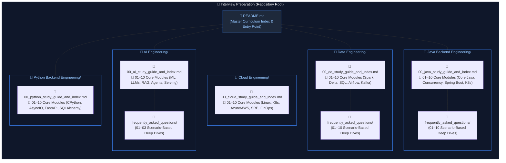

# Interview Preparation & Engineering Knowledge Base

A structured collection of production-grade study guides, architectural deep dives, and real-world interview solutions across five core engineering disciplines: **AI Engineering**, **Cloud Engineering**, **Data Engineering**, **Java Backend Engineering**, and **Python Backend Engineering**.

Each track provides a strict 10-module linear curriculum, accompanied by scenario-based interview question deep dives in 1:1 mapped companion guides.

---

## Tracks Overview

### 1. [AI Engineering](AI%20Engineering/00_ai_study_guide_and_index.md)
Comprehensive guides covering applied machine learning, neural architectures, generative AI, vector retrieval, autonomous agent architectures, and LLM serving infrastructure.

- **Core Curriculum ([Study Guide & Index](AI%20Engineering/00_ai_study_guide_and_index.md))**:
  - Foundations & Neural Architectures: [`01. ML & Deep Learning Fundamentals`](AI%20Engineering/01_machine_learning_and_deep_learning.md) | [`02. LLM & Transformer Architecture`](AI%20Engineering/02_llm_and_transformer_architecture.md)
  - Orchestration & Knowledge Systems: [`03. Prompt Engineering & Orchestration`](AI%20Engineering/03_prompt_engineering_and_context_design.md) | [`04. Embeddings, Vector DBs & RAG`](AI%20Engineering/04_embeddings_vector_databases_and_rag.md)
  - Cognitive Agents & Security: [`05. AI Agents & Multi-Agent Systems`](AI%20Engineering/05_ai_agents_and_multi_agent_systems.md) | [`06. LLM Evaluation & Security`](AI%20Engineering/06_llm_evaluation_and_security.md)
  - Operations & Serving Platforms: [`07. LLMOps & Production Gateways`](AI%20Engineering/07_llmops_and_model_gateways.md) | [`08. AI Cloud Infrastructure & Serving`](AI%20Engineering/08_ai_infrastructure_and_serving.md)
  - Real-Time & Systems Design: [`09. Multimodal AI & Real-Time Systems`](AI%20Engineering/09_multimodal_and_realtime_ai.md) | [`10. Model Adaptation & Enterprise AI Design`](AI%20Engineering/10_model_adaptation_and_system_design.md)
- **[Interview FAQs & Scenarios](AI%20Engineering/frequently_asked_questions/00_ai_faq_study_guide_and_index.md)**: Deep-dive interview scenarios covering transformer mechanics, LLM architecture, prompt engineering, and context design.

---

### 2. [Cloud Engineering](Cloud%20Engineering/00_cloud_study_guide_and_index.md)
Concept-first, production-grade curriculum spanning Linux OS internals, software-defined networking, core cloud infrastructure paradigms (Azure & AWS), Infrastructure as Code (Terraform), release engineering, Kubernetes & GitOps, DevSecOps, observability, Site Reliability Engineering, distributed databases, serverless architectures, and FinOps.

- **Core Curriculum ([Study Guide & Index](Cloud%20Engineering/00_cloud_study_guide_and_index.md))**:
  - Foundations & Networking: [`01. Linux OS & Shell Scripting`](Cloud%20Engineering/01_linux_systems_and_scripting.md) | [`02. Networking & Cloud Networking`](Cloud%20Engineering/02_networking_and_cloud_connectivity.md)
  - Cloud Architecture & IaC: [`03. Cloud Fundamentals & Multi-Cloud`](Cloud%20Engineering/03_cloud_foundations_and_multicloud.md) | [`04. Infrastructure as Code (IaC)`](Cloud%20Engineering/04_infrastructure_as_code.md)
  - CI/CD, Containers & Security: [`05. CI/CD & Release Engineering`](Cloud%20Engineering/05_cicd_and_release_engineering.md) | [`06. Containers, Kubernetes & GitOps`](Cloud%20Engineering/06_containers_kubernetes_and_gitops.md) | [`07. Cloud Security, IAM & DevSecOps`](Cloud%20Engineering/07_cloud_security_iam_and_devsecops.md)
  - Reliability & Platform Operations: [`08. Observability & SRE Reliability`](Cloud%20Engineering/08_observability_and_reliability.md) | [`09. Distributed Storage & Serverless`](Cloud%20Engineering/09_cloud_databases_and_storage.md) | [`10. Platform Engineering & FinOps`](Cloud%20Engineering/10_platform_engineering_and_finops.md)

---

### 3. [Data Engineering](Data%20Engineering/00_de_study_guide_and_index.md)
In-depth coverage of distributed data platforms, database internals, batch and stream processing, Lakehouse ACID engines, orchestration, and enterprise system design.

- **Core Curriculum ([Study Guide & Index](Data%20Engineering/00_de_study_guide_and_index.md))**:
  - Relational Mastery & Programming: [`01. SQL Fundamentals & Advanced Querying`](Data%20Engineering/01_sql_and_advanced_querying.md) | [`02. Python for Data Engineering`](Data%20Engineering/02_python_for_data_engineering.md)
  - Architecture & Distributed Storage: [`03. Data Modeling & Warehousing`](Data%20Engineering/03_data_modeling_and_warehousing.md) | [`04. Database Internals & Distributed Systems`](Data%20Engineering/04_database_internals_and_distributed_systems.md)
  - Compute Engines & Lakehouse: [`05. Apache Spark & PySpark`](Data%20Engineering/05_apache_spark_and_pyspark.md) | [`06. Databricks & Delta Lake`](Data%20Engineering/06_databricks_and_delta_lake.md)
  - Governance, Streaming & Pipelines: [`07. Unity Catalog & Governance`](Data%20Engineering/07_unity_catalog_and_governance.md) | [`08. Streaming, Kafka & Auto Loader`](Data%20Engineering/08_streaming_kafka_and_auto_loader.md) | [`09. ETL Pipelines, Orchestration & DevOps`](Data%20Engineering/09_etl_pipelines_and_orchestration.md)
  - High-Scale System Design: [`10. System Design for Data Engineering`](Data%20Engineering/10_system_design_for_data_engineering.md)
- **[Interview FAQs & Scenarios](Data%20Engineering/frequently_asked_questions/00_de_faq_study_guide_and_index.md)**: 10 dedicated scenario guides covering real-world SQL puzzles, Spark performance tuning, Delta Lake internals, streaming watermarks, and pipeline troubleshooting.

---

### 4. [Java Backend Engineering](Java%20Backend%20Engineering/00_java_study_guide_and_index.md)
Deep architectural exploration of JVM mechanics, core Java, modern functional features (Java 8–21), high concurrency, Spring Boot internals, microservices, and cloud operations.

- **Core Curriculum ([Study Guide & Index](Java%20Backend%20Engineering/00_java_study_guide_and_index.md))**:
  - Language Foundations & Data Handling: [`01. Core Java & OOP`](Java%20Backend%20Engineering/01_core_java_and_oop.md) | [`02. Collections Framework & Generics`](Java%20Backend%20Engineering/02_java_collections_and_generics.md)
  - Modern Java & Concurrency: [`03. Modern Java, Records & Streams`](Java%20Backend%20Engineering/03_modern_java_streams_and_records.md) | [`04. Concurrency & Multithreading`](Java%20Backend%20Engineering/04_java_concurrency_and_multithreading.md)
  - Enterprise Frameworks & Security: [`05. Spring Boot & REST APIs`](Java%20Backend%20Engineering/05_spring_boot_and_rest_apis.md) | [`06. Security & Cryptography`](Java%20Backend%20Engineering/06_security_and_cryptography.md)
  - Persistence & Messaging: [`07. Databases, JPA & Hibernate`](Java%20Backend%20Engineering/07_databases_jpa_and_hibernate.md) | [`08. Caching, Redis & Messaging`](Java%20Backend%20Engineering/08_caching_redis_and_kafka.md)
  - Architecture & Cloud Operations: [`09. Microservices & System Design`](Java%20Backend%20Engineering/09_microservices_and_system_design.md) | [`10. Cloud Native, DevOps & Troubleshooting`](Java%20Backend%20Engineering/10_cloud_devops_and_observability.md)
- **[Interview FAQs & Scenarios](Java%20Backend%20Engineering/frequently_asked_questions/00_java_faq_study_guide_and_index.md)**: 10 dedicated scenario guides covering HashMap internals, multithreading puzzles, Spring bean lifecycle, JPA N+1 optimization, Kafka consumer lag, and thread dump triage.

---

### 5. [Python Backend Engineering](Python%20Backend%20Engineering/00_python_study_guide_and_index.md)
Comprehensive, production-grade curriculum spanning CPython runtime mechanics, object model internals, advanced metaprogramming, high-concurrency AsyncIO, Clean/Hexagonal architecture, web framework internals (FastAPI & Flask), SQLAlchemy 2.0 enterprise persistence, API security, and distributed systems operations.

- **Core Curriculum ([Study Guide & Index](Python%20Backend%20Engineering/00_python_study_guide_and_index.md))**:
  - Language, Runtime & Tooling: [`01. Core Python & OOP`](Python%20Backend%20Engineering/01_core_python_and_oop.md) | [`02. CPython Runtime & Tooling`](Python%20Backend%20Engineering/02_cpython_runtime_and_memory.md)
  - Concurrency & Architecture: [`03. Concurrency & Async Programming`](Python%20Backend%20Engineering/03_python_concurrency_and_asyncio.md) | [`04. Design Patterns & Architecture`](Python%20Backend%20Engineering/04_design_patterns_and_architecture.md)
  - Web Frameworks & Persistence: [`05. Web Frameworks & API Protocols`](Python%20Backend%20Engineering/05_web_frameworks_and_api_protocols.md) | [`06. Databases & SQLAlchemy ORM`](Python%20Backend%20Engineering/06_databases_and_sqlalchemy_orm.md)
  - Security & Event Messaging: [`07. Security, Identity & Auth`](Python%20Backend%20Engineering/07_security_and_authentication.md) | [`08. Caching & Event Messaging`](Python%20Backend%20Engineering/08_caching_redis_and_kafka.md)
  - Distributed Systems & DevOps: [`09. Microservices & System Design`](Python%20Backend%20Engineering/09_microservices_and_system_design.md) | [`10. Testing, Observability & DevOps`](Python%20Backend%20Engineering/10_testing_docker_and_devops.md)

---

## Directory Tree

