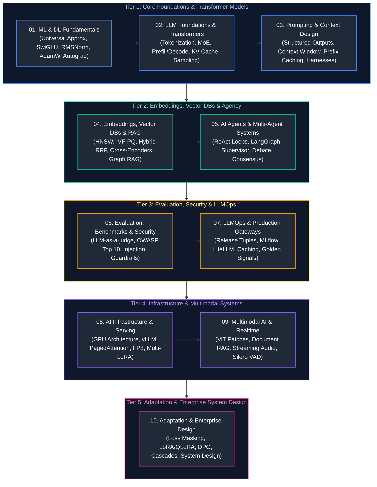

# AI Engineering Master Curriculum & Comprehensive Study Guide

This master guide provides the definitive, production-grade learning roadmap, conceptual index, and chronological study order for modern AI Engineering. The curriculum spans foundational machine learning and deep learning mechanics, modern LLM architectures (Transformers, MoE, KV caching), prompt engineering and API orchestration, high-dimensional vector embeddings and hybrid search, advanced RAG and knowledge systems, context engineering and agent harnesses, autonomous single- and multi-agent systems, rigorous evaluation and quality gates, AI security and guardrails, enterprise LLMOps and gateways, high-throughput GPU inference serving (vLLM, PagedAttention), multimodal architectures (Vision, Audio, Realtime Voice), model adaptation (SFT, LoRA/QLoRA, DPO, Distillation), and end-to-end enterprise system design.

Every module emphasizes definitions, operational mechanisms, topological Mermaid diagrams, memory and hardware mathematics, production-grade code implementations with line-by-line commentary, defensive edge-case mitigation, and production troubleshooting playbooks.

---

## Recommended Chronological Study Order

---

## Master Topic Guides & Curriculum Coverage Overview

| Study Order | Guide File | Conceptual Domain | Corresponding Interview Guide | Key Topics & Production Scenarios Covered |
| :---: | :--- | :--- | :--- | :--- |
| **01** | [`01_machine_learning_and_deep_learning.md`](01_machine_learning_and_deep_learning.md) | ML & DL Mathematical & Code Foundations | [`01_machine_learning_and_deep_learning_faq.md`](frequently_asked_questions/01_machine_learning_and_deep_learning_faq.md) | Universal approximation theorem, backpropagation DAG mechanics, activation functions (SwiGLU, GELU, ReLU), normalization (RMSNorm vs LayerNorm), AdamW weight decay, and mixed-precision AMP training. |
| **02** | [`02_llm_and_transformer_architecture.md`](02_llm_and_transformer_architecture.md) | Transformer Architectures & LLM Mechanics | [`02_llm_and_transformer_architecture_faq.md`](frequently_asked_questions/02_llm_and_transformer_architecture_faq.md) | Auto-regressive next-token prediction, BPE/WordPiece tokenization, Transformer block internals, Multi-Head vs Grouped-Query Attention (MHA/GQA), MoE routing, Prefill vs Decode, KV cache formulas, and sampling parameters. |
| **03** | [`03_prompt_engineering_and_context_design.md`](03_prompt_engineering_and_context_design.md) | Prompt Systems, Context Design & Harnesses | [`03_prompt_engineering_and_context_design_faq.md`](frequently_asked_questions/03_prompt_engineering_and_context_design_faq.md) | Zero-shot, Few-shot, Chain-of-Thought, structured outputs, SSE streaming, tool calling loops, context budget allocation, dynamic compaction, prompt prefix caching (>85% hit rate), and durable session state. |
| **04** | [`04_embeddings_vector_databases_and_rag.md`](04_embeddings_vector_databases_and_rag.md) | Vector Geometry, Indexing & Advanced RAG | — | Vector representations, distance metrics (Cosine, Dot Product, L2), ANN indexing (HNSW, IVF-PQ), hybrid search (RRF), chunking taxonomy, cross-encoder reranking, Self-RAG reflection tokens, and Graph RAG. |
| **05** | [`05_ai_agents_and_multi_agent_systems.md`](05_ai_agents_and_multi_agent_systems.md) | Autonomous Agents & Multi-Agent Collaboration | — | ReAct loop execution cycle, Model Context Protocol (MCP), agent memory taxonomies, LangGraph state machines, multi-agent coordination topologies (Supervisor, Router, Peer-to-Peer), and multi-agent debate. |
| **06** | [`06_llm_evaluation_and_security.md`](06_llm_evaluation_and_security.md) | Quality Gates, Benchmarking & AI Security | — | Deterministic validation, LLM-as-a-judge calibration, RAG Triad metrics, trajectory scoring, OWASP Top 10 for LLMs, prompt injection, programmable guardrails (NeMo Guardrails, Llama Guard), and vector ACLs. |
| **07** | [`07_llmops_and_model_gateways.md`](07_llmops_and_model_gateways.md) | Enterprise LLMOps, Gateways & Observability | — | LLMOps release tuples, config management, MLflow registries, CI/CD blocking eval gates, high-performance API gateways (LiteLLM, Kong) with semantic caching, Prometheus golden signals (TTFT, TPS), and runbooks. |
| **08** | [`08_ai_infrastructure_and_serving.md`](08_ai_infrastructure_and_serving.md) | Cloud AI Infrastructure & Engine Internals | — | Cloud AI platforms (AWS Bedrock, Vertex AI, Azure Foundry), GPU microarchitecture (H100/B200, Tensor Cores), vLLM serving, PagedAttention block allocation, dynamic batching, and chunked prefill. |
| **09** | [`09_multimodal_and_realtime_ai.md`](09_multimodal_and_realtime_ai.md) | Vision, Audio & Sub-Second Conversational AI | — | Native multimodal Transformers vs cascaded pipelines, ViT patch tokenization, image tiling, document visual RAG, Mel-spectrograms, Whisper STT, streaming neural TTS, Silero VAD, and cross-modal embeddings. |
| **10** | [`10_model_adaptation_and_system_design.md`](10_model_adaptation_and_system_design.md) | Fine-Tuning, Alignment & Enterprise System Design | — | Model adaptation decision tree, chat templates, loss masking, SFT, LoRA/QLoRA adaptation, DPO alignment, knowledge distillation, 4-step AI system design framework, dynamic routing cascades, and blueprints. |

---

## Production Problem-Solution Cross-Reference Index

The table below maps the **50 canonical AI engineering production problems** to their architectural solutions and exact curriculum anchors.

| # | Problem | Canonical Solution | Module Reference |
| :---: | :--- | :--- | :--- |
| **01** | **Vanishing / Exploding Gradients** | Gradient clipping (`clip_grad_norm_`), SwiGLU activations, and RMSNorm pre-normalization | [`01_machine_learning_and_deep_learning.md`](01_machine_learning_and_deep_learning.md#2-neural-network-foundations--computational-graphs) [`01_machine_learning_and_deep_learning.md`](01_machine_learning_and_deep_learning.md#5-regularization-normalization--numerical-stability) |
| **02** | **Loss Spikes & NaN Divergence** | Dynamic loss scaling via AMP (`GradScaler`) and AdamW decoupled weight decay | [`01_machine_learning_and_deep_learning.md`](01_machine_learning_and_deep_learning.md#4-optimization-algorithms--gradient-descent-mechanics) [`01_machine_learning_and_deep_learning.md`](01_machine_learning_and_deep_learning.md#5-regularization-normalization--numerical-stability) |
| **03** | **Training Memory Out-of-Memory (OOM)** | Activation checkpointing, FlashAttention-2 kernel integration, and PyTorch FSDP | [`01_machine_learning_and_deep_learning.md`](01_machine_learning_and_deep_learning.md#7-the-transformer-core-building-blocks) [`01_machine_learning_and_deep_learning.md`](01_machine_learning_and_deep_learning.md#8-production-implementation-end-to-end-pytorch-training-loop) |
| **04** | **High Prefill Latency for Long Prompts** | Chunked prefill request interleaving and hardware-aligned prompt prefix caching | [`02_llm_and_transformer_architecture.md`](02_llm_and_transformer_architecture.md#4-the-lifecycle-of-an-inference-request) [`08_ai_infrastructure_and_serving.md`](08_ai_infrastructure_and_serving.md#4-continuous-batching-chunked-prefill--speculative-decoding) |
| **05** | **Time-To-First-Token (TTFT) SLA Violations** | Speculative decoding with draft models and prompt prefix KV cache reuse | [`02_llm_and_transformer_architecture.md`](02_llm_and_transformer_architecture.md#4-the-lifecycle-of-an-inference-request) [`03_prompt_engineering_and_context_design.md`](03_prompt_engineering_and_context_design.md#21-provider-context-caching--economic-optimization) |
| **06** | **Inference KV Cache Memory Exhaustion** | PagedAttention virtual block tables and Grouped-Query Attention (GQA) | [`02_llm_and_transformer_architecture.md`](02_llm_and_transformer_architecture.md#5-key-value-kv-caching--memory-footprints) [`08_ai_infrastructure_and_serving.md`](08_ai_infrastructure_and_serving.md#3-serving-engine-mechanics-vllm-sglang--pagedattention) |
| **07** | **Routing Skew in Mixture-of-Experts (MoE)** | Auxiliary load-balancing loss enforcement and expert capacity factor clipping | [`02_llm_and_transformer_architecture.md`](02_llm_and_transformer_architecture.md#3-transformer-core-dense-vs-mixture-of-experts-moe) |
| **08** | **Token Generation Loops & Degeneracy** | Dynamic sampling parameter tuning ($T \in [0.6, 0.8]$, min-p $\in [0.05, 0.1]$, repetition penalty) | [`02_llm_and_transformer_architecture.md`](02_llm_and_transformer_architecture.md#6-sampling-parameters--generation-control) |
| **09** | **Provider Rate Limiting (HTTP 429) Cascades** | Client-side Token Bucket rate limiting, circuit breakers, and exponential backoff with full jitter | [`03_prompt_engineering_and_context_design.md`](03_prompt_engineering_and_context_design.md#6-concurrency-async-io--rate-limiting-resilience) [`07_llmops_and_model_gateways.md`](07_llmops_and_model_gateways.md#3-enterprise-llm-gateways-resilient-routing--semantic-caching) |
| **10** | **Malformed JSON & Schema Drift in LLM Output** | Constrained grammar generation via Pydantic model validation and Instructor retry loops | [`03_prompt_engineering_and_context_design.md`](03_prompt_engineering_and_context_design.md#3-structured-outputs--schema-enforcement) |
| **11** | **Client SSE Stream Disconnect Resource Leaks** | Async generator wrapping with explicit cancellation and HTTP disconnect listeners | [`03_prompt_engineering_and_context_design.md`](03_prompt_engineering_and_context_design.md#2-streaming-architectures--server-sent-events-sse) [`07_llmops_and_model_gateways.md`](07_llmops_and_model_gateways.md#5-high-performance-serving-streaming--containerization) |
| **12** | **Upstream LLM Provider Outages** | Multi-provider fallback routing (Anthropic $\rightarrow$ OpenAI $\rightarrow$ vLLM Self-Hosted) via Gateway | [`03_prompt_engineering_and_context_design.md`](03_prompt_engineering_and_context_design.md#7-api-robustness-retries-timeouts--fallback-cascades) [`07_llmops_and_model_gateways.md`](07_llmops_and_model_gateways.md#3-enterprise-llm-gateways-resilient-routing--semantic-caching) |
| **13** | **Degraded Vector Index Search Latency ($p99$)** | HNSW parameter tuning: increasing $M$ and `efConstruction` during build, calibrating `efSearch` | [`04_embeddings_vector_databases_and_rag.md`](04_embeddings_vector_databases_and_rag.md#5-graph-based-search-hierarchical-navigable-small-world-hnsw) |
| **14** | **Excessive Vector Memory Footprint** | Inverted File Product Quantization (IVF-PQ) compression and 8-bit scalar quantization | [`04_embeddings_vector_databases_and_rag.md`](04_embeddings_vector_databases_and_rag.md#4-approximate-nearest-neighbor-ann-indexing) |
| **15** | **Keyword Blindness in Dense Embeddings** | Hybrid Search combining Dense HNSW with BM25 inverted indexes via Reciprocal Rank Fusion (RRF) | [`04_embeddings_vector_databases_and_rag.md`](04_embeddings_vector_databases_and_rag.md#7-sparse-lexical-search--hybrid-retrieval) |
| **16** | **Distance Metric Inconsistencies Across DBs** | Mandatory $L_2$ unit-norm vector normalization before indexing for Cosine/Dot Product equivalence | [`04_embeddings_vector_databases_and_rag.md`](04_embeddings_vector_databases_and_rag.md#2-mathematical-distance-metrics) |
| **17** | **Document Table & Structure Loss in Ingestion** | Layout-aware vision-augmented document parsing with Markdown tabular serialization | [`04_embeddings_vector_databases_and_rag.md`](04_embeddings_vector_databases_and_rag.md#13-document-ingestion--hierarchical-extraction) |
| **18** | **Context Boundary Clipping Across Chunks** | Recursive hierarchical character splitting with sentence-boundary preservation and parent-child retrieval | [`04_embeddings_vector_databases_and_rag.md`](04_embeddings_vector_databases_and_rag.md#14-chunking-strategies--semantic-segmentation) |
| **19** | **Retrieval Precision Loss & Noise Injection** | Two-stage retrieval: broad bi-encoder candidate retrieval followed by cross-encoder neural reranking | [`04_embeddings_vector_databases_and_rag.md`](04_embeddings_vector_databases_and_rag.md#15-two-stage-retrieval--cross-encoder-reranking) |
| **20** | **Vocabulary Gap in Short RAG Queries** | Hypothetical Document Embeddings (HyDE) zero-shot document hallucination and expansion | [`04_embeddings_vector_databases_and_rag.md`](04_embeddings_vector_databases_and_rag.md#16-query-transformation--expansion-techniques) |
| **21** | **Hallucinations on Unanswerable Queries** | Self-RAG reflection tokens (`[RETRIEVE]`, `[ISREL]`) and Corrective RAG (CRAG) fallback to web search | [`04_embeddings_vector_databases_and_rag.md`](04_embeddings_vector_databases_and_rag.md#18-advanced-rag-architectures-self-rag-crag--graph-rag) |
| **22** | **Multi-Hop Reasoning Failures in RAG** | Graph RAG knowledge extraction, entity-relationship triples, and Leiden community summarization | [`04_embeddings_vector_databases_and_rag.md`](04_embeddings_vector_databases_and_rag.md#18-advanced-rag-architectures-self-rag-crag--graph-rag) |
| **23** | **Lost-in-the-Middle Attention Degradation** | Context budgeting and prompt assembly placing high-value context at extreme prompt edges ($<15\%$ and $>85\%$) | [`03_prompt_engineering_and_context_design.md`](03_prompt_engineering_and_context_design.md#15-the-context-window-as-a-finite-operating-budget) [`03_prompt_engineering_and_context_design.md`](03_prompt_engineering_and_context_design.md#16-deliberate-context-selection--assembly) |
| **24** | **Context Window Exhaustion in Long Sessions** | Hierarchical rolling compaction, sliding window token buffers, and periodic summary checkpoints | [`03_prompt_engineering_and_context_design.md`](03_prompt_engineering_and_context_design.md#17-context-compression--compaction-techniques) |
| **25** | **Runaway Tool Call Output Clutter** | Observation Governor implementing character limits, head/tail slicing, and structured stderr filtering | [`03_prompt_engineering_and_context_design.md`](03_prompt_engineering_and_context_design.md#20-tool-context-management--observation-pruning) |
| **26** | **High API Costs for Repeated Static Context** | Canonical prompt prefix caching: pinning invariant system instructions and tools at prompt prefix | [`03_prompt_engineering_and_context_design.md`](03_prompt_engineering_and_context_design.md#21-provider-context-caching--economic-optimization) |
| **27** | **Infinite Loops & Flapping in ReAct Agents** | Visited tool action hashing, max step ceilings, and semantic stagnation loop detectors | [`05_ai_agents_and_multi_agent_systems.md`](05_ai_agents_and_multi_agent_systems.md#2-reasoning-planning--reflection-patterns) [`05_ai_agents_and_multi_agent_systems.md`](05_ai_agents_and_multi_agent_systems.md#8-production-implementation-resilient-bare-metal-react-agent-engine) |
| **28** | **Host Compromise from Agent Code Tools** | Sandboxed microVM / container execution (E2B, Docker, gVisor) with network egress whitelisting | [`05_ai_agents_and_multi_agent_systems.md`](05_ai_agents_and_multi_agent_systems.md#7-sandboxed-code-execution--runtime-security) |
| **29** | **Tool Calling Schema Hallucination** | Strict Model Context Protocol (MCP) tool schema definitions and automated repair prompt retries | [`05_ai_agents_and_multi_agent_systems.md`](05_ai_agents_and_multi_agent_systems.md#4-the-model-context-protocol-mcp-standard) |
| **30** | **Agent Amnesia Across User Sessions** | Tiered memory architecture: short-term working memory, episodic vector search, and procedural rule sets | [`05_ai_agents_and_multi_agent_systems.md`](05_ai_agents_and_multi_agent_systems.md#5-agent-memory-systems--state-lifecycle) |
| **31** | **Cascading Errors Across Collaborating Agents** | Strict Pydantic message envelope schemas, state checkpointing, and coordinator supervisory gates | [`05_ai_agents_and_multi_agent_systems.md`](05_ai_agents_and_multi_agent_systems.md#17-inter-agent-communication-protocols) [`05_ai_agents_and_multi_agent_systems.md`](05_ai_agents_and_multi_agent_systems.md#18-mitigating-multi-agent-pathologies) |
| **32** | **Groupthink in Multi-Agent Consensus** | Multi-Agent Debate with explicit devil's advocate prompts and independent blinded vote tallies | [`05_ai_agents_and_multi_agent_systems.md`](05_ai_agents_and_multi_agent_systems.md#19-consensus-voting--multi-agent-debate) |
| **33** | **Infinite Handoff Ping-Pong Between Agents** | Directed Acyclic Graph (DAG) routing matrices, transition decrement counters, and supervisor fallbacks | [`05_ai_agents_and_multi_agent_systems.md`](05_ai_agents_and_multi_agent_systems.md#16-architectural-topologies-for-collaboration) [`05_ai_agents_and_multi_agent_systems.md`](05_ai_agents_and_multi_agent_systems.md#18-mitigating-multi-agent-pathologies) |
| **34** | **Fragile "Vibe Checks" in Model Releases** | Automated programmatic validation gates (Pydantic schema assertions, deterministic regex checks) | [`06_llm_evaluation_and_security.md`](06_llm_evaluation_and_security.md#2-the-three-tiers-of-evaluation-methodology) |
| **35** | **Subjectivity & Position Bias in LLM Judges** | Chain-of-Thought scoring rubrics (1–5 scale), position swap normalization, and human calibration | [`06_llm_evaluation_and_security.md`](06_llm_evaluation_and_security.md#3-engineering-reliable-llm-as-a-judge-systems) |
| **36** | **Unclear Root Cause for Bad RAG Answers** | RAG Triad evaluation: independent scoring of Faithfulness, Answer Relevance, and Context Precision | [`06_llm_evaluation_and_security.md`](06_llm_evaluation_and_security.md#5-rag-evaluation--the-rag-triad) |
| **37** | **Degraded Multi-Step Agent Trajectories** | Trajectory evaluation: Step Accuracy, Visited Path Jaccard Index, and Tool Call Precision | [`06_llm_evaluation_and_security.md`](06_llm_evaluation_and_security.md#6-agent-trajectory-evaluation--fault-injection) |
| **38** | **Direct Prompt Injections & Jailbreaks** | Structural system prompt delimiter isolation (`<system>`, `<user>`) and input guardrail classifiers | [`06_llm_evaluation_and_security.md`](06_llm_evaluation_and_security.md#10-direct--indirect-prompt-injection-attacks) |
| **39** | **Indirect Injection via Web Browsing** | Dual-LLM architecture: unprivileged reader extracts raw text; privileged executive acts on vetted facts | [`06_llm_evaluation_and_security.md`](06_llm_evaluation_and_security.md#10-direct--indirect-prompt-injection-attacks) |
| **40** | **PII Leakage in LLM Prompts & Logs** | Microsoft Presidio scrubbing vault replacing entities with reversible cryptographic tokens | [`06_llm_evaluation_and_security.md`](06_llm_evaluation_and_security.md#15-data-privacy-pii-protection--secrets-management) |
| **41** | **Multi-Tenant Leakage in Vector Retrieval** | Single-stage in-graph metadata ACL filtering directly inside the HNSW traversal loop | [`06_llm_evaluation_and_security.md`](06_llm_evaluation_and_security.md#14-rag--knowledge-security-document-level-acls--provenance) |
| **42** | **Silent Output Degradation in Production** | Automated telemetry tracking token usage, latency percentiles ($p95$, $p99$), and semantic topic drift | [`07_llmops_and_model_gateways.md`](07_llmops_and_model_gateways.md#6-distributed-observability-telemetry--cost-governance) |
| **43** | **Runaway LLM API Billing Costs** | Exact SHA-256 Redis caching combined with semantic vector caching and tenant budget quotas | [`07_llmops_and_model_gateways.md`](07_llmops_and_model_gateways.md#3-enterprise-llm-gateways-resilient-routing--semantic-caching) [`10_model_adaptation_and_system_design.md`](10_model_adaptation_and_system_design.md#10-core-architectural-subsystems-gateways-routing-cascades--multi-tier-caching) |
| **44** | **Breaking Model Upgrades in CI/CD** | Immutable release tuple tracking $(\mathcal{C}, \mathcal{P}, \mathcal{M}, \mathcal{K}, \mathcal{T})$ with blocking evaluation gates | [`07_llmops_and_model_gateways.md`](07_llmops_and_model_gateways.md#4-evaluation-as-a-blocking-cicd-release-gate) |
| **45** | **GPU Underutilization During Serving** | Continuous dynamic iteration-level batching and PagedAttention in vLLM | [`08_ai_infrastructure_and_serving.md`](08_ai_infrastructure_and_serving.md#3-serving-engine-mechanics-vllm-sglang--pagedattention) [`08_ai_infrastructure_and_serving.md`](08_ai_infrastructure_and_serving.md#4-continuous-batching-chunked-prefill--speculative-decoding) |
| **46** | **High Memory Footprint for Serving 70B+** | Activation-Aware Weight Quantization (AWQ) 4-bit weights and FP8 KV caching | [`08_ai_infrastructure_and_serving.md`](08_ai_infrastructure_and_serving.md#6-model-quantization-mechanics-fp8-awq-gptq--gguf) |
| **47** | **Vision LLM Out-of-Memory on Hi-Res Images** | Dynamic patch cropping, thumbnail overview generation, and ViT patch token merging | [`09_multimodal_and_realtime_ai.md`](09_multimodal_and_realtime_ai.md#2-computer-vision--vision-transformers-vit) |
| **48** | **Conversational Voice Latency (>1000ms)** | Full-duplex WebSocket architecture with Silero VAD, streaming Whisper STT, and chunked neural TTS | [`09_multimodal_and_realtime_ai.md`](09_multimodal_and_realtime_ai.md#5-realtime-sub-500ms-conversational-voice-agents) |
| **49** | **Catastrophic Forgetting During Fine-Tuning** | Low-Rank Adaptation (LoRA / QLoRA) with frozen base weights, rank $r \le 16$, and target loss masking | [`10_model_adaptation_and_system_design.md`](10_model_adaptation_and_system_design.md#4-parameter-efficient-fine-tuning-peft-lora-qlora--dora) |
| **50** | **Teacher-Student Gap in Small Distilled Models** | Step-by-Step Chain-of-Thought distillation with Reinforcement Fine-Tuning (RFT) verifier rewards | [`10_model_adaptation_and_system_design.md`](10_model_adaptation_and_system_design.md#6-reinforcement-fine-tuning-rft-with-verifiable-rewards) [`10_model_adaptation_and_system_design.md`](10_model_adaptation_and_system_design.md#7-knowledge-distillation--model-compression) |

---

## Production Engineering Takeaways & Architectural Invariants

1. **Deterministic Gates Precede Probabilistic Inference:**
   Never delegate deterministic validation (schema conformity, security boundaries, rate limiting, and ACL authorization) to probabilistic LLM prompts. Enforce rigid programmatic controls at the gateway, harness, and parser layers before prompting the language model.

2. **Memory is the Primary Bottleneck in LLM Serving:**
   While training is compute-bound (FLOPs), high-throughput inference decode is memory-bandwidth bound. Optimizing the KV cache through Grouped-Query Attention (GQA), PagedAttention virtual block tables, AWQ/FP8 quantization, and hardware prompt prefix caching produces an order-of-magnitude greater ROI than scaling raw GPU compute.

3. **Context Engineering Trumps Raw Window Expansion:**
   Expanding the context window without active context budgeting induces severe lost-in-the-middle degradation, elevates latency, and balloons token costs. Production systems must combine hierarchical rolling compaction, the Observation Governor, and prompt prefix caching to maintain deterministic signal-to-noise ratios.

4. **Multi-Stage Retrieval is Invariant for Enterprise RAG:**
   Dense vector embeddings excel at broad conceptual search but fail at lexical keywords, exact acronyms, and alphanumeric identifiers. Production RAG pipelines must always implement hybrid dense-sparse retrieval (HNSW + BM25 via Reciprocal Rank Fusion) followed by cross-encoder neural reranking.

5. **Multi-Agent Systems Require Strict Isolation and Bounded State:**
   Agents must never share unbounded prompt contexts. Robust multi-agent architectures isolate contexts behind specialized worker interfaces, validate inter-agent transitions via structured Pydantic schemas, and prevent runaway execution through circuit-breaking loop detectors.

6. **Continuous Alignment Between Off-the-Shelf APIs and Fine-Tuning:**
   Fine-tuning base models is not a substitute for robust retrieval or prompt engineering. Follow the adaptation hierarchy: start with few-shot prompting, graduate to advanced RAG, add agentic tools, and only invest in LoRA/QLoRA fine-tuning or distillation when domain-specific style, latency, cost, or strict formatting cannot be solved in context.

---

## References & Further Reading

1. **Foundational Transformers & Attention:**
   - Vaswani et al. (2017). *Attention Is All You Need*. [arXiv:1706.03762](https://arxiv.org/abs/1706.03762)
   - Shazeer (2020). *GLU Variants Improve Transformer*. [arXiv:2002.05202](https://arxiv.org/abs/2002.05202)
   - Dao et al. (2022). *FlashAttention: Fast and Memory-Efficient Exact Attention with IO-Awareness*. [arXiv:2205.14135](https://arxiv.org/abs/2205.14135)

2. **Inference Acceleration & Memory Virtualization:**
   - Kwon et al. (2023). *Efficient Memory Management for Large Language Model Serving with PagedAttention (vLLM)*. [arXiv:2309.06180](https://arxiv.org/abs/2309.06180)
   - Lin et al. (2023). *AWQ: Activation-aware Weight Quantization for LLM Compression and Acceleration*. [arXiv:2306.00978](https://arxiv.org/abs/2306.00978)
   - Leviathan et al. (2023). *Fast Inference from Transformers via Speculative Decoding*. [arXiv:2211.17192](https://arxiv.org/abs/2211.17192)

3. **Advanced Retrieval & Context Engineering:**
   - Lewis et al. (2020). *Retrieval-Augmented Generation for Knowledge-Intensive NLP Tasks*. [arXiv:2005.11401](https://arxiv.org/abs/2005.11401)
   - Asai et al. (2023). *Self-RAG: Learning to Retrieve, Generate, and Critique through Self-Reflection*. [arXiv:2310.11511](https://arxiv.org/abs/2310.11511)
   - Liu et al. (2023). *Lost in the Middle: How Language Models Use Long Contexts*. [arXiv:2307.03172](https://arxiv.org/abs/2307.03172)
   - Edge et al. (2024). *From Local to Global: A Graph RAG Approach to Query-Focused Summarization*. [arXiv:2404.16130](https://arxiv.org/abs/2404.16130)

4. **Autonomous Agents & Tool Calling:**
   - Yao et al. (2022). *ReAct: Synergizing Reasoning and Acting in Language Models*. [arXiv:2210.03629](https://arxiv.org/abs/2210.03629)
   - Anthropic (2024). *Model Context Protocol (MCP) Specification*. [modelcontextprotocol.io](https://modelcontextprotocol.io)
   - Wu et al. (2023). *AutoGen: Enabling Next-Gen LLM Applications via Multi-Agent Conversation*. [arXiv:2308.08155](https://arxiv.org/abs/2308.08155)

5. **Fine-Tuning, Alignment & Distillation:**
   - Hu et al. (2021). *LoRA: Low-Rank Adaptation of Large Language Models*. [arXiv:2106.09685](https://arxiv.org/abs/2106.09685)
   - Dettmers et al. (2023). *QLoRA: Efficient Finetuning of Quantized LLMs*. [arXiv:2305.14314](https://arxiv.org/abs/2305.14314)
   - Rafailov et al. (2023). *Direct Preference Optimization: Your Language Model is Secretly a Reward Model*. [arXiv:2305.18290](https://arxiv.org/abs/2305.18290)

