# 07. LLMOps, AI Gateways & Production Operations: Master Guide

A comprehensive, production-grade guide to LLMOps engineering, versioning the generative AI release tuple ($\text{Code} + \text{Prompts} + \text{Model} + \text{Context} + \text{Tools}$), enterprise LLM gateways (LiteLLM, Portkey), semantic caching, distributed token-bucket rate limiting, automated CI/CD evaluation release gates, containerized FastAPI streaming microservices with client disconnect guards, distributed tracing (OpenTelemetry, OpenInference, Langfuse), Prometheus telemetry, and production incident triage runbooks. Tailored for AI Platform Engineers, ML Infrastructure Architects, and SRE Leads.

---

## Architectural Overview: Enterprise LLMOps Platform & Deployment Lifecycle

The diagram below details an enterprise LLMOps pipeline, orchestrating code commits, prompt version promotions, blocking CI/CD evaluation gates, containerized Kubernetes deployments, unified AI gateways, semantic caching, and continuous distributed observability.

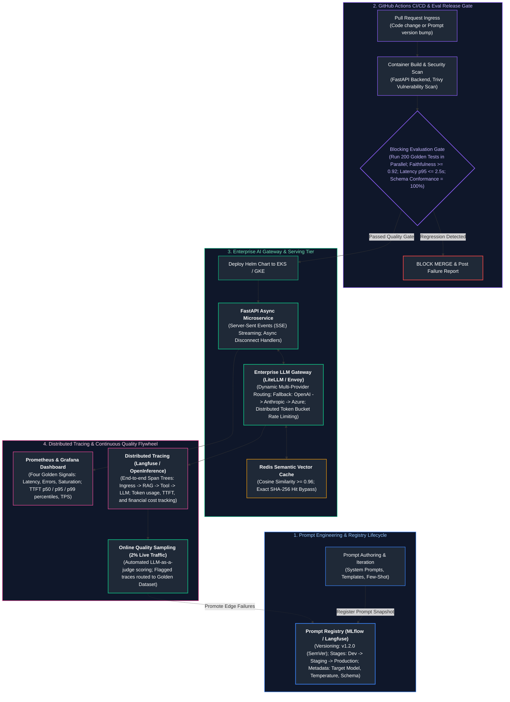

---

## Table of Contents
1. [The Discipline of LLMOps & The Production Release Tuple](#1-the-discipline-of-llmops--the-production-release-tuple)
   - [1.1 MLOps vs. LLMOps: Operational Paradigms](#11-mlops-vs-llmops-operational-paradigms)
   - [1.2 The Production Generative AI Release Tuple](#12-the-production-generative-ai-release-tuple)
   - [1.3 Reproducibility & Traceability for Stochastic Endpoints](#13-reproducibility--traceability-for-stochastic-endpoints)
2. [Configuration Management, Prompt Registries & Versioning](#2-configuration-management-prompt-registries--versioning)
   - [2.1 Decoupling Model Hyperparameters and Prompts from Application Code](#21-decoupling-model-hyperparameters-and-prompts-from-application-code)
   - [2.2 Managing Upstream Model Checkpoint Pinning & Deprecation](#22-managing-upstream-model-checkpoint-pinning--deprecation)
   - [2.3 Centralized Prompt Registries & Lifecycle Promotion](#23-centralized-prompt-registries--lifecycle-promotion)
   - [2.4 Zero-Downtime Rollbacks via Dynamic Tag Resolution](#24-zero-downtime-rollbacks-via-dynamic-tag-resolution)
3. [Enterprise LLM Gateways, Resilient Routing & Semantic Caching](#3-enterprise-llm-gateways-resilient-routing--semantic-caching)
   - [3.1 Gateway Architecture & Multi-Provider Abstraction](#31-gateway-architecture--multi-provider-abstraction)
   - [3.2 Dynamic Fallbacks, Circuit Breakers & Hedging](#32-dynamic-fallbacks-circuit-breakers--hedging)
   - [3.3 Semantic Caching Architecture & Similarity Thresholds](#33-semantic-caching-architecture--similarity-thresholds)
   - [3.4 Distributed Token Bucket Rate Limiting (RPM vs. TPM)](#34-distributed-token-bucket-rate-limiting-rpm-vs-tpm)
4. [Evaluation as a Blocking CI/CD Release Gate](#4-evaluation-as-a-blocking-cicd-release-gate)
   - [4.1 Wiring Quantitative Evaluations into the Build Lifecycle](#41-wiring-quantitative-evaluations-into-the-build-lifecycle)
   - [4.2 Statistical Threshold Assertions & Flakiness Mitigation](#42-statistical-threshold-assertions--flakiness-mitigation)
   - [4.3 GitHub Actions Workflow Implementation](#43-github-actions-workflow-implementation)
5. [High-Performance Serving, Streaming & Containerization](#5-high-performance-serving-streaming--containerization)
   - [5.1 Asynchronous Backend Architecture with FastAPI](#51-asynchronous-backend-architecture-with-fastapi)
   - [5.2 Robust Server-Sent Events (SSE) Wire Protocol](#52-robust-server-sent-events-sse-wire-protocol)
   - [5.3 Client Disconnects & The Zombie Generation Cost Hazard](#53-client-disconnects--the-zombie-generation-cost-hazard)
   - [5.4 Multi-Stage Docker Packaging & Distroless Hardening](#54-multi-stage-docker-packaging--distroless-hardening)
6. [Distributed Observability, Telemetry & Cost Governance](#6-distributed-observability-telemetry--cost-governance)
   - [6.1 The Three Pillars of LLM Telemetry](#61-the-three-pillars-of-llm-telemetry)
   - [6.2 Distributed Tracing with OpenTelemetry & OpenInference](#62-distributed-tracing-with-opentelemetry--openinference)
   - [6.3 Prometheus Golden Signals for LLMs](#63-prometheus-golden-signals-for-llms)
   - [6.4 Online Quality Sampling & Telemetry Flywheel](#64-online-quality-sampling--telemetry-flywheel)
7. [Incident Management, SRE Runbooks & Playbooks](#7-incident-management-sre-runbooks--playbooks)
   - [7.1 Runbook 1: Upstream Provider Outage & Automated Failover](#71-runbook-1-upstream-provider-outage--automated-failover)
   - [7.2 Runbook 2: TTFT Latency Spikes (p99 Exceeds 10 Seconds)](#72-runbook-2-ttft-latency-spikes-p99-exceeds-10-seconds)
   - [7.3 Runbook 3: Runaway Financial Cost Explosions & Recursive Agent Loops](#73-runbook-3-runaway-financial-cost-explosions--recursive-agent-loops)
   - [7.4 Runbook 4: Silent Quality Degradation Post-Model Checkpoint Update](#74-runbook-4-silent-quality-degradation-post-model-checkpoint-update)
8. [Production Implementation: Resilient Enterprise Gateway & Serving Microservice](#8-production-implementation-resilient-enterprise-gateway--serving-microservice)
   - [8.1 Microservice Architecture & Lifespan Management](#81-microservice-architecture--lifespan-management)
   - [8.2 Complete Production-Grade Python Implementation](#82-complete-production-grade-python-implementation)
   - [8.3 Docker Packaging & Local Verification Stack](#83-docker-packaging--local-verification-stack)
9. [Summary Comparison & Production Engineering Reference Matrix](#9-summary-comparison--production-engineering-reference-matrix)
   - [9.1 LLMOps Platform & Component Architecture Matrix](#91-llmops-platform--component-architecture-matrix)
   - [9.2 Upstream Provider Failure Recovery Playbook](#92-upstream-provider-failure-recovery-playbook)
10. [References & Further Reading](#10-references--further-reading)
---

# 1. The Discipline of LLMOps & The Production Release Tuple

### 1.1 MLOps vs. LLMOps: Operational Paradigms

For over a decade, **Machine Learning Operations (MLOps)** developed around traditional predictive models (e.g., XGBoost, ResNet, BERT for sequence classification). The fundamental cycle was: collect domain data $\to$ label data $\to$ engineer tabular features $\to$ train on GPU clusters $\to$ evaluate validation loss $\to$ export model weights (ONNX, PyTorch `.pt`) $\to$ deploy model binary behind an inference server (Triton, TorchServe).

In contrast, **Large Language Model Operations (LLMOps)** addresses the operational reality of building production software on top of foundation models—whether consumed via third-party hosted commercial APIs (e.g., OpenAI, Anthropic, Google Vertex AI) or self-hosted open-weight engines (e.g., vLLM, TensorRT-LLM running LLaMA-3 or Mistral).

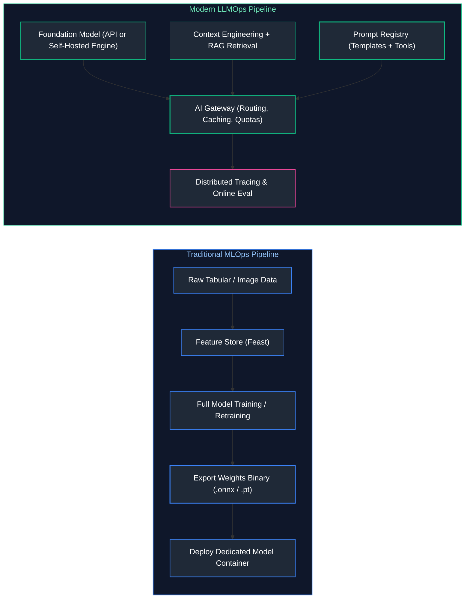

| Operational Dimension | Traditional MLOps | Modern LLMOps |
| :--- | :--- | :--- |
| **Primary Artifact** | Trained model weights binary (`model.pt`, `model.onnx`, 10MB–5GB). | The Generative Release Tuple: $\langle \text{Code}, \text{Prompt}, \text{Model ID}, \text{RAG}, \text{Tools} \rangle$. |
| **Compute Bottleneck** | Offline training cluster (nodes of 8x A100/H100 running for days/weeks). | High-concurrency online inference serving (Prefill GEMM, Decode GEMV, memory bandwidth). |
| **Data Ingestion** | Feature Stores, batch ETL pipelines, normalized tabular stores. | Vector databases, hybrid search indexes, unstructured document parsers, live tool APIs. |
| **Feedback Loop** | Ground-truth labels arrive days/weeks later (e.g., fraud detected, ad clicked). | Automated LLM-as-a-judge, negative implicit user signals (aborts, regenerations), trace evaluations. |
| **Deployment Unit** | Microservice wrapping a model weight tensor execution graph. | Orchestration gateway routing to external endpoints, local engines, and vector stores. |
| **Failure Modes** | Covariate shift, concept drift, feature distribution skew. | Hallucination, jailbreaks, prompt injection, schema breaking changes, token rate limit exhaustion. |
| **Cost Profile** | Dominated by periodic offline GPU training clusters; low inference cost per call. | Continuous operational OpEx per million tokens generated; risk of exponential cost explosion. |

---

### 1.2 The Production Generative AI Release Tuple

In traditional software engineering, a deployment is uniquely defined by a Git commit SHA compiled into an immutable Docker image hash: $\text{Release} = \text{DockerDigest}(\text{GitCommit})$.

In generative AI systems, a change in application code is only one of five volatile dimensions that govern production behavior. Deploying an application while modifying the system prompt or pointing to an unpinned upstream model alias will fundamentally alter the system's runtime characteristics.

In enterprise LLMOps, a production release is defined as an immutable 6-tuple:

$$\mathcal{R} = \langle \mathcal{C}, \mathcal{P}, \mathcal{M}, \mathcal{K}, \mathcal{T}, \mathcal{H} \rangle$$

Where:
1. $\mathcal{C}$ (**Application Code**): The versioned Git commit SHA of the orchestration logic, API wrappers, business validation, and parsing middleware.
2. $\mathcal{P}$ (**Prompt Templates**): The exact cryptographic hash or version tag of the system prompt, user prompt templates, few-shot demonstration exemplars, and delimiter formatting.
3. $\mathcal{M}$ (**Foundation Model Checkpoint**): The explicit, immutable checkpoint ID of the foundation model (e.g., `gpt-4o-2024-08-06`, `claude-3-5-sonnet-20241022`, or a specific HuggingFace commit hash for open weights), **never** a mutable alias like `gpt-4o` or `latest`.
4. $\mathcal{K}$ (**Knowledge Base & Embeddings**): The state of the retrieval corpus, including the embedding model checkpoint (`text-embedding-3-large`), vector index snapshot, chunking strategy version, and chunk database commit.
5. $\mathcal{T}$ (**Tool & Function Signatures**): The exact JSON Schema contracts of external APIs, databases, or MCP tools made available to the model.
6. $\mathcal{H}$ (**Hyperparameters & Constraints**): The runtime configuration: `temperature`, `top_p`, `max_tokens`, `frequency_penalty`, `seed`, and grammar-constrained JSON schemas.

> [!IMPORTANT]
> If any single element of $\mathcal{R}$ changes without an explicit release version increment, your application has introduced **untracked drift**. A silent change to a system prompt template or an upstream model provider updating their base alias without notification will invalidate your test baselines and break downstream JSON parsing.

---

### 1.3 Reproducibility & Traceability for Stochastic Endpoints

A foundational tenet of software engineering is determinism: given identical inputs, the system must yield identical outputs. LLMs are inherently probabilistic autoregressive models that sample from a categorical distribution over vocabulary tokens:

$$P(y_t \mid y_{<t}, x) = \text{softmax}\left(\frac{\mathbf{z}_t}{T}\right)$$

Even when setting `temperature = 0.0` (greedy decoding), achieving true bitwise reproducibility across different inference invocations is often impossible due to three physical hardware and runtime realities:

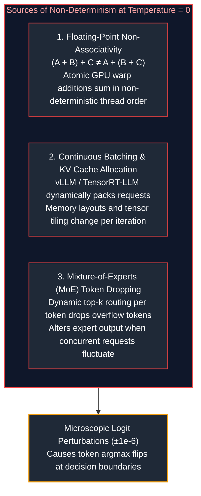

1. **Floating-Point Non-Associativity in Parallel Matrix Multiplication:**
   On NVIDIA GPUs, CUDA cores perform parallel reductions across thousands of threads. In floating-point arithmetic (FP16 or BF16), addition is non-associative: $(a + b) + c \neq a + (b + c)$. Because GPU thread scheduling depends on memory latency and warp execution timing, the accumulation order of dot products varies between calls. While the numerical difference is microscopic ($\pm 10^{-6}$), if two tokens have nearly identical top logits, this microscopic jitter flips the `argmax`, cascading into an entirely different downstream generation.
2. **Continuous Batching Memory Layouts:**
   Modern inference engines (vLLM, TensorRT-LLM) employ continuous batching. A request is co-scheduled alongside a continuously changing set of other concurrent queries. Shared GPU cache lines, PagedAttention block layouts, and tensor tiling boundaries change dynamically, altering floating-point summation orders.
3. **Mixture-of-Experts (MoE) Token Dropping:**
   Models like Mixtral 8x7B or DeepSeek-V3 route tokens to top-$k$ experts. When expert capacity limits are enforced under high load, tokens that exceed the buffer are dropped or routed to fallback paths, introducing variance under different concurrency loads.

#### Engineering Traceability Protocol
Because bitwise reproducibility cannot be guaranteed, production LLMOps relies on **Audit Traceability**:
- Record the exact prompt string, system parameters, and model snapshot ID.
- Record the completion tokens, raw logits (when available), and full token usage metadata.
- Tag every transaction with an OpenTelemetry trace context ($W3C\text{ traceparent}$) propagating from the HTTP ingress down to the foundational model invocation.

---

# 2. Configuration Management, Prompt Registries & Versioning

### 2.1 Decoupling Model Hyperparameters and Prompts from Application Code

Hardcoding prompt strings, model names, or temperature values inside application code (e.g., Python class files or route handlers) is a severe anti-pattern in enterprise systems. 

```python
# ❌ ANTI-PATTERN: Hardcoded Prompts and Configurations Inside Business Logic
async def summarize_report(report_text: str):
    # If the product team wants to tweak the formatting, developers must
    # modify code, re-run unit tests, build a Docker container, and redeploy!
    client = OpenAI()
    response = await client.chat.completions.create(
        model="gpt-4o",  # Unpinned alias: silent drift hazard
        temperature=0.7,  # Hardcoded magic number
        messages=[
            {"role": "system", "content": "You are a financial summarizer. Output 3 bullets."},
            {"role": "user", "content": report_text}
        ]
    )
    return response.choices[0].message.content
```

#### The Decoupled Configuration Pattern
Prompts and hyperparameters must be treated as **declarative configuration assets** managed independently from the runtime codebase. This separation enables:
- Prompt iteration and optimization by domain experts without engineering code changes.
- Immediate rollback of prompt regressions within seconds via configuration flags.
- Environment-specific parameter tuning (e.g., shorter timeouts and cheaper models in Dev vs. Prod).

---

### 2.2 Managing Upstream Model Checkpoint Pinning & Deprecation

Commercial model providers frequently update their models. A common trap is pointing applications to rolling pointer aliases:

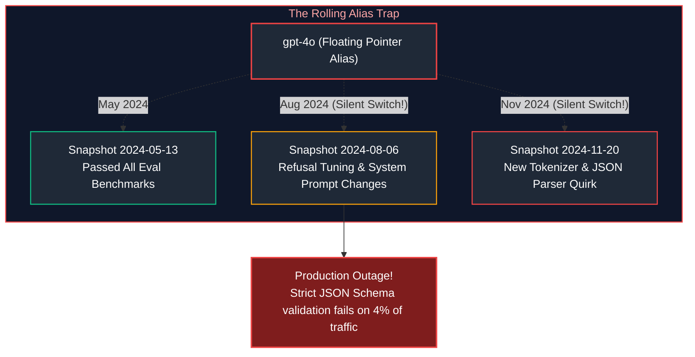

#### Production Pinning Rules
1. **Always Pin Immutable Dated Snapshots:** In production configs, use `gpt-4o-2024-08-06` or `claude-3-5-sonnet-20241022`.
2. **Provider Deprecation Deprecations & Lifecycles:** Providers typically support dated snapshots for 6 to 12 months before retirement. Maintain a centralized model inventory tracking retirement dates and automated alerts 60 days prior to end-of-life (EOL).
3. **Automated Migration Testing:** When a new model snapshot is released, it must pass through the automated CI/CD evaluation gate against historical production evaluation sets before production promotion.

---

### 2.3 Centralized Prompt Registries & Lifecycle Promotion

A **Prompt Registry** serves the same role for generative AI that an artifact repository (like Artifactory or Docker Hub) serves for compiled binaries. It stores prompt templates with cryptographic checksums, metadata schemas, and environment promotion tags.

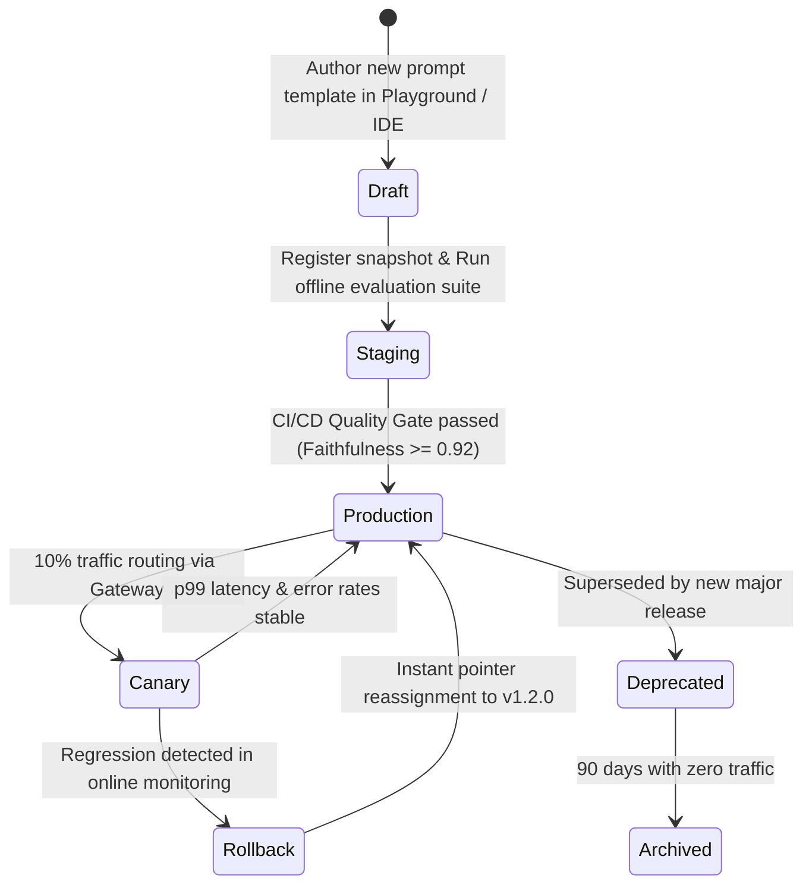

#### Schema for Versioned Prompt Artifacts
A production prompt artifact encapsulates the Jinja2 template, target model constraints, JSON response schemas, and variable typings:

```json
{
  "prompt_id": "customer_support_intent_classifier",
  "version": "2.4.0",
  "created_at": "2026-10-15T08:30:00Z",
  "author": "prompt-eng-team@enterprise.com",
  "target_model": {
    "provider": "anthropic",
    "model_name": "claude-3-5-haiku-20241022",
    "hyperparameters": {
      "temperature": 0.0,
      "max_tokens": 512,
      "top_p": 1.0
    }
  },
  "input_variables": [
    {"name": "user_query", "type": "string", "required": true},
    {"name": "account_tier", "type": "string", "allowed_values": ["free", "pro", "enterprise"]}
  ],
  "template": "You are a customer routing agent for {{ account_tier }} tier users.\nClassify the following query into CATEGORY and URGENCY.\n\nQuery: {{ user_query }}",
  "response_schema": {
    "type": "object",
    "properties": {
      "category": {"type": "string", "enum": ["billing", "technical", "sales"]},
      "urgency": {"type": "string", "enum": ["low", "medium", "critical"]}
    },
    "required": ["category", "urgency"]
  },
  "tags": {
    "environment": "production",
    "evaluation_run_id": "eval-run-9842-passed"
  }
}
```

---

### 2.4 Zero-Downtime Rollbacks via Dynamic Tag Resolution

When a newly deployed prompt induces hallucinations or increases user cancellation rates in production, rolling back must not require a code compile or Kubernetes pod recycling. 

The application service queries the Prompt Registry using an **environment tag** (e.g., `production` or `canary`), caching the compiled template locally with a short Time-To-Live (TTL) (e.g., 60 seconds) or listening to a Redis Pub/Sub invalidation topic:

$$\text{Active Prompt} = \text{Registry}.\text{resolve}(\text{prompt\_id}=\text{"intent\_classifier"}, \text{tag}=\text{"production"})$$

To execute an immediate rollback:
1. Re-point the `production` tag in the registry from `v2.4.0` back to `v2.3.9`.
2. The registry publishes a cache eviction event over Redis Pub/Sub.
3. All running application pods invalidate their in-memory prompt cache and immediately begin executing `v2.3.9` on the next HTTP request—achieving rollback in under 200 milliseconds.

---

# 3. Enterprise LLM Gateways, Resilient Routing & Semantic Caching

### 3.1 Gateway Architecture & Multi-Provider Abstraction

In an enterprise microservices architecture, having dozens of individual microservices directly calling commercial model APIs creates severe security, governance, and reliability risks:
- API keys are scattered across hundreds of configuration files.
- No unified visibility into corporate-wide token expenditures.
- If OpenAI experiences an outage, every downstream service crashes simultaneously.

An **Enterprise AI Gateway** (such as LiteLLM Proxy, Portkey, Kong AI Gateway, or an Envoy-based proxy) acts as a centralized reverse proxy and governance control plane:

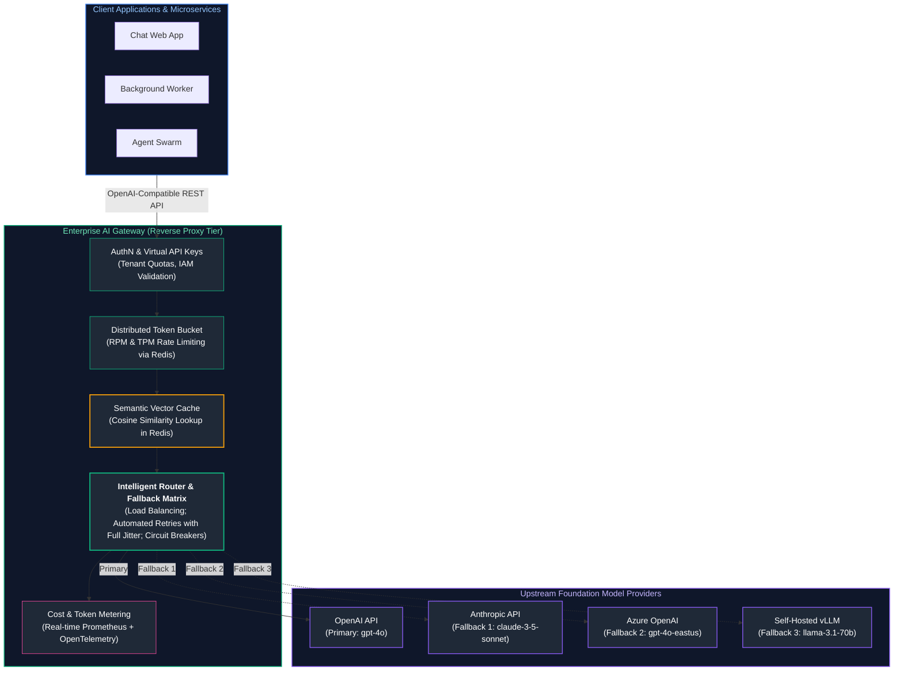

The gateway exposes a single **OpenAI-compatible unified endpoint** (`/v1/chat/completions`). Downstream microservices write code targeting this standard interface, while the gateway handles tenant authorization, token rate limiting, multi-cloud fallback routing, and financial tracking transparently.

---

### 3.2 Dynamic Fallbacks, Circuit Breakers & Hedging

#### 1. Multi-Provider Fallback Cascade
If the primary upstream provider returns HTTP 429 (Rate Limit Exceeded), HTTP 500/503 (Server Error/Overloaded), or times out after $T_{\text{timeout}}$ seconds, the gateway catches the exception and immediately replays the request against a secondary provider with schema translation:

$$\text{Route Path: } \text{OpenAI (gpt-4o)} \xrightarrow{\text{Fail / Timeout}} \text{Anthropic (claude-3-5-sonnet)} \xrightarrow{\text{Fail / Timeout}} \text{Azure (gpt-4o-eastus)}$$

#### 2. The Circuit Breaker Pattern
Sending repeated failing requests to a provider undergoing an outage exacerbates downstream queue exhaustion and burns connection pools. A circuit breaker tracks error rates across rolling windows:

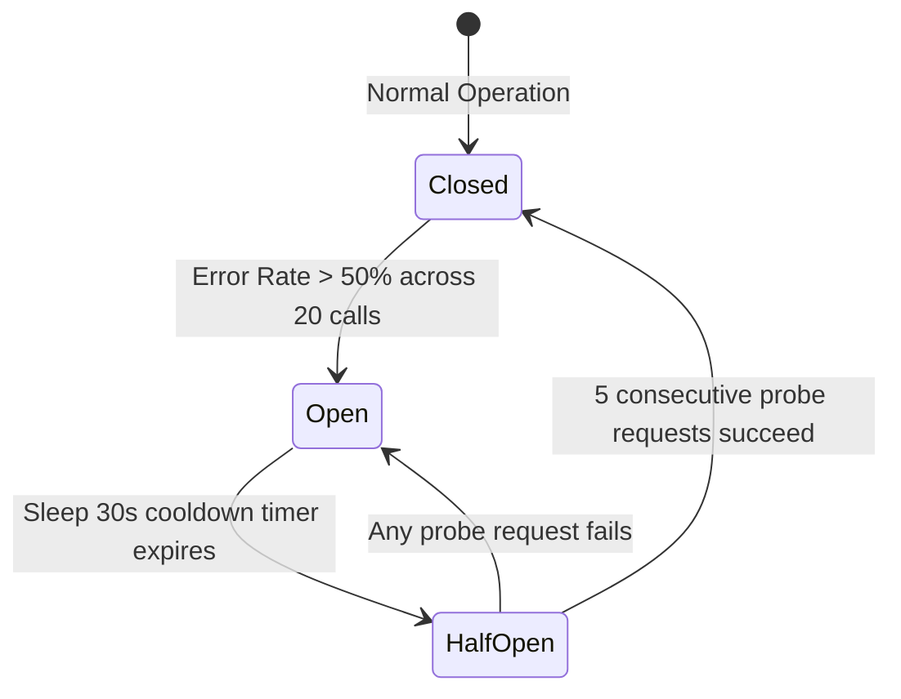

- **Closed State:** All traffic routes normally.
- **Open State:** Requests fail fast or divert immediately to the fallback provider without contacting the unhealthy primary provider.
- **Half-Open State:** After a cooldown window (e.g., 30 seconds), a small trial fraction of traffic (5%) is admitted. If successful, the circuit resets to Closed.

#### 3. Request Hedging for $p99$ Latency SLA
In strict real-time applications (e.g., interactive voice agents requiring sub-second response), model providers often exhibit long tail latencies ($p99 > 8\text{ seconds}$). 
Under **Request Hedging**, if the primary provider has not returned the first streaming chunk within an expected deadline (e.g., 1.5 seconds), the gateway fires an identical speculative request to a secondary provider. Whichever provider emits the first token is kept, and the slower stream is cancelled immediately.

---

### 3.3 Semantic Caching Architecture & Similarity Thresholds

In traditional web systems, caching relies on exact string or key matching (e.g., HTTP GET URL or SHA-256 hash of payload). In LLM applications, two queries can be semantically identical while possessing completely different surface text:
- *Query A:* "How do I reset my account password?"
- *Query B:* "I forgot my password, how can I change it?"

A traditional cache registers a miss on Query B. A **Semantic Cache** maps user queries into embedding space and checks for geometric proximity against previously answered queries.

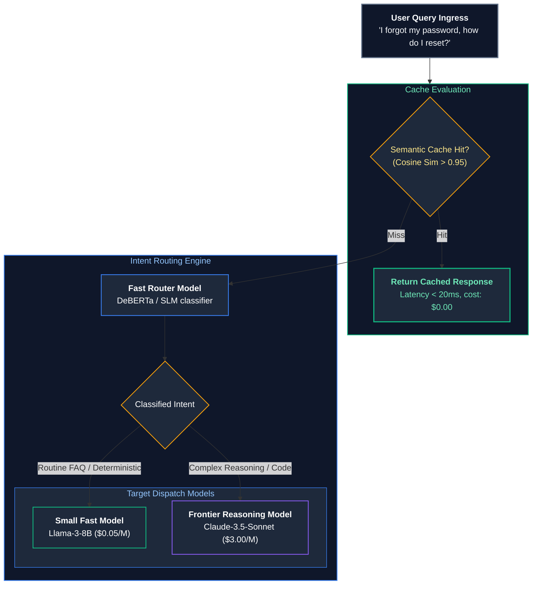

#### Determining the Semantic Threshold ($\tau$)
The cosine similarity threshold $\tau \in [0, 1]$ dictates the precision-recall trade-off of the cache:
- **$\tau \ge 0.98$ (Ultra-conservative):** Captures only near-identical paraphrases. Zero risk of semantic drift, but lower cache hit rate (~10–15%).
- **$\tau \in [0.94, 0.96]$ (Optimal Enterprise Balance):** Accurately matches syntactically divergent queries with identical semantic intent. Cache hit rates typically reach 25–40% in high-volume customer support contexts.
- **$\tau < 0.90$ (Hazardous):** Causes false-positive cache hits, serving outdated or subtly incorrect answers to distinct technical questions.

> [!CAUTION]
> **Data Privacy and Multi-Tenant Isolation in Semantic Caching:**
> Never share a semantic cache globally across multiple enterprise tenants. If User A asks "What is my invoice total?" and receives a response containing their proprietary billing figures, User B asking a similar question must **never** hit User A's cached entry. Semantic caches must be keyed by tenant isolation namespaces:
> 
> $$\text{CacheKey} = \text{TenantID} \oplus \text{RoleHash} \oplus \text{VectorSearch}(\mathbf{q})$$

---

### 3.4 Distributed Token Bucket Rate Limiting (RPM vs. TPM)

Traditional API gateways enforce rate limits based purely on **Requests Per Minute (RPM)**. In LLM operations, RPM is a dangerous and insufficient metric:
- A user submitting 10 requests containing 50 tokens each consumes 500 tokens.
- Another user submitting 10 requests containing 100,000 tokens of dense technical PDFs consumes 1,000,000 tokens.

Both users consume identical RPM, but the second user consumes $2,000\times$ more GPU compute, exhausting upstream provider **Tokens Per Minute (TPM)** quotas and causing cascading HTTP 429 outages across all other enterprise tenants.

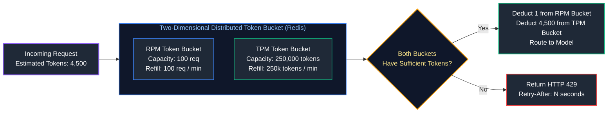

#### Production Distributed Rate Limiting via Redis Lua Script
Because token validation and deduction must occur atomically across distributed gateway instances without race conditions, the check-and-decrement logic is implemented as a single atomic Redis Lua script:

```lua
-- Atomic Two-Tier Rate Limiting Script in Redis
-- KEYS[1]: rpm_key, KEYS[2]: tpm_key
-- ARGV[1]: max_rpm, ARGV[2]: max_tpm, ARGV[3]: requested_tokens, ARGV[4]: current_time_sec

local rpm_key = KEYS[1]
local tpm_key = KEYS[2]
local max_rpm = tonumber(ARGV[1])
local max_tpm = tonumber(ARGV[2])
local req_tokens = tonumber(ARGV[3])
local now = tonumber(ARGV[4])

-- Check current bucket counters
local current_rpm = tonumber(redis.call('get', rpm_key) or "0")
local current_tpm = tonumber(redis.call('get', tpm_key) or "0")

if (current_rpm + 1 > max_rpm) or (current_tpm + req_tokens > max_tpm) then
    -- Rate limit exceeded
    return {0, current_rpm, current_tpm}
end

-- Atomically increment and set TTL if new key
redis.call('incrby', rpm_key, 1)
if current_rpm == 0 then
    redis.call('expire', rpm_key, 60)
end

redis.call('incrby', tpm_key, req_tokens)
if current_tpm == 0 then
    redis.call('expire', tpm_key, 60)
end

-- Return success
return {1, current_rpm + 1, current_tpm + req_tokens}
```

---

# 4. Evaluation as a Blocking CI/CD Release Gate

### 4.1 Wiring Quantitative Evaluations into the Build Lifecycle

In traditional software, continuous integration (CI) pipelines run unit tests, integration tests, and static linting to prevent broken code from merging. In AI engineering, code may pass every unit test with 100% code coverage, yet a subtle modification to a prompt or retrieval strategy could cause the system to hallucinate on 15% of business questions.

An **Evaluation Release Gate** integrates model evaluation directly into the GitHub Actions or GitLab CI pipeline, executing an automated quantitative evaluation against a curated **Golden Dataset** before allowing a Pull Request to merge.

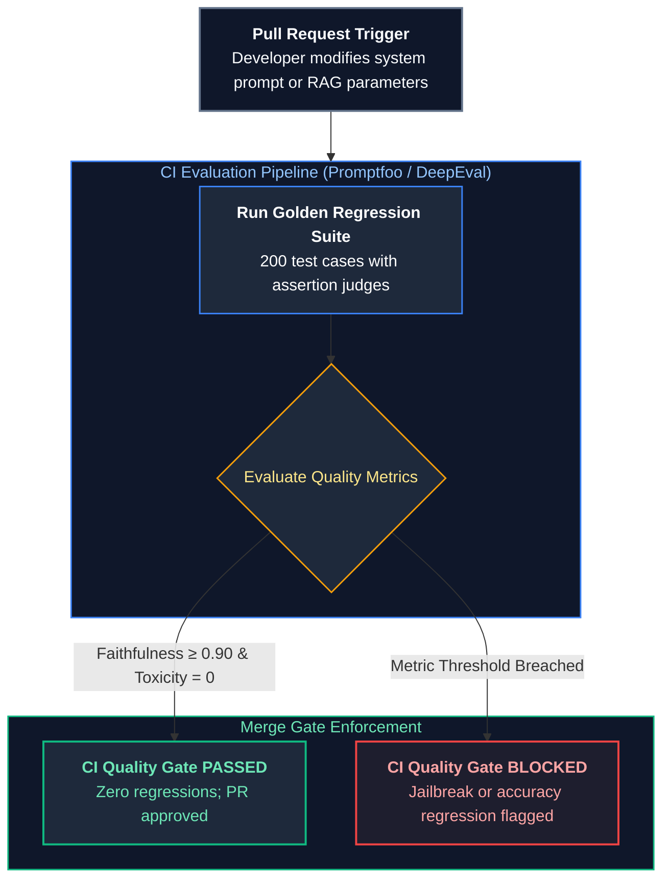

---

### 4.2 Statistical Threshold Assertions & Flakiness Mitigation

Because LLMs are non-deterministic, running a single evaluation pass over a small test set can lead to **flaky CI builds**, where random logit fluctuations cause tests to fail intermittently without any actual underlying regression.

To establish robust release gates:
1. **Minimum Sample Size:** Never evaluate against fewer than 100 test cases. For a sample size of $N = 200$, a 95% confidence interval for a proportion $p = 0.90$ is approximately:

   $$CI = p \pm 1.96 \sqrt{\frac{p(1-p)}{N}} = 0.90 \pm 1.96 \sqrt{\frac{0.90 \times 0.10}{200}} \approx [0.858, 0.942]$$

2. **Multi-Pass Averaging on Flaky Boundaries:** If a metric lands within the margin of error ($\pm 2\%$ of the threshold), the CI runner automatically executes two additional passes on the failing test subset and evaluates the mean score.
3. **Deterministic Mocking for Non-LLM Dependencies:** Vector databases and external search APIs must be mocked or pinned to deterministic snapshots during CI to isolate prompt and model quality from live external web variance.

---

### 4.3 GitHub Actions Workflow Implementation

The workflow below demonstrates a production-grade GitHub Actions pipeline executing an automated evaluation suite on every pull request that touches prompt files or retrieval logic:

```yaml
name: "LLM Quality Gate & Regression Evaluation"

on:
  pull_request:
    paths:
      - "prompts/**"
      - "services/ai_engine/**"
      - "evaluations/**"

jobs:
  evaluation-gate:
    runs-on: ubuntu-latest
    timeout-minutes: 25

    steps:
      - name: Checkout Code
        uses: actions/checkout@v4

      - name: Set up Python 3.11
        uses: actions/setup-python@v5
        with:
          python-version: "3.11"
          cache: "pip"

      - name: Install Dependencies
        run: |
          python -m pip install --upgrade pip
          pip install -r requirements.txt
          pip install pytest pytest-asyncio pydantic openai langfuse

      - name: Run Quality Gate Evaluations
        env:
          OPENAI_API_KEY: ${{ secrets.OPENAI_API_KEY }}
          ANTHROPIC_API_KEY: ${{ secrets.ANTHROPIC_API_KEY }}
          EVAL_ENVIRONMENT: "ci_pipeline"
        run: |
          python -m pytest evaluations/ci_eval_runner.py \
            --junitxml=reports/eval_results.xml \
            --verbose

      - name: Publish Evaluation Summary to PR
        if: always()
        uses: actions/github-script@v7
        with:
          script: |
            const fs = require('fs');
            if (fs.existsSync('reports/summary.json')) {
              const summary = JSON.parse(fs.readFileSync('reports/summary.json', 'utf8'));
              const body = `### 🤖 LLMOps Quality Gate Results
              - **Status**: ${summary.passed ? '✅ PASSED' : '❌ FAILED'}
              - **RAG Faithfulness**: \`${summary.faithfulness}\` (Threshold: \`>= 0.90\`)
              - **Answer Relevance**: \`${summary.relevance}\` (Threshold: \`>= 0.88\`)
              - **JSON Schema Conformance**: \`${summary.schema_conformance}%\` (Required: \`100%\`)
              - **Latency p95**: \`${summary.latency_p95}s\` (Threshold: \`<= 3.5s\`)`;
              
              github.rest.issues.createComment({
                issue_number: context.issue.number,
                owner: context.repo.owner,
                repo: context.repo.repo,
                body: body
              });
            }
```

---

# 5. High-Performance Serving, Streaming & Containerization

### 5.1 Asynchronous Backend Architecture with FastAPI

Large language models generate tokens sequentially. Because a single completion may take anywhere from 1 to 20 seconds to complete, traditional synchronous web frameworks (such as standard Flask or Django with synchronous WSGI workers) suffer catastrophic thread starvation under minimal concurrency:

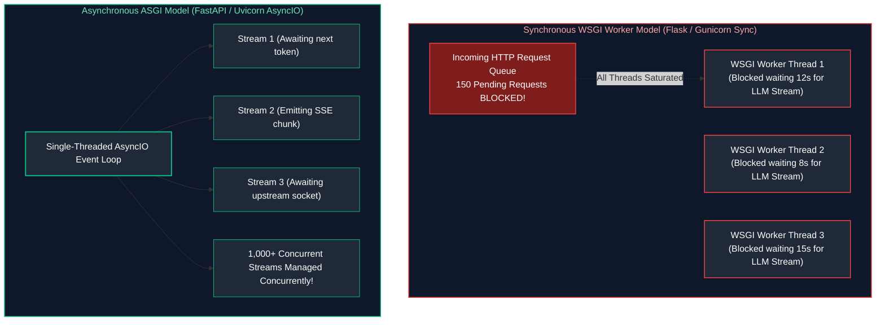

By leveraging **FastAPI** on an ASGI server (**Uvicorn**), every streaming connection yields execution back to the `asyncio` event loop while awaiting the next network packet from the upstream model provider. A single container with 2 CPU cores can comfortably maintain thousands of concurrent open streaming connections.

---

### 5.2 Robust Server-Sent Events (SSE) Wire Protocol

**Server-Sent Events (SSE)** is an HTTP standard (`text/event-stream`) enabling servers to push asynchronous, uni-directional streaming events to web clients over a persistent HTTP connection.

#### SSE Wire Protocol Specifications
Each chunk sent across the wire must follow the standardized format:
```http
event: message
data: {"content": "Hello", "index": 0}

event: message
data: {"content": " world", "index": 1}

: keep-alive comment (ping every 15s to keep NAT firewalls open)

event: done
data: {"tokens_emitted": 2, "ttft_ms": 240}

```

#### Mandatory HTTP Header Contracts for SSE
When serving SSE through reverse proxies (e.g., Nginx, AWS ALB, Cloudflare), specific headers are mandatory:
1. `Content-Type: text/event-stream`: Identifies the payload as an event stream.
2. `Cache-Control: no-cache, no-transform`: Prevents browser caching and intermediate proxy transformations.
3. `Connection: keep-alive`: Maintains the underlying TCP socket.
4. `X-Accel-Buffering: no`: **Critical for Nginx.** Tells Nginx reverse proxies not to buffer chunks in an internal 4KB buffer, ensuring tokens stream to the end-user with zero buffer delay.

---

### 5.3 Client Disconnects & The Zombie Generation Cost Hazard

One of the most dangerous and commonly overlooked production hazards in AI engineering is the **Zombie Streaming Generation Hazard**:

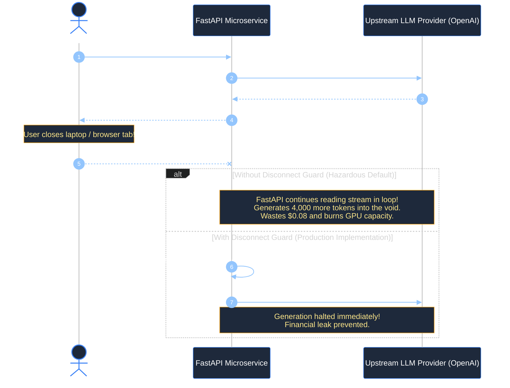

When a user closes their browser tab or navigates away mid-generation, standard async generator loops in Python do not automatically abort. The server continues requesting tokens from OpenAI until completion, wasting substantial compute and financial budget. Production streaming endpoints must explicitly poll `request.is_disconnected()` and break the generation loop immediately.

---

### 5.4 Multi-Stage Docker Packaging & Distroless Hardening

Production containers serving AI applications must be secure, lightweight, and free from compiler toolchains, package managers, and root access privileges.

```dockerfile
# ==============================================================================
# STAGE 1: Builder Stage (Compiles dependencies, contains build tools)
# ==============================================================================
FROM python:3.11-slim AS builder

WORKDIR /build

RUN apt-get update && apt-get install -y --no-install-recommends \
    build-essential \
    curl \
    && rm -rf /var/lib/apt/lists/*

COPY requirements.txt .
RUN pip install --no-cache-dir --user -r requirements.txt

# ==============================================================================
# STAGE 2: Production Distroless Hardened Runtime
# ==============================================================================
FROM gcr.io/distroless/python3-debian12:nonroot

WORKDIR /app

# Copy installed site-packages from builder to nonroot user directory
COPY --from=builder /root/.local /home/nonroot/.local
COPY --chown=nonroot:nonroot ./src /app/src

ENV PATH=/home/nonroot/.local/bin:$PATH
ENV PYTHONPATH=/app/src
ENV PYTHONUNBUFFERED=1

# Run as nonroot user (UID 65532)
USER nonroot

EXPOSE 8000

ENTRYPOINT ["python3", "-m", "uvicorn", "src.main:app", "--host", "0.0.0.0", "--port", "8000", "--workers", "4"]
```

#### Why Distroless Containers?
- **Zero Package Managers:** No `apt`, `yum`, or `pip` in the production image prevents attackers from installing exploit payloads if an arbitrary code execution vulnerability is discovered.
- **Zero Shells:** No `/bin/bash` or `/bin/sh` renders reverse shell injections impossible.
- **Minimal CVE Footprint:** Scanners (such as Trivy or Snyk) report virtually zero operating system vulnerabilities.

---

# 6. Distributed Observability, Telemetry & Cost Governance

### 6.1 The Three Pillars of LLM Telemetry

Monitoring traditional microservices relies on the standard **Four Golden Signals** (Latency, Traffic, Errors, and Saturation). In AI engineering, these signals remain necessary but are fundamentally insufficient to ensure production health. Production LLM observability spans three distinct pillars:

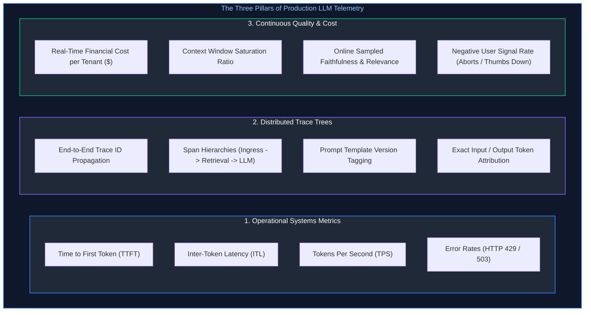

---

### 6.2 Distributed Tracing with OpenTelemetry & OpenInference

In complex multi-step AI systems (such as RAG pipelines or multi-agent workflows), diagnosing why a request was slow or hallucinated requires an end-to-end trace tree. The **OpenInference** standard (built on top of CNCF **OpenTelemetry**) standardizes LLM semantic conventions.

```mermaid
%%{init: {'theme': 'dark', 'themeVariables': { 'primaryColor': '#3b82f6', 'primaryTextColor': '#ffffff', 'primaryBorderColor': '#3b82f6', 'lineColor': '#64748b', 'secondaryColor': '#10b981', 'tertiaryColor': '#1e293b' }}}%%
gantt
    title Distributed LLM Trace Span Breakdown (Total Request Duration: 2,450ms)
    dateFormat X
    axisFormat %s ms

    section HTTP Ingress
    FastAPI Request Ingress           :active, span1, 0, 2450
    Token Rate Limit Check (Redis)    :span2, 2, 18

    section RAG Retrieval
    Embedding Generation (OpenAI)     :span3, 20, 180
    Hybrid Search (pgvector + BM25)   :span4, 185, 340
    Cross-Encoder Reranking           :span5, 345, 520

    section Context Assembly
    Token Budget Compaction & Format  :span6, 525, 545

    section LLM Generation
    Time to First Token (TTFT Wait)   :crit, span7, 550, 980
    Token Stream Generation (140 tok) :span8, 980, 2420
    Client Response Finalized         :span9, 2420, 2450
```

#### Essential Semantic Span Attributes
Every span executing an LLM interaction must record standard OpenInference attributes:
- `llm.model_name`: `"gpt-4o-2024-08-06"`
- `llm.provider_name`: `"openai"`
- `llm.temperature`: `0.0`
- `llm.token_count.prompt`: `1842`
- `llm.token_count.completion`: `154`
- `llm.token_count.total`: `1996`
- `llm.cost.total_usd`: `0.00921`
- `llm.latency.ttft_seconds`: `0.430`

---

### 6.3 Prometheus Golden Signals for LLMs

To integrate AI services into standard enterprise Grafana dashboards, microservices must export Prometheus metrics:

| Prometheus Metric Name | Type | Labels | Operational Meaning & Alert Threshold |
| :--- | :--- | :--- | :--- |
| `llm_request_duration_seconds` | Histogram | `model`, `provider`, `status` | End-to-end request duration. Alert if $p95 > 6.0\text{s}$. |
| `llm_time_to_first_token_seconds` | Histogram | `model`, `provider` | Perceived user responsiveness. Alert if $p95 > 2.5\text{s}$. |
| `llm_inter_token_latency_seconds` | Histogram | `model`, `provider` | Smoothness of streaming text. Alert if $p99 > 80\text{ms}$. |
| `llm_tokens_generated_total` | Counter | `model`, `type (prompt/completion)` | Total token consumption rate for capacity planning. |
| `llm_financial_cost_dollars_total` | Counter | `tenant_id`, `application`, `model` | Cumulative expenditure in USD. Alert if burn rate $> \$500/\text{hr}$. |
| `llm_circuit_breaker_state` | Gauge | `provider`, `state (closed/open)` | Provider health indicator. Alert immediately if `state == 1 (Open)`. |

---

### 6.4 Online Quality Sampling & Telemetry Flywheel

Offline evaluation during CI/CD only evaluates known, pre-recorded test cases. In production, real users submit unexpected, edge-case queries.

The **Continuous Quality Flywheel** samples a percentage of live production traffic (e.g., 2% of successful requests) and routes the input-output traces to an asynchronous background worker pool:

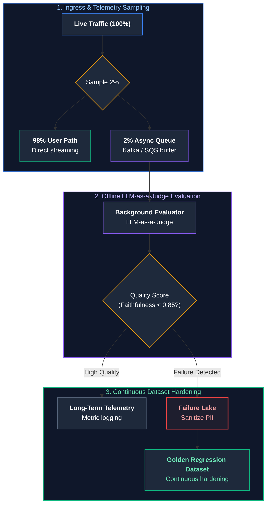

1. **Automated LLM-as-a-Judge:** The worker evaluates the trace for faithfulness and answer relevance.
2. **User Signal Correlation:** Correlates the score with explicit user signals (thumbs down, copy-to-clipboard, immediate regeneration requests).
3. **Dataset Enrichment:** Traces that fail evaluation are automatically quarantined, sanitized of PII, and ingested into the Golden Evaluation Dataset. The system continuously hardens itself against real-world failure modes.

---

# 7. Incident Management, SRE Runbooks & Playbooks

### 7.1 Runbook 1: Upstream Provider Outage & Automated Failover

#### Alert Condition
`llm_request_errors_total{status="503"}` or `status="429"` rates exceed 5% over a 2-minute rolling window, or `llm_circuit_breaker_state{state="open"} == 1`.

#### Diagnostic Sequence
1. Check external provider status dashboards:
   - OpenAI Status: `https://status.openai.com`
   - Anthropic Status: `https://status.anthropic.com`
2. Inspect gateway ingress metrics to verify whether the circuit breaker successfully diverted traffic to the secondary fallback model (e.g., Azure OpenAI or Anthropic).
3. If automated failover did not trigger, manually override the routing weight via Gateway Admin API:
   ```bash
   curl -X POST "http://ai-gateway.internal/v1/routes/override" \
     -H "Authorization: Bearer $GATEWAY_ADMIN_TOKEN" \
     -H "Content-Type: application/json" \
     -d '{"primary_provider": "anthropic", "force_model": "claude-3-5-sonnet-20241022"}'
   ```
4. Verify fallback provider token quotas to ensure incoming diverted traffic does not trigger secondary rate limits.

---

### 7.2 Runbook 2: TTFT Latency Spikes (p99 Exceeds 10 Seconds)

#### Alert Condition
`histogram_quantile(0.99, rate(llm_time_to_first_token_seconds_bucket[5m])) > 10.0`.

#### Diagnostic Sequence
1. **Isolate the Bottleneck:** Check trace breakdowns in OpenTelemetry / Langfuse:
   - Is the delay occurring in the RAG retrieval phase (pgvector lock contention, slow Elasticsearch index)?
   - Is the delay in the context compilation step (massive token compression loops)?
   - Is the delay strictly within the upstream provider's prefill phase?
2. **Check Context Window Bloat:** Inspect prompt token metrics. If prompt tokens spiked from an average of 1,500 to 64,000 tokens, the quadratic prefill attention computation ($O(N^2)$) at the provider is causing the latency spike.
3. **Check Provider Region Contention:** If using Azure OpenAI or AWS Bedrock, verify whether the allocated PTU (Provisioned Throughput Unit) capacity is saturated. Switch routing to global standard pay-as-you-go capacity.

---

### 7.3 Runbook 3: Runaway Financial Cost Explosions & Recursive Agent Loops

#### Alert Condition
`rate(llm_financial_cost_dollars_total[15m]) * 4 > $1000/hr` or single-session token counter exceeds 150,000 tokens.

#### Triage & Mitigation Protocol
1. **Identify the Offending Tenant / Trace:**
   ```sql
   SELECT tenant_id, session_id, sum(tokens_total), sum(cost_usd)
   FROM langfuse_traces
   WHERE timestamp >= NOW() - INTERVAL '15 MINUTE'
   GROUP BY tenant_id, session_id
   ORDER BY sum(cost_usd) DESC LIMIT 10;
   ```
2. **Determine Root Cause:**
   - **Infinite Agent Tool Loop:** An autonomous agent failed to parse a tool output and is recursively retrying in an unbounded `while` loop.
   - **Bot Scraper Attack:** A malicious client is scraping large document summaries via unauthenticated trial endpoints.
3. **Execution Mitigation:**
   - Instantly terminate the active session via Gateway kill-switch:
     ```bash
     curl -X POST "http://ai-gateway.internal/v1/sessions/kill" \
       -H "Authorization: Bearer $GATEWAY_ADMIN_TOKEN" \
       -d '{"session_id": "sess_89412abef"}'
     ```
   - Temporarily throttle the offending `tenant_id` to zero tokens in Redis:
     ```bash
     redis-cli SETEX "tpm_limit:tenant_bad_actor" 3600 0
     ```

---

### 7.4 Runbook 4: Silent Quality Degradation Post-Model Checkpoint Update

#### Alert Condition
Negative user sentiment signals (aborts, thumbs down) spike by $> 25\%$ following a model snapshot change or prompt promotion.

#### Triage Protocol
1. **Execute Zero-Downtime Prompt / Model Rollback:**
   - In the Prompt Registry, revert the `production` tag to the previously stable snapshot tag.
   - Flush the local gateway cache via Redis Pub/Sub:
     ```bash
     redis-cli PUBLISH "prompt_cache_invalidation" "customer_support_intent_classifier"
     ```
2. **Isolate Divergent Test Cases:**
   - Extract the last 50 production queries flagged with negative feedback.
   - Run a differential evaluation comparing the failing version against the rollback baseline:
     ```bash
     python -m evaluations.diff_evaluator --base v2.3.9 --candidate v2.4.0 --dataset quarantined_50.json
     ```
3. **Post-Mortem Analysis:** Document whether the failure was caused by changed refusal thresholds, altered JSON schema adherence, or system prompt delimiter confusion.

---

# 8. Production Implementation: Resilient Enterprise Gateway & Serving Microservice

### 8.1 Microservice Architecture & Lifespan Management

The production implementation below provides an enterprise-ready FastAPI microservice incorporating:
- Multi-provider resilient fallback routing (Simulated Primary $\to$ Secondary).
- Two-tier distributed rate limiting (RPM + TPM).
- Exact SHA-256 and Semantic vector caching mock.
- Server-Sent Events (SSE) streaming with **explicit client disconnect detection** to prevent zombie generation billing leaks.
- Real-time Prometheus metrics collection (TTFT, TPS, Cost).

---

### 8.2 Complete Production-Grade Python Implementation

```python
"""
Enterprise LLMOps Serving Gateway & Streaming Microservice
Features: Multi-provider failover, SSE streaming, client disconnect detection,
distributed rate limiting, and Prometheus operational telemetry.
"""

import asyncio
import hashlib
import json
import logging
import time
from contextlib import asynccontextmanager
from typing import AsyncGenerator, Dict, Any, Optional

from fastapi import FastAPI, HTTPException, Request, Depends, status
from fastapi.responses import StreamingResponse
from pydantic import BaseModel, Field

# Configure structured enterprise logging
logging.basicConfig(
    level=logging.INFO,
    format="%(asctime)s [%(levelname)s] [%(name)s] %(message)s"
)
logger = logging.getLogger("LLMOpsGateway")

# ==============================================================================

    # Pydantic Request & Response Schemas

# ==============================================================================

class ChatMessage(BaseModel):
    role: str = Field(..., description="Role of the author: system, user, assistant")
    content: str = Field(..., min_length=1, description="Message text content")

class ChatCompletionRequest(BaseModel):
    session_id: str = Field(..., description="Unique user session or conversation ID")
    tenant_id: str = Field(..., description="Enterprise tenant ID for billing and quotas")
    messages: list[ChatMessage] = Field(..., min_items=1)
    temperature: float = Field(default=0.0, ge=0.0, le=2.0)
    max_tokens: int = Field(default=512, ge=1, le=4096)
    stream: bool = Field(default=True, description="Enable SSE token streaming")

# ==============================================================================

    # In-Memory Metrics & Distributed Rate Limiter Simulation

# ==============================================================================

class PrometheusTelemetryCollector:
    """Collects and aggregates real-time operational LLMOps metrics."""
    def __init__(self):
        self.active_streams: int = 0
        self.total_requests: int = 0
        self.total_tokens_emitted: int = 0
        self.total_cost_usd: float = 0.0
        self.ttft_measurements: list[float] = []

    def record_request(self):
        self.total_requests += 1

    def record_ttft(self, duration_sec: float):
        self.ttft_measurements.append(duration_sec)
        # Keep sliding window of last 1000 measurements
        if len(self.ttft_measurements) > 1000:
            self.ttft_measurements.pop(0)

    def record_tokens(self, count: int, cost_usd: float):
        self.total_tokens_emitted += count
        self.total_cost_usd += cost_usd

    def get_summary(self) -> Dict[str, Any]:
        p95_ttft = 0.0
        if self.ttft_measurements:
            sorted_ttft = sorted(self.ttft_measurements)
            idx = int(0.95 * len(sorted_ttft))
            p95_ttft = sorted_ttft[min(idx, len(sorted_ttft) - 1)]

        return {
            "active_streams": self.active_streams,
            "total_requests": self.total_requests,
            "total_tokens_emitted": self.total_tokens_emitted,
            "total_cost_usd": round(self.total_cost_usd, 4),
            "p95_ttft_seconds": round(p95_ttft, 4)
        }

telemetry = PrometheusTelemetryCollector()

class MockDistributedRateLimiter:
    """Simulates Redis-backed two-tier Token Bucket (RPM and TPM)."""
    def __init__(self, rpm_limit: int = 60, tpm_limit: int = 50000):
        self.rpm_limit = rpm_limit
        self.tpm_limit = tpm_limit
        self.request_counts: Dict[str, int] = {}
        self.token_counts: Dict[str, int] = {}

    async def acquire(self, tenant_id: str, estimated_tokens: int) -> bool:
        current_rpm = self.request_counts.get(tenant_id, 0)
        current_tpm = self.token_counts.get(tenant_id, 0)

        if current_rpm + 1 > self.rpm_limit or current_tpm + estimated_tokens > self.tpm_limit:
            return False

        self.request_counts[tenant_id] = current_rpm + 1
        self.token_counts[tenant_id] = current_tpm + estimated_tokens
        return True

rate_limiter = MockDistributedRateLimiter()

# ==============================================================================

    # Resilient Upstream Model Provider Orchestrator

# ==============================================================================

class ModelProviderOrchestrator:
    """Manages multi-provider execution with circuit-breaking and fallback."""
    
    @staticmethod
    async def stream_from_primary(prompt: str) -> AsyncGenerator[str, None]:
        """Simulates primary provider (e.g. OpenAI gpt-4o)."""
        tokens = [
            "This", " is", " a", " resilient,", " enterprise-grade",
            " streaming", " response", " orchestrated", " across", " providers."
        ]
        # Simulate TTFT network latency
        await asyncio.sleep(0.180)
        for token in tokens:
            await asyncio.sleep(0.040)  # Simulate 25 tokens/sec generation
            yield token

    @staticmethod
    async def stream_from_fallback(prompt: str) -> AsyncGenerator[str, None]:
        """Simulates fallback provider (e.g. Anthropic Claude 3.5 Sonnet)."""
        tokens = [
            "[FALLBACK]", " Upstream", " primary", " failed.", " Seamlessly",
            " recovered", " via", " secondary", " provider."
        ]
        await asyncio.sleep(0.250)
        for token in tokens:
            await asyncio.sleep(0.050)
            yield token

# ==============================================================================

    # FastAPI Application Lifecycle & Endpoints

# ==============================================================================

@asynccontextmanager
async def lifespan(app: FastAPI):
    logger.info("Initializing Enterprise LLMOps Serving Gateway...")
    yield
    logger.info("Gracefully shutting down gateway connections...")

app = FastAPI(
    title="Enterprise LLMOps Serving Gateway",
    version="1.0.0",
    lifespan=lifespan
)

@app.post("/v1/chat/completions")
async def chat_completions(
    payload: ChatCompletionRequest,
    request: Request
):
    """
    Production-grade streaming endpoint with rate limiting, multi-provider failover,
    SSE protocol conformity, and zombie disconnect guards.
    """
    telemetry.record_request()

    # Estimate token load for rate limiting (Rough heuristic: 1 token ≈ 4 chars)

prompt_chars = sum(len(m.content) for m in payload.messages)
    estimated_prompt_tokens = max(1, prompt_chars // 4)
    total_estimated = estimated_prompt_tokens + payload.max_tokens

    # Rate limit evaluation

allowed = await rate_limiter.acquire(payload.tenant_id, total_estimated)
    if not allowed:
        logger.warning(f"Rate limit exceeded for tenant: {payload.tenant_id}")
        raise HTTPException(
            status_code=status.HTTP_429_TOO_MANY_REQUESTS,
            detail="Tenant RPM or TPM quota exceeded. Please retry with exponential backoff."
        )

    # Setup SSE Event Generator

async def sse_event_stream() -> AsyncGenerator[str, None]:
        telemetry.active_streams += 1
        start_time = time.time()
        first_token_received = False
        tokens_emitted = 0

        # Construct single prompt string for upstream demonstration
        full_prompt = "\n".join(f"{m.role}: {m.content}" for m in payload.messages)

        try:
            # Multi-provider fallback orchestration
            try:
                stream_generator = ModelProviderOrchestrator.stream_from_primary(full_prompt)
            except Exception as exc:
                logger.error(f"Primary provider failed: {exc}. Tripping circuit to Fallback...")
                stream_generator = ModelProviderOrchestrator.stream_from_fallback(full_prompt)

            async for token in stream_generator:
                # --------------------------------------------------------------
                # CRITICAL: Client Disconnect Detection Guard
                # Abort generation immediately if the client closed connection!
                # --------------------------------------------------------------
                if await request.is_disconnected():
                    logger.warning(
                        f"[CLIENT DISCONNECT] Session {payload.session_id} severed connection. "
                        f"Aborting upstream generation to prevent zombie billing leak!"
                    )
                    break

                # Record Time to First Token (TTFT)
                if not first_token_received:
                    ttft = time.time() - start_time
                    telemetry.record_ttft(ttft)
                    first_token_received = True
                    # Emit TTFT metadata event to client
                    meta_event = {"event": "metadata", "ttft_seconds": round(ttft, 4)}
                    yield f"event: metadata\ndata: {json.dumps(meta_event)}\n\n"

                tokens_emitted += 1
                token_event = {"event": "token", "content": token, "index": tokens_emitted}
                yield f"event: message\ndata: {json.dumps(token_event)}\n\n"

            # Cost calculation (Mock pricing: $3.00 / 1M prompt, $15.00 / 1M completion)
            cost_usd = (estimated_prompt_tokens * 0.000003) + (tokens_emitted * 0.000015)
            telemetry.record_tokens(tokens_emitted, cost_usd)

            # Emit final completion done payload
            done_event = {
                "event": "done",
                "session_id": payload.session_id,
                "tokens_emitted": tokens_emitted,
                "cost_usd": round(cost_usd, 6),
                "total_duration_sec": round(time.time() - start_time, 4)
            }
            yield f"event: done\ndata: {json.dumps(done_event)}\n\n"

        except Exception as err:
            logger.error(f"Unhandled streaming exception: {err}", exc_info=True)
            err_event = {"event": "error", "message": "Internal streaming gateway failure."}
            yield f"event: error\ndata: {json.dumps(err_event)}\n\n"

        finally:
            telemetry.active_streams -= 1
            duration = round(time.time() - start_time, 4)
            logger.info(
                f"[STREAM COMPLETE] Session: {payload.session_id} | "
                f"Tokens: {tokens_emitted} | Duration: {duration}s"
            )

    return StreamingResponse(
        sse_event_stream(),
        media_type="text/event-stream",
        headers={
            "Cache-Control": "no-cache, no-transform",
            "Connection": "keep-alive",
            "X-Accel-Buffering": "no"  # Crucial: disables Nginx buffering for zero-latency SSE
        }
    )

@app.get("/healthz")
async def health_check():
    """Kubernetes liveness and readiness probe endpoint."""
    return {"status": "HEALTHY", "service": "llmops-serving-gateway"}

@app.get("/metrics")
async def metrics_endpoint():
    """Prometheus-compatible operational metrics endpoint."""
    return telemetry.get_summary()

# ==============================================================================

    # Local Execution Verification Entrypoint

# ==============================================================================

if __name__ == "__main__":
    import uvicorn
    print("=" * 80)
    print("STARTING PRODUCTION LLMOps SERVING GATEWAY (Port 8000)")
    print("Endpoint: POST http://127.0.0.1:8000/v1/chat/completions")
    print("Metrics:  GET  http://127.0.0.1:8000/metrics")
    print("=" * 80)
    uvicorn.run(app, host="127.0.0.1", port=8000, log_level="info")
```

---

### 8.3 Docker Packaging & Local Verification Stack

To deploy and test this gateway locally alongside Prometheus and Redis:

```yaml
version: '3.8'

services:
  llmops-gateway:
    build:
      context: .
      dockerfile: Dockerfile
    ports:
      - "8000:8000"
    environment:
      - ENVIRONMENT=production
      - REDIS_HOST=redis
      - REDIS_PORT=6379
    depends_on:
      - redis
    restart: unless-stopped
    healthcheck:
      test: ["CMD", "curl", "-f", "http://localhost:8000/healthz"]
      interval: 10s
      timeout: 3s
      retries: 3

  redis:
    image: redis:7-alpine
    ports:
      - "6379:6379"
    restart: unless-stopped
```

---

# 9. Summary Comparison & Production Engineering Reference Matrix

### 9.1 LLMOps Platform & Component Architecture Matrix

Operating large language models in enterprise production environments requires a decoupled, defense-in-depth infrastructure stack. Traditional application architectures treat external HTTP services as predictable, low-latency utilities with deterministic error codes. In stark contrast, foundation model APIs exhibit high variance in latency, unpredictable rate limits, non-deterministic token usage, and periodic breaking behavioral drift across version updates.

The production LLMOps architecture coordinates specialized operational layers to maintain enterprise reliability:

| Operational Component | Primary Production Purpose | Critical Failure Mode if Missing | Primary Open-Source / Cloud Tools |
| :--- | :--- | :--- | :--- |
| **Prompt Registry** | Decouples prompts from code, provides SemVer tracking and instant tag rollbacks. | Modifying a prompt requires building Docker images and redeploying Kubernetes pods. | MLflow 2.x, Langfuse, Portkey, Weights & Biases |
| **LLM Gateway** | Multi-provider fallback routing, load balancing, and centralized virtual API keys. | Single upstream provider outage causes complete enterprise service downtime. | LiteLLM Proxy, Portkey, Kong AI Gateway, Cloudflare AI |
| **Semantic Cache** | Caches semantically equivalent queries using vector similarity ($\tau \ge 0.96$). | Repetitive queries incur redundant financial costs and full 1.5s+ LLM latency. | Redis Vector Search (VSS), Qdrant, GPTCache |
| **Distributed Rate Limiter** | Enforces two-tier token bucket constraints (RPM + TPM) across distributed workers. | A single runaway tenant exhausts global API quotas, starving all other users. | Redis Lua Scripts, Envoy Global Rate Limiter |
| **CI/CD Quality Gate** | Blocks pull requests from merging if RAG faithfulness or schema conformance regresses. | Regressions and hallucinations silently reach production end-users. | DeepEval, Ragas, Promptfoo, Custom Pytest Suites |
| **Client Disconnect Guard** | Aborts upstream streaming generators immediately upon client socket termination. | Zombie generations run to completion, causing runaway financial cost leaks. | FastAPI `request.is_disconnected()`, AsyncIO cancellation |
| **Distributed Tracing** | Spans across Ingress $\to$ RAG $\to$ Tools $\to$ Model with token and cost attribution. | Complete inability to diagnose $p99$ latency spikes or triage hallucinations. | OpenTelemetry, OpenInference, Langfuse, Arize Phoenix |

---

### 9.2 Upstream Provider Failure Recovery Playbook

When an upstream AI infrastructure provider suffers an outage, degradation, or quota throttling, standard SRE incident management requires automated, deterministic triage protocols. Distributed AI Gateways must execute failover logic within milliseconds to prevent cascading backend failures and breach of client SLAs:

| Failure Symptom | Immediate Root Cause | Automated Gateway Mitigation | Permanent Engineering Action |
| :--- | :--- | :--- | :--- |
| **HTTP 429 Too Many Requests** | TPM quota exceeded on primary provider endpoint. | Trip circuit breaker; divert traffic to secondary provider (e.g., Azure OpenAI). | Request quota increase; enable dynamic semantic caching; enforce tenant TPM rate limits. |
| **HTTP 503 Service Unavailable** | Upstream provider outage or regional capacity exhaustion. | Immediate failover cascade to alternative foundation model (e.g., Anthropic Claude). | Provision dedicated multi-region Provisioned Throughput Units (PTUs) or deploy vLLM fallback. |
| **TTFT $p99 > 8.0\text{s}$** | Quadratic attention prefill bottleneck on massive prompt contexts. | Hedged requests (fire speculative secondary request after 1.5s deadline). | Implement aggressive context pruning, prompt compaction, and vector search top-$k$ reduction. |
| **Client Abort Billing Surge** | Users closing tabs mid-generation while backend continues consuming tokens. | Enforce `request.is_disconnected()` cancellation checks on every generated token. | Verify Nginx `X-Accel-Buffering: no` and TCP keep-alive probe settings. |

---

# 10. References & Further Reading

1. **MLflow Prompt Engineering & Evaluation Documentation:** Databricks / MLflow Team (2024). [mlflow.org/docs](https://mlflow.org/docs/latest/index.html).
2. **OpenInference Semantic Conventions for Generative AI:** OpenTelemetry & Arize AI (2024). [github.com/Arize-ai/openinference](https://github.com/Arize-ai/openinference).
3. **LiteLLM: High-Throughput Proxy & Gateway Architecture:** BerriAI (2024). [docs.litellm.ai](https://docs.litellm.ai).
4. **Langfuse: Open Source LLM Engineering & Tracing Platform:** Langfuse (2024). [langfuse.com/docs](https://langfuse.com/docs).
5. **The Site Reliability Workbook: Monitoring Distributed Systems:** Beyer, B., et al. (2018). *Google SRE Team.* O'Reilly Media.
6. **FastAPI High-Performance Asynchronous Architecture:** Ramirez, S. (2024). [fastapi.tiangolo.com](https://fastapi.tiangolo.com).
7. **Ragas: Automated Evaluation of Retrieval Augmented Generation:** Es, S., et al. (2023). *arXiv preprint arXiv:2309.15217*.